# 约翰霍普金斯大学《信息保障分析｜Information Assurance Analysis》中英字幕 p26 6_记录与DNS查询机制.zh_en -BV1Qz8EzYENX_p26-

Qu this is 6757 in the floor1 information assurance analysis， this is Dr。

 Collins talking you know this is going to cover module 7。2。

 which is devoted to A records and DNS lookup。

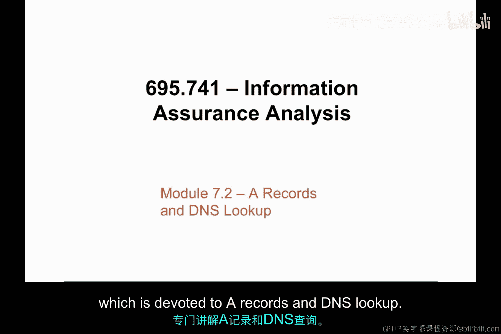

The goal of this module is to get you to understand how DNS operates as a protocol in the previous module I discussed at a high level how you purchase a domain。

 how you grab it， and so on how you purchase a domain， how you purchase IP addresses。

 things like that。 The goal of this module is to show you how the actual query process goes on and how you get an address we're going to understand how you look up names when you take a look at DNS queries。

 and we're going to take a look a bit at the process of name allocation。

 This is really the point where resolve cos the DNS lookup process starts to differ from Etsy hosts and static name allocation。

 It's important to understand this because without this the internet as you understand it would not work。

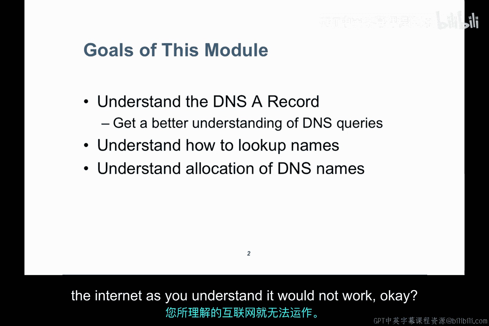

Okay。Now。I tell about DNS client to DNS server on your DNS client is normally called a Rer。

 this configuration is normally storedwithfo calledResolve。

com should'll be sitting somewhere on your host normally Resolve。

com is an extremely boring configuration file it's an IP address。um。

Name servers themselves are basically hierarchical caches。 We'll go into the caching soon enough。

 but the important thing to keep in mind is as we talk in the last module。

 I mentioned this idea of the fully qualified domain name at the hierarchy of lookup so if I want to look up www。

jhuedduu。 The first step is I go to the root server who tells me Eduu is managed by this server over here。

 go to that server over there and it says well Jhu is managed by this server over here and in place read the Jhu server it goes wwwjhu。

edu has this address Okay this process of going back and forth。

 it be fairly expensive and so oftentimes there's caching in the way to improve performance。

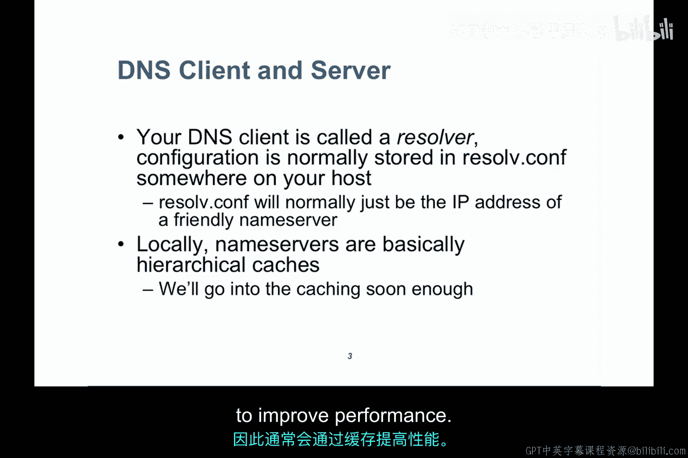

Now。Let's talk about what DNS looks like on the wire DNS is a UDP protocol。

 mostly UDP There exists an exception called zoneone transfer'll talk about that later the basic DNS packet format is on the right now the important thing to note here the query ID than this collection of flags here。

 the 16 bits that's used to identify what type of query you're doing things like that and then this set of counts followed by some number of resource records resource records of the actual DNS information and there are upwards of 20 different types of resource records a lot of which are focused on DNS housekeeping okay there's a limited number that is an end user affect your life。

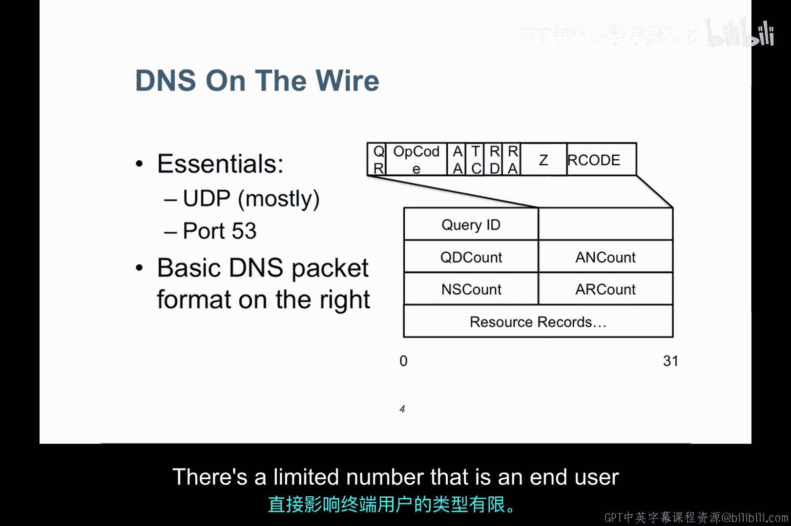

Okay now the state of a DNS query is maintained by the query ID。 What do I mean by the state Well。

 remember， DNS is UDP moderated is not TCP moderated because DNS is a UDP protocol。

 there are no session in order to ensure that DNS gives you an answer for the information you're looking for you use the query ID。

 you send a query， you sign an arbitrary 16 red integer。

 the response coming back has that same 16 red integer in it to indicate that it's response to your initial query Okay after that。

 the other flags are set for various information， whether a server's authoritative recursive things like that。

 I'm not going to talk about authoritative and recursive in this section of the lecture we will get into that when we discuss the concept of zones and ownership in DNS right now the thing I want you to pay attention new more is this count element where what counts are are the number or the number of response records responding。

That are be in for a particular response， okay？

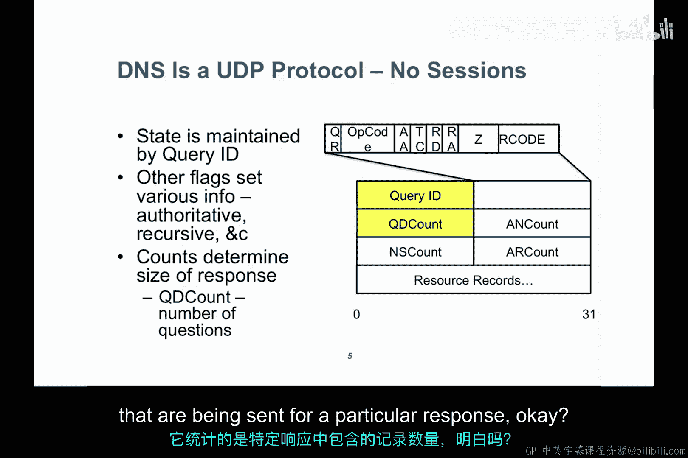

Now a query consists of three parts， the first is the actual query name。

 Now this is encoded as a set of what I usually call Pascal strings For those of you who are not familiar with Pascal strings and C strings。

 a C string is a sequence of characters terminated with zero， also called an ASI Z straight。

Pascal string is a string which encodes the length of the string in the first byte and then follows that with the context。

 Pascal strings are safer than C strings because you've got all the length of buffering information up front Okay now。

 this means that， for example， if I said the query for CMmUeddu or Jh。edduu。

 the encoing is going to be。A3 in a byte， then the three bytes says Ww， another3， CMU，3， Eduu。

 and then0， and the 0 is going to be the actual termminator at that point。 Now。

 this means incidentally， when you look at it that you can predict the maximum length of a DNS state。

 there's a limit of 63 characters per label。Now the next item you have noticed the query type。

 this is I'm providing you with a set of values on the right。

 as I said this is not the only set available to you， there's about 20 or 30 of them。um。

Maybe there's also what we call a query class， which is where。The query is relevant too。

It should almost always be what， which means you're querying the internet。

Creektype should loads over here， a， NSC name， PTR， MX and quadruple A okay。

 A is the most important one we're going to be dealing with now。

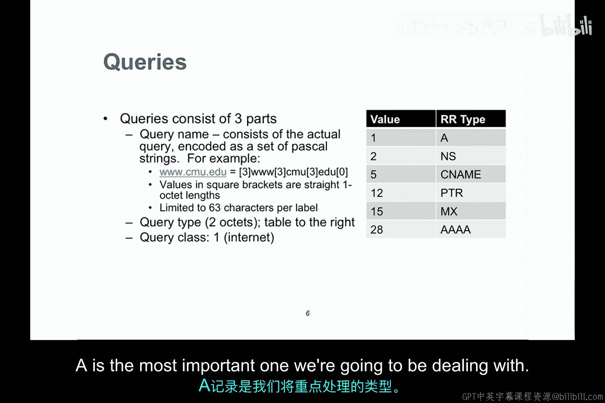

Your responses are sent back in what's called resource record format。

 The first thing in the resource record is twoocts for the type。

 The type will be from the table above。 The class is is the area for which it's relevant again one for the internet and that the TTL is the length of the validity of the response in seconds。

 This is particularly important for DNS， which is dealing with the sort of caching and dynamic updating throughout it simplest version that you're going to be dealing with an a record which gives you the IP address associated with a domain name that TTL is how long you can be sure that that IP address is valid for that domain name the Rd lengths is the length of the data record itself。

 and then there is a type dependent record format that follows that format will be a function of the type。

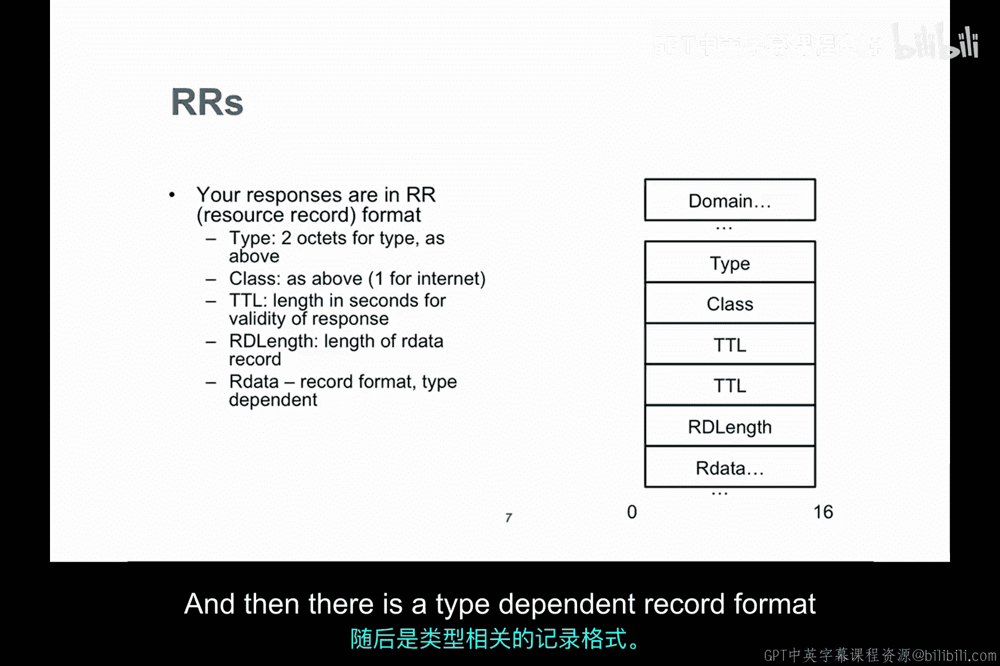

For example， a records， the formats just a 32 inger。

 is that simple now let's start with actually doing a query so you can see the relationship between all of these values。

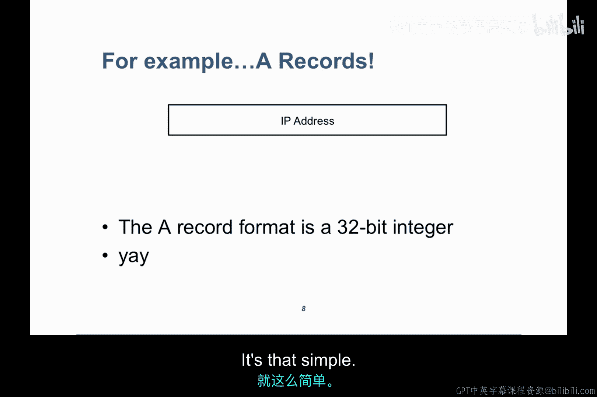

The standard query tool these days is D D is a replacement for NS lookup Okay。

 now what I've done here is I've done a simple dig for CNN。 co throughout this module。

 you are going to see a lot of dig outputs Okay in many cases I'm going to cut out different sections of Dig。

 which is a very verse tool in order to focus on specific items Now the things I want you to notice here。

Okay， you'll see there's a question， you'll see there's an answer he carried。

 you'll notice the A there， which of course means that these are A records。

 the IE is the internet domain and you'll see that you know I'm getting a bunch of names for this。

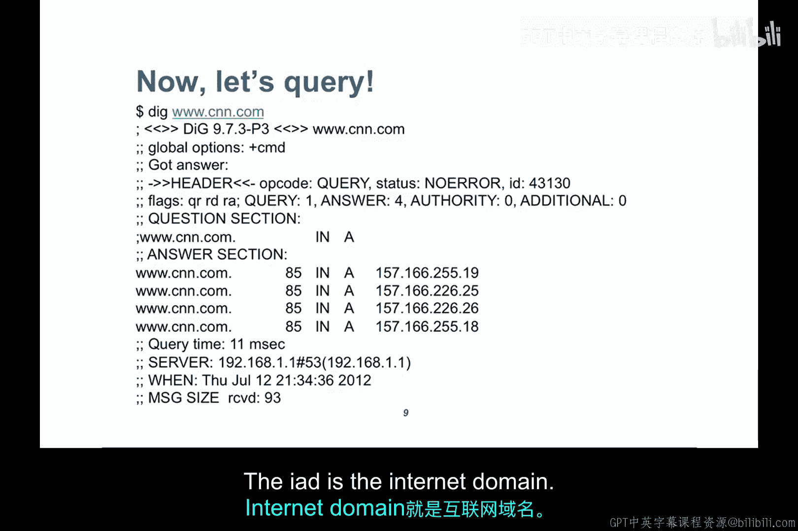

The thing is that D lets you see a lot of the guts of the query， in fact。

 you can see most of the DNS header。In there， so for example， the query， there's one query。

There are four answers that corresponds to this one and this four here that another query in the number of response records。

 okay， there are no additional records， there's no additional information okay。

The flags are set there。Corspond to flags of the header。And then， you know。

 everything else or these resource recordss itself。

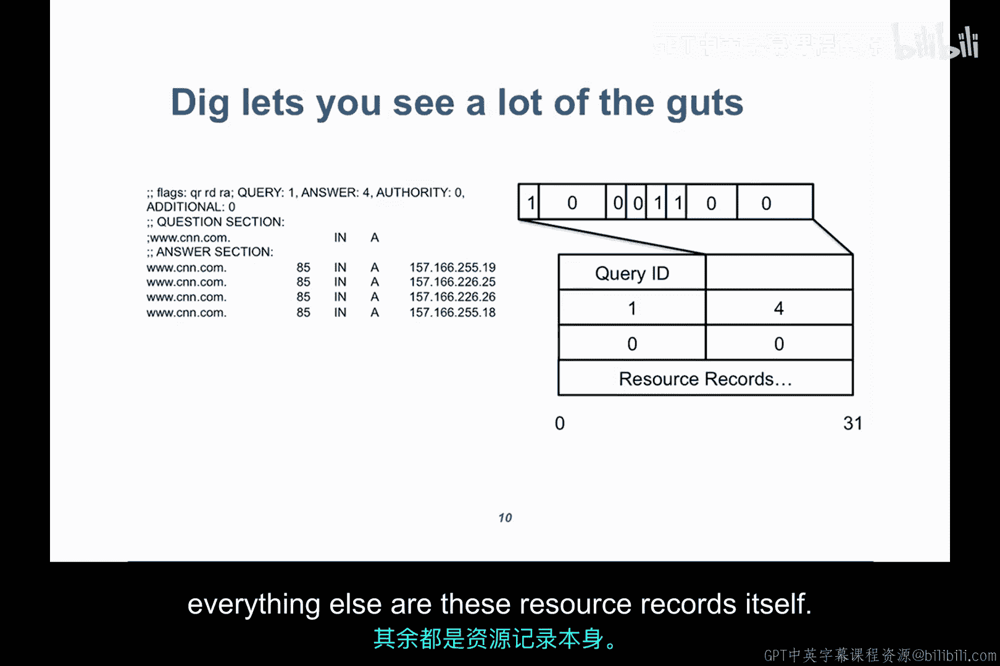

No。One of the things I want you to note here， the TTL is pretty short in 85 seconds these days TTLs tend to have fairly short values on the order of about。

Less than an hour。This is a big change from how we thought the internet was going to work。

And the reason for this change is the World W Web。Arms。When people started using the internet。

 these assumption shows that it was going to be basically Tnet and mails， these long flow protocols。

 very user intensive where know your target doesn't move around much。

If you take a look at a modern website you'll pull down 100 different DNS requests and of course you're constructing a single web page you've got a lot of dynamic movement and as a result what you're seeing now is the TclLs which years ago they might just put it down as a month for convenience they're downing down for like 203055 seconds as part of that there's also this business with four answers you'll notice I queries for CNN。

 co and I got four different namess for CNN co this is what we call roundundroin allocation what this means is that whenever the CNN block or set the dNS entries for CNN co they told them to point to multiple IP addresses this is a way of ensuring that the system doesn't collapse because what happens is what happen is when you do your query you'll pick one of those for at random to talk to and that will cut down the load of any one host This is the beginning of what we can call CDN or cut to distribution network architecture a lot more to be said about this later。

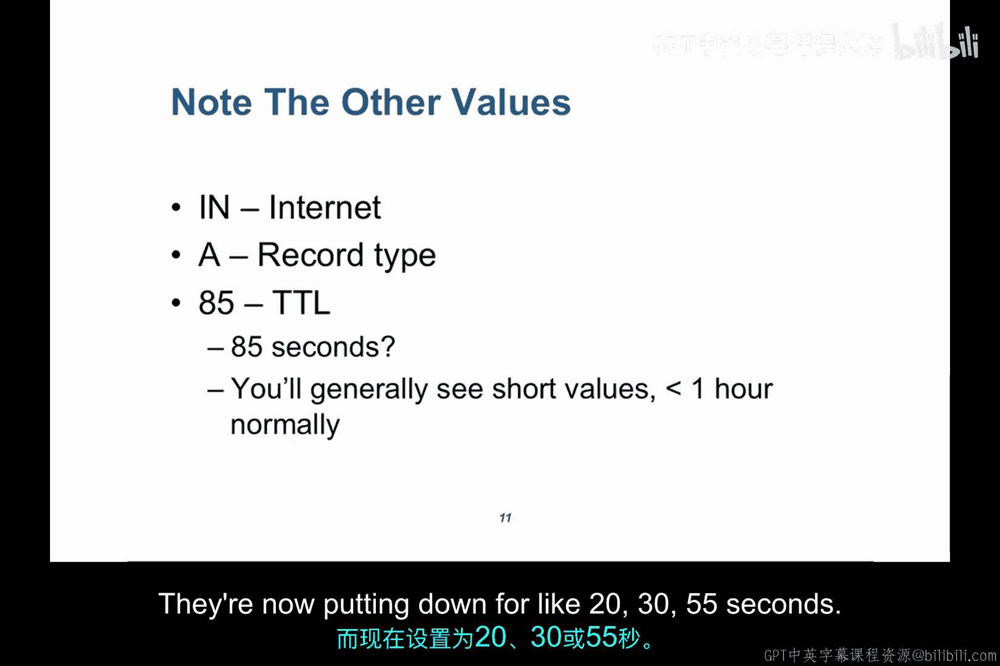

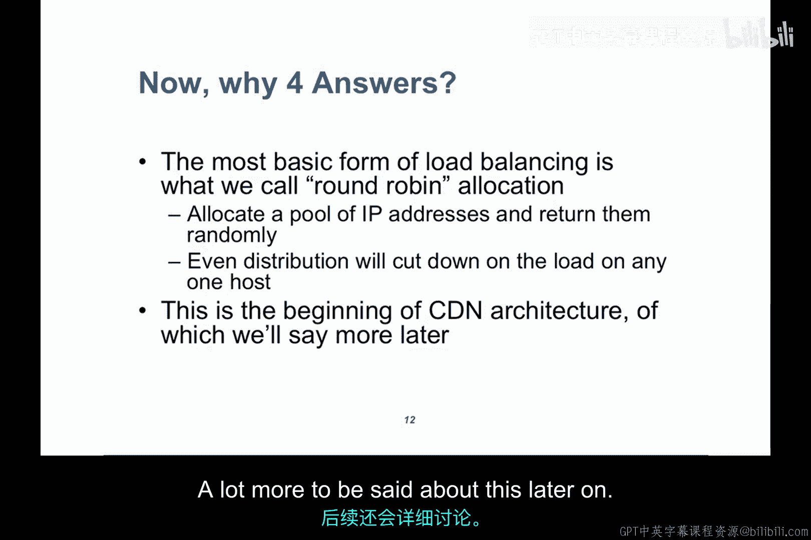

Death。A is an IPV4 convention。 All right， so obviously we've got to be preparing for IPV6。

 which we are using the quadruple A record， which is type number 28。Okay。

 was it look like it looks like the A record except it's Scott， you know？

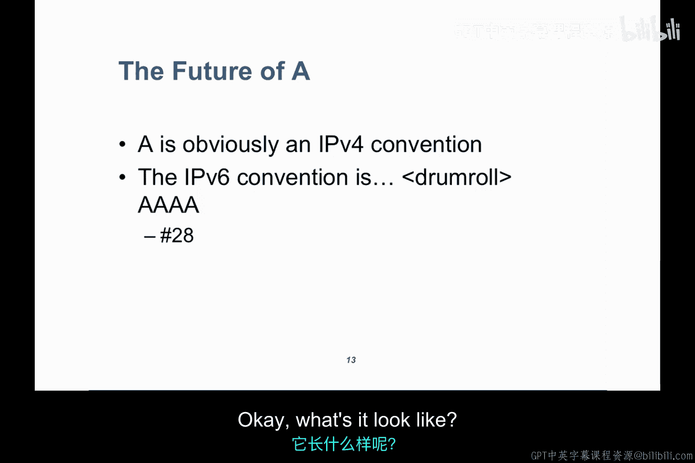

And IPZ6 address in it。No。😡，A is the beginning， A was very simple。However， for example。

 you know that if you go to jh。edu and your web browser， it'll punch into wwe。jh。edu。

The reason for that is because of what we call canonical nomenclature。 Okay。

 this is the beginning of DNS going from the simple query response element to the others of the 20 or so different types I mentioned。

 Okay， so C name I dig wwwduu。 Okay， you see that the answer I get is wwwg do Eduu has a C name。

 which is this esgweproxyjos Hopkins ESgwe proxy has an actual name as an actual a record。 Okay。

 this is a redirection mechanism。 and the C name record is a pointer。

 what Cname does is C name points to a canonical or accepted name So www。

u is effectively an alias at egweproxy is for the real www。

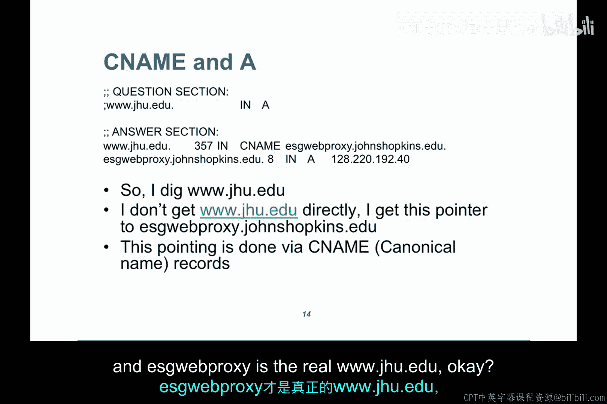

This is important to understand because this is where we start to get into the real headache with DNS DNS is as with most protocols in the internet sort of unidirectional。

 it's a one way protocol you pass it a name because youite P address it's possible to do a reverse lookup。

But it's a pain。It's not what Dianus is built to do。 And there are really no guarantees about it。

 This really leads to a very important rule when you're doing analysis。

 Try to get any domain names at the time collection rather than after the fact。

 because Deanus look up after the fact is not guaranteed。 And you may， in fact。

 end up going down a you may end up going down a completely wrong path because your reverse lookup might give you an name that's completely unrelated to the original date。

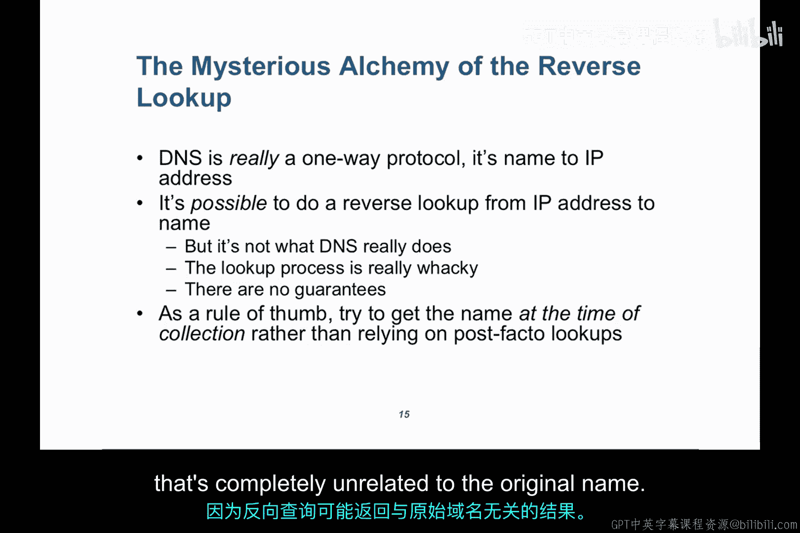

Now let's talk about the mechanics of it All right allide co is myza domainbe Okay so if I do a dig on alli。

 co I get back to 1692179155 now I do a reverse lookup reverse lookup is done mechanically in dig with dashx okay the reason for the plus by the way as remember I mentioned the dig is very ver protocol if you do a dig help you'll find that there's lots of little sections you can switch on and off plus short for example gets rid of everything Okay no command no stats over remove various sections。

Going back though to the actual query， you'll see that I do dig dashak and then the address that I got doing my original dig All right Now what happens is I get this PTR record which has the domain name Oi。

 co there and you will notice the original IP address reversed in inad on ARPpa take a look at it。

 you'll notice 21692179155 15517992216 Okay why is this going on because it's actually doing a DNS lookup in a special domain which is ARPpa the ArRPpa Tld has an inader tool which is an actual DNS lookout reverse lookup domain structure it's a standard lookup using specially encoded name and it's messy。

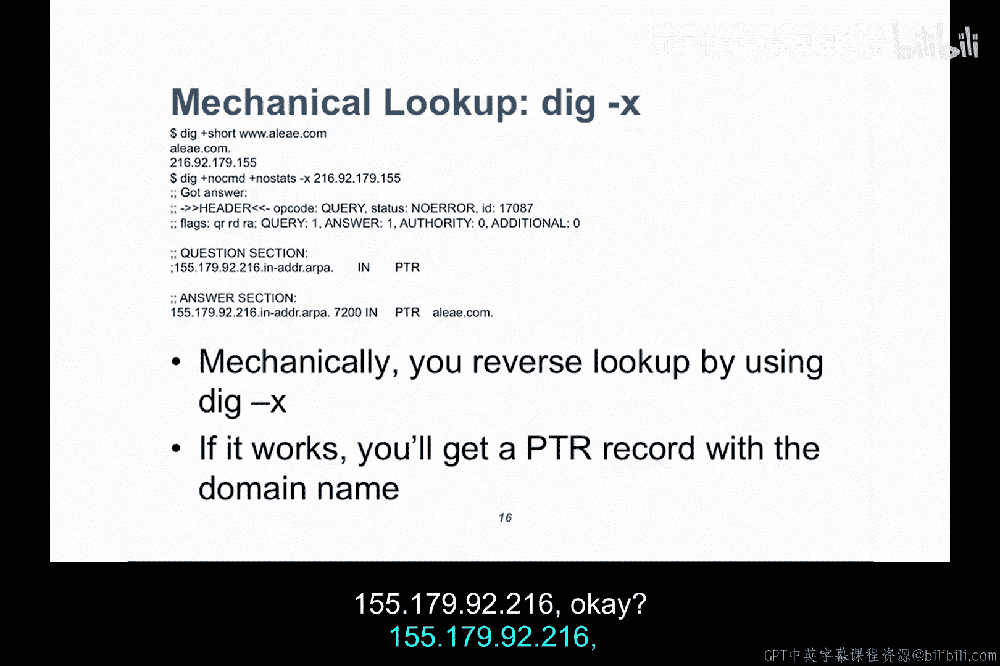

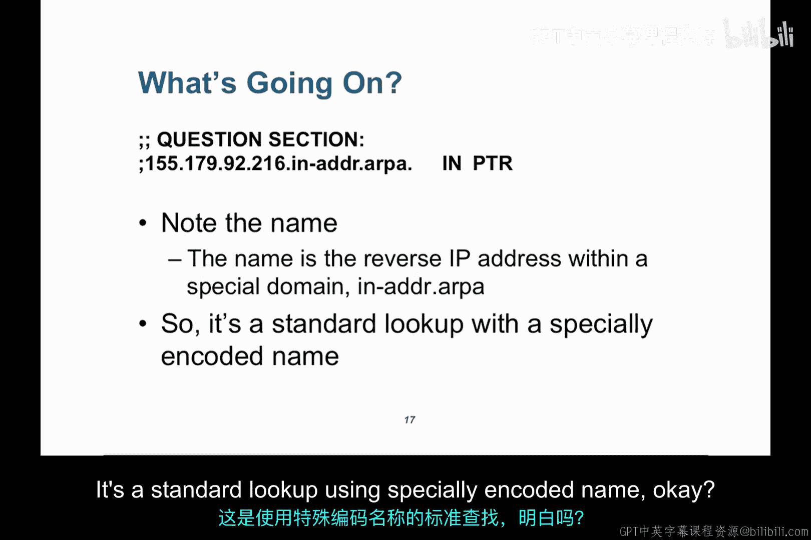

For example， I do a dig for the New York Times。 Okay， I then do the reverse lookup。 Okay。

 you'll notice that when I do the reverse look up here， I don't get an answer。 Okay。

 what I get instead is an S OA record， which tells me that it is actually controlled by the New York Times name server。

 but I get no information on what that address is supposed to be。

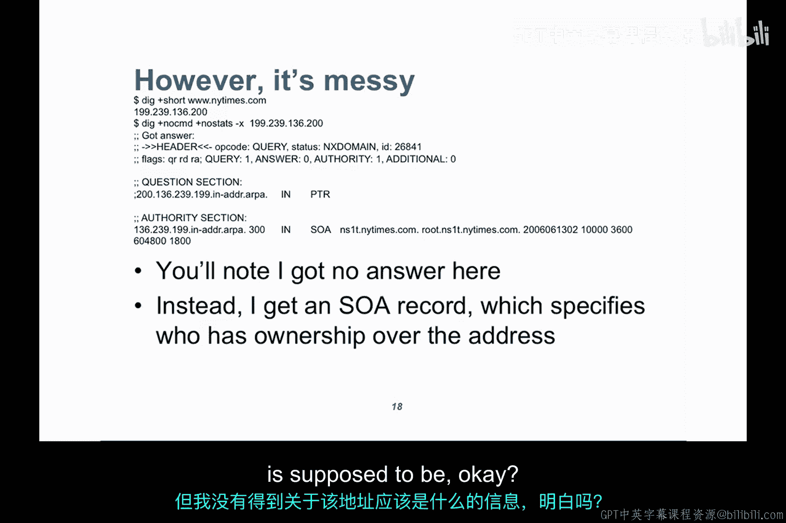

Okay。Now I want you to keep that in mind when you start taking over first look up。

 it really is not a magical solution， there's an awful lot that's going to screw it up。

We'll go into that in more depth in the next section Okay so Bo we've discussed the section basic of the DNS protocol。

 We've looked at Rs。 who've looked at A， we've looked at quadrupplay records。

 He's also looked at C name， pointer and SA records Okay we've worked for the usager dig。

 which is your Swiss Army knife for DNS operations and we've talked about the mysterious reverse lookout。

 which is from my respect one of the most annoying tools on the planet what we're going to do with the next module。

Is we're actually going to do a walk through investigating a couple of addresses。

 which will bring together who is DNS reverseverse lookup all of these tools into one combination。

 and it'll give you a good feel for engaging in this lookup investigation process and the problems involved in doing so。

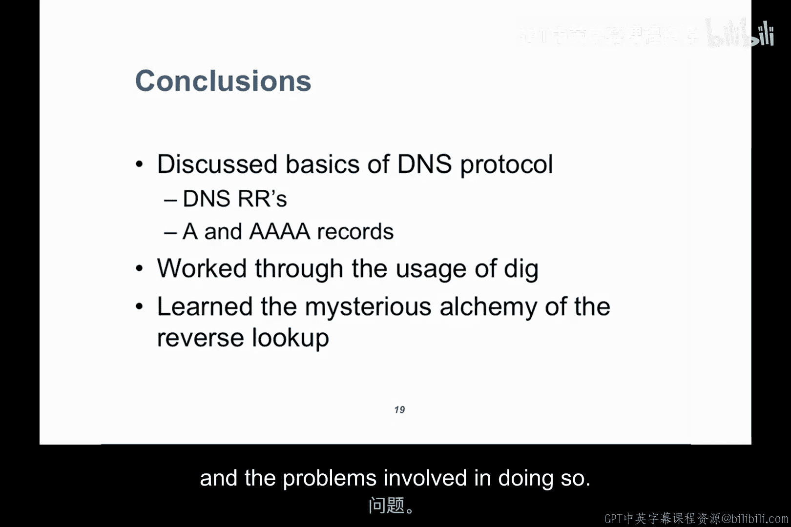