# 信息保障分析：7.2：A记录与DNS查询机制 🔍

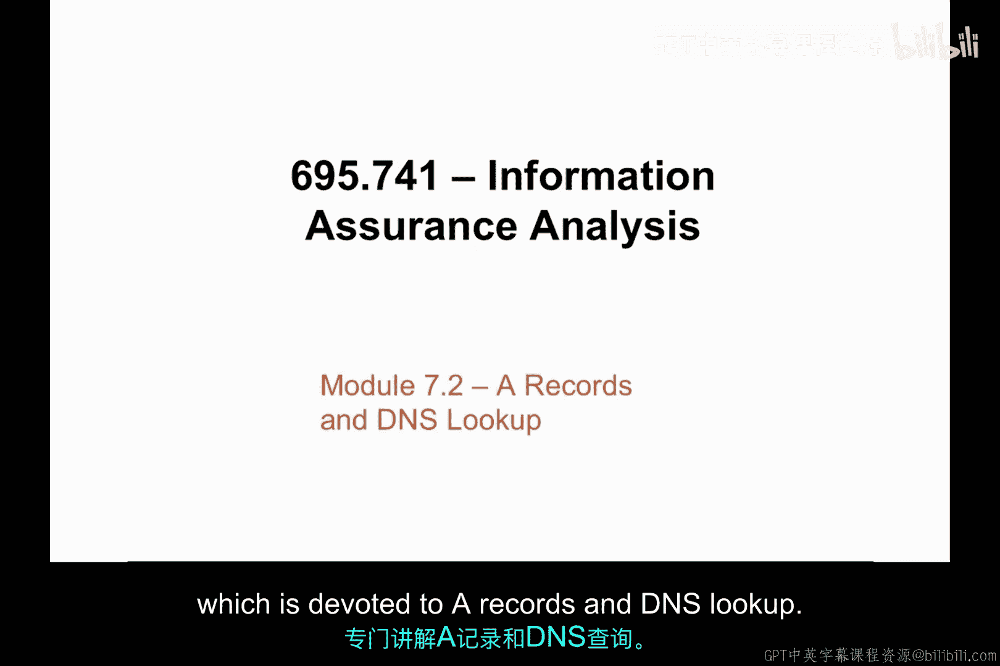

在本节课中，我们将要学习DNS协议的核心操作机制，特别是A记录和DNS查询过程。我们将从DNS的基本概念入手，逐步深入到数据包格式、查询类型以及实际查询工具的使用。

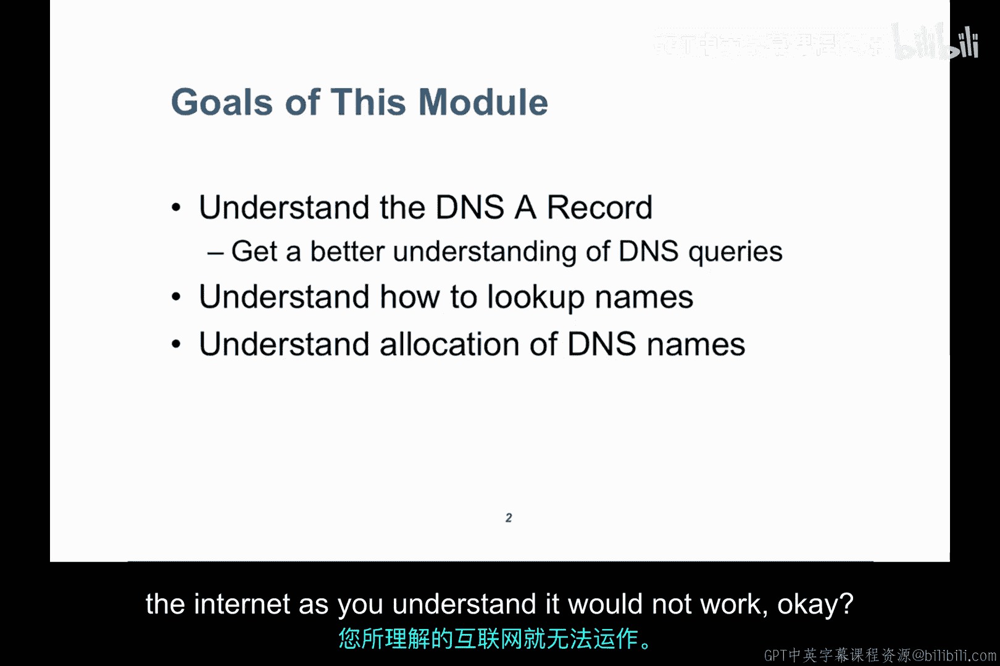

上一节我们介绍了域名和IP地址的获取等高层概念，本节中我们来看看DNS查询的具体过程是如何进行的。

## DNS查询概述 🌐

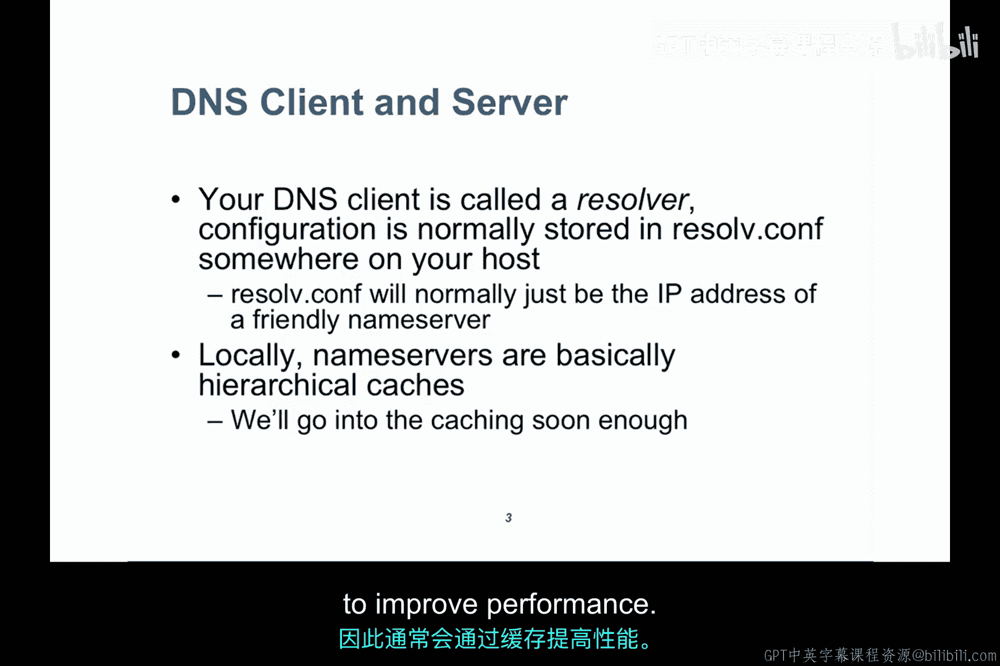

DNS协议的目标是解析域名到IP地址。理解这个过程至关重要，因为它是互联网运作的基础。DNS查询过程与传统的静态主机文件（如`/etc/hosts`）分配方式有根本区别，它引入了层次化缓存和动态解析机制。

## DNS客户端与服务器 🖥️

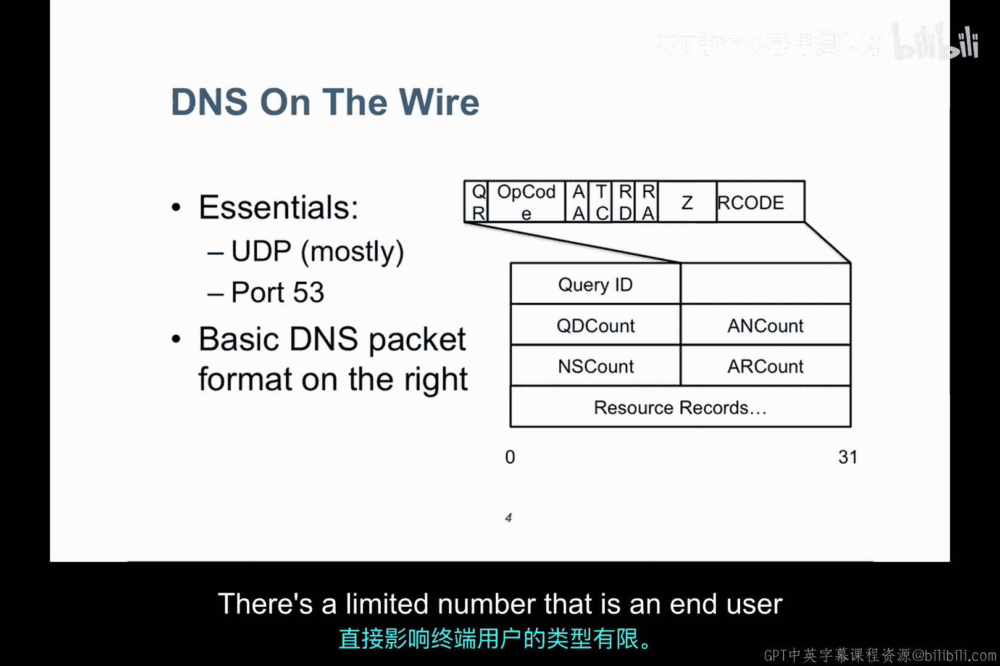

DNS客户端通常被称为解析器。其配置通常存储在一个名为`resolv.conf`的文件中。该文件内容简单，主要包含一个或多个DNS服务器的IP地址。

DNS服务器本质上是层次化的缓存系统。缓存机制对于提升查询性能至关重要，因为完整的域名解析过程可能涉及多次服务器间的往返查询。

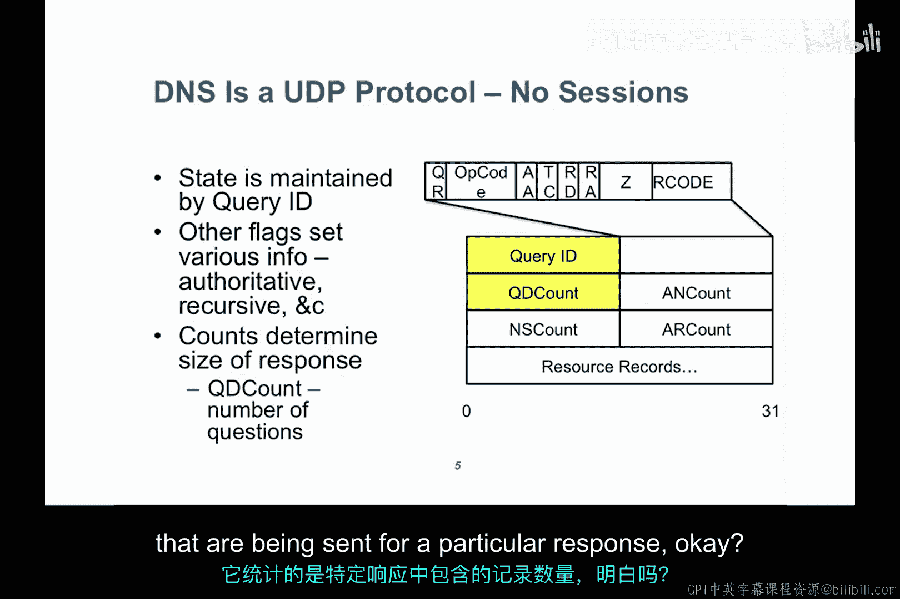

以下是DNS层次化查询的基本步骤：
1.  客户端向根服务器查询顶级域（如`.edu`）的权威服务器地址。
2.  根服务器返回指向`.edu`域权威服务器的信息。
3.  客户端再向`.edu`权威服务器查询二级域（如`jhu.edu`）的权威服务器地址。
4.  最终，`jhu.edu`的权威服务器返回目标主机（如`www.jhu.edu`）的IP地址。

## DNS数据包格式 📦

DNS主要基于UDP协议（区域传输等特殊情况除外）。理解DNS数据包格式是分析查询过程的关键。

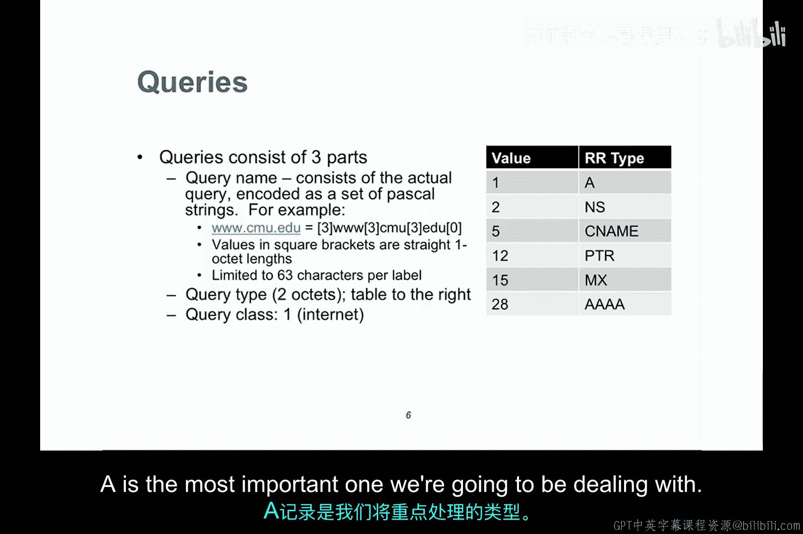

一个基本的DNS数据包格式包含以下核心部分：
*   **查询ID**：一个16位的随机整数，用于匹配查询与响应，维持UDP协议下的“状态”。
*   **标志位**：16位，用于标识查询类型（如递归查询、权威应答等）。
*   **计数区**：包含问题数、答案数、权威记录数、附加记录数等。
*   **资源记录**：实际承载DNS信息的区域，包含多种类型的记录。

## DNS查询与响应详解 🔄

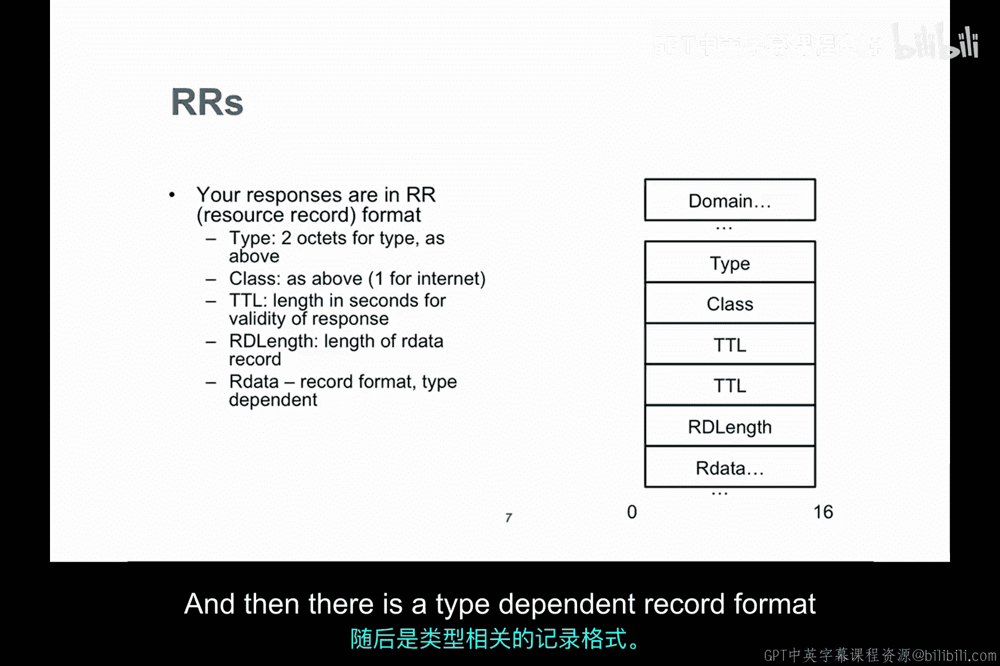

一个DNS查询主要由三部分组成。

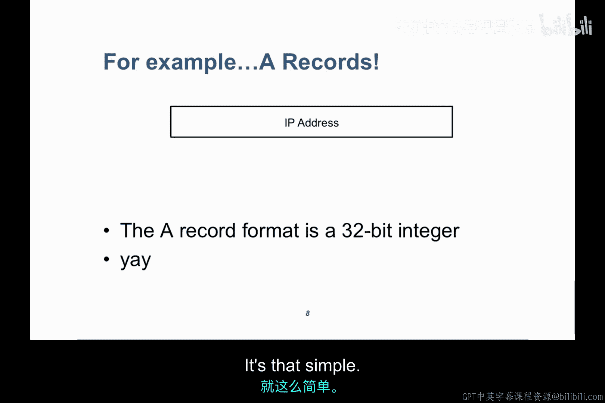

**查询名称**采用一种类似Pascal字符串的编码方式：每个标签（如`www`, `jhu`, `edu`）前有一个字节表示其长度，最后以长度0结束。例如，`www.jhu.edu`的编码为：`3www3jhuedu0`。每个标签长度限制为63个字符。

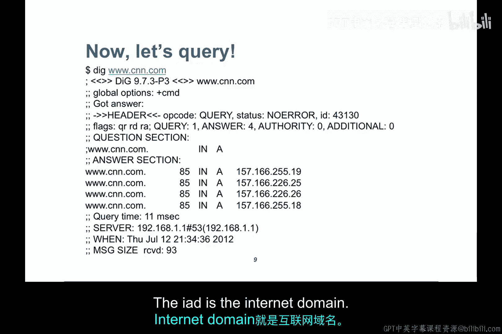

**查询类型**指定要查找的记录类型。虽然存在约20-30种类型，但最常用的几种包括：
*   **A**：将主机名映射到IPv4地址。
*   **AAAA**：将主机名映射到IPv6地址。
*   **CNAME**：规范名称记录，用于设置别名。
*   **PTR**：指针记录，用于反向DNS查找（IP到域名）。
*   **MX**：邮件交换记录。
*   **NS**：名称服务器记录。
*   **SOA**：起始授权机构记录。

**查询类**几乎总是`IN`，代表互联网。

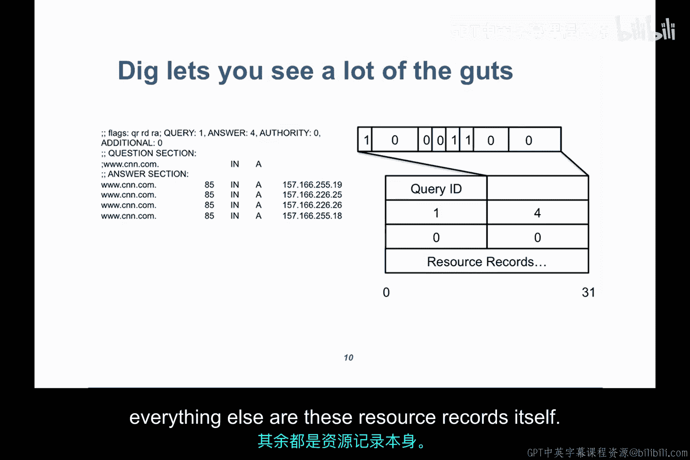

响应以**资源记录**格式返回。其结构如下：
*   **类型**：与查询类型对应（如A、CNAME）。
*   **类**：同样为`IN`。
*   **TTL**：生存时间，以秒为单位，表示该记录在缓存中有效的时长。现代网络TTL通常较短（如几分钟到一小时），以适应动态内容。
*   **数据长度**：后面资源数据的长度。
*   **资源数据**：格式取决于记录类型。例如，A记录的数据就是一个32位的IPv4地址。

## 使用Dig工具进行查询 🛠️

`dig`是当前标准的DNS查询工具，功能强大，可以显示DNS查询的详细信息。

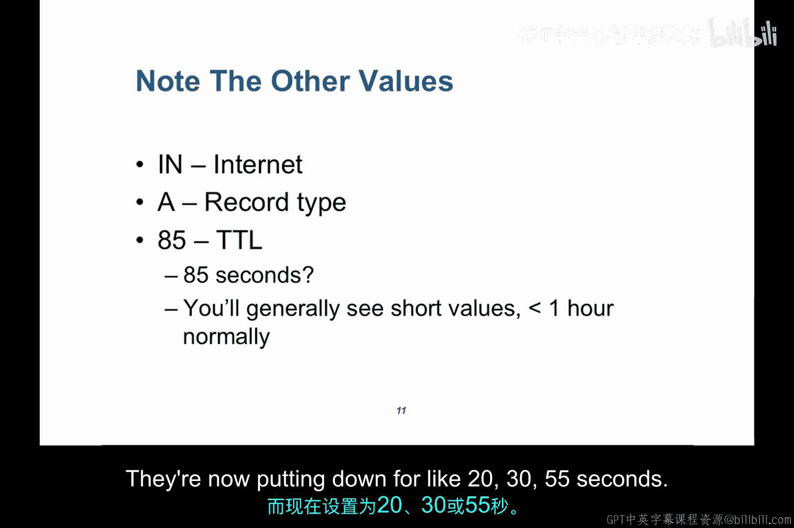

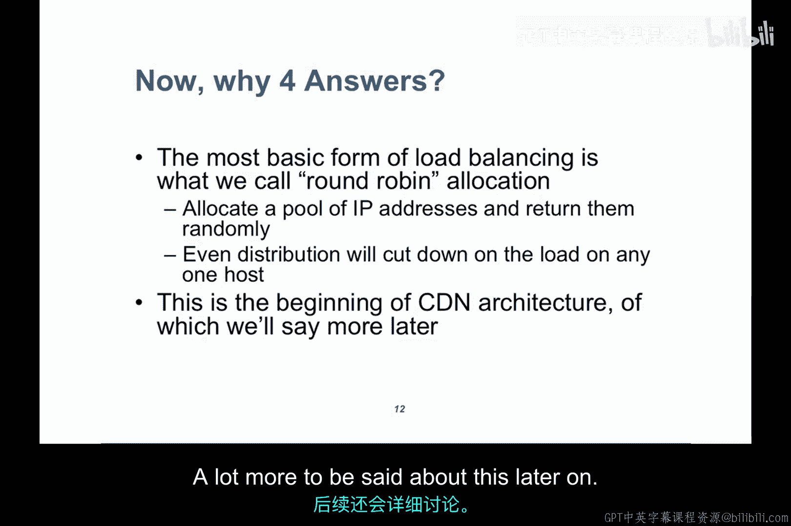

以下是一个简单的`dig`命令示例，用于查询`cnn.com`的A记录：
```bash
dig cnn.com
```
输出结果会包含多个部分。在“ANSWER SECTION”中，你可能会看到多个A记录，每个对应一个IP地址。这称为**轮询负载均衡**，是一种将流量分散到多个服务器的简单方法，也是内容分发网络的基础。


你还会注意到较短的TTL值（例如85秒），这反映了现代网站的动态特性。

## 其他重要记录类型 📝

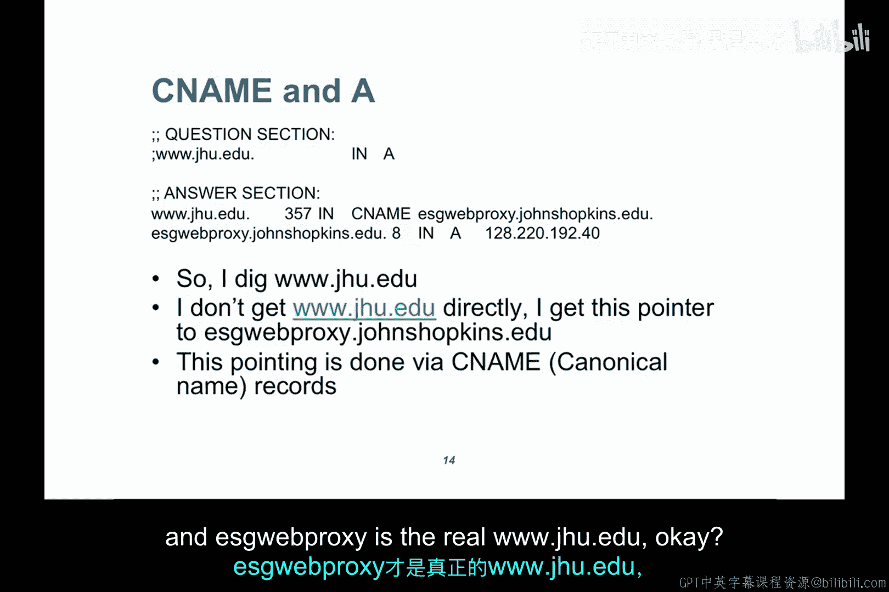

除了基础的A记录，还有其他关键记录类型。

**AAAA记录**是IPv6时代的A记录，类型号为28，其数据部分包含一个128位的IPv6地址。

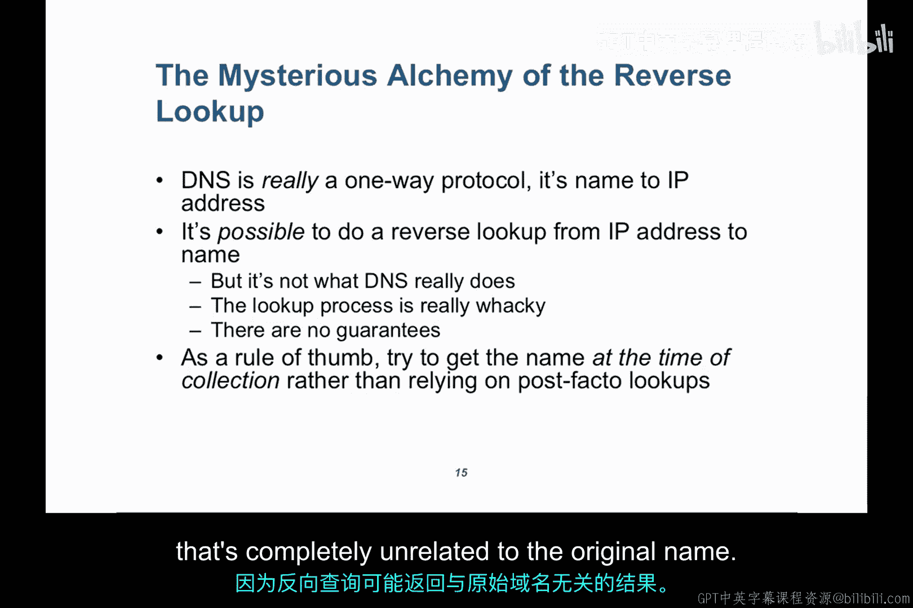

**CNAME记录**用于创建别名。例如，`www.university.edu`可能是一个CNAME，指向真实的主机名`webserver.proxy.university.edu`。这实现了灵活的重定向机制。

**反向DNS查找**尝试通过IP地址查找域名，但这并非DNS设计的主要方向。它使用特殊的`in-addr.arpa`域，并将IP地址反转后作为查询名称。例如，查询IP`192.0.2.1`的反向记录，实际查询的是`1.2.0.192.in-addr.arpa`的PTR记录。

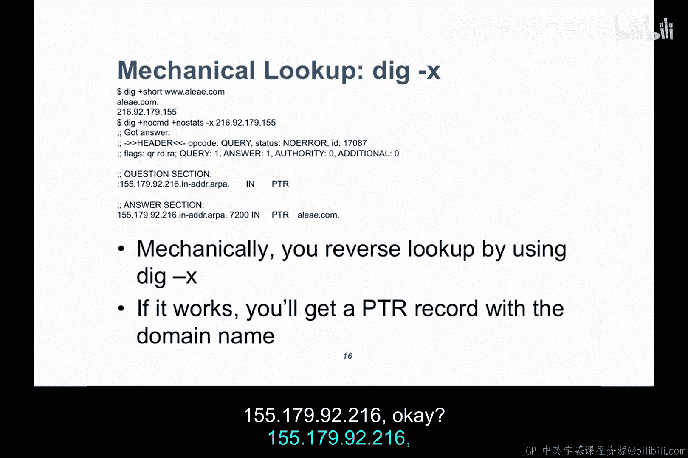

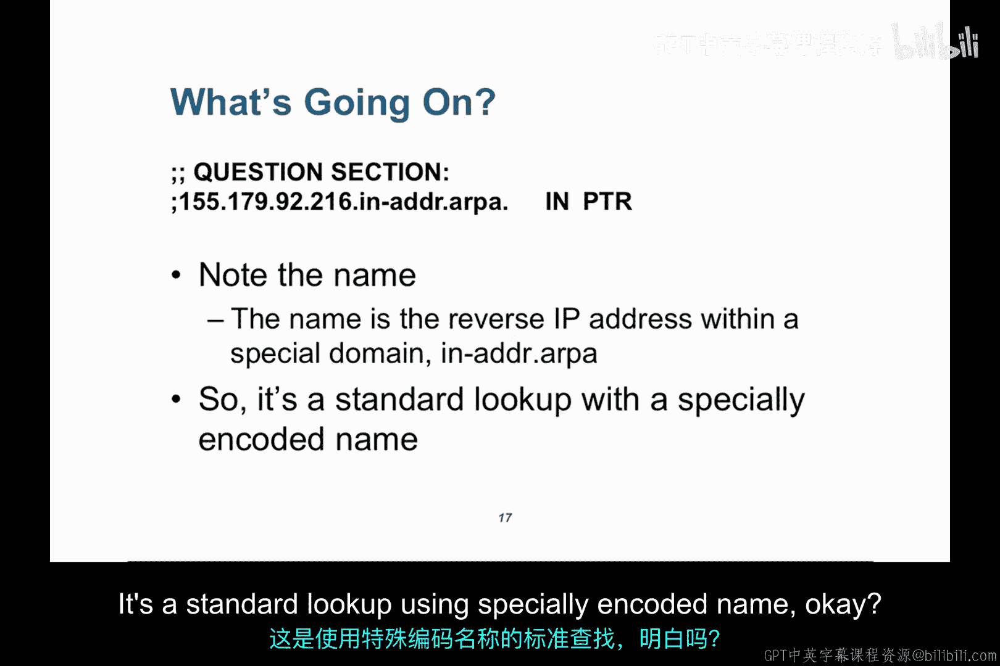

反向查找并不可靠，许多组织并未正确配置PTR记录，可能导致查询失败或返回无关信息。因此，在进行分析时，一个重要的原则是：**尽量在事件发生时收集域名信息，而非事后依赖反向查找**。

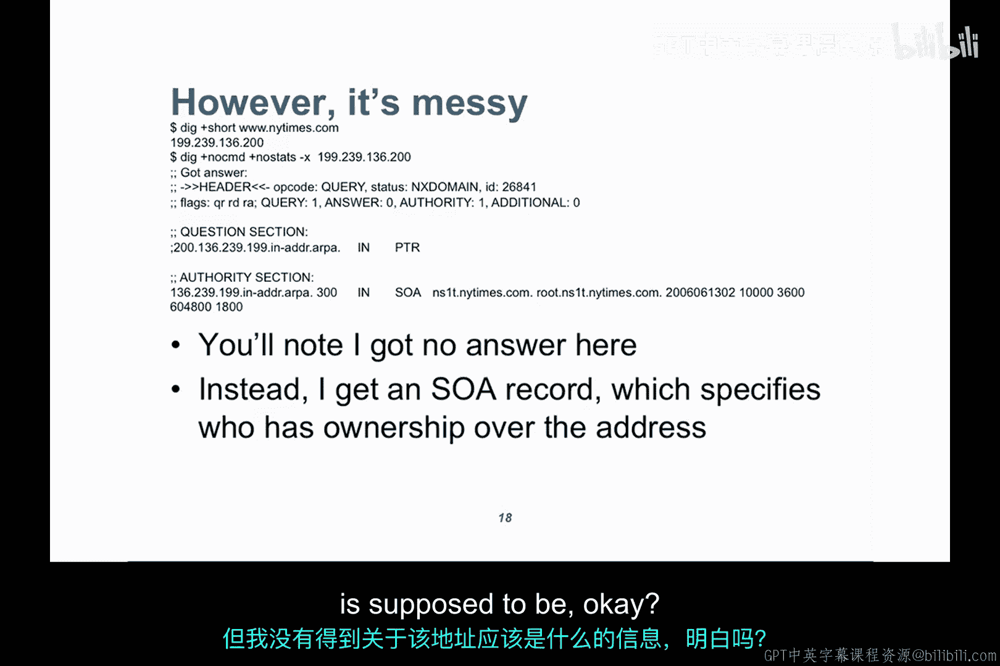

## 总结 📚

本节课中我们一起学习了DNS协议查询机制的核心内容。我们探讨了DNS客户端与服务器的角色、DNS数据包的格式、以及查询与响应的详细过程。我们介绍了关键的资源记录类型，包括**A记录**、**AAAA记录**、**CNAME记录**和用于反向查找的**PTR记录**。我们还学习了使用强大的`dig`工具进行实际查询，并了解了反向DNS查找的局限性和不可靠性。

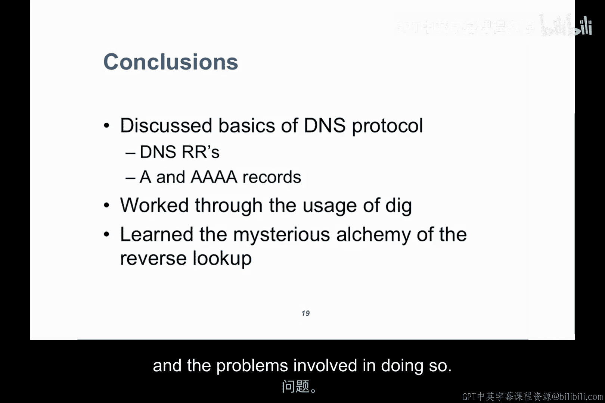

下一模块，我们将通过实际调查案例，综合运用whois查询、DNS正向/反向查找等工具，让你亲身体验域名解析调查的过程及其中的挑战。