# 约翰霍普金斯大学《信息保障分析｜Information Assurance Analysis》中英字幕 p27 7_地址调查分析.zh_en -BV1Qz8EzYENX_p27-

Plus this is 695741 information assurance analysis and this is module 7。

3 which is going to be that investigating address this is Dr。

 Collins talking so let's get going so there's going to be a relatively messy section so。

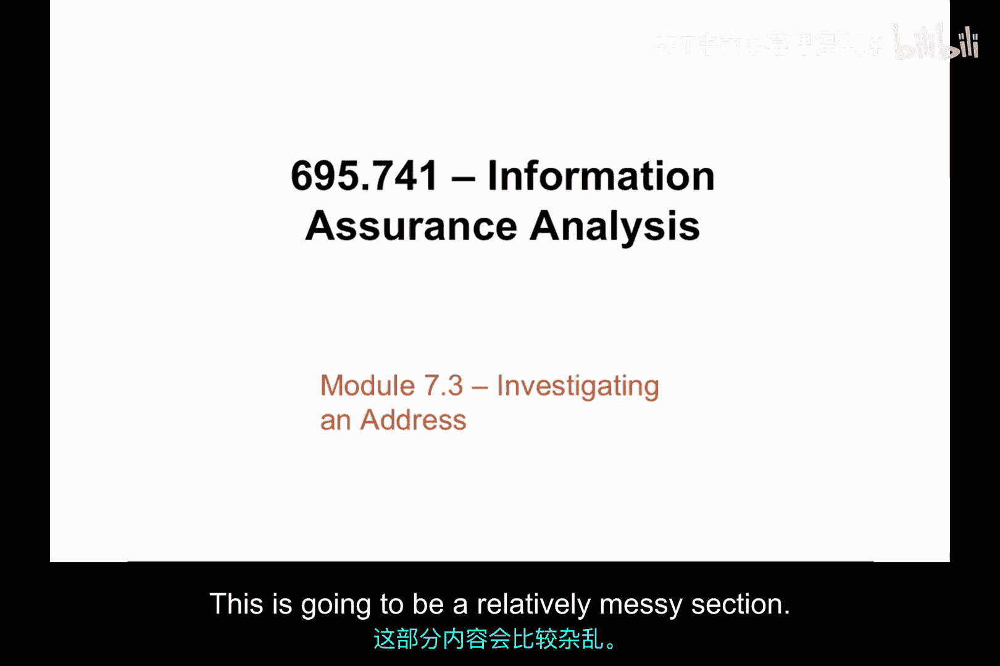

The goal of this module this module is a walkthrough okay this is effectively given an IP address。

 how do you find out information about that address now this is more or less my approach to doing it it's a set of helpful suggestions as time passes you will find other tools to use but this should give you a jumping off point to understand the general way to go through and look up information on an address we've talked an awful lot about various tools in this course at piecemeal。

This is when we're going to tie them together to take a look at how we would grab all of this information。

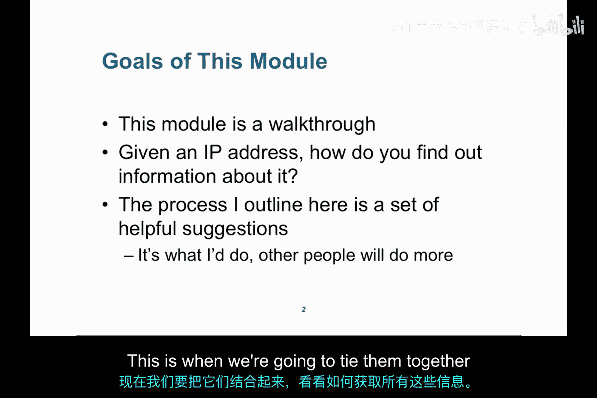

Okay。Now I'm going to use is an exemplar IP address 192 44318 I'll talk about one or two other addresses during the course of this just to outline alternative courses。

 ways that I might end the investigation quickly， things like that。

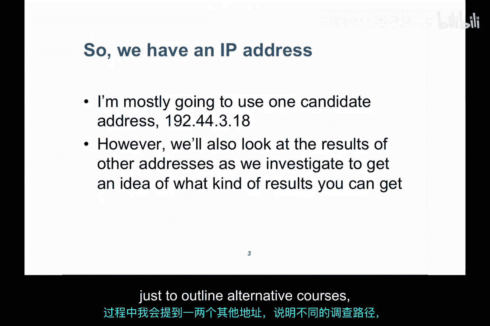

But let's start with an initial name search so I do a D DashX on 18244318 and what I find out is that I don't know anything about it。

 what I get is an authority section telling me that it's owned by Phonehoffer a German organization now the important things to note there the NSS2 Na servers are normally given an NS prefix when you take a look at the names of hosts this will come up again as I discuss things but。

One of the things you're going to find as you do these sort of searches is people have developed a certain set of conventions which leak into domain names and sometimes you can tell something purely that way D E means it's German okay now you know the comparison to that let's say I pick 9943 to 1118 okay I do a deep dashx there now this is a good example of somebody who is actually encoding information in an H so you see I do the answer section here and I get the name is ADsl 9943 to 1118 DSslrcsNtx SBc global。

net okay now。

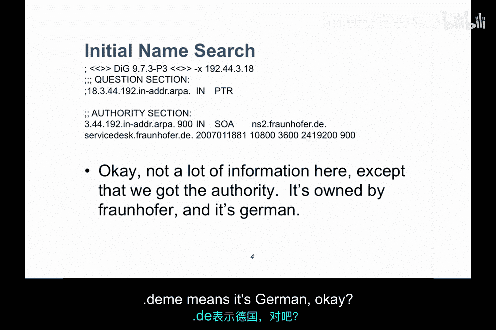

I want you to note this this is actually a lot of information given to me on a silver platter in this particular case it's a DSL line this sort of coded name is not uncommon for the type of dynamic names that cable modem providers and ISPs give to people who have home DSL numbers okay or have home DSL you'll get this kind of name an awful lot usually like the RCSN Tx may be a geographic located。

 the TX I'm pretty sure is going to be Texas and SBC is Southwest Bell okay anyway。Now you'll。

 as I said， you'll find that a lot of times functional sites will have names like DSL， mail。

 FTP search， eta， and you can use that as well。

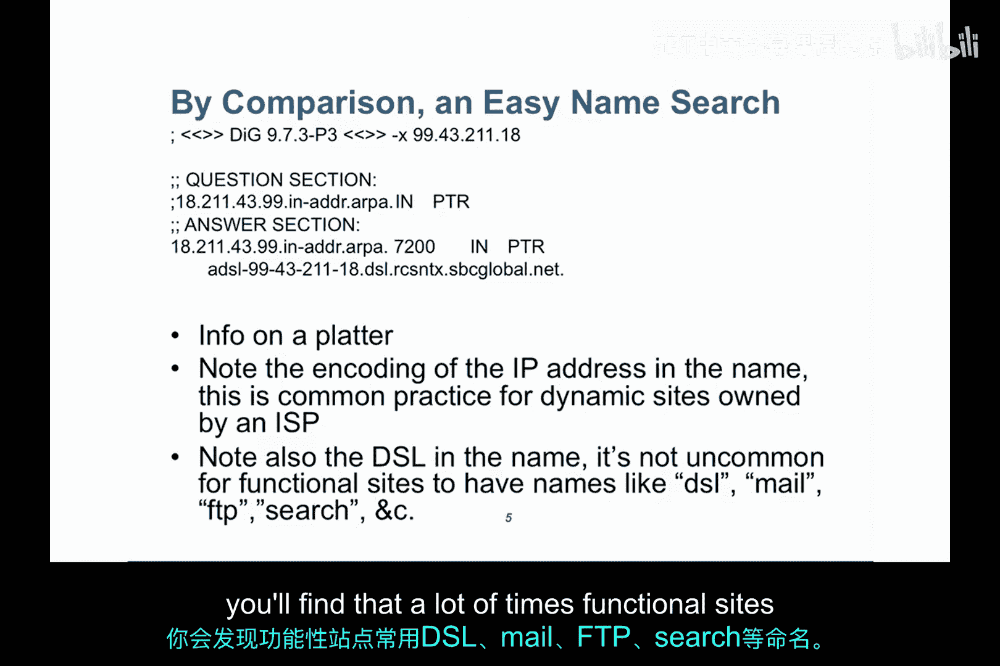

Now， going back to our original name though， one thing that I want to emphasize here。

This is an investigative process and unfortunately it is true that especially given the employers of many of us in this room。

 there's a tendency to take this is a very checklist driven approach or you you'll do this that you'll do that you'll do that you'll do that you'll do the other unfortunately what's often missing on these checklists There's some bloody obvious things Okay so among things。

 don't forget to look up and site in Google don't forget to look it up in Wikipedia don' you know go visit the site if you are allowed to find out about the authority itself is it ISP is it a company is it non-governmental organization a university is going to handle IP addresses very differently from how an ISP does now。

Really， I'm just surprised how often people forget to Google things and oftentimes you'll find yourself wanting to Google something every other step of the way。

 all right， now。

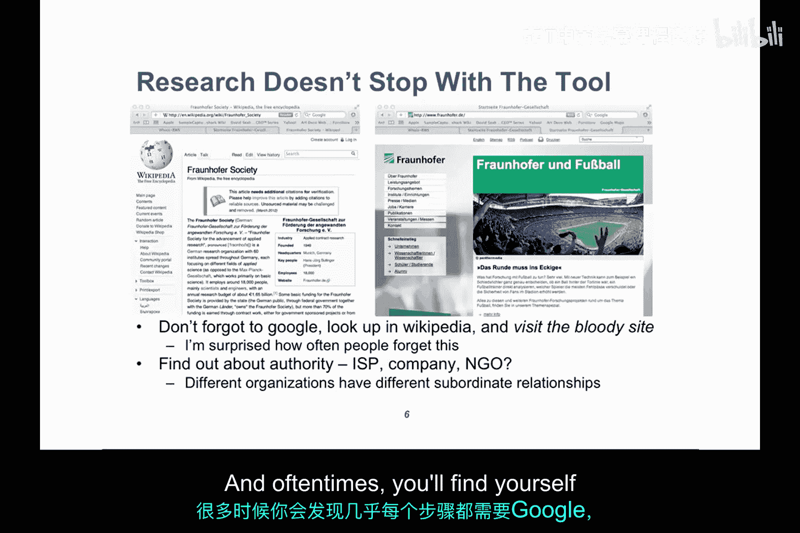

Given all of that， we go on to who is Now I go to Aaron， All right， first off。

If I was in possession of my medical faculties if I was doing this in a professional context。

 I would go to Aaron， the reason I would go to the Aaron is because I know that the address thrown gopherdeE。

 so it's German German means you go to ripe。I want to show you what happens if you don't know if you don't pay attention to that information。

 okay， so I go to the search who is in the corner with Aaron and Aaron provides me with this report okay no。

😊。

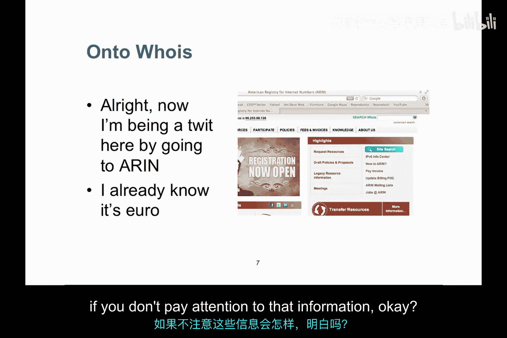

This report is actually who owns this batch of IP addresses okay and what it tells me is it tells me that there's this whole batch of addresses。

 this whole batch of cider blocks， they're under the name ripe Ex 1924410 okay。

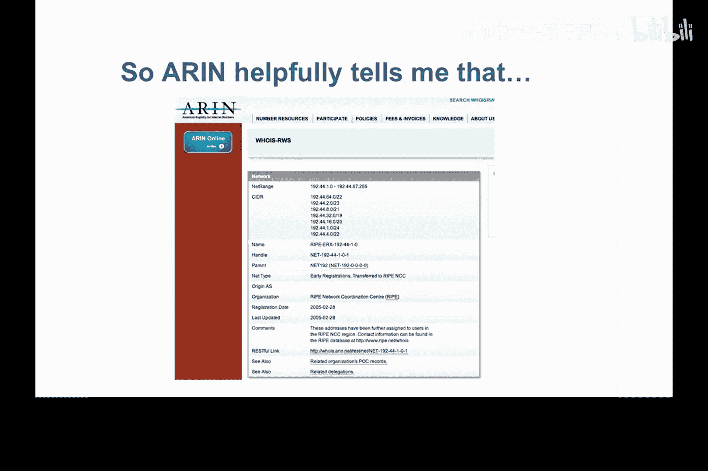

And it's part of rips， so guess what？We're got to go to ripe now your various registries have who is pages。

 all of the registries， all the top level ones and many of the country level ones as well will provide you with a who is service you can go to Kr Nick for example and look up Korean addresses all right the ones I provided here at the top level for each of the RRs but you can just as easily drill down in a lot of cases and find further information Okay so I go to ripe and ripe actually you'll notice stuffer stuff one of the things you'll notice here this is giving me 199430 to255 okay so it's giving me finer tuned information than Aaron did Aaron gave me you know 60 gave me 64 or so class 524 is to deal with this one is giving me exactly one okay。

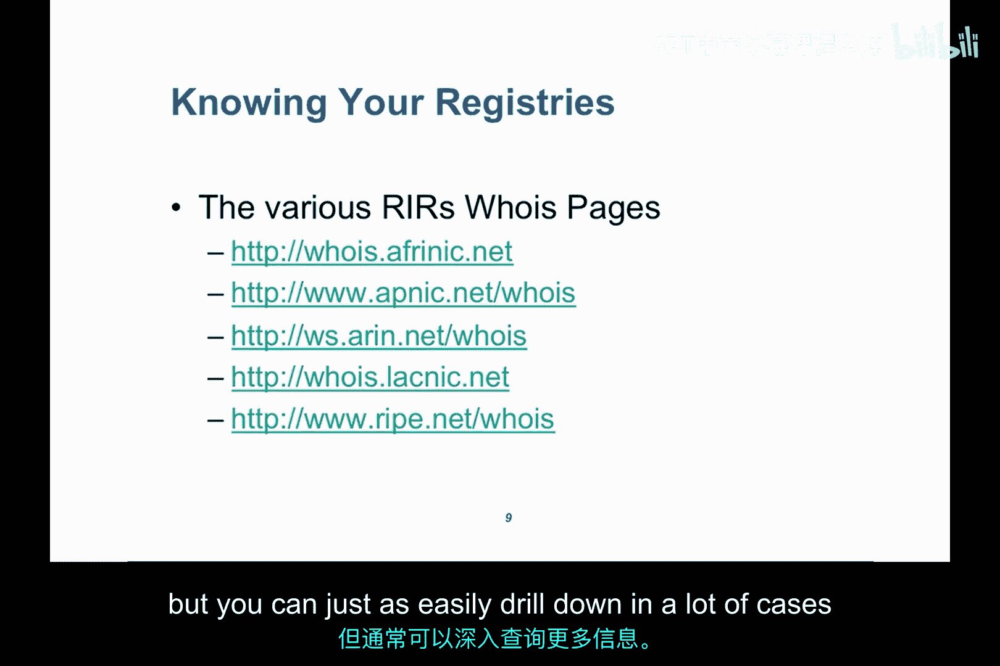

It's giving me the ASN when it belongs to and you'll notice that I can find technical and contact numbers with some exploration here again。

 depending on the type of investigation you're doing。

 you may want to pick up a phone and call somebody。Okay， now。I want to make it one point here。

 which unfortunately is an ugly one but it has to be made what you will find as you do these types of investigations is that there are various organizations that are better and worse at keeping addresses as a rule of thumb。

Anything in Europe between Germany and England is probably going to be good。In fact。

 in terms of order of accuracy of who is information， Western Europe， North America， and after that。

 you're just doomed， okay。I will say that I have， for example。

 friends at regiiststry who refuse all requests from certain Southeastern Asian country because the only request they ever again for spamning so expect that the quality of information is going to be a function of the registrar and the location。

 all right？

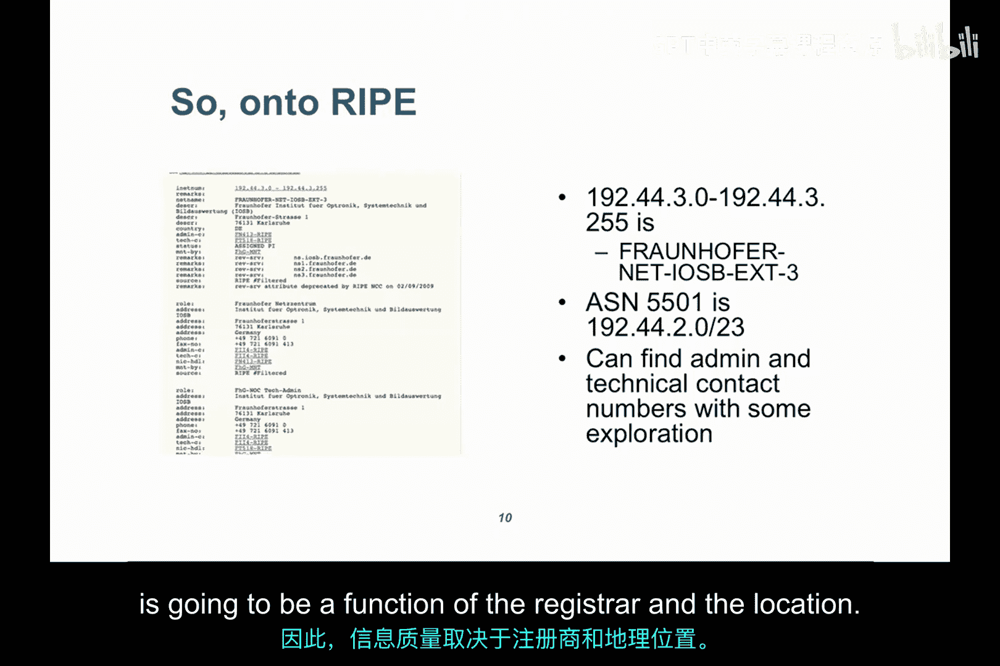

Now。Okay。So let's talk about。

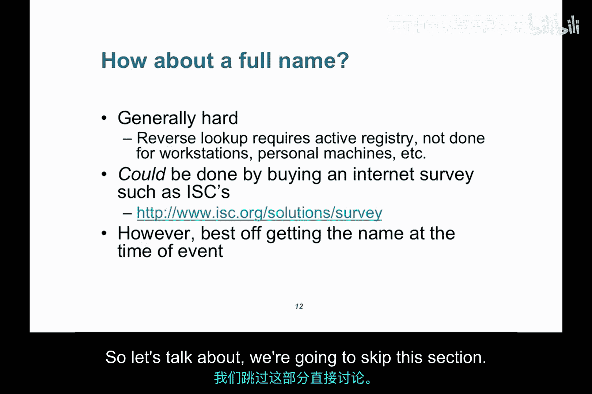

We are going to skip this section。 All right， Danll， this is Mike here on slide 11。

 apparently I threw in here without thinking about what I was doing。So when I say go again。

 we will go。

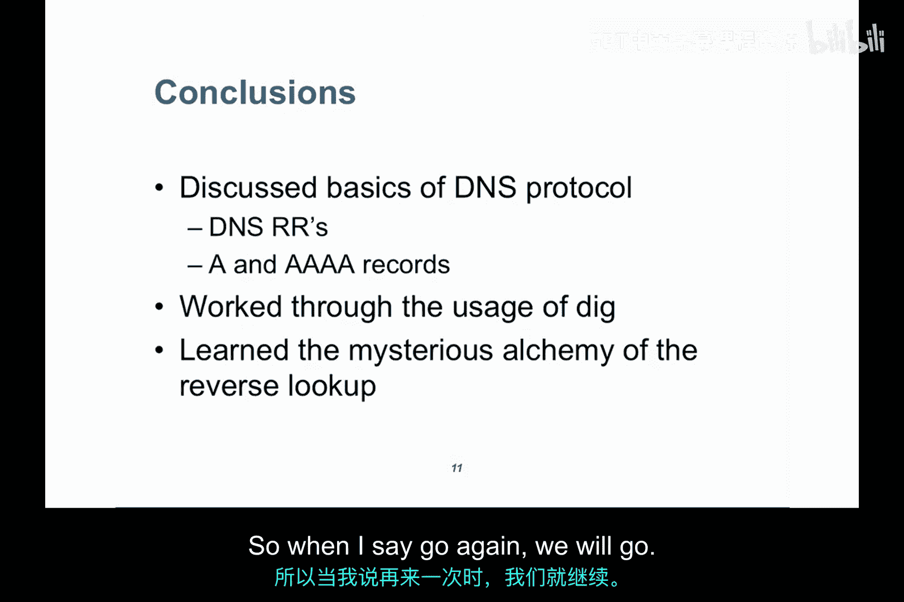

Go。2。Now。There is an alternative approach to doing name lookup as well， which is。

You could use Internet surveys， there's an organization called the ISC。

 which actually purchase which actually buys。

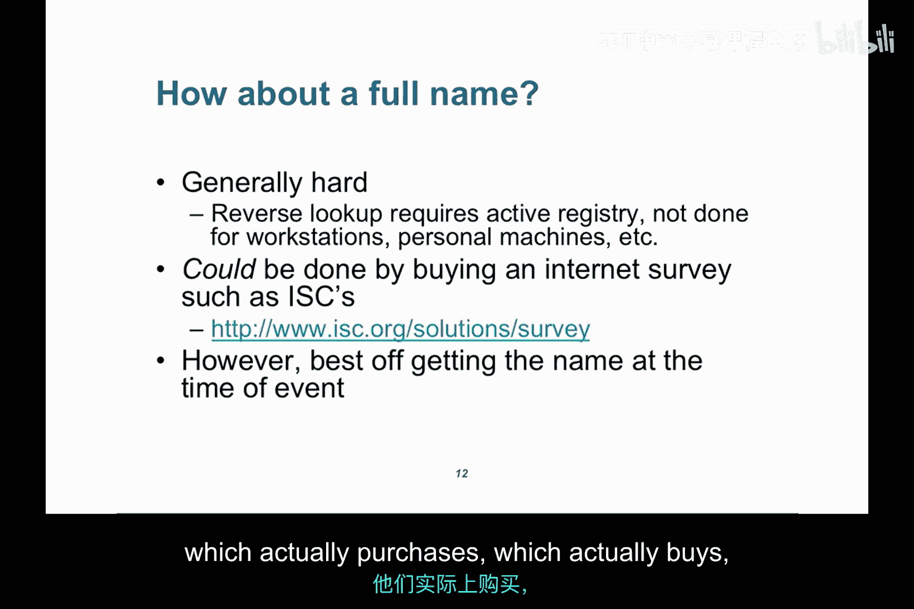

对。Okay， Danil， this is Mike again， once I go back into slide view we'll be able to get going again。

 I apologize for this。

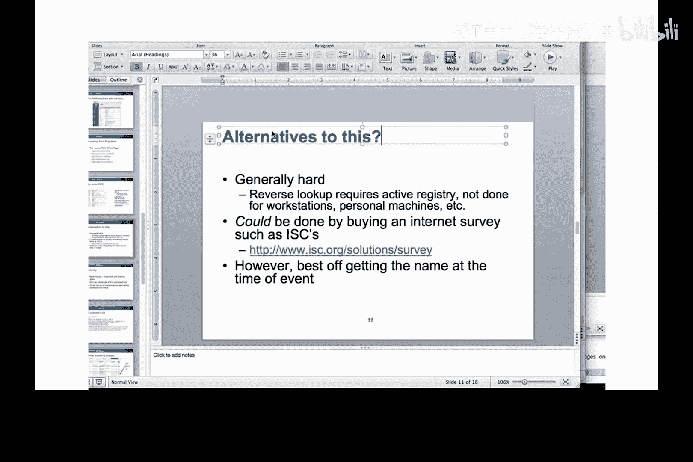

Okay， so what else can we do besides the Louis's approach well it's a bit messy reverse lookup as based on what we've said before。

 you know it rarely works there are alternatives the Ic wweisc。org actually sells a book。

Or an internet survey of names and there are a couple of companies that will actually sell you this kind of naming information as well。

 but they're getting it by actively probing DNS so don't expect too much from it okay and that's sort of the end of where we can go socially now we can take a look at the routing itself and do some checks this way okay we can trace route at the command line or we can go find looking glasses via tracero。

 org okay so for example I'm going to do a trace route to this site all right and I do this from my home address so I've limited limited the first six hops and you can see that eventually gets to board around FhG do D and stops there okay。

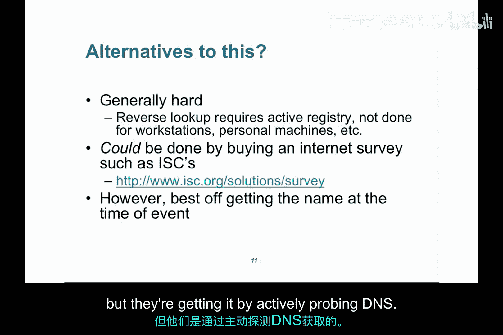

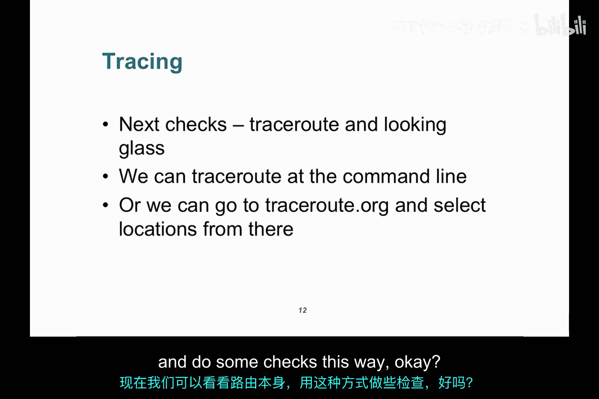

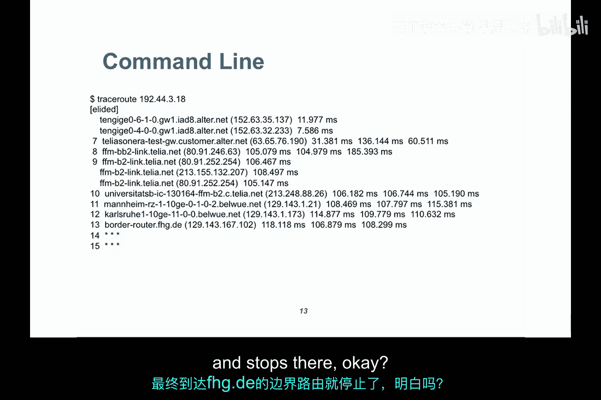

Now I try it from another routing location， okay this window is actually。

 as you can tell German and you can see again， it gets to this location and then it gets to the Fho for Network Operation Center and stops there okay。

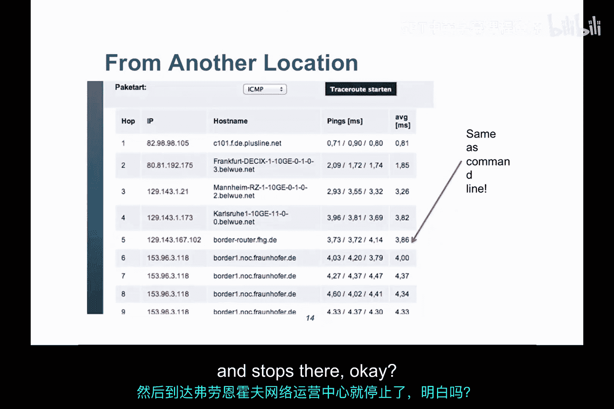

So this actually tells us something about， you know， there doesn't if here to be anything there。

 so let's just do what we might consider the simple stupid test， let's ping it okay。And so I ping it。

 and you can see that the time the live is exceeded every time I try to get to it， I don't get to it。

 Now， this probably means that there's nothing there。 Okay， now。

 the reason I say probably is because it's time to ac quit you with one of those great lessons about Internet security。

Internet security or internet traffic in general， there are no rules Okay， so for example。

 they might have set up the router block p attempts what I can do to check that。

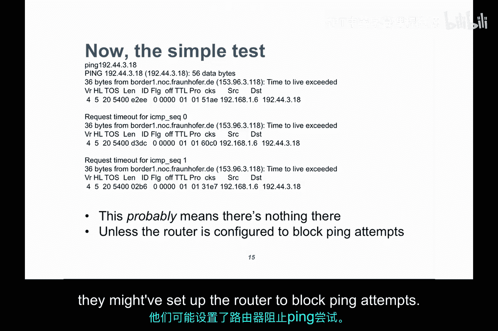

Is I can ping next to that host。 So instead of ping 19244，318， I'm going to ping 1924421。 Okay。

 and I do that。 and you'd see that I actually get responses。 Okay。

 now I also do a trace route and the trace route。 you will see says that I am going around the same thing I'm getting this board route and I'm going through the frown hofer network。

 when I know that this is also owned by Fr hoffer， But the only reason I know that is because I can you know go back and do who is check on it。

 Okay， so Ackerm's where Azer suggests that there's no machine at 318。

 It's possible that they're just blocking everything there。

 but there's no good reason for them to do it now。

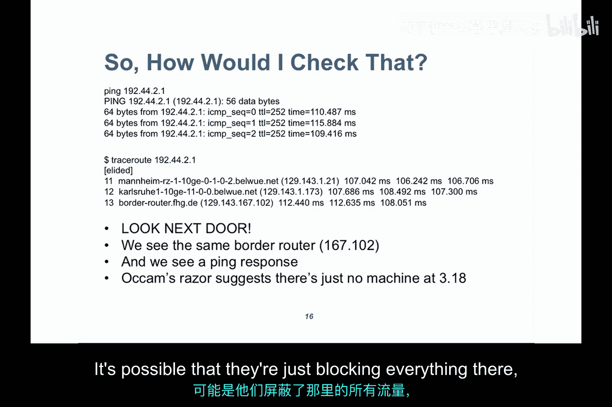

This really gets to the core issue here。 What I've done here is I've done sort of a I've done an initial set of probes and pokes。

 You can go further。 okay， for example， you've gotten the technical contact address from the foundhoeer Lewis information you could call them up if you had a need to you could call and ask them。

 Okay you could scan a probe。 you can buy data like the ISC survey but what you're going to find is that nothing is perfect you can really only describe features of the traffic。

 you can describe whether the traffic was dropped but you can describe why that is it is likely to be the case that it's because there's no host there but maybe the routers configured to not transmit responses that would be obnoxious but I've seen more obnoxious things done with routers。

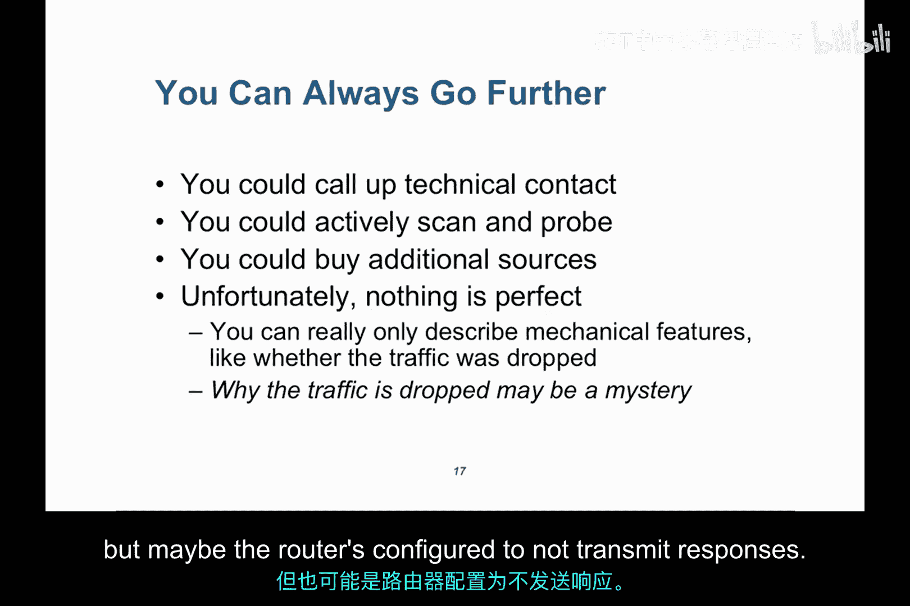

So this was a manual walkthrough， okay， and there's a couple of things I want you to keep in mind about this。

 you know， this is a rule of thumb activity， but there's some basic rules I want you to pay attention to。

The first is probe the neighborhood if you can't find anything directly there。

 take a look at the neighbors， you might be able to find out the authority。

 you might be able to find out a local name server。

 things like that you can use for further investigation。

Don't be afraid to use Google it just this is I know I've emphasizes a couple of times and I'm going to repeat it。

 I'm just amazed by how often people will trace Ro or ping or things like this and they won't use the most basic research tools available to them as an initial step okay。

Don't be afraid to use looking glasses in fact especially when you're looking at the routing level information looking glasses are godsend because they're going to allow you to deal with geographic biases if I probe Germany from Virginia。

 there's going to be a very specific set of cables that are actually going to transmit my pings okay。

 if I probe from Germany itself completely different route take okay？Now。

 the important thing again is I emphasize that there's no perfect process。

 but I wanted to show you how I'd go about doing it myself or some of the initial things that I would do and you know at this point I have a couple of dozen different routes that I might take in addition to various sites I know of various lists I might use。

 but this gives you a jumping off points to understand how you can build your own seed process for doing this investigation。

Okay。

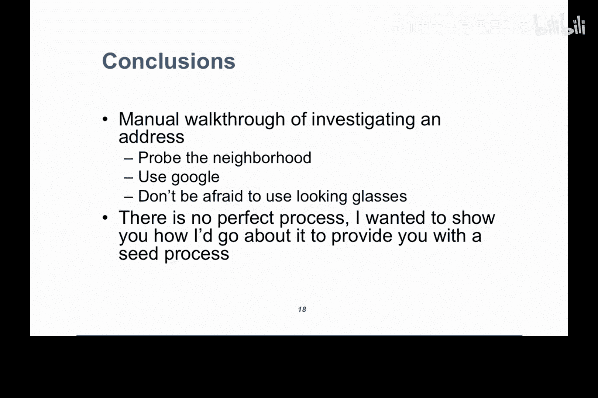