# 约翰霍普金斯大学《信息保障分析｜Information Assurance Analysis》中英字幕 p28 8_DNS基础设施架构.zh_en -BV1Qz8EzYENX_p28-

Hello class since the 675741 information assurance analysis， this is Dr。

 Collins speaking and the topic of this talk is module 7。4。

 which is about various infrastructural aspects of DNS this module is going to dives into the guts of DNS a bit more to recall what we've talked about so far is the idea that DNS is a protocol that enables you to associate IP addresses with arbitrary user names arbitrary strings one of the things that call also that DNS is a hierarchical protocol in the sense that when you do a lookup on a fully qualified domain name you are actually you' are actually performing a series of lookups on a series of servers to give them progressively more related to the address in question。

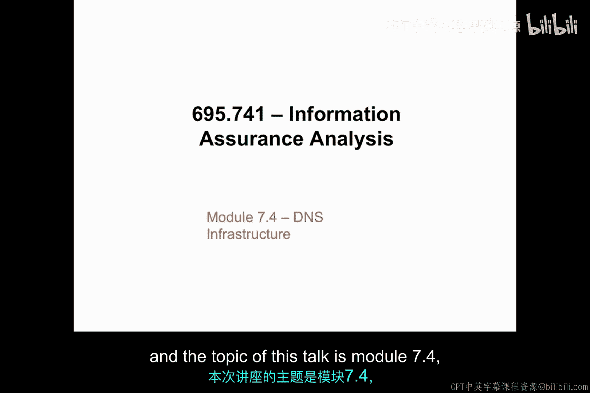

Today， we're going to talk more about the concept of a zone in DNS。

 A zone is a mechanism for establishing authority and ownership over a collection of DNS names。

 and it is critical to understanding various aspects of certain DNS attacks and also sort of how DNS controls addresses in general。

We're going to examine the relationship between DNS and SMTP。

 and we're going to talk a bit about DNS's physical infrastructure。

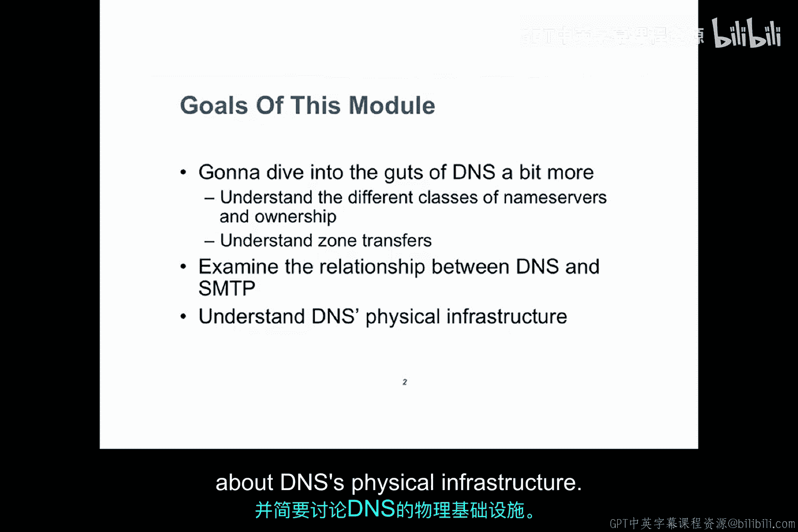

Now。The first item to discuss is a zone。Now， what if a zone is distinct from a domain。

In DNS terminology， a domain is one of is a continuousiguous collection of names which have a common label。

 so for example， comm is a domain， food。com is a domain， bar。fo。com is a domain and so on。

Administratively， DNS is design divided into zones。

 A zone is a collection of continuous DNS space allocated to a particular server。

 Zones may allocate sub domainme may allocate parts of those two other zones。

 worthy to understand about zones。 Zs are not about domains。 Zs are about ownership。 So， for example。

 these version I have over here。 food co is a zone。

 co and xfo co are in one zone y do xfo com is in the same zone as food co underneath food co we have another zone barfo co X do barfo Anything with barfo com is in it is in that zone。

 If I create a third one Bafo com that is going to be part of the food co zone unless I further split things now。

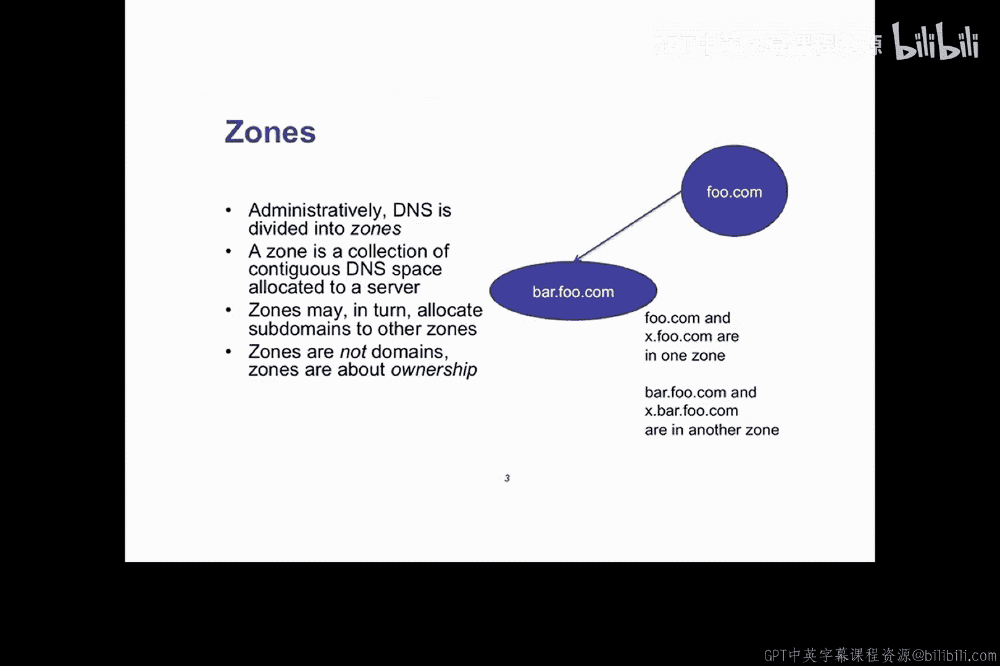

So zones matter for ownership in particular they deal with the problem of authoritative lookup we recall that I mentioned briefly the custom of an authoritative server several presentations back in particular the last presentation when I did the look up on the reverse look up of that IP address。

 it told me what server was authoritative for the Frhoffer domain which owns that IP address okay。

The authoritative server is a server that provides the definitive answer about IP address。

 so if I query two servers that you be two different IP addresses for the same name。

 or one of the visits recognizes the authoritative server， it wins out。Withoritative servers。

Were assigned。During the registration process， so when I register a domain I may also register that the particular server is authoritative for that nomate。

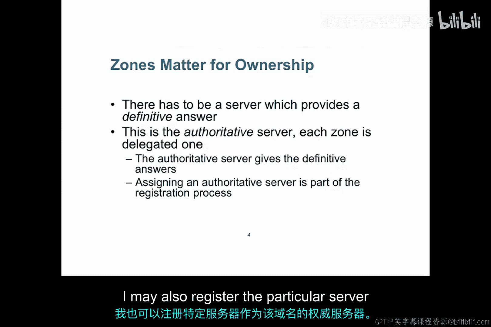

Now。In theory。You should be able to do everything with a tor servers。

 probably we run a lot of queryries。In order to manage this。

 we also be continually called acursive service。A recurive testingsing server maintains。

Zone information。Or address information until there are updates， this has to do with that TTL。

 what youll call when you do a dig query if you do a digig for a particular name。

 so example if policy say3line Dig www。jeddu right now。

 you'll remember that we get a particular number with this returning a record and that is the time that response is guaranteed for。

 that's what the cache is hold on to。

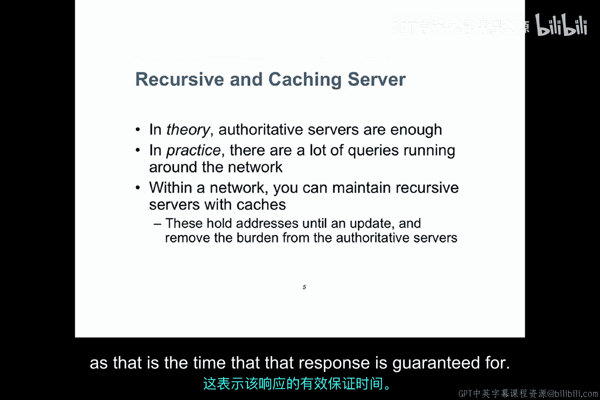

No。An authoritative server。Covered Z z。Zone's whole bunch of address， a whole bunch of names。

You may would。To get everything in the zone。A DS that's done with a record type AXFR。

 the zoneone transfer， the authoritative zone transfer record that returns everything the service is authoritative for yeah you may notice that's going to be more than you could put in a UDP record。

It's worth the EP data graphic at old。This is DS done over TCP and it's done pretty much exclusively for the purposes of zone transfers。

 so if you watch a DS server， which is a authoritative server over time you are in Netflix flow collect your on it or something like that。

You occasionally see that it runs a big TCP session， which is the zone transfer。

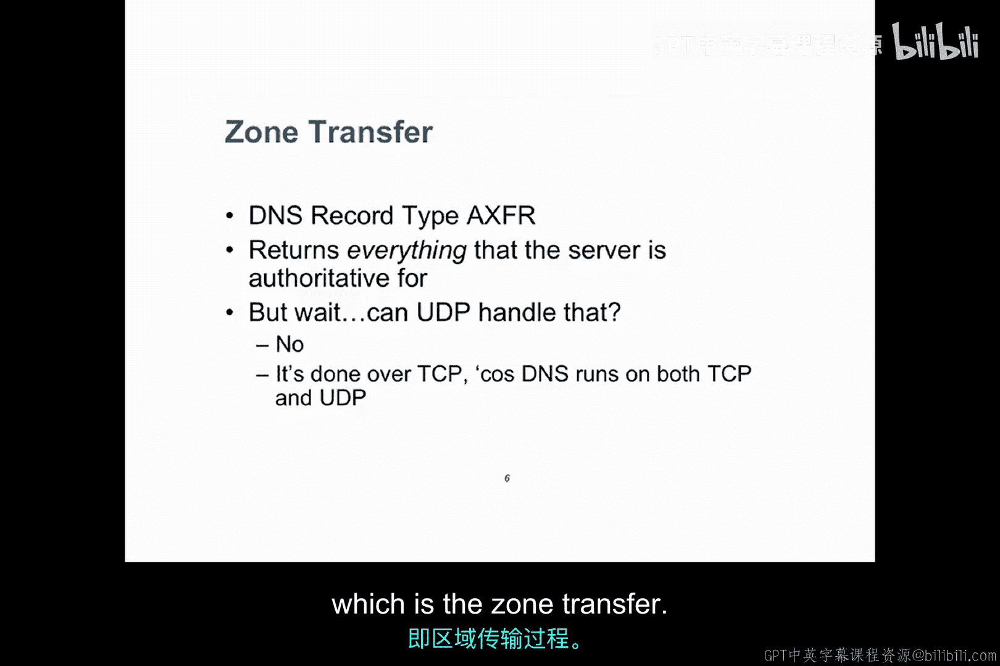

Now， let's talk about mail。 Now， this might seem to be a bit of a jump。

 and it is a bit of a jump because there's no good reason that DNS and mail are interrelated with each other。

 except the oldest protocols of the Internet， and consequently。

 somebody decided we'll split half of DNS into mail。All right。

Get to email without DNF because what DNS does is it maintains the information several locations。

This is done via class of record called an MX Record。

And X records given a domain and returned the name of the mail server for that domain。

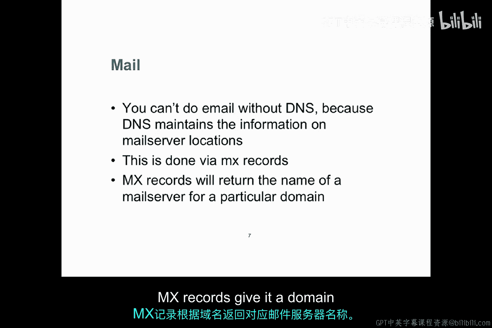

So， for example， if I do a D Mxjedduu， as I've done here。

 you will see that the NS returns an Mx record for smtp。johnshoopkins。edu。

 Now I want you to know but not think too much right now about the additional section。 All right。

 I included because it's going to be important for future discussion the thing I want you to understand about it right now。

 DNs can very helpfully pass you additional information。

 so that you don't have to do multiple queries under normal circumstances。

 if I do if I do a mail lookup for js。edu。 I get SMmtpjohns hopopkins。edduu。

 I select to do another query to get that address。 They're giving me everything I need ones fell swoop now。

Yeah， the thing I want you to notice？All right， as you can see， it's got a very long expert at TTL。

 but it's also got they would after the MX。That is a priority number and the priority number is a message broadcast by the mail servers to indicate if you have multiple mail servers。

 which one should be your first choice。 So， for example。

 I might run five mail servers beside the pro priority10，2030，40，50， No。

It is up to the male client to decide which of the servers it's going to open up communications with the priority is supposed to be an instruction the client telling them the frequency with which they should use a particular server。

 the idea being that the low is that the ones that have the lower priority number are the ones that you should go to more often because that's what they're allocated for and now。

Couple of things first off my experience has been that clients do obey us intent to drop off roughlyly exponentially。

 so you go to the first server and you find that there's a quarter of the traffic goes to the second at9 to the third and so on The other thing is that spammers like this information。

Because from their perspective， somebody is assigning a lower priority to a server that probably means they're not paying attention to that server as much。

 and they might be able to pull off more damage there。

 So favors will search and may use that information as well。As a response to that。

Identify that most people just decide the same priority to every mail server。

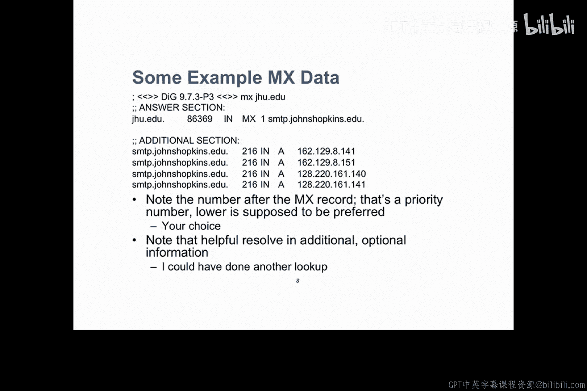

No。Let's talk a little bit about the physical resources。There is this。

 what we've talked about in the fully qualified domain name is the idea that if you take a look at a name like www。

jsu。edu， technically it's www。jsu。edu with another dot slept on the end。

 which is the root there are these servers on the internet。

 the root servers and these are technically the first server you talk to because they are the servers for the root domain now。

These are physical machines， and if you go to rootservice。

org you can see their location and you can see how much of them you can see their location。

 you can get some idea for what they look like many of these are actually clusters of computers because they receive an enormous volume of network traffic every day。

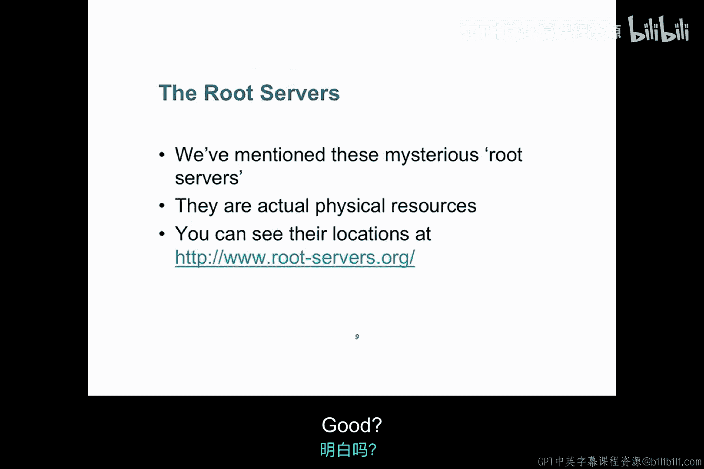

Now what does these things do the first is that they maintain the root zone okay。

 so this means that if you wants to look up anything they dont want to tell you to talk to。

edduu or things like that， they deal with hum this query volume basically everyone on the planet is talking to them all the time。

And it is so large that they're actually probably closer to 130 servers rather than the actual 13 Now you might ask yourself。

W 13 Ro servers。It has to do with the original size of the UDP packets that DNS set。

 which we limited to about 512 bytes。Given the size of the records describing the servers。

 given that every host had to be aware of all of them。

13 was the number that you could reasonably stuff into a legitimate DNS packet at the time so we're sort of stuck with this right now and when you take a look at them what you'll find is that they are basically numbered it used to be that they don have names like NSS。

na。gov now they are aroservs。net Brootservs。net etc they have fixed IP addresses you can go and file if you go to rootserv。

 you go to Wikiedia you can find the IP addresses of these servers it's not bad have a couple of them sitting in your back your hand especially for diagnostic purposes but what you'll find also is that they have IPv6 addresses well that's more of a migratory or shoes some of them have  IPv6 some of them don't。

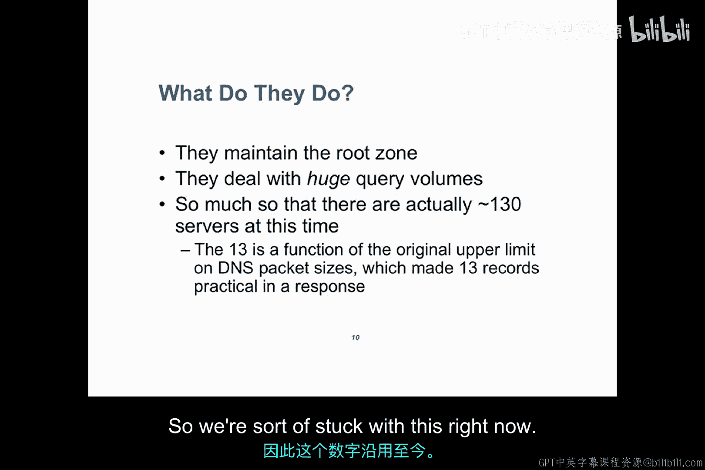

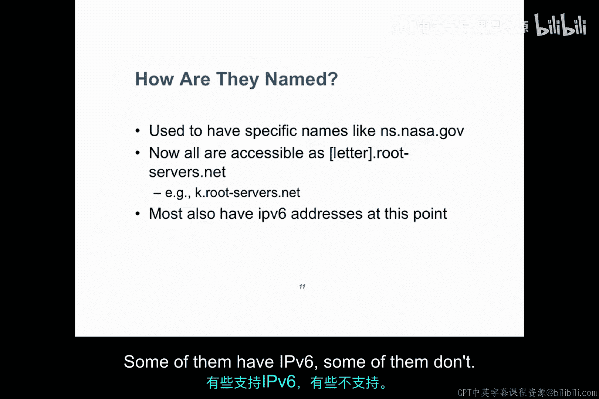

We're very short， like sure。What I wanted to do was give you some idea of infrastructure and Ds。

 zones， domains， mail and to talk about this cousin of the root servers。

 So you got this idea that somewhere。

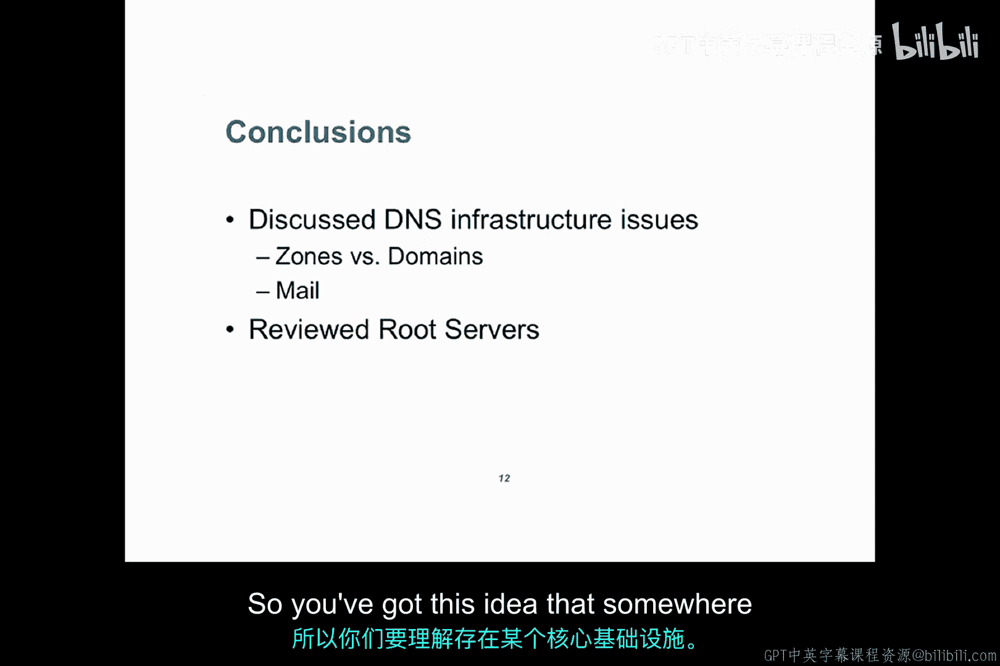

There's a core infrastructure that's in place。