# 信息保障分析：7.4：DNS基础设施架构详解 🌐

在本节课中，我们将深入学习DNS（域名系统）的基础设施架构。我们将探讨DNS的核心概念，包括区域、权威服务器、邮件交换记录以及根服务器的物理基础设施。通过理解这些组件，你将能更好地掌握DNS的工作原理及其在网络安全中的作用。

---

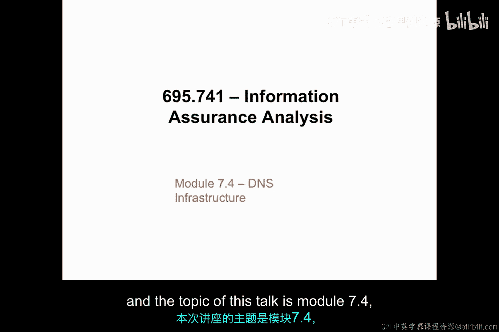

## 区域与域名的区别

上一节我们介绍了DNS的基本概念，本节中我们来看看DNS中的“区域”与“域名”有何不同。

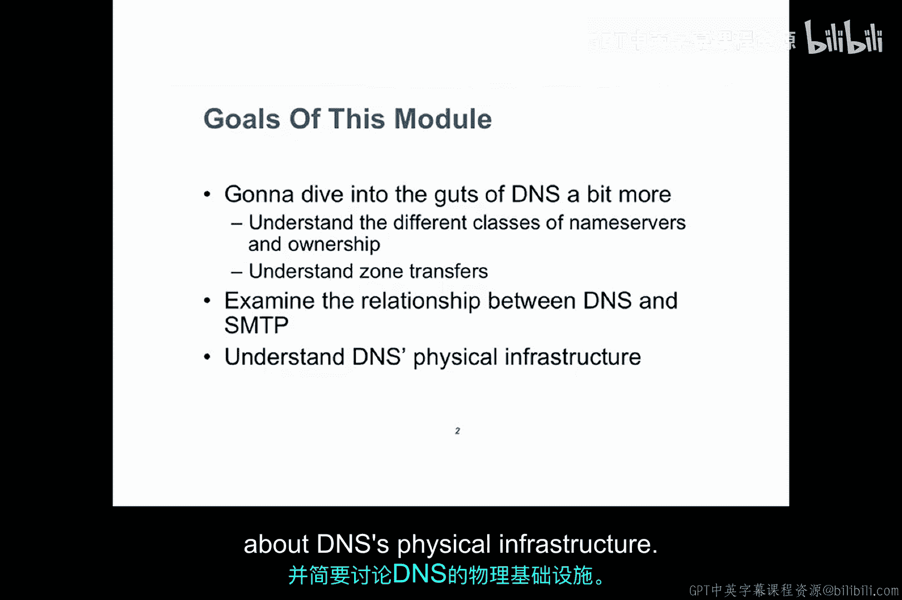

在DNS术语中，**域名**是一个连续的、具有共同标签的名称集合。例如，`.com` 是一个域名，`foo.com` 是一个域名，`bar.foo.com` 也是一个域名。

从管理角度看，DNS被划分为**区域**。一个区域是分配给特定服务器的连续DNS空间集合。区域可以分配子域名，也可以将部分空间分配给其他区域。

需要理解的关键点是：区域关乎**所有权**，而非仅仅是域名。例如，`foo.com` 可能是一个区域，而 `x.foo.com` 和 `y.foo.com` 可能同属于 `foo.com` 区域。如果在 `foo.com` 下创建 `bar.foo.com` 并为其分配一个新区域，那么所有 `bar.foo.com` 下的名称都属于这个新区域，除非进一步分割。

---

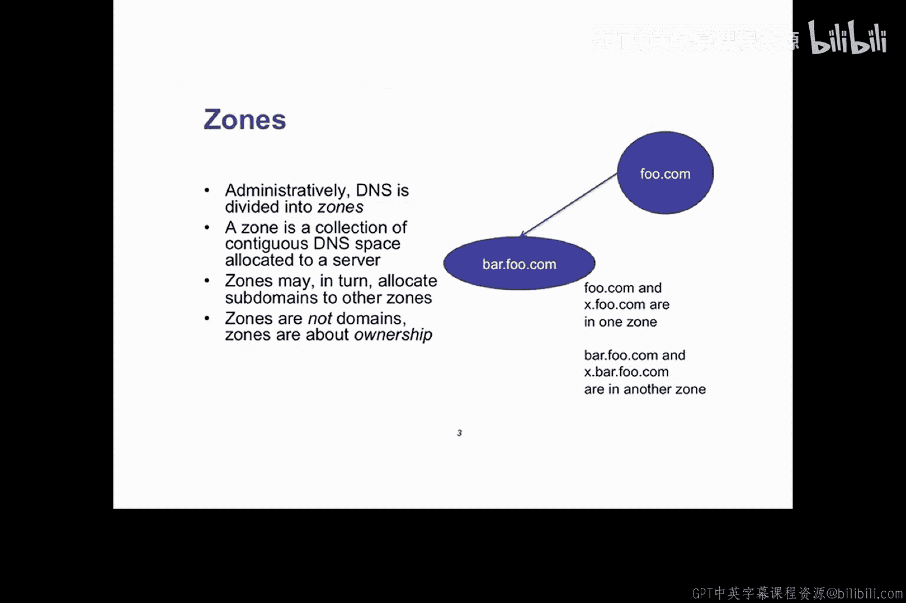

## 权威服务器与递归服务器

区域的概念直接关系到权威查找问题。我们之前简要提到过权威服务器的概念。

**权威服务器**是为特定域名提供权威答案的服务器。如果我查询两个服务器得到同一个名称的不同IP地址，那么来自权威服务器的答案具有决定性。

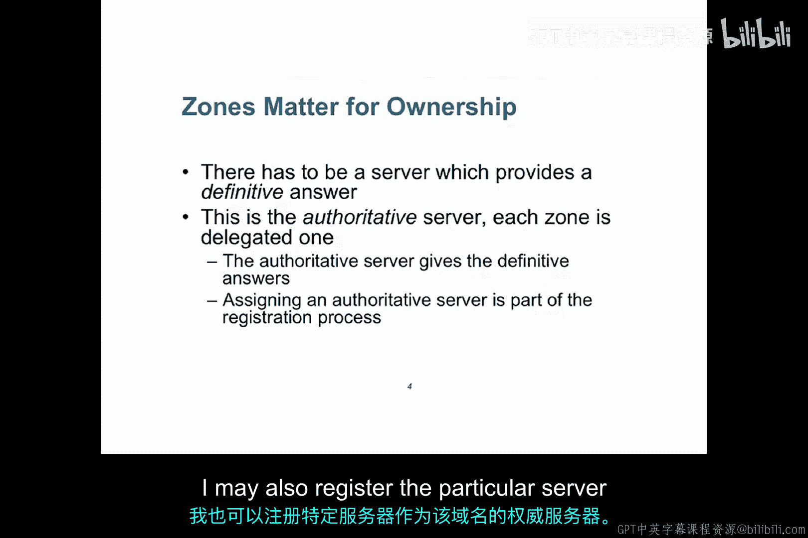

权威服务器在域名注册过程中被指定。当我注册一个域名时，我会同时注册一个对该域名具有权威性的服务器。

理论上，所有查询都可以通过权威服务器完成。但为了管理海量查询，DNS系统广泛使用**递归服务器**。

递归服务器会缓存区域信息或地址信息，直到信息更新（由TTL，即生存时间控制）。当你使用 `dig` 命令查询一个名称时，返回结果中包含一个TTL值，它表示该响应在缓存中有效的时长。

---

## 区域传输

一个权威服务器管理一个区域内的所有地址和名称。

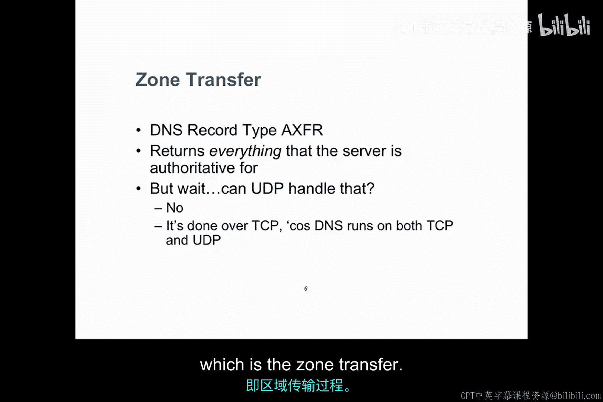

如果你想获取区域内的所有记录，可以使用记录类型 **AXFR**，即区域传输。AXFR记录会返回该权威服务器负责的所有信息。由于数据量可能很大，无法放入单个UDP数据包，因此区域传输通常通过TCP协议完成。

如果你长时间监控一个权威DNS服务器的流量，可能会偶尔观察到大型TCP会话，那就是在进行区域传输。

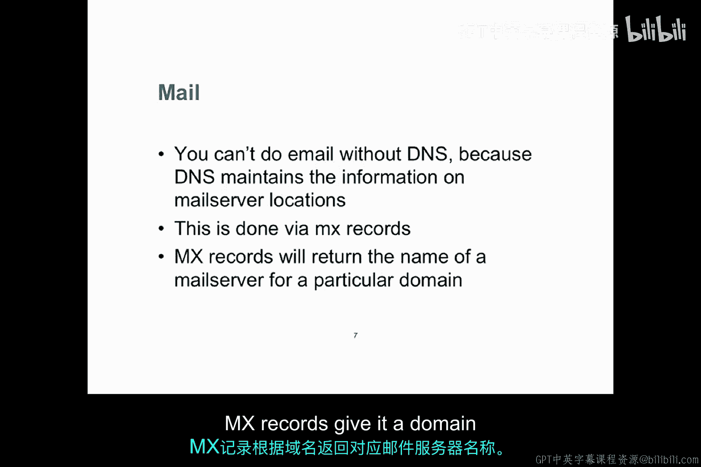

---

## DNS与邮件系统的关联

现在，让我们谈谈邮件。这看起来似乎有些跳跃，因为DNS和邮件系统本质上没有必然联系。但由于它们都是互联网最古老的协议，设计者决定将邮件系统的部分功能整合到DNS中。

没有DNS，电子邮件将无法正常工作，因为DNS负责维护邮件服务器的位置信息。

这是通过一类称为 **MX记录** 的DNS记录实现的。MX记录接收一个域名，并返回该域名的邮件服务器名称。

例如，执行 `dig MX jhu.edu` 命令，会返回 `smtp.johnshopkins.edu` 这样的MX记录。

在返回结果中，你可能会注意到“附加部分”。DNS会非常有帮助地传递额外信息，这样你通常就不需要执行多次查询。例如，查询 `jhu.edu` 的邮件服务器时，DNS不仅返回服务器名称，还可能直接提供其IP地址。

MX记录中还有一个**优先级数字**。如果你有多个邮件服务器，优先级数字指示邮件客户端应优先使用哪个服务器。数字越低，优先级越高。

邮件客户端应遵循此优先级，流量通常会按优先级指数级下降。但需要注意的是，垃圾邮件发送者可能会利用此信息，他们可能认为低优先级的服务器监控较弱。因此，许多人选择为所有邮件服务器设置相同的优先级。

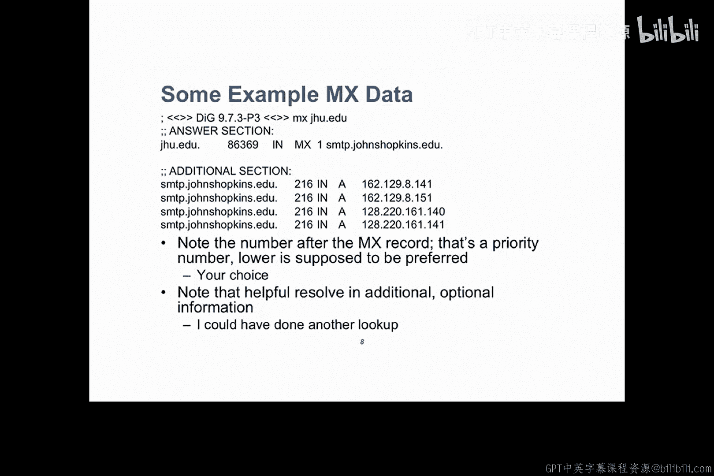

---

## 物理基础设施：根服务器

最后，我们来谈谈物理资源。我们之前讨论过完全限定域名，例如 `www.jhu.edu.`，结尾的点代表根域。

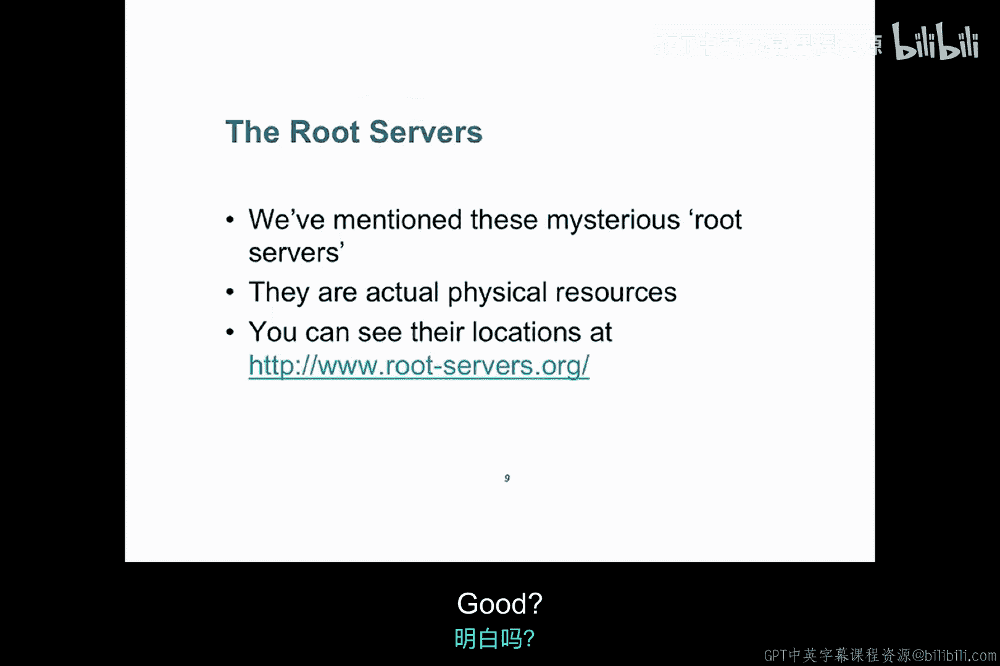

互联网上存在**根服务器**，它们是技术上的第一级查询服务器。这些是物理机器，你可以在 `root-servers.org` 上查看它们的位置和状态。其中许多实际上是计算机集群，因为它们每天需要处理巨大的网络流量。

根服务器的主要职责是维护**根区域**。这意味着，当你查询任何顶级域（如 `.edu` 或 `.com`）时，根服务器会告诉你该去找哪个服务器。

你可能好奇为什么只有13组根服务器。这与DNS最初设计的UDP数据包大小（约512字节）有关。考虑到描述服务器所需的记录大小，以及每个主机都需要知道所有根服务器，13是当时能合理塞进一个DNS数据包的最大数量。这个数字一直沿用至今。

这些根服务器有固定的名称（如 `a.root-servers.net`）和IP地址。其中一些还支持IPv6地址，这反映了向IPv6迁移的进程。

---

## 总结

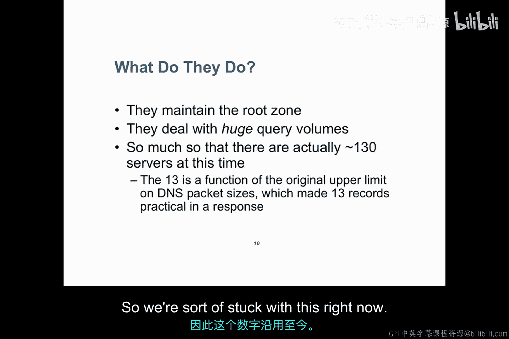

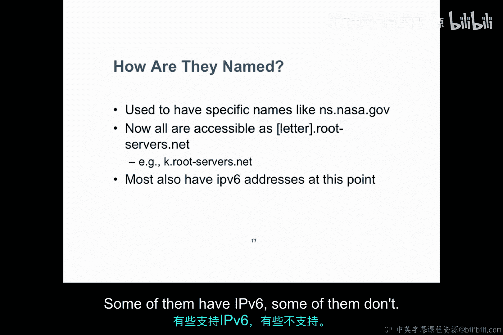

本节课中，我们一起学习了DNS基础设施的几个核心方面：
1.  **区域与域名**：理解了区域是管理所有权的单位，而域名是名称的连续集合。
2.  **权威与递归服务器**：认识了提供权威答案的服务器和用于缓存、提高效率的递归服务器。
3.  **区域传输**：了解了如何使用AXFR记录获取整个区域的数据。
4.  **DNS与邮件**：掌握了MX记录如何将域名映射到邮件服务器及其优先级机制。
5.  **根服务器**：认识了互联网DNS查询起点的物理基础设施及其历史设计约束。

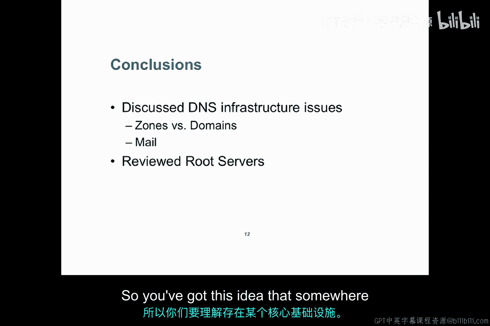

通过理解DNS的这些内部架构，你为分析潜在的DNS攻击和设计更安全的网络配置奠定了坚实基础。