# 约翰霍普金斯大学《信息保障分析｜Information Assurance Analysis》中英字幕 p29 9_DNS攻击技术.zh_en -BV1Qz8EzYENX_p29-

This is module 7。5 which is going to cover DNS hacking general tweet Now the goal of this module is to get you're aware of various techniques and abuses that can be done with DNS now abuses probably too broad term to use here because in a lot of cases these techniques are actually legitimate but we're going to talk about the way that legitimate companies use DNS and that we're going to also talk about mechanisms and attackers use particularly malware authors to manipulate DNS the first and busy easiest is what we call roundrobin DNS allocation。

 I talked about this several modules ago and I just want to go over it again because it's the cornerstone of more sophisticated DNS manipulation techniques now。

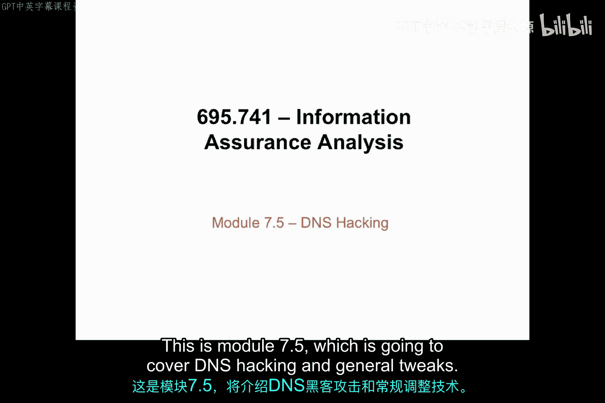

Recall if I look at a site like CNN。com and I do would dig on it。

 I get back to multiple IP addresses Now you'll also notice that these IP addresses are a bit scattered in the sense that there are different s 24s Okay Rorobin DNS allocation is the earliest and simplest form of load of balancing on the internet。

And what it does is it means that when you， as a client， look up a name。

 then what will happen is you will get a name from a set from a pool of addresses passed you randomly。

 Now， ideally， these addresses are widely distributed。

 So it's not just a question of them being different machines。

 They're different machines on different networks， preferably。Read different locations。

By randomizing the distribution， we even out the traffic。

We ensure that traffic is evenly distributed， one machine does not get overloaded。

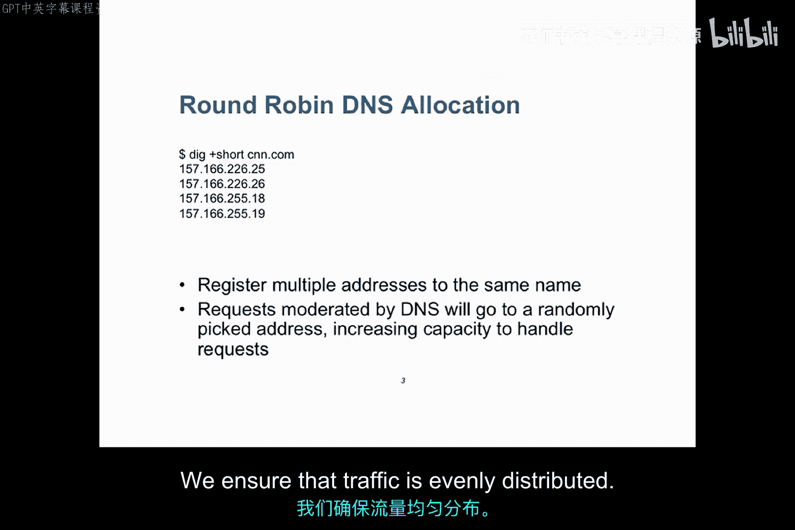

Now。Here's an important thing。We lie an awful lot about the structure of the Internet。

 So what we've told people over the years is that the Internet's a collection of decentralized nodes。

 You know， there are classic statements like Gilmore is the Internet interpret censorship is damaged and routes around it。

 And its' decentralized， scalable network of peer systems。 Theres gigantic pile of lies。

 The Internet relies heavily。 on highly centralralized nets。

 And one of the things you will tend to find is that people will build these decentralized peering network and then recentralize them as time passes。

 This happens with peer to peer networks as happens with DNS。 It happens with STP。

 Some of this is because of physical infrastructure。 connectivity is expensive。

 connectivity is limited， for example， if I'm going to communicate with Australia。

 There there's a limited number of tables， along which I can send that information。

 So it' is going to be a specific set of areas of where to go to to do this。 and most importantly。

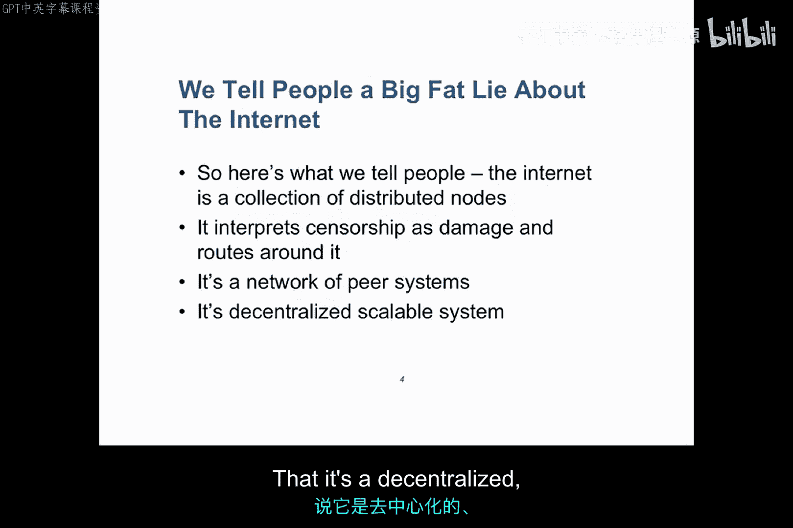

The Internet is not the wet。 The Internet was not designed for the web。 Now。

 I mentioned this in the previous lecture， but I want to go over this again。

 Here's how I was going to use the Internet 25 years ago。 I would go， I would open up my email。

 somebody would tell the that a report was donted that I had to go to a particular server。

 I would then tell letter FTP to that server。 So in the course of an hour， I might， if I was busy。

 talk to6 different site。Okay， so6 DNS requests in an hour。 in the course of a day。

 If I talked to 30 different hosts， I was a busy man。 Okay。

 is the modern internet in the world wide Web。 I open up the New York Times。

 I am opening up 70 different websites simultaneously。 I am firing off 70 different DNS requests。

 I am pulling data from dozens of different locations， and it is all coming to my web page。

 So I am several orders of I am doing several orders of magnitude。

 more DNS requests in the course of a day。 It was originally expected。

 I am pulling down vast amounts of traffic。

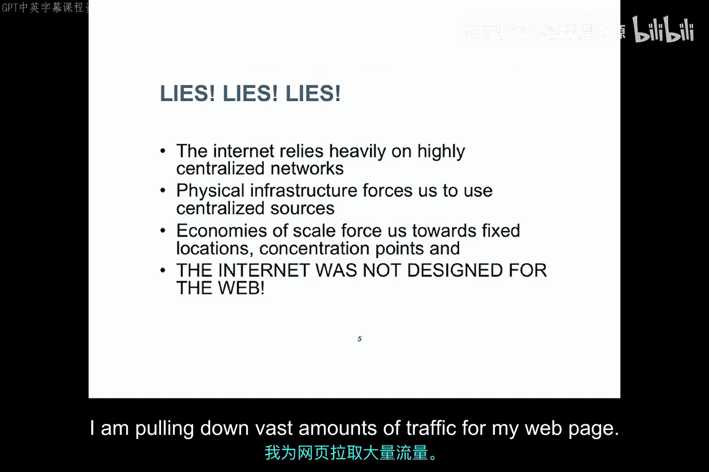

For my web page。 And when we started seriously doing this around 1998。

 we nearly killed the Internet because what happened was the single servers。

 the original big one was the star report， which was。

 if you remember the Monica Lewinsky scandal during the Clinton years。

 It was released as it was released as an electronic document knocked off the White House Web server knocked off all the servers next to it because it completely because the router that was connecting to it was completely exhausted。

 Similarly that he happened with the vi Se webcast in 1999。 very public complaints about this。

 This end to end connectivity model got exhausted very quickly due to these flash crowds。

 that was the term it was coined for him。 These people who all of a suddengrouped together and went and visited a site。

 This actually for years was also called the slash dot effect。

 because there's a web slash dot a hacker news site。 for years was one of the or numerous sites。

 if something appeared on slash dot， there was a good chance it。

effectively DOs by the number of requests that came in for it so sites actually had flashdo contingency plans for dealing with okay and so youd see this kind of exhaustion happen fairly often the solution is what we call a content delivery network or a CD。

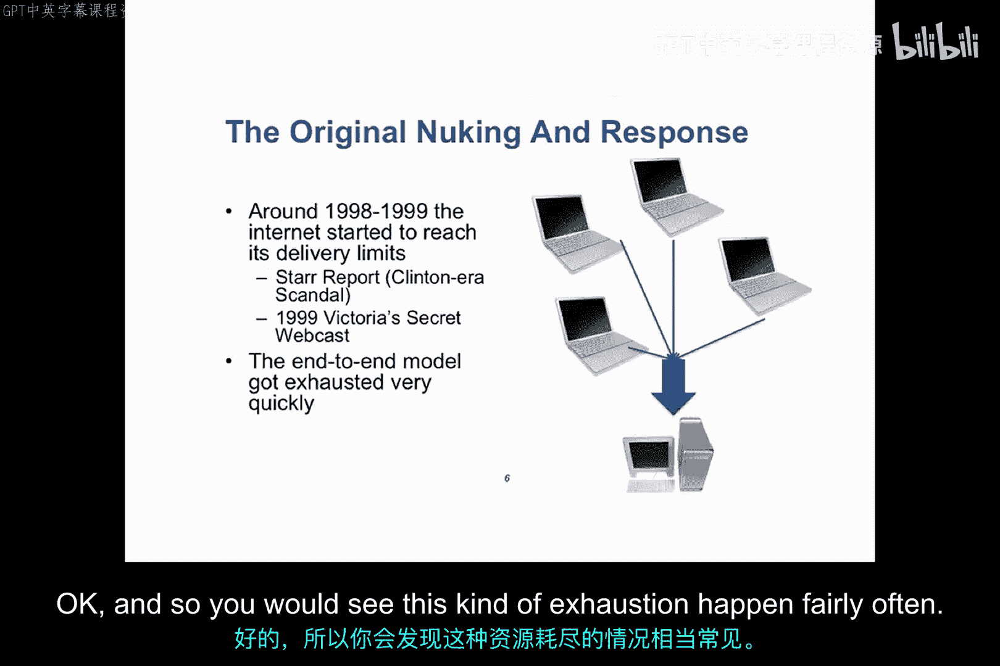

A CN is a network of tats， specifically it is duplicated websites that are all over the Internet。

 So for example， when you go to CNN All right on top of the four CNN www CNNcom website the servers。

 there are a variety of image servers， there are video servers。

 all of those servers are replicated dozens or hundreds of times across the Internet。

 there is a content providing company in the case of CNN。

 I think it's time warer In Fox News's case it's Oabbi。

 they have access to that and they will send out the original content to those servers。

 so they will do one cent to push it everywhere。 but after that's done。

 the caches will pass it locally。 So instead of there being one server that everyone in the country is talking to the CDn splits it across hundreds of servers。

 Now does it do that。

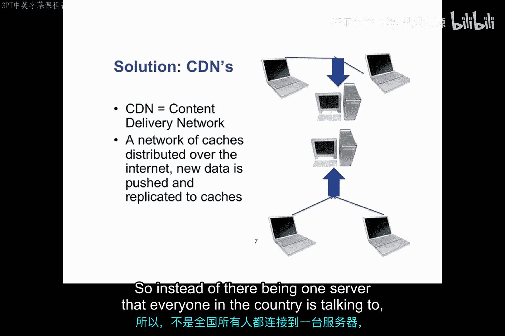

It does that by abusing DNs now。If you have access to a couple of geographically distributed terminals。

 okay， for example， I did this one with contact in DC and Pittsburgh， okay？And I do a dick。

 okay for Foxnews。com， you will see that I get radically different IP addresses for Foxnews。com。

Occui， the hosting company actually does Gelocation。

What it signs out now what happens is the root server had those heads over you know to the Akaai is the authoritative name server for Fox News okay so what happens is when Akamai receives a request for someone for Fox News's addresses。

 it actually takes a look at the IP address that sent the request and it figures out where that IP address is in the country。

 they've got a variety of tricks and techniques for doing this ranging from lookup tables to actually strategically paying you。

 but the point is they figure out where you are and pass you the location of the cash servers that are physically closest。

To you。😡，Okay， so if you're in California and you look up Fox News you'll get a Fox News server in California if you're a DC you get one in DC if you're in Pittsburgh。

 you get one in Pittsburgh okay and this is all through ocuized control of these addresses in DNS okay？

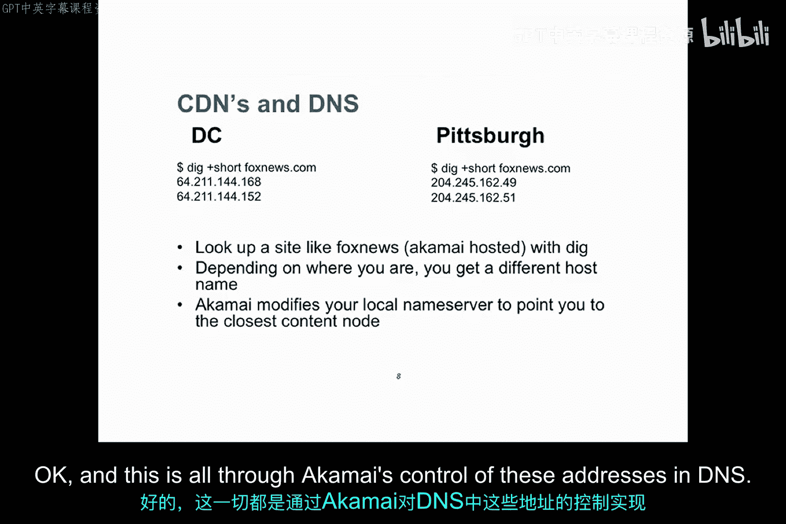

And this is an important thing。DNS is the most important infrastructure of the internet。

 it is the front end to the human internet okay， DNS control gives you enormous power， okay？Akamai。

 which oftentime is jokes that it's the biggest company you've ever heard of。

It uses this information to engineer the internet without the existence of CDN's。

 Akaai levell3 Time warner of these companies， the internet would have collapsed that end to end a model you're told about doesn't scale。

Okay， it was only through the introduction of CDns that we got to the level， the the level of。You。

 that we got through the multimedia internet that we have today， okay？

CDNs will use DNS a manipulation to engineer it， attackers use it to attack you。

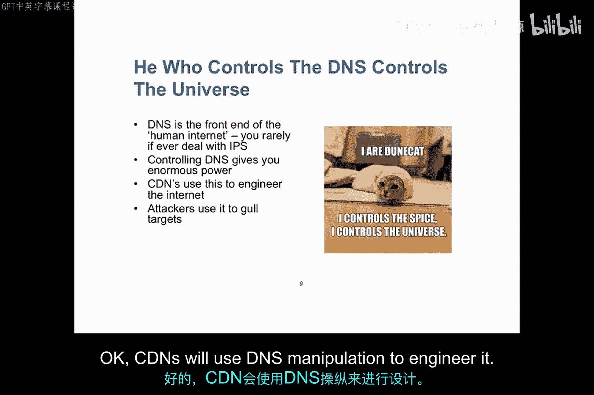

So。The most basic attack isn't even really it is called farming no lie。

I'medgy on using the term of farming I it started showing up in fishing conferences a couple years ago。

 you know， it's a cute pun oh， if he's fishing， oh， he' farming， I'm not sure if it's a real word。

I occasionally hear people use it I don't trust anyone who does。 Okay。

 but well let's talking about mechanically what we're doing。 We're talking about hijacking resolve。

 resolution in order to force the user to go to specific sites。

 the easiest way to do this type of things to modify your E C host。

 which is about malware generally does Most other versions though involve attacking local DNS servers and breaking them。

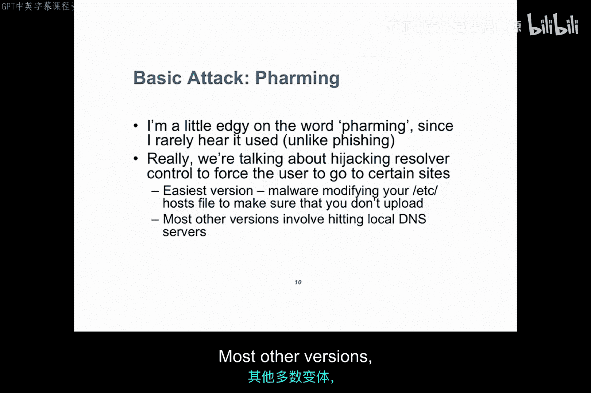

Now an alternative approach is what's called fat fingering okay fat fingering is where you register a site which is almost the same as another one for example。

 I register wwwnyytime。com okay I register ebay X。com or something like that now the reason I do this is because the odds are you look at the name and you just sort of nod that it is the correct one and move on from there Aters will often use this one where what they'll do is they'll register a very long trailing domains so for example。

 I'll create 9931p1x。com and they'll put Bankof Americaica it's an xium on it。

These types of attacks are also possible using international domain names domain names are now internationalized which means you can put a name。

 you can register domain name in Chinese and Arabic and whatever typeface you like and several of these typefaces have homoographic characters。

 which means they look like something in our language so for example。

 you know if you evert a look at the old C Union logo， you know it looked like CCP。

 it was actually the equivalent SSR， but they look like the same English letters and so you could take a name and write it with Cyyrillic characters maybe throw in one or two and have it look identical to another name。

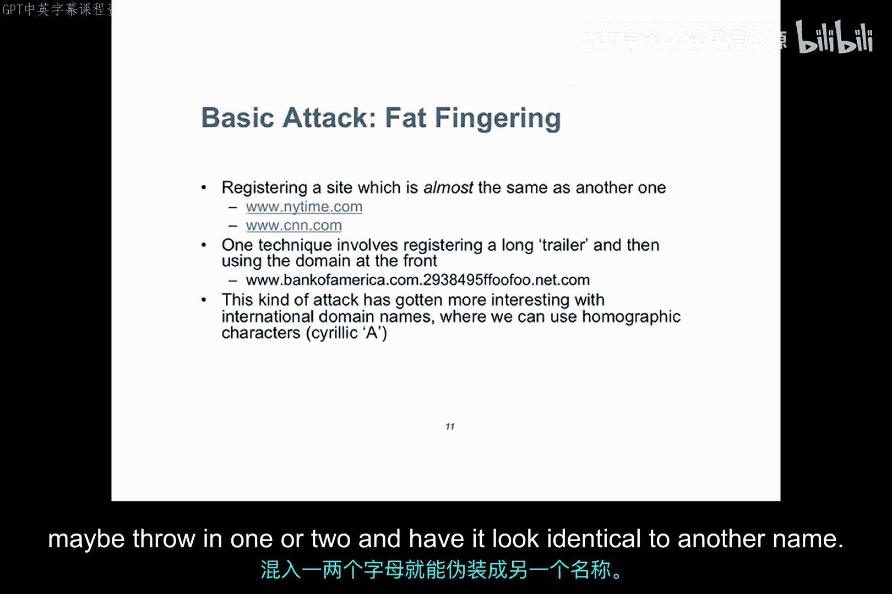

Right。Another approach is cache poisoning Ca poisoning involves selectively changing the names and recursive DNS request okay it's done to remember the DNS does this caching to reduce load and improve performance that's thes with lifetimetime figures Ga the TTLs。

Dodist holds on today so that it doesn't have to bother the rest of the hierarchy。

If you are corrupt upstream of an address， then you can poison the cache if you do that then you're going to leave the name IP relationship that you control so you know for example。

 if I was to compromise the doedu servers， I can start setting everyone's own own addresses Now historically cache poisoning has been considered sort of a handwavy theoretical problem the reason for this is because DNS does do this cache update mechanism are where it DNS does this query mechanism where it has this query ID and at the 16 bit value which is supposed to ensure that when you get a response it matches the original query。

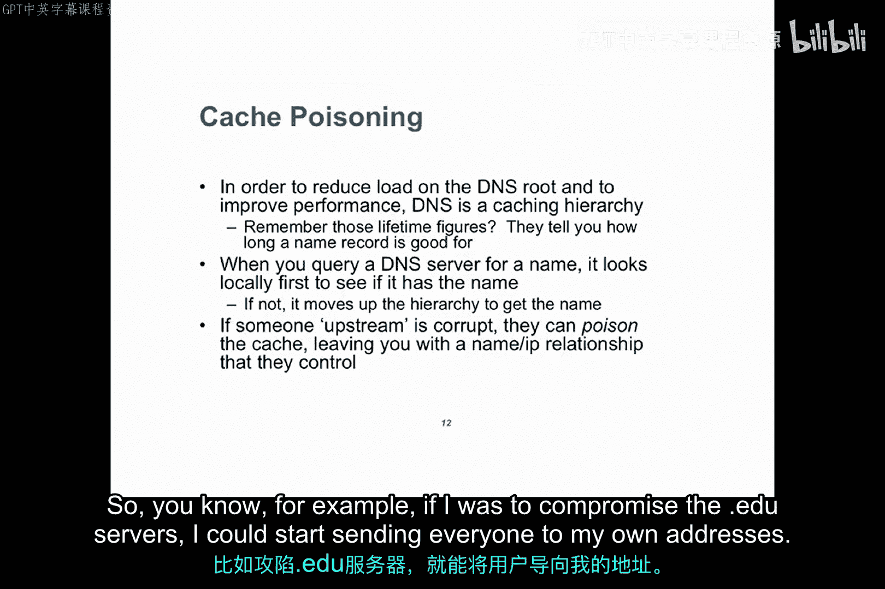

attacker would have to guess this and with 16 bits it's going to take a while in particular it's。

 you know， no， this is not to say that this cyber of attack hasn't been done successfully。

 for example。Design mistake number1。😡，Anytime you tell a developer to use a random number。

 the odd are that the first thing they're going to do is they're just going to increment things linear light okay。

Technically， that could be random， but it does make for a nice predictable value。

And there were several DNS implementation or bydis that did this， and as a result。

 you would find that it was possible to predict and launch attacks with these， however。

 the most interesting one of the past few years， the one that has been the most effective was somebody guy named Dan Kainsky。

 okay。

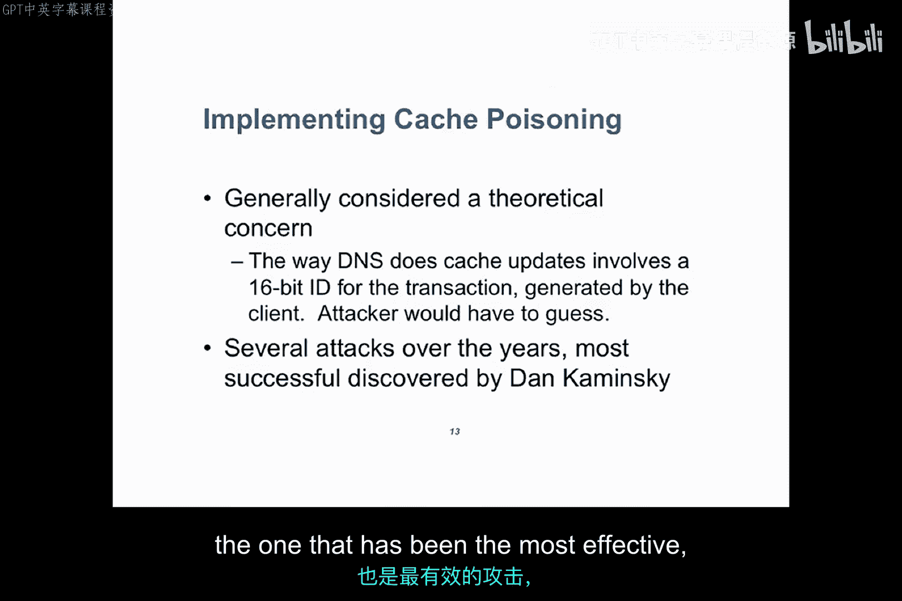

Now you might recall on the several slides ago when we did the MX query for Hopkins it returned a bunch of additional records okay DNS can send unrelated information right so Im my queryrydNS and ask for CNN。

 co and great and then is additional information but elevator it tells me what the New York Times。

com is normally DNS ignores this to the process of what's called bailowic checking which is you know if you send a request for something and the request will that will be brought back with it it's only going to care about things within the same so。

There is no state though that really maintains what the original query was so the system can send back records as it feels like。

 so I might query for A。com okay and I could then respond to return what aW。

com is and it can also add addresses that you don't care about but which might be relatively common like at www。

com okay so I can start to control you that way by sending that additional information okay。

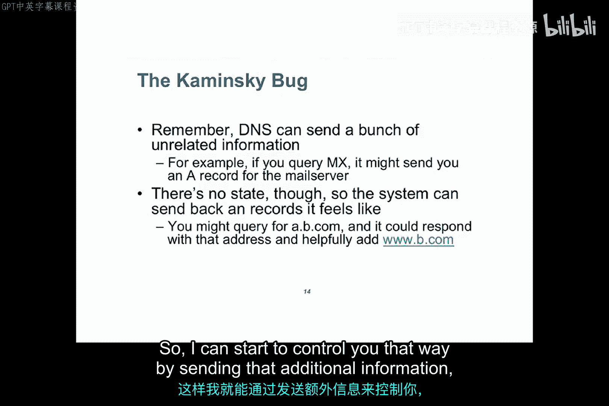

That's， you know， no， obviously the Q I D is supposed to stop that。

 But the interesting thing is that you could force a number arbitrarily。

 So the classic Kaminsky example is I put up a web page with。20000 images on it， okay。

And closegrily I launch 20，000 DNs requests， meanwhile， I'm flooding back。

This response from DNS you know I just use a fixed QI okay and the probability。

 you know there's 20000， there's 20，000 unique QIs being sent out there's a high probability that I am going to intersect it's actually higher than one over3 which is what you might think initially because 2000 out of 60000 there's a phenomenon called the birthday paradox which extends that but the point is you know you can trigger the responses or you can trigger the query you can then send the response with a blind query ID and have a decent chance of matching the query ID and then the additional information is update it Now one thing about the convince keybu I'm you know as little lot of things in this course I sort of touch on things very rapidly and then move on I just want to emphasize the convince keybu is interesting because。

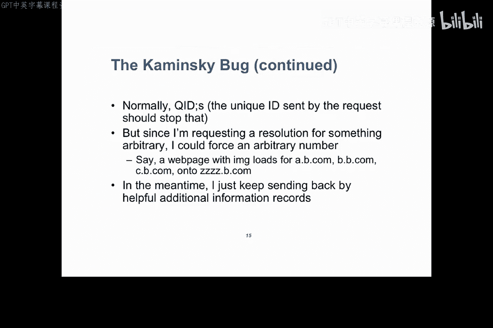

It's the first case I've seen if people actually taking DNS cryptographic security and DNS seriously。

 you' got to understand we have a lot of potential mechanisms for repairing the internet。

 cryptographic ones in particular。It is almost impossible to get administrators to agree to use them。

DNS Se went through because of the Kainsky bugs that had never happened。

 we never would be talking about doing DNS ciing like we are now。On to the next technique。Fast flux。

 this is explicitly an attacker technique， it's aneditivity and defensive mechanism。

The idea is that you register multiple IP addresses to a single domain name with a very short TtL Now the reason for this is because attackers on the whole attackers or defenders on the whole don't block on domain names。

 we can't I the relationship between domains and I is very fuzzy so we normally block on IP addresses the attacker takes advantage of this so for example he sets up so that you know you have to contact you know。

You contact malware site with this date Okay fast fuck if malwares site with this date。

 I block the IP address of one of these malware sites that's okay。

 the name is already shifted over to a new address which has that information so the attacker really doesn't have to do anything the burdens on the defender tip。

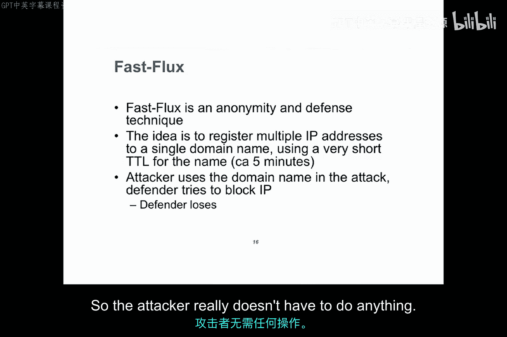

Vixing is predictive domains， so this was a cute trick of conor debt okay。

 now what happens with predictive domains？Is the attacker creates a pseudo red number generator to generate domains now。

I'm sure you're all familiar with Gen random numbers， but just to go through it again。

 this is sort of one of those core cryptographic ideas。

You create a number that is dependent on a particular C if you're unfamiliar with the algorithm of the C。

 then over space if you look random to you， the attacker can predict the values。

 and so what he does is he registers the domains ahead of time so that every few days Confiker looks for a particular name it can get marching orders and new software downloads for defendanters to ID this they need to have the seat。

 though in the case of Confiker working group， they need reverse engineer that we're able to purchase the domain names ahead of time。

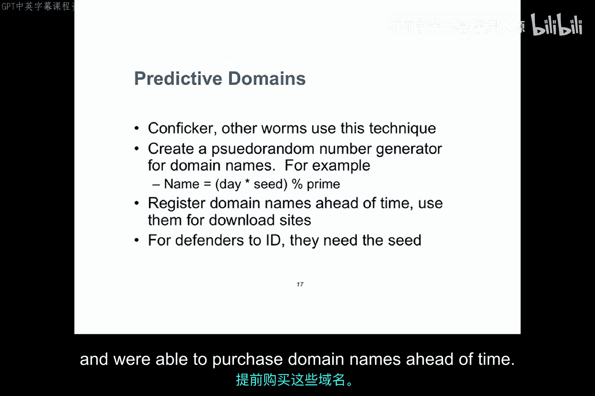

Now， DS changer， this was sort of ripped from the headlines recalled。

 I told you about alar roots a couple of lectures ago as you don't remember。

But alt root is a DNS route that exists outside of the standard I cant hierarchy there's nothing that prevents these things from existing it's just normally a question of performance there's a subcategory of these al routes which are rogue networks and obviously what a rogue network is is it's somebody who set up a route for the purposes of distributing malware or attacking you things of that nature the classic way to really do this is you muck up somebody these resolve。

 co or are there Etsy hosts so that names go to this specific location DNS changers a good example of the piece of malware which did this you might know that it was shut down by the government earlier in July where DNS changer did as it modify the resolve co to point to specific DNS servers maintained by the authors of the original malware by doing this they were able to you know send they' were able to basically control all the name resolution and create whatever they wanted you know。

You want to go to York Time that they wanted to sho malware on the New York Times website they could do that so it've been operating for several years De had basically been sending out information on how to shut these things down they took over the actual actually addresses for the resolvers a couple years ago for safety sake that they actually shut them down earlier this year This is sort of a taster of a variety of ways to fiddle with DNS to sort of work outside of what you might think of as the standard DNS implementation some of these approaches are actually beneficial Robbin allocation has a purpose CDNs have a purpose but a lot of these purposes are malware intended and by going through them I sort of giving you a taste for the way that people can do things they can do things socially fat fingering for example or some of these domain registrations they can do things technically they can modify the host itself they can manipulate the DNS protocol the thing they' understand about this as the hard as a DNS is very messy it's a complicated protocol and because it's such。

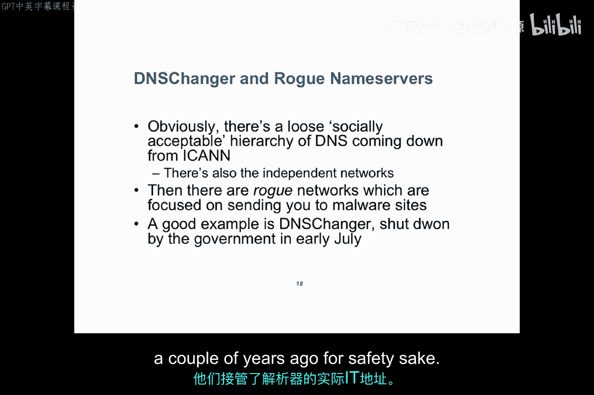

The core of what we do， there are a lot of hacks builts into it DNS is not complicated because the problem is complicated。

 DNS is complicated because it's the infrastructure for everything else and so we have added more and more things into it as time has passed。

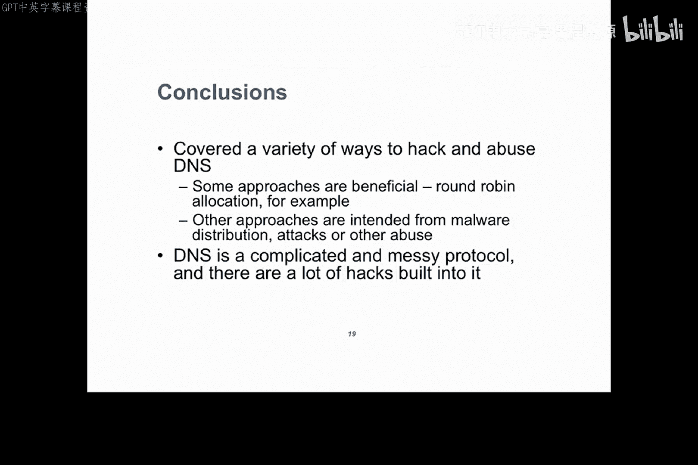