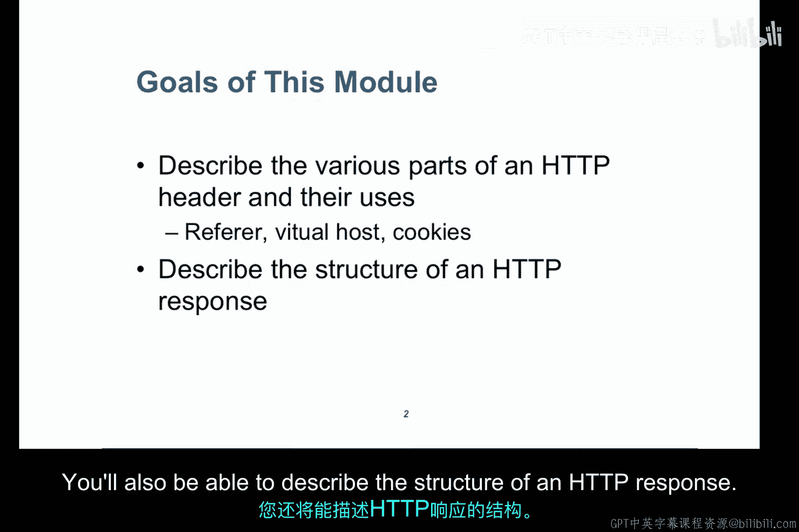
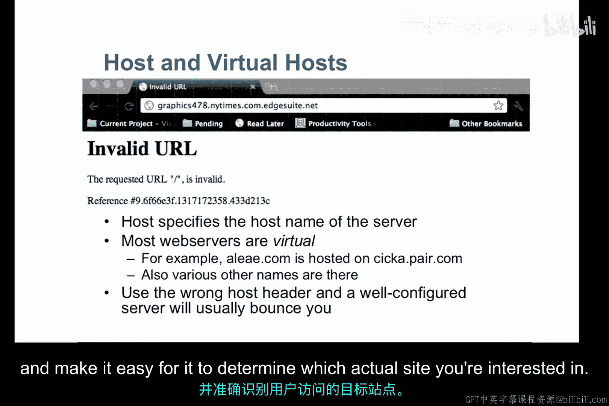
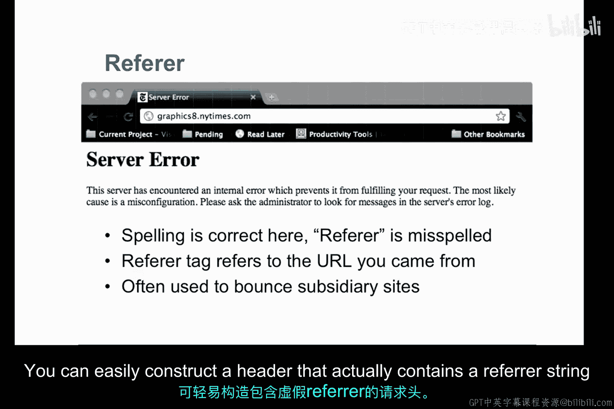
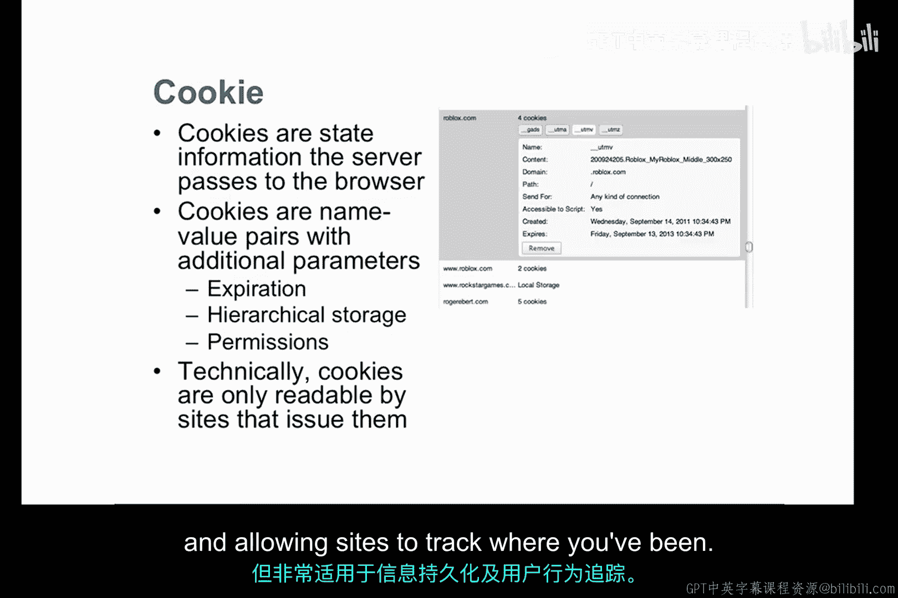
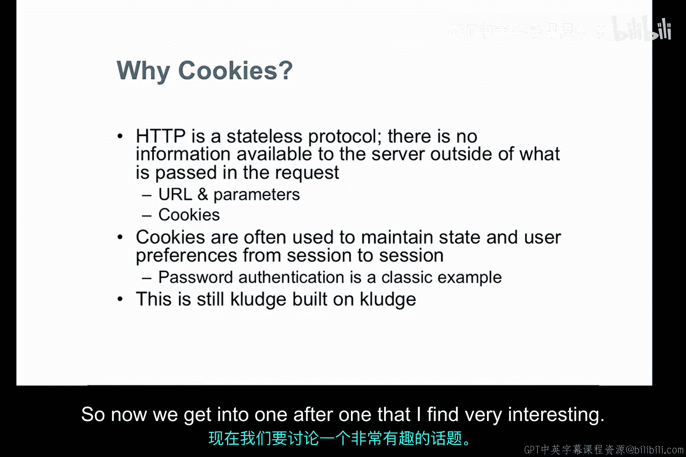
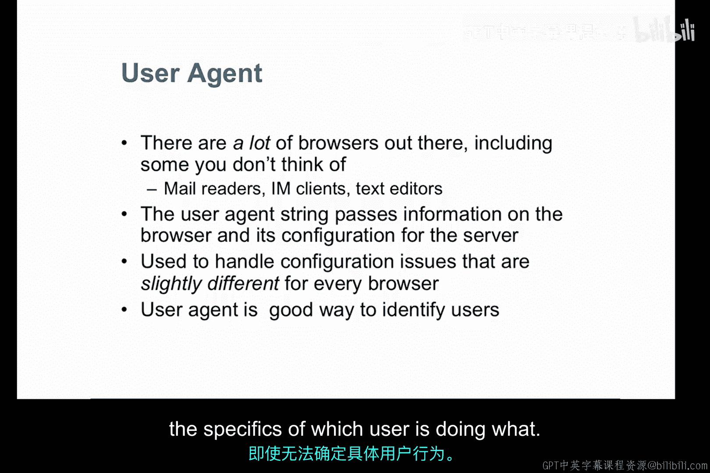
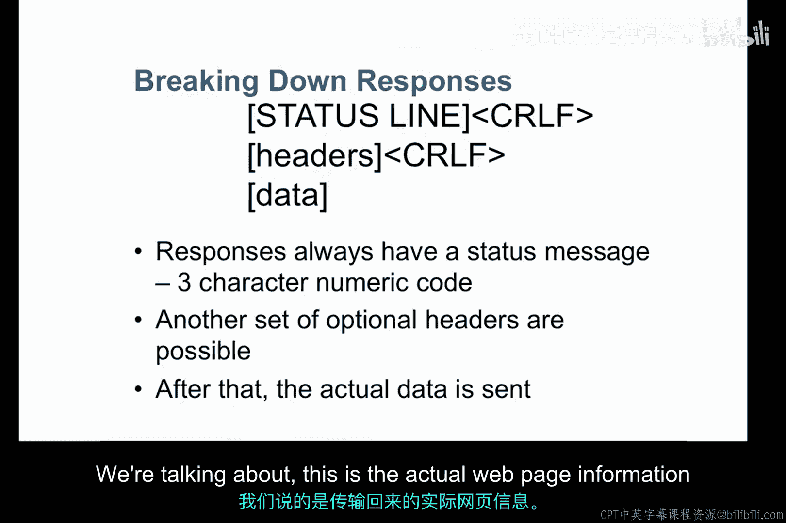
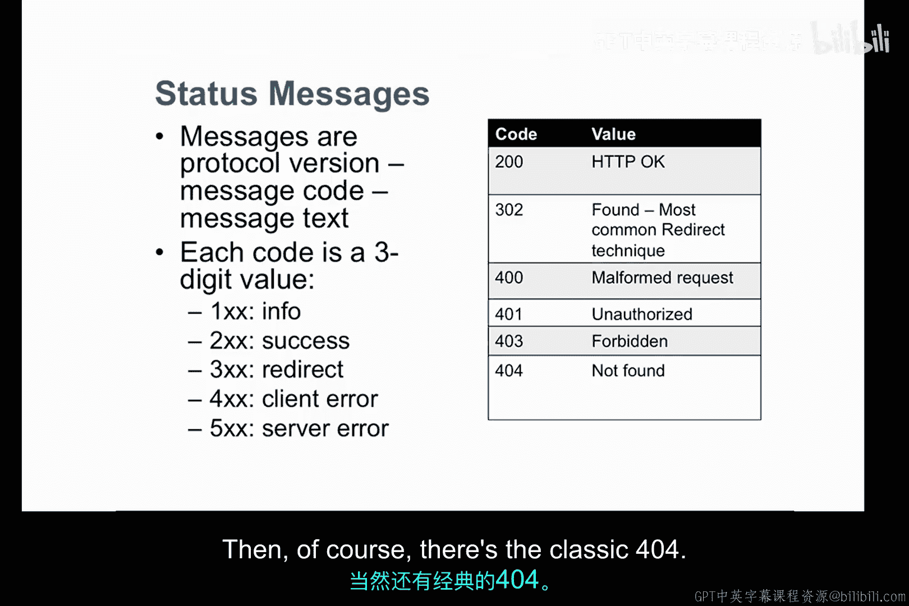
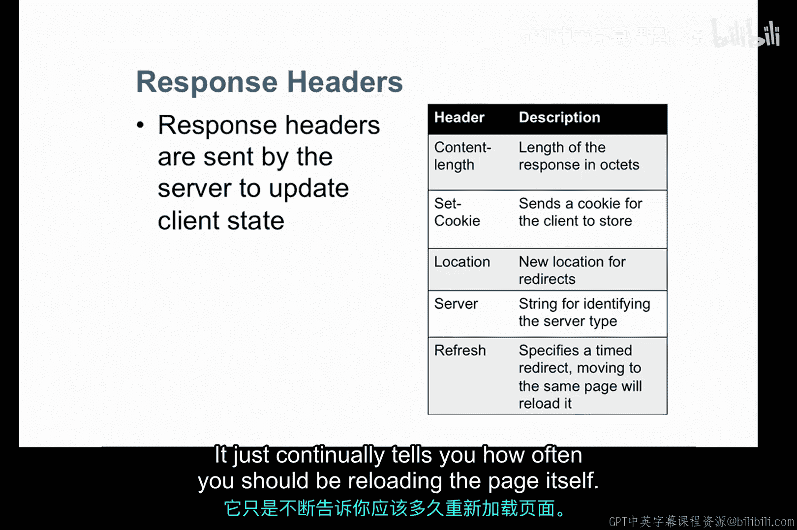
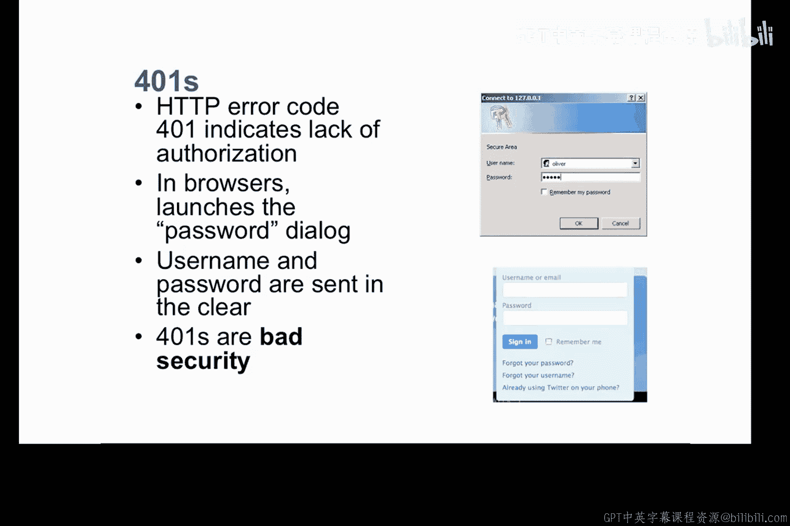

# 约翰霍普金斯大学《信息保障分析｜Information Assurance Analysis》中英字幕 p30 10_HTTP协议简介与发展历史.zh_en -BV1Qz8EzYENX_p30-

This is 695741 module 8 in this lecture we're going to be talking about how to break down the HtTP head after this lecture you'll be able to describe the various parts of an HttP header and their uses you'll be able to describe the structure of an HtTP Let's start off with and virtual hosts're talking about the field and antP header referred to as host It specifies the host name of a server web servers or virtual example A is hosted sites are also host on the same So identifying the actual virtual host that you're using is important if you use the wronger configured server configure server will basically give an error indicating that you are not using correct this is basically multiple a server to host multiple sites and make it easy for it determine which actual site you're interested in Now let's go on to the。

Now refer basically says where you came from who referred you to here Now first this is the actual spelling of it It has been refer tag refers to URL it specifically just means that URL that refer to from often used to subsidiary New York Times the way that it was actually handling the authentication for a while was whether or not your refer string was from a particular site that they had within So this information is also useful for determining if you should be somewhere if you went through the actual server that you should have before the actual site you should have in order to get to a particular but it's also useful for determining you actually gets credit for directing some such as is this a Google link did a Google link direct you here did some other page that I know after that sort thing is all information that can be contained in matter but doesn't necessarily have to be populate in cases where we are trying to handle authentication and again we're trying to actually make sure that people go through a particular directed path This is definitely a way to go However this can be spooked easily。

Easily construct a header that actually contains a refer room that otherwise was not press finalists talk about cookies are the state information for server passes this to the browser cookies are name value pairs with additional parameters that can be passed from the client back to the this information can contain the expiration date storage permissions information any sort of information that they want to actually keep track of for the end user technically cookies are all readable by sites that issue kind of what's been done however they're very useful basically padding out information and allowing sites to track where you've been so why use cookiesP is stateless is no information available to the server outside of what is passed in the request is usually the URL and the parameters that are associated with and that in the cookie that way you can actually track where they've been what they've been doing what the preferences are that's cookies are often used to maintain state of user preferences and session。

From a single connection or a single site visit this actually can be done across multiple visits and maintain preferences across time Another wonderful way of thinking about this is this is a great way for password authentication and a classic that way you don't have to each site actually provide your credentials again it's got a cookie that actually states that we've already provided some information and give you a little bit it's an understanding of where they've been and how they were authenticated beforehand if so now again it one of the ones that I find very interesting and this is one that most of you will find very interesting if you're protecting a server this is your user agent there are a lot of browsers some you wouldn't you can use malreaders I am clients text editors in order to browse what pitch the user agent string passes information about the browser about the system to the actual server the reason why it provides some so that it can tell the server exactly what it can and can't do basically so it can tell you it can tell the server that it has a specific set of capabilities So it has a different set of。

classic example is you might have to process a page slightly differently if you're using ie that if you're using Moz server and telling them that they could probably give you a customized version that works best for ie one that works best for Mozilla depending on which browser your own It's used to configuration is issues in this way and user agent is a good way to identify particular users as well basically they're not going completely reconfigure your system before visiting a site each time you can kind of start getting a field for particular group of users you've got available to you even though you might not be able to identifys of which user is doing what can at least categorize them into group header has gone out this actual request went out' got the HttP header went out has all the everything checks out nowttP request is very it is one of the simplest things to break down got status line you've got your date now the response always has status charactermatic nu。

Then another set of optional head are possible which give you information about the actual server and give you some indication of what the server can do after that the actual data and this part the purposes of discussion not talk about the data because the could be any talking about this is the actual web page information as being couple are not these you an indication of what happened on server and what the server about code is a three digit the first the first digit the it was the digits the first digit' an success of some but it may somedirect tell you wherever it somewhere didn't satisfy the request for you it just moved you along if it's that's a client errors a server of the main that you normally are be200 which is it's the most。

Common redirect technique use 400 is a mouthform request41 is an unauthorized。

 which is different for forbidden which just means that you are unauthorized to accessbiden means access then of course there's the classic 404 you didn't know what you we don't know what you're looking for because it so those are the basics of look up a complete anywhere on Google type status the a couple of really interesting ones that are available the server is to the client as which is of the set cookie which sends a cookie from the client to store sends cookie for the client to store sorry and then you also has location which is the new location for a redirect for redirects basically saying okay you really should be you also have the server which is the string identifying the different types of server and this is very interesting in and。

self because it gives you specification the server is writing what sort of system the server is he using went there capable then of course there's a refresh refresh which specifies a timed redirect to the same page will reload it just continually tells you how often you should be reloading the page talking about 401 jumping401 indicates unauthor the lack of authorization in order to access the site is really easy to in the browser go to any site that requires a password if you're actually using're using it over this gets really funny because what you can do is you can actually sendnamename and password and whenever you're sending it via youre sending it in the any sites then actually request that you transmit a password and they're using're sending your user credential in the clear you see 401 a pretty good indicator。

That if you sniff around there long enough， you're going to see a way to get in because it's sending you everything again。

