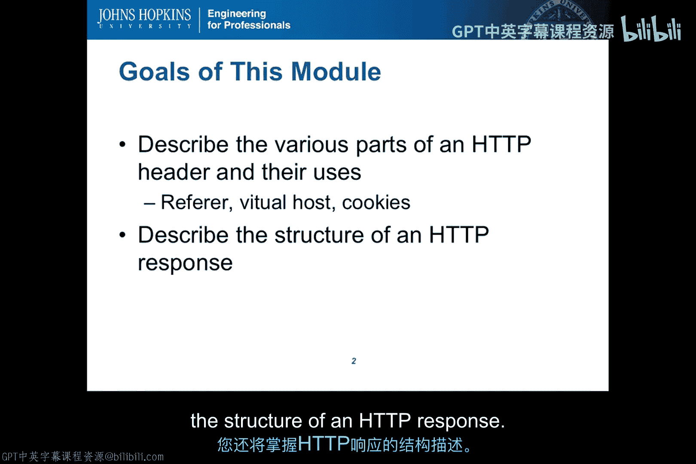
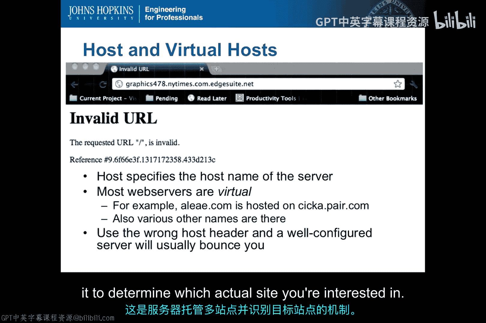
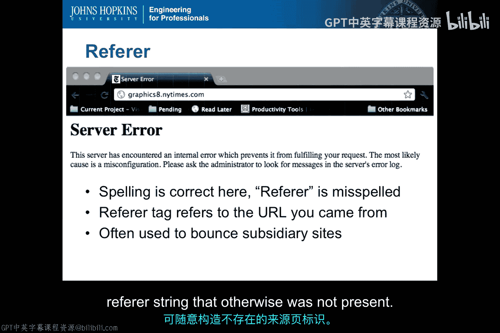
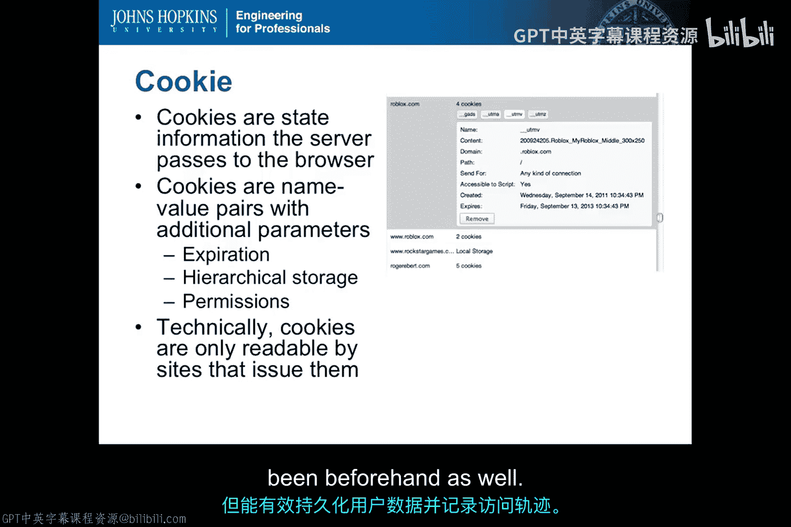
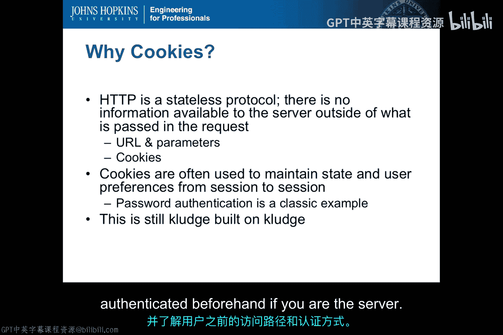
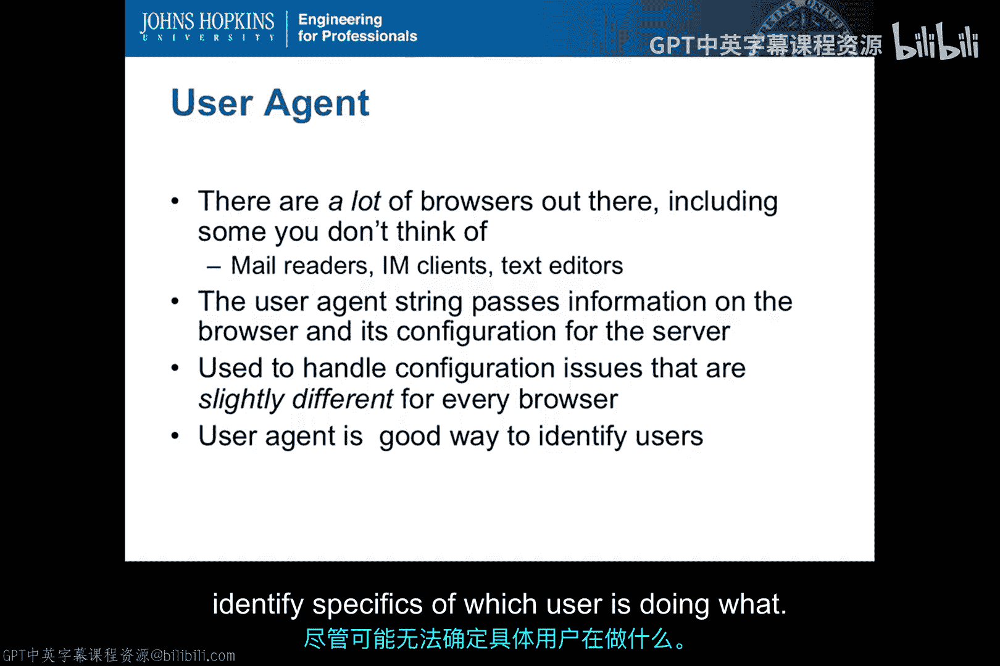
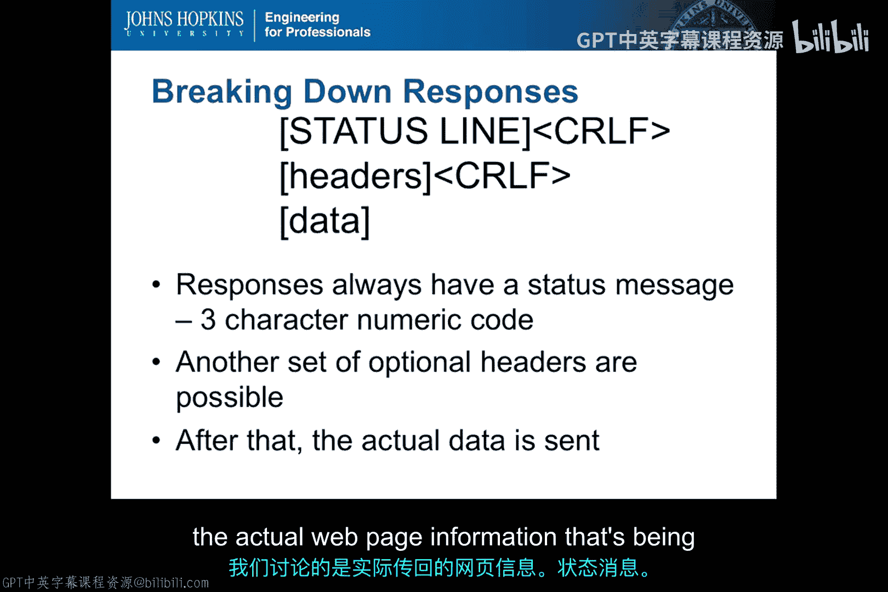
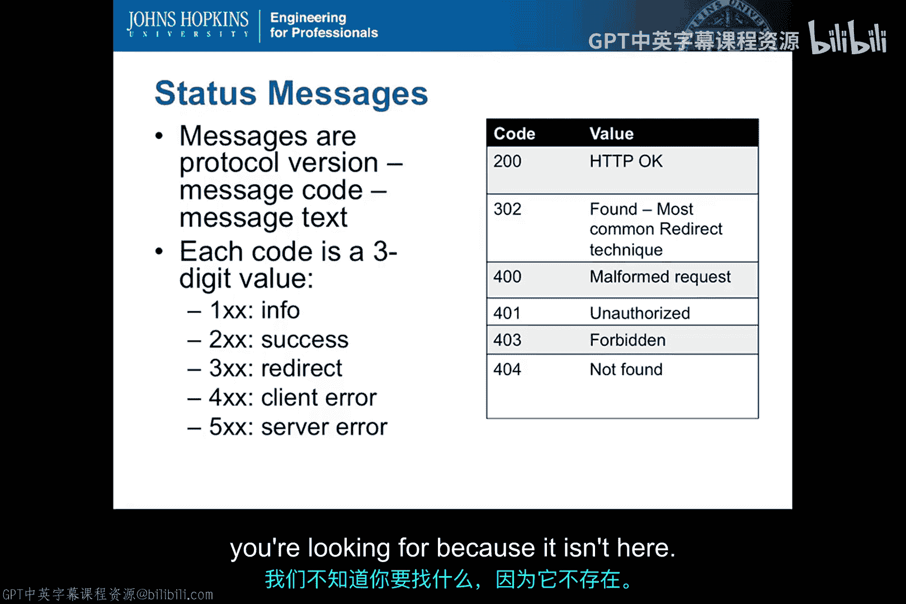
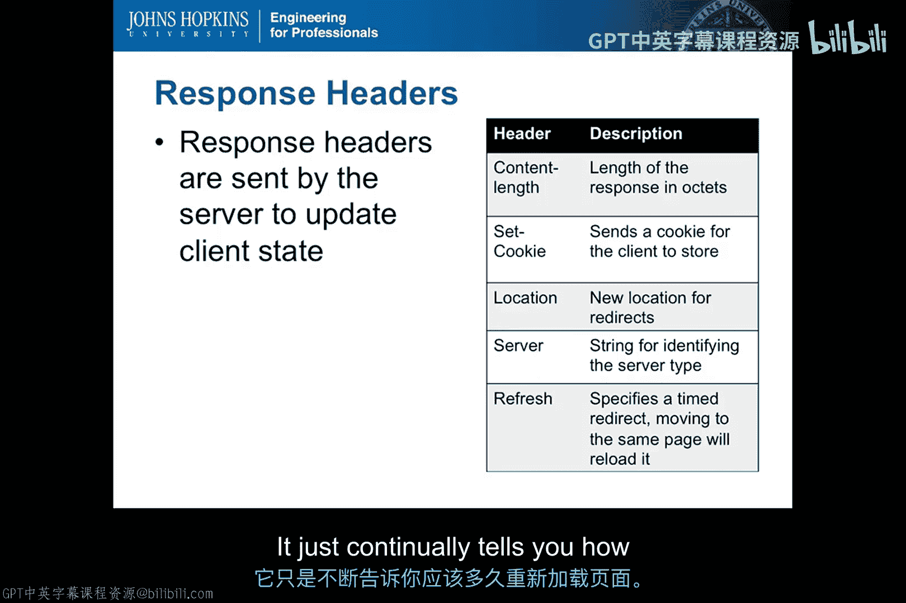
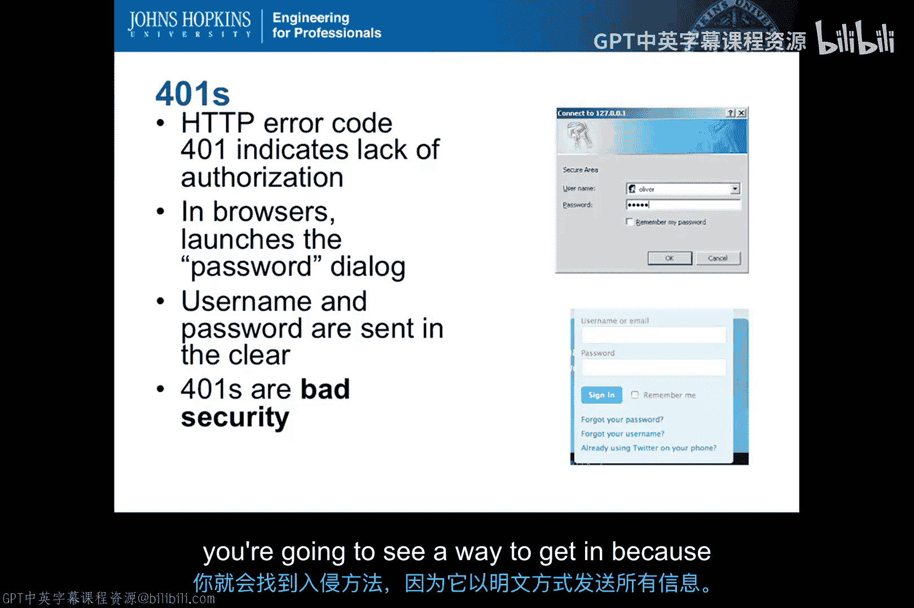

# 约翰霍普金斯大学《信息保障分析｜Information Assurance Analysis》中英字幕 p31 11_解析HTTP头部结构.zh_en -BV1Qz8EzYENX_p31-

This is 6，95，7，41， module 8 lecture 2。In this lecture。

 we're going to be talking about how to break down the h T TP header。After this lecture。

 you'll be able to describe the various parts of an HTP header and their uses。

 This includes the refer virtual host and cookies。You'll also be able to describe the structure of an HTTP response。

Let's start off with host and virtual hosts。When you are talking about the field and N H T T P header。

 refer to as host。It specifies the host name of the server。However， most web servers are virtual。

 for example， Aia。com is hosted on chica。pere。com。Other。Other sites are also hosted on the same host。

 so identifying the actual virtual host that you're using is important。

If you use the wrong host header and a well configured server。

 well configured server will basically bounce you， it'll give you an error indicating that you are not using the correct thing。

So this is basically our way of allowing。MultA server to host multiple sites at once and make it easy for it to determine which actual site you're interested in。

Now let's move on to the refer。Now refer basically says where you came from。Who referred you to here？

Now。First things first， this is the actual spelling of it。 It has been misspellt。

Refer tag refers to the URL you can from， and it specifically just means that URL that refer to you from here it's often used to。

Bounce subsidiary sites。For example， New York Times。

 the way that it was actually handling authentication for a while was whether or not your refer string was from a particular site that they had within them。

So this information is also useful for determining if you should be somewhere。

 like if you went through the actual server that you should have before or the actual site you should have in order to get to a particular page。

But it's also useful for determining。Who actually gets credit for directing somebody to your page。

Such as is this a Google link， did a Google link direct write you here。

 did some other page that I know I write you here？That sort of thing。

This is all information that can be contained in the header。

 but doesn't necessarily have to be populated。However。

 in cases where we are trying to handle authentication and again。

 we're trying to actually make sure that people go through a particular directed path。

 This is definitely a way to go。 However， this can be spoofed very easily。

 You can easily construct a header that actually contains referfurishing that。

Otherwise was not present。Finally， let's talk about cookies。

Cookies are the state information for HTTP。The server passes this to the browser。

Cookies are name value pairs with additional parameters that can be passed from the client back to the actual server。

This information can contain the expiration date， hierarchical storage， permissions information。

 any sort of information that they want to actually keep track of for the end user。Technically。

 cookies are only readable by sites that issue them。But and that's that's kind of what's been done。

 however， they're very useful for basically padding out information and allowing sites to track where you've been beforehand as well。

So while I use cookies， HtTP is stateless protocol。

 there is no information available to the server outside of what is passed in the request。

whichhich is usually the URL and the parameters that are associated with it。

 you can add in the cookie that way you can actually track where they've been。

 what they've been doing， what their preferences are。

 that's worth thing Cookies are often used to maintain state of user preferences and from session to session not just from a single connection or a single site visit this actually can be done across multiple visits and maintain preferences across time。

Another wonderful way of thinking about this is this is a great way for password authentication and a classic example。

That way you don't have to at each site， actually provide your credentials again。

 you've got a cookie that actually states that we've already provided this information and gives you a little bit of an understanding of where they've been and how they were authenticated beforehand if you are the server。

So now we get into one of the ones that I find very interesting。

 and this is one that most of you will find very interesting if you're protecting a server and this is your user agent stuff。

Now， there are a lot of browsers out there， including some you wouldn't think of。

You can use Ma readersers， IM clients text editors even in order to browse web pages。

The user agent string passes information on about the browser and about the system to the actual server。

And the reason why it provides this information is so that it can tell the server exactly what it can and can't do basically。

 so it can tell the server that it has a specific set of capabilities or it has a different set of capabilities。

Classic example is you know you might have to process a page slightly differently if you're using Ie than if you're using Mozilla。

So。Being upfront with the server and telling them that they could probably give you a customized version that works best for Ie and one that works best for Mozilla。

 depending on which browser you're on。It's used to handle configuration issues in this way。

And user agent is a good way to identify particular users as well。

 so basically you're not going to completely reconfigure your system before visiting a site each time。

 so you can kind of start getting a feel for what particular group of users you've got available to you。

 even though you might not be able to identify specifics of which users is doing what you can at least categorize them into groups。

Now， so。This header has gone out and this actual request went out， we've got the HTP header went out。

 has all this information， everything checks out now we get a response。Now the response。

From HTTP request is very simple， it is one of the simplest things to break down。

You've got your status line， you've got your header， and you've got your data。

Now the response always has a status message， it's a three character numeric code。

 we're going to get into that in a second。Another set of optional headers are possible。

 which give you information about the actual server and give you some indication of what the server can do after that。

 the actual data。And this part， for the purposes of this discussion。

 we're not really going to talk about the data because the data can be anything。

 talking about this is the actual web page information that's being transmitted back。

So status messages。You got a couple that are boring， some that are not。Theyre。Basically。

 these messages give you an indication of what happened on the server and what the server thought about it。

Each code is a three digit value。one where the first digit is the major categorical grouping of what it was and the other two digits give you more specifics。

If it's a one。If the first dig it's a one， it's an info message it's two。

 it was a success of some kind would but it may have some caveats， it was three， it was a redirect。

 it's going to tell you whenever it sent you somewhere else， it didn't satisfy the request for you。

 it just moved you along。If it's a four， that's a client error， if it's a5， that's a server error。

So some of the main values that you normally see are going to be 200。

 which is HtTP OK 302 found it's the most common redirect technique that's used。嗯。

400 is a mouthform request 401 is an unauthorized， which is different from a forbidden。

 it just means that you are unauthorized to access this or a forbidden means that you cannot access this period and then of course there's a classic 404 We didn't know what you we don't know what you're looking for because it isn't here。

Okay。So those are the basics of those status codes。

 you can look up a complete list almost anywhere on Google which just type in HTTP status code。

Simple enough。Now the response headers， there's a couple of really interesting ones that are available here。

This is information that the server is provided to the client。Such as。Content length。

 which is the length of the response in optts they will actually tell you how long the response is you can also set cookie。

 which sends a cookie from the client to store sends a。A cookie for the client to source sorry。

And then you also have location， which is the new location for redirects for redirects。

 it's basically saying， okay， you really should be going here。You also have the server。

 which is the actual string identifying the different types of servers。

 and this is very interesting in and of itself because it gives you a specification of what the server is running。

 what sort of system the server is using and what they're capable of。Then of course。

 there's a refresh refresh， which specifies a timed redirect。Moving to the same page will reload。

It just continually tells you how often you should be reloading the page itself。

Okay， now let's spend some time talking about 401。Jumping back to this stage is good thing。So。

401 indicates unauthored。The lack of authorization in order to access a site。

This is really easy to generate。In the browser just。Go to any site that requires a password。

If you're actually using this and you're using it over HTTP。

 this gets really funny because what you can do is you can actually send username and password and whenever you're sending it via HTTP。

 what you're doing is you're sending it in the clear so any sites that actually request that you transmit a password and they're using HTTP。

 you're sending your user credential information in the clear so if you ever， ever。

 ever see 401 on a HTTP site。That's a pretty good indication that if you sniff around there long enough。

 you're going to see a way to get in。Because it's sending you everything in the clear。

