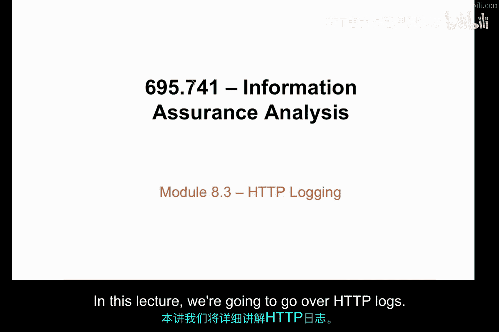
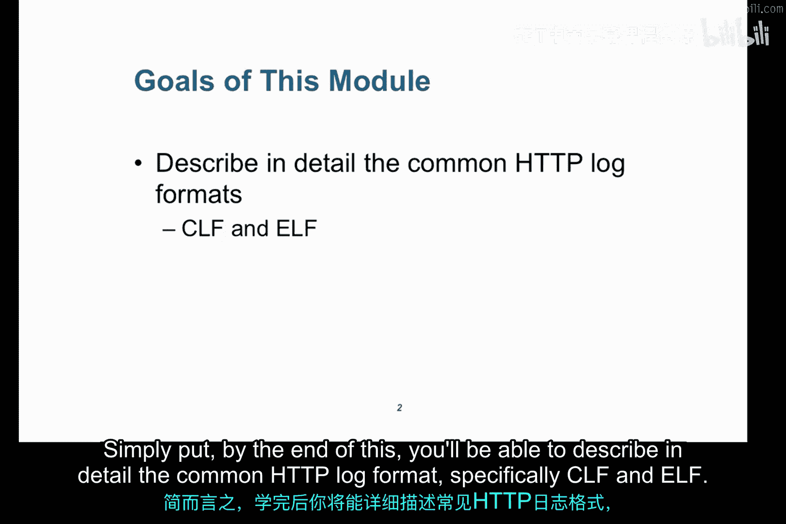
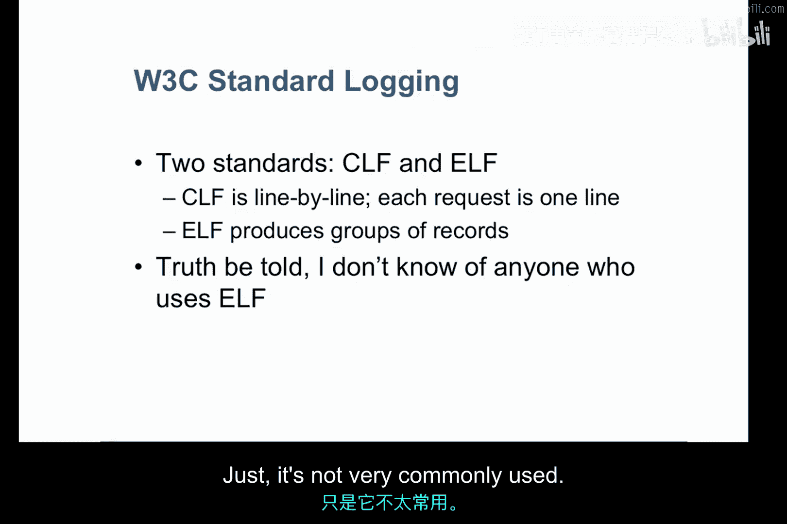
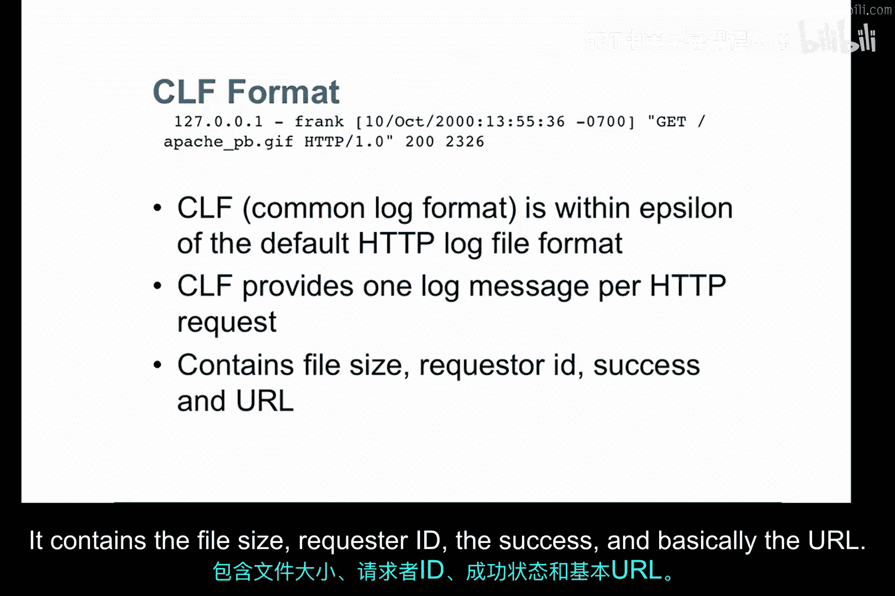
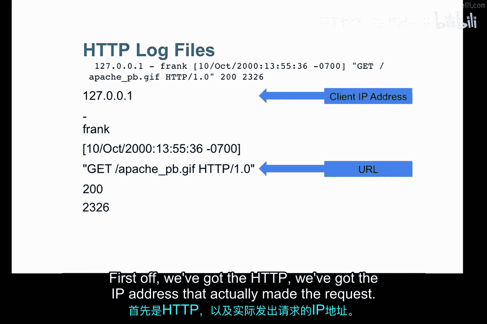
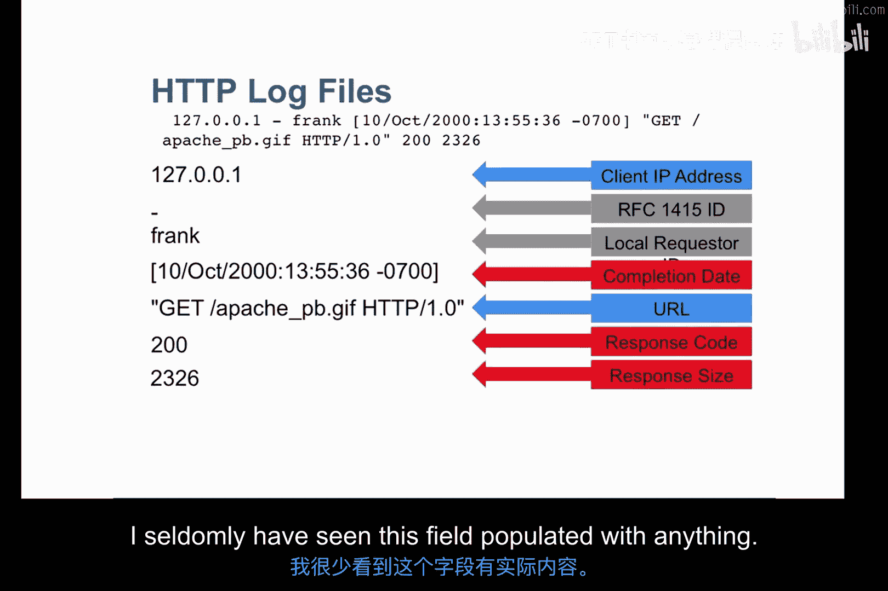
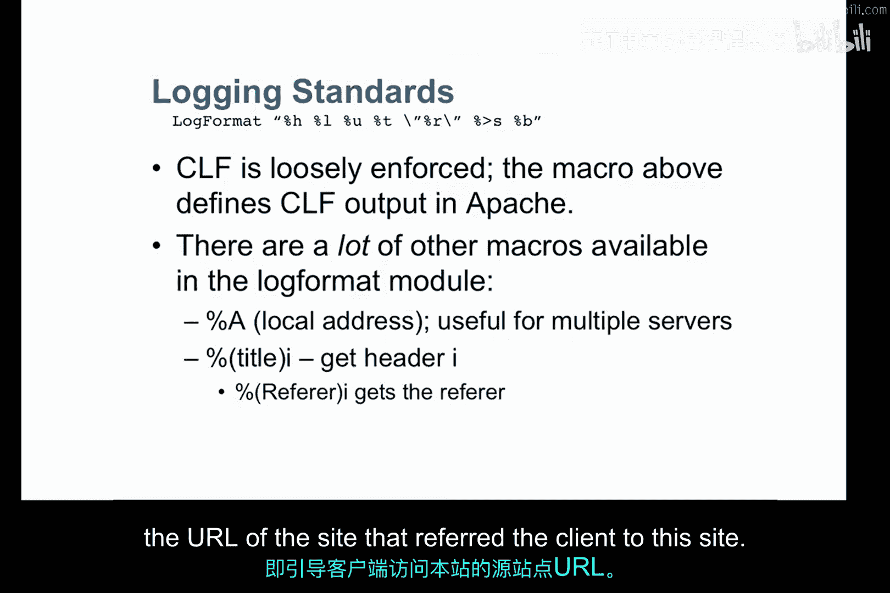
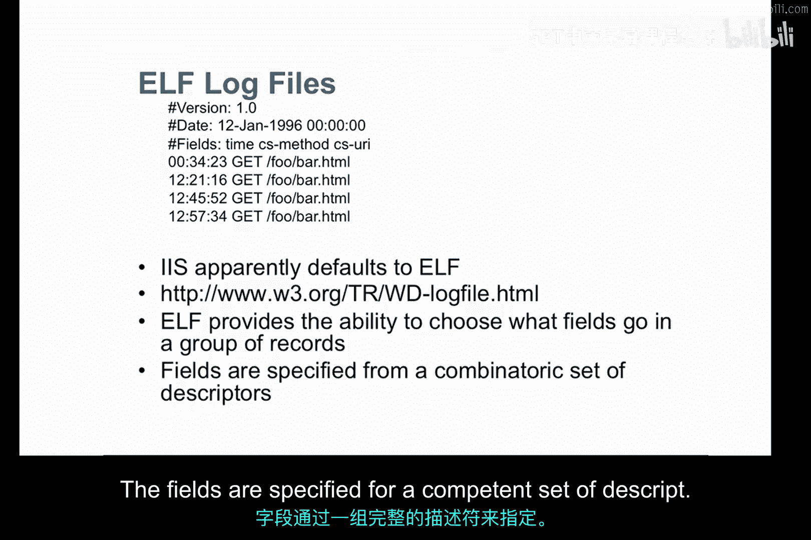
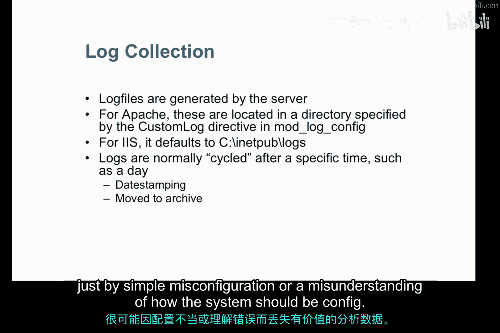
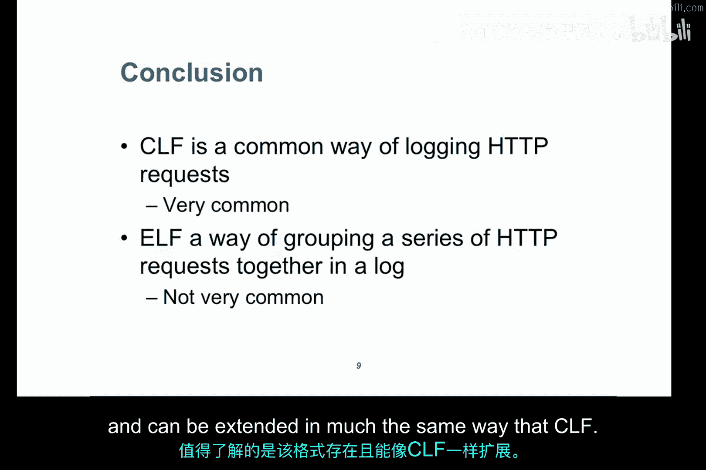

# 约翰霍普金斯大学《信息保障分析｜Information Assurance Analysis》中英字幕 p32 12_HTTP日志分析.zh_en -BV1Qz8EzYENX_p32-

This is 695741 module 8 lecture3 this lecture we're gonna go over HtP log simply put by the end of this。

 you'll be able to describe in detail the common H log format specifically C and W3 standard log two major D line by line each line represents a takes each of these requests and groups get truth C is far far more than No with good reason it's a very simple。

 very straightforward protocol makes it very easy people to understand what's going not saying that is deficient some wish's not very commonly use at least I don't know many people that use it I could be wrong about willing to accept's start with Em with C stands for common log format straightforward written's written basically the default for log provides one log message perTP request and contains the file size or ID success and basically the。

brokenken into several key components first off， we can actually take everything and do a space separated tokenization of the record and you see some interesting you see basically what each of the fields first off we've got the we've got the IP address that actually made the request and the URL that request we also have some complimenting data actually indicating climbing when the actual request was made and also the response code in this particular case we actually made a request to get the Apache P guess with httttP1。

0 and that request was actually a successful one we've got response code the status code 200 indicating that the server found this okay and actually transmiting information back then we also have there's 2326 bytes being transmitted back we also have this kind of interesting stuff right here these two things are kind of annoyed is identification information that is either going to be present and slightly erroneous or it going to be just these dash。

What these are is it supposed to be a requester identifier and it's present the dash would be the user ID as provided via HTP this is deprecate not really used but still precede in all of our rec just want to make sure that everybody's there it's included here for consistency with the actual CLF format I seldom have seen this field populated with anything it's almost always the dash so now to logging standard CLF is loosely the macro above defined CLF output in a patch and basically what it is is we've got a ton of different of different variables that can be used to populate this what we define in the previous slide was the most common default configuration there's a lot of other macro is available such as you percent sign capital a which will give you the local address and that's useful for if you've got multiple servers that are serving out the same material this will actually give you an indication of which server actually provided in of course can also be obtained if if each server is during。

Pit log because well the logs for that server will be the one that contains that request you also can do a no present something I and it gets a particular header I So if there's something that's then you definitely want part of the header for the header that's in the request then you just do a whatever that title for instance if we want to refer it's going to open for in refer closed for I and that will give you the entire refer string which will be the URL that URL of the site that refer the client to this site enough about C pretty simple now we're gonna move on to it's an IIS apparently default so it gives in specification isn't available at the following URL now it provides the ability to choose what fields go in a group of records and it will take those and group them all together the fields are are specified from competent set of the log files are generated by the server for Apache these are located in their directory specified by the custom log。

Directive and mod underscore log underscore for IIS at defaults to see Col innet logs are normally cycled after a specific time。

 such as a day and what happens is once the when the log is actually open。

 it's open with a file name that has some sort of dateint， wherever it's closed。

 that file is closed down the important thing here is that if you are indeed doing log that you understand the file size limits that are associated most web servers will have a maximum log file once that log file size is exceeded。

 the file itself is closed down and written out if that file it also will have a maximum size the log directory can grow once that size is exceeded it is not going stop log。

 It's just going start throwing away the oldest logs that it has。

 So it's important to understand these before， because if you don't have an adequate grasp what these file sizes are and when you are actually start tossing away log。

 it's entirely possible that you're going to be throwing away analytically useful information just by。

Simple misconfiguration or a misunderstanding of how the system should be configured in conclusion for this one main thing we've got CLA which is the very common way of logging HtTP requests in fact most people use this quite regularly very exsible and very easy to understand everything's written now in ASU format very easy to grasp what the fields are and very easy to modify what's available We also have a way of grouping a series of HtTP requests together not very commonly used but it is a default for IIS so it is worth actually mentioning that this file format does exist and can be extended in much the same way that CLA。

