# 约翰霍普金斯大学《信息保障分析｜Information Assurance Analysis》中英字幕 p33 13_搜索引擎原理.zh_en -BV1Qz8EzYENX_p33-

This is 695741 module 8 lecture 4 in this lecture we're gonna be talking about search engines by the end of this module。

 you'll be able to describe how search engines get their understanding of the web in general how do they know what is over site how do they decide what to give you when you search what are their limitation All these things are going to be questions that you could answer by the end of Also we're going to talk a little bit about building a robot TxT file So let's start simply with a image that Dr。

 Collins put together So if we start in the center here with a slack thing that looks like it came out of an Atari video game you can see that there is we're just going to generalize it to be some sort of device that goes out and starts looking for web page once it goes to a web page it's going to take all the links from that page and put that into a list of places that it should be trying to go to so whenever it first goes to this page it's going get two more hyperlinks that it can go it's going traverse to one of those hyperlinks and get the other web page then eventually that also is going to。

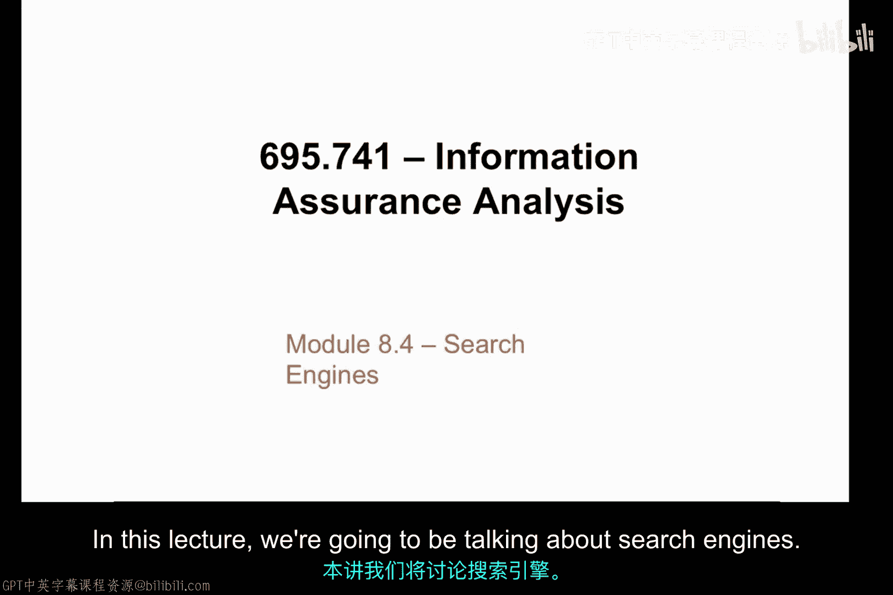

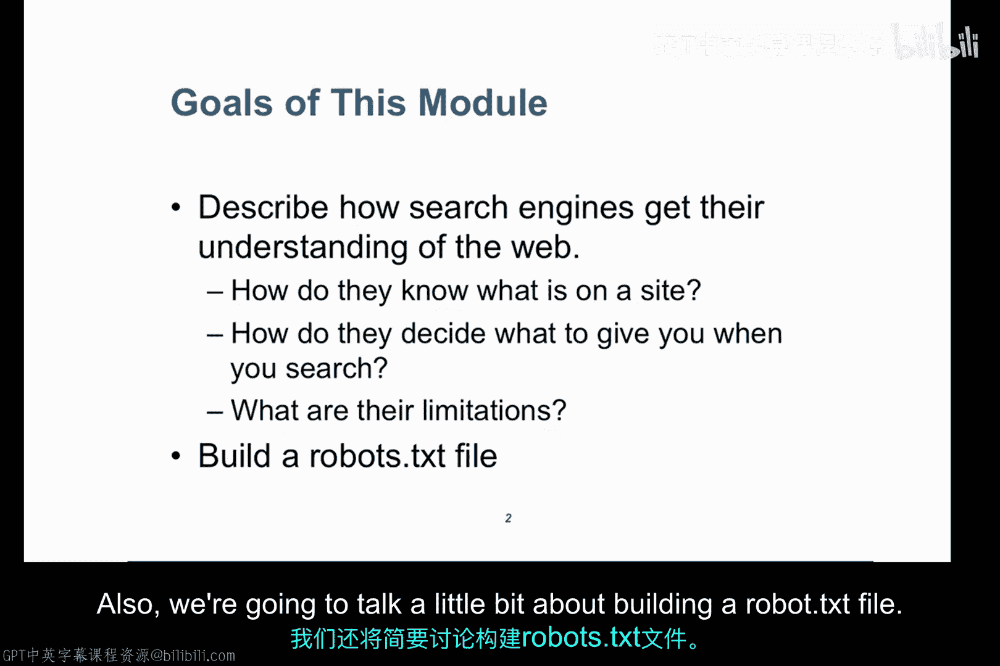

A link to the final web page over here。 that one can be returned that one eventually will be traversed as well。

 Now we note that this Atari object will sit there and look will keep track of how many how many different websites actually reference this one web page over here in this particular case this guy's referenced twice Now I'm just going to point out because apparently Dr。

 Collins likes to put this in every lecture possible there's the waffles it gets all this information and puts it into a storage mechanism and then that storage mechanism is going to basically hold all of the data and be used to process be used as a storage mechanism for all of the data and then it will be indexed by the indexer process to produce some sort of model of what the web actually looks let's talk about that indexing step the earliest web indexes were handmade Yahoo was was an entirely handcrafted index early the next generation since that was completely intractable process next。

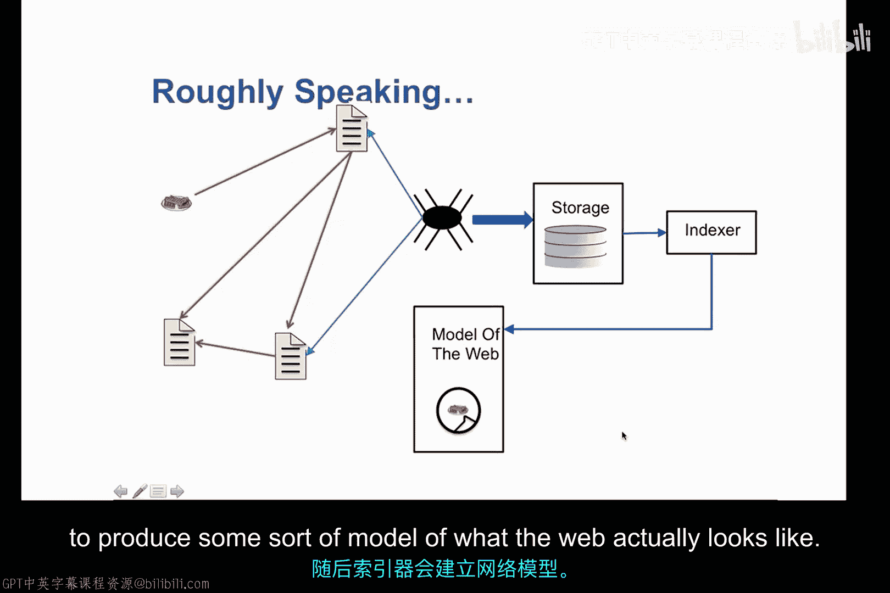

Generation of indexes scanned text and built ranks based on the text that they found they took the placement of terms near the top of the document。

 they also looked for repetition of terms， the presence of in conjunction with other terms。

 that sort of information and started to build model of the web in bottom。

Which websites were associated with particular terms that way then came along page rank page rank named after named after page。

 who is one of the original founders of。

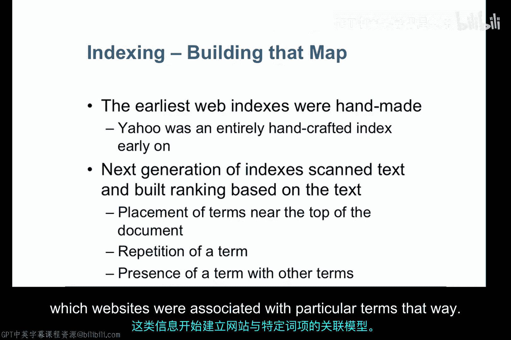

Is a ranking algorithm that's at the core of Google's business Page rank was a new approach to page ranking which which dependent on hypertext structure to describe a page's importance You'll notice that we've got the term page overloaded。

 please don't get confused whenever we're talking about the actual person page we're always going to be referring to as in conjunction with Google whenever we're talking about a web page we're just going to be saying a page Here is the original algorithm that they put together or the original the original scoring mechanism that they put together This is how it used to work would say this is how it used to work because Google has continually tweaked this and actually added different functionality bells and whistles to it as theyve progressed through the ages Basically page rank is the probability that a page will be visited by a user。

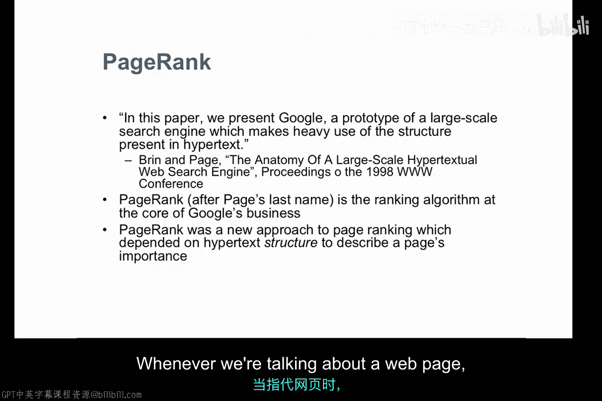

On the page that linked to it So this is how likely you are to go to the page。

 given that you've already been to a particular other page it works by creating an adjacency matrix and then solving the principal eigenvector of it I'm not going to spend much time on that because that's basically a straightforward of you actually look at the weights between the pages and you calculate the eigenvector based off of those weights Now there's some additional tweaks to it the original paper describe some other methods used to optimize searches for instance。

 look at the text that anchors come from and point to the current process as far as anyone outside of Google knows involves extensive tweaking on a regular basis as some of those tweaks you might also consider to be the way that they attempt to mitigate people trying to push up malicious websites to the front by generating huge number of pages that all linked to the malicious site So this sort of thing is also So there is a problem with this search engines are basically popularity。

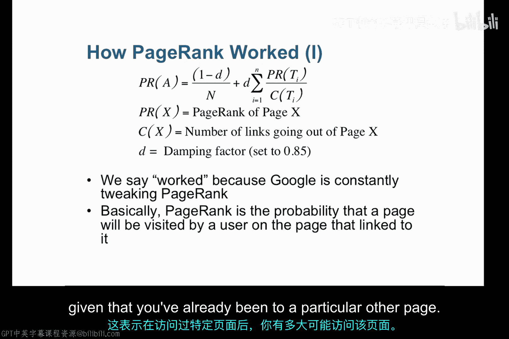

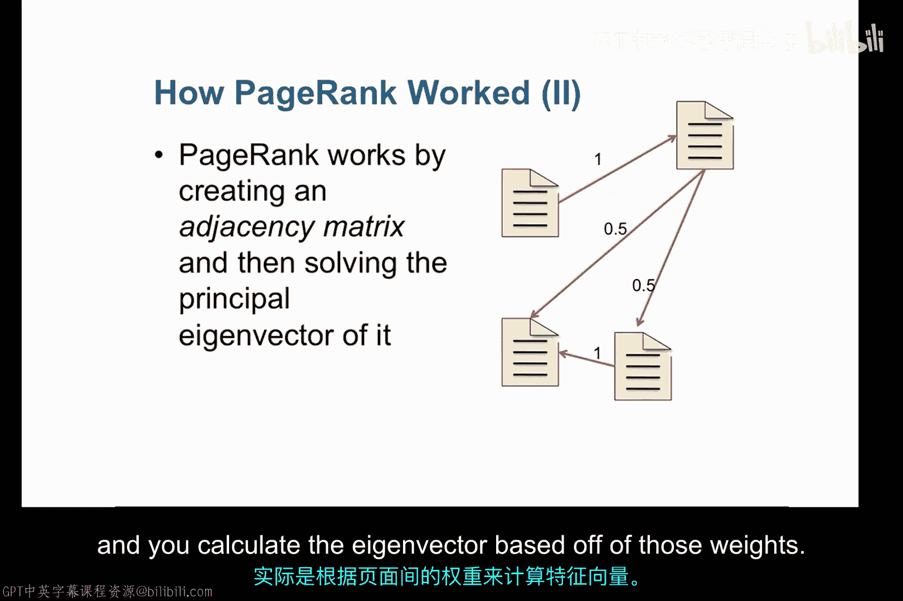

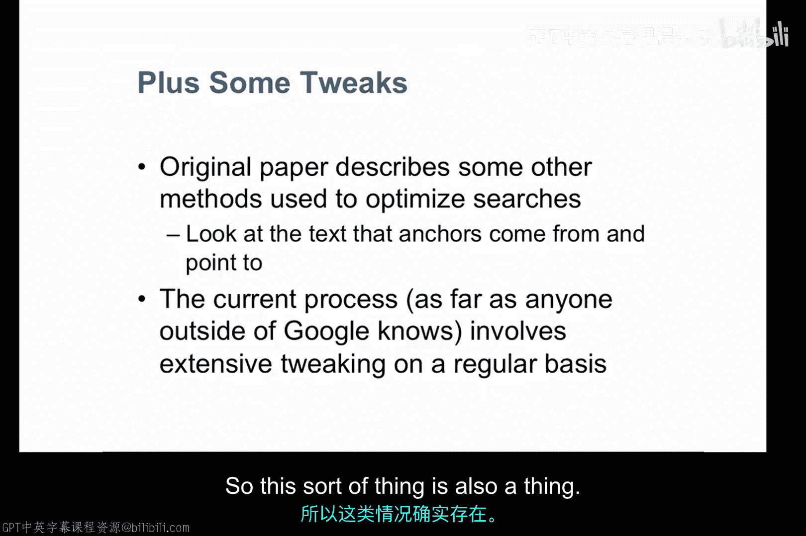

ion most mentions most vote most likely to be seen this sort of thing this all calculates into the actual ranking that you get for a particular web page This means for example that pop culture terms will pop up our terms engineered to this can be gained in such a way like we previously discussed what's trying to actually force a page up to the top by by associating several pages are having several pages linked to that page so they can overload this particular page with a series of terms that they know to be top search items at that time generally we can actually address this by adding semantically rich data to the data set for instance tagging information of particular importance formal metadata such as labeling such as describing what types of data are present on the site and also using semantic web technique and also there is RFC 3514 compliance that can be provided so let's jump now to talking about。

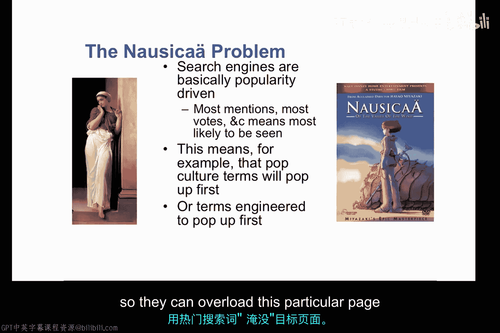

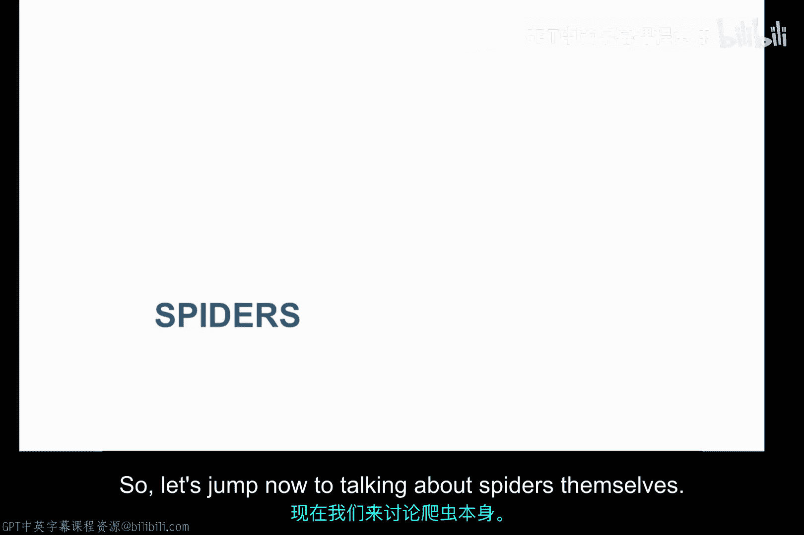

Fers themselves。Spider， searchbod， crawler， web gutterer。

 whatever you want to call it it's an application which automatically search the web defined sites This is that itari looking thing that came from that image that I put up at the beginning of this lecture spiders are tools to find the pages that search engines index this is actually a thing that's going on it's yanking down all the information for the web pages Yanking down all all the references to other web pages and add proceeding onto those websites Now webmasters have a complex relationship with spider spiders are very stupid spiders are also a key are also key to having your page on servers con consequently controlling spiders is a task for the webmasters you have to balance between don't publish this and please publish this information So you've got kind of this give and take relationship If you've got a web page you don't necessarily want them to index everything all the time but you don't want to just say don't index anything because then nobody will go to your website。

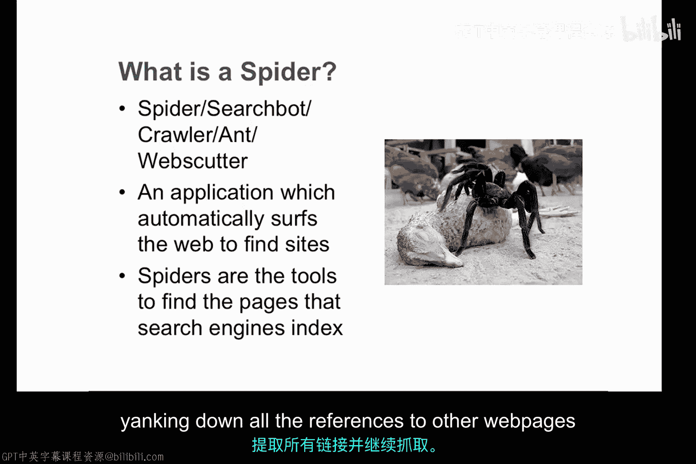

Unless they already know about it， they won't be able to search so another strange thing about the spiderrus is I've already said that they're not very bright and they have limited capabilities。

 but let's say you want them on your site and you try and get them to go to your site and you allow them to go everywhere。

They still have a very key very difficult problem with just understanding everything that's on a site to barsse everything that'd have to be as smart as they'd have to be really smart AIs roughly equivalent to T are roughly equivalent to actual people who understand what they're looking at I should say they consequently have trouble with dynamic sites and forms and things like that it's been estimated that about a six of the web is actually map the rest is a bunch of dynamic information that was hard for them to really understand and hard for them to really get a strong grasp one and then fully index That's one issue but let's go back to this whole webmaster spider that webmaster spider relationship is generally dictated by the robots Txt file that we've been mentioning throughout this module It is one of the few ways that you can directly interact with a spider of your web Basically what you can do is you can put together this robots TxT file put it into your up on your website and any time that a spider will come to your site it will open up that file and read through it。

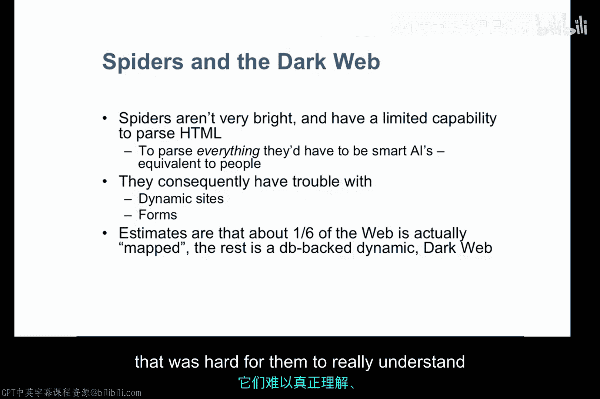

Place that that robots TxT following the redirecty of the website。

 the bot is supposed to read it in a bit I say supposed to because there are instances where some bots don't necessarily follow that rule or for the most part you can trust that if it's a wellbehaved spider it's cool to actually do exactly what you tell in that file you can actually write out in how it's supposed to look at your website you can tell what user agent string it should be using you can also tell it what not to go to So in this particular case if we do it disallow colon's it's going disallow it from looking at anything at all。

 So again this is good because you can actually make it not look at your site it's that because then your sites never going to show up in the search engine results because it hasn't been index let's get into something a little bit more interesting we identify spiders that are coming to our the things that we would probably need to do if we're actually doing a bunch of web analysis is out where these spiders are that because for most part that's going be chas。

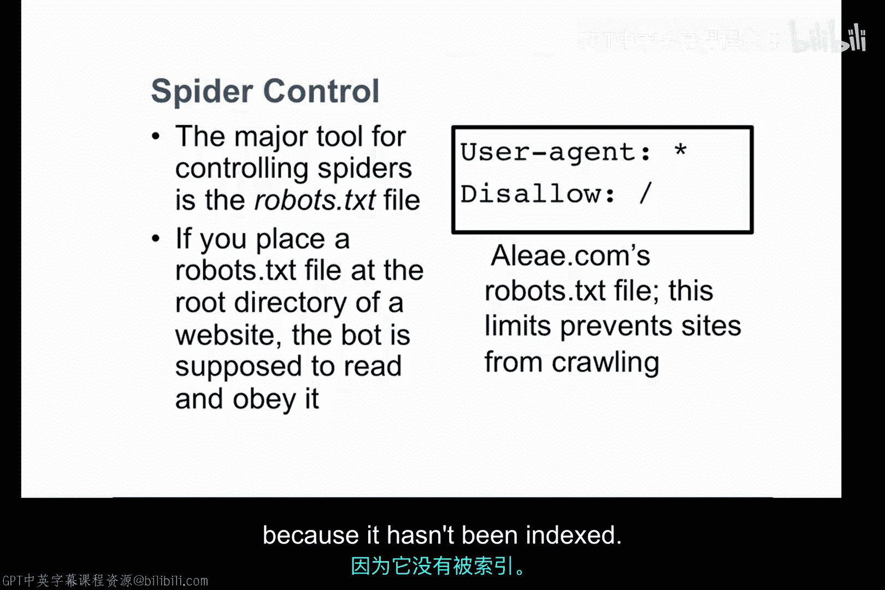

Corrupting our data set you might be interested in looking at spidersson by all means feel free to if you're actually looking for malicious activity going on your network and you can be reasonably assured that the spiders are not doing anything malicious to your site might want to just quickly remove that several ways to identify first off by I address you can also use DNS lookups and you can also do a behavioral announce something each of them valid methods let's start with the IP addresses as part of the process most companies announce the addresses of their spiders on public pages you can generally find this information by googling are by scouting the site for webmaster information this generally will give you a good idea of which cider blocks are actually which cider blocks spiders will be coming but one thing about that I would caution people about is that this is not one of those things that you can do once and just leak that at that you have to do this on a continual basis because organizations like Google generally speaking though provision and IP a particular host be。

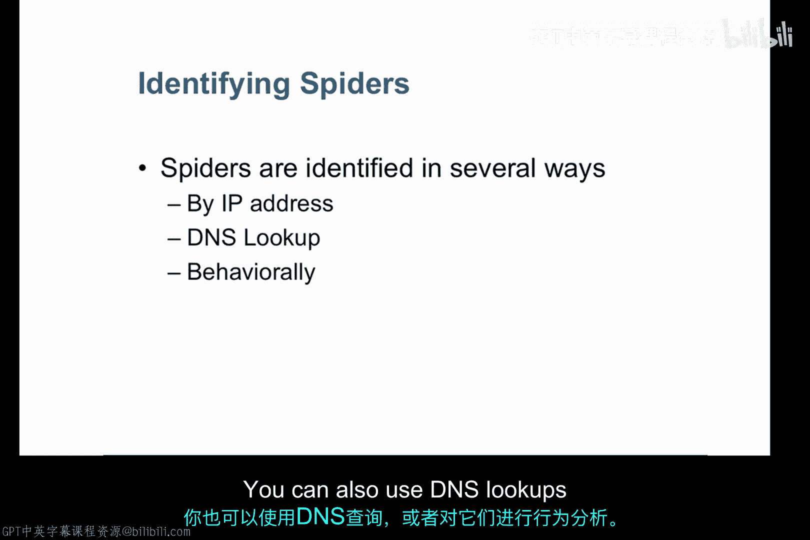

A spider one day an indexer in X day and something else a third day So they're going to be shuffling around all these IP addresses quite frequently so you need to continually go and look for those IP addresses and make sure that you've got a consistent set that's consistent with the timeframe that you're dealing with in order to appropriately be able to to filter your data Now of course you can also use DNS and that's that's simply just reverse DNS look up on your IP addresses and determine what what the host is actually doing they will have pretty common names that will associate them with spiders and then we have the most interesting and simplest way to actually detect a spider remember how I've said several times throughout this lecture that spiders are stupid they're really stupid they have a tendency of behaving quite different than any other user here we've got a nice detection of exactly what we mean the Xx is here the number of tests for a specific website the number of times that that a particular user agent went directly to a website the Y axis is。

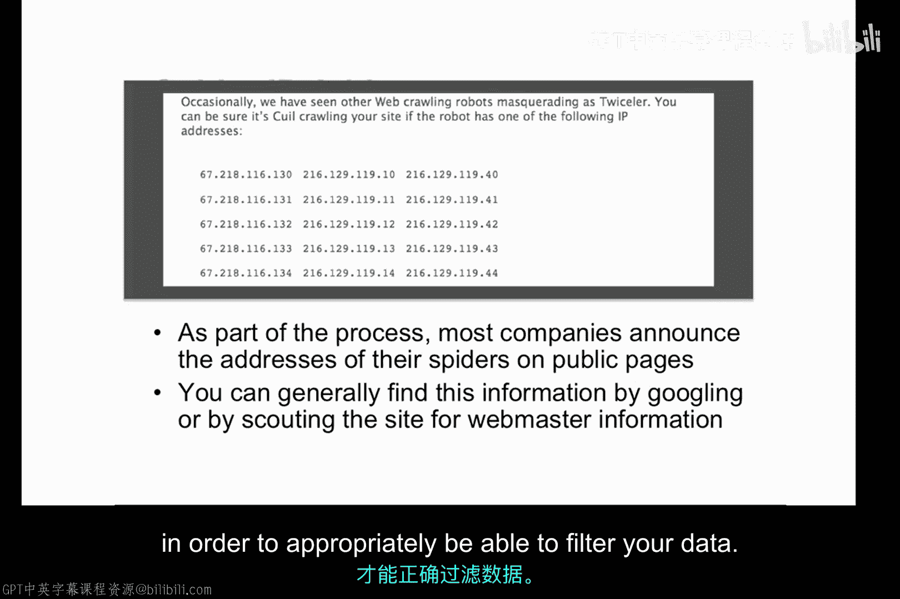

The actual consistency of success， how many concurrent successes did they have what you're see in the case of a spider is yeah there's a lot of concurrent successes and then all of a sudden there's a sudden drop after you get between 1 hundred and50 or so you start seeing that there's a lot of failures and there are a lot of consistent what that is is the spider will sit there and it doesn't get bored it doesn't get frustrated it doesn't get tired well basically happens is spider just decides hey I didn't see the site now okay how aboutll continually do that any user in their right mind unless they have actual mental syndrome of some kind well give up very rapidly in this case spiders not so much so it's very easy to start seeing where these guys are because they're gonna to start having tons of requests that are failed and then they'll just get stuck on and then eventually they'll go away which you'll find is the pretty good indicator that you're dealing with a spider at least an automated process's there's further there's further investigation that you probably should do in order to declare it truly a spider but this is a good of first。

In conclusion， we've got spiders that get information to the search engine they're the guys who actually are the eyes and ears that are out there that are getting the information that is indexed by the search engine now the search engine itself it's up to them in order to interpret how to relate to what you were searching they've got a variety of means that looking at the page content looking at how many things linked together or how many things provide links to a particular page of interest all of these things factor into this index and most of these algorithms you can get a fair approximation of but all of the superces isn't necessarily available and why should it be that's their business and one last thing that want to point out about this is once again they're limited by the ability their ability to horse a page automatically so dynamic content is not always appropriately index it's not always categorized again we've only got about one sixth of the internet by some approximations truly being categorized。

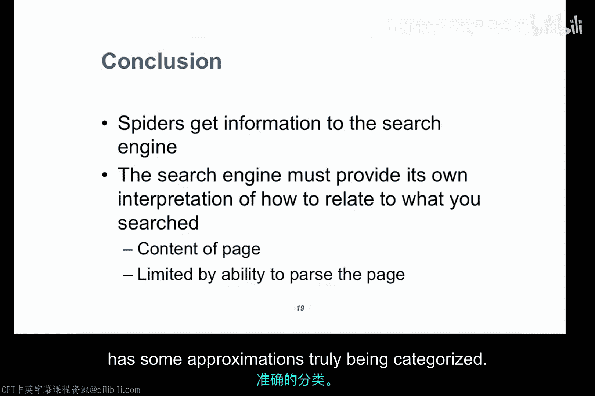