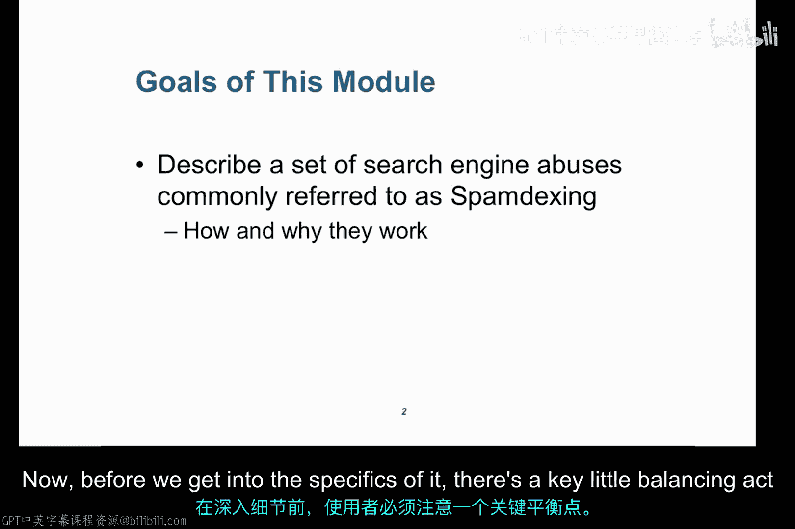
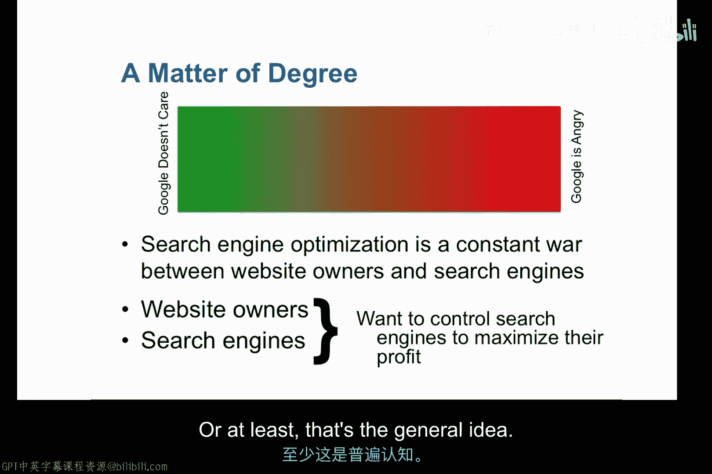
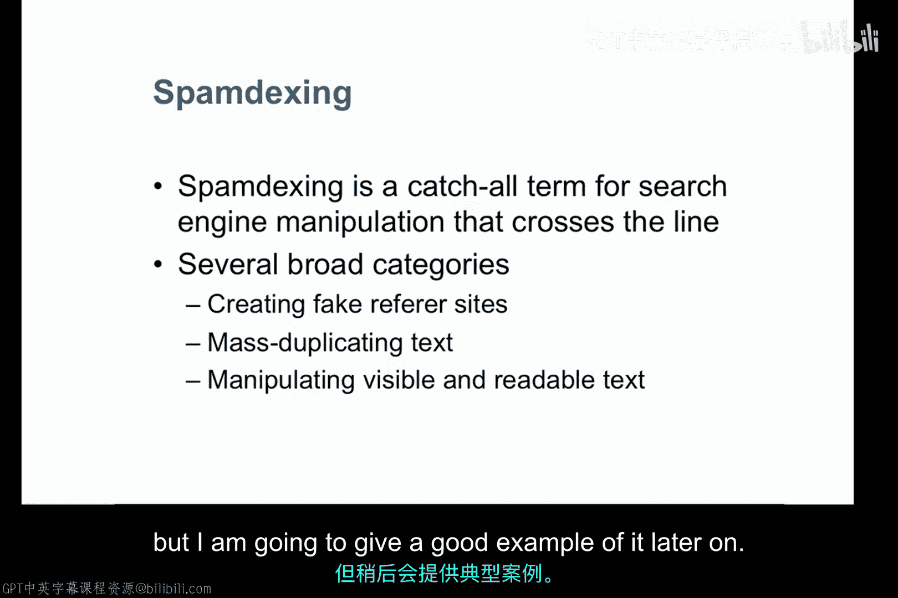
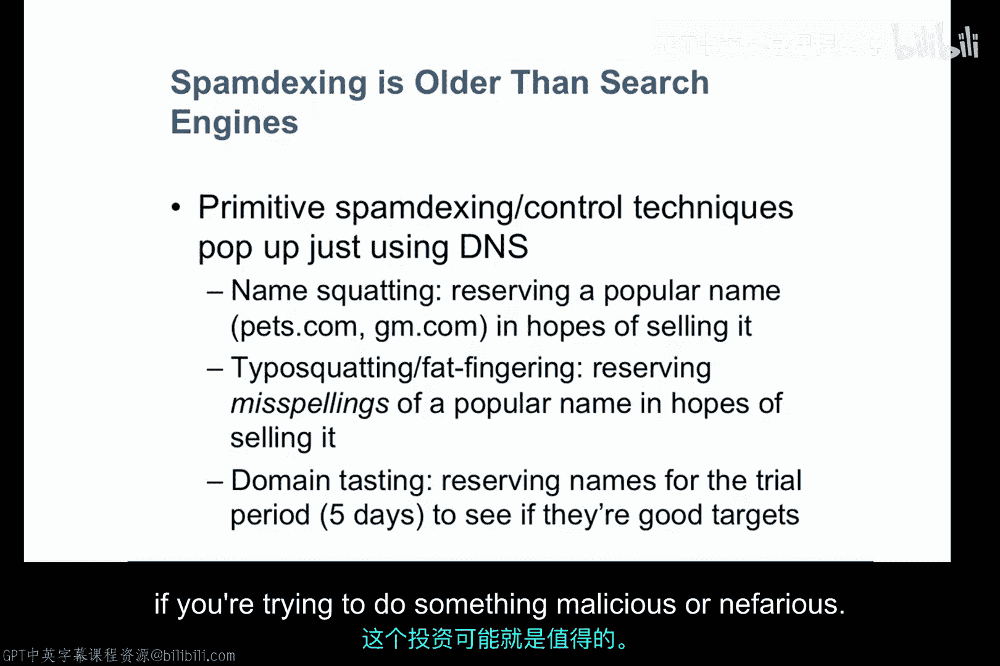
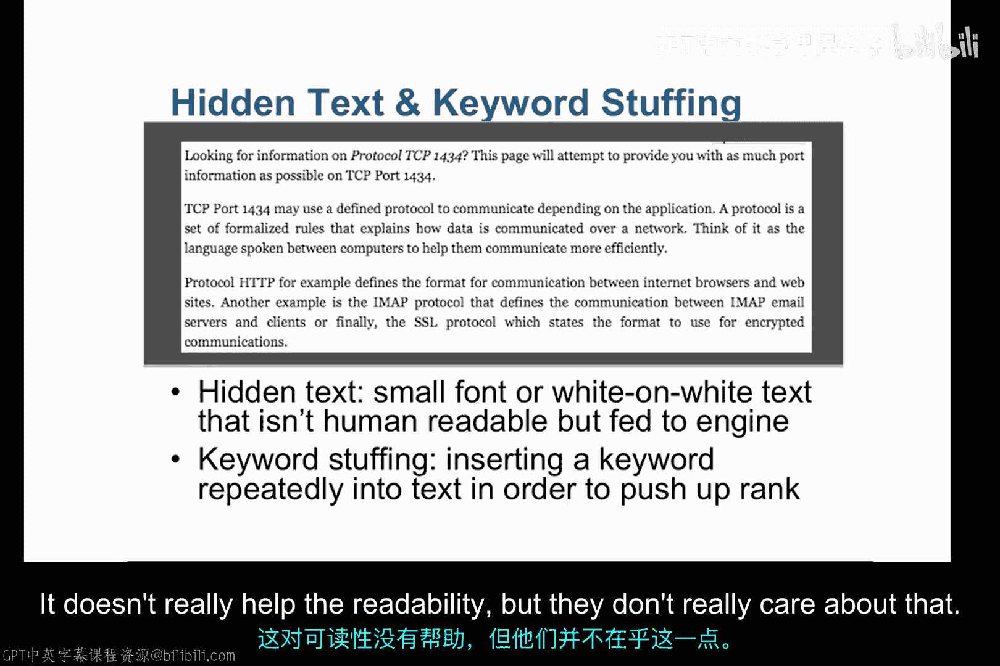
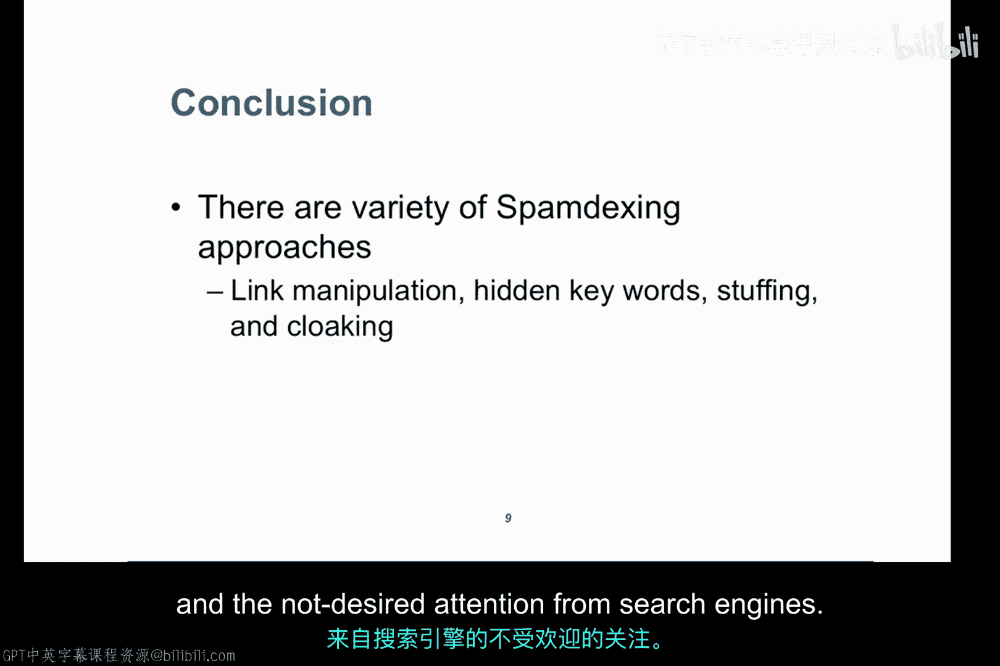

# 约翰霍普金斯大学《信息保障分析｜Information Assurance Analysis》中英字幕 p34 14_搜索引擎滥用行为.zh_en -BV1Qz8EzYENX_p34-

This is 695741 module 8 lecture this lecture we're going go over some search engine abuse by the end of this module you'll be able to describe a set of search engine abuses commonly referred to as spam you'll be able to talk about how they work and why they were before we get into the specifics of it there's a key little balancing act that anybody who is using any of these techniques must be if you're going to be actually gaming the system or you've got to actually worry about what the search engine is going to think about what you're going there is a tradeoff here you won to be able to game the system so that you can actually make your page a higher rank not necessarily game it so much you attract negative attention from the search engine So I mean this is a constant word everybody wants to control search engine result because it affects their bottom line the more certain the more hits you get the search engine results better off you're going be at least that's the general idea So alongmm depthcing is a catch all tower for search。

manipulation buses the line to some extent。 Now there's several broad categories of this。

 There's of course， creating fakeites mass duplication of tags and manipulating visible and readable name a few In fact these the ones we're going focus on I'm going focus more on later too as I think that the refer sites have been used as examples and many of the other lectures in this module So I think I've adequately expressed exactly how that but I am going give a good example of later on Now a key thing to realize here is thating is older than search engines you can actually see primitive examples of this and Dan。

 for instance， we've got names plot are whenever you reserve a popular name such as pets G and the hope of selling it date this is one of those that that's been a continual example of this is there is a wonderful little talking about a group of guys who are actually meeting in Starbucks and going over sites they were going to actually develop and the names of。

s they wanted to use and they were being loud obnoxious and somebody right behind them said excuse me guys you'all been really annoying。

 And so every single site that you guys have listed off I purchased and will sell to you now so that was a wonderful example of names squad and as we speak this is something very common and something that almost every group has to deal with there's also typo squtting and that thing Now this one is it's to be a little bit more this is where you actually start reserving names for sites that are very close to the spelling of a legitimate such as Bank America instead of Bank of America or bank of Americas and what you're basically doing is you're trying to actually get people who accidentally mistype something to go to your site Now there's two hopes first off you can actually use this in order to do something malicious and to actually capture users that have gone to the wrong site Now the thing is again trying to get the actual honor of the legitimate site to purchase that site from you at extremely marked up。

Of these can be implemented with something called domain tasting。

 which actually will mitigate a lot of the cost of performing these operations Basically what you can do is you can reserve a name for the trial period of five days and see if it gets you a good set of target if a lot of if a lot of host actually make request the site then might be worth the investment if you'reious if you're trying to do something malicious and you just are actually tasting the domain you can give it Now another way that you can gain the system with search engines is by adding will start index and this text you can add can be very dry。

 boring but contain very specific search terms that you know people are going be looking easiest way to do this that leaves your site still looking track is using hidden you can make small font or white on white text at the end of a site or the beginning of site something that is a really readable by a human but directly in search engine spider because they're reading through it and they're not interpreting it based on a human would say they're interpreting it based on the text that's there so you can。

Tm that you want to that you think people are going search for hundreds of done and white don't white nobody will see it give you a higher rank you can also do keyword stuffing This actually isn't as good because what you're doing is you're basically ensuring that you encode the search terms directly in your text over again the text that's at the top of this page that little excerpt right there is a prime example of you see TCP 1434 repeated over and over it doesn't really help the readability but they don't really care about that they're just getting the rank talked a lot about the actually providing links to a site that may be a malicious or something the best example of this or the most highly publicized example of this did not direct people to a malicious site it directed people to a very valid it was definitely a sort of gaming of the global code of the page rank algorithm basically what happen was somebody had the bright idea that they would try and get miserable failure to link directly to George W。

 Bush's by so they took hs of。

I and they actually had done associate biographies in President Georgia and President George W Bush and of course。

 eventually this game assistant made it to where the biography of President George W。

 Bush was the result number one hit for Google's search of miserable failure not exactly what Google was intending not exactly biggest game changer in the world but it does demonstrate exactly how powerful this sort of technique even though it in and of itself has done a malicious this is pretty powerful moving on toak a very interesting manipulation of the robot TxT obvious at first or most people probably wouldn't find it obvious at first that if you've got a file that allows you to say you are a robot if you are a bot I want you to index these pages and only if you are a human I want you to look at these pages and only so the way that cloaking really works spider comes to yourself downloads the robotsXT robots TxT file says you go。

those pages are loaded with all of the wonderful search terms that you want your site to be highly associated with pushes up your rank as much as possible whenever anyone else comes to site they'll be directed there and once you see the not a bot you will direct them to your legitimate content which can be whatever you want it doesn't even have to be related to the search terms that you're rich entire point is you're just gaming how the bot operate so in conclusion there's a variety of spam index and approach there's like manipulation hidden keyword stuffing and any of these can be used but they do cross the line and they are things that will start getting you attention and the not not desired attention from search engine。

