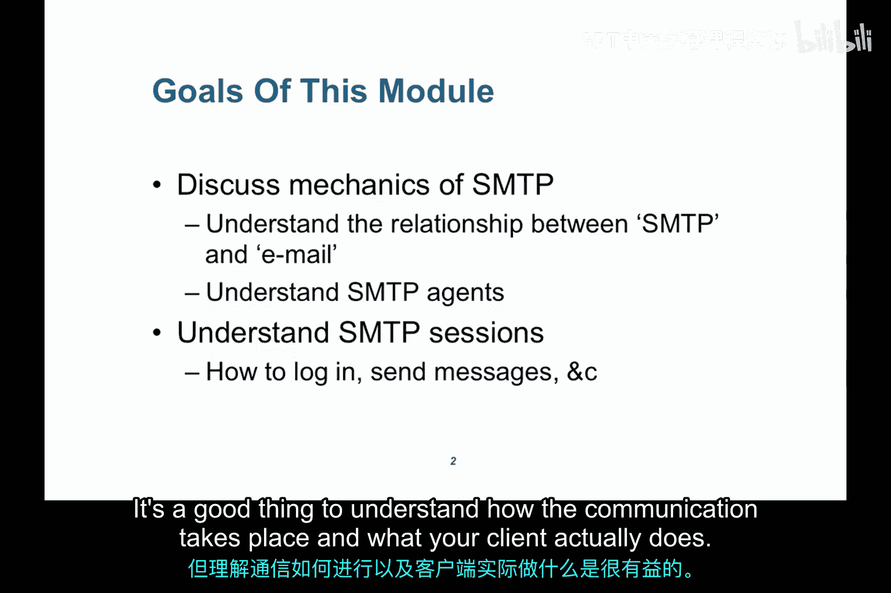
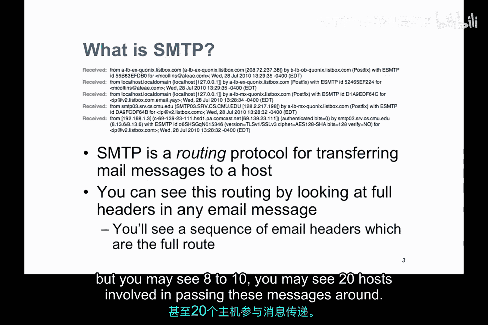
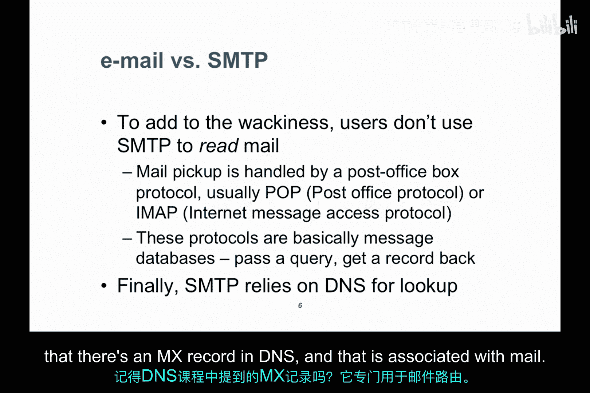
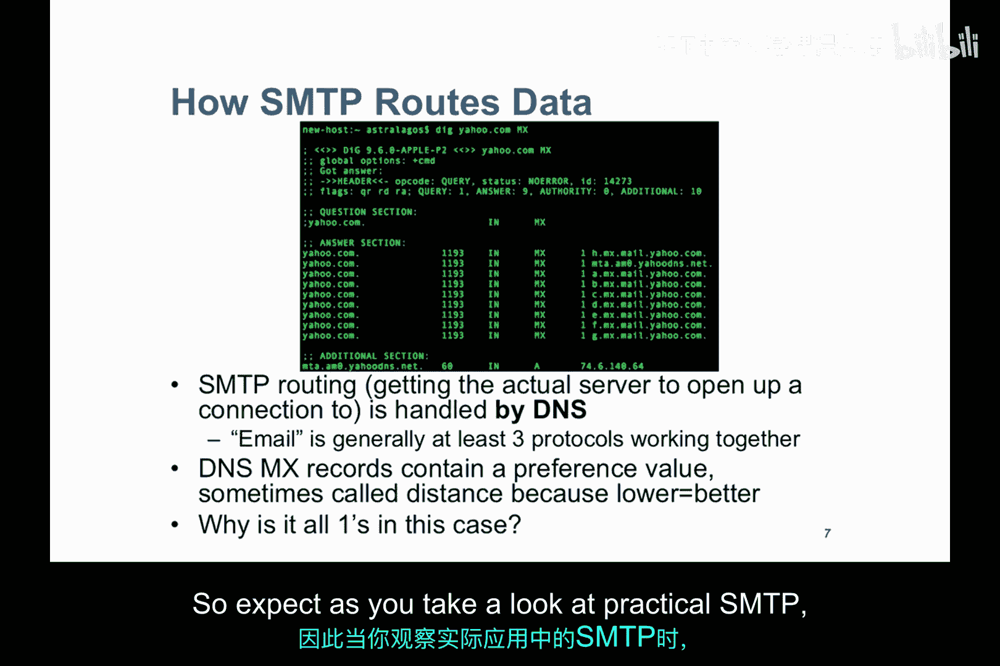
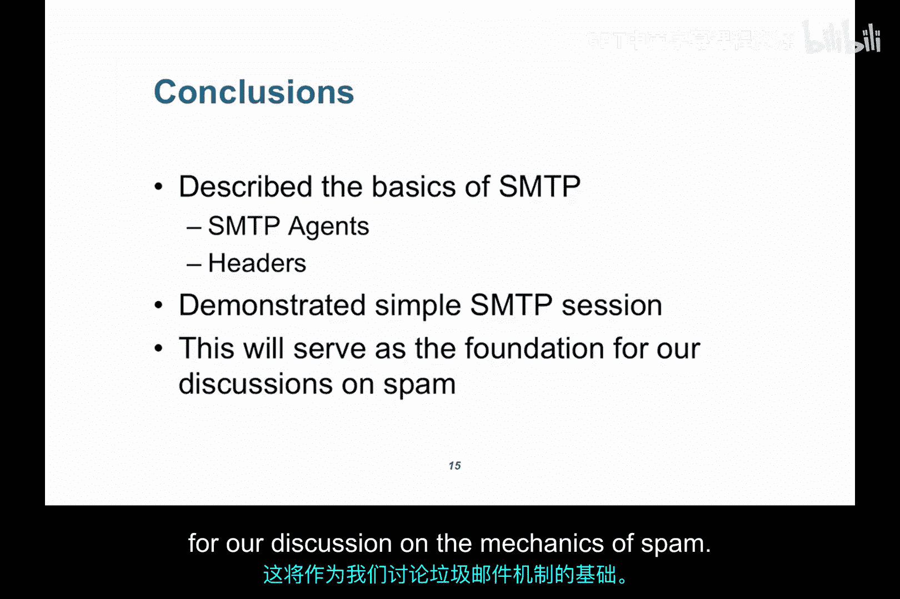

# 约翰霍普金斯大学《信息保障分析｜Information Assurance Analysis》中英字幕 p35 15_SMTP协议概述.zh_en -BV1Qz8EzYENX_p35-

this is Professor Collins speaking plus 695741 information assurance analysis and this is module 9。

1 This is an overview of SMTP inacate named simple mail transfer protocol goal of this module now the goal of this entire section is we're going to be educating you about spam and in order to talk about spam we have to talk about email is a very complicated beast which is actually the interaction of multiple protocol the foundational protocol however。

 is what we call SMTP， the simple mail transfer protocol what you take away from this module is an understanding of basic operation of SMTP what an SMTP agent is how the information back and forth and also the relationship between this protocol SMTP and this service email because there is email is actually results from the interaction of at least three protocols and possibly more depending on what you do Part of this is a function of just the ancient history of email it's one of the oldest protocols on。

Internet a it was originally designed to stitch together communications between systems that had their own email purchase thing I want you to get from this this session is an understanding of how SMTP actually looked as a protocol the messages are sent back and forth how you log in and so on This is to certain extent obsolete knowledge because it's very hard to actually find an open server these days it's a good thing to understand how the communication takes place and what your client actually does right so what is SM fundamental SM is a routing protocol in this it shares some behavior with BGp in the sense that it's a stored forward I want to send mail to you communicate with system this is okay I can get this far and I pass it over to a relay which that repeats the process passing the message like passing the message to say way around a transfer packet if you look inside of one of your SMTP message if inside a mail message if you look in your mail clients there is a view full headers option and if you do that。

You will see something like this sequence of received headers that I've put up here This sequence of headers actually shows the step by step passing that a mail message goes through to get to you so for example you'll see that the version I've got here it's sending mail to myself at M Collins@i。

 youll see that before that it was at this host at listbox。

com list box in turn got it from SMtpo3 that served cs。cmu。

edu which got it from Comcast and so on so you see that there is this sequence of hosts and you'll be surprised at how many hosts are involved in for your message you might think it's kind of an aBc type of thing but you may see 8 to 10 you may see 20 hosts involved in passing these messages around how does it SMtP is in fact your to peer protocol as far as I'm concerned because it consists of a network of peers they talk on port 25 tCP for authentication authenticatedC SMP。

usuallyual be on port 587 and then there are these servers that have all of these funky names MSA M MX M these are all actually just different hats worn by the same application an STP server and in certain cases they're actually the same server is really what this is just this is just sort of describing the path from one user to another the user submits to the MSA the MA to the m the to multiple m is the M to the and then the passes it to the receiver each one of these guys is just a step in the route and process soA is the mail user agent or as we like to think of email client So this is outlook or mail app if you're using Gmail it's hidden behind the scenes in Gmail it talks STP to a server to initially submit your message the MSA the mail submission agent actually begins communications with the SMTP and then MTs transfer the messages back and forth within the network until they reach an MA。

Which is delivery agent That's the thing that gets mail to your targets mailbox。

 This is where we get into the difference between email and SMT。

 you do not use SMTP to read your email you use SMTP to send your email email is read your email is accessed through a protocol generally called a post office to classic one are pop which is the oldest of them and the other standard one is imm the internet message access protocol So these are the things that actually store your message on your mail server lets you access them put in folders things like that Basically message database I get an I I can query the mail server it can return to be the message associated in addition to this DNS is deeply embedded in SMTP may recall that I mentioned in the DNS that theres an M record in DNS and that is associated with mail In fact here's how it works so let's talk about doing a dig for a mail exchange So I want to mail somebody at Yao。

I know that I know that the email address is something like obhoo co okay that's great。

 but that doesn't actually tell me which machine at Yahoo co I open up for an SMTP session I look for an Mx record and you can see for example this dig statement with Mx and you'll see that in this case1。

2369 SMTP the other thing that I want you to notice here is this set of one at the side here Mx records contain what's called preference value now the preference value a distance metric sort of the same thing as the distance metric in B it works in sort of the same way lower value means that you're going to get a better rap now you'll notice the case of Yahoo they've assigned everything in equal way there's a couple of reasons that organizations might do this one of the major reasons these days is spammers so it used to be you would decide the lowest metric to the server that you wanted people to contact the most and historically you'd see kind of an expert you'd see a exponential backing law X number of users who go to the first。

To the highest ranked server X over4 would go to the second highest ranked X over 90 to the third and so on Bammer figured that a high value in the preference meant that it was a less maintained and less watched server so they would make a be for the high value that's probably the reason that Yahoo is the point decided to just equally weight mail server now I'm not say that necessarily the case but what you find but let's just make a blood statement here SMTP is the Russian front of the information security war it is the spaming and anti spam has been the oldest fight in the book because of that you see an awful lot of changes to SMTP the actual usage versus SMTP the ideal because people have figured out over the years that spammers will do everything humanly possible access it so expect as you take a look at practical SMTP you're going to see a lot of battle scars SMP messages contain email headers email headers are SMTPs metadata that the equivalent or TCP option。

HCGP options， things like that。 Those received headers I showed earlier are an example of email header。

 Most email headers are fairly selfexplaned。 For example。

 you need a from header to header and a subject header。

 somebody who set the mail sending the mail and what you're talking about there are a variety of other headers that are of interests class of optional headers will discuss there's the received headers which basically serve as a laundry ticket showing you what every step that the mail took there's the message I and there's the reply。

 let's talk about the Re header I showed you some of these earlier along every mail along a transfer train what the you'll see you'll usually see that sequential filtering takes place between the received headers for example if I received by server X and server some antipanm and drops a couple of headers into the system indicate the type of an antispanm operation those headers will often appear between the two received headers indicate this happened this Now receive headers fairly cut and dried's a DNS name there's an IP address and。

There's the date at which it took place Okay the next thing of note is the message ID a message ID is a globally unique identifier for that mail message If you take a look at message Is one of the things you'll notice is that they have domain like an email address attached is to ensure that the message is globally unique because that means because the idea is that it only generate it only generates unique Is within that domain that the domain is step at on to it to ensure in addition to message ID there's also a reply toer apply to header specifies who to send a message to when youers will often tweak it they'll put a blank address in it or something of that nature and you'll often find that a certain classes of malware type mails if you hit reply you'll find that there's no reasonable place for to reply to it that's done using the reply to header in addition to that there are optionaler usually beginning with an X they're not supported by SMTP they're past along the major thing that you'll put in X headers an awful lot you'll see encryption type material you'll also see messages from antipan systems placed many antipan。

Systems actually don't block or stop mail they just annotate it indicate whether they think it's spam spam As will for example add a whole bunch of details about whether or not think something to spam and will actually include sort of a receipt showing you the reasoning process it used to reach that decision that's basically your circle line boat tour about SMTP let's actually talk about what an SMTP session looks like back in the 1990s those incental and days we used to annoy our friends by sending mail you did this by directly tell to an SMTP server and sending an SMTP session lot like HttTP can be done at the command line if you set your to difference between SM andt is that because spammers will find it open STP server it start using it immediately we don't open sTP server the wild so is a simple SMTP session first thing you you tell that to your SMTP site 25 you'll get back a message about where it is。

And then what you do is you contact it。 And the first thing you do is you send it hello message。

 which says where you're from Most of the time these days。

 if you do do that the first the SMmTP server will do is a reverse lookup to double check on you anyway。

 you put your name in there you send you put your receipt who you're sending to and then you send a message Now traditionally this is done with this data statement and what you'll do is to terminate the message you return in a period hit return Yeah anyway you have to put in headers So you'll see that the beginning of messageenger put in these headers from to date and subject and you know then just a short message this is how we used to amuse ourselves and then at the end of that stops accepting data and then goes back to SMTP then you just quit your're done as I said this is the kind of thing we used to do in the 90s because it was font and it was confusing and it was a neat。

 you just don't see that anymores one of those things that's basically been a casual Bamers look for SMTP servers。

Because they're inordinately handy for them Now let me add。

 when I say spammers look for SMTP servers， I'm using a bit of outdated information these days most spaming software。

 most malware includes SMTP servers for sending messages it used to be that spammers would look for what we called open relays so most SMTP server connected to the border of a domain so they might be on so if it's the border of A。

com that all messages must either originate from A。

com and at A openrelays would take anything from anywhere it used to be that we did constant checks on the internet we sent mail to people to close their open relays because spammers love open relays basic design which was open and friendly and consequent basically had about as much chance to surviving as a wounded antelope on the Serengeti that led to the demise of this kind now basically everyone locks down their SMTP servers authenticate protects them only excepts from limited set of servers。

Like that because of the shear damage we've described the basics of SMTP we've talked about the agents we've talked about the headers。

 I've shown you what a simple SMTP agent looks like a session looks like I've shown you the role of the headers in particular I want to be the role of the received header and the idea of these optional X header serves a foundation for a discussion and mechanics of spam。

Enjo。