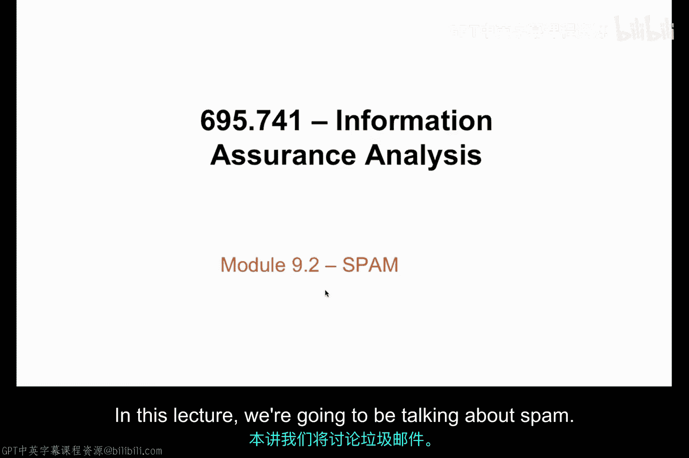
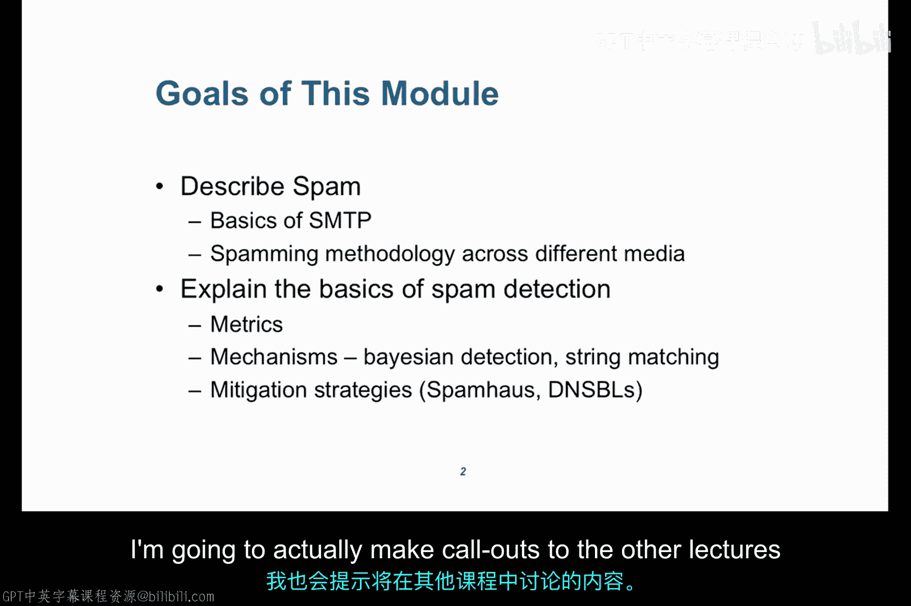
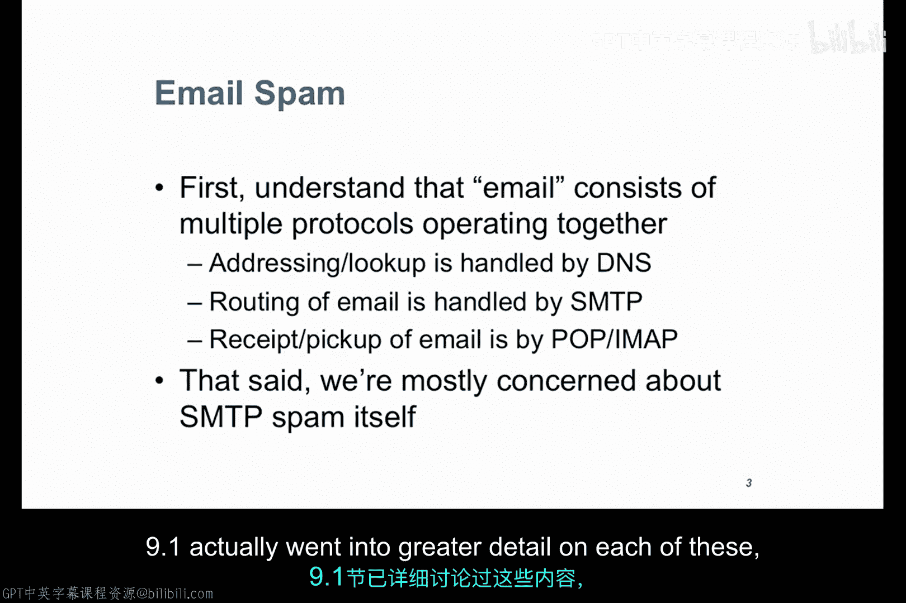
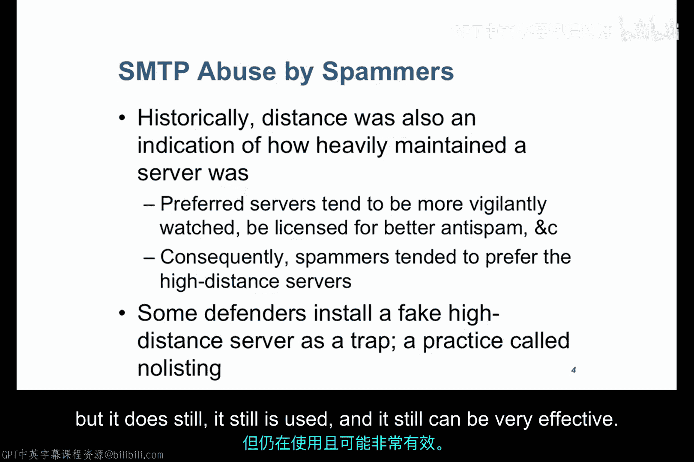
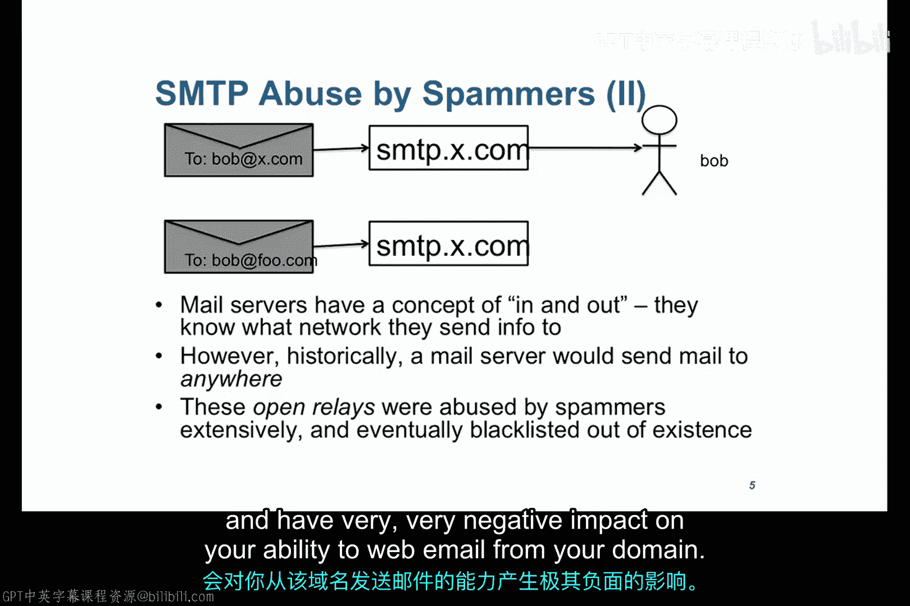
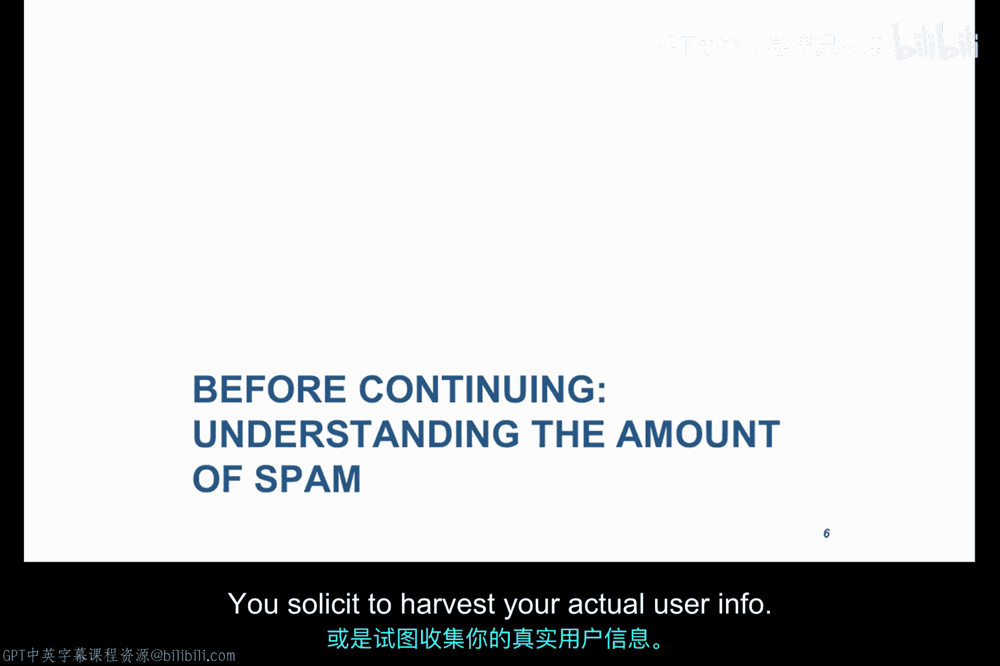
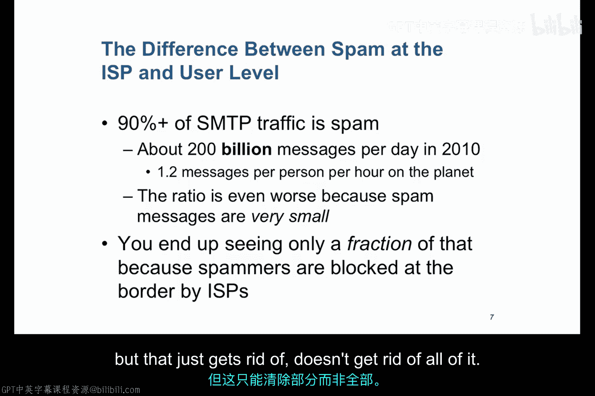
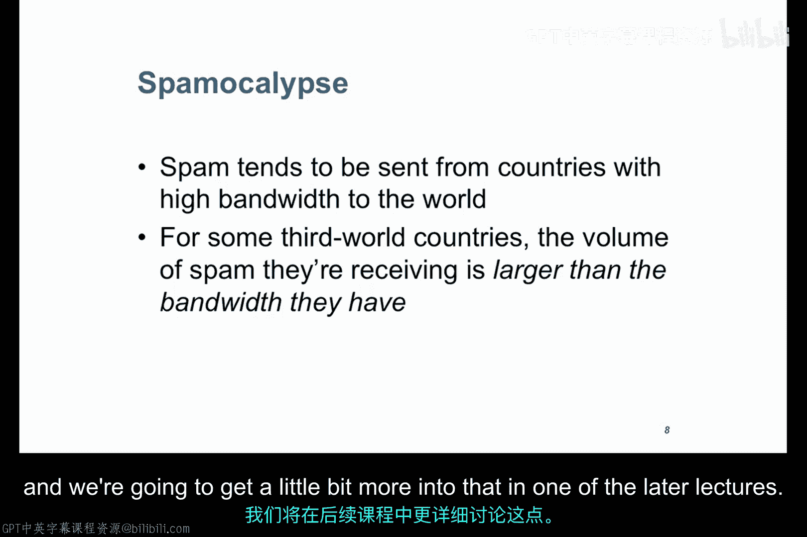
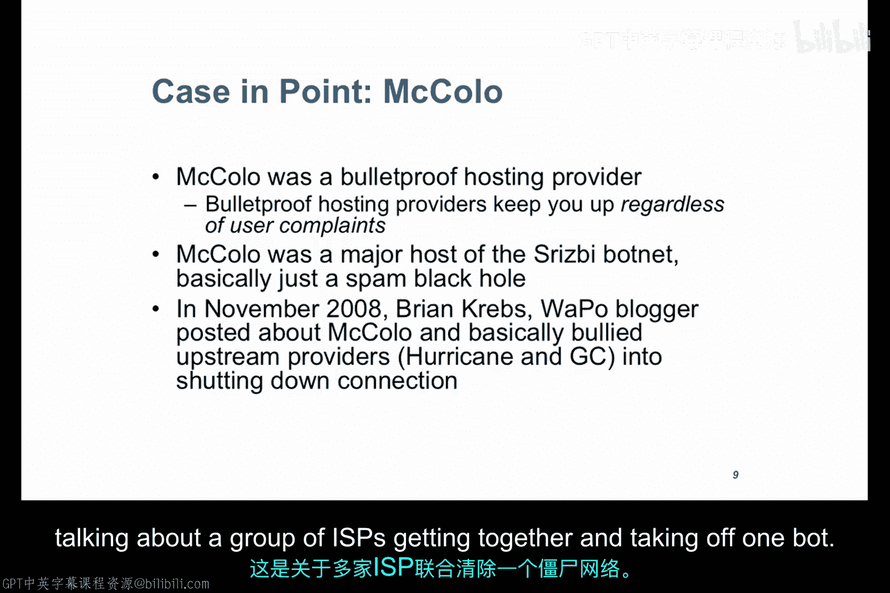
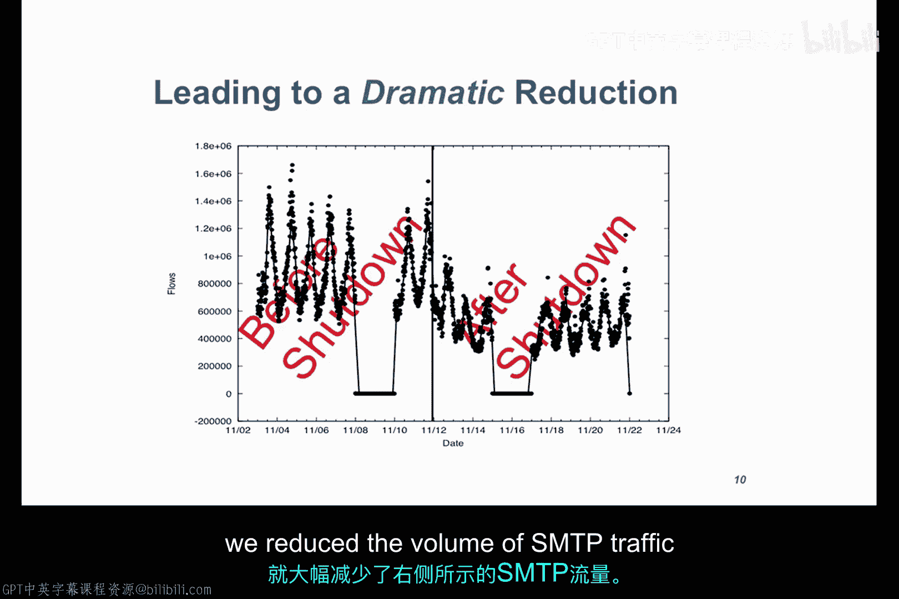

# 约翰霍普金斯大学《信息保障分析｜Information Assurance Analysis》中英字幕 p36 16_垃圾邮件问题.zh_en -BV1Qz8EzYENX_p36-

This is 695 P741 module 9 lecture2 This lecture we're gonna be talking about spam by the end of this lecture you'll be aware describes we've already gone over the basics of STP。

 but we're going to actually call back to one or two of those things actually describe how they relate specifically spam're also being discussing spam methodology across different media playing the basics of spam detection metric mechanismsian detections during matching like and mitigation strategies All of this is going to encompass the rest of the lectures for this module So even if we don't touch on specifics and this I'm going to actually make callouts to the lectures where we will discuss them first once about email got to understand that email consists of multiple protocols operate got your address look which is handled by DNS routing of email which is handled by STP recipient pickup of email handled by an imM That said we're mostly concerned about SMTP spam itself whenever we're talking about it this 9。

1 actually went。

detail on each of these and I would refer you back to them if you do not STP abuse by spamners historically the distance metrics that were talked about in routing are also indicators of how heavily maintained the server preferred servers tend to visually watched by licensed anti spam such as your iron or wellma black list and the con spammers tended to prefer the highdist server ones that were further away Some defenders installed a fake highdist server as a trap it's a practice called no listing and and had varying levels of effective that in today's market this really doesn't have as much of an impact it does still it still is used and it still can be very's talked about what were actually mail servers have a concept of and they know what network they send in however historically a mail server would send mail to these open relays were abused by spammer extensively and eventually blacklist out of its basically with these。

as you could actually open up your own mail open mail relay on your this thing would route any anywhere to it was intended as a method to actually connectivity promote content as with most content delivery people did not necessarily think about the bad side of these spammers actually started using these as their relay that about that is that post that has that IP address that is the open relay that guy gets black so the owner of that is left holding the bag of being accused of being spammer and they really didn't have that at least we can assume that a miniki since they do as we're going go into and some of the future lectures you'll see that it is very problematic to end up on one he's black because not only can your IP address will walk being there is also domain resolution options that are available for determining whether or not a particular domain actually just having this information having one of your hosts in your domain blacklist and have very。

Very negative impact on your ability some you domain So before we continue any further。

 we do have to understand a little bit about the amount。

 I think everybody here really understands what spam is I'm not going to spend any time for those of you who don'test way I can put is a bunch of garbage that just gets sent to yourbox and you didn't want that was unsolited and is intended for you to buy use solicit harvest your actual user whenever we're talking about the amount of spam to realize that if you eliminate spam tomorrow the amount of S traffic that youd be dealing with by sub estimates upwards of 90% of traffic is so this results in about2 billion messages per day in 2010 and。

2 messages per person per hour on foot that breaks down this ratio is too low in my opinion because spam messages of journal small not not the high volume messages。

You generally get so if we're just dealing with the sheer volume of S2P traffic kind of hiding it because the number of S you're kind of hiding the actual number of S so again they're very small so that is probably more of in there you end up seeing only a fraction of these messages becauseP of blocking than the generalized piece really don't want this link these messages on there and there's a variety of reasons for this cross being but even more important near and dear to their heart got an infrastructure that's being clogged up with this they could be making money。

 they are making money off the bits that are transing than that And if they've got garbage bits they're not able to actually charge for that is not helpful to them that's not helpful to their so so they do their best at trying to get rid of that at their level but that just gets where doesn't give so I've got to laugh at the title of this slide because Mike was the one bam tends to be central free contras with highamp。

Some third world countries the volume is spam they're receiving is larger than the bandwidth so again very important for the ISPs to be able the filter sum you're going to see in some of the labor lectures a lot of the spaming operations had been moved to countries that are not necessarily big first world nations and the reason for that is because laws had started to push them out of however there's a nice sweet spot in several world and several countries that are not necessarily Third world found necessarily first world where they've got enough bandwidth to actually support a spaming operation or multitude but they don't have legal rigor which would restrict them from being able to do this that's where the sweet spot and we're going to get a little bit more into that in one of the labor lectures and let's get to case point actually trying to dealing with these ISP and how they have to worry you got this thing which was a bulletproof host bulletproof hosting providers keep you up regardless user components these guys they don't care Colo was a major host of Tsbe。

just a spam black and was just hand in 200 group of people that put together while basically bully basically pulling all the oxygengen provider into shutting down the connect want everybody to realize one thing before I talking about a group of ISP getting together in taking off one this is a graph showing the number of flows that was observed on a very large my highest key level the number of STP flows we saw coming1 side here November 2 to November 12 we're seeing the number of SMTP flows that impact that as you can see there's several high volume you've got this seasonal pattern seasonalable dinal pattern which indicates the actual days the week then you see sharp drop offs on the weekends and then on the week starts back up now the funny part about this is again we not one button only change that we can actually find for them but just by doing that we reduced。

The volume of S&TP traffic by as much as you see and。

