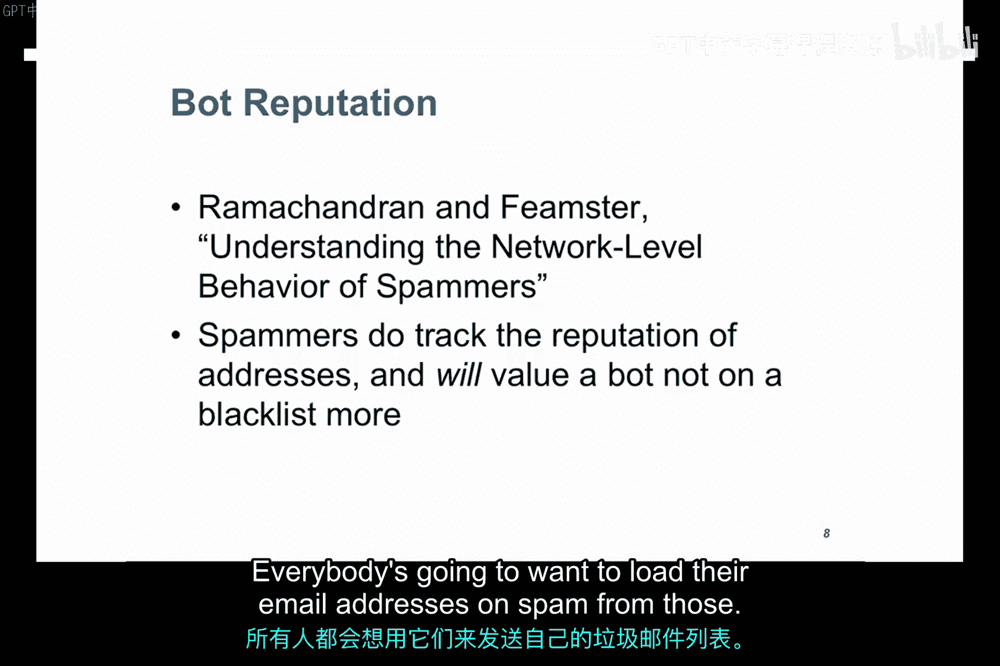
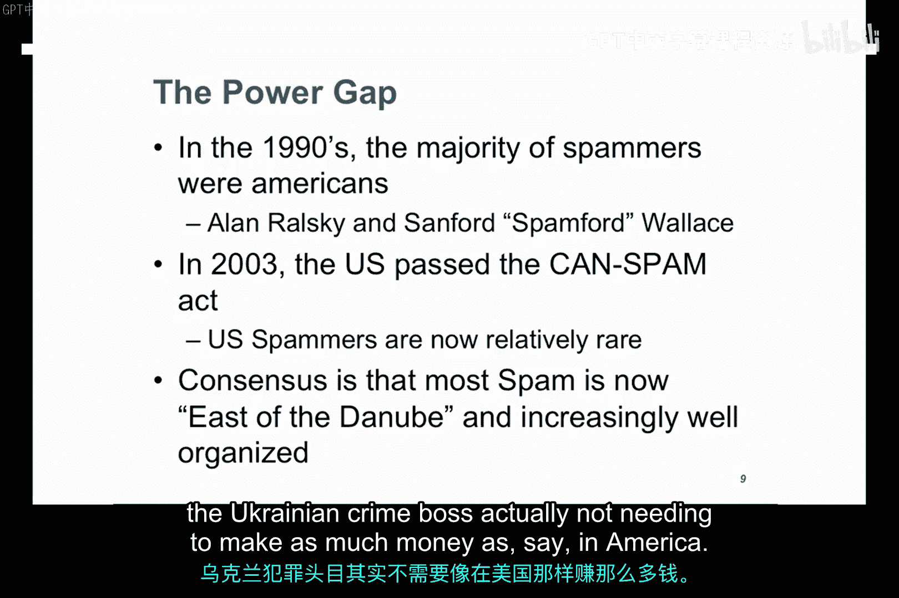
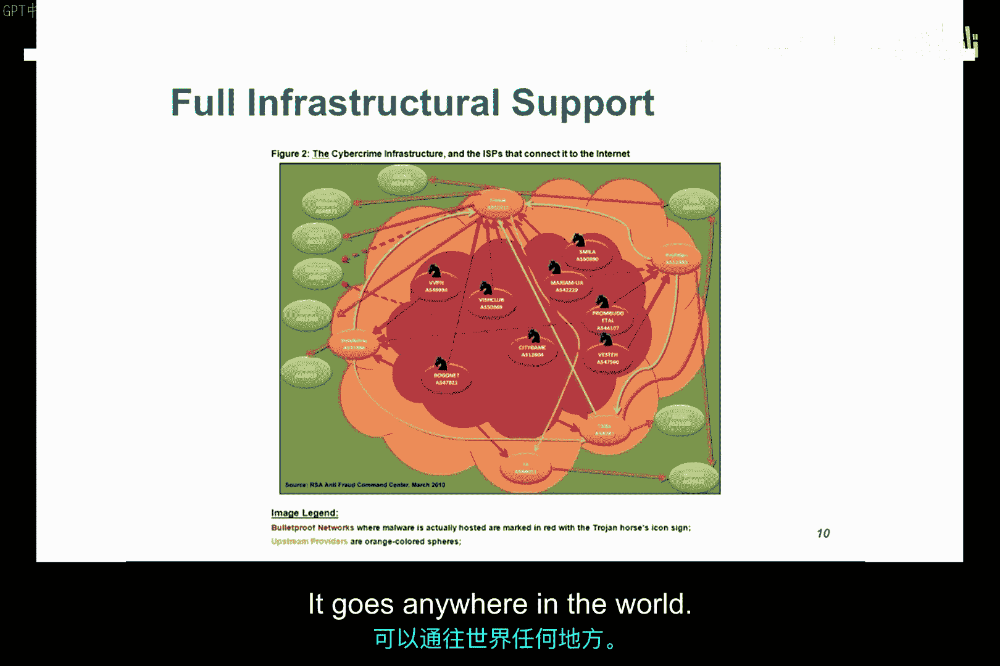
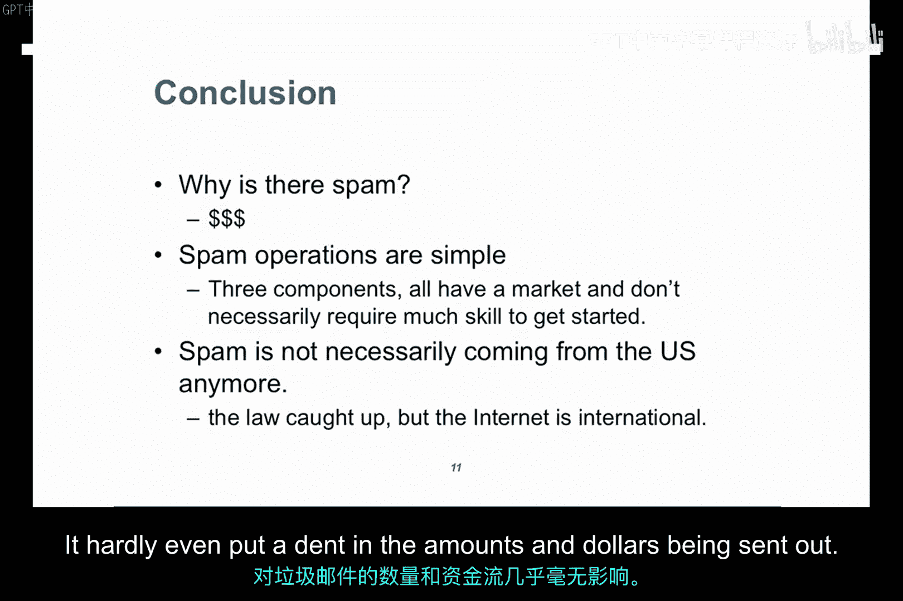

# 约翰霍普金斯大学《信息保障分析｜Information Assurance Analysis》中英字幕 p37 17_垃圾邮件发送者视角.zh_en -BV1Qz8EzYENX_p37-

This is 695，741 module 9 lecture 3 This lecture we're going to go over the standard by the end of this module。

 you'll be able to explain the motivations behind spam specifically how this activity is monetize why it's effective and you also be able to describescribe the Spanish man talent why they pretty much do the way do what they do and how they structure going about first question that we should probably answer is why is there so much ultimately because it's effective It's why of those things that actually can drive much of the more sophisticated Ecrme operations on the planet and historically that's what is viewed as it's just basically your profit engine this is just what's going to build up all the capital that you need in order to get to an next level and do the more sophisticated Ecrmes that you want a reason why it's so useful is because a it's actually effective at monetizing for a lot lower costs than you be I mean of what done is been pretty brazen well set up systems to combat any4 anti- spam。

Mechanisms that are around they're able to throw around a lot of money in this to develop some very efficient systems I mean you know what they've got is they're able to throw money around to actually develop their software and then also they can start organizing with less repputable bias quez and actually get contracts with them in order to host their central network again then little and one of the things that I find most interesting there is a one I call them very bra is because they'll use the legal system of the countries in which they operate in order to try and actually bat any sort any sort of curtailing about their activities so they will actually sue anti-spamers if the country that they reside in as a little bit of wiggle room and the loss that surrounds fing activity I find this variance but I'm not going to actually spend much time on this because well basically I'm not a lawyer and I have a ceiling that most to keep in this room most people listening to as lecture not lawyers either they are that I really don't want to be bad at around by them。

If I says something wrong it's a profit engine So how do they actually make there's a paper that we're gonna have you read in this module which actually goes through how this is how things are and greater detail than we're gonna go into in this Now I will warn you that their conversion read we might not be correct In fact they even say that they might not be but the important thing that I want everybody to take away in this lecture is that we're talking about an industry that is workings of the millions of dollars per So I mean this is not just child's split nons small thing receives lots of spam and everybody who would ever click on something where I say everybody I'm talking about everybody who's listening to this particular Grandma in Illinois and that's where they start getting they just have to do few people in order to start getting some how do they specifically make primarily through marketing do know you got high profit profit margins selling cheap drugs that don't really work and the great part about it is that and for。

their perspective is that they can make stupid things like that for very cheap just because we've globalized as much as we have you've got cheapwa India。

 you've got Canadian labelbeled drugs， you've got Chinese labelbel drugs all these things coming in being pumped into an American to American who actually have money so for very cheap。

 you can inf or some for very minimal you can market it to a large group of and anybody who is dumb enough to actually grab the stuff be victimized by these advertisement is going to be providing them another fine detail about this that I want everybody else so as we said greater than ma dollars or unit but one of the more important details about that is that if you're talking about a completely globalized up you could be talking about somebody from a much smaller economy who is actually extracting money from first world economy such as the money that Americans pumped into the Ukraine from this kind of operation having a multipliers associated with them。

The cost of living is so much cheap so they don't have to walk away with billions and billions of dollars to live like a king in some of these areas they just have to walk away with just a little bit scratching a pocket and they will be able to level on that for several years so it makes things a lot it's a completely asymmetric sort of economy at your deal and we'll get into exactly how it emerged as such and a little bit first let's just talk about what's needed to set up a spend specifically what we're doing here is we're trying to get you more invested in the actual mentality behind these semi operations why they set up the way they do and what what they're actually after when they're trying to set before we talked about how they're getting the profit but now what I talked about how they actually start getting set up as now this is not not front this is not an actual instruction set for you guys to set this up and first off I really would hate to be at your king people to do that second very incomplete if you actually wanted to do this for real this just gives you the high level over when you kind those three main things that。

You actually need what you need is an address list， your you need spammy tools。

 your means of extracting and from extracting money from your victims。

 and need your bandwidth and support and hosting。The infrastructure to actually extract the money from your victim。

 So let's go through each spam harvesting spammers harvest addresses from a variety of locations。

 youve got public posts，cher implicit net implicit naming schemes that people have which make it very easy for spammers to just start hopping one sending out scans Pacificos with names for reasonable addresses。

 See what comes back。' something knows that great something doesn't took you what2 milliseconds。

 So basically they'll start hammering away at these systems and were going try and see which addresses actually are valid E it。

 Let's say they've got their list from their public posts。

 They've just gone and they've scraped all kinds of websites。

 They've scraped all kinds of address books， contacts and contact us sort of pages on any sort of website that is for an optimization。

 They've got this huge list of emails and important detail about this。

 whenever them'm saying important detail lot， but there are a lot of wonderful。

 interesting little nuances to this software have to actually。

Set up a spamming infrastructure in order to make money。

What you've got right now is a command Go a list of email that somebody is willing to pay is in order to actually take those addresses and spam them themselves。

 So it's entirely possible that you could set up your own tier of the operation for just grabbing all these email addresses in a more unique。

 more realistic email addresses that you get the more profitable each of them come If you've got a list of 100 addresses that are completely valid and have never been hit before you've got a good set。

 If you've got 100 million addresses 50 some on like in a majority of them are complete dus。

 not so good a set。 but basically these gals set up shop and start putting together their own trading site。

 and they will start trading from for money。 you've have your own set and you went to one of these sites and you started buying up a bunch of addresses yourself。

 Now you've got a complete set of address。 Now this complete set of addresses。

 you're gonna to start using in order to do some spam one detail that I want to point out before we go。

ar with this I really don't think that address hiding schemes really。

 I don't see them as having any value because once once an address gets found once it's going to enter into this system I'm going be able to buy that address from anybody who you're investing a large you as a network defender a large amount of effort into hiding address when what you really need to be doing is investing large amount of effort into protecting once that address getss sense in me trying to figure out exactly trying to figure out all these all the nuances that you put into your email address when I could simply just buy it Ukrainian website that's trading this I've got my address got all this together I need a system that I can use to actually we've got a second paper that we're going tell we're going to have you guys during this module and it's talking about understanding the network level behaviors and this is very interesting。

Not only are addresses radio according to their freshness and usefulness and legitimist the hosts on which you place your spamming and use it to want your spam those guys are also according to how many blacklist they already exist as we're gonna get into later in this one of the things that you can easily to em the amount to decrease the amount of spam that you receive is actually look at the reputation of the host that sent you the message chances are they're associated with other variousious activities and chances are somebody is eventually going to report them as malic show up on some black most wise of spammers are there bots that have not shown up those are are guys that they're going those that go to bos theyre going high value everybodys going want to load their addresses from those So now let's get a little bit into the power that occurs because in the mid90 majority of spammers were So you know we didn't have。

Good one how to stop spaming in America So this was back whenever it was very easy for Bamers to start suing anti spam services。

 dropping their traffic in 2003 the U passed can spam basically was the nail in the coffin to kill the American spam industry every operation moved overseas in some way so now when we've got is you've got a you've got an infrastructure that completely left our soil set up this dichotomy that we talked about beforehand they're really going to hit a lot of Americans of first world nations and try and get as much money from them as possible extracted and bring it to bunch of this in and of itself was a wonderful shift and this explains a lot of how things happened with you know the Ukrainian crime boss actually not needed to make as much money to say in America so then a more interesting as they started organizing around not having to be in a central location。

You start dealing with the fact that you get close the possession What starts forming is for flyby night IP to provide some method of allowing them to host their militious whether it be you know hold their malware actually put up their trading sites for their email addresses put up their trading sites for selling and selling bots that are what it host regardless regardless of all this which was very easy for them to put together these are very adept individuals whenever it comess to when it comes to network So what we've got here is a wonderful image that came up in RSA antifrud man center March 2000 where they list out a couple of AS and in the center here the red one this is your malware this is your sites that are basically hosting malware that are that are selling addresses all that that's present and this is decentralized globalized across the world each of these little AS autonomous system for those view around。

The actually appeared with T is their extreme correct and there's a series of things as you can see there's not that many listed here but quite a few therere kind of your slide night I or your IP have less as a very reputable and these guys are providing access to that malware now and then from there off to the races anywhere in the so this was my meandering path through what spamming actually is so some things that I want you guys to take away from this is that's the only reason why they do it they're trying to make money to make more money with other thing so this is your startup capital this is a very easy way to get startup more spam operations are simple three basic components we went over here all of them have a market and don't necessarily require much skill to get started when you can even buy the software that you need to run spam operation which we'd mentioned before in several so I didn't find it to mention spam is not necessarily。

Comming from the US anymore our laws cut up， that was the good part to globalization so it hardlyening can put a dent and the amounts dollars being sent out that all。

