# 约翰霍普金斯大学《信息保障分析｜Information Assurance Analysis》中英字幕 p38 18_反垃圾邮件的技术军备竞赛.zh_en -BV1Qz8EzYENX_p38-

This is 695，741 module 9 lecture 4 This lecture we're gonna to talk about the anti spam on by the end of this module。

 you'll be able to describe antitam how it works， what spammers do about it whenever I say how it works。

 we're going be very briefly just kind of flying through it because there's a lot of material So standing is spam blocking is conducted on two major first off the network level second off the message the network level deal with reputation in the last lecture we talked about how bots with good reputations that aren't on a blacklist are higher value This is primarily on the message level。

 we're gonna to be talking about address white listing and basic filtering。

 which is basically our methods of looking at the text and figuring out this is a spam message based a lot of tools that are out there integrate both classes blocks and being this and also iron So the network level prevention you're primarily going to be dealing with black anti spams collect reports of spam activity and then generate those lists and distribute。

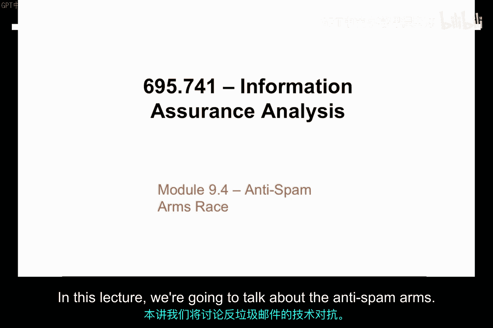

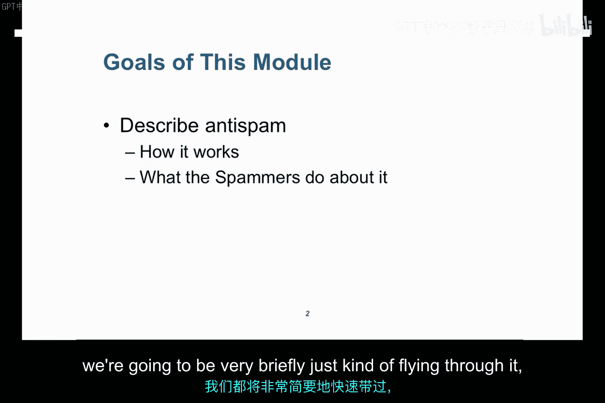

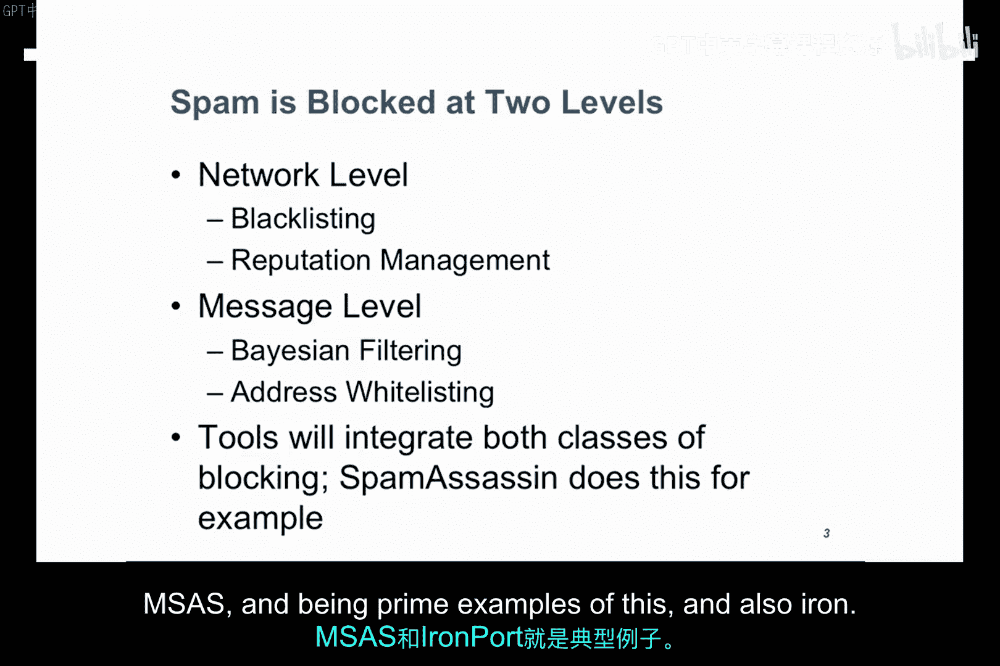

To when you any subscribers to their server these lists can varying presume demo expiration of time and important details about this are we once something actually gets blacklist it stays on the blacklisted for a period of time there is a thton detail about reputation manage which is various hardware services maintain reputation information and information and actively maintain histories when something went on to blacklist and winning these did to be part of the appliances service such as I import you can actually go back in the past and see when something actually start start be listed as being the way that you can use these blacklist there's several out there that allow you to use DNS blacklists which are blacklist that operate through DNS itself and described what you basically do in this kit context is you set up your own local DNS server that is going to update periodically with blacklist information and whenever you actually receive messages from a unknown URL you look it up。

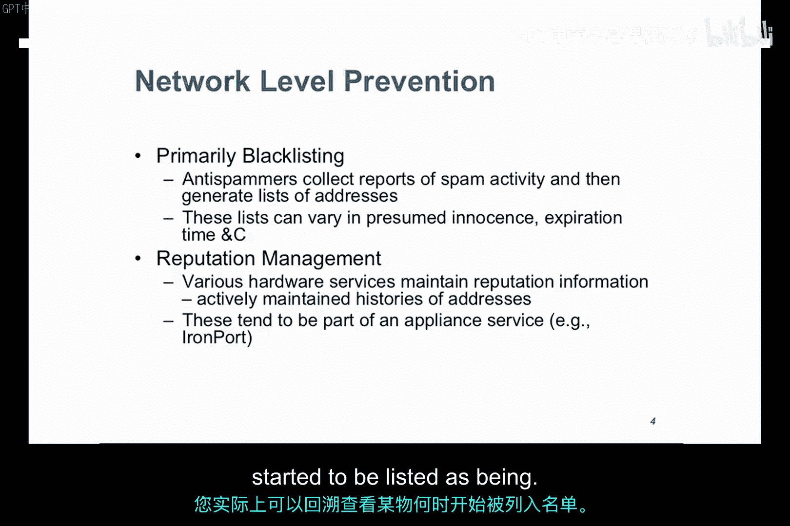

So a local DNS server and a local DNS server will tell you it's a malicious suicide's whether or not it's malicious so a general note about these is the quality of these drastic what many people are concerned about whenever they look at these lists is how you get off there are several lists that has I never removed pretty stupid if you think about it if somebody cleans up the infection on their network they should be allowed to to be in with the outside world again however some of these lists say。

 okay well you did it want so you're going probably do's once problem with why these lists are downloaded at one point in time and realize that indeed it was 100% effective that blocking old spam。

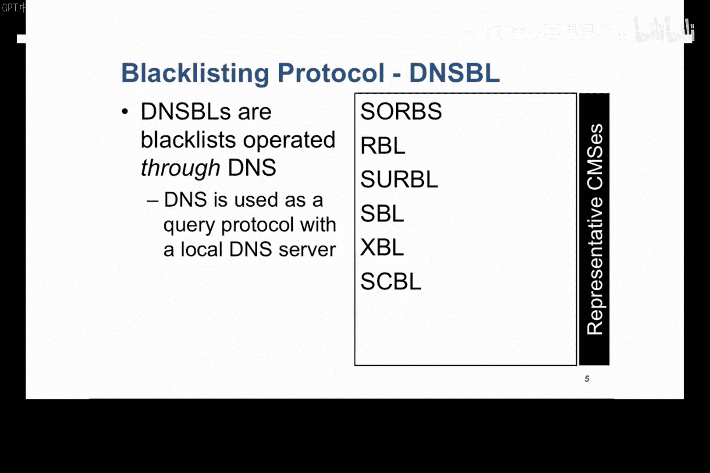

Whereas the bang is because the blacklist contained before4 billion address。

 It was blacklisting the Internet。 So， yeah， of course， you're not getting。

 not going to get anything else。 understanding what the actual removal policy is is very important。

 And if you are an network defender and also the administrator of the network。

 you definitely have to understand what all of these blacklisting systems to for blacklist removal。

 If all of a sudden you show up a one list list， you have know how to get all。

 that basically takes care of the reputation blacklist and common stuff。 it's pretty straightforward。

 Pre sad。 You go home。

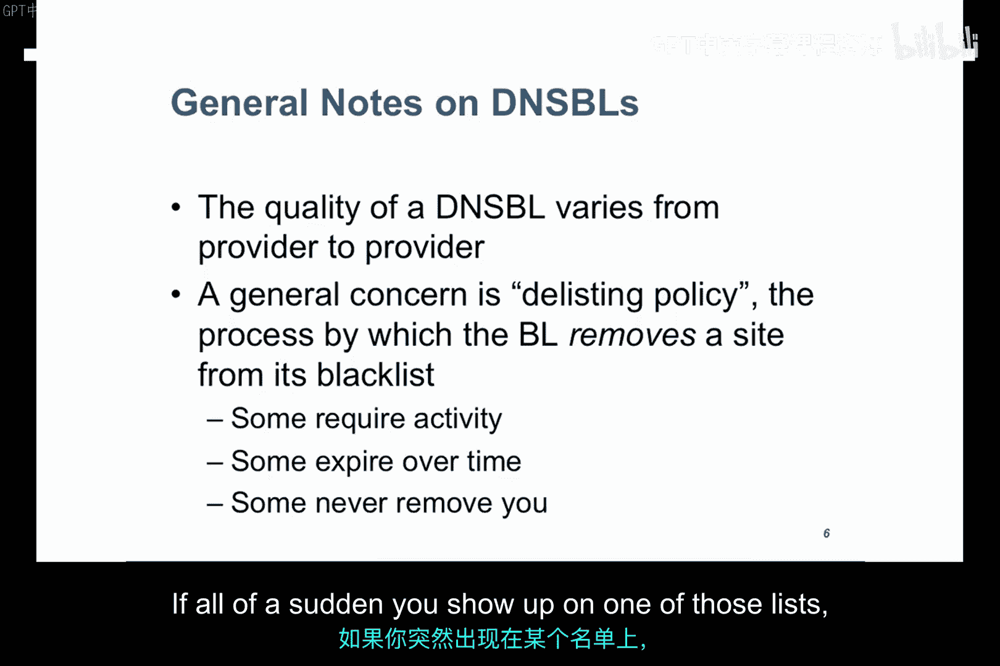

You're good。 hopefully you get to pulled off you can use DNS local DNS server in order to actually resolve all the and all the stuff for DNS servers。

 you can also just plug in an IP set for some of these systems such as I am let's move on to actual message law and this we're going be talking about basically how we inspect a specific email message in order to determine it what so we're no longer concerned about the infrastructure at all we're just concerned about the message that we've got sent right and front a lot of the early band messages to consist of exactly the same message over and over again they just sent everyone they could so it was pretty easy for defenders to protect against this because you start hashing the messages that you see with the same content and you can very effectively compare to see if you see that message before if you one of these messages is spam that hassh indicates that spam all of them this is a very effective method and if your spammer is stupid and they're just going to give you the same message over and over。

It's not so effective if they actually start trying to do something different。

 we introduced Bayesian s and the basic premise behind Bayesian filtering this so you don't get much legitimate nail asking about herbal Viac unless you are a pharmaceutical company that's just not the case so what they thought was they could attach a pro and basically what they do is they calculate a probability that a given message is spam given that it contains some sort of strange message that is very rare viaag is mentioned in it give me the probability that this is spam What this does is if asked the user to help with the system so it's going to ask the user to help it determine whether or not something is spam in order to calculate these probabilities and adjust its actual probabilities for so I'm not going to go directly them into this formula wheel here but this is a standard bayesian check begins with a probability the message is spam。

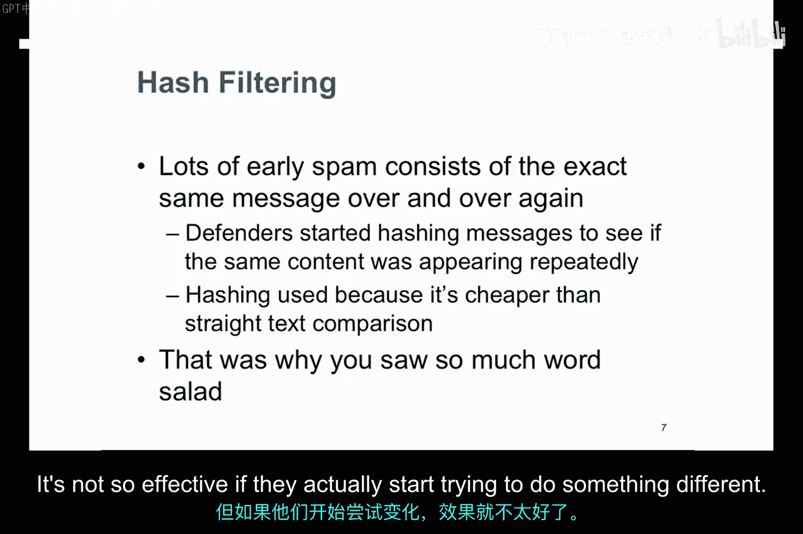

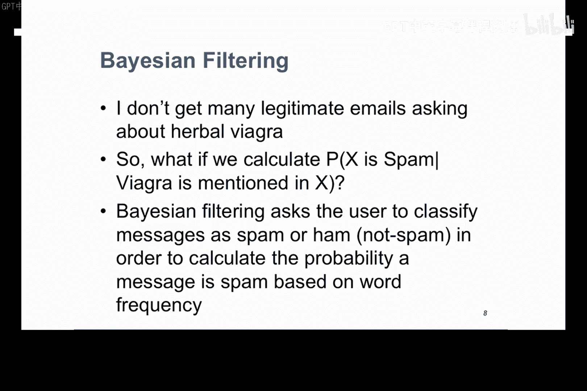

Approximately 85 and estimates the probability that spam based on presence or absence of select words that you have flag every time you user hand marks and messages spam and becomes more and more effective at identifying spam that your system and starting to receive it a variant strategy also exists the formula above is naive Baium classifier and can be used to calculate the probability for a group of words so instead of just working on specific words it's working on groups of words and other classifiers also to use this approach and'm going to use like aggregate of multiple types of words that here in the document multiple configurations of those words and so all part of a very interesting strategy that requires some basic well understood。

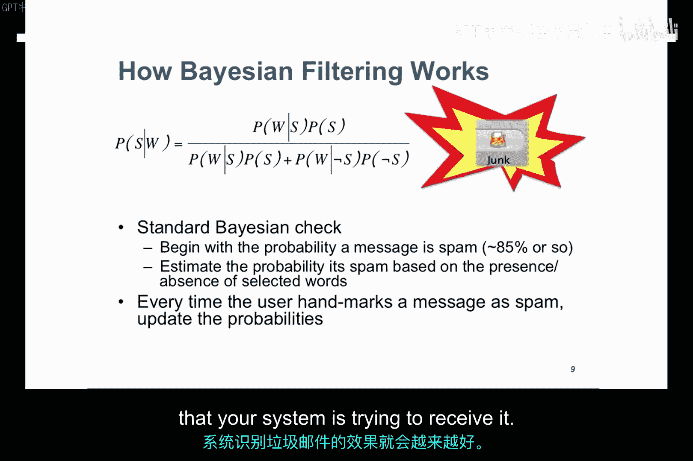

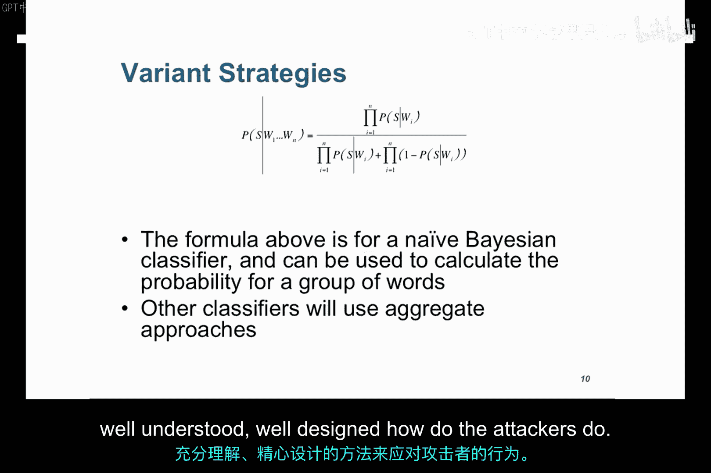

Well designed， how do the attackersguise are not going toette。Some simple process。

 defeat them and destroy their profit margins。 Atters have constantly moved forward and spam new technology to evade these ans food。

 They do a lot of things such as poisoning the well alias in group bot adss， exploiting economics。

 All of these things are available to them。 They leveraged them like you wouldn't。 First off。

 the general， the general easiest way that they can actually deal with many of visa purchase。

 Got a fairly legitimate bot。 It's not on every spin。 You can start hammering as quick as possible。

 Since we've got a system that is basically born to allow messages through before it's been try and deny messages。

 I。e。 users haven't click junk yet。 so that ba identifiers have been updated。

 Also that's using unique messages。 So those haven't necessarily been ementurers haven't necessarily caught up that it's a spam message comments on them。

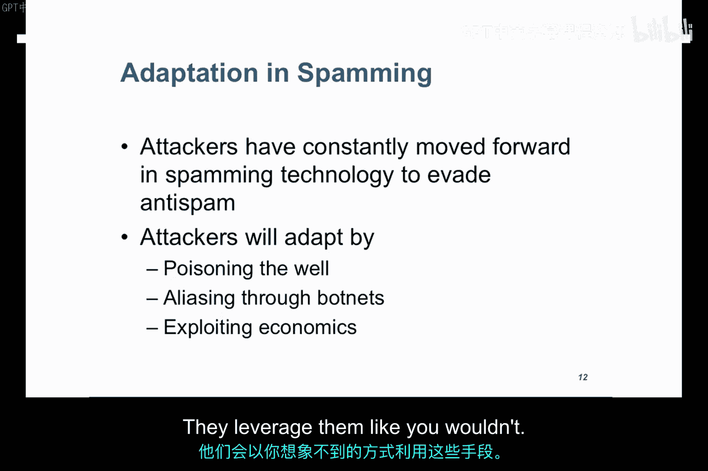

And again， the bots， not on any blacklist， yet as many messages as you can into inbox is as quick as possible and see how how much you can get done before you get that's kind of the mantelity that spa that words。

 and that's fine and good。 But if we want to actually defeat some of these specific techniques that anti spams are using。

 Of course， we've got that hashfel to， let's start talking about how spamber would take care of that in this particular case。

 again， just for a recap early spam hashf thing every message wasstones。

 you know once you see a message repeated a couple thousand con。

 you get a good indication that that is probably not a message that intended to be used to a specific user way that they got around this was they introduce something called word salad。

 Add a set of randomly selected garbage terms to the tech。

 And it is no longer wreck you could also do basic merging。

 take a wild guess of what the user's aim is。 And you put that into the message as well。

 and then actually affect the am as what both approaches are pretty good。

 And this is pretty much the same sort of manity that she。

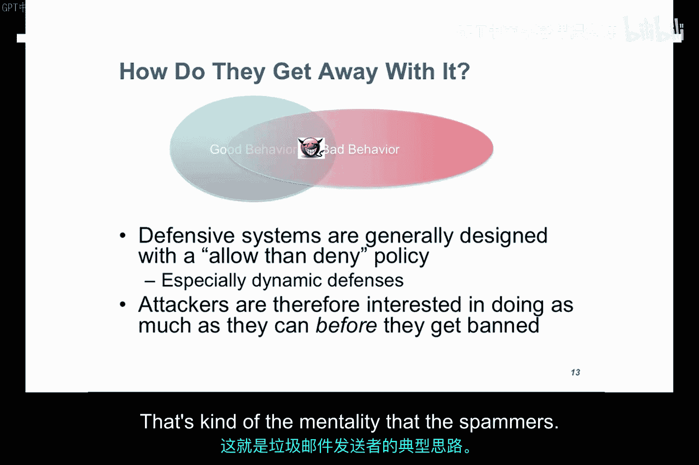

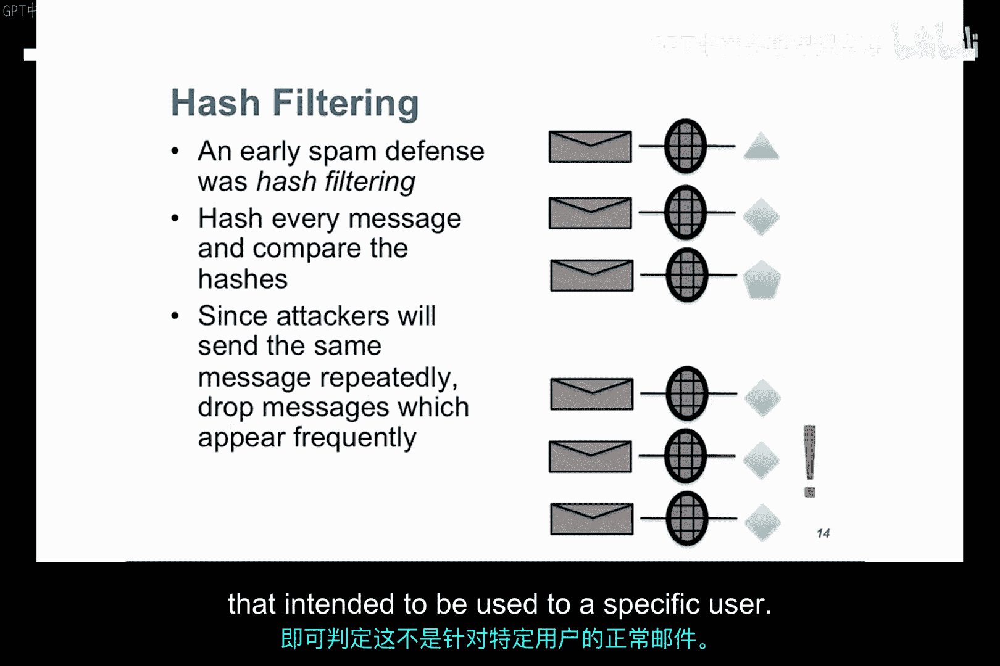

In a lot of malware packing， which is put in your malware and then you pat it out with a bunch of random so that the hash on it will always be different。

 that's fairly effect。 so what about Bayesian filter this one course we've got the math behind us on this one we start actually developing probabilities and and everything starts getting tailored to what the user themselvess to be again it's actually looking at the text that send the message there is that small problem with word it's very easy for mean once problem with the Bayesian filtering is it's very easy for a human to read something that is not written very well if you don't believe me there's this line here if you still don't believe me just go read any tweets that you can find our Facebook for that matter So it's pretty easy for the attack or team beat any sort of text processing like this because we're good humans are good at reading not so great when it comes to especially with all of these strange elite speak that we can throw into this stuff and finally there's。

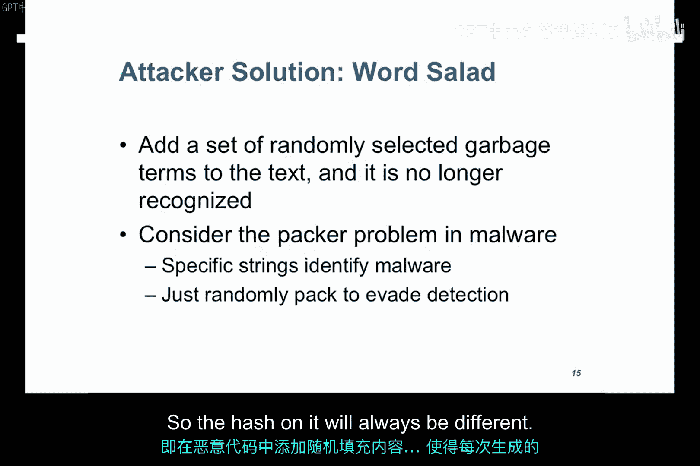

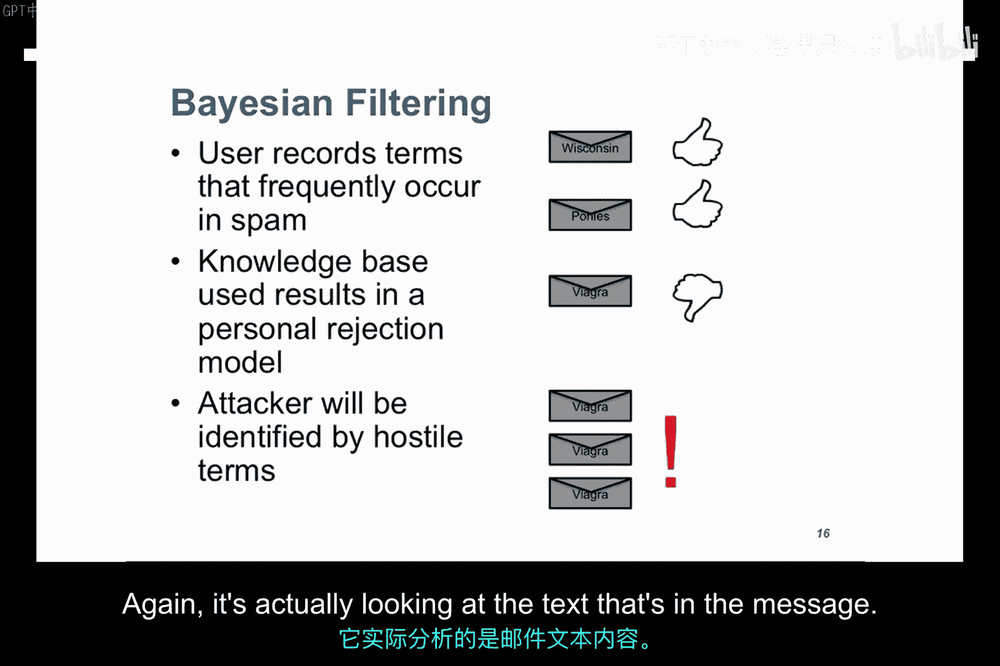

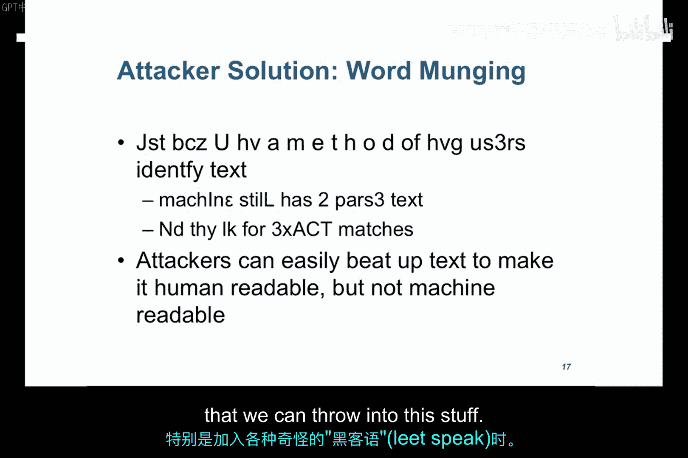

Sr which is you can't necessarily the anti spam engines cannot necessarily do very well with why even use tech just encode every single bit of your message into an image send that that will not be analyzed by the anti spam engine and you got through a you of this fact that there's a finer wonderful this one this one gotta makes me live because this ones using the infrastructure in order to make the message more palatable to the antiviruser engine I sometimes get these Michael Collins gets them quite frequently length and that's because he's his email addresses out there more basically what happens is you guys they send an email message。

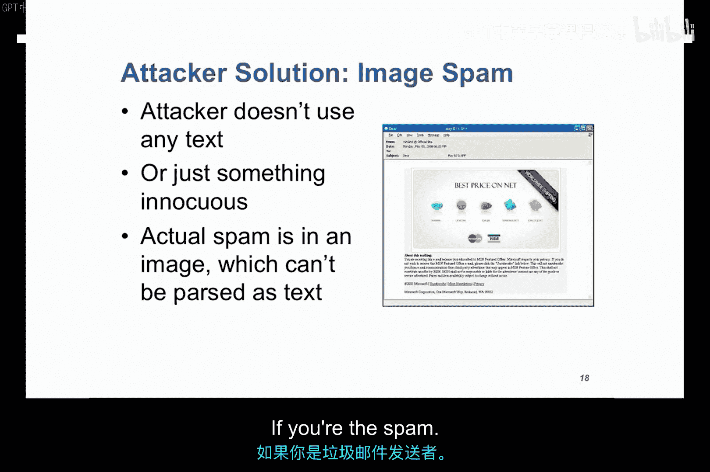

It bounces back。 This send an email message。 It bounces back， says they are fine。 For this。

 I'm just gonna send the bounce。 sendend the bounce message。 exact Z bounce message。

 They just send that message direct go straight into his。

 reasonsa big is because now he's actually adjusted it so much to where it actually looks like assistance level message that needs to be returned to The bottom line is even with the most advanced technologies that we've got。

 Whoever solutions that we can think Even having users themselves。 He have us feedback。

 Bamers are not going to sit back and just let us let their profits to wedle because we're getting better and better。

 come up with the new technique will come up with they'll find a way around the existing stuff。

 they'll rentom repeat until they actually get something that work。

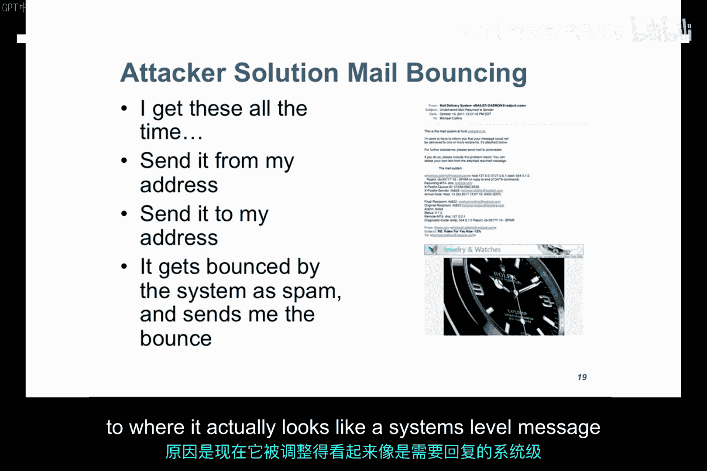

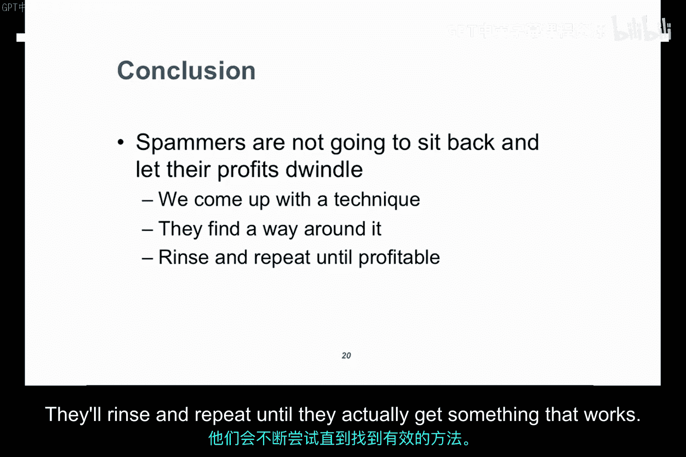