# 信息保障分析：模块9：反垃圾邮件的技术军备竞赛 🛡️📧

在本节课中，我们将学习反垃圾邮件技术的工作原理，以及垃圾邮件发送者如何应对这些技术。我们将从网络和消息两个层面探讨反垃圾邮件的策略，并了解攻击者如何不断调整策略以绕过防御。

---

## 网络层面的防御 🌐

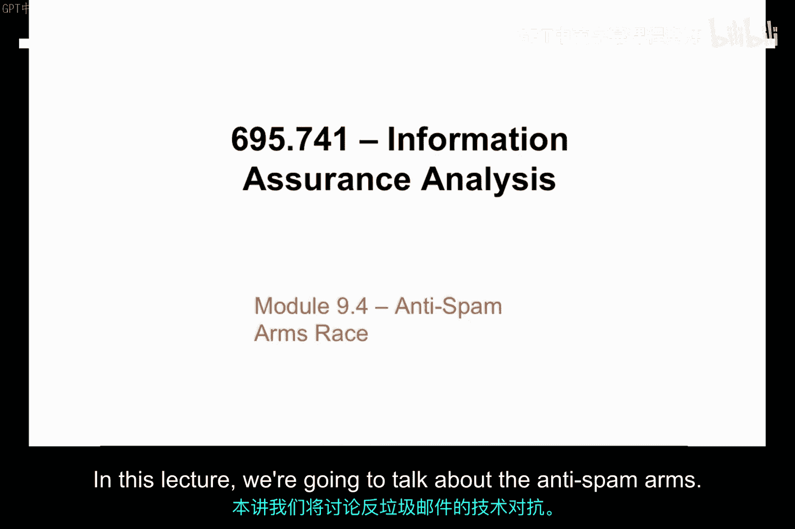

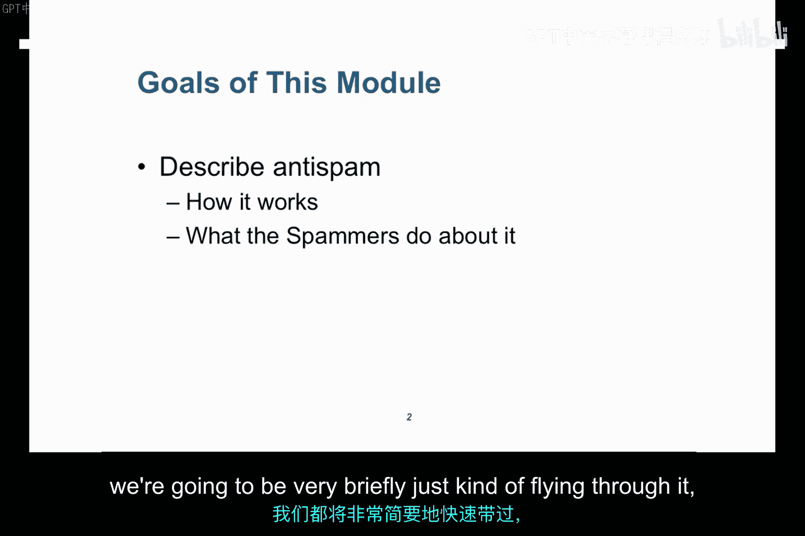

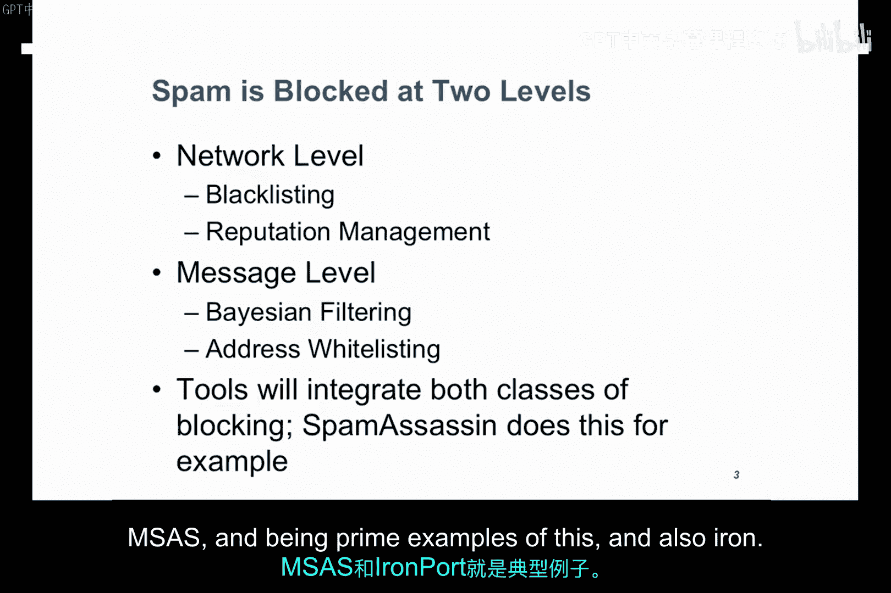

上一节我们介绍了反垃圾邮件的整体框架，本节中我们来看看网络层面的防御措施。网络层面的防御主要处理声誉问题，通过黑名单机制来阻止已知的恶意来源。

反垃圾邮件系统收集垃圾邮件活动的报告，生成黑名单并进行分发。订阅这些服务的服务器会定期更新黑名单。黑名单的条目通常有预设的过期时间。

关于黑名单的一个重要细节是：一旦某个实体被列入黑名单，它会在一段时间内保持在该列表中。声誉管理服务会维护历史信息，记录实体何时被列入黑名单以及何时被移除。例如，某些硬件服务（如 IronPort）允许你查询历史记录。

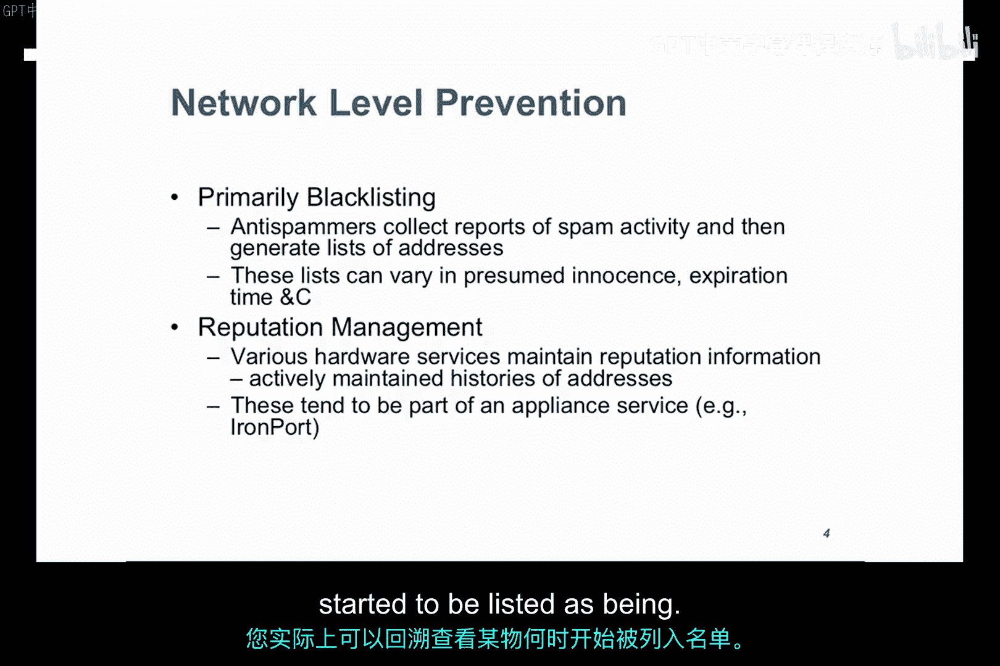

以下是使用DNS黑名单的典型流程：

1.  设置一个本地DNS服务器。
2.  该服务器定期从黑名单服务更新数据。
3.  当收到来自未知URL的邮件时，系统会查询本地DNS服务器。
4.  服务器会返回该URL是否为恶意站点的信息。

关于这些黑名单的一个普遍问题是其质量参差不齐。许多人关心的是如何从黑名单中移除。有些列表的移除政策非常严格，即使网络感染已被清除，也可能无法被移除。理解实际的移除政策非常重要。

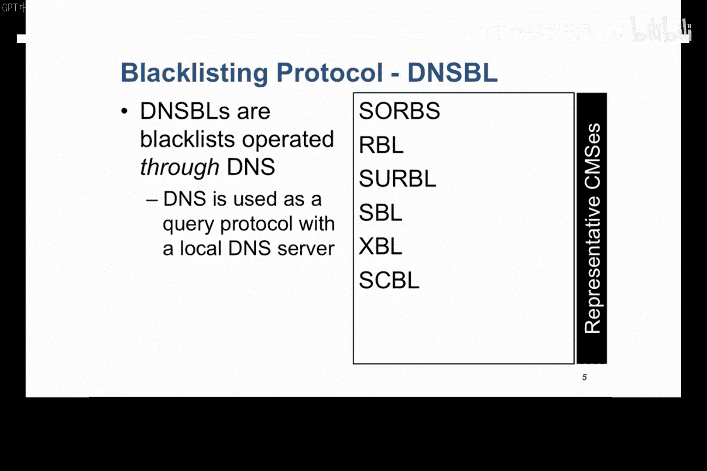

如果你是一名网络防御者或管理员，必须了解这些黑名单系统的移除机制。如果你的网络突然出现在某个黑名单上，你需要知道如何申请移除。

总的来说，声誉黑名单机制相对直接。你可以使用本地DNS服务器来解析查询，也可以直接将IP集插入某些系统（如 IronPort）。

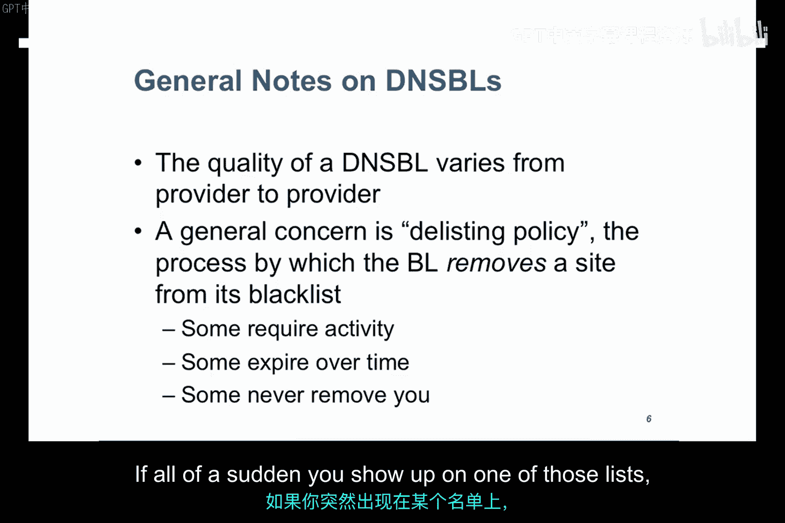

---

## 消息层面的防御 📄

上一节我们讨论了网络层面的声誉管理，本节中我们来看看消息层面的防御。这里我们不再关心基础设施，只关注收到的具体邮件内容。

早期的垃圾邮件防御非常简单，因为攻击者会反复发送完全相同的信息。防御者可以通过对邮件内容进行哈希处理，来识别和阻止重复出现的垃圾邮件。这种方法在攻击者重复使用相同消息时非常有效。

然而，如果攻击者开始尝试发送不同的内容，这种方法就会失效。于是，贝叶斯过滤被引入。

贝叶斯过滤的基本前提是：计算一封包含特定罕见词汇（如“草本伟哥”）的邮件是垃圾邮件的概率。系统会请求用户帮助判断邮件是否为垃圾邮件，以此来计算和调整概率。

我不会深入讲解具体的公式，但这是一个标准的贝叶斯检查。它从一个基础概率（例如，某封邮件是垃圾邮件的概率约为85%）开始，然后根据邮件中是否存在你标记过的特定词汇来估算其是垃圾邮件的概率。

每当用户手动将邮件标记为垃圾邮件时，系统就会学习，并变得越来越擅长识别你系统收到的垃圾邮件。

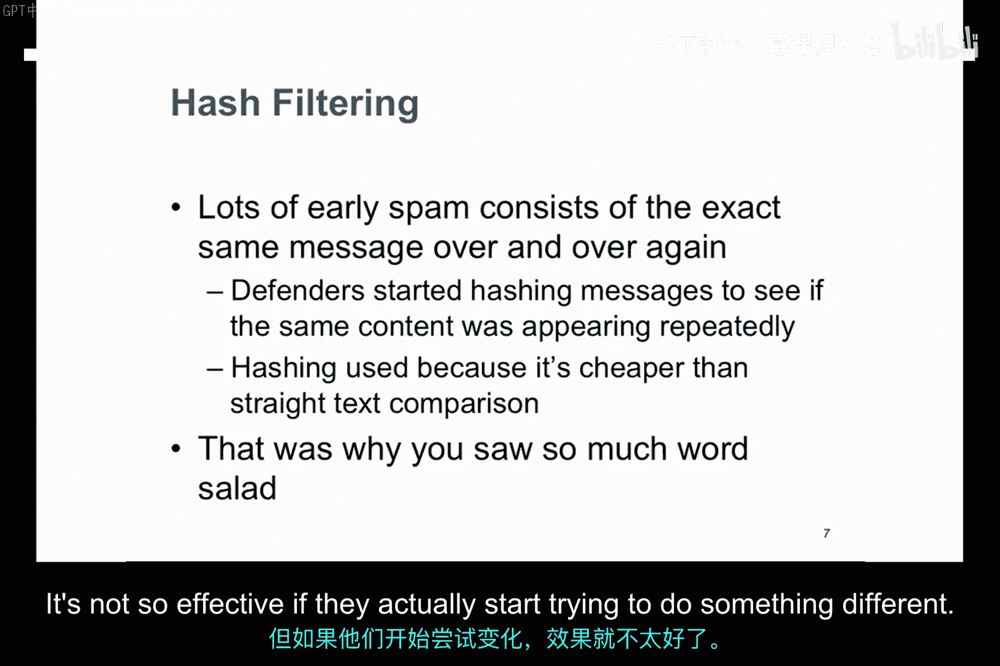

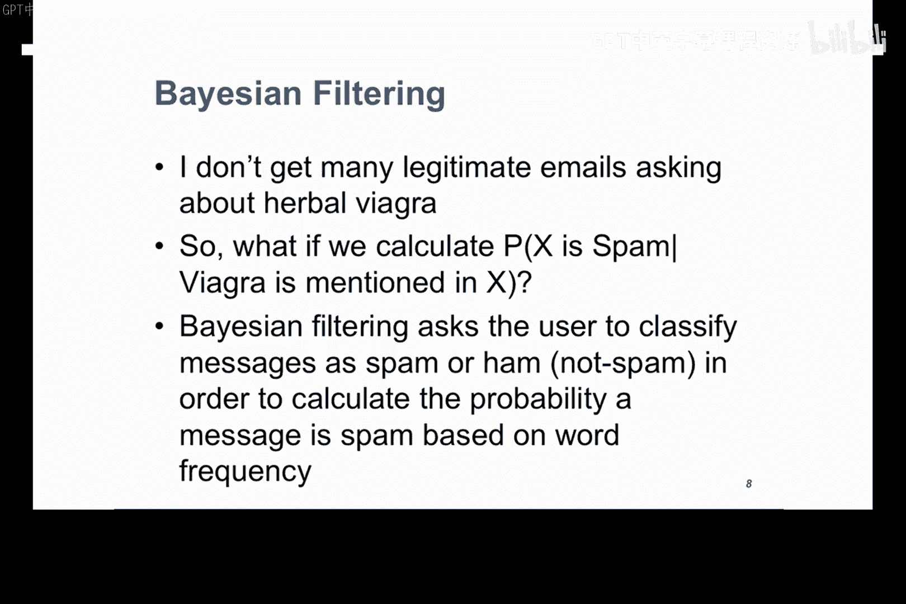

还存在一种变体策略。上面的公式是朴素贝叶斯分类器，可用于计算一组词汇的概率。这意味着它不是针对单个词汇，而是针对词汇组进行分类。其他分类器也采用这种方法，例如聚合文档中多种类型的词汇及其不同配置。

这是一种非常有趣的策略，需要一些基础但设计良好的机制。

---

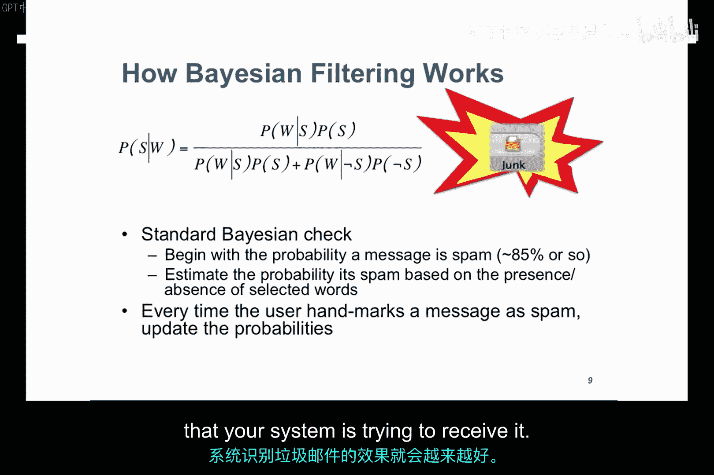

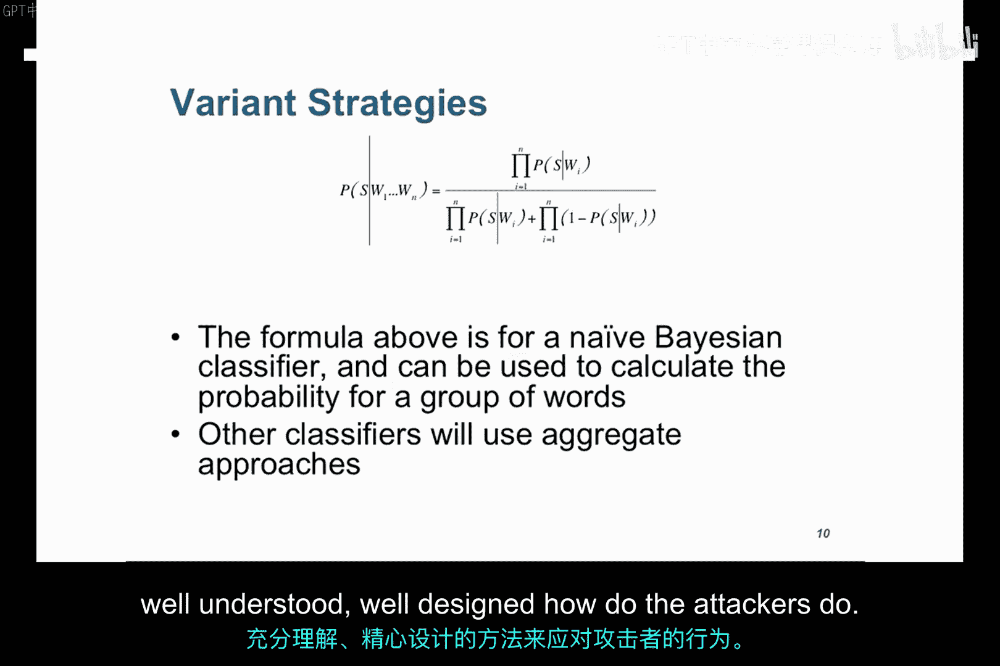

## 攻击者的应对策略 ⚔️

上一节我们了解了防御技术，本节中我们来看看攻击者如何应对。攻击者不会坐以待毙，他们会不断采用新技术来规避这些防御，以保护其利润。

攻击者会采取多种手段，例如“投毒”训练数据、利用僵尸网络群发广告、利用经济学原理等。他们会充分利用这些手段。

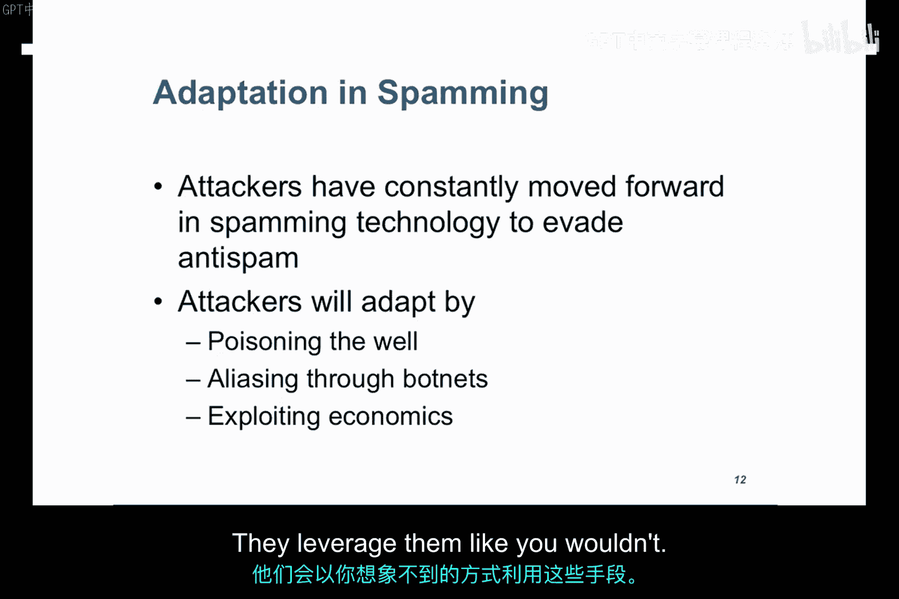

首先，他们应对许多防御措施最简单的方法是：获取一个声誉良好的、不在任何黑名单上的僵尸网络。然后尽可能快地发送大量邮件。

由于反垃圾邮件系统的基本设计是默认允许邮件通过（在用户点击“垃圾邮件”按钮之前），贝叶斯标识符可能尚未更新。同时，攻击者使用独特的邮件内容，因此基于哈希的过滤器可能尚未将其识别为垃圾邮件。

只要僵尸网络尚未被列入黑名单，攻击者就会尽可能快地向收件箱发送尽可能多的邮件，看看在被阻止之前能完成多少。这就是垃圾邮件发送者的基本思路。

但如果我们想真正击败反垃圾邮件系统使用的某些特定技术呢？例如，早期的哈希过滤器要求每条信息都完全相同。一旦你看到某条信息重复了几千次，就能很好地判断它可能是垃圾邮件。

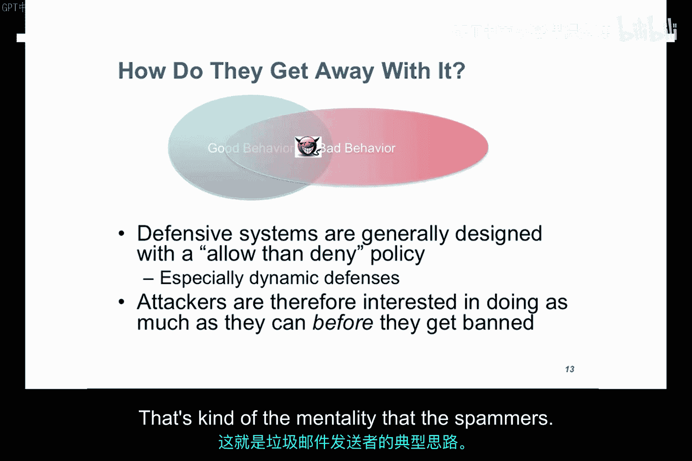

攻击者绕过此防御的方法是引入“词汇沙拉”，即在邮件文本中添加一组随机选择的垃圾词汇。这样，哈希值就不再重复。

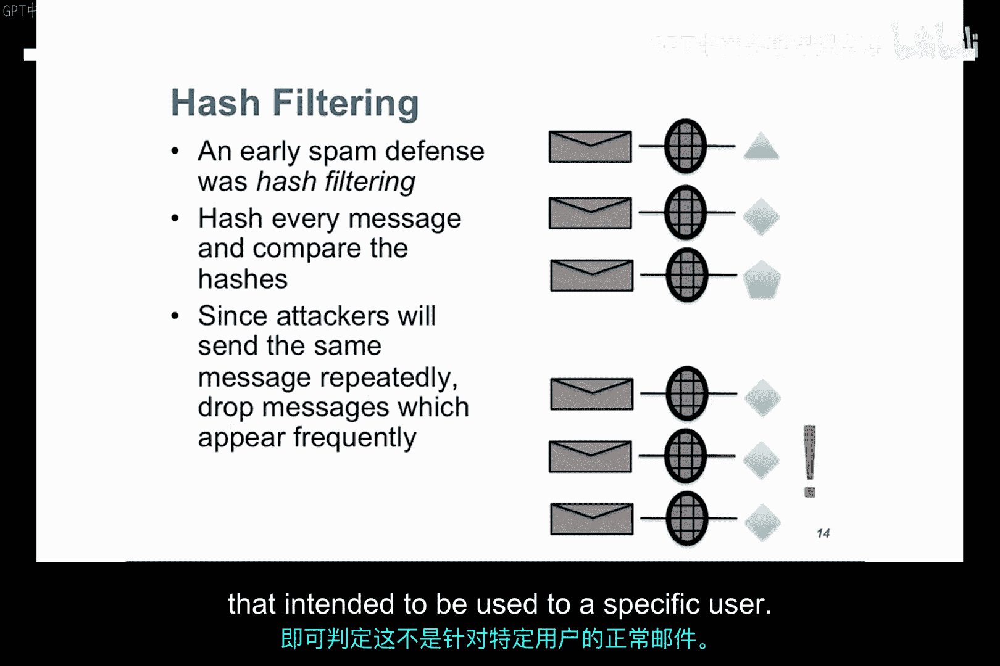

攻击者也可以进行基本的混淆，例如猜测用户的电子邮件地址并将其放入邮件中，这同样会影响哈希值。这两种方法都相当有效。

这与许多恶意软件加壳的思路类似：在恶意软件中填充一堆随机数据，使其哈希值每次都不同。

那么，贝叶斯过滤器呢？这个过滤器背后有数学原理支撑，它会根据用户自身的行为来计算概率并调整过滤策略。它实际上是在分析发送的邮件文本。

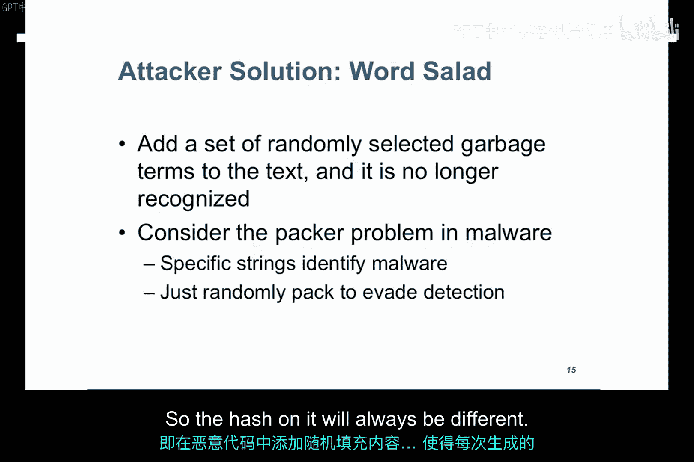

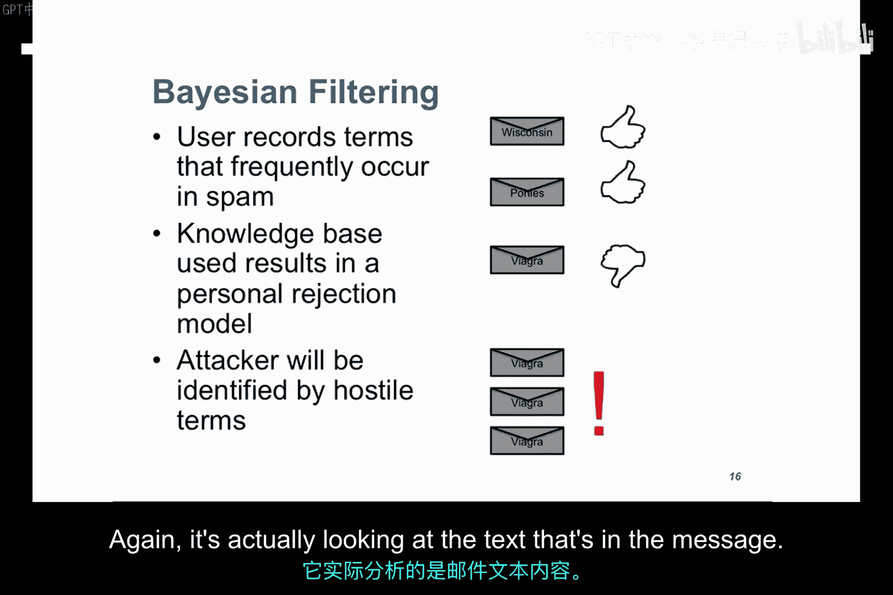

贝叶斯过滤器的一个小问题是：人类很容易阅读写得不好的文字。攻击者很容易击败这类文本处理系统，因为人类擅长阅读，而机器在处理各种奇怪的网络用语时则不那么擅长。

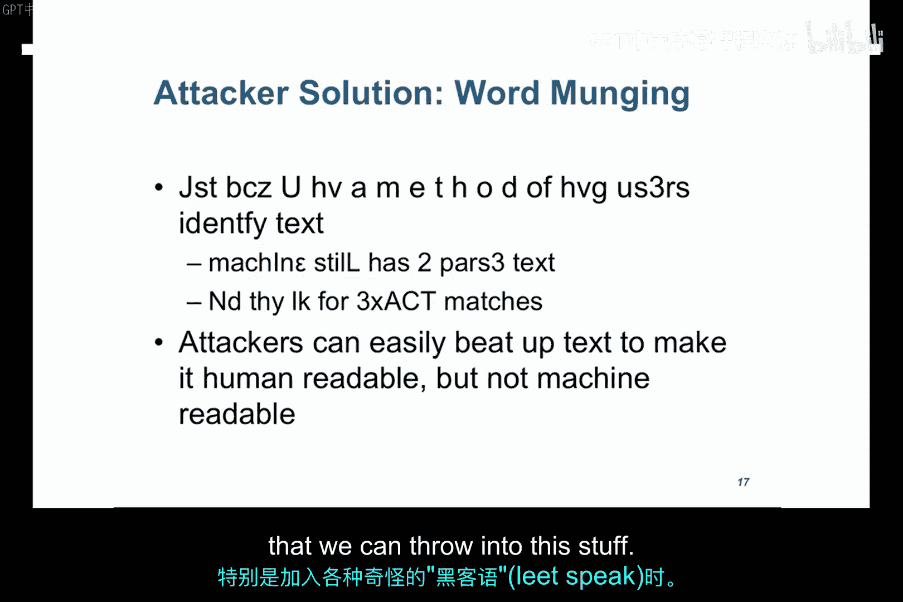

最后，还有图像垃圾邮件。反垃圾邮件引擎不一定能很好地处理图像。攻击者可以将邮件的所有文本编码成一张图片发送，这样就不会被反垃圾邮件引擎分析，从而绕过防御。

还有一种利用基础设施使邮件对反垃圾邮件引擎更具“亲和力”的技巧。例如，攻击者会发送一封邮件，邮件被退回，然后他们直接转发这封退信通知。因为这封邮件看起来像是需要返回给发件人的系统级消息，所以更容易进入收件箱。

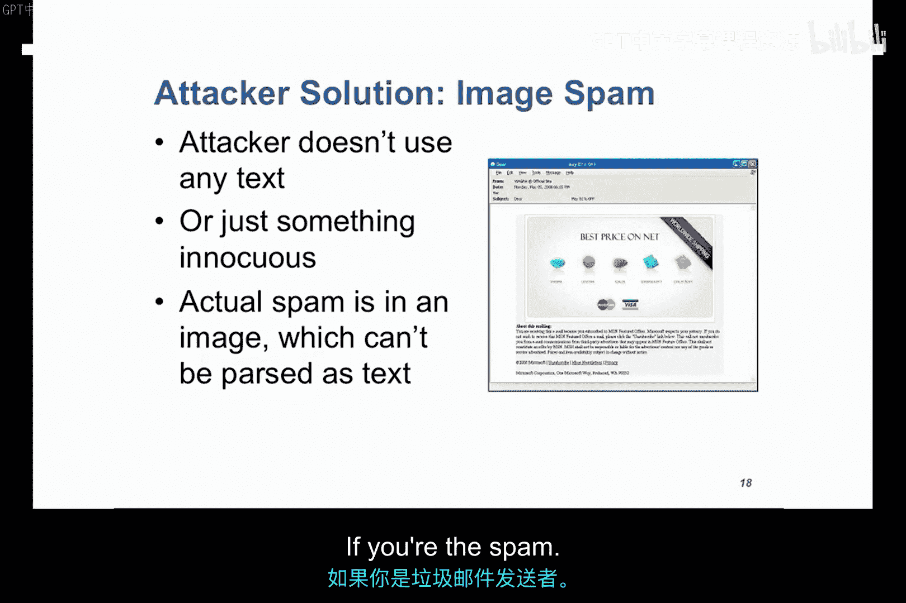

---

## 总结 📝

本节课中，我们一起学习了反垃圾邮件的技术军备竞赛。我们从网络层面的黑名单和声誉管理开始，了解了如何通过DNS查询来阻止恶意来源。接着，我们探讨了消息层面的防御，包括早期的哈希对比和更先进的贝叶斯概率过滤。

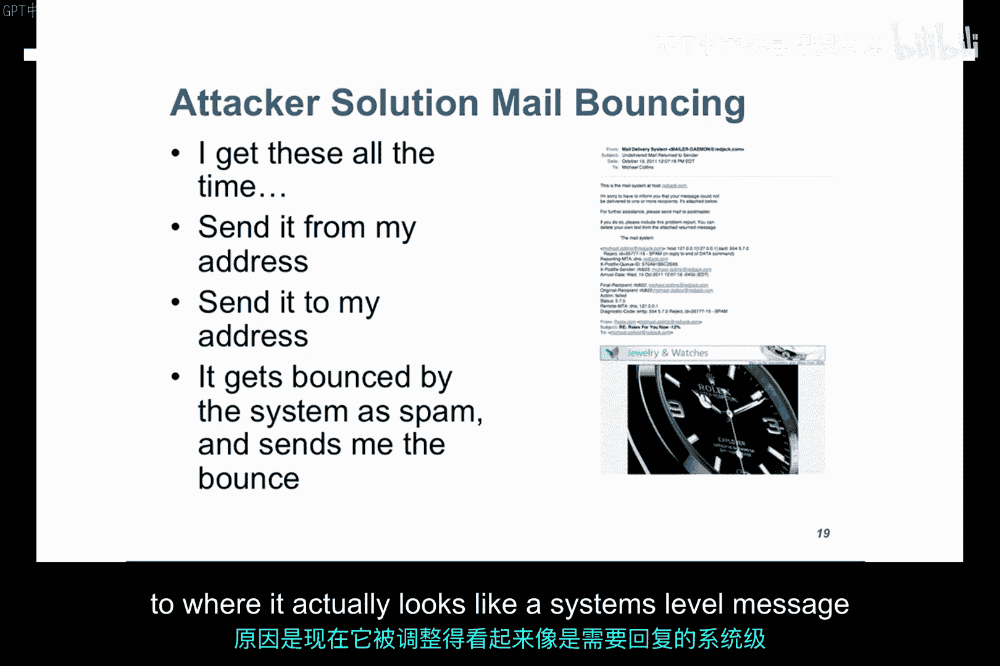

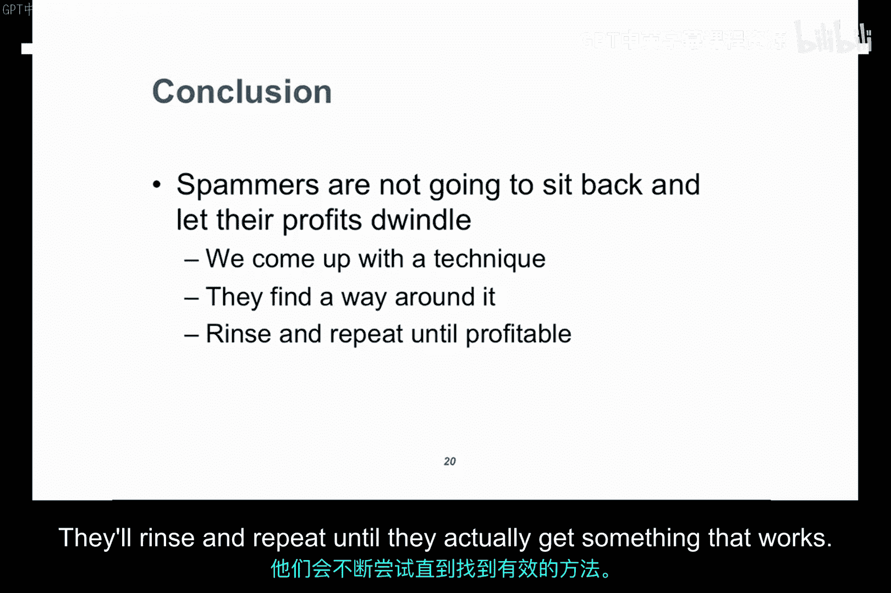

最后，我们看到了攻击者如何不断调整策略来应对这些防御，例如使用“词汇沙拉”、图像垃圾邮件和利用系统退信机制。关键在于，即使我们拥有最先进的技术和用户反馈机制，垃圾邮件发送者也不会坐视利润减少。他们会不断寻找新方法，绕过现有防御，并重复这一过程，直到找到有效的手段。这场攻防对抗将持续进行。