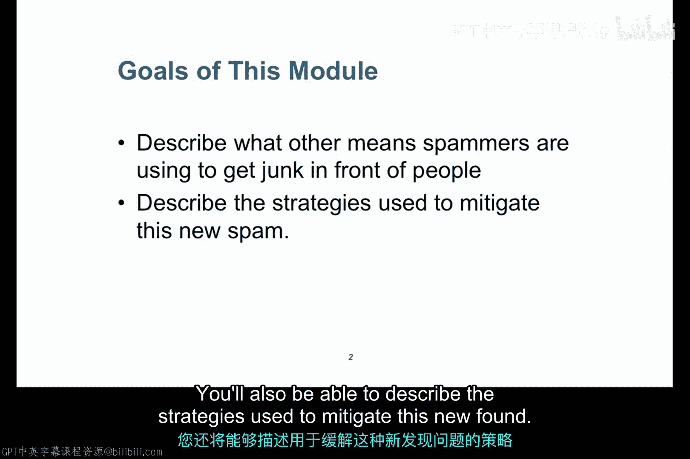
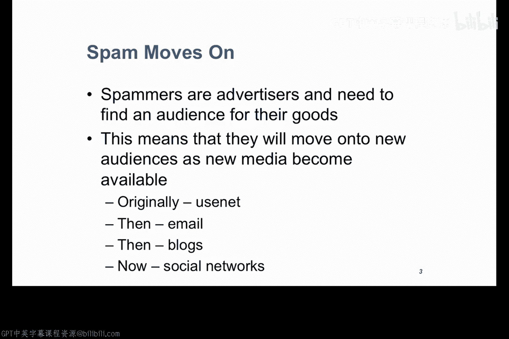
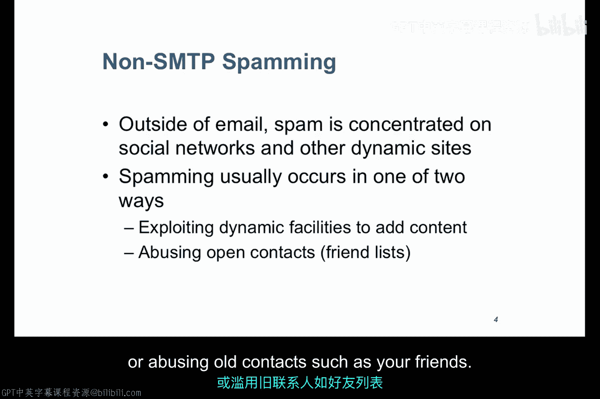
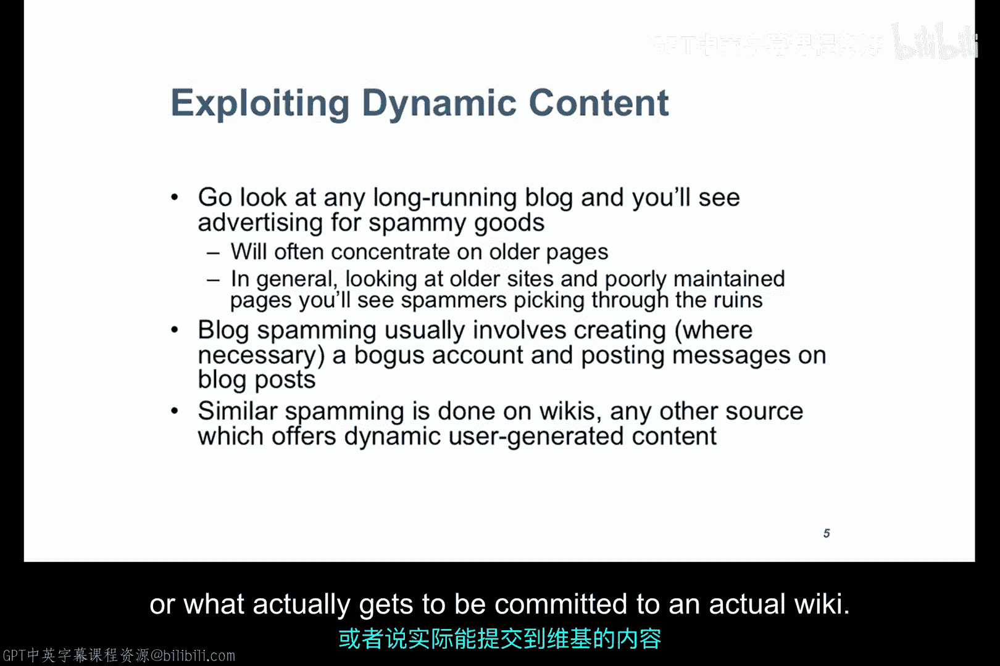
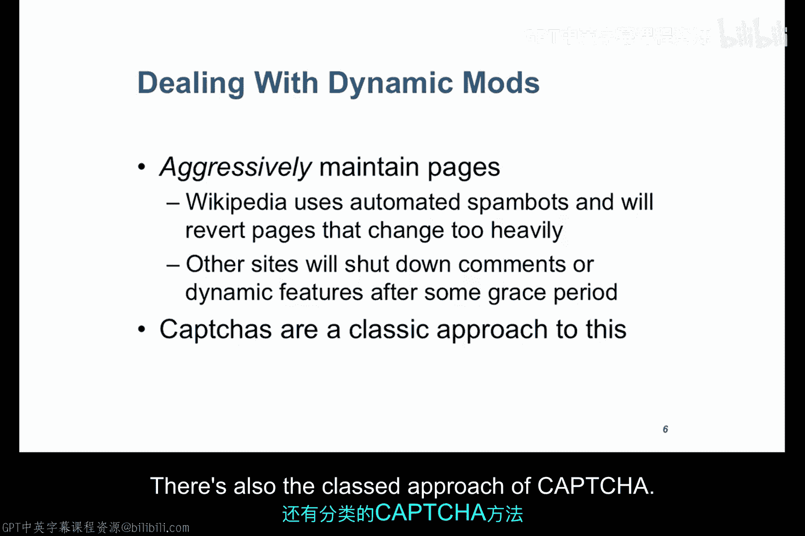
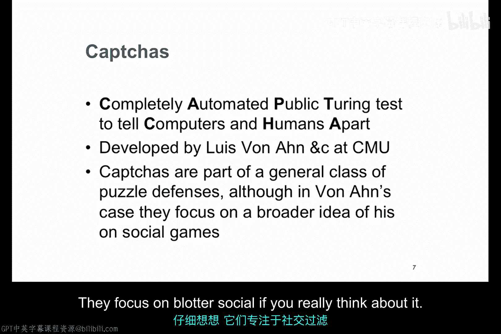
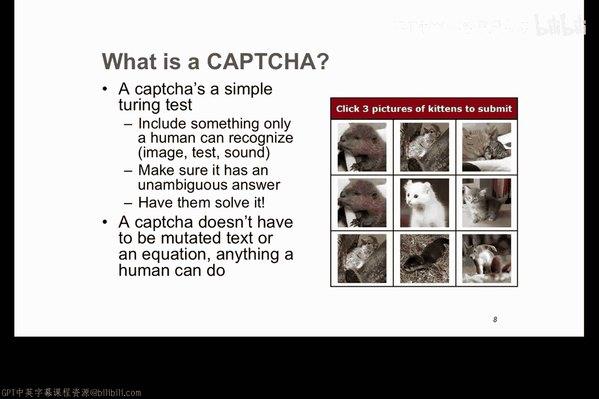
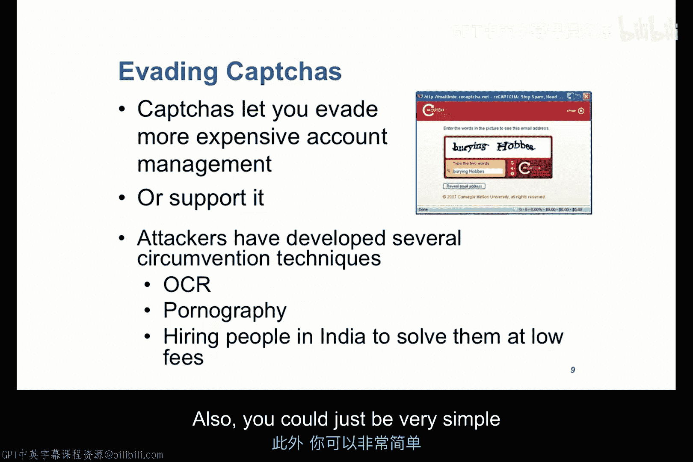
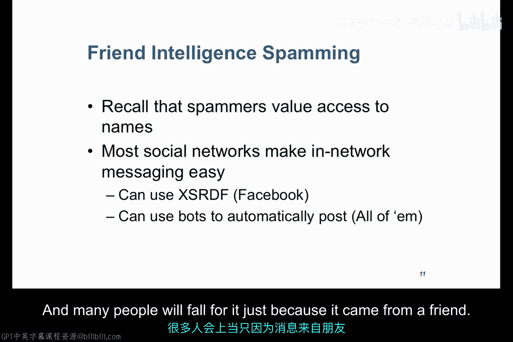
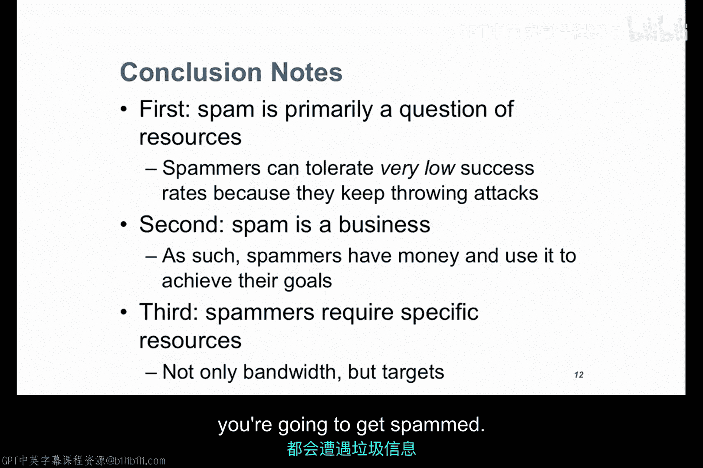

# 约翰霍普金斯大学《信息保障分析｜Information Assurance Analysis》中英字幕 p39 19_SMTP之外的垃圾信息传播.zh_en -BV1Qz8EzYENX_p39-

This is 695，741 module warning lecture in this lecture。

 we're going to be talking about spamner that isn't necessarily going to using SN2。

 then talk about how spam has progressed past the point of just by the end of this。

 you'll be able to describe what other means spammers are using to get junk in front of people。

 You also be able to describe the strategies used to mitigate this newfo。

 We talked a lot about the fact that this is a profit in。

 Bammer are not can just let that go to way dota Dammers are advertised。

 and they need to find This means that they'll move into new audience。

 So as new media becomes a ritual use email and not persisted the time。

But theyve also moved to blogs and now they moving into social non spamming is an interesting outside of email spam is concentrated on social networks and other dynamic sites again as spaming usually occurs in one of two ways exploiting dynamic facilities to add content are abusing O contacts such as your so exploiting dynamic go look at any longrun blog and you'll see advertisements for spammmy could often concentrate on an older page in general looking at older sites employee maintenance pages you'll see picking through the ruins basically they're just going to try and actually get messages associated with things that people would search for log spammings usually involves creating where necessary a bogus account and posting messages on the bbs themselves This isn't always the case sites actually allow you to postously which this once again is something that's used similar spamming is done and other source。

which are all offered dynamic content generated by users themselves part of the reason why you'll see things like wki actually maintaining very strict controls or what actually gets to be committed to an actual wki and also wki is a good wki is a great a great case study and how。

You can appropriately deal with if you are indeed Robten set you actually have to maintain some aggressive maintenance strategies Wikipedia uses automated spam bos and will revert pages that change to other sites shut down comments or dynamic features after some gase thus locking in the final Chris freshreest information it also the classicd approach of cap now Capcha stands for completely automated public turn test to tell computers and humans apart It's developed it was developed at CMU the capture is part of a general class puzzled defenses they folk on broader social if you really think about it Now what a catch is trying to do visits simple term and includes something that's very easy for a humans to reckon but very difficult for a computer to reckon it tries to make sure that the answer is some sort of ambiguous sort of answer the user has to solve it before it go forward many people does。

I' have probably dealt with sites that have captured text and you have to actually typed in an answer and those are there's some sort of text that's difficult to read that's that you can interpret but would be very difficult for to cheer。

 however I find that men times I'm having trouble and exactly is written it that's neither here that these Irish active method for distinguishing humans from actual or however there are ways that they can't be evaded。

They let you they have this they have basic text components in them。

 And so any sort of OCR scan could possibly actually get to the text itself。

 Also you just be very simple and higher group of people in India to solve the amount of low fee cap is not always the best way to take care of it but it is a method that's in theR now let's move one and start talking about let's move away from just simple accounts and people trying to establish a specific account and let's talk about people who have an established account they're going to use this account and they're gonna make it very easy for outers to to that in particular we could talk about Twitter for this one know there's such things as Twitter spamers I would like to call it t that's more or less and basically what you're doing here if yours Fmer you're trying to get to a point where。

A group of people will start following you quickest way to do that。

 Start and cow friend as many people as possible。 Everybody you can think of The limit is 1000 without additional permissions。

 And then hope they look now that limit of 1000 was in because this originally was kind at water。

 they were able to actually get people to start follow by saying， okay，10000， you hit all of them。

 And then inevitably some of these when setting all right fine I' follow。

 they have now opened them themselves up to get sp then also， there's friend intelligence。

 We'll recall that Stans value access to names。 these these guys are really after an Instagramary of that。

 So most social networking sites make how。In network messaging very easy。 for instance。

 face So if you have the access to an individual's account。

 it's a lot easier to spam using that account than to try and establish your own account and get people and spam them by using somebody else's you actually have a higher probability set because what you could do which you've got mentality that oh my friend is sent as opposed to some strange youre spammer and you've got access to somebody's account you can use a bots just automatically opposed to everybody saying。

 hey go to this something like that you one a simple innocuous message and many people will fall for it just because it came from a friend So these are a brief a very brief overview of some of the other methods that are currently even Now note that we didn't really talk about the actual detection methods for this。

 part of the reason why we did not talk about any the detection methods for this is because we're using infrastructures that are likely to reside outside of our own network。

 I made Twitter Facebook， Wikipedia， all these things are basically outside of our network we're not going to be able to examine everything。

That goes to the site However， we can actually look at the returned HTML from those sites in certain cases that's either here in way there for this conversation really the point is that figuring out ways around our current methods for detecting them and they are quick adopters of any new technology other things that I want people to take away from this entire module aremers primarily interested in getting some they don't have to have a high response rate in order to be they can send to 10000 people in no time flat and if only one of them respond back they still doesn't really matter if they've got this very low success rate they just keep throwing and they're going keep adapting to new situations and keep adapting to new media and just keep throwing the messages out and hopefully just keep that low level of response second thing that want everybody remember is this is a business it's always about business nobody's trying to take this personally after your money thing requires。

spececific resources guys have adapted but they have to stay within certain bound they're not going to start they're not going to be able to spam in the ways that they used to they're not going to be such as from the US within the US borders but they are going to be using the same protocols that they've been using the full Grnite they're going to adapt and they're going to keep adapting to use new technology so anything that allows people to start communicating with one another very effectively you're going to get spam。

