# 约翰霍普金斯大学《信息保障分析｜Information Assurance Analysis》中英字幕 p40 20_TCP-IP协议分析 I：分层模型.zh_en -BV1Qz8EzYENX_p40-

Hello class， this is Professor Collins。This is module 2。1 of 695741 information assurance analysis。

We are now going to start talking about TCP IP analysis。

 and to do that we have to start with what's below TCP IP。

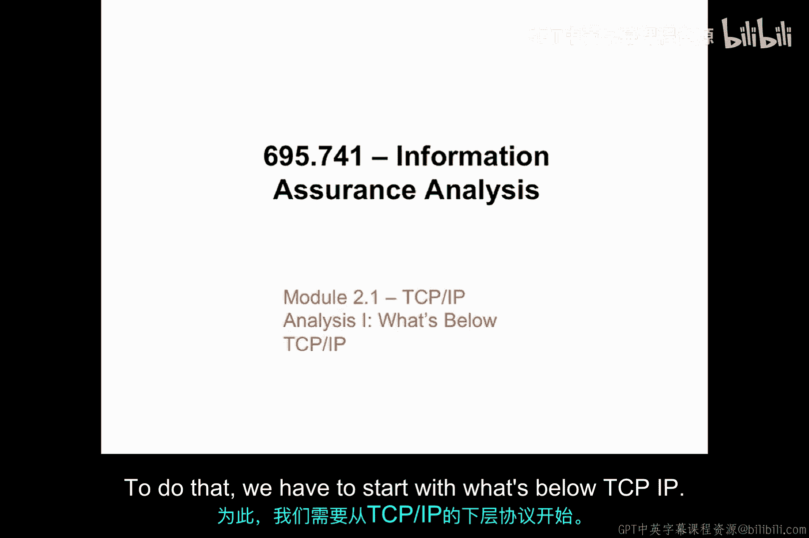

The goal of this module is for you to understand the role of layering and network protocols。

 layering is used to hide complexity from networks to make them easier to configure to make it possible for us to implement things。

 There are several layering models available。And what you will be able to do at the end of this module is identify and scribe them。

As well as understand the interdependencies between layers and their impact。

Because this is where security problems appear。

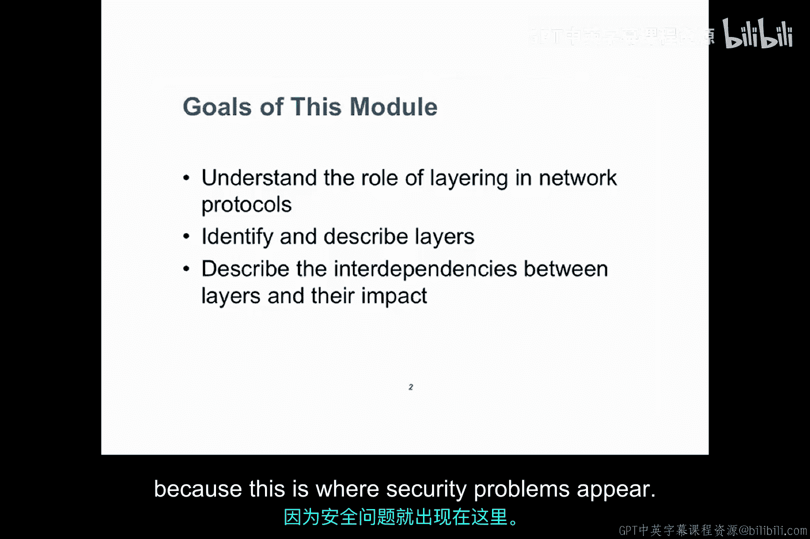

Now。IP， which is the bulk of what we are concerned about， sits between a variety of other protocols。

 IP runsgs above protocols such as ethernet， I can talk about running IP over ethernet IP over ATM IP of cityD IP over OC3 and all means that I'm transmitting IP。

 although mechanisms by which these packets are moved back and forth changes。

IP in turn runs below other protocols we talk about running TCP over IP， UDP over IP。And in turn。

 we talk about even more protocols such as HTTP， which runs on TCP， which runs over IP。

 and what you will find is that you will find hackers get creative and run HTTP over DNS over UDP。

 which is of no particular value except that it confuses everyone and therefore will likely evade firewall rules。

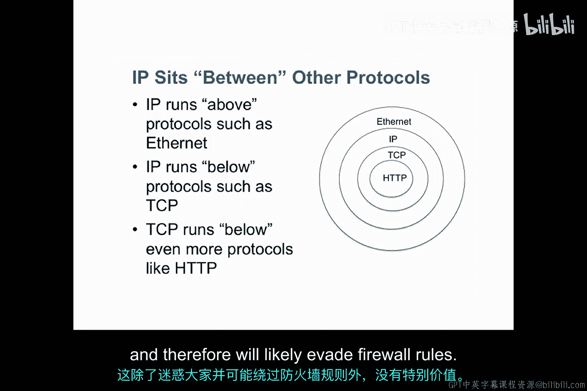

Now。One of the core ideas in engineering is the concept of bounded rationality。

Bounded rationality means that the engineer takes a look at a project。

 and he imposes boundaries on it in order to make the problem solvable。

 He must abstract away certain aspects says it。You're designing a car。

 You don't worry about the environmental impact of it。

 You don't worry about the aggregate pollution impact of the car itself。

 You worry about getting the energy to the wheels in protocol design。

 we abstract and bound our rationality by putting the protocol into a sequence of black boxes。

 which are called layers。A layer is a functional black box and sense that it interacts with a layer above it。

 It interacts with a layer below it， but it does not know what's going on within those layer。

This provides us with flexibility and it provides us with robustness。A key feature of flexibility。

I can talk about running。IP， the core protocol over the internet over a variety of lower level linked protocols on the dust tube of history or ATM token ring。

 there are also protocols like aloha sonnet。Cam， are there are networking protocols for your car。系。

And I get one IP on top of all of those without worrying too much about the details of what's going on inside those lower level protocols。

 The other thing is that it provides us with a certain degree of robustness if something goes wonky on one layer。

 it doesn't necessarily automatically propagate the entire system。

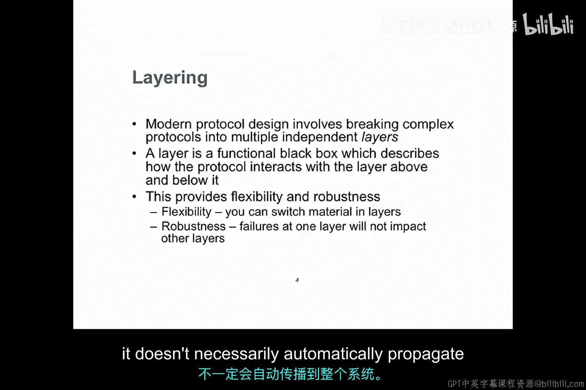

Now， the main thing about layers is that they work't so well。 We did the twice。

 part of this is because the Ie T F， who， in their words。

 believes in rough consensus and running code， do not like complex layering schemes。

 The O S I loves complex layering schemes。 How can I tell they love complex layering schemes。

 This is a 7 layer scheme。 Here's a special in for you。

Seven usually means that somebody actually went out of their way to build something， for example。

 you may be familiar with the rainbow and you may be familiar with strange color indigo。

The reason that Indigo exists in the rainbow why we have Roy G。

 Bive as opposed to Royage above is because Isaac Newton wanted7 colors。 He had 7 everywhere else。

 And and consequently， he threw in the indigo color to as a sort of separator between blue and violet most of the time。

 color scientists。 And， yes， there are color scientists， Igno or indigo。 Ne。So the OSI model。

 we have seven layers， physical datalink Network Trans session presentation application。

 the IETF model first off they don't really have layers as much。

 there's a famous paper called layering consider there's a famous argument layering is considered harmful。

 more on that later， they have the link the internet the transport the application layer and the distinction between these are not as clean as the OSI model pretends that they are。

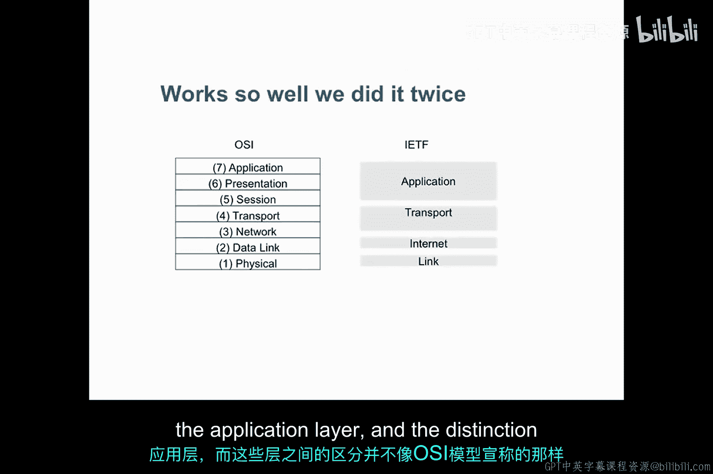

Okay。Let's go through the OSi model first because it is。Bigger， it's more complex。

 and you'll often hear people toss around both， okay。

The physical layer is concerned with interconnectivity。

 A physical layer is literally concerned with how do I plug two computers together。

 issues like pinouts and how information is transmitted is transmitted as pulses on carrier waves is transmitted as beams of light it transmitted as electricity。

 all this is the physical issue。The data link layer is about communications between two points without relying on routous and intermediary。

 so this is protocols like Ethernet， City and ATM which do not which assume that they have or list direct a connection to everything that way to communicate when people talk about ST topologies or ring topologies。

 they're talking about data link issues。The network level layer is concerned with routing and fragmentation。

 the actual movement of stuff across the land。

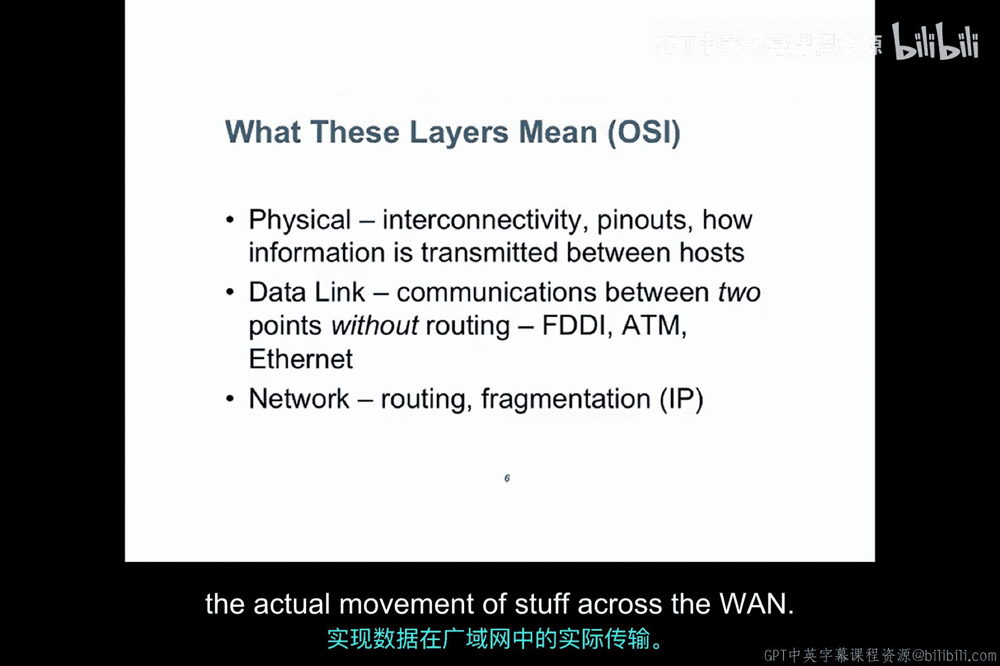

The transport layer is also concerned with moving data and primarily protocols like TCP and UDP。

 which are focused on sending user information。 So this is about the point where the user's actual interests start to fade into view There's in the session layer。

 which involves back and forth transmission。 Now， one of the things you may notice here is that TCP is appearing an awful lot here。

 The reason for this is because the OSsi model came out a long time after TCP was developed。

 And this is the IETF model overlaps the ITF model， which is。

Driven largely by TCPIP overlaps multiple layers in the ISO at the OSI model。Yeah。

The presentation layer is concerned with the encoding and conversion of data。

 So what this is actually concerned about is now that I've gotten these bits back and forth。

 how do I convert those bits into something a user can read。

 This covers everything from is it ASCI or EyD to issues like encryption。

The application layer is when we get to the thing you might think of as the client Nescape， tell net。

 things like that。There are also semi joy superlay that you will hear about layer 8s the most common。

 that's the user， layer9 is the organization and layer 10s the government。

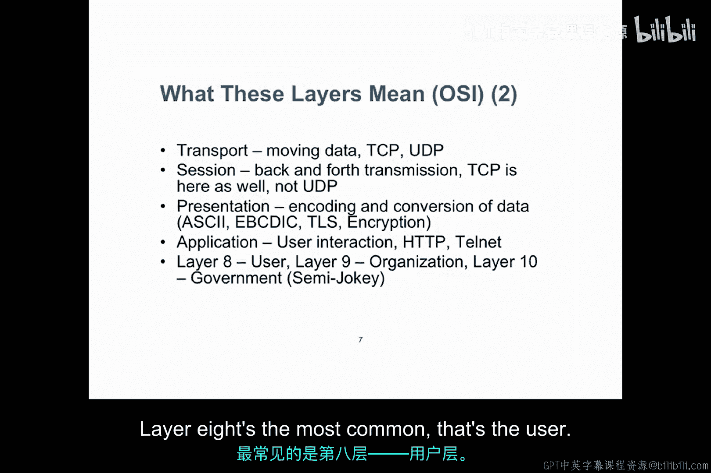

Now。The CTF versus OSI model， okay？RFCC 3439， and if you're not familiar with an RFC。

 and RF is a document， a formal title be request for comments。

 these are the standards documents for the internet。And they are generated by the IetF。

 the Internet engineering task force。 The IetFsto， as we believe in rough consensus and running code。

 So what they want to see is they， they do generate fairly extensive standards。

 but they do not go in for the level of taxonomic thoroughness。 The O S I does。 In fact， RF C 34。

39 has a stitch called layering considered harmful。Laying considered harmful。

 considered harmful is one of the great。shibbols of the computer science community。

 along with Y X is not my favorite。 It comes from a fundamental paper by Edsgar Dstrut。

 entitled Go to considered harmful。 And if you've done software development and you've been told never to use go to because it's a nightmare。

 the origin point for that is this diyke for paper， considered harmful is a fairly damning statement。

Now。This does not any divide that ITF does use layering。

 but they are not remotely as intensiveified as the OSI is， and you can see reasons for this。

 the OSI model adds a lot of layers for things which don't necessarily have that clearer distinction。

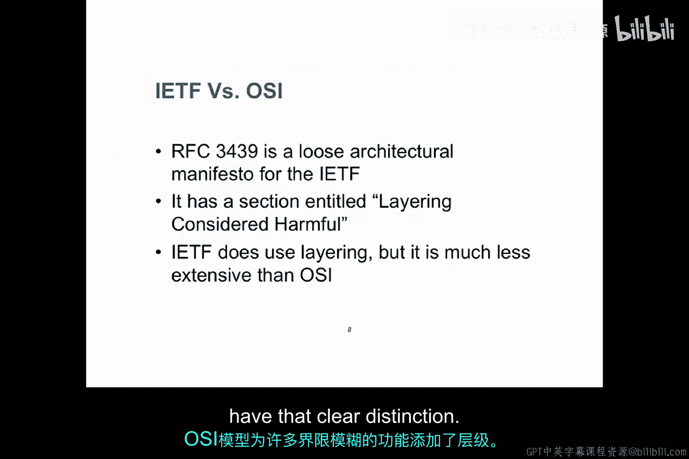

And。The issue here and the reason we've got to pay attention to the OSi model in particular is because we'd like for the world to operate basically within a layer form。

 which is where IP resides， okay？As I said， IP is sort of this fuzzy between that layer three and layer six on the OSi bottle。

The important sa is that in addition to layer 4。We have to pay attention to layer 2 and layerer 3。

 layeryer 2 is switching。 layeryer 3 is routing。 These do impact the world， even if we want behind。

 they don't。

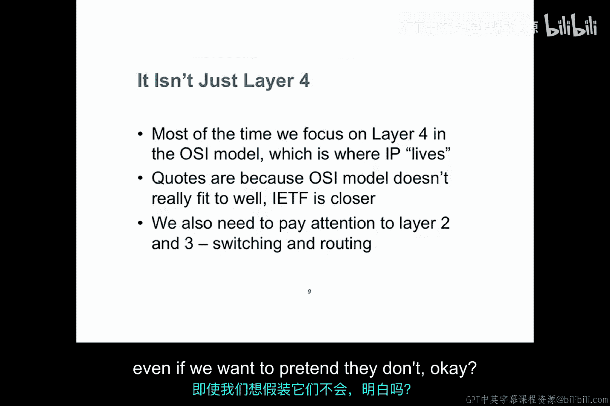

Next。Now。Keep all that in mind。Keep this in mind about layering， layering reduces complexity。

But the abstraction reduces efficiency and it enables flexibility by formalizing dependency。

 The problem is that layering is rarely clean。 If you ever experimented with a formal language like M L。

Um or one of the extremely functional languages， you may have noticed that output is often referred to as a side effect。

And those types of side effects tend to show up in a lot of formal models because in order for something to actually work。

 it needs to have those side effects and this pops up as much in layer I get everywhere else。

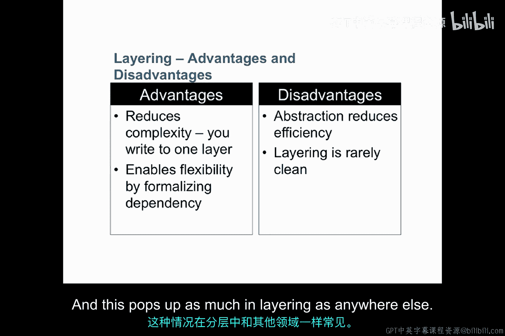

To understand this， let's take a look at sort of one of the cornerstone problems we're going to run into this thing called the MTU。

 the maximum treads for you to understand the MT U， let's start with。A layer2 freight。

 the ethernet freight and when we're talking about layer two layer two is generally frame layer three is datagram layer force packet。

 so ethernet frame IP datagram TCP pen。anyway。Now the Ethernet frame。

 you'll see a lot of these breakdowns， this is bybytes， it has what we call a sync word。

 which is an8 byte value， it has max， these are hardware addresses， these are six byte values， okay。

 it has some quality service information， it has some more structural information then it has the payload which is up to 1474 octs okay。

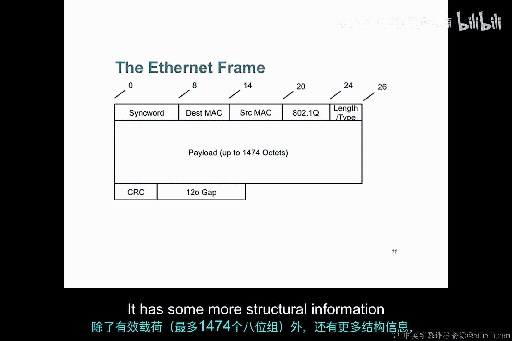

Now， Ethernet is one of a variety of layer 2 protocol。

 so other examples include ATM ATM was going to beat a big thing in the 1990s when I was going to graduate。

 I was told not to worry about Ethernet or TCPIP because ETM was going to solve everything。

Didnt go anywhere it's sort of used for the backbone now。

 but most of the time when we really talk about the backbone and talking about sonnet。

 the synchronous optical network， the notable light about to sonnet just so you know it。

Sonet defines a term OCX。For backbone communications。

 OCx refers to the speed OC3 is 155 megabits per second if you're dealing with another OC x like an OC192。

 you simply convert from 3 to whatever so OC19192 is 64 times 3 so OC 192 is 155 megabits per second times 64 so somewhere in the vicinity of 10 gigabbits per second。

Toking Ring， this was a major competitor for Ethernet in the 80s and '90s it was developed by IBM。

 and then there's things like CanN， CanN is a synchronous control network protocol used in industrial sites。

 industrial robotics uses it a lot。

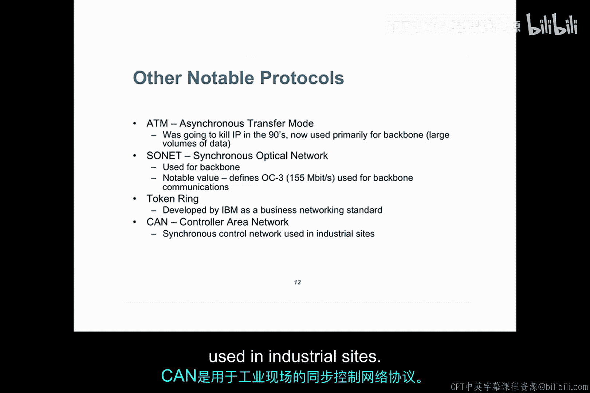

Okay， now。Yeah know， obviously， I'm betting that of those protocols I mentioned or， you know。

 in the previous slide， you've probably never heard of any of betting you've heard of can。

 I'm very impressed。Okay， and this brings to this question， why is everything really Ethernet now。

 why is our competition between Ethernet and wireless Ethernet effectively？Okay。

 and this is actually a big issue， I mean， as I said when I was， when I was an undergrad。

 ETM was going to solve everything。The answers that network protocol design involves managing trade offs。

 These trade offs are primarily focused on resource contention。 When you get down to it。

 a network protocol is a bunch of people on a common resource， a bus or some far form。

 arguing over who has control of it， at the different protocols have different ways of handling this。

 token ring， for example， basically followed the talking stick for Lord of the flies。

 whoever had the token at that point， communicated on the network。Ethernet。

Turns out to be very good at handling asynchronous activity。

 it tends to get very poor as the network had saturated much worse than token removal protocols。

 but it's cheap。And if you're dealing with asynronous activity。

 like people in an office fighting over a laser printer。It works very well。And you know。

 a couple that with Moores long， these are that comes out。

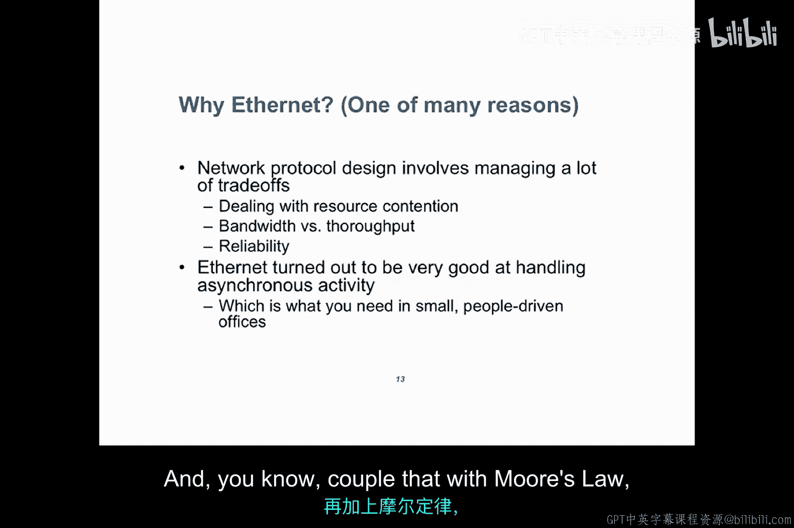

Wonderful。So。Ether so even though Etherda did kill off a lot of protocols and that does have an impact on the world。

It still means that there are a couple of protocols out there， there is sonnet。

 there are different protocols out there and layering is necessary， however。

The problem is that these protocols have their own dependencies okay and these dependencies result in increased complexity。

 the most infuous example of this in IP is what we call fragmentation。

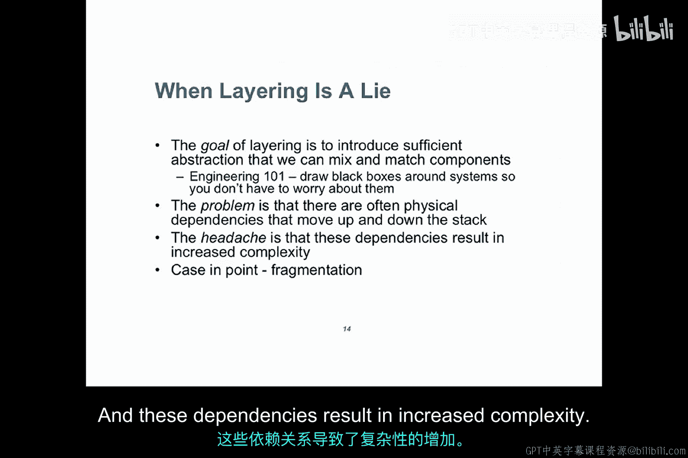

Now to understand fragmentation， you have to understand this concept of the MTU。

 the maximum transfer unit， recall。Ttocols involve people or entities arguing over the control of a resource and what they really the resource really is bandwidth so in the case of an ethernet frame。

 for example， you have 1500 bytes per frame that you sent okay the thing is this is a trade off So let's say that you set it to a megabyte for example。

 well， if you drop the packet or you have to resend the packet。

 that's a megabyte worth of data you have to send out again So you try to keep these sizes to the point where。

Dropiving an individual packet。We dropping an individual frame is not a disaster。

 Vious protocols have established different standards for the maximum frame size。

 The table on the right gives you some notable examples，1500， which is the one we really care about。

 is ethernets sand got。

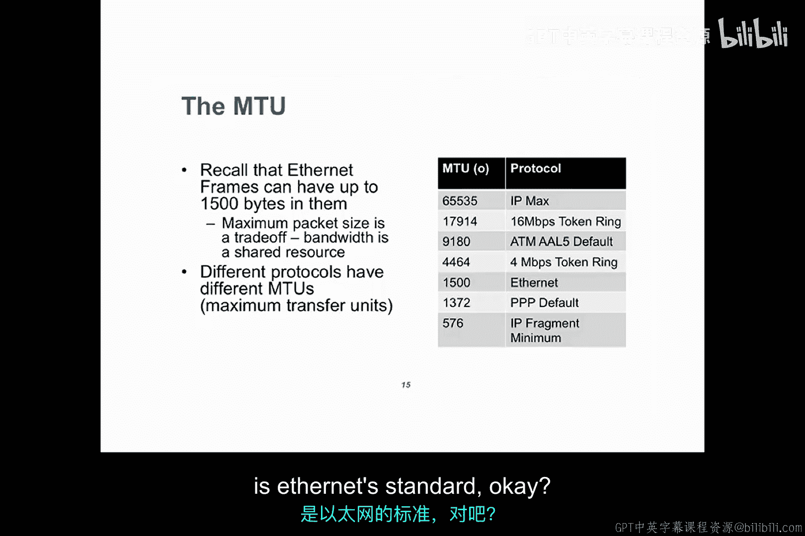

But let's say you go between networks that have different MTUs， let's say， for example。

 I'm on a network using ATM AL5， where the maximum frame size is10 10，000 bytes， okay？

I now connect to a network with Ethernet， well obviously1 AAL5 packet is equivalent to7thernet or one AAL5 frame is equivalent to seven ethernet frames。

 okay。In IPZ4， they developed this mechanism called fragmenting fragmenting splits packets up。

 so the solution is that the router。Whi is between the IP network or the Ethernet network and the ATM network takes that 10。

000 byte ATM packet and splits it into seven sub packets that have reassembly instructions so the user never has to know that the MTU is even there。

 it's completely transparent， the system magically reassembles the packets and this is covered in RFC 797911915 okay。

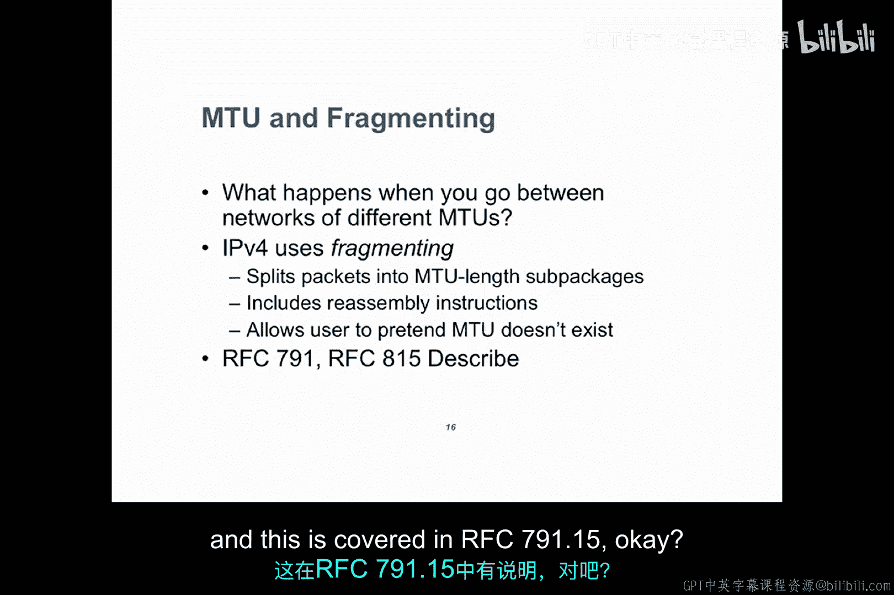

IP implements this with three fields an IP identifier the IP identifier is a magic number。

 All the fragments will have the same IP identifier Okay。

 then there's the fragment offset which indicates where the plant fragment should be placed and then there's a flag to indicate the last fragment Okay the idea is you take everything with the same IP identifier you order them by the fragment offset up until you get to the flag and then you try and then you reasseemble the packet Okay。

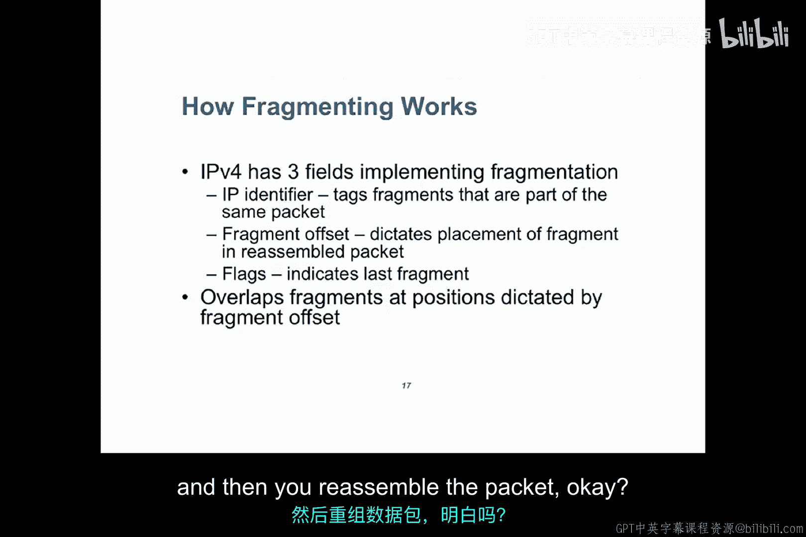

It's a nightmare。 It's been a， it's been a monumental disaster since day one。

 The real problem is when the spec was written that there were collection of complex undefined behaviors。

 What happens， for example， if two fragments are specified so that they overlap。 Now。

 the first question you're probably asking yoursels， well， that should not occur in nature。

 We are security people。A key feature of security people is that if there is a parameter and the parameter can be set。

 we have to think about what happens when somebody sets it。 It might be a perverted。

 It might bemented。 It might be an insane case， but we have to consider what happens in the answer is that in this case。

 different stacks implemented it different ways， because it wasn't clearly explained what to do。

 Okay， this means that attackers can pro the stack based on how it reacts to fragmentation。 Okay。

 attackers themselves would manipulate fragmentation to avoid detection。

Terrible idea IPV6 doesn't use it well， it does have a capability for it。

 but generally what it does and says is it uses this thing called path discovery。

 where what it does is it sends a packet to determine what the maximum fragment size is across the entire or the minimum fragment size across the entire network and uses that or minimum packet size。

The other thing that've tilted those is ethernet， because everything starts into an ethernet connection and ends into an ethernet connection。

 As long as everything in between nuon is using a larger fragment is using a larger MTus size。

 it doesn't matter。 It's not like its。 It's not gluing packets together。

 It just happily sends those ones with the MTs in frames it can handle larger sizes。😊。

So why does this matter， here's the reason。M Ts break the layering model。

 They're an engineering constraint that impacts everything else。 Okay。

 because I cannot have an Enet a frame that is bigger than 1500 Bs。

 I effectively cannot have a TCP packet。 that is bigger than 1500 bys。 Okay。

 I cannot have a UDP packet。 That's bigger than 1500 bys。 That actually impacts things like DNS。

 Okay， decisions about the data I can transfer back and forth in DNS are largely driven by issues like that。

 get。Fragmenting attempt was an attempt to keep the layering model working。

 you it hides all these details， it does it by adding complexity and the complexity basically it just introduced to the gigantic pilotsecurity halt。

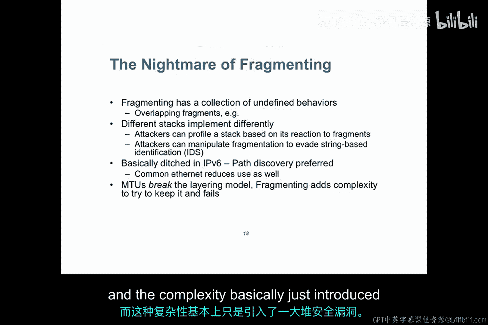

So keep that in mind， no black box's complete layering is a very powerful tool as you design security you will layer things people are already layering stuff in HTTP when you take a look at AjaXs architectures。

 you basically have another layering architecture that's being built on top of HTTP the problem is that if you attempt to maintain the metaphor past the point of no return。

Theelitude is more complexity than you want， more complexity than you need。

 and in security complexity is an invitation for attack okay？

Don't get obsessed with maintaining a model over reality。 That is the heart of the problem。 Okay。

 don't defend layering to the point through introducing security halt。

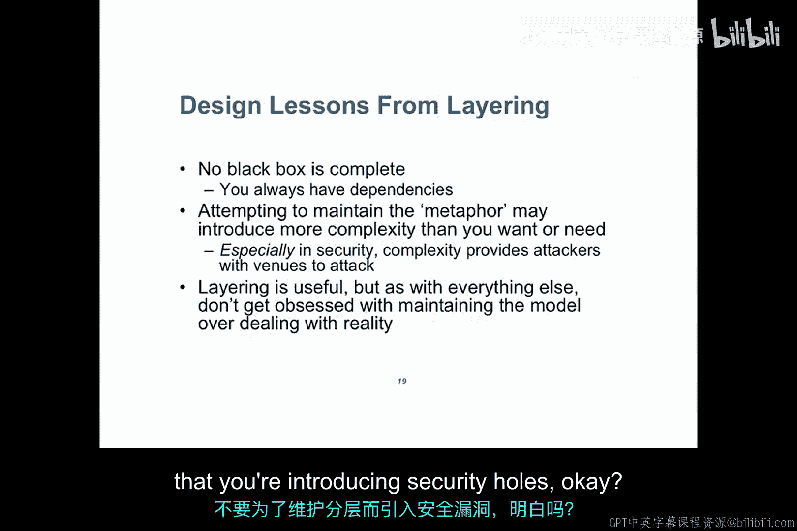

No， so。What I want you to take away from this。First off。

 modern protocol design depends on layering and keep in mind layers  two， layers  three， layers 4。

 switching， routing protocol， okay。All of these hiding tools are imperfect informational lower layers will impact the higher layers。

 The mU is a layer2 artifact that affects PCP packet size IP packet size everything above it。

The other thing even minds that maintaining abstraction adds complexity complexity opens up paths for attack。

 okay fragmenting is a classic example of this。

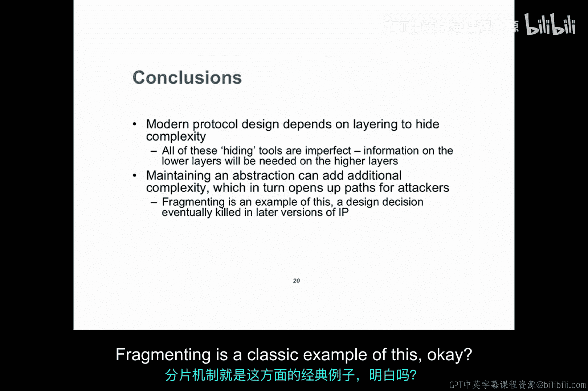

Okay。