# 约翰霍普金斯大学《信息保障分析｜Information Assurance Analysis》中英字幕 p41 21_TCP-IP协议分析 II：IP协议族.zh_en -BV1Qz8EzYENX_p41-

This is 695，741 module 2， Le 2。

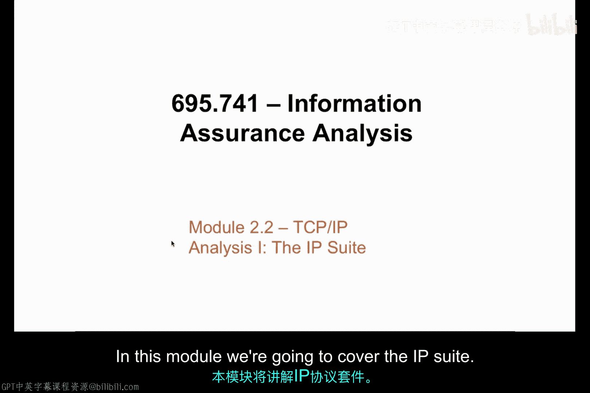

In this module， we're going to cover the IP suite。The goal of this module。

Is to get you to a point where you can describe the key characteristics of TCPIP。

 specifically how it's a best effort transport and how it's a packetcket switching protocol。

You will also be able to describe the contents of the IP datagram。Sludes fields such as the TTL。

 the addresses in an IP datagraph， and the protocol field， and what the protocol field means。

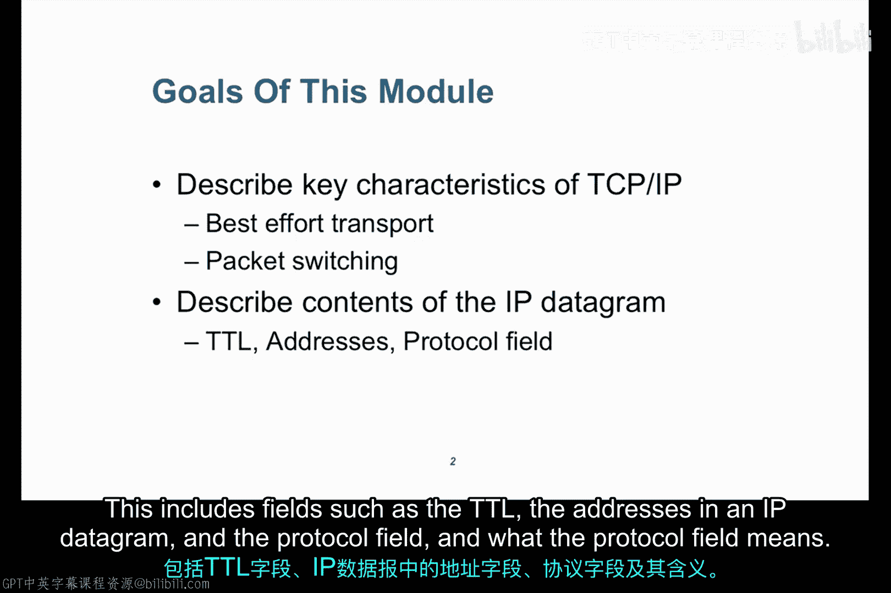

TCPIP is the basic protocol used to transfer information around the internet。

As a packet switching protocol， what we mean by this is that packets are discrete packages of data that are transmitted around the Internet。

And ultimately will reach the destination。Described in the actual diagram。

You can generally think of this in the same way that you think about the postal service except very。

 very fast。

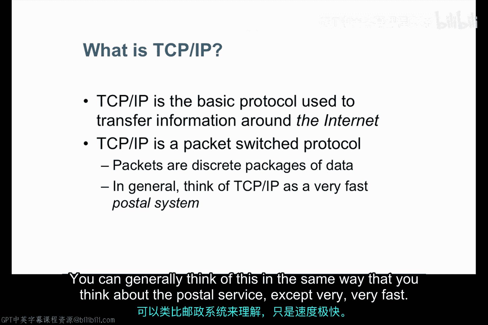

So what do we mean by packet switching？There's two modes。

That can that you can think about for transferring information。For a session。

 circuit switching and packet switching， circuit switching is like the O phone system。

You have a dedicated physical connection that the operator makes between two locations。

This dedicated connection allows you to transfer information between two points and you have a dedicated amount of resources for that。

In packet switching， we chunk up the information into packets and send each of the packets alone to the destination。

They may go along the same path that they may not packet switching really doesn't care as long as all the information makes it there。

TCP uses packet switch。Packets are subparts of your session and they can be moved around arbitraryr。

Being able to move things arbitrarily was a specific goal of TCPIP。

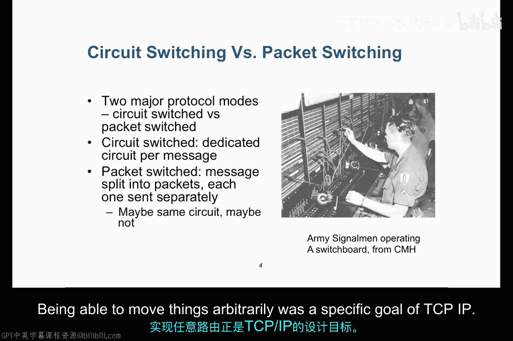

So why do we want packet switching and not circuits？Danarette is designed。To survive a war。

IP Suite was designed to route traffic， even if the site routing the traffic gets nuped， true。

 a circuit gives you dedicated set of resources with packet switching。If。If the site goes down。

 you can route around it。Whereas with circuit switching。If the sight goes down。

 the entire connection goes down。

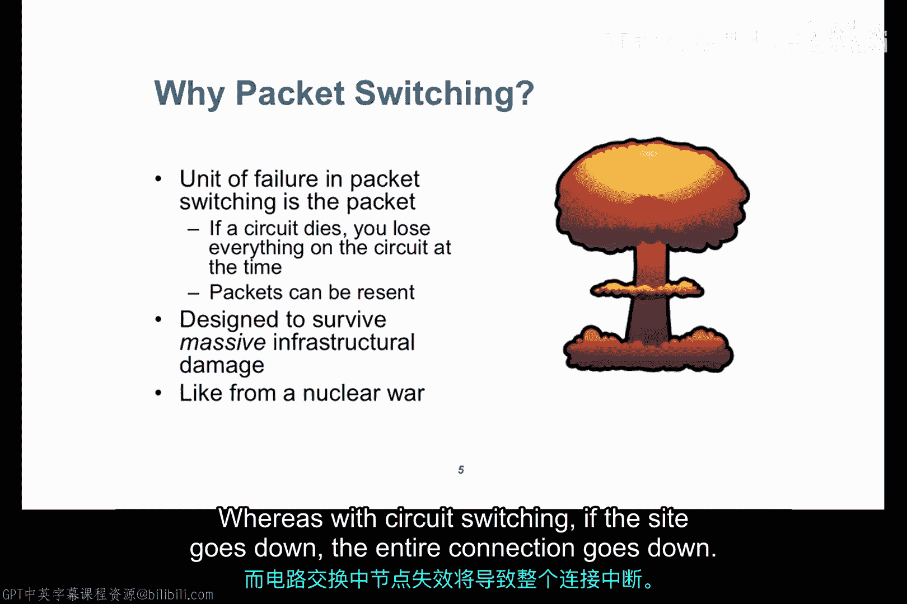

Now the best way to think about the packet N TCP is like messagess N IP。

 is like messages and a really fast posted service。We only care about where something is going。

 not where it came from。 In this analogy， the routers are the different postal offices。

 They don't have to know exactly where the destination is。

 They just have to know which post office gets the message closer to the ultimate destination。

 similarly。Routers only care about which router。They know about that will get the packet closer to itsation。

And quickest。This means that you can route information without knowing everything about every computer in the world This also means that you don't have symmetry and how things are routed。

Just because one path was taken to get and packet from A to B does not mean that the reverse path will be taken to get from B to A。

Or that you will necessarily be able to get for B day。

Because so much focus is placed on the getting the information to the destination。

 this form of routing is subject to spoof。Where someone can claim that they're sending on behalf of a。

 but really are completely unrelated to。As we will get to later。

This can and is used for both legitimate and illent purposes。

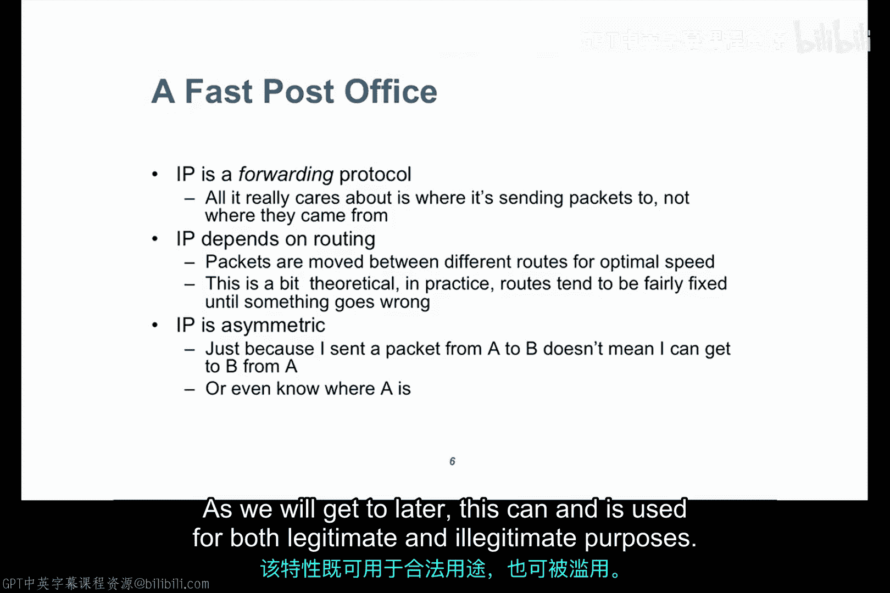

。Now to the IP suite itself。It is a suite of protocols。

Protocols exist in the layer above IP and depend on qualities。Specifically addressing and TTL。

You never really communicate in IP， it's not really designed for that it's really。

Communicate it's really designed to help shepherd the packets a lot。

So you communicate over IP in some other protocol。

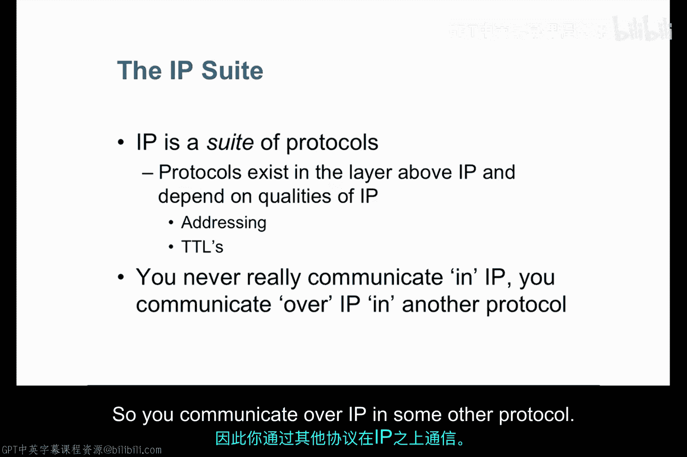

But not IP itself。Here's a Mazegati data。As you can see。

 it's broken up into several different fields， the first of these fields is four bits and that's the version which can be either four or six at present and most the time you're going to see this in IPB4。

And the next is the IHL， which is the length of the entire IP Datagram header。

And then type of service links， IP identifier flag fragmentation， and so on so forth。

We're going to get into a couple of these as we proceed through this。

 the ones that we find the most interesting。Of course。

 the top on most people's list is the source destinationation addresses。

 which are the 32 bit addresses that you were most common you most commonly see referred to whenever talking about network traffic。

It's going to be addresses like 192。168。1。1。Now， I do want to point out that at the end here。

 we have this options and padding Now， the options in padding is a。Collection of。😔。

Fields for values that don't necessarily need to be part of the of the actual datagram。

 So one thing that you'll notice is that the IP datagrams actually change in length。

 and this is because you don't necessarily have to have options added here， but you can't。

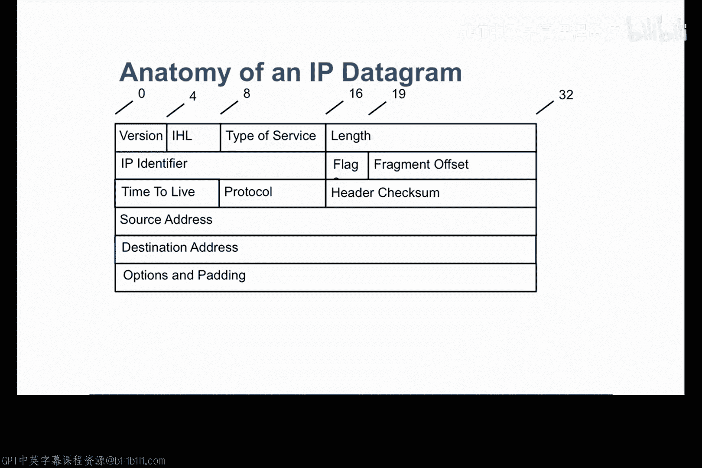

Now onto some specific more exotic features of this are， I wouldn't say exotic。

 but some things that we want to know。In the IHL， you've got it's basically the length。Of the header。

 including the options view。Now the one thing that really bites people about this is whenever you think length people think in just。

 you know， eight bids or or。A buy eat or however， many bits are by its period。 But what this is。

 as it specifies， it's a。Forbit Field。That actually specifies how many 32 bit words are present in the header itself。

Now the other parts。Toss， the type of service。This is actually fairly over frontload。

It's been redefined all the time over the years， roughly speaking。

It defines priority of a packet now it generally has two components。

And these components are the DSCP， which is differential service code point and。

Congestion notification。The way that this field is currently set up is it's supposed to be eight bits long。

The first six bits of this represent that DSCP Pat or DSCP classification。

Then last two bits represent the ECM。The DSCP provides a classification for the packets such as Voip service priority that those packets should get。

And so forth， and so on。And the ECN is used to notify the destination about congestion issues that are emerging in the network。

Important thing about this is this is only used when both the originator and the destination explicitly decide to use that。

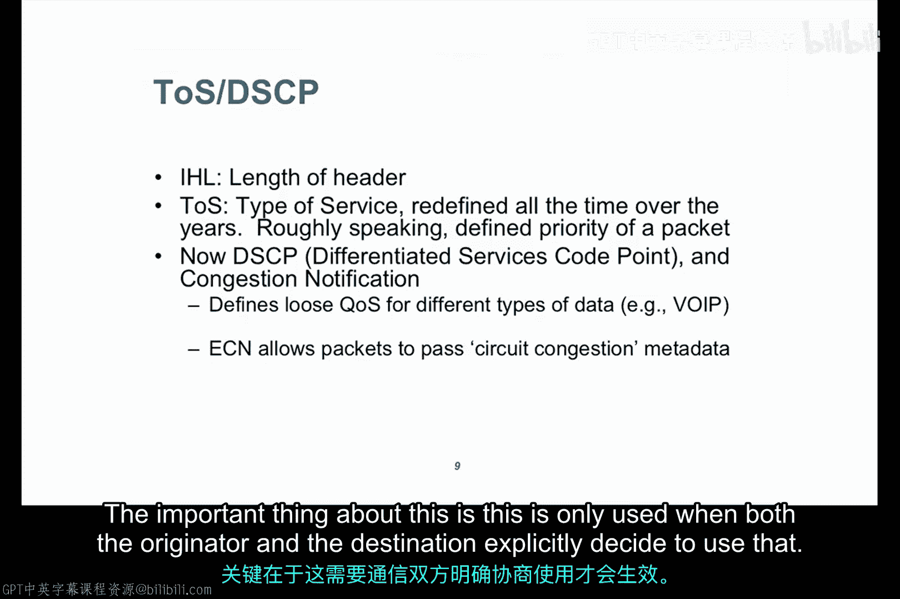

Now on to TTL TTL is quite possibly the simplest but the most easily exploited portion of this。U。

 you'll see many times that what you can do is you can futs around with the TTL and make packets。

Hit certain doubts inside of networks the way that it works is is basically does TTL basically stands for a time。

IP packet so routed with a best effort fashion， they don't actually know if the packet will get to its target。

It could conceivably loop around forever， so what they decided to do is associate count with each of the packets。

The TTL is used to prevent these infinite loops by simply being this count and its decremented every time a packet trat in traverses。

A o。A router。Basically， what ends up happening is that you can set your TTL for， let's say。

 three in this case。First router sees it， takes it in， decrements that TTL passes it along。

 so now the TTL set to two。Next one takes it， decrements it， now it's set to one next one takes it。

 decrements it， sets it to zero， the next router that sees it， if it's not the ultimate destination。

 it will just drop。So you can start actually mapping out networks by adjusting TtLs and sending packets in。

 and if you've got a effective way of determining when they're dropped。

 you've got a way of actually seeing。How big the network is。

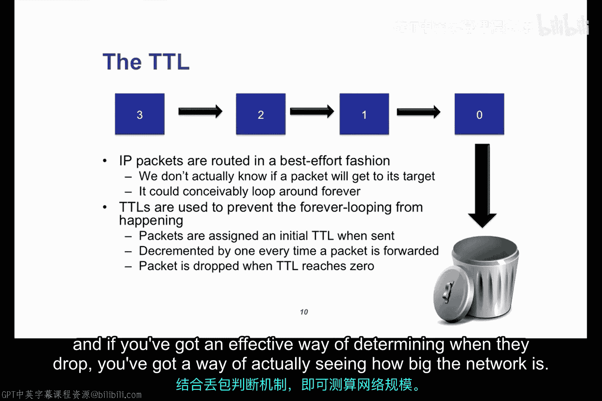

So。Let's move on to the protocols。

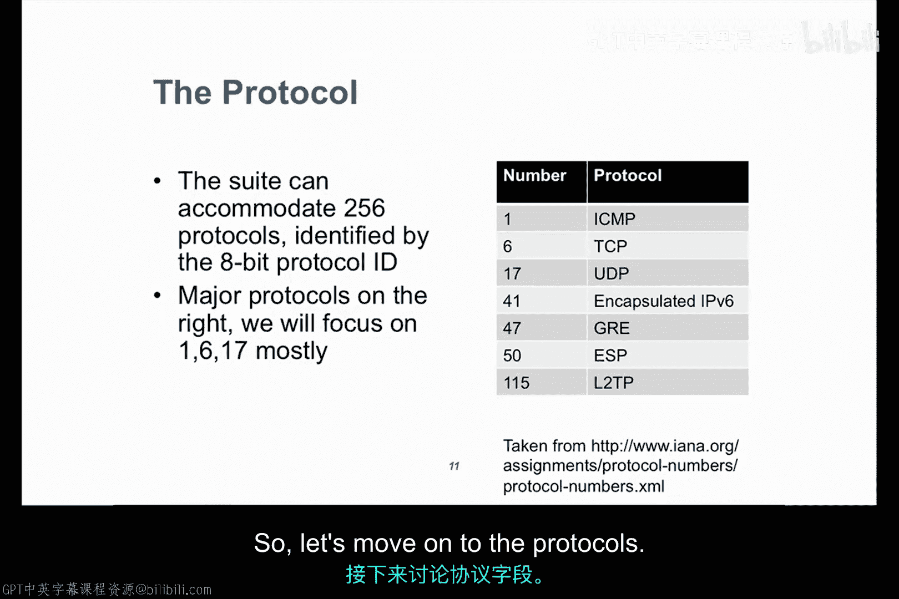

And you'll notice back here。Now we actually have the protocol field right after the time to live。

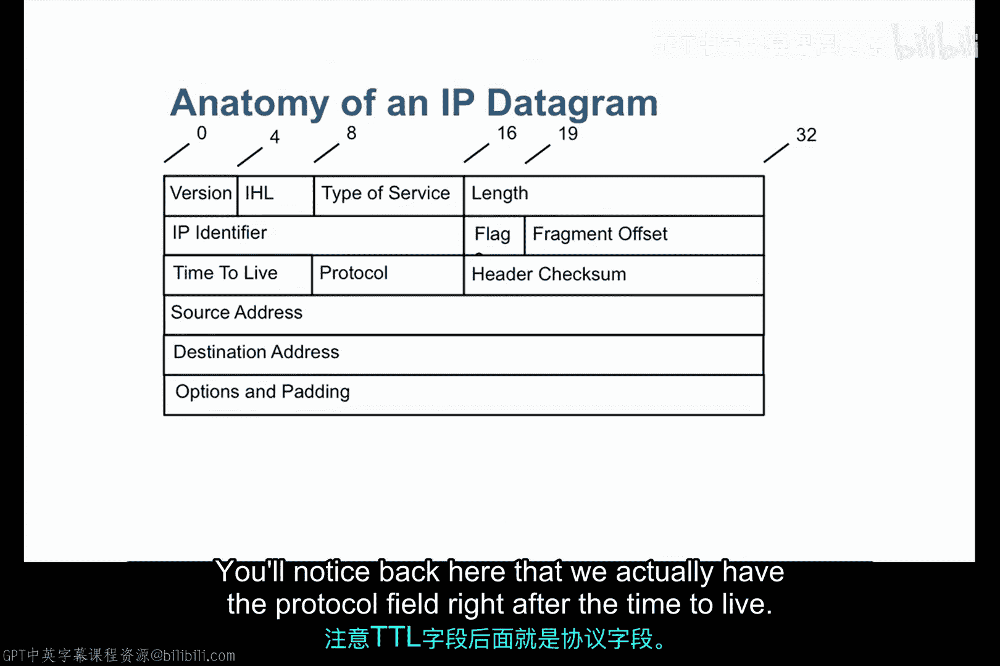

咩。This week can accommodate 256 different protocols identified by the ABP protocol ID。Now。

 one thing that you'll find is that most people can list off maybe two or three of these。

We've got a couple listed here， but the reason why people can only most a lot of people only list off about two or three is because the two or three are pretty high up there。

Most common one that's problem that you would see just by volume alone is going to be ICMP。

 which is Procol1。And this is going to be all of your information about。

You what's going on that were？Couldt find a host destination unreach， that sort then， of course。

We've got six， which is TCP that's going to be your stateful connect。Connection oriented protocol。

And then， of course， youd。Those three are the most common that you can see you might also sit and start seeing some encapsulated IPV6。

 GreE and ESP for your VPN。sortrt of your Vpn activity and the like。So。

We're going to leave it at that for the moment， but these this field is going to give you vital information about every packet that you're seeing。

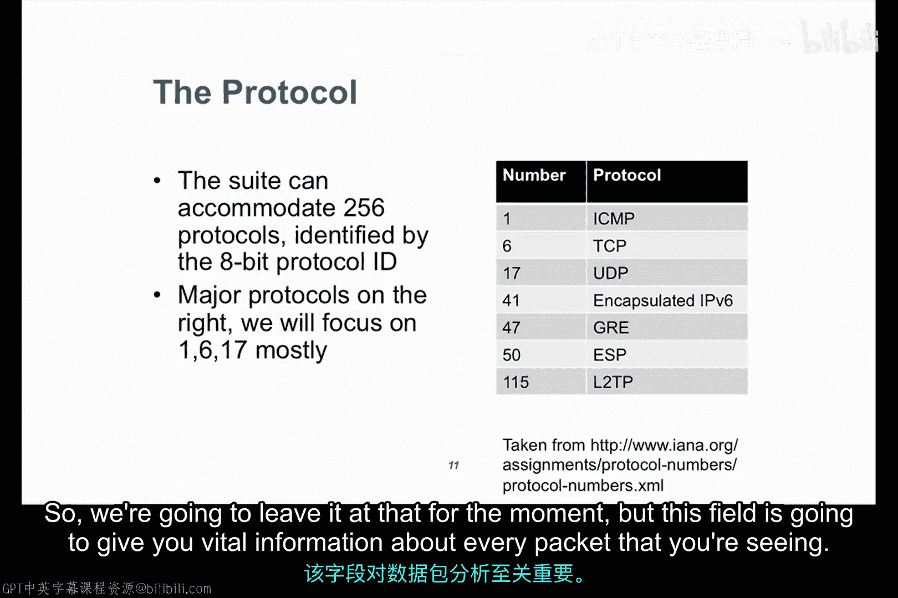

Then we have an IP address we're going to specifically talk about IPV4 in this lecture。

There's going to be a lecture later that will discuss IP6 now on IP before address。Is a 32bit energy？

Which provides a unique identifier for most。And the I address is usually referred to either as the straight integer in decimal or hackx。

 or more commonly in speech， it's referred to as a dotted quad format such as 192。168。1。1。 In fact。

 for the majority of this presentation， we're going to refer to it in that form。

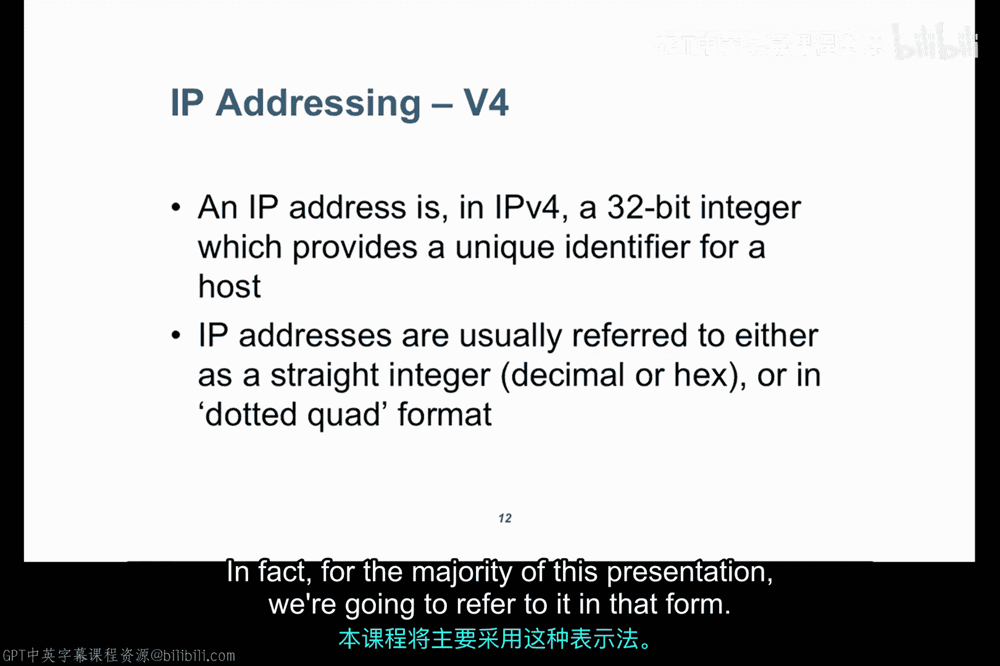

Now you can group IP addresses different historically we have talked about classes such as class A。

 B， C or D。Whenever we're talking about Class A networks。

 that's a block of 16 million addresses starting from 0。0 to0。0。哦完了。Let' we talking about Class B。

 talking about 65536 addresses。Starting with the second on。And when you're talking about a class C。

You're talking about blocks of 256 different addresses。

Now the bad part about this is that if you only divide up the network in this way。

 got you've got a very limited number of chunks that you can hand out and those chunks are pretty large。

 the smallest one that we've got there is 256。So。Now， instead of referring to it like this。

 we actually use ciderblock notation， which is a classless internet domain route in blocks。

And these normally have the slashes that you see right here。And what you will see is that they will。

Give be first。It's。That are actually mask for the address。

And the part that comes before the slash and the number of bits that are mass after the s。

 So in this particular case， we've got 16 ma bits。And then 16 then are free， so slash 16。

If we actually wanted to do a slash C in this case， it would be slash 24 and these three。

Octets here would be frozen where this last one could be any number from 0 to 25 to6。

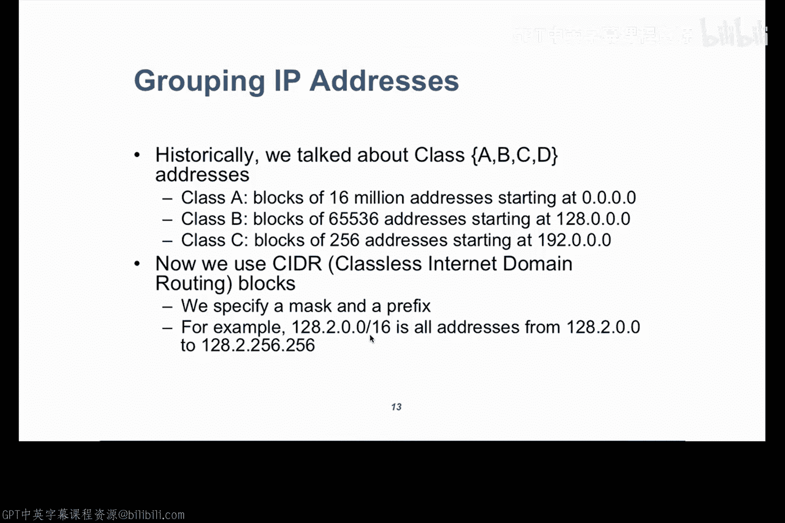

Now， how do you get your addresses， addresses are allocated by I。

You can find who owns a/8 at this address up here。Addresses are。

Are actually allocated hierarchically， AA assigns them to RRS our regional internet registrars。

 and those regional internet registrars may assign them to national or local internet registrars。

 and these national or local， will then assign you particular IP addresses。

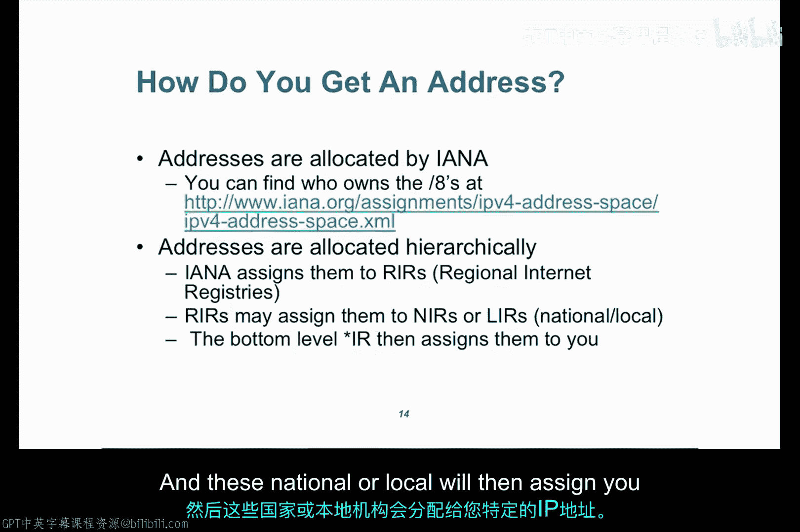

Now。We've got two to the 32 addresses available。But not all of those addresses are actually able to be used。

We have a subset of these that are really not used for anything or they have special purposes。

Of particular interest to us for the broadcast addresses。

 which is the big complementfment of the network， usually ends in tick55。

And it's used to send messages to the entire now， every router understands what they're supposed to do with2 for the Q5。

Of course the nows there's the gateway。This is usually your access point to the internet our transition area from your local network to the larger wide。

Now， this one usually has an address of zero for whatever network you're talking to。

So let's say you've got an address base 1 isU。168。1 dot。Zero， slash。

You've got your broadcast address， which is 255 and you've got your gateway address， which is zero。

Which means you actually have 254 addresses as opposed to 256。

 that's actually a statement approved slide。Oh， we can it that just。Okay， so。

In addition to these addresses being carved off of your collection of addresses。

 there's a couple of different cider blocks that will never be handed out to people。

And we bet those listed right here， under the third bullet。

These are addresses that are specifically supposed to be mobile traffic。

The interesting thing about this is whenever you start seeing this as non buckle T。

That generally indicates that somebody is leaking their local traffic to the internet as a whole。

So although they should be private addresses， they sometimes are not as private as we would like to think。

They're not supposed to be routed across the network， but have seen cases where they have。

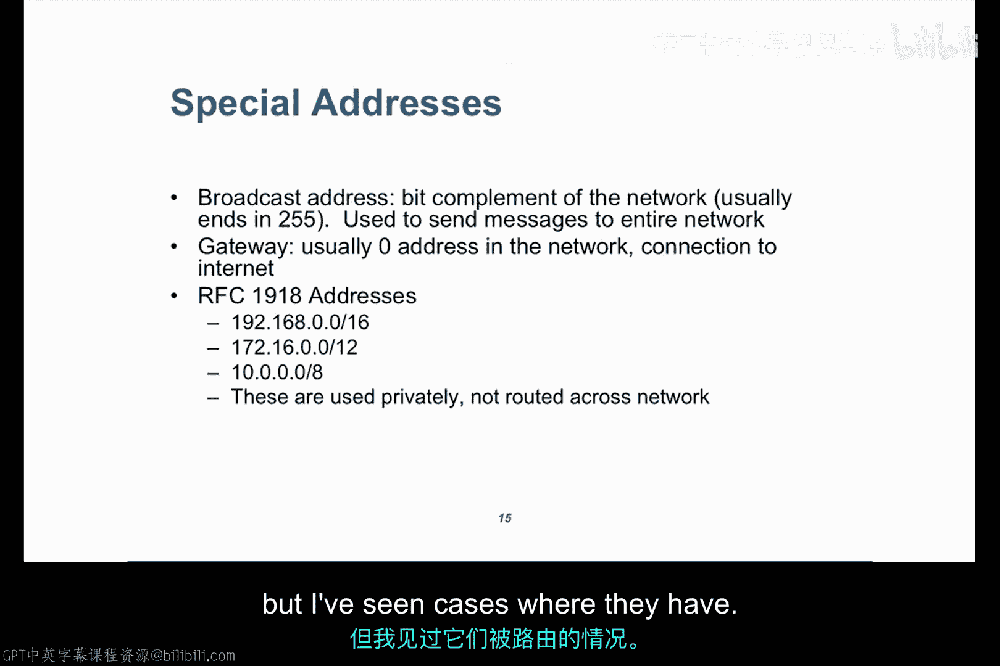

Okay， so。IP really doesn't do by directional communication， as we said before， I mean。

 what we've really got is。A case where each router is trying to get the packets to a destination。

So there is no real concept of our return path。Because of this。

 the source address is effectively meaning。It means something to you as an analyst。

 because it gives you some indication of where it came。

 but that might not necessarily be the ultimate source。That's just the source that you see。

TCP provides you with a lot of capabilities of strange tricks。

 one of the best one is it's exploited quite regularly via proxies。

Wwhich will perform functions on behalf of other hosts using their IP address instead of the actual originator of the requests。

This has yet again legitimate and illegitimate uses。

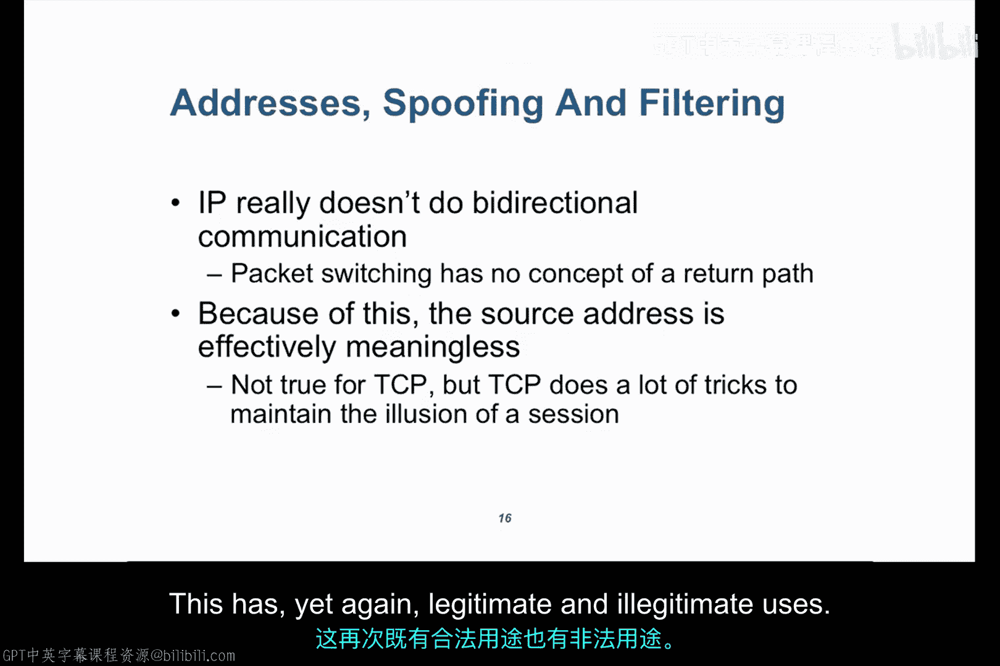

So in conclusion。IP is a packet switched forwarding protocol。It is suite。

 it sits under a protocol such as TCP and UDP。The IP packing contains a the variety of fields。

 describing the traffic pitch deal including the address， the type of protocol， and so。

Sppooon f and manipulating these deals is relatively as we said， right？

It really is just a matter of something in whatever you have， there's no real chaps。

So you can say anything came from 19 do。168。1。That concludes this lecture， I hope you've enjoyed it。

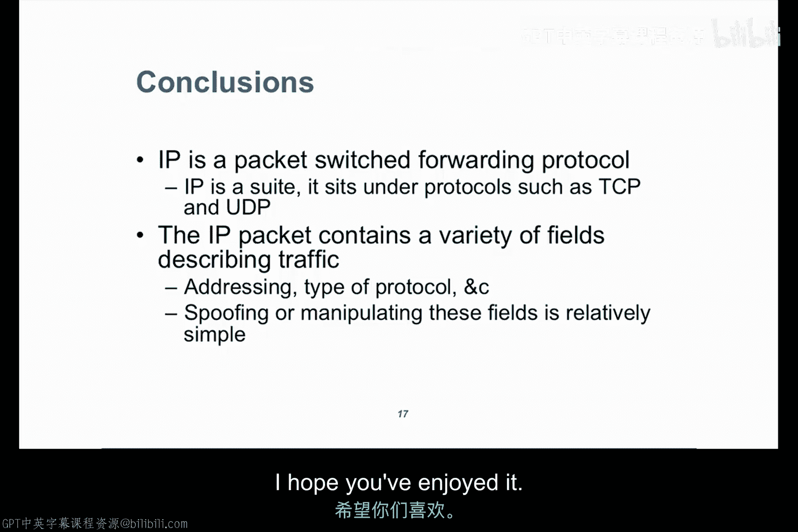