# 约翰霍普金斯大学《信息保障分析｜Information Assurance Analysis》中英字幕 p42 22_TCP-IP协议分析 III：ICMP与UDP协议.zh_en -BV1Qz8EzYENX_p42-

Or one information strength analysis， This is Doctor。 Collinins talking。

 The topic here is TCPIP analysis Section 3 on this， covering ICM and UDP。

The goal of this module is for you to be able to understand and describe the role of ICMP and UDP and network traffic。

 We are covering ICMP and UDP first because they are relatively simple protocols。

 You can understand how they work within the I suite without dealing with the almighty complexity of this TCP。

 which will be coming up。The other thing in this section is that youll learn to describe major ICMP commands and explain the role of addressing。

In the case of UDP， we're going to discuss the composition of UDP messages and the role of quartz quars are a feature of both TCP and UDP and are critical to the majority of user interactive protocol。

Now。Recalll it from module 2。2 if you take a look at an IP datagram。

 there's8 bits available for the protocol yieldable a potential set of 256 protocols If you take a look at the ionianist list of protocols。

 you will find that that of number is actually pretty close to complete there's an excess of 120 protocols however。

Unless you're using a VPM， the majority of traffic on your network will be about 70% TCP， 25% UDP。

 4% ICMP and about 1% for everything else， okay many of the other protocols that are listed in the IAlyst are specialized or obsolete for example。

 there are a variety of VPN protocols like L2TP， GRE and ESP and there're also outdated multimedia protocols。

The big three， the ones that really make up what's going on in your network are TCP， UDP and ICMP。

 and the Dime store description， TCP is focused on reliable data transport。

It is focused on things like Tnett， FTP， HTTP and SSH protocols which are either user interactive。

 meaning that TCP is the thing that makes sure that when I press X on my keyboard。

 that X gets sent over to the network and the acknowledgement from the server that it received in the X that it can come back and print on screen。

 that's what TCP worries about TCP worries about sending big files。UDP does unreliable transport。

 but fast transport， DNS， voice over I P gaming， all of these depend on UDP。

 where either we're robust to loss。 We have pattern metric mechanisms in our head that enable us to deal with occasional dropvo packet。

Or the data is sufficiently small， but you just want to get it in that。 And finally。

 there's ICMP ICMP is the error message protocol of the Internet Okay。

 we are going to cover ICMP and UDP first primarily because there simpler。Now， ICM。

ICMP is the Internet control message protocol。 It is the error handling protocol of the Internet。

 If something goes wrong in routing or something goes wrong in traffic。

 you may get an ICMP packet in response。On the other hand。

 your most common experience with ICMP is going to be through the ping and trace wrapped tools。Now。

 ICM sends single packet messages， single packet messages and expects single packet responses messages are broken down by a type and code value。

 If you look at this datagram breakdown above， you'll see that an ICM packet consists of six of。

Consists of eight bytes one of these is the type， one of these is the code。

 a two byte checks them and an ID and sequence number。

The actual values in the message are a function of the type in the code。

Messages are classified by the type， and then the code is an additional 8 B of information。

 Table at the right shows some of the major types and some associated codes。 For example。

 typey 0 is the echo reply message， which has only one code。 Conversely， type 3 is unreachable。

And you will notice that there are multiple codes， so one means that the host Detroit reaches is unreachable。

 two means the protocol in question doesn't work， three means the ports unreachable Okay these pro combinations may lead to additional packet payload in order to provide diagnostic information。

 For example， if you try to reach a host with an ICD host unreachable message back。

 the actual host's IP address will be encoded in the IC&P message。ok。

There are a variety of commands use ICMP directly。 Ping is the most common。

 Ping sends ICMP type 8 code0 messages to a target。

 This message is echo request and consists of them sending a number and in waiting for a message with same number to come back。

AndPing generally sends multiple packets and expects to get them back to generate statistical models how long took。

And packets are differentiated using the sequence number and also the order of the packet of these jobs。

 you can send optional data with pink packets and in fact most paying commands give you a command line operate a command line option to send a pink packet of any size you want。

reUp to the M chief for that one。NowLet's take a look at ping in action。

If I bring up a terminal window。

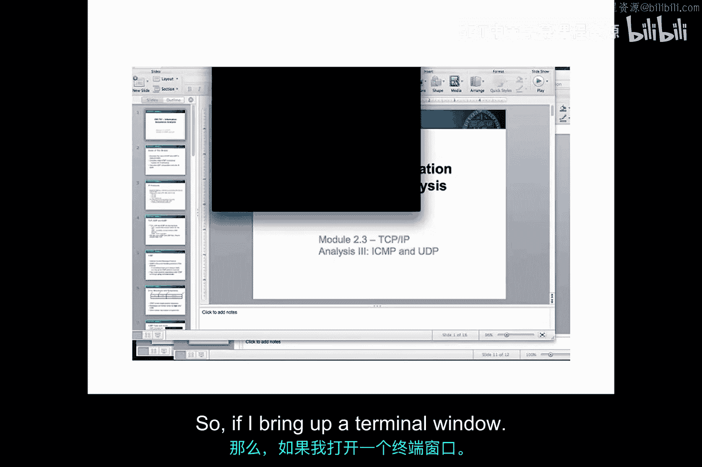

Okay。Let's say that I plug ping a location。So I will paying the New York tax。Yeah。

As you can see what happened in this case is the P message goes wwwNtimes。

com and since 56 bytes we then get in this case a request timer because I'm not reaching the New York Times an odd situation Let's try Google。

Google you can see I'm actually reaching so this is an interesting situation first off you'll notice that I do have a request timeout there as I did above this is an indication that the network I'm operating on is running into some performance problems that may mean that there's a problem somewhere upstream whatever the case is under normal circumstances if I want to pig I should get a message back for everything I'm sending the fact I am seeing packet dropped like this is actually an unusual situation and pay attention to that kids that's actually a valuable real life example of network diagnostics。

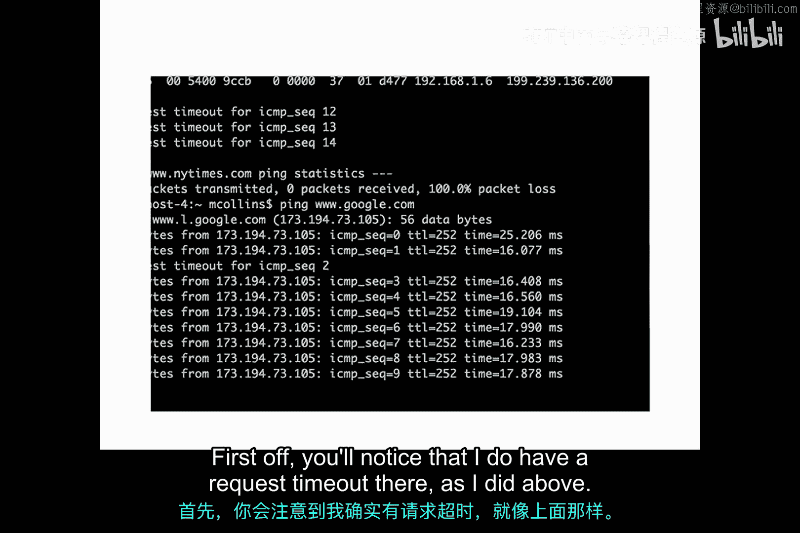

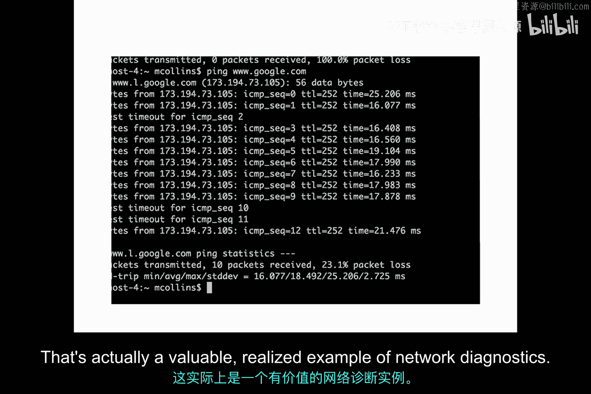

Now。Traceroute is a similar function to ICMP。 What traceroute is for is it's for tracing a physical connection of routers to hosts on the network。

 It works like ping that it sends like a request messages however。

 unlike ping it begins with a small TTL and progressively increments that that value If you remember from the previous lecture on what the TTL actually is the TTL is intended to prevent the network from being flooded with packets Every time packet is sent through a router the TTL gets deced by one value So it's happening with trace route is I say when traceroute to the New York Times the first packet I sent as a TTL of one it the the router right outside of my machine gets dropped。

 I get narrow message next TTL TtL of two it's the router outside of my machine goes to the next router process repeats This allows you to see when the packet itself is dropped。

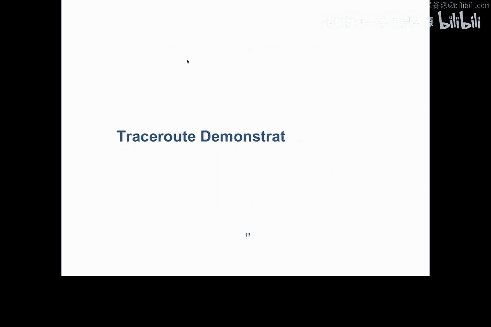

Let's take a look at that with P show I'm kind of curious now。

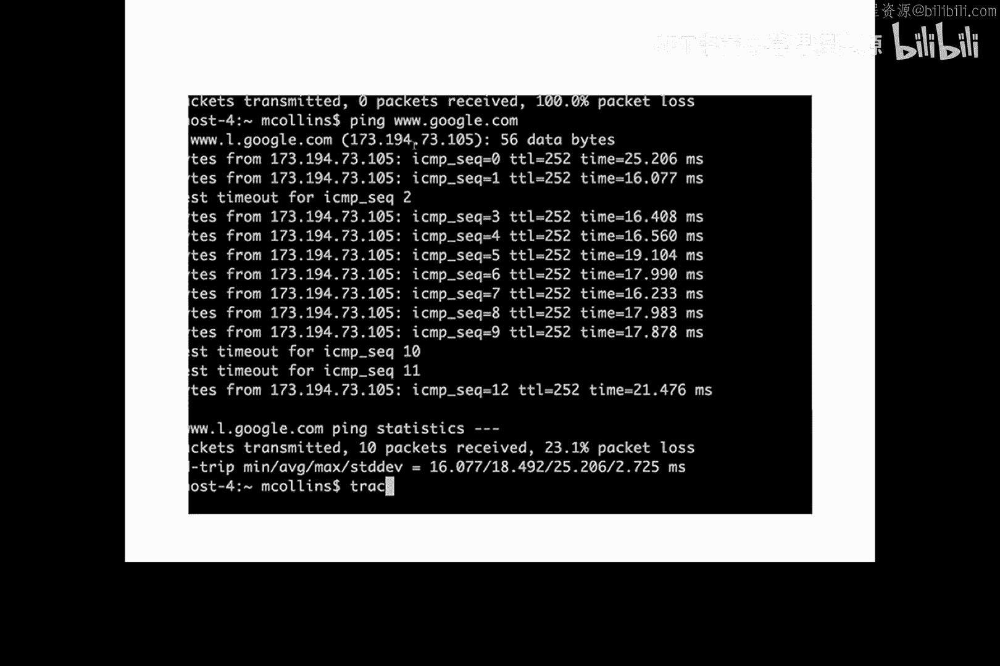

No。So this is an example of a trace route from my home machine going to New York Times website Now what you see here first off。

 you see this wireless broadband router that is the connection to that's connection to the router in my home network is then started going to various machines on G andI do net and you can see that。

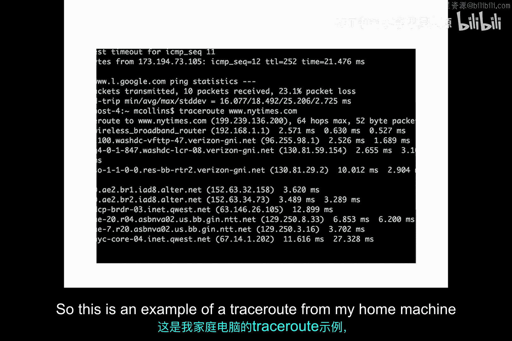

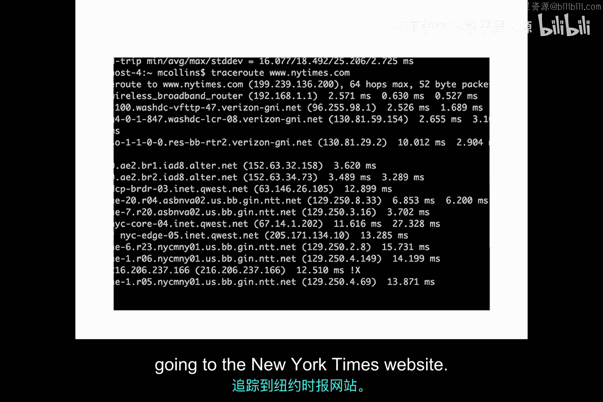

You can see that as the routes increase the time required to reach them is generally increasing going up as time passes。

 but the key thing here is you see this ordered list of routes。 Now if I trace route to Google。

 I should see。

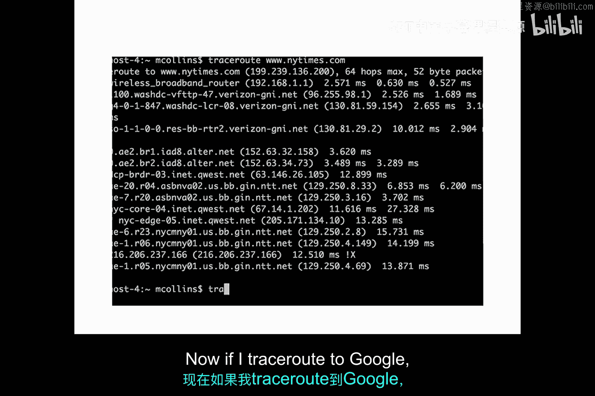

First off he load it ran much faster that's because Google generally has much better connectivity。

 but you will see again it went to my broad at router that it goes to this Verizon G and INe and you can see similarities between number two which is the same post and then we're still within the Verizon G and Inet domain until it can get outside of there So we have there's a good example of the physical nature of routing there are only a limited number of paths from my machine to anywhere else on the network and there are fixed locations that it's going to have to pass through。

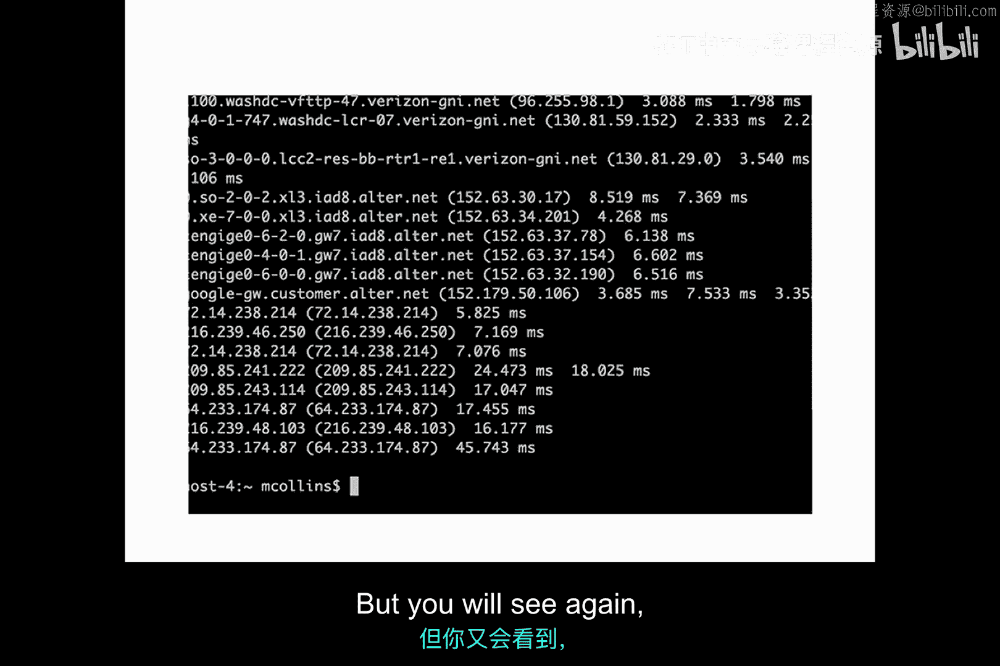

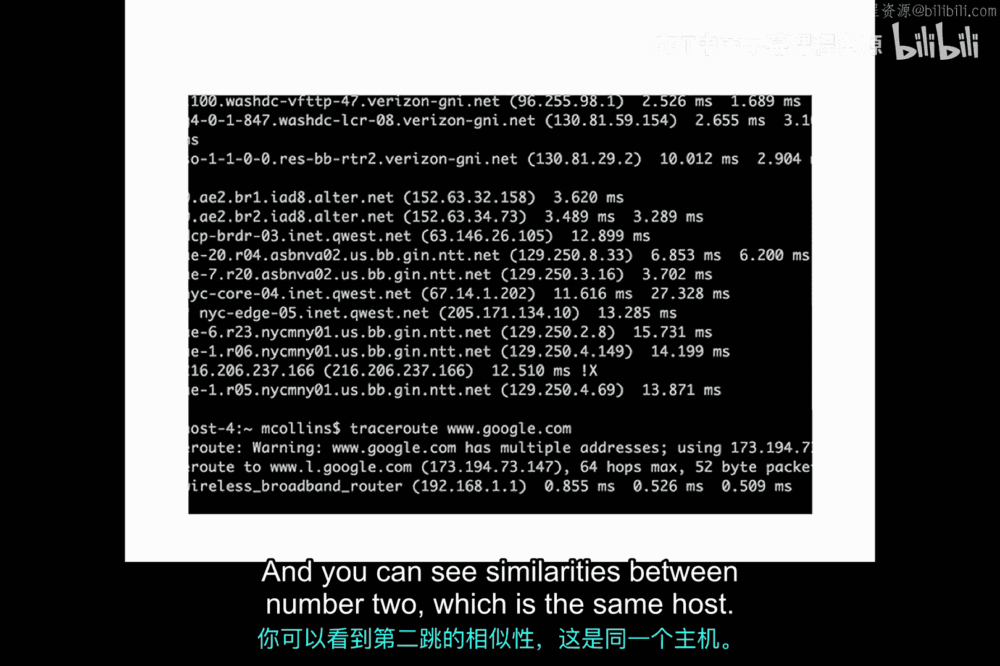

没事。Yeah。ICMP leads to an interesting problem in addressing。Recall。

IP is not like a telephone service it's like the post office， you send the mail。

You may get a message back。ICMP messages are often indicating that something went wrong。

Host is not found， for example。Because of that， it is often the case an ICMT message will not。

You may send， you may send out something that generates niceCP message。

 You might just send out a request， and they get niceCP message in response that is not from your destination。

 I open up a communication to 1821111。That machine doesn't exist。

 so 1482 1111 is not sending me an ICMP message to the effect of I don't exist。

The router that is on that network。Will send me that message。

 ICMP is an extremely asymmetric protocol。 I may send a message to A and get a response from somewhere else。

This also means incidentally tracer can work without ICMP in fact the regional tracer protocol tracer models UTP。

Now。We talk about UDP。UDP user datagram protocol or a reliable datagram protocol UDP is a lightweight data transfer protocol It send single stateless datagrams between two hosts UDP makes no assumptions about responses UDP is like sending postcards a service can implement the ability to send a response but UDP has no mechanism for handling that So UDP is cheap I could receive there's no state information This is an comparisonbarrassing to TCp。

 which I know I'm building up as this kind of ogre in the background but TCp is a phenomenal complicated mechanism UDP does not have the overhead the TCP does which means that it is very easy to just fire off data with UDP but it's unreliable if a packet is lost。

 you don't know that the UDP packet is gone Now it's not uncommon to see people start to build well what I could do is it could take UDP and then I could add in sequencing number so that I could see if I'd loss a packet then I could start sending these back and what you see eventually is that people reimple TCP。

U。I've seen this happen at least four different times on four different projects。

The core feature of UDP cheap。Unreliable mess with that。

 just go to TCP and D with it now let's see you if P diagramgram look like。That switch port。

 get a destinationestation port and a leg and check some， get some data， that's it。Nothing else。

 Very simple。Key thing， the key concept that the UDP Park debri incorporates is the port。

 A port is effectively a subtle address for an IP address。 It's a value between 0 and 655，35。

And basically， these are the actual services that we use for systems supports are numbers by which we expect to find something if we to continue on the metaphor continue on the metaphor of IP is postal system。

 if an IP addresses a building。The port is a post office box in that building。

Now there are a lot of well known ports，53， for example， DNS 6081 on TC is bit torent。

 There are a variety of security rules reports that we'll discuss later。Okay。

 but right now just know that these ports are really the way that we define publicly how you communicate with servers on the network if you want to talk to a DNS server。

 you're probably going to open up a connection to 53 this is public knowledge。

 this is officially common knowledge the attackers will to scan port 53。So。In conclusion。

Two of the three most important protocol in I suite are， UDP and ICMP。

 ICMP is used for diagnostics and error messages， These to originate from sources that were not the original place where you're expecting the error from。

 and UDP is used to send messages， It's fast， it's unreliable， it's simple。一。

Keep these in mind because now we're going to explore the wonder。There is TCP。And TCP is a very。

 very messy particle。

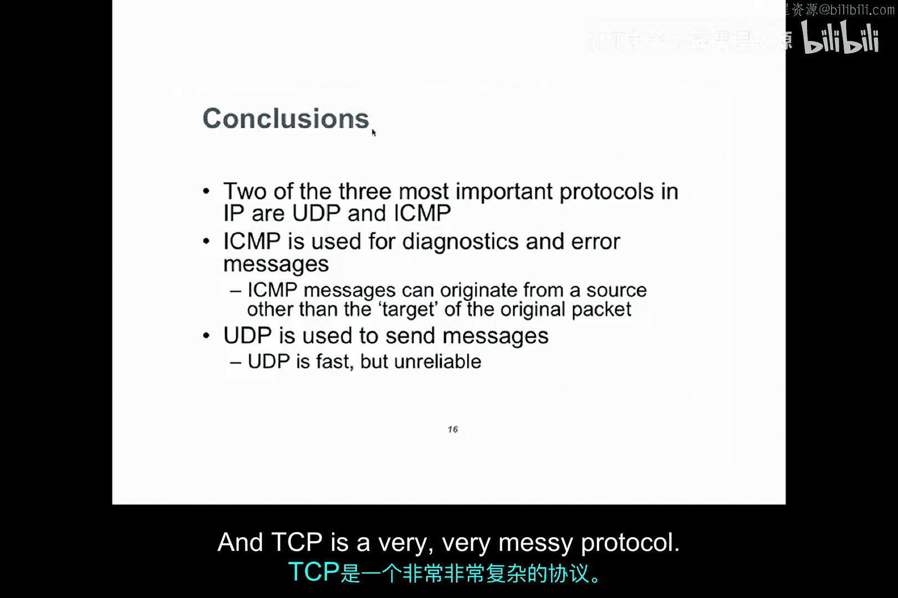