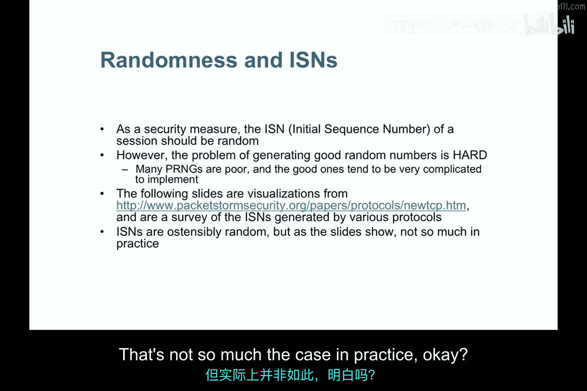
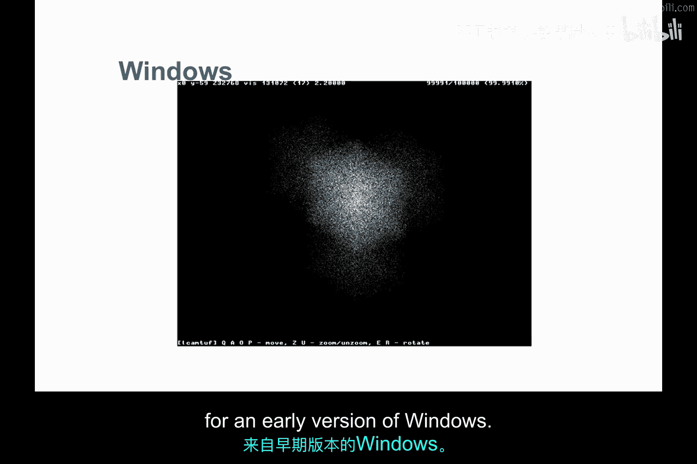
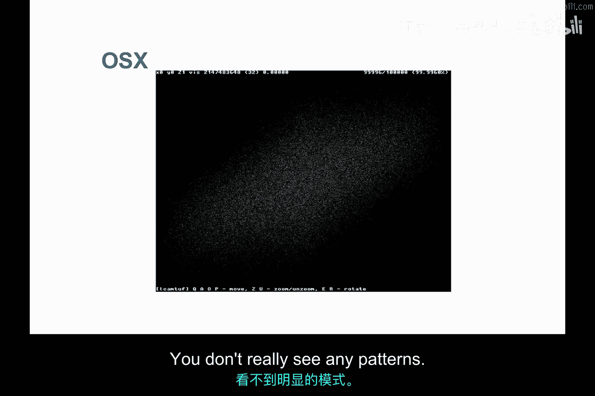
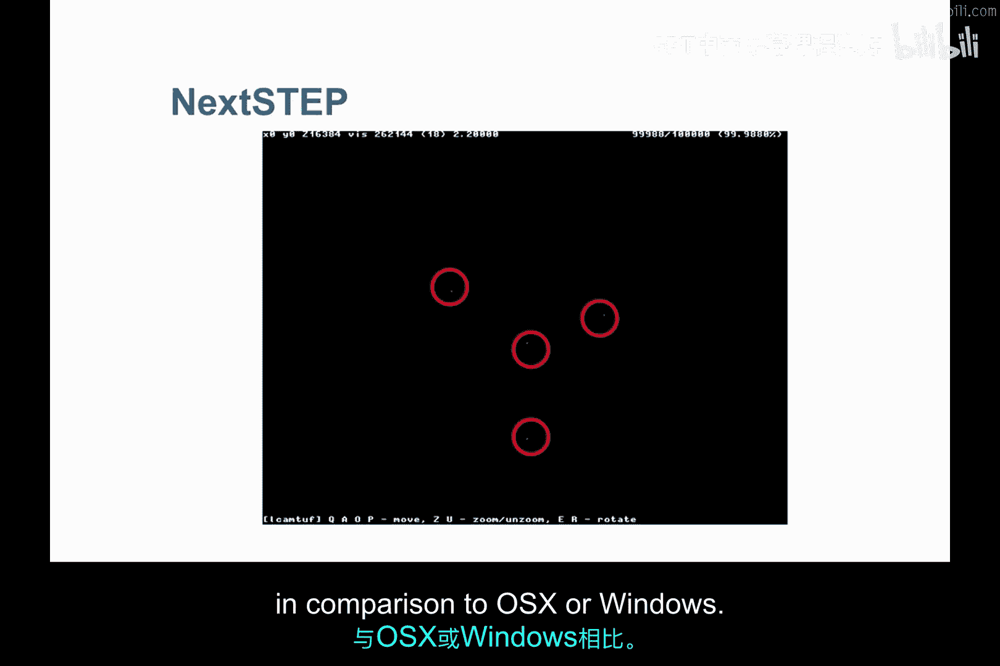
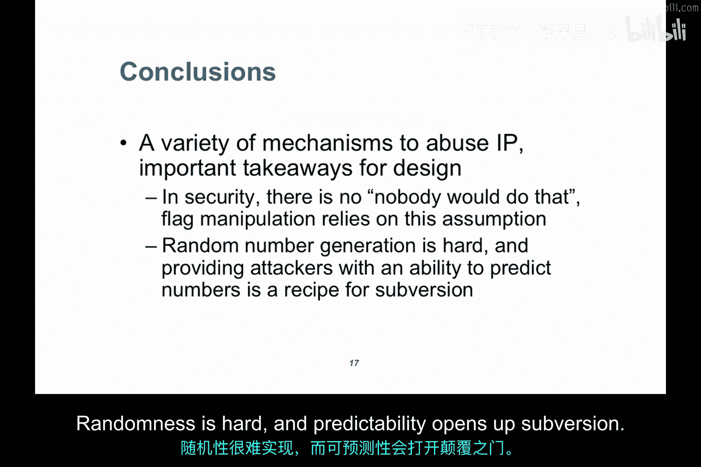

# 约翰霍普金斯大学《信息保障分析｜Information Assurance Analysis》中英字幕 p44 24_TCP-IP协议分析 V：IP协议滥用.zh_en -BV1Qz8EzYENX_p44-

Hello class， this is module 5 of 695741 information assurance analysis， this is Dr。

 Collins lecturing， the topic of this module is TCP abuse。

 the actual ways that people can attack or use TCP in a malicious fashion。At the end of this module。

 I want you to be capable of explaining mechanisms that users attackers can use to abuse TC P itself。

 Now， this abuse may involve gathering intelligence。 This abuse may involve attacks。

 Some of this abuse may be exotic， most of it is relatively mundane。 And to be frankly， to be fra。

 kind of silly， but it is extremely common。And we want to talk about some common signs of TCP abuse。

 short sessions， strange TTLs， things of that behavior， things of that nature。Now。

The most boring and most common form of abuse we see is scanning。 Now。

 scanning can be any of a family of reconnaissance efforts with the right capabilities you can scan using UDP。

 ICMP， you can scan using pure I P packets。 you can scan using ethernet packets if you really set your mind to it。

 However， the basic， boring bog standard vanilla， Ho world malware scanning is done using TCP。

 And the reason for this is because in comparison to every other protocol we've looked at。 Remember。

 TCP guarantees a response。 If there's something there that can respond。And therefore。

 if you want to gather intelligence， you want to use a protocol that's going to respond to you。Now。

 when we talk about scanning in general， I want you to imagine that you have a network with a bunch of IP addresses and those IP addresses are laid outside to side then each of those IP addresses has a set of ports。

 as you will call from the UDP， a description and similarly in TCP we have ports Now。

 if you think of these addresses lying side side to the port lighting on top of each other。

 then we can describe the two major categories of scanning horizontal scanning and vertical scanning。

When we scan vertically， we're scanning all of the ports of in particular address。

 when we scan horizontally， we're scanning all of the IP addresses。

 but we're looking at a specific port or possibly combination of ports。Now。

 horizontal and vertical scanning represent two families of behavior。 Aters in my experience。

 rarely scan vertically。 They scan horizontally。 The reason for this is because attackers are rarely interested in the target itself。

 They do not care that I P address X is running exotic vulnerable software a。

They have a set of well known vulnerabilities。 They have tools they can use。

 They know how to break into your FTP server or SSH server， maybe a couple of web servers。

 So what they care about is whether or not there's a web server there。

 They care about with is FTP server there。 They view the network as effectively intinguishable。

 except by the exploits that they can lodge at targets。

 So they're going to look for targets and they're not going to bother with anything else。Defenders。

 in comparison， are usually concerned about whether or not a host on the network is vulnerable to something because they cannot predict which vulnerabilities in attack are used。

 Now we can make a good guess。 Most vulnerabilities are used in attack。

Belong to a fairly small set and for example， I have not in my professional lifetime encountered a large number of NTP based attacks or much using Mbone。

 Most of what we see tend simply focused on your classic Trinity a server， web server FTP。

 SSH Okay regardless of that， if you're looking to adequately defend it at work。

 you may not have that， you may not have the opportunity to be complacent about it。

 so you look for anything。Of that host that scam that's vulnerable and to do that。

 you conduct a vertical scan。Now。😡，TCP， as we know。

 is different from UDP and ICMP that it tends to respond。

 and this means that TCP scans tend to rely on this response capability。

 Now there's a couple of classic TCP scans， the boringest scan of all is what we call the half open scan you send a sin and you see if you get a CAC。

 The reason it's called a half open scan is because at that point use the scanner stops。

 stops the TCP open process， which means that if you go back to the state machine。

 it's not actually in the open and receiving packet state because it's waiting for the acknowledgeknowment from the original client to continue onwards。

Therefore， the system sort of freezes for lack better term in that state。 I mean。

 eventually the connection will close。 But until then you've got this dangling session。 Okay。

 the connect scan。 so the difference between the connect scan and the half open scan is that the connect scan is using the Unix connect hall。

 The reason that this is different from a half open scan is because this is equivalent to me。

Tellneting or opening connections manually I'm going to actually do the whole S S act acknowledge。

 try to run a session type of action Okay so your connect scan is your basic and most primitive skin if you don't know how to do anything you start by basically tellnet to this address。

 tellNe to that address， tellNe to the next address or if you're a little more clever you go into your socket library you connect to that address and you connect to the next address you don't do a half open scan unless you know how to do data graph manipulation okay。

The next category of scan。 And this is not really， this is not behaviorally related to the half opening connect scans。

 more it's a classic example of scanning behavior is what we call a Christmas tree scan。

 A Christmas tree scan is a scan where you set all the TCP flags。 Now， remember。

 TCP uses these flags to inform state transition。 So there's sin sit， there's sin。

 act fin push urge reset。InChris tree scan， the attacker sets all of the flags high。

 so it's like everything in the packet that's lit up。

 which is where the metaphor comes from okay Christmas tree scans are used because they tend to confuse stacks immensely there's no real definition of what you're supposed to do because it's a gobbledy packet。

Now。The point of this all is that you know if TCP has some if you have a TCP port that is amenable to accepting connections then you're going to get a response。

 if you don't， you should get a reset in KP now again。

 this does not have to be TCP specific it's just easier to do it in TCP and quite frankly if you're an attacker looking for an exploitable resource most of the best ones are in TCP。

 HTTP， TCP， SSH TCP， Telenet， TCP， all those things are running there KP now。

Scanning as intelligence gathering， it works for a variety of reasons。

 The first is that TC P IP is full of odd little ambiguities in the implementation。 For example。

 how do you respond when S fin is the first packet。

 How do you respond if you're combining a reset with other flags。 Okay。

 what happens if you send the fin first， right， And this is something I want you to consider。

 Because this is a key part of security design。These flight combinations are allluded in the original TCP specification。

 which。It't hold me to this to be about RFC 798。嗯。The reason for this。Is that， you know。

 it was a happier， more innocent， trusting time we don't live in that world anymore。Right now。

 whenever you do receive a state machine or something of that nature in a design specification and you have something like flags。

 you have to consider every possible combination， if somebody says to you that shouldn't happen the point is that an attacker is going to make a beeline for things that shouldn't happen。

 If something is unspecified， it's a way of differentiating the system because developers are going to be lazy and different developers are going to end up with different weird behavior going on that's housecaning works and TCPI。

 So as a security professional And when you are taking a look at this problem in the design phase at work。

The things you have to remember is that any flag combination that can happen。

 any flag combination that can happen will happen， an attacker will try it。Okay， now。

Let's talk about scanning crop。 The easiest way for you guys to learn about scanning is to use Endmap。

 Endmap is a scanning tool。 Endmap is the gold standard for open source scanning tools。

 developed by developed by a hackard in go lion。 you can go through the Nm org site I would just pull it down and I fiddle with it。

 now I'm not going to endorse that you scan random chunks of the internet。

 everyone else is doing it already。 So you're not going to're not going to find anything new。

 what you may want to do is if you have your own internal network。

 such as your whole intra on your wireless router。 You may want to run endmap and you want to run TCP dump in promiscuous mode。

 So you can see what happens when you scan your network。 Now。

 if you take a look at the options that Nm has you rat。

 There are congiillllions of command line options for different kinds of exotic scans and the ability to alter the timing。

 manipulate the packet construction and so on。Now。😡，Scanmmings is associated with profil。

 Profiling may be very simple。 For example， at the moment， there is a my first exploit tool written。

 which does SSH attacks。 It doesn't care about what version of SSH you're running because what it's going to do is it's going ready to get some password list。

 So the only profiling It runs is I open up a connection to the SSH port。

 Do I get back in this SH response。 excellent， Let's start spamning passwords to it。 However。

There are a variety of Os profiles that can be constructed by taking a look at the responses to flag combinations。

 fragmenting， things like that。 The standard profiling tool for this is tool developed by Michael Zululuki called Poff。

Poff basically gives you a whole set of tests to run to run on a stack。

 Take a look at the responses that come out of it and uses that to make a decision about what the stack is。

 It's at stack。 It's a stack guessing expert system and it looks at a variety of attributes。

 It looks at default TtL， which varies radically depending on your operating system。

 It looks at reactions to different flag combinations， default labels， things of that nature。

 There are a variety of undefined spaces in these specifications where developers can end up fingerprinting now。

All that it might。I want you to keep something in mind about attackers， okay？

The information security community loves to talk about incredibly clever attackers， okay。

 people who are going to do very sophisticated stealthy profiling。

I'm not going to say these attackers don't exist。 These attackers do exist， but they're rare。

The majority of attackers out on the internet are idiots。Okay。

 there are people who are going to do bones stupid attacks on networks， and here's the bad news。

They going to succeed。 so it't feel too smart， we are on the whole losing a war against the collection of idiots Okay。

 for example， when you look at SSH， if you look at an SSH on any large network。

 you will find that it is being scanned continuously so that an incredibly stupid SSHxbo tool can run password lists against it Okay。

 this happens all the time One of the common recommendations for security hardening at this point。

 move SSH to a different port just to get rid of the scanning。Now。

Let's talk at this point about a really clever attack。

 This is something that really is extremely fragile and extremely clever。

 but it gives you an idea of。Abuusability in the protocol。

Now I want you to recall it in TCP a session continuity is maintained via the sequence numbers and keep in mind the sequence numbers are public knowledge if you are listening to the packages going back and forth。

 you see the sequence numbers so what you could do if you were sufficiently motivated because it's ver protocol you could set your IP address to the IP address of one of the hosts and start sending packets with the appropriate sequence numbers and hijack the session now it's not a trivial effort for example。

 if the two hosts are cross you know cross multiple routers then your address hacking is going to involve some BGP hacking as well or some sort of writing protocol hacking。

 but the point is it is conceivable because again。There is no concept of a circuit at the Ip level。

 TCP creates the fiction of it by using the sequence numbers。 So that's all well and good。

Here's the interesting thing。In the specification for TCP， the initial sequence number。

 which we call the ISN that is the first sequence number of the protocol Now if we were done。

 what we do is we'd set this ISN to one in every packet in every session， of course。

 if we did that that anyone could hijack any time so the idea is that this value should be random。

Random numbers are hard okay many pseudo randomdom number generators are poor。

 Good pseudo randomdom number generators actually tend to be very complicated to implement and usually depend on what we call on what we called entropy source But if you've ever created a password using GPG you know。

 it makes you do that little mousead some things like that nature because that's the best source oftro of nondeminism we've got is your nervous system Okay what I'm going to show you at the moment are plots of the range of random numbers generated for ISns for a variety of operating systems。

 Iens theoretically random and perfect worldbl is a perfectly even distribution。

 That's not so much the case in practice。 Okay for example。

 this is the distribution of windows this is the distribution of random of initial sequence numbers for an early version of Windows。

 then you'll see that there's this concentration in the center。

Now， if we take a look at OS X， OS X actually does a pretty good job。 It's evenly distributed。

 you don't really see any brightness。 But now let's take a look at next step。 Apparently。

 Steve Jobs did learn something in between， because you'll see here the initial sequence numbers are very tightly clustered and repeatable。

 Now， this does not mean ho， an attacker can just automatically take over a next step session。

 but it increases the probability that he can do so。 These maybe statistical functions。

 or what we've done here is we've got something that is statistically very weak comparison to OSX or Windows。

Now。There's one last thing I want to talk about at this point which is the manipulation of TTLs there is not so much a TCP TCP abuse as it is an IP abuse。

 but it gives you an idea of again the way that people can attack the protocol Now recall TTLs reach zero the packet question is drop okay now defensive systems are usually at least one hop away from the target so my firewall is probably going to be at least one hop possibly you know three to five hops away from thing that's being exploited most of your classic firewalls examined payload so they look for things like the classic idea system was something that look for root。

In text streams because root is of course， the root password or the root accounts name in UniX that gives you all the permissions if you've got route access。

 you're doomed。So what you could do is you could send you know you could send the string root R0OT and you could send those four letters with a high TTL and then in the middle of it you could put a packet with a low TTL so ROB OT for example。

 the firewall sees robot pass by that packet in the meantime gets dropped and it goes to ROOT so that means that the defender never sees this extraneous data that stops it from matching the string the target does not and it allows you to hide the attack among garbage so again。

 what we're seeing here is that there are various ways to exploit the fact is basically a stateless environment there's no concept of a circuit there's really no of continuity it doesn't work that way and consequently attackers can abuse it from a variety of creative fashion。

Now， conclusions there's a variety of mechanisms available to abuse IP At this point。

 the important thing for you is takeaways for design and the big one。

 if somebody says nobody would do that， ignore them attackers will do it if attackers can figure out a way to do it。

 they will do so One of my favorite attacks involving PhP nuke involved the attacker injecting attack injecting SQL statements into a completely useless variable that basically just kept track of how many requests had been done okay。

Now。The other thing we keep in mind is that a lot of the stuff we depend on over security in particular randomness is hard to implement when you create a mechanism by which an attacker can easily predict values。

 that's a recipe for subversion。 That does not just apply to sequence numbers。 I've seen。

 people dealing with passwords where you know， they have the password rule。

 so many characters plus numbers。 So their passwords would literally be password one。

 password 2 password 3。 And of course， then I could break in after knowing when the expiration date was because I could just type it password 4。

 so keep that in mind。 Okay， randomness is hard。And predictability opens up subversion。

