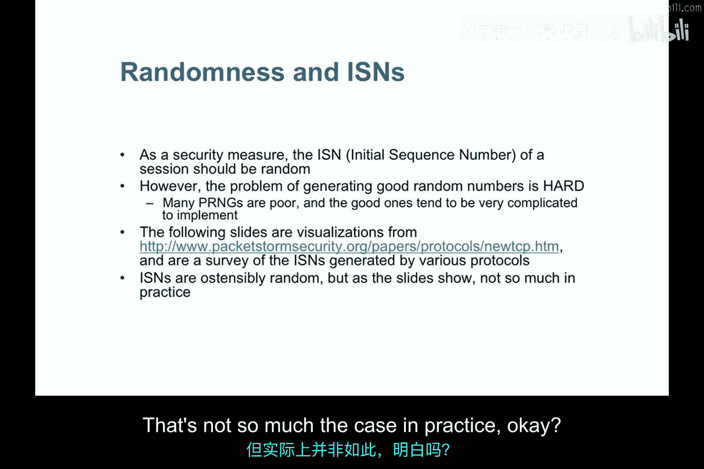
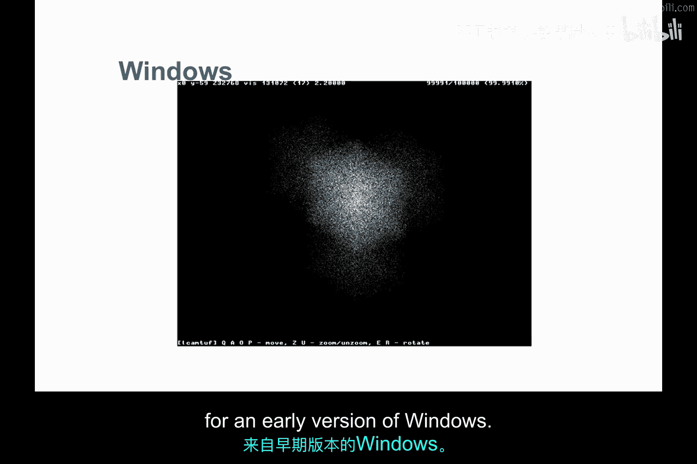
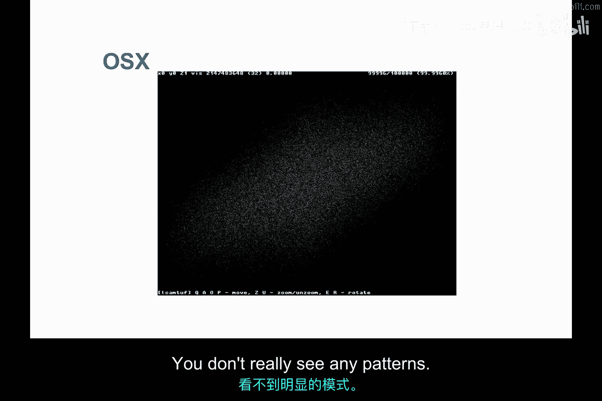
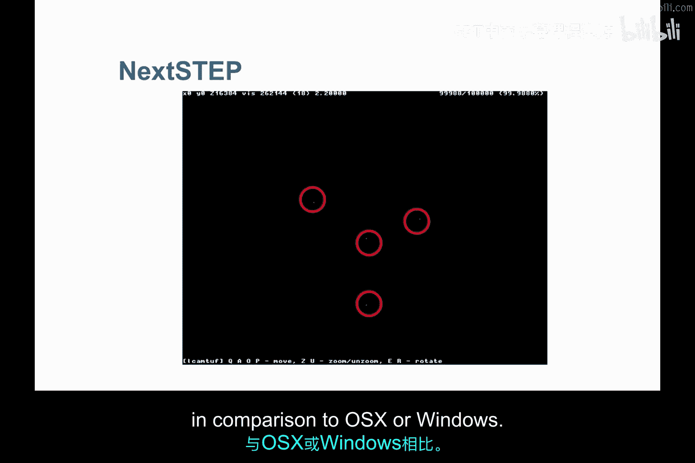
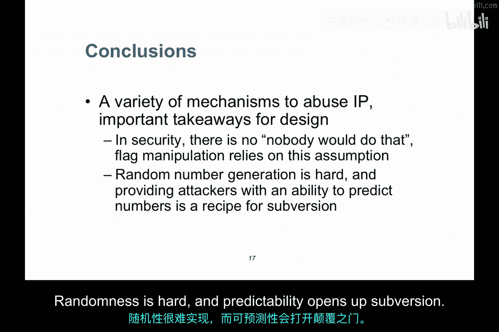

# 信息保障分析：5：TCP/IP协议滥用分析

在本节课中，我们将学习攻击者如何滥用TCP/IP协议进行恶意活动。我们将探讨从基础的网络扫描到更复杂的会话劫持和协议漏洞利用等多种机制。理解这些滥用方式对于设计安全的系统和进行有效的防御至关重要。

## 扫描：基础情报收集

上一节我们介绍了TCP/IP协议的基本概念，本节中我们来看看最常见的滥用形式：扫描。扫描是一系列侦察活动的基础，其核心目的是探测网络中哪些主机和端口是活跃的。

以下是两种主要的扫描策略：

*   **垂直扫描**：针对一个特定的IP地址，扫描其所有可能的端口。这通常用于评估单个主机的整体安全状况。
*   **水平扫描**：针对网络中的一系列IP地址，扫描一个或几个特定的端口（例如，所有主机的22号SSH端口）。攻击者常用此方法寻找运行特定易受攻击服务的机器。

TCP扫描之所以流行，是因为与UDP或ICMP不同，TCP协议保证响应。如果一个端口开放并准备接受连接，它会回应；如果关闭，则会发送重置（RST）包。

## TCP扫描技术详解

了解了扫描的基本分类后，我们深入探讨几种具体的TCP扫描技术。

以下是几种经典的TCP扫描方式：

*   **半开放扫描**：扫描器发送一个SYN包，如果收到SYN-ACK回复，则立即发送RST包终止连接，而不完成三次握手。这避免了建立完整连接，更为隐蔽。其过程可简化为：`客户端 -> SYN -> 服务器`；`服务器 -> SYN-ACK -> 客户端`；`客户端 -> RST -> 服务器`。
*   **全连接扫描**：使用系统调用（如Unix的`connect()`）完成标准的三次握手，建立完整TCP连接后再断开。这相当于手动使用Telnet测试端口，是最基础、最易被检测的扫描方式。
*   **圣诞树扫描**：扫描器发送一个设置了所有TCP标志位（SYN, ACK, FIN, PSH, URG, RST）的数据包。这种“全亮”的畸形包（如同挂满彩灯的圣诞树）可能引发不同操作系统栈的异常反应，用于探测和指纹识别。

## 协议模糊性与指纹识别

扫描不仅用于发现目标，还能通过分析目标对异常数据包的反应来收集更深入的信息，即操作系统指纹识别。

TCP/IP协议栈的实现中存在许多未明确定义的模糊地带。例如，RFC规范可能未规定当第一个包是FIN，或当RST与其他标志位组合时应如何响应。不同开发者在实现时会做出不同选择，这就产生了可被探测的差异。

攻击者会系统地尝试各种标志位组合和异常情况（如分片），观察目标的响应，从而推断其操作系统和协议栈版本。一个著名的指纹识别工具是Michael Zalewski开发的**p0f**。

需要记住的是，虽然存在技术高超的攻击者，但互联网上绝大多数攻击是自动化、重复且“愚蠢”的。例如，针对SSH端口的暴力密码破解扫描无时无刻不在发生。一个简单的防御建议就是将SSH服务移到非标准端口，以避开这些自动化扫描的噪音。

## 会话劫持与随机数安全

除了扫描，TCP协议本身的机制也可能被直接攻击。一个经典的例子是利用初始序列号（ISN）的弱点进行会话劫持。

TCP通过序列号来维持会话的连续性和可靠性。在理想情况下，每个新连接的初始序列号（ISN）应该是完全随机且不可预测的，以防止攻击者猜测序列号并劫持会话。

然而，生成高质量的随机数（熵）在计算上是困难的。许多早期或设计不良的系统使用脆弱的伪随机数生成器，导致ISN并非真正随机，而是存在可预测的模式或范围过于集中。

如果攻击者能够监听通信并成功预测出下一个序列号，他就可以伪造源IP地址（这通常需要更复杂的路由欺骗），并插入带有正确序列号的数据包，从而劫持或注入数据到现有会话中。这凸显了在安全设计中，**随机性至关重要，而可预测性则意味着漏洞**。

## IP层攻击：TTL操纵示例

最后，我们来看一个在IP层进行协议滥用的例子：生存时间（TTL）操纵。这虽然不是纯粹的TCP攻击，但很好地展示了如何利用协议的无状态特性。

TTL字段规定了一个数据包在被丢弃前能经过的最大路由器跳数。一些旧的入侵检测系统（IDS）或防火墙会检查数据包负载中的特定字符串（例如，查找“root”这个关键词）。

攻击者可以将攻击载荷（如“ROOT”）拆分到多个数据包中发送。他们给包含干扰字符（如“ROBOT”）的数据包设置一个很低的TTL值，使其在到达检测设备之前就被路由器丢弃。而包含真正攻击字符串（如“OT”）的数据包则设置较高的TTL，顺利通过检查。由于IP是无状态的，检测设备看不到被丢弃的包，因此无法重组出完整的“ROOT”字符串，从而绕过了基于内容的检测。

## 总结与设计要点

本节课中我们一起学习了多种TCP/IP协议滥用的方式，从基础的扫描到复杂的会话劫持和协议漏洞利用。

关键的设计要点总结如下：

*   **永不假设“这不会发生”**：在安全设计中，必须考虑所有可能的输入和状态组合。如果某种情况在理论上是可能发生的，攻击者就一定会尝试它。
*   **随机性至关重要**：无论是生成会话令牌、密码还是初始序列号，使用强密码学安全的随机数生成器是防御预测攻击的基石。可预测性会直接导致系统被颠覆。
*   **协议无状态性是一把双刃剑**：IP和TCP协议的高效源于其无连接、无状态的设计，但这同样为攻击者进行数据包注入、会话干扰和逃避检测提供了空间。防御系统必须考虑到这一点。

作为安全专业人员，理解这些攻击机制是构建有效防御的第一道防线。