# 约翰霍普金斯大学《信息保障分析｜Information Assurance Analysis》中英字幕 p45 25_TCP-IP协议分析 VI：IPv6协议.zh_en -BV1Qz8EzYENX_p45-

Hello class， this is a 6057401 information assurance analysis is module 26， TCPIP analysis 6。

This is going to be a discussion about IPV6。

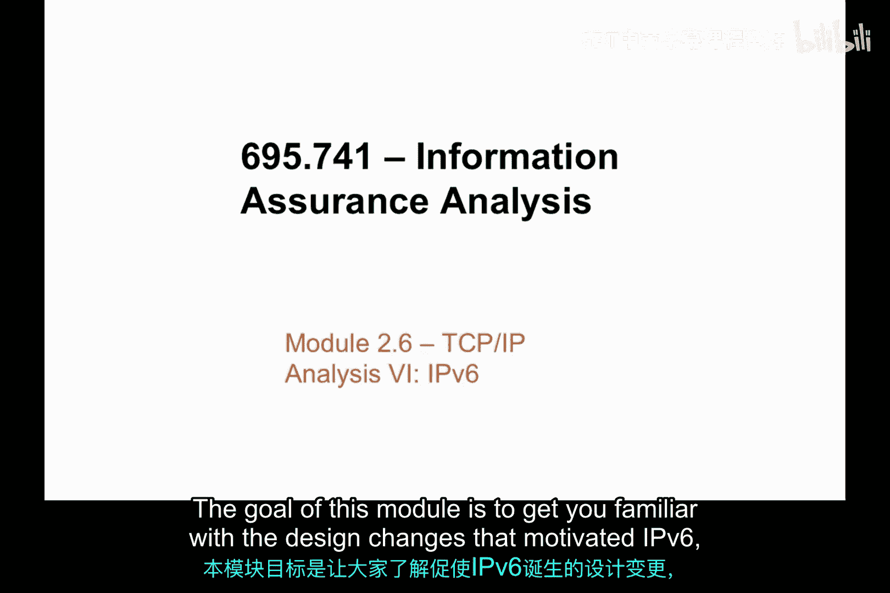

The goal of this module is to get you familiar with the design changes that motivated IPV6。

 which can basically be summed up as we're running out of IPV4 addresses we also want to explain the differences between V4 and V6。

 I want to show you how to use IPV6 address notation and explain the changes between IPV4 and IPV6 fragment。

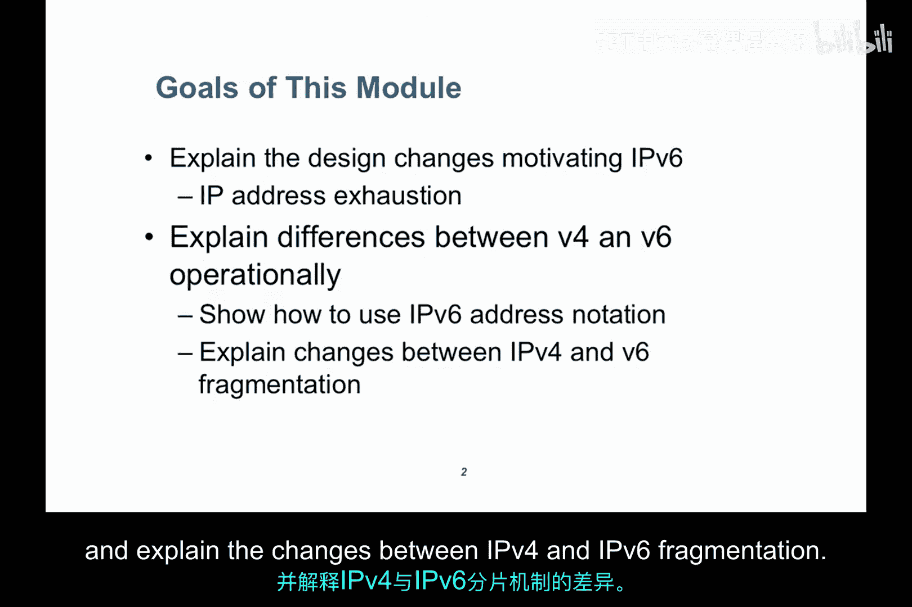

Now， let's deal with the issue of address exhaustion。 IPV4 offers about。4。3 billion addresses。

 nominally this is2 to the 302nd， but due to routing multicast， local addresses。

 things of that nature， there are a variety of sets that are not for lack of going are legally available。

the big category for this is what you should call the RFC Fl T735 or formerly the RFC 1918 addresses。

 which are addresses that are allocated for private networks。

 these include your 192168 and your 10 addresses now。This means that Aana。

 the organization that holds the slash8s， has historically been giving these out and finding out the number slash8s they had was running out。

 They ran out in January 2011， at which point the last two unallocated slash8s were Giffin。

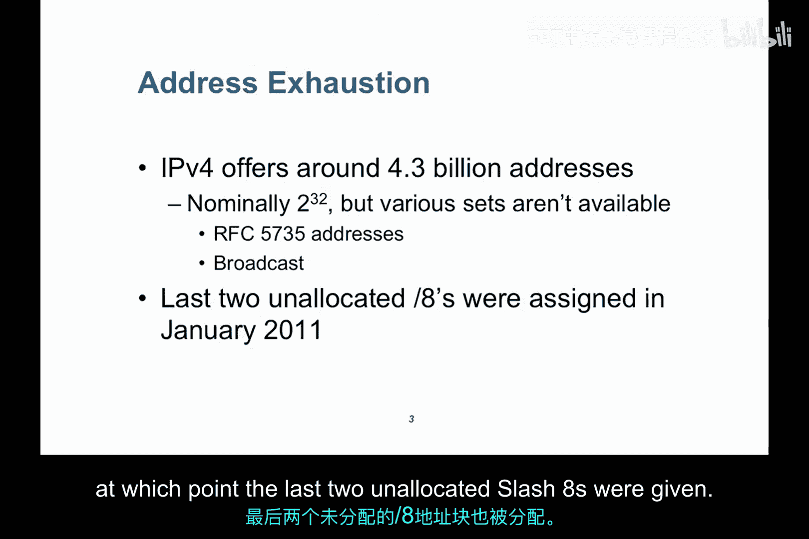

Now。All of that said， let's talk a bit about the addresses themselves。

IP address allocation is not uniform on an address basis were originally assigned basically on a first come first serve basis。

 so there are a lot of organizations that you might wonder why they have 16 million addresses Ford。

Eli Lily， Prudential Merck， I think Merck owns it because Lilly owns one as well。

 Or you can take a look at DoD， which owns the largest single chunk of IPV4 real estate。

 DoD owns about 10 slash8s。 So does about 160 million I P addresses all on its own。 Okay。

 many of the organizations in question do not even use a fraction of that space。 Lily uses， I think。

 somewhere around a slash 10。Maybe and they've basically just dropped the other three the other the other three slash tens that they have is dark。

This early allocation has led to this kind of abuse。

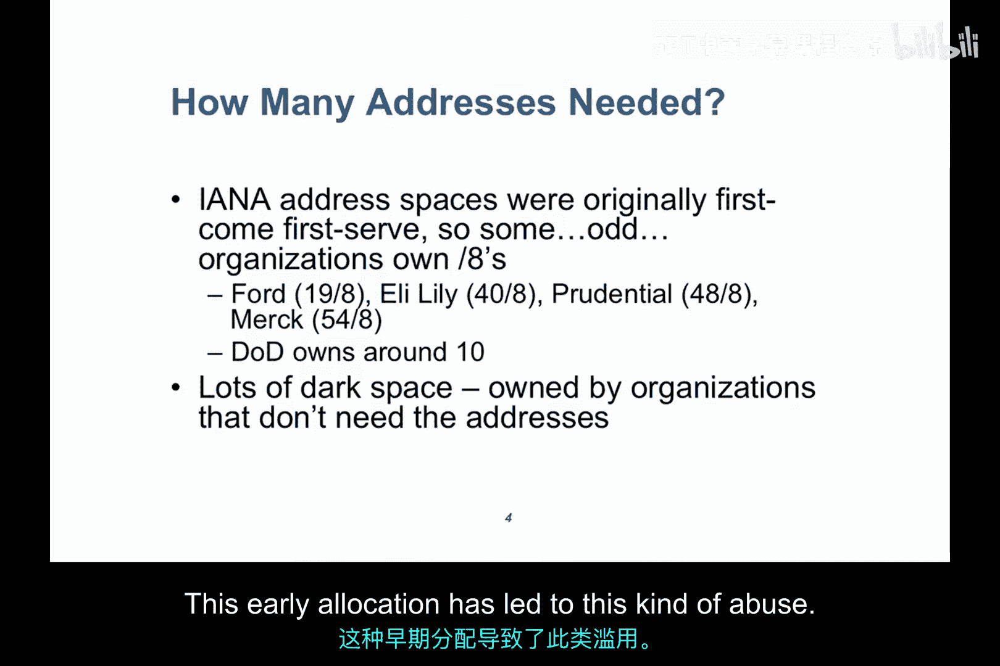

亮。We have adapted to these limits。 The big ones are the cornerstone address juggling services。

 Nat network address translation and DHCP， Okay Nat allows a lot of addresses to sit behind one I address for example。

 most of you have some kind of wireless router of a like in your home or apartment。

 and when you set it up， it set it up so that you could use DHCP addresses。

 All of those addresses are generally in the 192168 network。

 and then you have one public outward facing address allocated to your router by your ISP。

That's what it does from that point is it translates using ports。

 it translates between your internal addresses and the communications to the outside world。

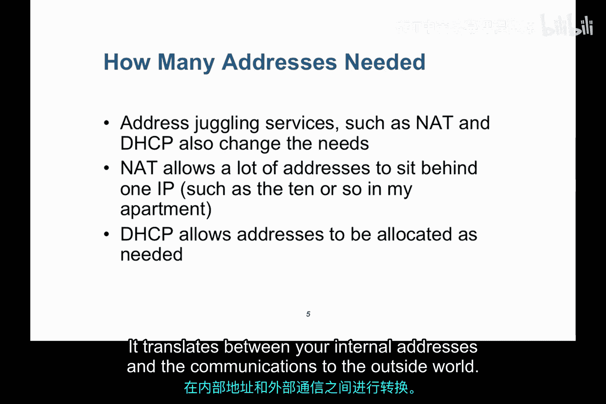

Now。😡，IPV6 IPV6 was designed to overcome flaws that we discovered in IPV4 now IPV6 the ideas started flowing around 1992 so the errors the errors with flaws we were're seeing were flaws that were apparent in 1992 and you know the most obvious one was we are going to run out of addresses so。

IPV6 adds a lot more address space。 The other big thing that IPV6 does is it reduces the overhead on the router recall the whole fragmentation business that we talked about earlier in this module IPV6 generally does not do fragmentation or anything of that nature router overhead is reduced as much as possible That said most of the changes that we do see an IPV6 have to do with acommodating the new much larger address space Otherwise things are relatively similar。

 there's a TCP and IPV6 UDP and IPV6， they look and operate basically like their V4 cousins Okay other protocols like DNS include IPV6 and IPV4 functionality within the same protocol DNS uses what they call an a record and IPV4 and a quadruple A record in IPV6。

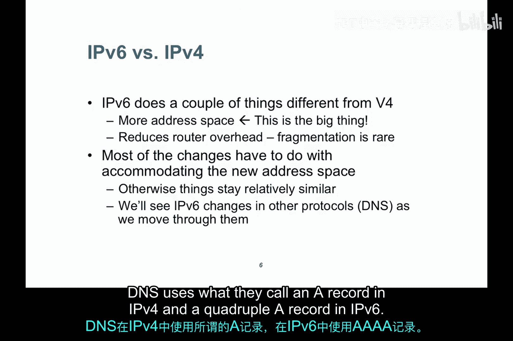

Now。How much bigger？IPV6 dresses are 128 Bs。 This means 3。4 times 10 to the 38 addresses。

 Rly speaking， everyone one on earth right now gets 11 quintillian internets to play with。Okay。

 if we just split it perfectly evenly， that's about what we're getting， so youd have。

 you know a couple of intranets per atom in your body。

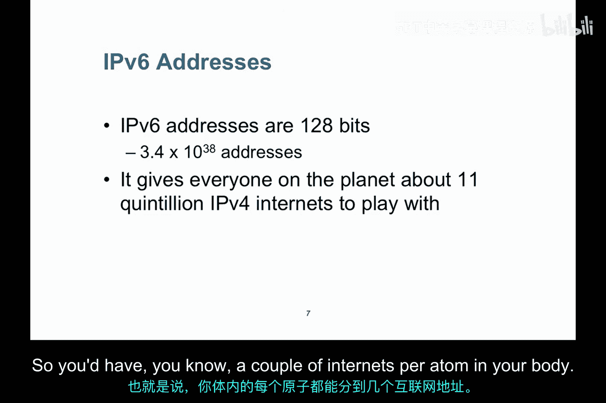

Okay。Actually， that's not true because you have， you know。

 times 10 to the 27th or so Adam it is in your body， so please disregard that statement。

 I'm now a physicist， okay。So the biggest problem with IPV6。in general。

 what we're talking about it is that the addresses are huge and consequ the notational patterns used for IPV。

 The notation used for IPV6 is considerably more complicated than what we use for IPV 4。

 The simplest form of the address is simply to write out full address as8 groups of four hexadecimal digits。

 So for example， though1 I've got here，1111，0， D B 8 and so on。 Okay， now。

Goals generally to get this as compact as possible。

 so the first thing to do is leading zeros are dropped。And you keep it。

 But if you have a group composed of nothing but zeros， you keep that one0 around。 So you can see。

 for example， the second address here， the O DB8 is now down to DB8。

 the four zeros after that is now a0。 but see apart from that colons remain。

Last thing is this double colon notation double colons mean that consecutive groups of zeros are indicated by using two colons。

 so for example my terminal two groups of zeros there are just indicated by those two colons which we fill the rest of this thing with zeros。

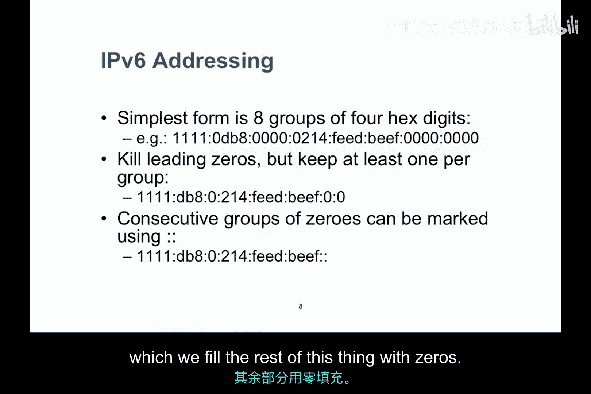

Okay， there are a variety of special addresses in IPV Se。

01 is your loop back address now you'll notice the slashes the same thing as cider blocks before they just get much bigger in this case F00 is reserved for local addresses the FffFF00086 slash 96 that's IPV4 space so literally if you wanted to convert  IPV4 address space to IPV6 you just slap the first 32 you just put the first 32 bits into this okay。

The multi cast addresses are FF00。

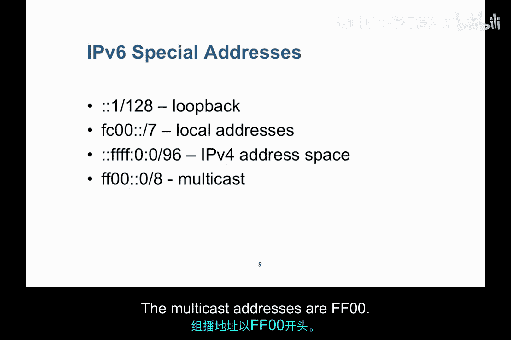

Apart from that。There's a couple of big differences。

 the big one is that IPV6 is completely aware that it has an upsce amount of space to play with。

Consequently， the standard subnet size of IV6 is2 to the 64th bits。

 You really don't deal with anything smaller than that because there's no point。

 This has been an issue in IPV 4 where we talk about going down to slash 27 and slash 28 in the routing and it makes things messy。

 much easier to do it this way。 The other thing is that fragmentation is generally handled at the beginning of a session using path discovery。

 You send a packet to find the smallest MT you on the route and you remain there。 Now。

 the important thing to know， this is an observation that came out after using IPV4 a lot。

 That generally remain static within session。 and consequently path discovery can work because you can pretty much guarantee that for the duration of your session。

 you're not going to be shifting around。

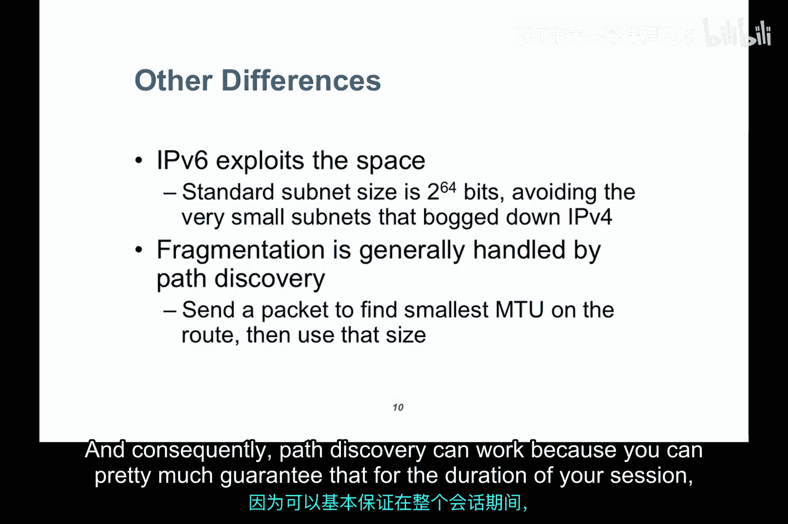

Now， let's talk a bit about IPV6 insec， the first thing is to ask does it actually make us secure？

There are some attacks that are effectively pointless， scanning。

 which is a backbone and extremely annoying feature of IPV4 traffic。

 doesn't really work in IPV6 space because the number of house thrilleds of the number of addresses is so minuscuable。

On the other hand， IPV6 is based around the idea of giving everything a permanent IPpedtris。

 That's not how we use the Internet now。 And a lot of this has to do with the fact that IPV6's concepts are old and the Internet is a rapidly moving target。

 IPV6 was around before wireless it was around before CNs。

 and it was before what we would think of as the modern Internet。Consequently。

Featured IPV stresses are features basically produce a bigger IPV4 and flaws that we've encountered in IPV4 since then aren't really addressed。

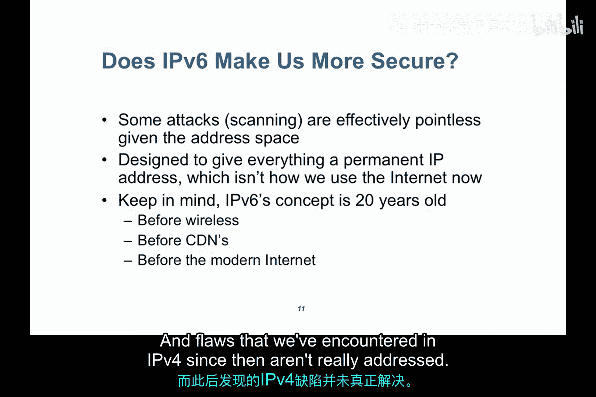

Now。As for the adoption of IPV6， this is a very piecemeal effort， It's sort of gal lump thing along。

 And over your lifetime， you will see it become more and more common。

 IPV6 is basically adopted on an ISP by ISP basis。 And the reason for that is because they're what deal with addresses。

 So for example， Comcast rolled out IPV6 support last year。 AT& T has had it for several years。

 IPV6 in terms of software support is available on all modern OSss OSX Windows。

 all of them have IPV6 built Most services of the Internet supported natively。

 you can use Google at IPV6 without any trouble。A lot of networks that are created from scratch。

 so research networks networks in other countries tend to be IPV6。

 This is especially true in countries where there is no IPV4 left My expected pace for this thing will be adopted。

 Asia is going to be first because Asia has the least IPV4 space Europe sort of moving east to west Eastern Europe same problem is Asia IPV4 space is ex is rare and expensive The US。

Sort of trailing because there's not as much of an impetus for it in the US on the other and because we own all the old IPV4 state。

 there's just not as much of a need for it， but you are seeing organizations like Google make an aggressive V6 push。

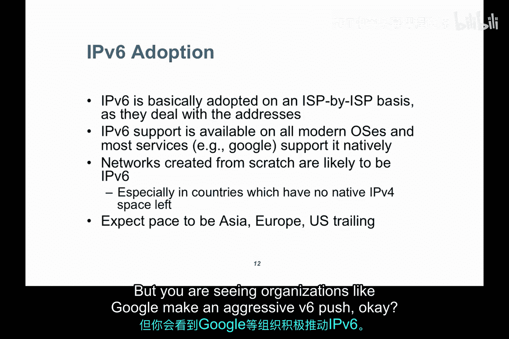

Okay。And this gets the idea of transition right now what we have is we have V6 and V4 networks communicating with each other and there are a pile of protocols for doing this the way these generally work is their tunneling protocols which means that somewhere there's a gateway between the V6 and the V4 network。

 the address as well no or it's part of your configuration for using this protocol and when you want to go from your V4 network to your V6 network you go through the gateway that converts your V4 packet into a V6 packet。

 it encodes the V4 address as a V6 address and that encoding sends it back through the gateway when it needs to go from V6 to V4。

Okay， the major names to know there's a six to four protocol， there's a six and four。

 there's a four and six， and there's torredo， which is named us a boring worm。

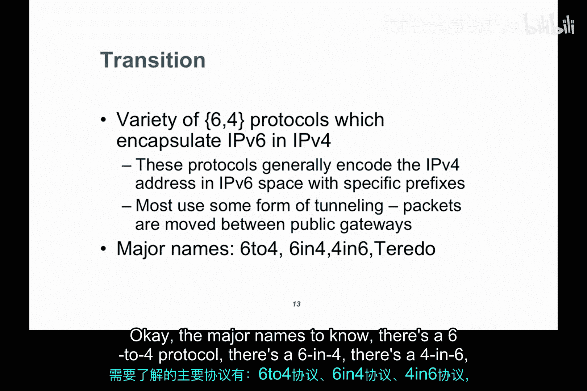

Okay。So things to keep in mind， first off。IPV6 addresses the problem of addressing exhaustion。

 That was its cornerstone。 It's going to provide you with a much larger address space。

 which leads to new notation， much larger representations of these spaces。

 The other thing to keep in mind is that this is an ongoing and messy process。

 Several factors are going to complicate it。 The allocation of IPV4。

 means that different organizations have different impetuses or how fast they want to move to V6。

 The other thing to keep in mind is that you would do have these transition technologies。

 which effectively introduce a new class of VPN。 You see this weird tunnel traffic。

 moving back and forth， which is V6 traffic in your V4 network and verifies it。

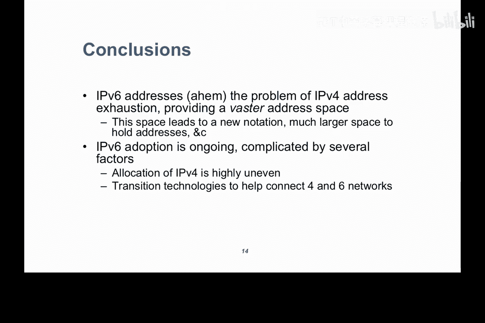