# 约翰霍普金斯大学《信息保障分析｜Information Assurance Analysis》中英字幕 p46 26_安全区域数据采集工具.zh_en -BV1Qz8EzYENX_p46-

This is 695-741。Moduule 2， lecture Saturn。In this module。

 we're going to cover enclave data collection。

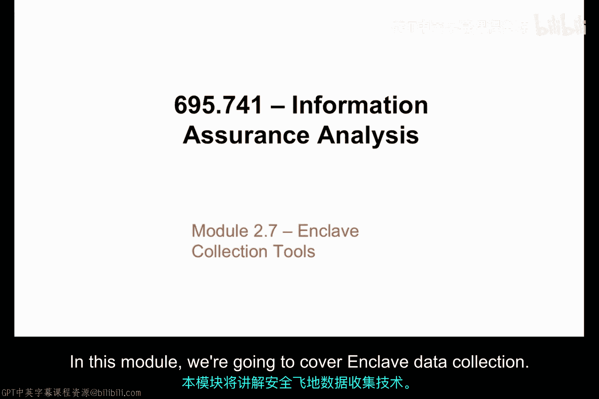

After this module， you'll be able to explain enclave level data collection。

 purpose and its limitation， and also explain the use of the verkeley packet filter。BPS。

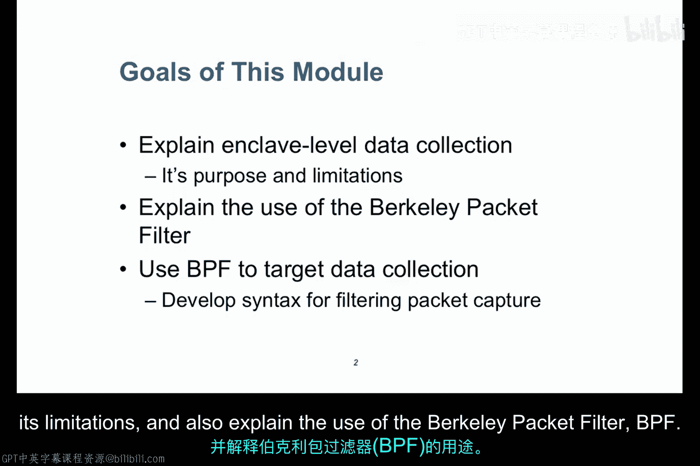

You'll also be able to use BPPF to target data collection and filter previously gathered data。

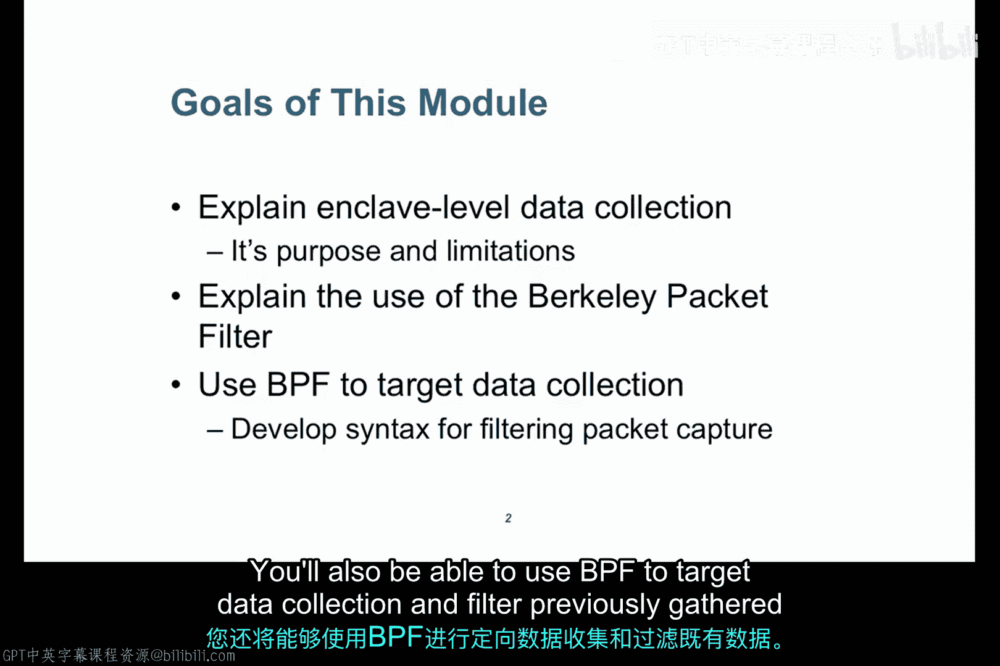

So before we hop into how to collect data， we need to first talk about your advantage。

We can break data collection into two major families based on where you decide to put your sensors。

Rooututer based and enclave based here we're going to cover our encve based and another lecture we cover router based。

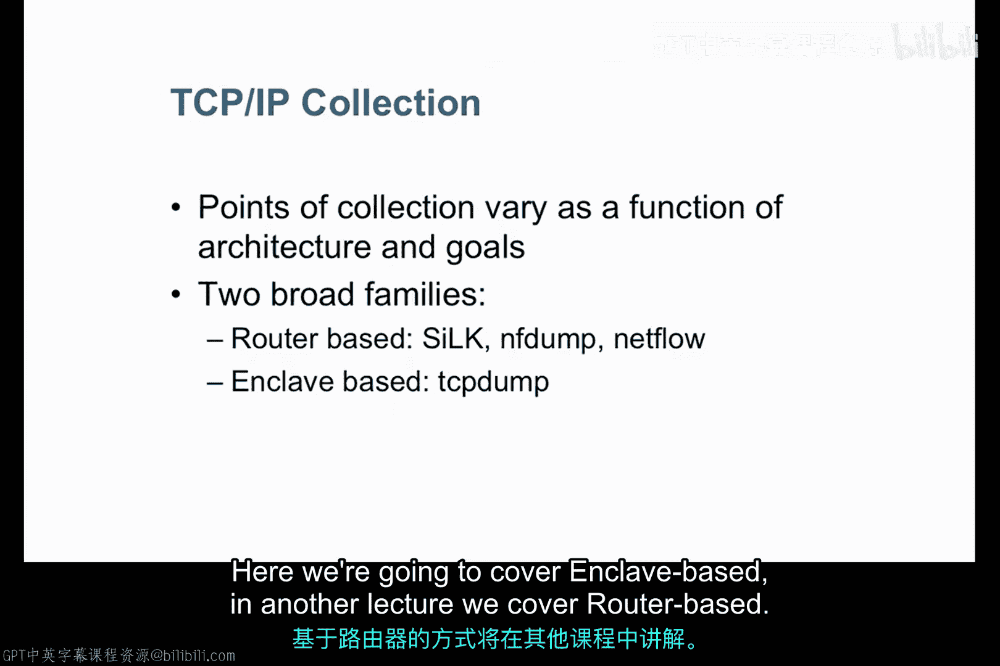

They more specific。When we are talking about an Han ways。

 we really mean it what we really mean as a network that has a clear distinction between internal and external space。

For instance， she your home network an army base or a corporate headquarters could be considered around enclaves。

 There is an obvious line that can be drawn between those things that reside within the enclave and the Internet as a whole。

So you can somewhat say that you are working with a known universal systems that you're trying to protect within an uncle。

I say somewhat here because as you will generally see， most of the time。

 people don't know their networks as well as they think they do。

Good example of this is most people don't realize that every single one of their printers is also functioning as an internal web server。

One of the most striking differences between an enclave and a router based collection is that in the enclave。

 you get to see more of what the individual host does， but less traffic overall。

You're seeing all of the hosts local traffic as well as his traffic that he's sending out to the internet。

 but you're not seeing all the traffic for every other enclaade that's also communicating across the routers that are above this encla。

In the enclave were less hindered by network address translation also。

Network addressous translation is， in some cases very big hindrance because then you can't really even figure out the exactg number of posts that you're truly dealing with。

Basically， you've got a device that's hiding all of them behind a particular IP address。

But at the enclave level， you get to see exactly what the host is doing and how they do it。

Since we are dealing with small a number of total hosts。

We have more flexibility about what traffic we keep。

Where you have to deal with summarizing activity at the router level because there's just so much of it here we're going to be able to at least attempt to record nons traffic data。

We can actually try and record on a per packet button。

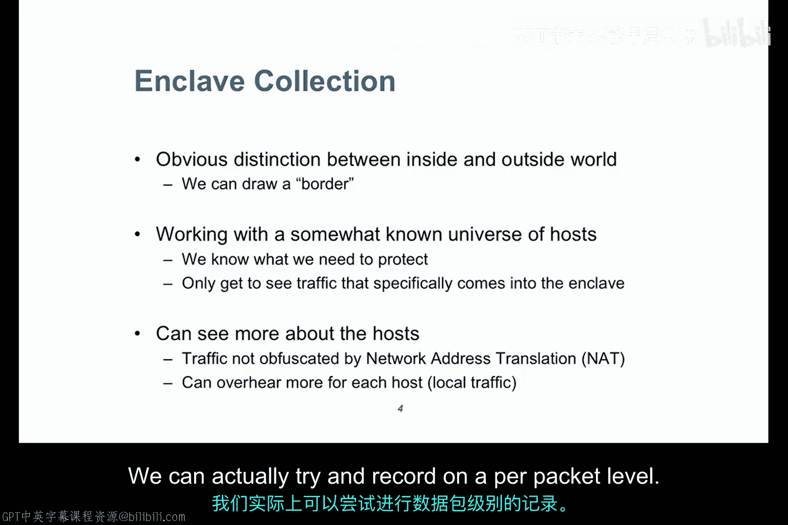

Towards that end， let's talk about how traffic gets in and out of the uncles For simplicity。

 let's assume that our enclave is on a single hub。We have a， if we have a large network。

 we can simply assume that we have collection set up on every hub and still get roughly the same results。

So Ethernet and most layer two protocols are broadcast programs。

If everything is implemented correctly。Whenever a host。Sends traffic to the hub。

 That hub will send it to the router， but it also has a tendency of just broadcasting tall to host around that are also connected to that hub。

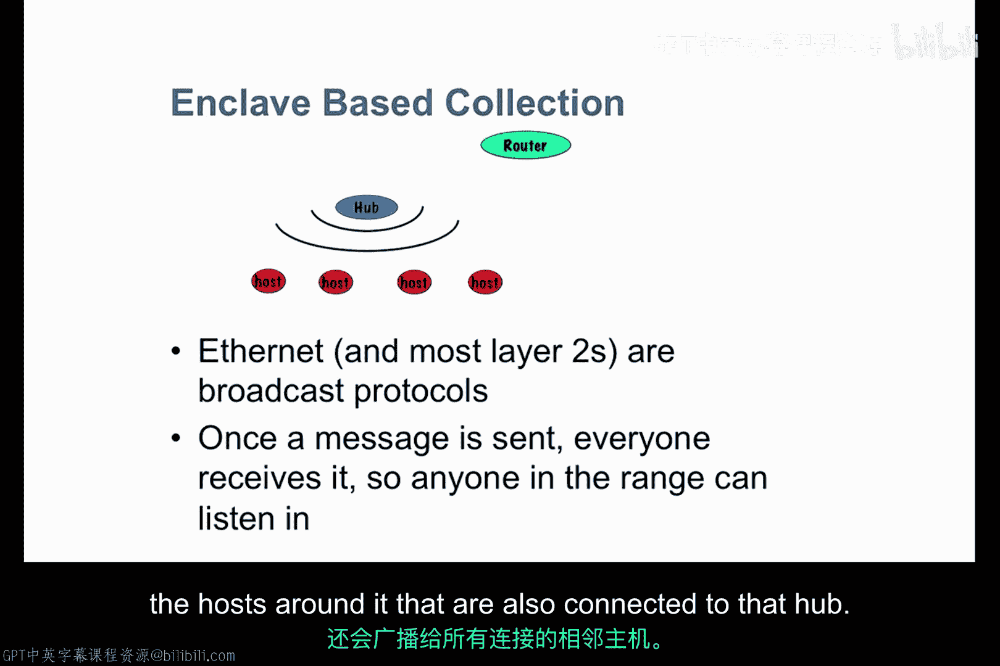

Now let's assume one of those hosts。And the previous slide was set up as a sensor。

That is recording traffic。There are two ways a host can most promiscuously。A non proously。

In promiscuous mode， a host listens to everything heard from the hub。

This has the advantage of overhearing other host traffic。 This has the disadvantage of。

Having be having to run your sensor and promiscuous mode。

 which requires root level access to the machine。If you don't have root level access or you just want to examine traffic that's going to a particular host。

 you can use non forestuous。And this does all the filtering that you normally see where the host itself is not going to actually be listening to all the traffic。

 but only to the traffic that is specifically addressed to it。

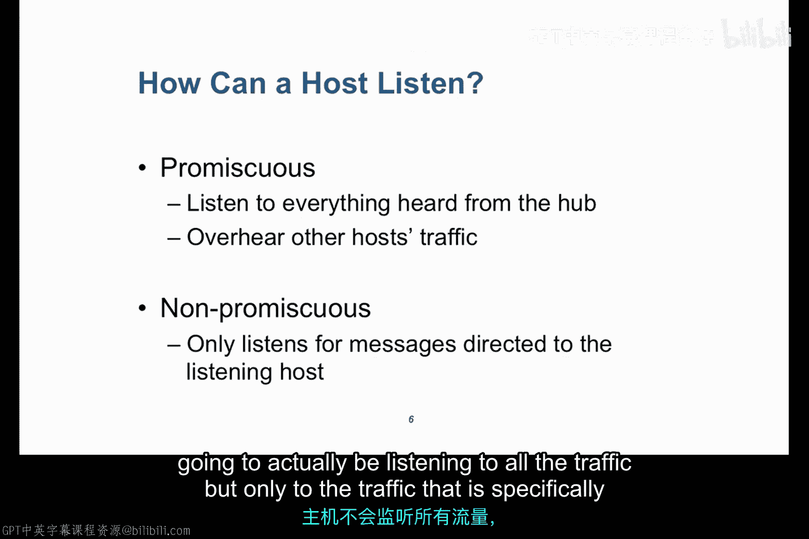

So that's enough about the brought over。Let's get to some actual tools There are two tools that we are going to keep coming back to in this class TCP dump and Warchar both pretty much do the same thing they both are collection analysis tools that will allow you to save network traffic into a binary file format they will also allow you to do filtering and other operations on the traffic。

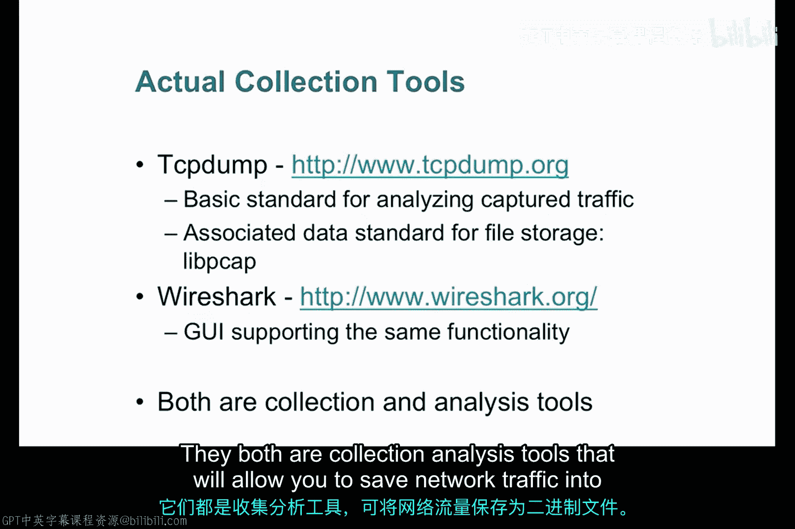

The difference is that wire shark is slick little gooey interface and it's available on a variety of different platformsid。

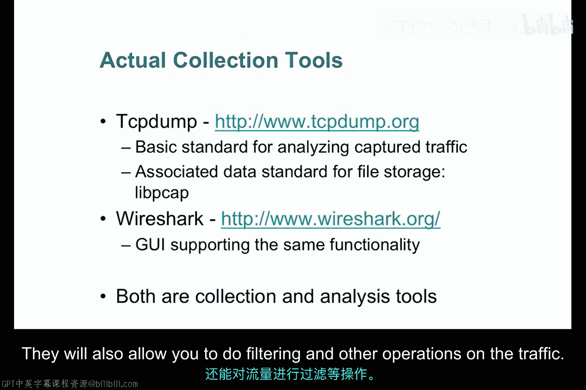

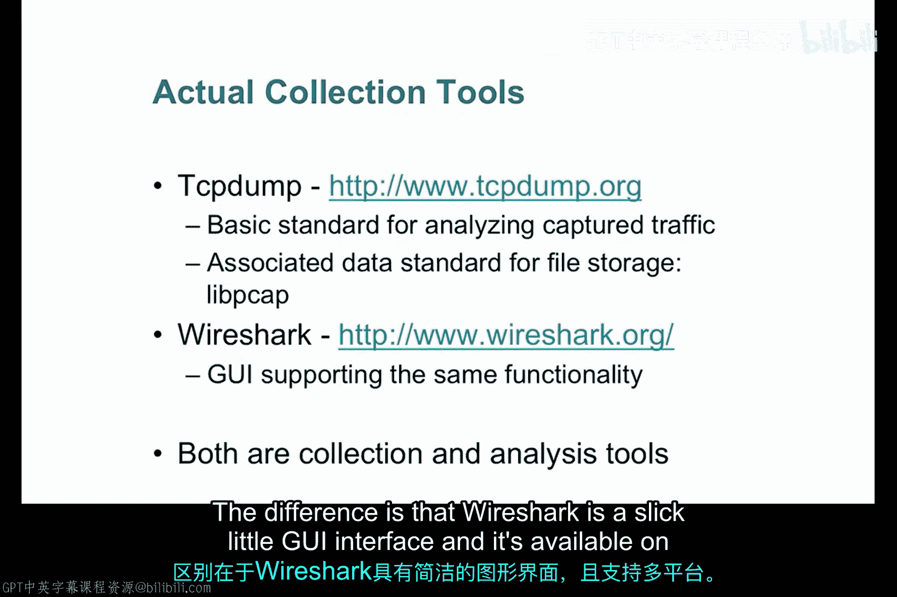

So going to start off TCB dump collection， just quick， quick look into it。

 It's a command line tool for Unix environment， and it's got a couple of really important options that I wanted to go over very quickly。

 First one is dash， which allows you to put ASI output to screen。 Now。

 this being said you can actually start reporting traffic and just dump it directly to the screen and take a look at what's what's going on。

You also have the dash eye， which allows you to specify the interface。

 Every here who has a laptop probably realizes that you've got。

About three or four interfaces available to you， so being able to specify which one we're actually interested in is of utmost importance。

There's also the DW for writingri file。

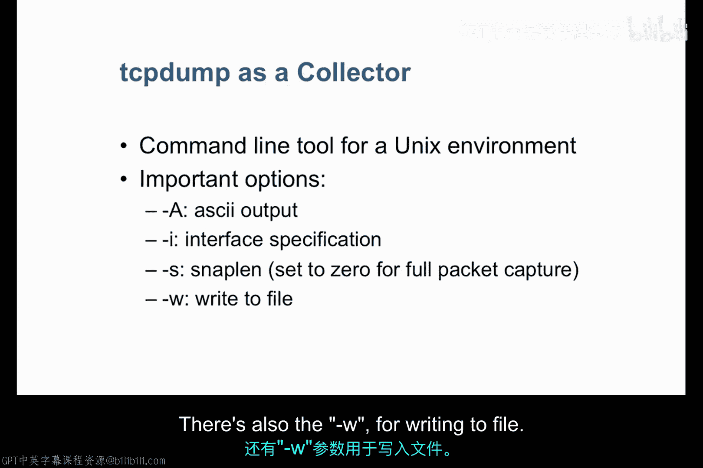

Wire short is， as I said before， a goI tool that easy easy to use one thing that I would caution you about is to make sure that you。

runun it with sufficient privilege to select the interfaces that you want to use and select those interfaces in such a way that they can be run a promiscuous mode。

This is the one thing that。It is not as obvious to people that the program needs to run in promiscous mode or it has to be configured to run some of its subprosses and promisccuuous and all to entirely property。

A lot of this is actually covered in a documentation that's provided at the website listed here。

 I'm not going to spend much time on it because there's a multitude of YouTube videos available to it as well as several documents on the website that tell you everything that you will ever need to know about the tool itself。

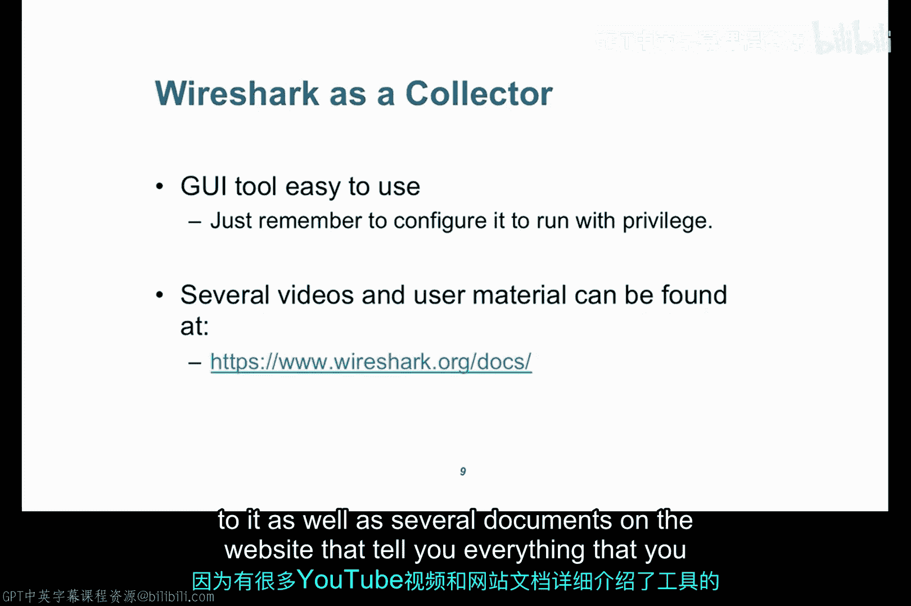

Now into filtering silences。One of the most important operations that an analyst will perform is F turn traffic。

MePS。Is basically an interface for data link layers to the data link layer。

It allows you to send and receive packets。And it's a very interesting tool that's available in E。

Or when most people talk about BPF， they're not necessarily talking about that tool by itself。

 but more the filtering capability。And that filtering capability is available in a variety of different tools and also。

Both Windows and UniX have APIs that support it。Those would be the Pap and wind Pap for units and windows respectively。

Whenever you're using TCP dump， you're going to have the ability to use DPF and also the syntax for wirereshark is quite similar as well。

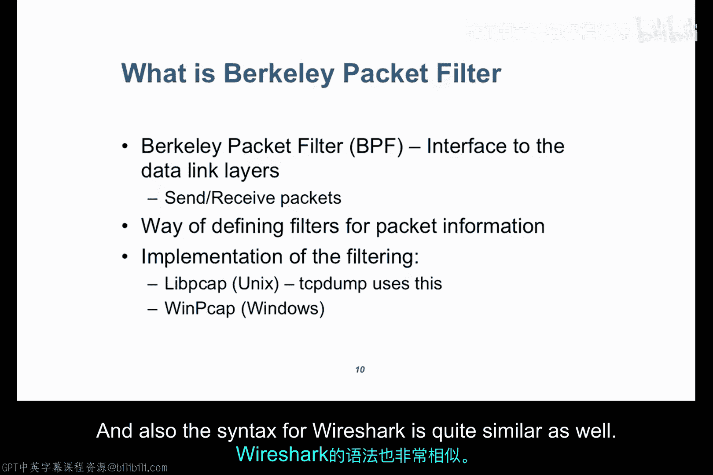

So let's get into the basics of that syntax as most primitive level。

 BF lets you analyze records from an array such as an IP， E3F or TCP。

Basically what it does is it chunks it up into the various fields that you saw in the datagrams from the previous lectures in this model。

So。If you've got IP open bracket9， closed bracket， it's saying that it's looking for the。

Value that's in the ninth。Spot in the array。Couning from010。And in this particular case。

 that's going to be protocol。And what's going to be in there is， not a written out version of it。

 but the actual number。That that's associated with it。

 so it's going to be that value between 0 and 256。If we've got a value of six。

 then that's going to that's going to be TCP， we've got a value of 17， that's going to be UDP。

It includes a lot of primitives their shortcuts to specific sections of the array。嗯。You can actually。

You can actually specify a specific value such as host or proto。

 and it will actually give you protocol。

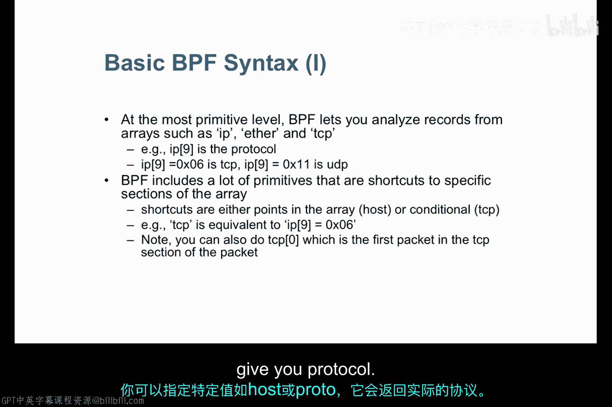

Arays have a range notation。So if you do TCP2， colon2。

 it's going to give you two bytes starting from an offset of two。

Into the particular datagram you're talking about in the case of TCP， that would be Dport。

 where if you did zero coal on2， that would be the first two bytes in the datagram period。

 and that would be the source port。Interesting feature about D PF is that it allows you to actually do comparisons。

 so you've got equals greater than less than not equal。You can manipulate values。

And combine together different fields and then compare those results to any sort of static value you want。

And use that filter whether or not you even keep a packet that you're collect。

You also have the ability to。Stitch together a lot of conditionals together with the。Apersign。

 ampersine。那。Ppe pipe or not。Kword now Eerson Amstein says an so that's going to be a logical hand。

 the orar is going to be a logical oar and not is a logical negation， obviously。

So with this very simple set of preserve keywords here。

 we're able to put together some very complex filters to determine whether or not we're going to keep specific traffic or display it if it's something that's already captured。

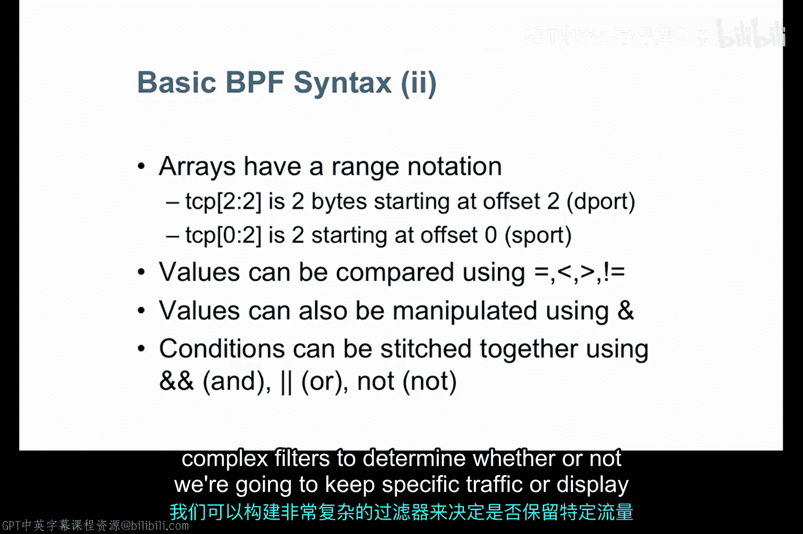

So another thing about this is that addresses can be filtered using the host name or IP dress。

 you can also use subnets whenever you're looking at things so you can say things like www。ia。

com sourcehost 192。168。1。1。11。11 and。That's worth thing。

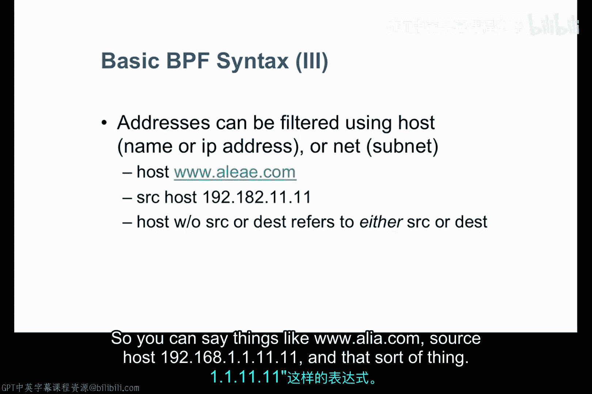

So here are some examples of BPF statements。So you can say。A host。Alia。com and port FTP or FTP data。

Now， what this translates into is that it's going to say if I resolve。

The Soer destinationation IP address。And I get back， Alia D Com。It's going to return true。And。If I。

Look up the port number。And either of the port numbers are FTP choose port 21。Or FTP data。

 which is port 20。If either of those are true， then， it returns true for that as well。

So if both hearts of this， the host name and the port name come back as true。The record while cap。

If we want to actually， let's say we want to look for。ICMP records。

 there's two ways we've got listed to do here if we say I1 I0 equals1。

That means that it is indeed going to be IP it is going to be ICmpP track。

 or we could simply just say ICMP and it translates that into the appropriate thing。

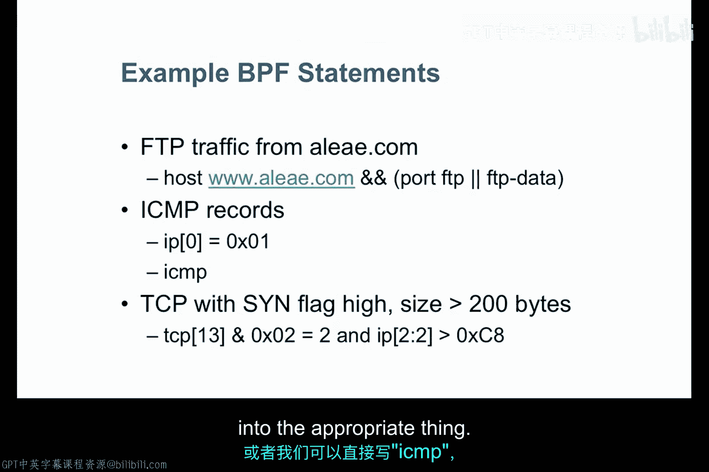

Now， in conclusion， collecting traffic at the enclave is fundamentally different from collecting at the route。

We have more knowledge of the individual hosts and what their local traffic looks like。

And we can overhear different things than we hear at the router。Ie the local track。

At the enclave there are well established tools available for free you got TCB Do you've got wirere Shark and there are quite a few others。

 these are just the two that we prefer in this class。

BPF provides a flexible means for us to actually filter a traffic in both of these tools。

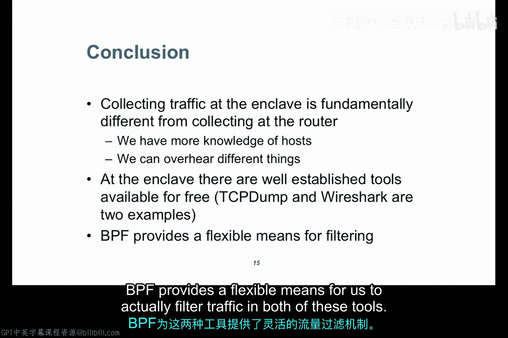