# 约翰霍普金斯大学《信息保障分析｜Information Assurance Analysis》中英字幕 p47 27_路由器流量采集工具.zh_en -BV1Qz8EzYENX_p47-

This is 695-741， module 2， lecture 8。

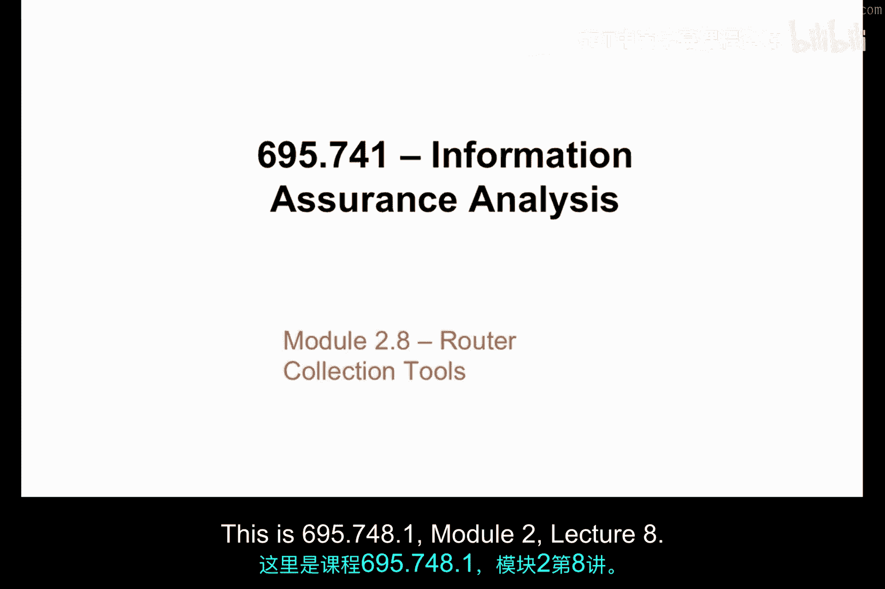

In this lecture， we're going to cover router collection of tools。By the end of this lecture。

 you'll be able to explain router level data collection， purpose， limitation。

You' also be able to explain a flow record， how it's constructed and what that actually represents。

 and you'll also be able to describe the So tool suite。

 what various tools comprise the suite and how it's actually used。

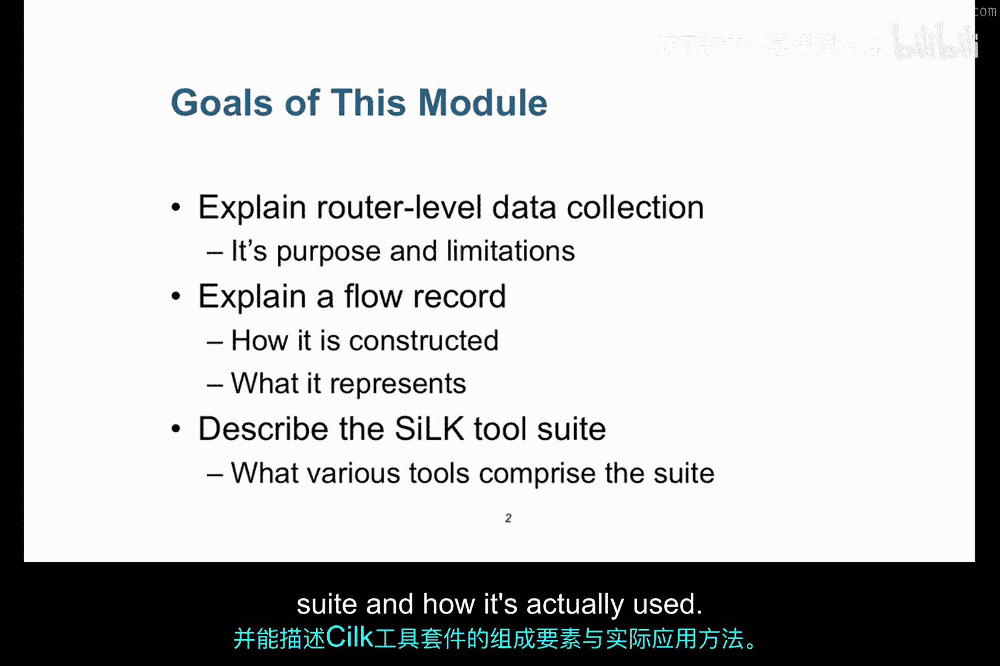

As mentioned in lecture 2。7， our vantage point says a lot about。

A datata collection strategy if you're in the enclave。

 you have access to local traffic and have fewer hosts that you are looking at。

If you are bra at the router level， for instance， as an ISP。

 you don't have access to local traffic and will likely see a much larger volume of traffic because you're going to be seeing all the traffic that's transiting the router itself。

 not just the stuff that's local to the enclaves。

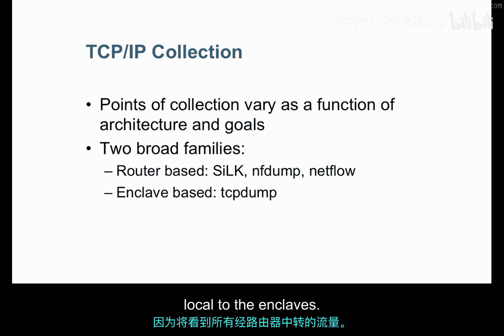

So consider this imagech， we have three hosts in a large network where we have multiple routers。

 let's assume that the owner of the enclaves don't want to let us collect traffic on their enclaves。

This is much more realistic than he might think， for example。

 you don't let Hawks collect traffic inside your home network。

 at least most of us would prefer that they didn't。

And most businesses don't want them collecting traffic in their networks either。

So instead of trying to get traffic from the enclaves， we can instrument our routers。

 They are perfect for this task。 They see everything that passes through them。

 The only problem is that if they， that they can't really duplicate every bit of traffic that they see。

 it's just too cumbersome of a task and it's too intensive for them。

Not their primary function or be reporting to us is their primary function to be around in traffic。

There's just too much traffic to just try and duplicate all of it。 So instead。

 they can summarize flow is a common summary used to。

So the result of having somearies of traffic goes from one enclave to the other。

Looks something like this， so we've got one host that actually is communicating out through one router and goes across two more to get to a host that's in some separate enclave。

This is great for actually detecting enclave to enclave traffic。However。

 completely blind if there's stuff going on with it in that angle。 again， you know， I can track。

Aside from this shortcoming， there's also a chance that your。

 your instrumentation will give you redundant flow information。 for instance。

 we instrument every single router here all three of these routers that the packet transits。

Will all see the same thing。Now， if we actually had some sort of strategy put in place to sort of limit the art put better sensing strategy in place where。

Not all the traffic transits， all three of them are if it is translating all three that it's just brought that it's not reported that could actually help us mitigate some of these circumstances。

 Also， understanding your actual infrastructure is key to keeping you from doing something foolish in this pilgrim place and actually。

Reporting arbitrarily insd numbers just because you accidentally saw some three times。

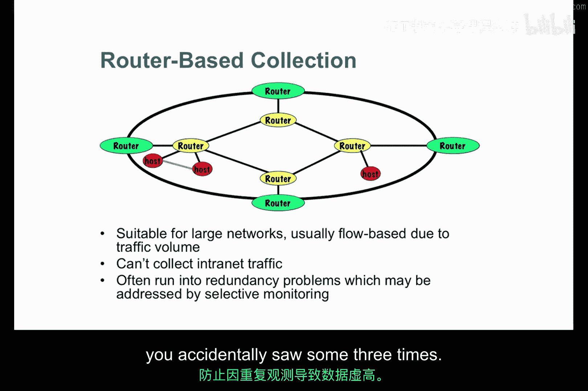

So I mentioned flow as summary on the last slide。Now in this course。

 we're going to focus on net flow specifically。Net flowlow is a unidirectional summary of packets that share a common 5 too。

That common 5 tuple is sourceur and destination address， sourceur and destination port， protocol。

So all packets that share that are going to be grouped together。

Each of those packets that each each so it starts constructing a record where it starts grouping together all of these packets that share the the same common source destination port。

 address and protocol。And it's counting up the number of bikes， packets。

 start time when it saw that first packet and the duration for how long the session actually goes on。

And in the case of net flow， specifically with silk， we store an oe of all the flags that you see。

So if you've got three way hishake and session still ongoing。

 you're going to have S and A in that flags field because。First a packet had a send。

 second packet had a send act and third packet had an act， so you ore those together。

 you get send and act bit set。Now what silkk does is it tries to actually follow its snatch to the protocol。

 so if we see a reset， if we see a f， we're going to start tearing down in session。We also。We also。

Try and time out sessions that are going on for exceedingly long。

There's two timeouts that you' got to be that you've got to contract yourself with first off。

 we have a TCP timeout which basically is going to be a shorter time frame。

 but we try and mimic the about the time frame that if that it has so if we don't see any packets for a set amount of time。

We just assume that the connection dot and we just write out the record， completely finished。

There's also a time out in here， where。If some session is going on for an exceedingly long period。

We'll just close down the session， write out the record。 We'll close down the record， write it out。

 And then the next time we see a packet， we'll just open out a new new record and start recording more information about it。

 The reason why I bring this up is it will make it to where if you've got exceedingly long sessions。

You're going to have multiple flow records that must be rolledd together in order to get a complete picture of what's going on。

The reason why we do that is。Take for instance， SSH， you can have an SSH session opened up for weeks。

If somebody has an SSH session opened up for weeks。

 I don't want to wait until they close the SSH session before they either report anything to me。

 I just assume get some information on it as it's going oh。

So this timeout allows me to do that because I can be guaranteed that at some point in the near future。

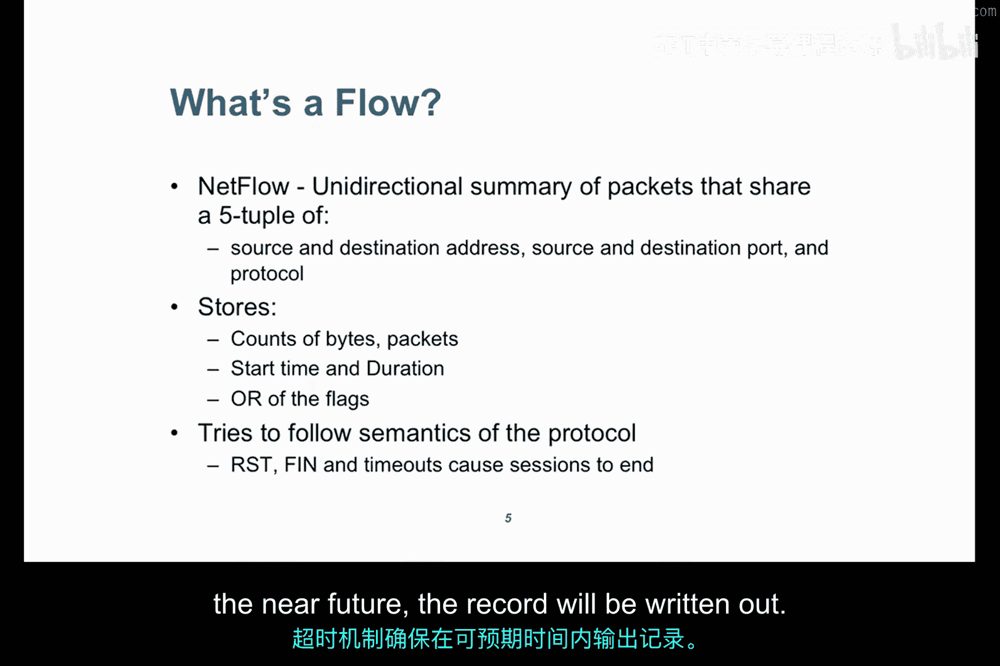

The record will be written out。So。Here's an example of some Neflow output。

Here I am not displaying all the shield available， but enough for you to get the gist of what flow looks like。

In this case， we have pipe delimited output of a town at session。

Real thing that I wanted to point out to people is that both directions。

 each direction has its own record。I said that so at the beginning， it's yield direction。

So anytime you're actually trying to figure out a full session。

 you're at least going to be dealing with two distinct records。

 one for the client communicating to the server and the other one for the server communicating back to the client。

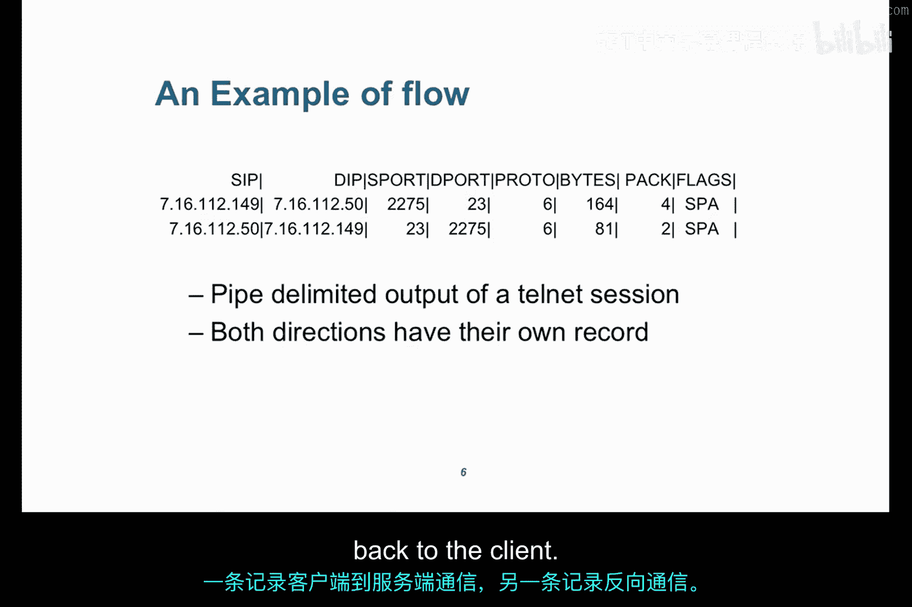

So simple enough to see what's going on in that session。

It is a really nice way for finding out who talked to who at what time for how long。What ports。

 how much information was transferred？However， there are some problems with it， I mean。

 in this particular case， with net flow and wherever you get up to the router level。

 you're going to be dealing with so much volume that it's it's inheable to really。

Maintain all of the payload like you did in the aclave。

 so no payloads available whatsoever with flow。Another thing is flows are an approximation of a TCP behavior I mean so so you've got things like ICMP and UDP。

 which we try and roll those together as we try and roll UDP together as much as possible aggregating together everything that we can for a stream。

But it doesn't necessarily。It's not exactly。Ideal。No thing is ICmp we don't you'll notice that there wasn't any type any any type or code shield in that TCP record there。

 the way that we do this and the way that we actually represent the type code is we take。

The typing code and we overload the destination port field and basically encode it there。

Where the high order bits at the type and the lower order bits of the coat。That might be reversed。

 but regardless， it's all encoded within that destination port， and it's in the documentation silk。

Also timing information is a little course， it's not as buyinggrained as you'd like it。

 you don't get you don't get any information about packet inner packet arrival times。

 you only get when it started， when it end， that's it。

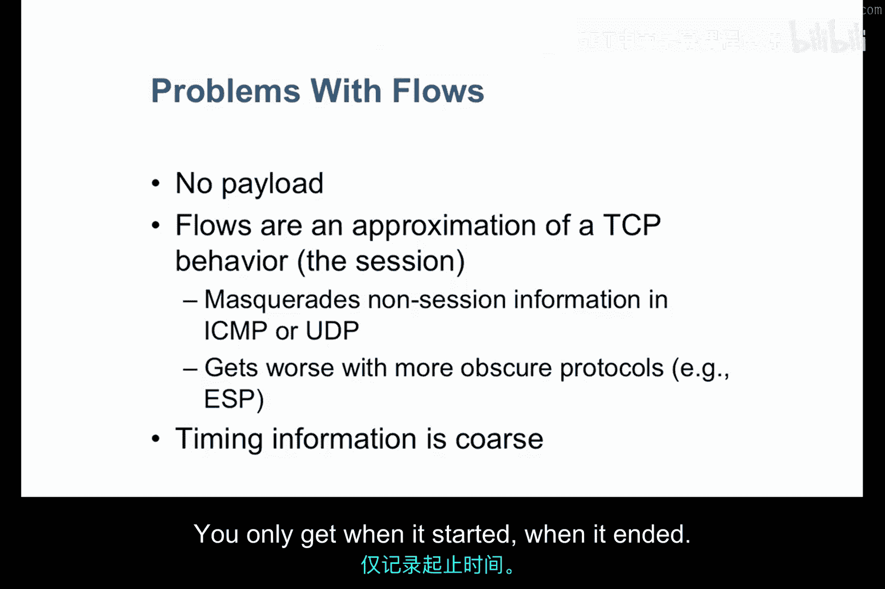

So。As I said before， for most part of course， we're going to be using silk for flow analysis。

 the URLs provided here for the actual tool suite itself。

 it's a relatively complicated suite of tools for analyzing flow data。

 its the important thing about it that you need to know right now is that it works is both a collection and an analysis tool suite it collects data and organizes it into its own repository and then you can access that repository via a set of silk tools。

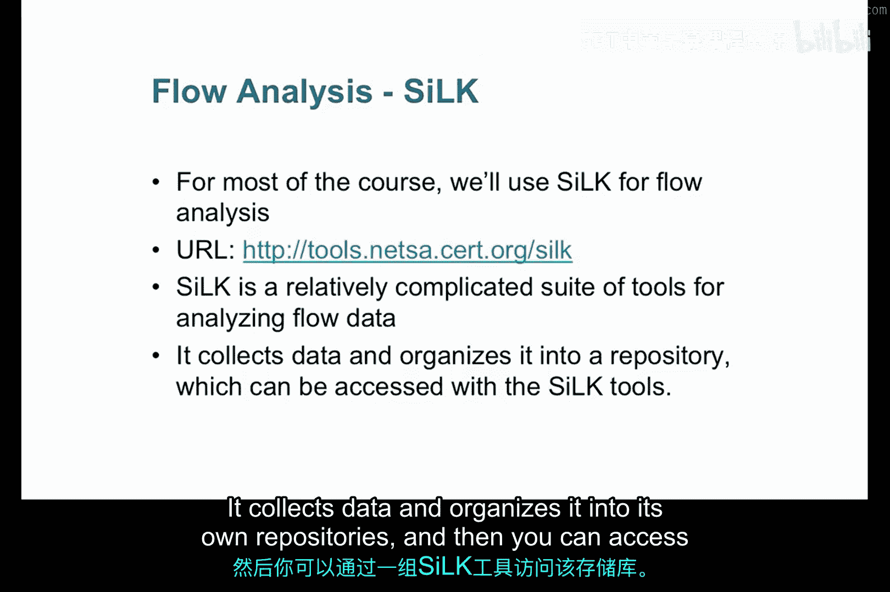

Okay， so here are some of the tools in the suite itself。

Now note that the list is very reduced from the total set of tools。

 but these are the ones that immediately pop out to most silky users whenever they're asked about the T suite itself。

RW She is a selection tool and it allows you to select records from the repository and also filter down to a specific。

Characteristics and records set you why。RW cut allows you to read silk format files as ASI text I mean you just it reads in the silk file and it outputs ASI text it's exactly what I use to actually put up that that。

Text that you saw earlier in the eflow example。RW count allows you to summarize data。

 it's really intended to be a time series sort of system。

 it basically allows you to specify any timeframe， bin up the data。

 count bys packets and flows over the time it's a really nice simple tool。

Need to put that directly into Excel works great。RW unique aggregates。

An arbitrary set of fields together， so you can say， okay。

 I'm interested Aaronon this IP this how many bytes came from these IP addresses and it'll aggregate based on source and destination IP address that allowed you to put together any field combination you want you can say how many bytes were transferred from this IP to this IP you know it'll just be that would just be source and destination IP address。

 aggregate those together and I'll give you a list of how many bytes packets bull flows。Had。

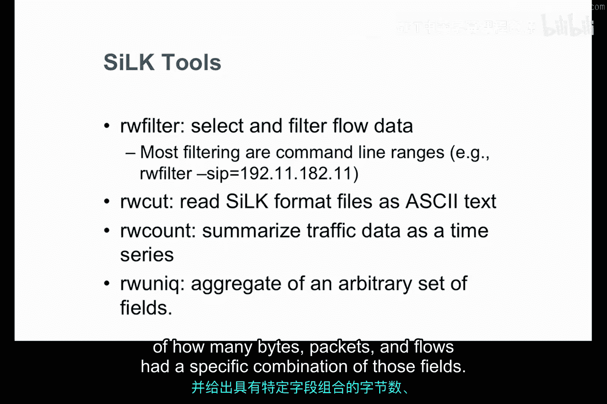

A specific combination of those fields。

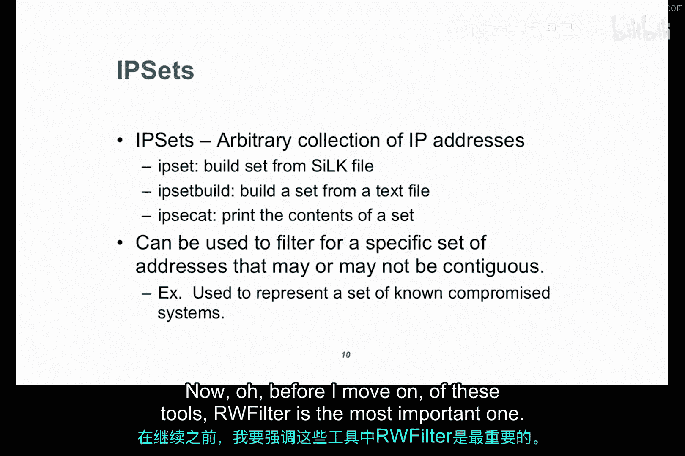

No， oh， before I move on。Of these tools， RW filter is the most important one。

 it not only allows you to filter data， but it is your access point into the repository of collected data。

Therefore， a majority of the time you're going to start your analysis， actually。

 I'd hazard to say all of the time that you're using silk， you're going to start your analyses by。

First， running in art every filter。

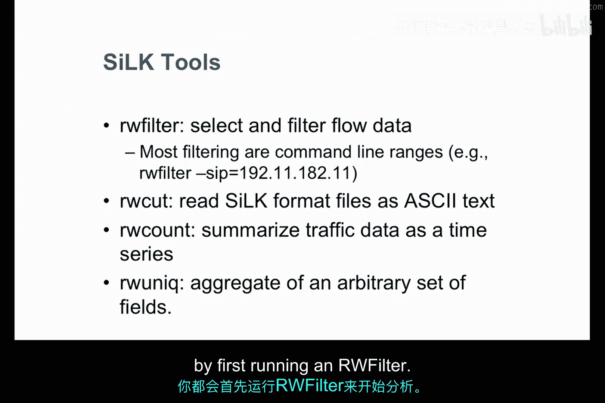

So。Another thing that's very important about this is one of the most important aspects of these tools。

And one that people miss at first is the IP set。IPSa is awesome。

IPC are basically arbitrary collection of IP addresses。

You've got three tools that allow you to work with them and you can use RW set to build set files from silkk files。

 you can use RW set build to build set files from ASCU files and RW set CA to actually prove the contents of a set。

Now， the。At first， blush people generally like， okay， why， why do you care so much about those。

 They can be used filter for a specific set of addresses that may are notty contiguous。

 You're not just dealing with cider blocks。 You can deal with any number of addresses。

 And a great example of how this is useful is let's say we filter out and we find a set of potentiallyly infected。

what hosts that are completely compromised， I can automatically put that into a set。

And silter to get just those dyes。Just as easily as if I wanted to plug in a single IP address。

 yet back the results for a single IP address， but I can do it for arbitrary algorithm hosts。

 all represented in a nice little compact binary representation， very efficiently done。

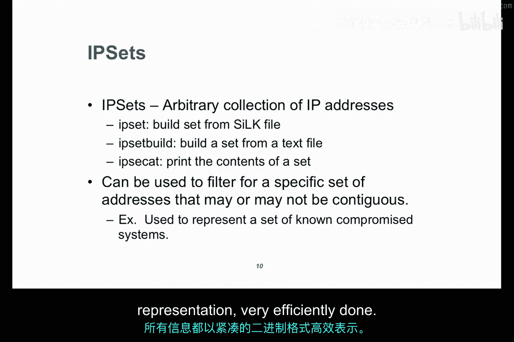

So in conclusion， routing level collection gives you what transits from one enclave to the other。

Typically， summary information。For this class， we will use Sil toolol suiteite processed netflow date。

 and it's a very robust， very well put together system。That is。

That has some features that are very useful at the levels we're going to be talking about。

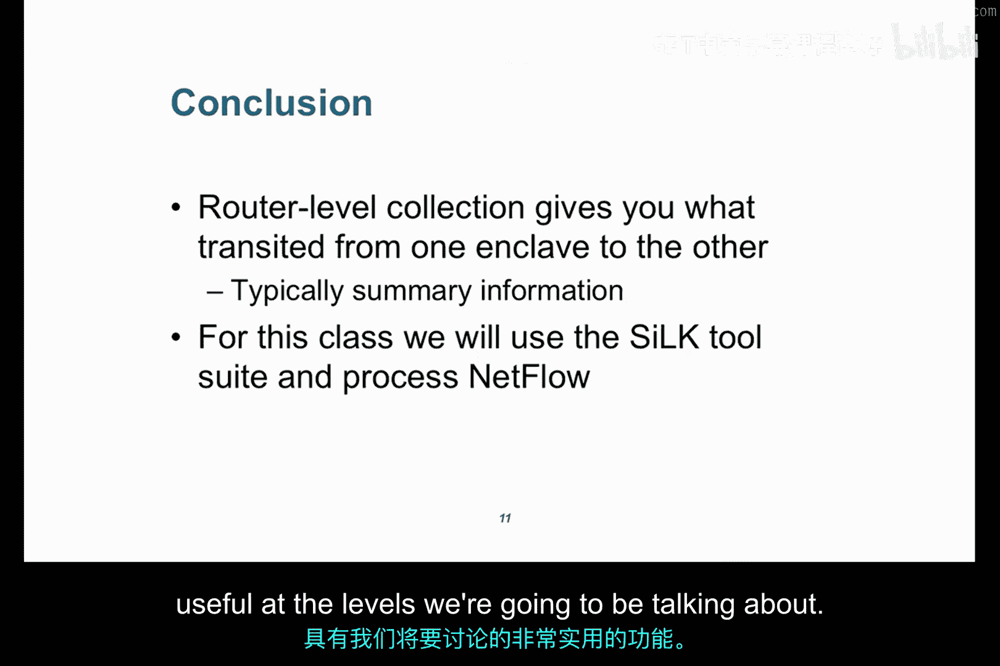