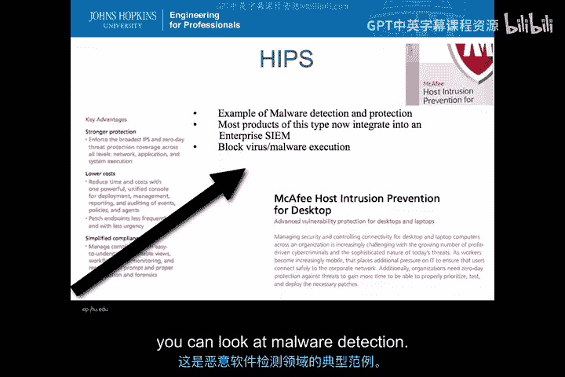
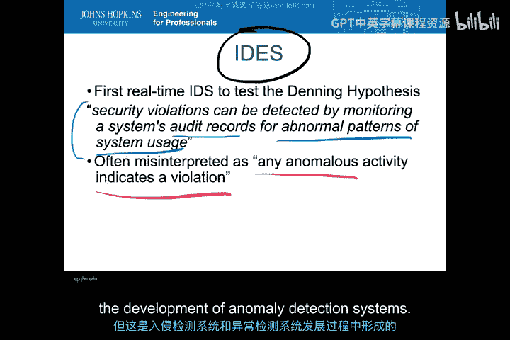
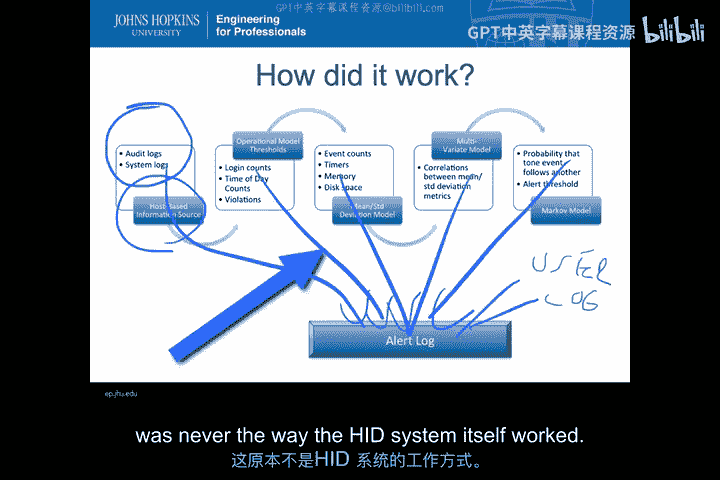
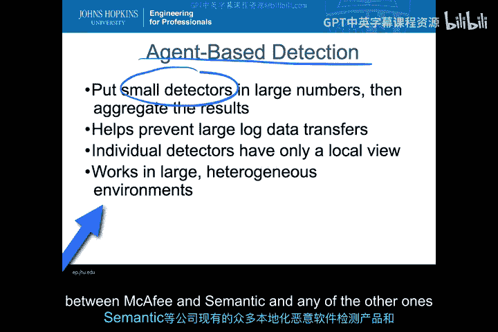
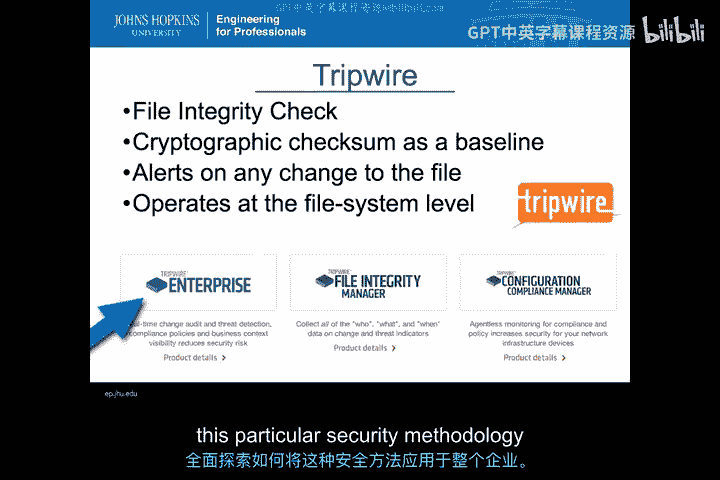
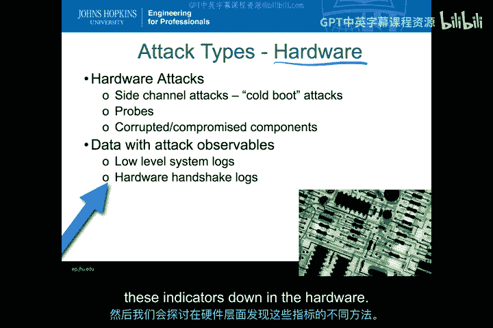
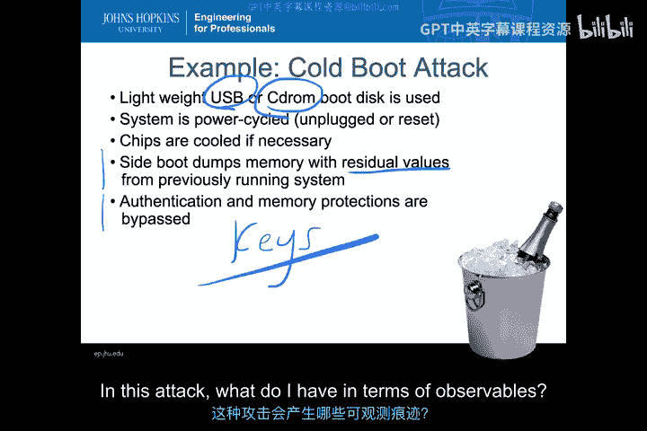
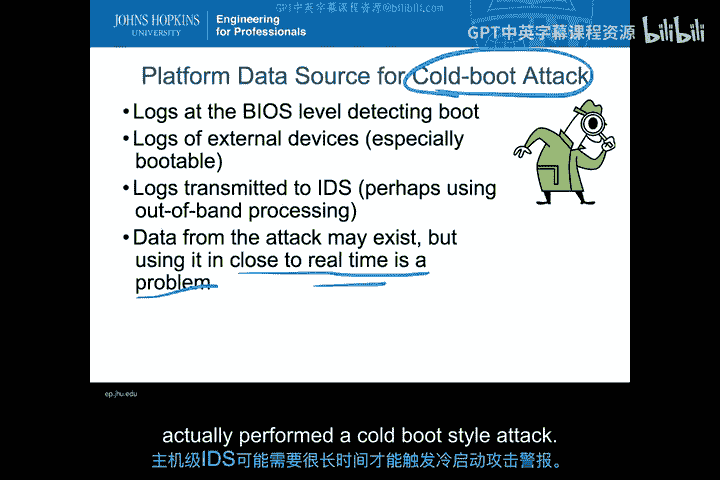
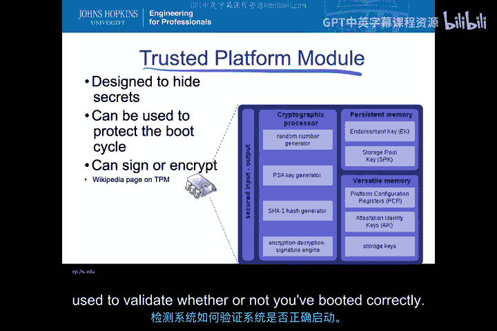
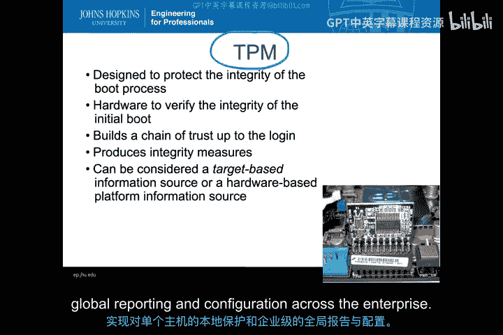

# 约翰霍普金斯大学《入侵检测｜Intrusion Detection》中英字幕 - P10：9_HIDS类型与典型系统.zh_en - GPT中英字幕课程资源 - BV1sGu1z5E2J

So building on the last video that we watched in module3。

 I want to begin to talk a little bit about some examples of the HiIDS types that we might run across in the common literature today and sort of how they work with regard to the platform information sources that we talked about。

 the different types of alerting and what they're looking for and some of the options that we have today。

So the first example that I want to talk about is within the hips category。

 this is the example of a malware detection type of hips that has't there。

 there are many of them out there there's a number that you can take a look at directly yourself。

 but I'll use the MacAfee hobased intrusion detection as one of the examples that you'll probably run into at some point with regard to a hobased hips that's sort of out here this is an example of malware detection and detection and protection like many other products in this space。

Anything that's going to be commercially viable， no longer runs just as a virus checker on a single host。

 but almost all of them now include some sort of integration into an enterprise security incident event management system these are systems thatll take all of the information that comes out of these different hosts and present them in sort of a common format to the enterprise itself on the host。

 however， we're still able to block individual virus and malware execution。

 So you're not required to make a round trip to some sort of centralized Is in order for this host-based intrusger detection to actually work So I pulled a couple of the things directly off of the website and the data sheet to give you some sort of an overview description of what this host intrusion prevention system actually sort of does the whole idea is that you want to have some kind of threat protection that crosses the boundary between host and network the way that the。

If the system does that of course， is by looking at all of the individual network activity from applications that run on the host and they can sort of enforce this idea of any sort of changes that are happening within the system obviously they're going to have cost and compliance issues that are sort of here really out of scope for what I'm talking about here。

 but the important part of this system beyond just virus checking is that it does allow you to look for signature-based systems。

 understand a little bit about the behavior of applications and lock down a host from a centralized location to update the configurations and pull back alerts that sort of happen out there so this is a good example of that entire space where you can look at malware detection。

For the idea of the interactive attack types， this is the type where I'm looking for specific behavior in the audit logs。

 I really want to go back and talk a little bit more about some of the original Is。

 the ID the intrusion detection system that was created out of Sri way back at the beginning of this because most systems are based on a very similar kind of element of looking at host intrusion detection This of course。

 is based on the denning hypothesis which I quote down in terms of the next quote that's here。

 the whole idea that security violations can be detected by monitoring a systems audit records So audit records of the key here looking for abnormal patterns of system usage which means this is not a signaturebased system This is a system that's going to do some kind of anomaly detection in order to try to find zeroday attacks or attacks that are not have not previously been seen So that's why this。

Dtting hypothesis is often interpreted as sort of this idea of any anomalous activity indicates a violation。

 which of course is not at all what the denning hypothesis says。

 but that's kind of what it's been translated to as a result of both IIDs and the development of anomaly detection systems。

So the way IDs work was it basically started with this whole collection of audit logs and system logs。

 This is your hostbased information source。 So this is the streaming logs that are coming both from the system level and auditing also within the operating system level。

 You could also get some application logs here But back in the eye in the NDs days。

 You didn't get much in the way of application logs。

 So all of these were basically fed into this kind of operational model threshold。

 So this took statistical variations of the audit logs and system logs and just took like counts and time of day and looked for direct rule-based violations。

 This was a first pass through the audit data。 These violations and the raw data were moved into a mean in a standard deviation model。

 This was the first place where you began to say what's a normal event count。

 What's normal amount of memory， What's a normal amount of diskgra that would be indicated here on these system logs。

If I have some sort of a deviation in this， then I'm going to actually alert。

This would actually feed now into this sort of multivariate model looking at correlations between these metrics that I had here and the rules that I had in the operational threshold metrics。

 So this was actually a fusion type that ran inside ofnds that looked at all the different alerts that were generated so far and attempted to do some correlation This was actually used to feed into a Markov model to identify whether the probabilities that these particular elements of an attack would come together would go past some kind of an alerting threshold within the Markov model。

 We're going to talk a lot more about Markov models and the idea of the classifier in future modules。

 but understand that the way this particular His worked is that it combined a lot of the sort of rulebased anomaly based Markov modelbased theta fusion and all of this basically fed down into an alert log。

 And from this alert log， you could actually come out。And send this directly to a user。

 or you could take it out to other kind of a new log file。

 or potentially these days you could have actually fed it into some sort of a hips program。

 although that was never the way the ID system itself worked。

Ns and a lot of the modernbased system today， including the Mccafee system we talked about already。

 is really an example of systems that are architected into an agent-based system。

 This says put a whole bunch of small detectors in large numbers and aggregate the results to a central location。

 this doesn't change the fact that you could have local host detection and prevention that actually runs there。

 but rather than try to ship all of the raw data back by just sending the alerts back。

 you don't have really large log file data transfers of the raw data。

 you're instead just sending alerts back from these local agents。

 So these individual detectors only have a local view which is valuable when the subject when the the victim of the attack is a file or some kind of activity that's being contained on that host。

 But if it's a staging attack where they're only cooperating an attack then you might need a more global view。

 So this was the movement of these His。Hip systems to from individual single PCs all the way up to large heterogeneous environments that would come in through some sort of security event manager。

 so the ND system and actually the ones called Emerald that went past that became some of the first agent-based detection systems and those created a lot of the products and services that we actually see now between Mccafee and semantic and any of the other ones that you might take a look at for localized malware detection。

So the other main type that we had talked about a little bit was this whole idea of the integrity checking systems so as an example I took tripwire。

 there's an open source version that's actually easy to install on a VM and you'll be doing that as part of the exercises and assignments in this class and as you should already know by now tripwire is really a file integrity checker at its heart it creates a crypto checksome as a baseline and alert on any changes to the file。

The product， as installed in the open source version。

 comes with a default file that really needs to be modified because it makes a lot of assumptions about what files on a Uniix system might be critical。

 This is only valuable for one particular variant of one particular Unix operating system。

 So by default， the standard system settings that you get probably are not going to be targeted very well to your system and will have to be tailored。

 These operate at the file system level。 So what your naming and tripwire are actually critical files。

 Now， trippwire， like Mccafee， like a lot of the other products that we've talked about so far has moved from the sort of initial file integrity manager that collects all of the data on change and thread indicators locally on the host to an enterprise version that actually moves this audit data up into a common enterprise area。

 and also into a configuration compliance manager。 because once you actually have the crypto checkums if you see changes to those check sums and。

They're the correct changes to come into compliance or patch various files。

 Then you can actually check through tripwi whether your whole configuration is sort of up to date with regard to what the baseline configure should be of critical files。

 So trip wirere in its open source version that you'll be most familiar with。

Basically doesies file integrity checks as a company they certainly have branched out in exactly the same way that other security companies have to cover the gambit of how would I leverage this particular security methodology across an entire enterprise。

So when we're getting down into the other types of intrusion detection systems。

 one of the things that we didn't cover a lot in the previous videos were basically what happens when I've got hardware attacks。

 What happens when I've actually got things that are not processes running directly on my operating system。

 So there's a number of different examples of hardware attacks。 We've got side channel attacks。

 cold boot attacks。 We're going to talk a little bit about those probes on your motherboard。

 corrupted and compromised components， things that are what we would call supply chain attacks。

These do still have attack observables that we can find with aHs。

 And that's the important part about this is just because I have a hardware attack that doesn't go through my traditional software that doesn't mean I don't create observables。

 often these low levelvel system logs and hardware handshake logs can actually contain the observables to some of these other very difficult to detect attacks。

 So we're going to talk a little bit more about this idea of what we're going to do within a cold boot attack。

 and then we'll talk some more about different ways we can find these indicators down in the hardware。

So let's first talk about the cold Bu attack and what the cold Bu attack really is。

So a cold boot attack says that I'm going to use some kind of an external operating system。

 a CDRM or a USB， and I'm going to boot your system up so that your security controls are not in place。

 but my security controls are in place so I'm obviously in order to achieve this。

 I'm going to have to power cycle the system in order to get it to boot off of my element。

 either my USB or my CDRM in order to do that。And then once I've managed to unplug or gi it of your system。

 if I can， I can boot up on my own external operating system。 If I can't。

 I can still cool the chips in order to maintain memory inside of the chips that are on the board itself。

 And then once I've got the chips sufficiently cold so they hold residual values， I can。Basically。

 dump them off by mounting that memory on an external operating system。

 I could pull the chips or pull the board。 So even if I can't boot the entire system using a USB or a C D rom。

 I can side boot the memory chips。 I can bypass any authentication or protections that are there and dump things out of memory。

 So what are the main things I'd want to dump。 Well， keys。

So I could do various kinds of authentication keys。

 I could do all kinds of security relevant data that's normally kept in memory。

 not saved out in disk， and that would allow me to use that information to spoof the user to identify and authenticate to other systems or essentially to violate any of the other security controls that might have been in place。

 So in this attack， what do I have in terms of observables。

So the first thing that I'm going to have in terms of observables is I'm going to have logs right down at the lowest levels of the systems that are detecting boots on the system if I'm booting from a CDRM or USB。

 I'm going to have all kinds of logs that may take place independent of the loading of my operating system that essentially says that I have booted the system but not in the normal way。

I may have other logs out there that actually show that I've booted off an external device or booted or included something within a USB。

 I might have other very lowlevel hardware logs that shows that I've actually had a negotiation down at the level of the hardware in order to boot the device。

 These logs still could be transmitted to the Is using some kind of out of band processing。

 It wouldn't be typical in a normal PC that you have。

 but that doesn't mean that there aren't systems out there that couldn't have some kind of a transmission of cold booting the system。

 Now， this won't really help much if you're tearing the system apart and ripping apart the chips。

 but trying to take a system that isn't actually physically ripped apart and then trying to log。

 log a boot from the other set is certainly possible。 Saly。

 although you may get data from this using it in anything close to real time is going to be a problem most for most systems。

 you won't get those。Lolog files transferred to your central location until the system bootss normally again。

 So if I did some kind of a cold boot attack brought my system down。

Brought it back up on a separate kind of boot， dumped the memory and then rebooted it into the normal system。

 I'm not going to be close to real time。 I'm going to be minutes to hours after the actual attack took place。

 especially if the person， the attacker doing this。

 left the system turned off after the deed was done。 essentially。

 the system won't report anything until it's been turned back on again。

 So it could be a long time before an I D S at the host level could fire that something is actually performed a cold boot style attack。

Another type of integrity checking hips system that actually does protect the boot cycle is this inclusion of the trusted platform module。

 which is a hardware， a chip that sits sort of out on the board on your system that's designed to create the cryptographic keys required to boot your system up from the hardware up through the boot sectors and into the B。

The， the way the trusted platform module is normally used is that it's designed to look first as you power on the board that the。

Bios that you're actually using to select the boot know essentially the boot location of the system is the correct one and sign cryptographically to be a correct set the bios。

 If it isn't， it will simply either choose not to boot or it could send just an integrity measure that is taking cryptographically to a log file and eventually to a central location。

 So in this way you can protect things all the way up into the bio level。

 there are ways within the Tpm that you can chain this type of cryptographic integrity so that once once you verify that the bios is correct and you've used that to boot you can then verify that the boot sectors on the disk are correct once they boot up。

 you can chain that to verify that the other boot sectors coming off of the disk are correct all the way up to in theory。

 at least critical files in the operating system that are loaded right at the time the operating system itself is booting up typically。

In most implementations that we see right now， the TPM is used mostly just protect the lowest levels of the boot cycle。

 but the TPM is available to chain any number of integrity checks all the way through the system and the use of that integrity check information to either block or log the different elements of the boot cycle essentially is what can feed into a hips in order to either block。

Bad software from booting or a bad USB or CdRM used to boot。

 or can at least indicate it to a central location or to the user later on of the single system that the system was not booted properly。

 So the use of a trusted platform module in hardware。

Can get underneath any of the kind of replacements that you might have gotten for the bios。

 any low level boots that you might get from USBs or CD Roms。

 So these are the sorts of very low level hardware support to aHs that can begin to really show how integrity checks and the integrity intrusion detection systems can be used to validate whether or not you've booted correctly。

So in summary here the TPM is really designed to protect the integrity of the boot process。

 the hardware is there to verify the integrity of the initial boot。

 it can build a chain of trust all the way up through to the login potentially it produces integrity measures so that this is the raw material necessary for an integrity- based or target-based IDS。

 so that's why this is considered to be a target-based information source or a hardware- based platform information source。

 when we're talking about reading into the HPS world of an IDS。

So those are some examples of types and different elements of aHs that are actually running within modern systems today。

 there are lots of variations throughout the commercial products that you'll see。

 but as you can tell， most of them either try to get down low into the system and into the hardware and try to leverage what you can get on the TPM。

 or they become more of an agentbased synchronization across an enterprise to allow local protection of the individual hosts and global reporting and configuration across the enterprise。

