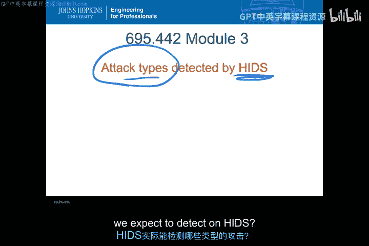
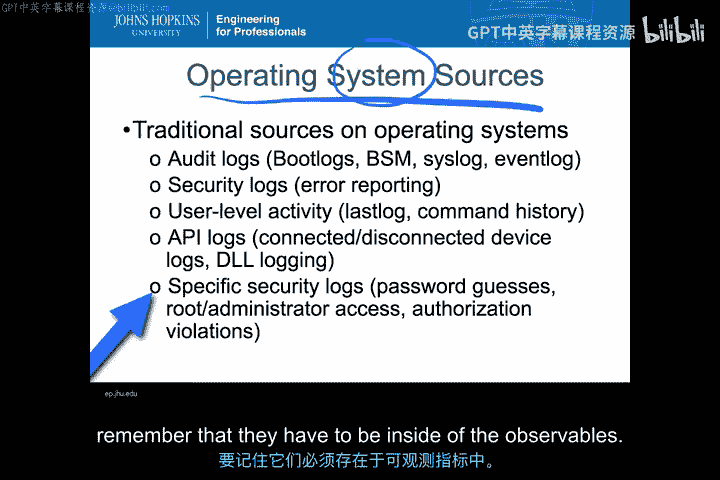
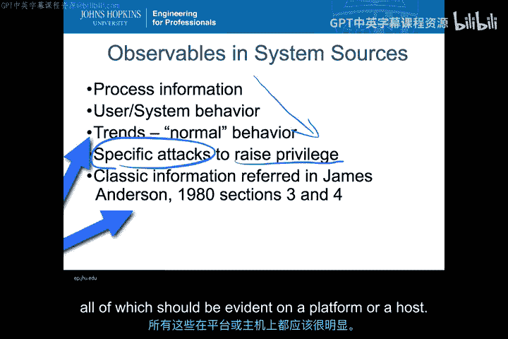
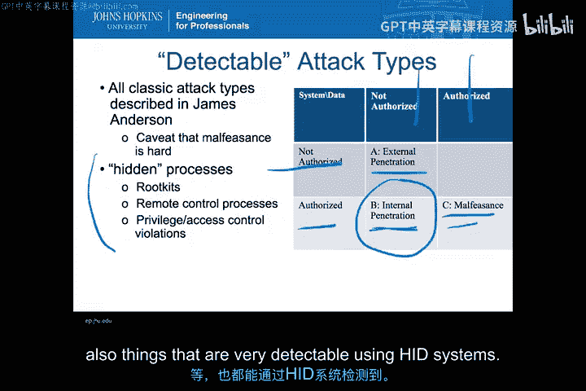
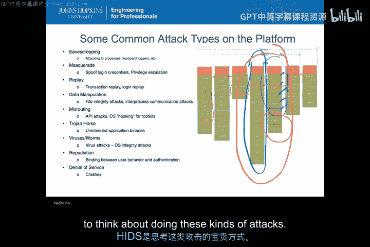

# 约翰霍普金斯大学《入侵检测｜Intrusion Detection》中英字幕 - P11：10_HIDS可检测的攻击类型（第二部分）.zh_en - GPT中英字幕课程资源 - BV1sGu1z5E2J

Okay， in this video for module 3， we're going to actually get into the attack types they can actually be detected by HIDs so we've been through the information that essentially is collected for our heads。

 we've been in through the different types of his you might want to put on your system。

 but now let's get down to what are the real sorts of attacks can we expect to attack on HiIDs。

So to start with， remember that。As with any intrusion detection system。

 if there is no evidence of the attack in an observable， then no Is can actually detect the attack。

 So when we think about the kinds of attacks that can actually be detected by a His。

 you have to start with the sources and think about the operating system sources or the system sources in general that you might want to use。

 So these include， you know， of course， all the traditional audit logs， the security logs。

 the activity and all of the things that you might collect from all the different areas as we talked about previously in terms of putting this together。

 So the specific kinds of attacks that you would detect really are where are the attacks evident inside each of the observables。

 So as we start to talk about the specific attacks。

 remember that they have to be inside of the observables。

So what are the observables that we actually talk about。 Well， first， we've got process information。

 So these are everything having to do with the way the processes， applications。

 everything from down in the kernel up to the application is actually running。

 So what do we mean by process information。 What we mean is sort of the traditional start time stop time amount of memory resources that are used。

 but also who owns the process what did the process open。

 Did it open network connections has it opened file connections， and also directly in the process。

 you can understand things like a system call chain or exactly what kinds of things were called in the course of actually running an application。

 So process information is one very， very rich element in terms of understanding whether any particular program or process is misbehaving And that could be misbehaving because the code in the process is misbehaving like it's malware。

Or the user controlling the process is causing that process to do something it shouldn't do。

 Either way， that information is evident down the process。

 There's also sort of other user and system behavior， things like login times。

Are you logging in at strange hours of the day， Are you starting up unusual programs。

 So unlike individual process information， the user system behavior is more like what kinds of applications do I run when And that sort of behavior creates observables within the system resources。

 Then there's sort of trends， observables in the trends。

 These are even a sort of a higher level element than looking at the user and system behavior。

 These are over time， How does my activity or a user's activity on the computer change。

 What constitutes normal behavior in this kind of area， So these sort of。

 as you can tell from these three， we kind of go from a lower to higher level of abstraction from process information to groups of processes to trends of processes over time。

But then in sort of an addition to that， we've got specific attacks that actually raise privilege。

 So if you remember this， this takes us all the way back to sort of the classic information from James Anderson。

 Now， remember from the James Anderson report， we had the different classes of attacks。

 all of which should be evident on a platform or a host。

So all of the classic attack types that are described in James Anderson should be detectable on hostbased intrusion detection systems。

 all of them leave observables that we would actually want to use the caveat， of course。

 is that as always， malfeasance is a hard problem in general， but all of these。

 you know from the ideas of external penetration， so I'm going to look at vulnerabilities in the system or vulnerabilities that a user is able to exploit in order to increase privileges in order to gain access to information they're not actually supposed to have。

So in the case of internal penetration now we've got the insider threat that's actually you know violating vulnerabilities。

 doing things to raise their privilege， so we're going to see a lot of privilege raising kinds of things that would happen on the host level。

 So this in fact， case B internal penetration is probably characteristic of a lot of the threats that you would end up seeing on the hostbased system Now you could of course have malware that has been downloaded or run and it's running at the behest of some internal user but this is going to look a lot like internal penetration。

 even though you could categorize that as an external penetration since the real perpetrator is outside。

 but the privilege under which it's running is going to be an insider in terms of that in that particular problem。

Of course， malfeasance is always difficult because basically you're getting a user who is doing what they're supposed to do on the system and you are attempting to use that in order to find whether or not they're using that information or processing appropriately。

 but the observables are still available on the host based system。

 even to find malfeance malfeasance， So you want to understand if the processes that the user is running。

 even if they have access appropriate access to them are running in a way that you would want them to run according to policy。

 So as you can see each one of these cases in both the columns， both the rows。

Are going to be really key in the whole HiIDS system that's there。

In addition to sort of the classic things that are happening here。

 a lot of His looks at things like stuff that's normally hidden on the operating system， root kits。

 remote control processes， things that are violating elements that really have nothing to do with an interactive user。

 So even though the most of what Anderson had talked about in the matrix had to do more with interactive intrusions。

 Remember that automated intrusions and things that are there and implanted on the system like root kits and control processes are also things that are very detectable using Hids systems。

So let's bring it all together and talk about the different types of attacks that are going to be evident within the platform。

 So here's a list of different attack types that are here from eavesdropping all the way down to the N of service these are categories。

 at least one set of categories of attacks and within each one of these categories。

 there is a hostbased attack or a hostbased set of observables that can be detected with a His。

 So to start with let's talk about attacking processes。So eavesdropping so attaching to a process。

 trying to look at what's going on in process memory， looking at keyboard loggers。

 all of these kinds of things are hostbased attacks。

 So how would I actually detect these sort of passive eavesdropping attacks using a His Well certainly I would detect the installation of things like the keyboard loggers of the programs and processes that are attaching to other processes So the observables here are going to be in the process observables or in the hardware level observables。

 So if I'm unplugging and plugging things in that should be a logable event and I would see the observables and these attack types on the platform for masquerading attacks remember these are really tough because you're spoofing somebody's login credentials or escalating privileges as somebody else but you still have the observables of having done the login and having done the privilege escalation So both of these happen on the host。

Available for His。 So masquerading attacks on the hosts are also something we're going to pick up。

 Re attacks， Trans and login replays。 These are essentially。

 I've captured some element from the host， and I'm going to replay them。

 We typically think about replay attacks as something that happens on the networks。

 But there's no reason at all。 I couldn't replay data or commands or anything else on a host and have that picked up by a Hs。

 So， again， that attack category has specific attacks that are going to be detectable by the His。

Data manipulation， file integrity。 obviously， these are things that tripwire was all about that we've talked about in a number of ways here。

Misrouting， this is another one that usually is more targeted toward networks。

 but if I'm connecting using an API attack， using something where I'm actually abusing the interface to a program or misrouting what a program loads in terms of DLL or some kind of hook for root kits。

 these are all misrouting the data path within the computer itself。 So this class of attacks。

 although we tend to think about it as a networking attack has a number of attacks that would be available and seen directly on the host。

Tjan horses， obviously these are unintended application binaries。

 a lot of this is what anti malware antivirus is all about， same thing with viruses and worms。

 so in repudiation attacks， these are the binding between user behavior and authentication。

Clearly on the host， we're going to have a lot of the types of attacks of masquerading that would end up being a repudiation style of attack。

 So those are evident and visible on a host。 And， of course， denial of service and crashes。

 We can see crashes on the platform， they're going to be logged。 the reboot's going to be logged。

 So within all of these categories of attacks。 We're going to see examples of things that are absolutely common on host and can be detected by His。

 This is a testament to the strength of what a hits can do because it's so close to the endpoint of the attack。

We can also go back to the original taxonomy that we talked about in module 1 and recognize that within the original target。

These targets all the way down from account to process to data to component。

 all the way down and into computer are all talking about host based targets。

 So every one of these actions applied to targets from account process。

 data component and computer can all be seen and detected on the host that really only leaves two categories network and interconnect that you wouldn't normally see directly on the host in terms of host observables。

 So all of the rest of this taxonomy and all of the different ways that you can thread from one through elements down through something else through scan as long as they're hitting one of these targets that's on the host。

To increase access to challenge， any one of these threads is going to be observable within this sort of event target area。

 this action target area。 and most of these targets that we've talked about are host based targets。

 So this is why， again， the His is such a valuable way to think about doing these kinds of attacks。

