# 约翰霍普金斯大学《入侵检测｜Intrusion Detection》中英字幕 - P12：11_导论.zh_en - GPT中英字幕课程资源 - BV1sGu1z5E2J

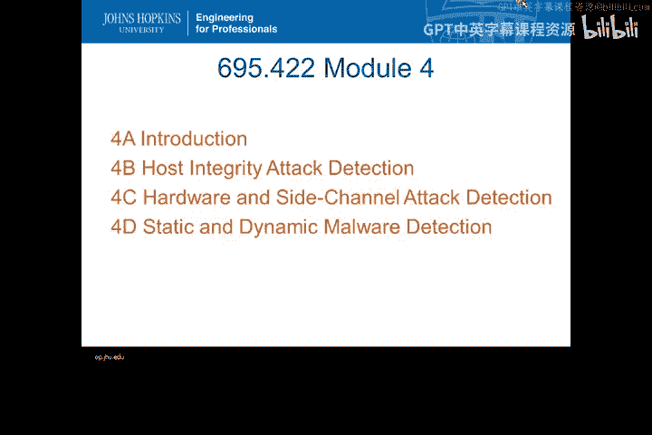

🎼Hi， I am Philip Ching。I am doing an introduction for you in module 3 and module 4。

 we focus on host intrusion detection system。

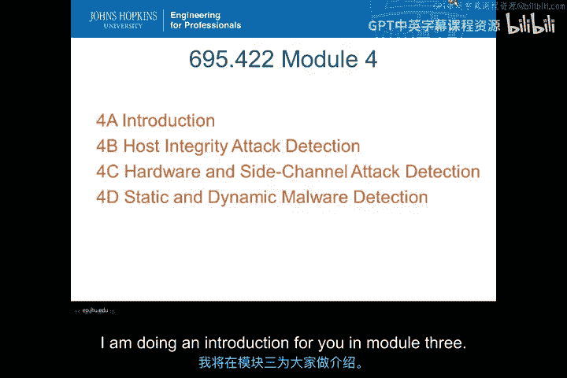

🎼Or Hs。🎼In module 3， Tong has presented layers of platform information。

 and there are associated threats and vulnerabilities that can be detected by different types of H IDs。

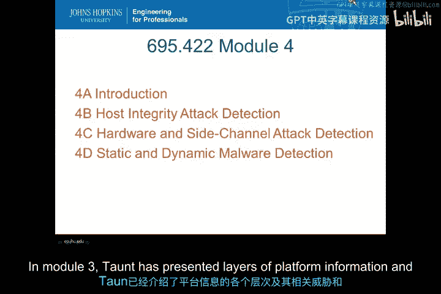

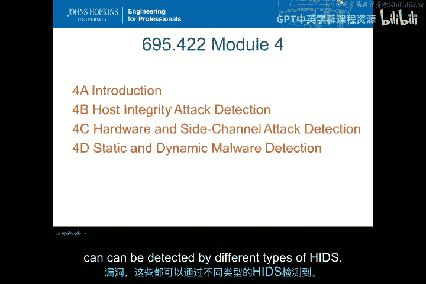

Note。🎼When we say platform， we usually mean the underlying operating system。

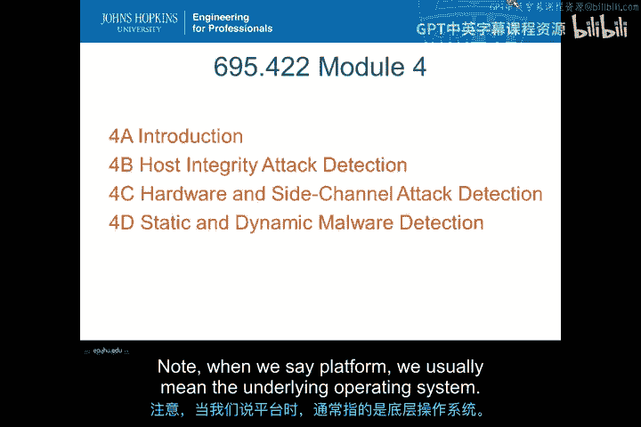

🎼In this module 4， Toang would present more information on different type of detections。

The main topics are。Host integrity attack detection。🎼Hardware and side channel attack detection。

🎼Static and dynamic malware detection。

And the host integrity attack detection， we should discuss the following topics。

Target based monitoring。Lot kit。Detection。Data integrity host integrity， monitoring and detection。

🎼And two integrity models。

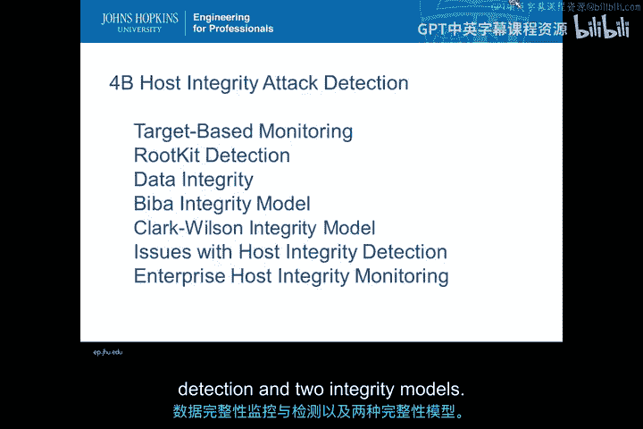

🎼You may have heard of this concept， in other occasions。

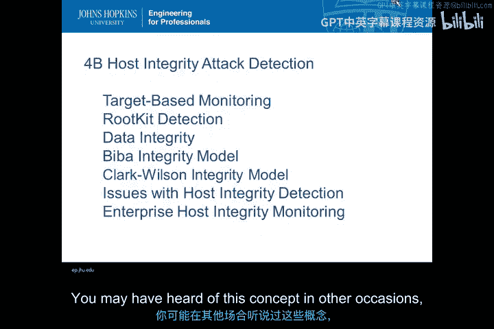

🎼But you can notice that we repeatedly use the words integrity。🎼And detection。

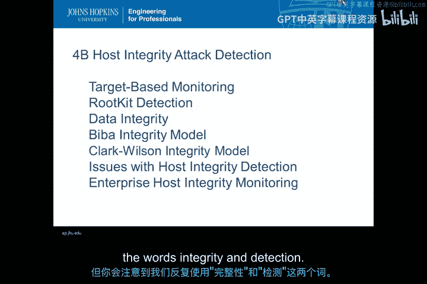

Ener the hardware。

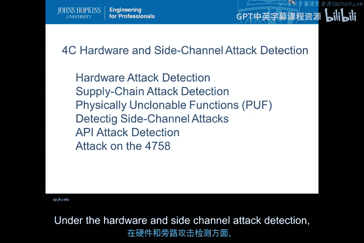

🎼And size channel attack detection， we should discuss different type of detections。

 They are hardware attack detection， supply chain attack detection。

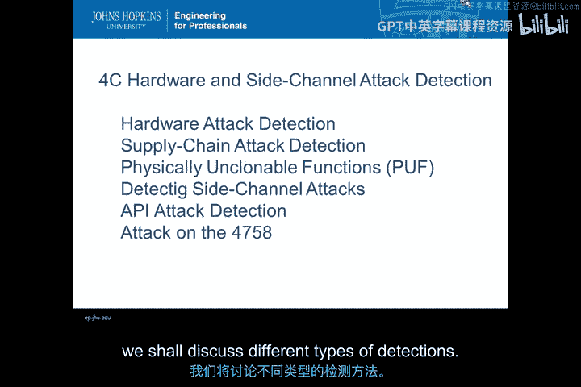

Physically。🎼Uncrable functions。🎼Size channel attack detection。EpiI attack detection。

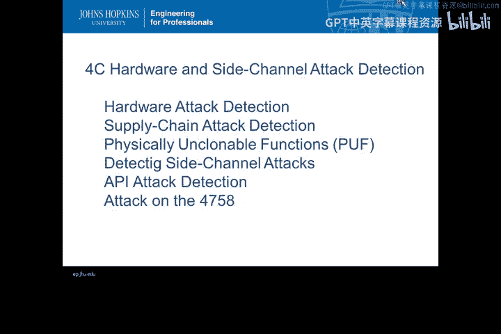

Again。🎼You can notice that we repeatedly use the word detection。

🎼In this part of module 4， we should discuss static。

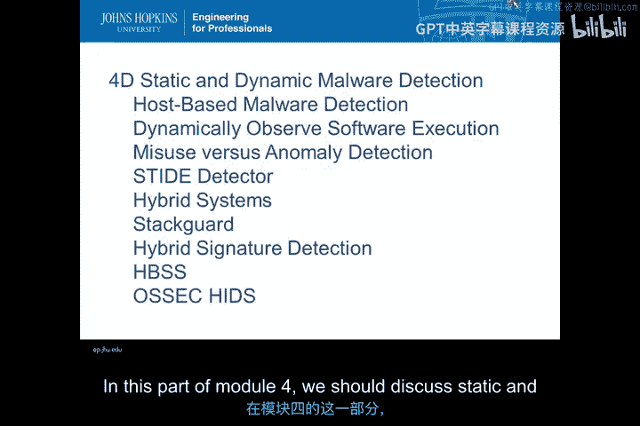

🎼And dynamic moreware detection。🎼And also， the heartbreak detection we shall cover。

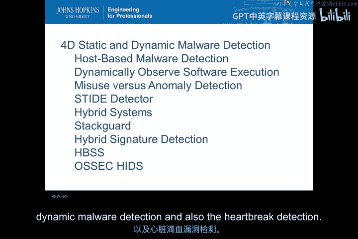

🎼Ht the based marvel detection。🎼Dynaically observe software execution。🎼Misuse versus an detection。

Sequence， time， delay， embedding detector。In儿的我。🎼S T， I， D， E detector。

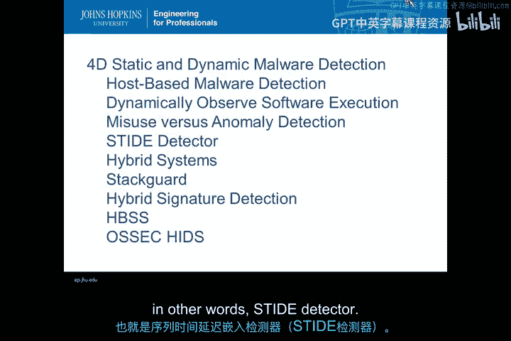

Hbaric system and a stack。

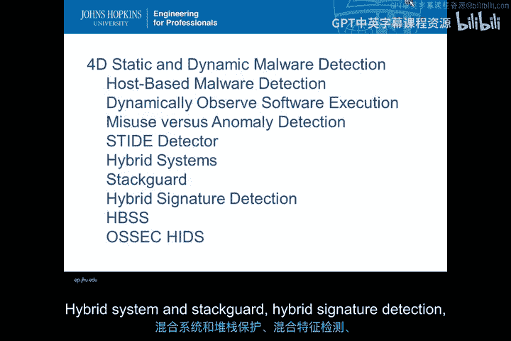

Guide。Harubric signature。Detection， holds the based。🎼Security system。

🎼Open system security。

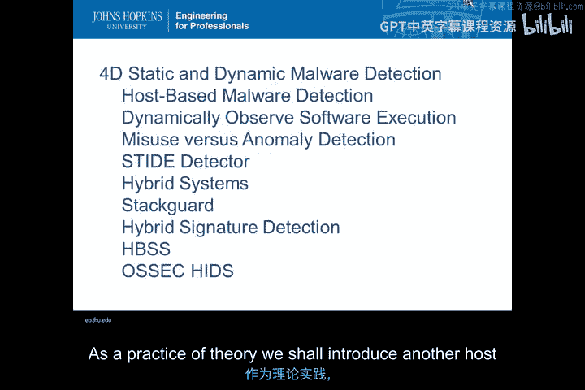

🎼H Is。🎼As a practice of theory， we shall introduce another host intrusion detection system called Oac。

🎼Be you stands for open source security。🎼For you to practice in this module and in other modules as well。

As you call。Through the theory。Of the different type of attacks and anomalies。 please keep in mind。

 How would you actually detect these intrusions。

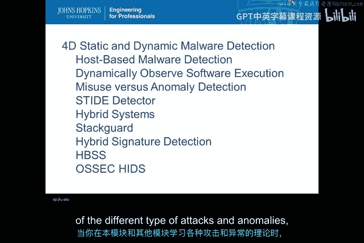

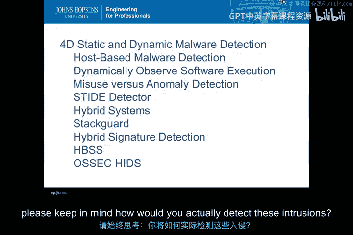

Please remember， the keyword is detection。

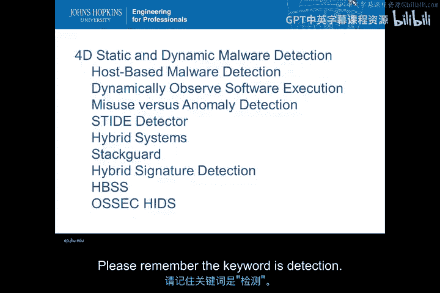

🎼The learning objective of this cause。

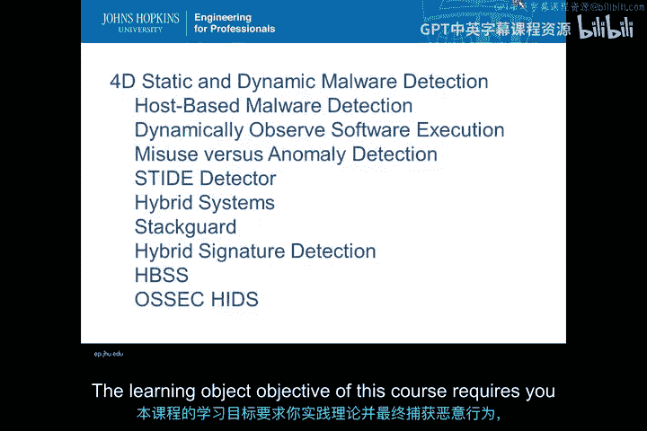

Requires you to practice the theory and ultimately go and catch the evils。

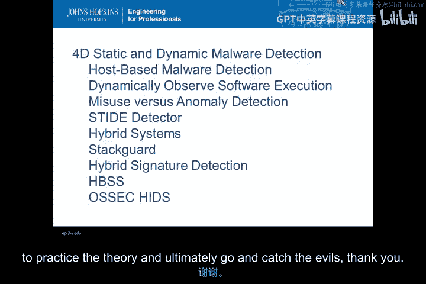

Thank you。