# 约翰霍普金斯大学《入侵检测｜Intrusion Detection》中英字幕 - P13：12_主机完整性攻击检测.zh_en - GPT中英字幕课程资源 - BV1sGu1z5E2J

So in this video， we're going to specifically focus on a type of host intrusion detection system that really focuses on integrity。

 the integrity of data items， the operating system。

 any kind of element within the host system that really ought to stay constant。

 and if it's not constant， then we know that there has been some kind of attack or modification that deserves investigation。

So this is one particular type of host based IDS， so you know we're still talking about a his in this system。

But the HiIDS here specifically is focused in on the integrity aspects of this。

 so this will also if you remember from the prior modules。

 be very much like the target based intrusion detection systems where this is on a host。

 but we're talking about target based。

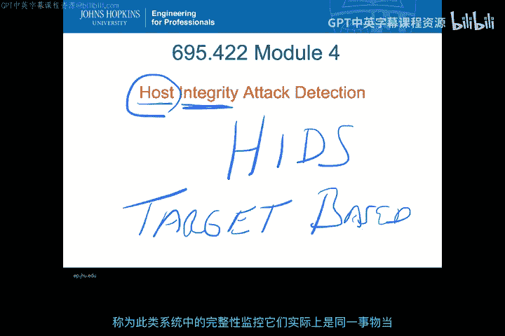

So target based monitoring is also called integrity monitoring in this type。

 they're really one and the same thing。 Whenever we're talking about a specific target。

 we mean a specific data element or item within the host that has to have its integrity maintained。

So within a host， what this means if the target will be some kind of very specific asset。

 This asset will produce an activity record of the changes to that object。

 So where you have an object that should never change。

 the sequence of changes that come from the object on the target will indicate a potential attack against the system。

Main examples of this that we have are tripwire stackguard。

 and we'll talk about some other different types of integrity measures as we move through this particular module。

So as I say， this monitors for modification， so that means that for most of the target based monitoring。

 we would expect some kind of data element to be completely static Now this isn't entirely the only way that target based monitoring can occur。

You may have a target that changes but only in specific known ways。

 So if you have a model of how a target ought to change and you can monitor that target for changes associated with that model。

 then you can also have a target based monitor on something that does change with regard to a trusted process。

So there are a lot of issues associated with these targetbased monitors。 you know， of course。

 you've got to pick the right assets to monitor。 How frequently do you take the measurement。

 How do you update the normal result when the when the thing being monitored changes in a way you're supposed to。

 So for example， let's say I'm monitoring a specific binary file know that's within my Linux system say it's the binary file for login。

 and that login program should actually never change So it might be a good target might be something that I actually want to target in order to understand whether or not it's been attacked。

 if you attack the login binary， you could bypass authentication。 However。

 if I'm going to do some kind of a patch or update to the system Well。

 then obviously I'm going to have to change that particular baseline so that my legitimate modification isn't picked up as an attack。

 So these are kinds of some of the issues that we'll talk about with regard to target based monitoring。

So where does this targetbased monitoring fit within our taxonomy。

 basically if you look at the targets specifically， So we're going to talk about the targets here。

 if the targets exist on the host， then you know that we've got the host base。

 so accounts process data is all the way down to the computer now that's the same would be true with any HiDs。

 but now if I look at what is the particular actions that I'm looking for。

 well the actions would be anything having to do with modifying the particular element。

 so probe scan。

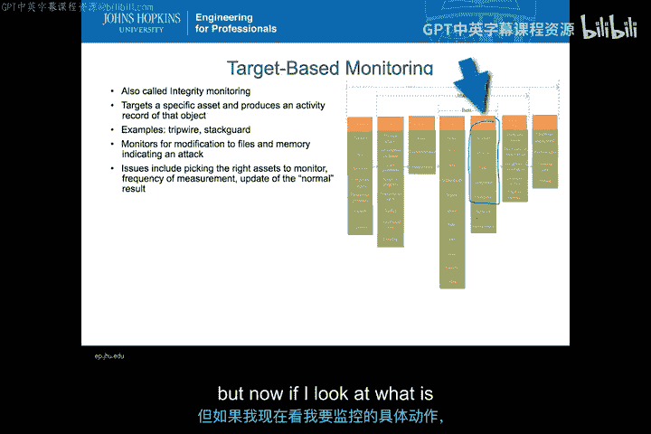

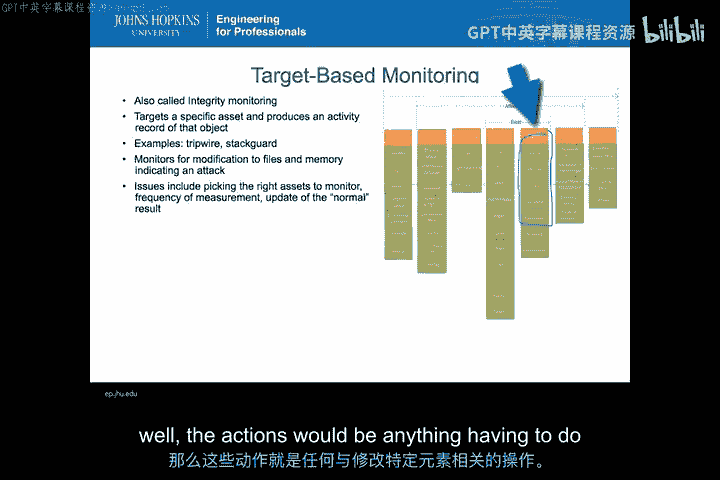

You know， flood， these don't change it。 authenticuthenticate doesn't change。 bypass， Boof， read。

 But when I start to get down to modify， delete down here at the bottom。

 these are the elements that I'm talking about， mainly as my actions on target based monitors。

 So this is how I'm threading between the attacks， the tools， the vulnerabilities。

coming down to do some sort of a modification of a target within the host。

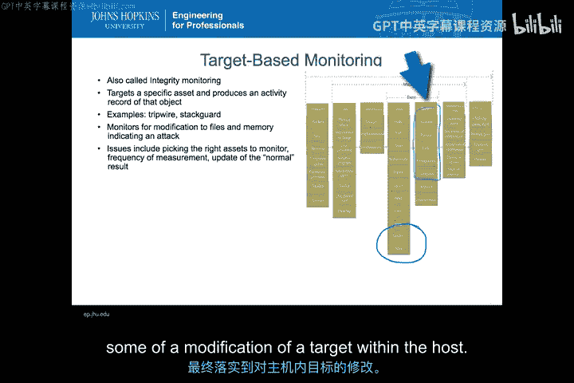

The most common type in one of the original types of the integrity based monitors was Triwire。

 Triwire was created in 1992 by Gene Kim and Gene Spford。

 Gene Kim being the student in Gene Spafford being his professor at the time。

 This was part of Gene Kim's doctoral dissertation in 1992。

 Gene has since become the CTO of the Triwire organization and still is very involved in integrity and the integrity kinds of systems and change management even today。

So what Triwire actually does is it performs a file integrity check against a baseline configuration。

 so the first time you open up tripwire you have to create this baseline configuration and then periodically or on demand。

 you can perform this integrity check against those files so that that's the general functionality of the core version。

Of the open source tripwire that you'll be using within this class。Now out of the box。

 as soon as you download the open source version of tripwire。

 this is actually designed to work with the Ceris operating system。

 so what you're going to see is a whole lot of errors when you install this on Linux that files that are in the baseline that are currently configured for tripwire don't exist that shouldn't be a problem all it means is that the configuration file for tripwire is going to have to be updated for the specific files on the system that you want to protect。

But that leads to， you know， a very， very important question when it comes to this。

 you have to know what files are key to attacks。 If you don't know what files there are that are going to be modified in attack。

 then you won't know which ones to configure to decide how they're going to be baseline and changed。

 The more files that you baseline， of course， the slower and more resource intensive。

 it will be on the host to check these files。 So you really want to pick those files that should never change。

 and are key to the various kinds of attacks。 Now， in that executable binary files and host configuration files like those you find in slash Etsy。

 Those are the natural targets of attackers。 So those are great places to start with regard to the files that you're actually going to protect using tripwire。

 Those are the ones that if attackers would change them。

They would change the authentication and the use of those files within the system host configuration files could change the way the system bootss up。

 could change the default programs that are run， could change various kinds of networking configuration and other things that would happen on the host。

 So all of these critical files， mostly found in slashettes， even on other places as well。

 are places that you're going to want to。Put into the trip wire configuration file。Now， of course。

 Triwire is not the only integrity checker fileile integrity checker that are out there since 1992。

 this has proved such a valuable technique that almost everybody。

 every security company has picked up some version of an integrity checker so from semantec to Qs to trustwave a bunch of these are sort of out there。

 As Cyrus and Sam Hayer actually open source versions that are similar and can be used as a more advanced version of Triwire Triwire itself as a company has moved into much more complex products that do more than simply check files based on a configuration。

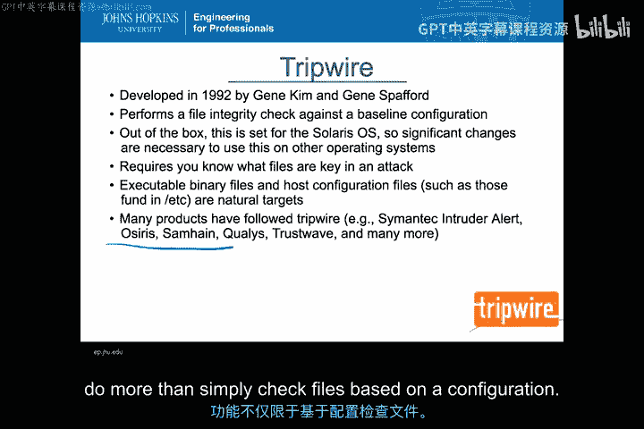

So one of the things you might do with an integrity checker is actually look for root kits So what is a root kit a root kit is a piece of software that gets underneath some other type of security or authentication or observables that you might see on your system So a root kit might for example。

 get be part of your kernel hook the element that does a process list in order to ensure that the process running the root kit is never displayed when you actually do a probe as to what things are running on your system so it's a way for malicious software to hide within the system and the one that as soon as you get a root kit on your system you have violated the integrity of the installation of something having to do with the way your operating system runs So there are a number of ways to do root kit detection using integrity checks one of the common ways is to check the integrity of the control flow。

This tries to determine whether or not your operating system has been hooked。

 whether or not the calls to various system utilities are exactly the way they should be from the install of your operating system if you've baseline the way that as those calls happen。

 an integrity check could identify if a route could has been installed。

So these will check for the integrity of DLL and hooks into the kernel。 Now。

 this is true as long as the baseline and the integrity check is not subverted。 This is really。

 really important。 In checks have to run underneath that level in the operating system that the malware is installed。

 if the malware is controlling the things the integrity checker is actually looking for then you can't trust your integrity checker to give you the truth as to whether that's actually been changed。

 This creates what we call a race for the bottom for integrity checkers。

 Since each layer in the system uses functions from the layer beneath it。

 If you control the layer beneath， you also can lie to whatever utility is above you。

 So if your integrity checker is running as an application and you subvert the operating system。

 then you can lie to the integrity checker and it can produce false results。

 If your checker works within the kernel you can get underneath that into the firmware and lie to it。

And then the colonel won't have the truth。If you kind of get your integrity checker all the way down into the firmware。

And you modify the hardware through some kind of supply chain attack。

 And you can lie to the firmware and essentially move it up from that side。

 So this is what we mean by when we talk about race to the bottom。 Now， within all of this。

 of course， you can still have portions of your memory that can be baseline and checked for root kit activity as well。

 So there's lots of different ways to try to get and identify root kits。

 which is a specific attack type using host based integrity checkers。

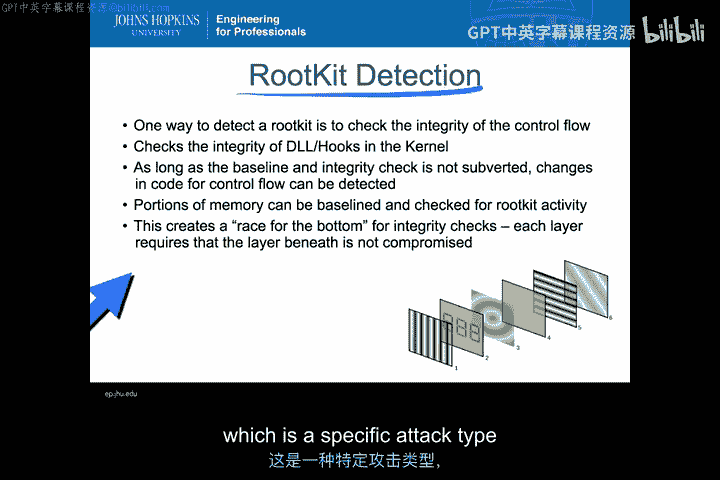

Now the operating system vulnerabilities and attacks against your operating system are not the only place where data integrity or integrity checkers are important for some application。

 data integrity， the data that's in the system is every but as important as the code or the system integrity that's there so you can imagine things like in banking and finance you would want the balance in your own bank accounts to have a high degree of integrity。

 and not be easily modified， same with medical records， intellectual property。

 any of these other sorts of things that you would have This idea of having a model for data integrity。

 something that would actually guarantee the integrity not necessarily the confidentiality of data has prompted a number of complementary models to the be of Pala model you might remember the Bell of Pala model from some of your earlier security classes as essentially creating a star property that provides confidentiality protection depending。

on a clearance level and a classification of the specific kind of file or object Well。

 from the Bellop Pagel model to models， the Bible integritytegrity model and the Clark Wilson model were created that focus more particularly on data integrity。

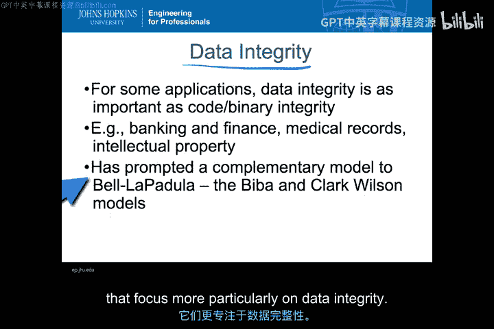

So let's talk about the Bible integrity model First， The Bible integrityity lead model is very。

 very similar to Bell Laagula。 Subjects are cleared， and objects are classified。

 just as you would see in Bellopagla。 And just like in Bellopagla。

 there is a star property and the star property in the Bible integrity model means that a subject can only write to object at its own integrity or below。

 So if I have a subject with a secret level clearance， and I have an object that is secret level。

 then this subject can write to the object。 if my secret object。Has a top secret object over here。

 this subject can also write to objects that are higher。

 What you can't do with this is write to objects below。

So that means if I have my subject and my subject is sitting here at the secret level again。

 and I have an object that is unclassified， I cannot。

Right from this particular object to the subject to that particular object。

 So what this means is that I can have higher integrity at these objects that are at lower classification levels than what I am。

 So because I can't write to these lower layers。 And I've got to be down to that lower layer。

 That's a model that was to guarantee integrity。 now。

We don't see the Biba integrity model implemented much in current projects。

 mostly because just like Bop Pala， to do this， you have to have built into the operating system the idea of mandatory access controls。

 you can't have discretionary control over these kinds of elements because if you had discretionary control。

 Then you could simply take that X away and go ahead and at your discretion， do the right。

 And since we don't want that to be under the user's control。

 This requires mandatory access control and all of the complexity that goes along with those kinds of systems。

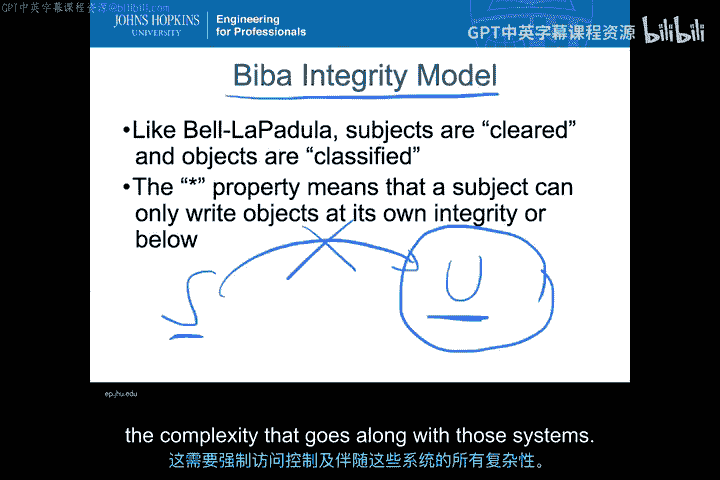

In contrast to the Biintegrity model， the Clark Wilson integritygrity model is a model that's actually used in many real systems today。

 The Clark Wilson started not from this exactly the same pattern as the beopaglo model。

 but started with three specific goals。 It was to prevent unauthorized modification maintain consistency of the data and prevent authorized but improper modification。

 You'll see that these actually match to the Anderson report categories of insider threat that we had talked about way back in the early module in module 1 and 2 So these are the goals that the Clark Wilson In model begins with in order to run this model。

 you actually partition all data on the system into constrained and unconstrained data items called CDdis and UDs。

 The CDdis are the ones that are actually under some kind of integrity control。In the system。

 UDIs are not under integrity control in the system。

 but there are trusted processes that can make UDIs become CDIs。

 so there are processes where unconstrained data items can become or influence constrained data items。

 but only through a trusted process， so that's the whole key is this integrity model relies on the fact that CDIs can only be changed by trusted processes。

The entire Clark Wilson model really relies on the fact that you can require some kind of a model that verifies that C D are in a valid state。

 In other words， C Ds can either be in a valid state where the integrity is assured。

 or they can be in an invalid state because they were changed in a way that wasn't that basically did not follow along from what should happen。

 so。So that means that what you actually have is that you've got wellform transactions that are defined and these carefully control how Cdis can actually can change。

 These are our trusted processes。 So the trusted processes change Cs and nothing else can change a C。

 So as long as your trusted process。 if your trusted process is still what。

That still has integrity itself and the course the process。

 descriptions and the data are themselves CDIs， so these particular things will control the integrity of CDIs within the system。

Now， unlike the Viba integrity model that we talked about for a minute， many operating systems。

 including Windows， has actually taken on at least a portion of the Clarkwison model。

 The reason is that you can interpret these particular three goals that we talked about in ways that are natural in the way that we produce modern operating systems So for example。

 you need to log changes specific ways that CDs and when a CDI changed in Windows that's actually logged into the Windows event logged So that maintains a log of CDI changes。

 So when you look at a Windows event log， what you're really looking at are the result of controlled processes and what happened when a control process actually change something is one of the thing that things that makes the Windows event log a valuable log file to actually understand doing intrusion detection at the host layer。

So the way this operates as an intrusion detection system is that violations of a cdiI。

These changes trigger an integrity violation。 The integrity violation is the core of exactly how the Is works。

 Now， in order to understand that you have an integrity violation you need a trusted process that's even more trusted than the trusted processes that change Cs。

 and this actually relies on a security reference monitor。

 the security reference monitor is a trusted piece of code within the operating system that controls and monitors Cdis。

 basically how do trusted processes actually change Cdis。

 So the windows log the Windows logging system that creates the event log。

 the event logger is actually the security reference monitor inside the Windows system。

 It's not a formally verified reference monitor as you might expect in a highly trusted system。

 but it serves the same purpose within the Clark Wilson integrity model。

 So that's the way that the models。Actually get integrated into operating systems today。

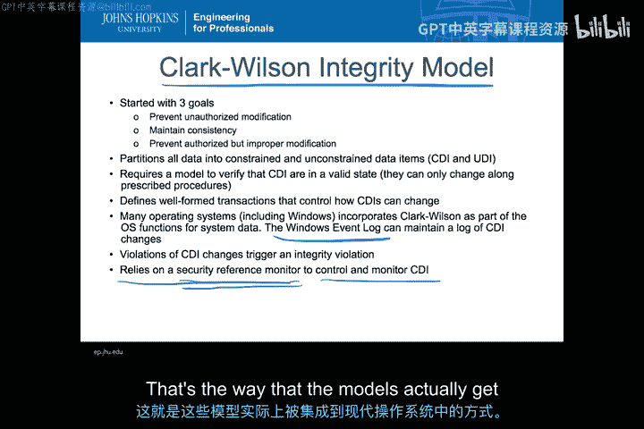

Now there's plenty of problems with regarding issues when when you start to talk about how do you do host integrity detection。

 the main problem right off the bat is that I'm using the same resources to detect an integrity attack as are the targets of the integrity attack。

 so this results in that race to the bottom that I talked about a few slides ago where you're using the same system to be the target of the attack and be the thing that detects the attack so if you attack the integrity mechanism you can then。

 if you're successful， attack other files that the integrity mechanism is assuring。

The other problem that you have with this sort of thing is that every host has to be protected independently。

 So at an enterprise， this can make it very difficult to deploy and maintain。

 especially with regard to host integrity because a number of critical files may change in different rates across your enterprise。

 Some systems may patch differently。 You're going to have different operating systems that have different critical files。

 All of this is going to make doing this at the enterprise level more difficult。And any change。

 like a security patch that has to occur on a trusted path must update the security baseline。

In order to understand that when you do future integrity checks。

 the baseline is correct after it's been updated。 Now， this process itself is a target of attack。

 So it's really， you know the targets of the attack are protected by things that are targets of the attack。

 which are protected by things which are targets of the attack。

 and there's the phrase it's turtles all the way down。

 which is essentially what we're talking about with host integrity detection。

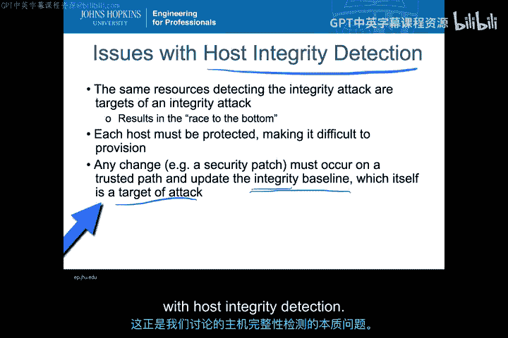

So this gets into how do I do this at an enterprise level。

 How can I go from a single host to entire enterprise worth a host monitoring？ Well。

 to make it practical， first of all， you need a secure channel to get alerts off the platform and updates onto the platform creating a secure channel to all of your hosts is sort of the step 0 on how do I go from a host integrity monitoring system on a single machine to something that's gonna to move across my enterprise。

 Now， this is very， very common in commercial products today。

 As you can imagine if you had to take what you're doing with tripwire and do that across an entire enterprise。

 that would be really， really difficult to individually log in and detect across thousands of systems So things like tripwire enterprise and Maccafe HBSS contain mechanisms that are helpful in coordinating across all of this。

 then the these mechanisms can use standards and a variety of techniques to make sure that these systems。

can communicate back and forth in a trusted way to some kind of a central server。

 so the exchange of this integrity information across and between enterprises can be supported by standards like ScapAP。

Whi you can see more details at this particular web address。

 and that can be used as a basis from going for tripwire。

 the individual to tripwire the enterprise in any way that I'm going to go from a host based IDS all the way out to some sort of an enterprise system。

So that's a quick run through host integrity monitoring there's of course lots of additional information but that's pretty much the basics in terms of how do I use changes in integrity as a detection system within the host it's an extremely important category of the whole HiD system and one that has been very successful at detecting zero day and attack that we don't know about because as long as I can understand that I have an element that should never change。

 I don't care what it was that caused the change， any change in integrity has indicated an attack in this system and that provides me the additional ability to understand that some kind of a new attack has happened which begins my investigation usually using forensics in terms of what has happened on my host to cause that change of file。

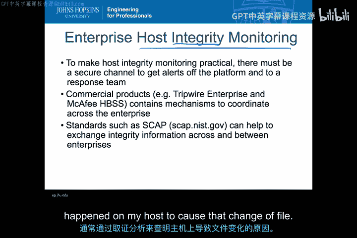