# 约翰霍普金斯大学《入侵检测｜Intrusion Detection》中英字幕 - P14：13_硬件与旁路攻击检测.zh_en - GPT中英字幕课程资源 - BV1sGu1z5E2J

Okay， so in this video， we're still going to be focusing on HiIDs， so we're still in the His world。

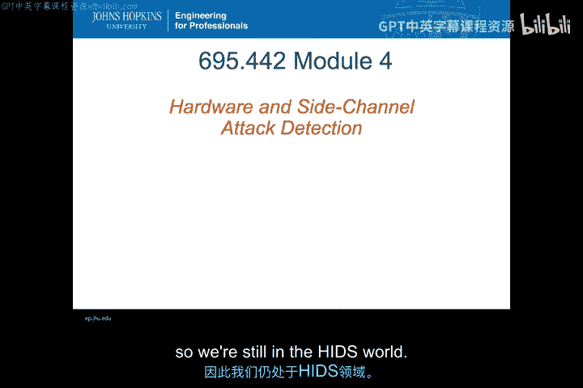

and in the HiDs world， one of the types of attacks that can happen to hosts is essentially looking at the hardware and side channel。

 so we want to try to look at host based IDSs that really focus down at the end of that race to the bottom that I talked about before and when you get down into how do we detect things all the way down sort of at the hardware layer。

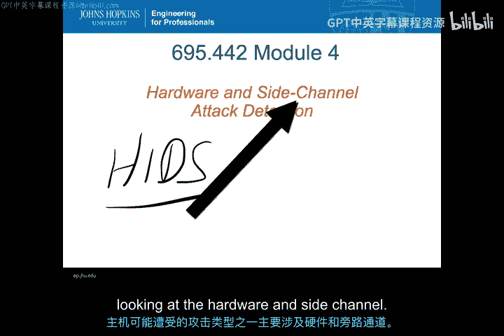

We're also in this video going to talk a little bit about the exercise that you have in looking at API style attacks。

 which have a lot to do with the way that we sort of look at hardware and side channel attack detection。

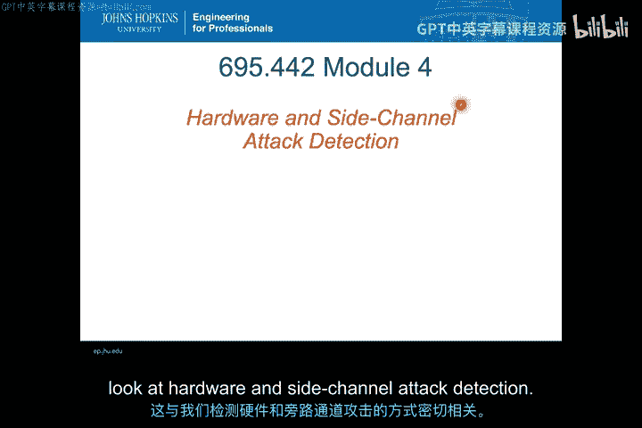

So we can detect hardware style attacks， so we're looking at hardware attack detection and that comes in three basic types。

 The first type is looking at integrity checks。 As we covered in the prior module。

 we remember that integrity checks take something that's supposed to be statically configured or a data element that supposed to be static and look for changes in that。

 and we can do that at the hardware layer， look for things that have observables that should be static and check for its integrity。

We can also do supply chain verification。 One way that you get hardware attacks is to during the provisioning of the hardware or when it's actually coming out and being delivered somewhere in the supply chain。

 you've got some place that's introduced either a malicious piece of hardware。

 a counterfeit piece of hardware or something that just has unexpected behavior。

 So this is largely a human process where you're checking at each point in the manufacture and transport that every component is only modified as authorized。

 So it's not the component can't be modified， they should only be modified as they're authorized to be。

Now one thing to note when we're talking about supply chain verification is that this doesn't necessarily have to be when something is initially provisioned。

 updatesates and changes to hardware or things very low in the operating system can also be modified at some point during their supply chain。

 we've had several cases where patches， for example。

 that are coming out either in terms of firmware patches or even software patches were modified before they were distributed and sometimes modified to include a virus or other piece of malware。

 sometimes modified just in a way that changed as behavior in some sort of undesired fashion。

The third type of hardware attack detection we're going to talk a little bit about is antitmer。

 This is when the physical protections that protect your hardware components have some kind of an alerting mechanism when they're physically accessed。

 This gets more into the area of sort of traditional alarm systems and other kind of protection systems。

 but when they are integrated into some sort of a host based intrusion detection system。

 these anti-tamper mechanisms can actually help aHs identify when the hardware has been tampered with or adjusted。

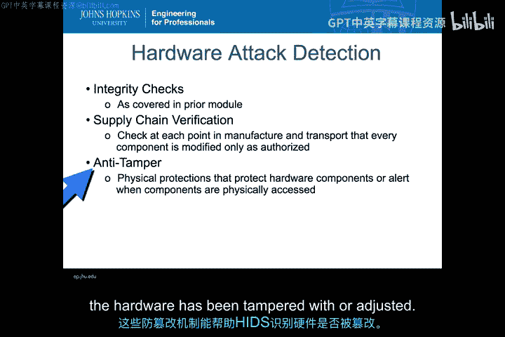

It should be noted that supply chain attack detection is probably one of the most critical problems that we have today。

 And there's a lot of active research on this very， very difficult problem currently going on。

 The whole idea that you can't trust the systems that you get when you open the box is just a really difficult kind of technical problem。

 So as I discussed in the race to the bottom in the previous video if I can't trust my hardware I can't really build up the kind of techniques that would allow me to verify anything else that's building up on top of the hardware。

 And today， the state of the practice is that we're really detecting supply chain attacks as failures and procedure and procedure meaning how things are put in boxes。

 how they're labeled how they're shipped。 but there are starting to be some ideas vendors are beginning to baseline hardware characteristics that attempt to verify the authentic。

Of hardware components as they're delivered。 And it's this kind of activity that could get incorporated into Is in the future that's really worth watching for and watching to see what happens as these products develop。

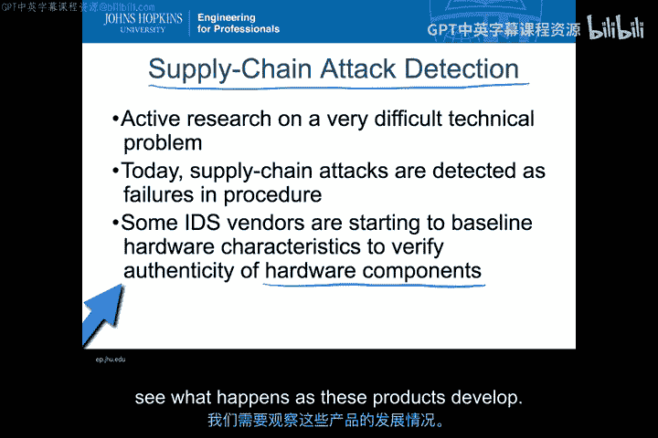

A lot of the current technology in trying to baseline and understand how the hardware can be verified focuses on this idea of puffs。

 physically unclolonable functions。 These are actual characteristics of the hardware that is unique for each chip during manufacture。

 So if chips are created in a trusted foundry。 In other words。

 they're created in a place where you can trust what was done when the chips were actually created that chips themselves can be baseline using。

 in this case， a nondeterministic function on the chip。

 it has to do more with the race conditions that say some parts of the chip are naturally going to be slightly faster than other parts of the chip all within the specification of the chip。

 but during execution or during the creation and manufacture of the chip。

 tiny changes in the way that the actual dyes created each individual chip allows us to。

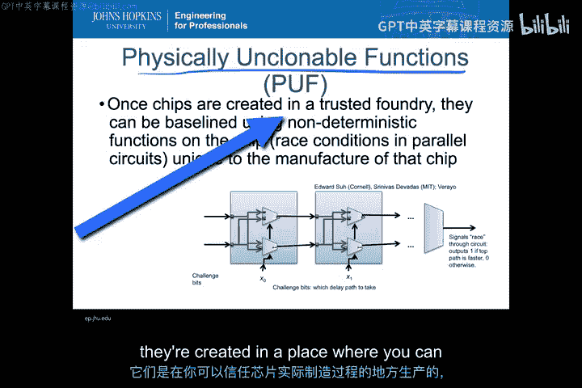

Baically characterize how those chips operate。Now， I want to be clear when I talk about differences between the chips。

 these are all inside of the correct operation of the chip。

 These are in that fine line between slight variations。

 but each chip can actually work according to specifications。

 I'm not talking about chips that don't work correctly。

 So the way that we have it sort of working in this diagram down here is you send a couple of challenge bits into the system。

 and they actually create feedback loops between the system。

 They come in and they route around and create feedback loops。

 And these feedback loops create a race condition between the bits that are actually coming out on the other side。

 Now， depending on whether this path is faster or this path is faster will depend on what this final bit is that comes out at the end。

 So this is a simplified version of what happens over many， many bits that are added to the chip。

 But these are actual things that are included on the chip that can actually help whether one path is faster than another。

 whether what you get。At the very end is a zero or a one for each individual bit。

 you get those up bit after a bit， get more and more of them until you actually get a characteristic number that's only associated with that one ship。

 Then after the machine is delivered， you can run these bits again。

 and you will get the same answer out the same way。

 So these physically and Chable functions or ways that IDss are beginning to understand how they might characterize the hardware and know whether or not there was a supply chain attack between the hardware being produced and when it was actually installed in the system。

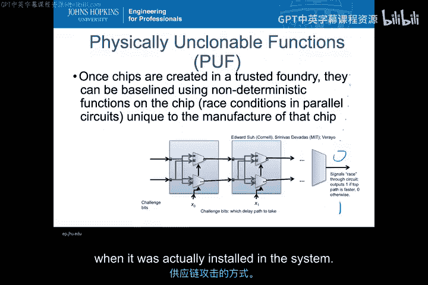

Another important way that we see these hardware style intrusion detections begin to happen are addressing side channel attacks。

 side channel attacks have their roots in the cryptographic style attack where information from the cryptographic algorithm can be retrieved using some characteristic of the device that isn't the plain text going in。

 and it's not the ciphertex coming out， yet these different piece of information can contribute to understanding what the key is。

So one example are timing attacks where different key values actually produce different characteristic data flow times。

 say during an encryption process。 So if I have a lot， I can watch an encryption algorithm run。

 I can look at how long it takes the plain text to produce the cipher text。

 I can look inside as much as I can at the way the rounds are happening in the encryption。

 And if the key has a one in a certain place in the bit or a0。

 I'm going get a slightly different time。 I can do the same sort of thing with the idea of power consumption。

 Some keys will produce slightly different amounts of power， than another。

 So a power consumption is another way that I can actually look to understand how to determine the key。

 I can look at tempest radiation sound， other information that can be gained as part of some kind of secure process。

 So how do you detect How does an Is detect a passive。

Distening of the side channel to understand whether or not。

There is some kind of attack going on in this direction。 Well， it's really， really difficult。

 but there are starting to be some elements that can look at the characteristics of， say。

 what happens during the reading of power consumption。

 Does that actually change the power characteristics， and can that be detected。

 Can I actually understand whether different parts of the radiation that are coming out of the system have been read。

 Can there be other sorts of things that allow me to detect through impedance。

 matching other things that a sensor is actually participating in some kind of a side channel attack。

 It's usually really wrapped around the specific physics of a device。

 But it is tied into an I D S and a host based Is to begin to decide whether or not we can detect the existence of these side channel attacks。

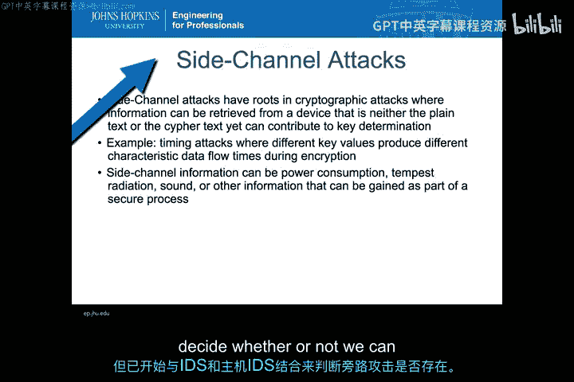

One area that this has been very popular recently is looking essentially at sort of quantum information exchange。

 So one example in detecting a side channel attack means I have to detect the listening device gaining information。

 So in some cases， the observables are going to be gained through the disruption of the side channel information。

 So in quantum information exchange， what I've essentially done as I'm creating a conjoined photon。

 and that conjoined photon is going to have two different read indicators。

 and it's going to be different， as opposed to when the photon has been read in the middle versus when it has not been read in the middle。

 Since this is part of the conjoined photon itself that's there。

 There is no physical process that allows me to produce a side channel attack on a quantum channel without disrupting the bits of the conjoined。

tonBecause the conjoined photon changes after I've actually read the photon that's in transit。

 I can determine whether that photon has or has not been read。

 even if the man in the middle attack in this area tries to produce another photon of the same value。

 Whatever the attacker does， they can't produce a photon that's entangled in the same way。

 the original photon was entangled that was read in order to get the value。 So。In this way。

 we could detect the side channel attack because it has disrupted the actual observable that would have happened during the exchange of the information。

 the details in the physics of quantum information exchange is beyond the scope of this course。

 but I urge you if you're interested to check some references。

 certainly check the ideas of the quantum information exchange as a way of actually detecting side channel attacks through the physics of the communication of the photons。

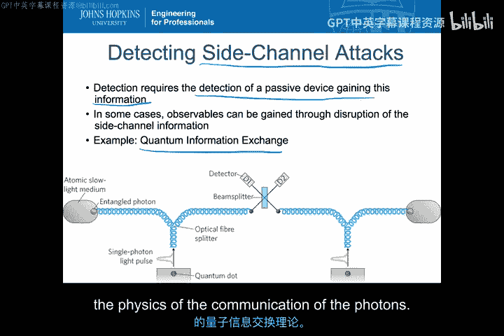

In many of the hardware and side channel attacks， you have to actually get the information through some kind of an API。

 So a lot of the hardware and side channel attacks end up coming down to how do you do API attack detection。

 It's a very common way of trying to hook something up and pull information For example。

 in a common system， you could do this through the USB port。

 I'm going to try to connect something into the USB and use that to pull information from the system and I want to try to detect that is going to happen。

 So this is saying that I've got a communication between running processes。

 And what I want to do is I want to detect whether that communication between running processes has been observed by an attacker。

 So the attacks in this particular case can either passively observe or they might even redirect where you expect the other half of the communication to be。

 This would be more of a man in the middle style attack with As inside。

So the detection of this really involves knowing what's installed where and how is the integrity。

 Remember， we're back into the integrity of these APIs again and how has that been maintained。

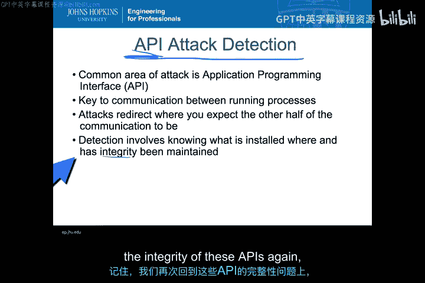

So you're going to explore this by looking specifically attack on a cryptographic box called the 4758。

 This is part of your reading assignment in security engineering chapterpter 18 in section 18。2。

2 the specific attack is described which uses an API on a cryptographic device in order to essentially have unlimited attempts to attempt to break a key Now there are observables that could be related to this attack。

 but one of the most important things to realize is this attack is an attack that is externally observed from the machine。

 it really is a hardware style attack and it's one that requires a lot of side channel and outside sort of observables So take a look especially at 18。

2。2 but read all of chapter 18 with regard to the API style attacks and try to describe what platform information。

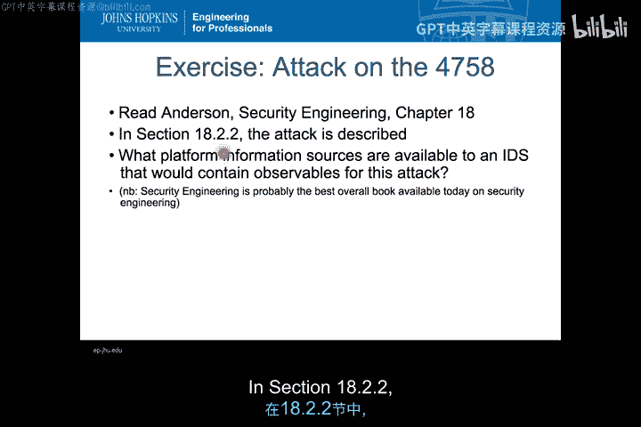

Sources are available specifically to an IDS that would contain observables for this specific type of attack as a side note。

 if you don't have it， the security engineering book may one of the best overall books and security that's written from the perspective of security engineering so it's certainly worthwhile taking a look at the previous version is available free online the new version is not available free。

 but is a significant update to the one that's actually available online so I would certainly recommend that book for anybody that has a desire to take the information from this course and beyond to really work in the area of security engineering so that's what that's going to wrap us up for talking about side channel and hardwarebased attacks between the APIs and the way we can do the hardware I think you can see that the important thing is tying the physical sensors for hardware style。

Attacks， whether it's puffs or whether we're looking at quantum interference or whether we're looking at APIs。

The indicators， these observables， have to be tied into an alerting mechanism。

 which can help a host based IDS alert us to know that some kind of attack has taking place on that system。

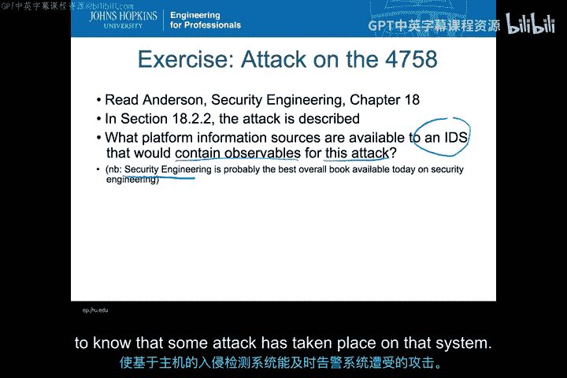