# 约翰霍普金斯大学《入侵检测｜Intrusion Detection》中英字幕 - P15：14_静态与动态恶意软件检测.zh_en - GPT中英字幕课程资源 - BV1sGu1z5E2J

Okay， so in this video we're going to go into one of the most important types of host intrusion detection systems and that's the ability to detect malware。

 the idea that you've got some code， something running on your system。

 no matter how it got there that is actually going to violate policy， do something malicious。

 do something unexpected， it's actually saying that I've got software on my system that I may not trust。

 and I want to detect the instance of that software either statically sitting on my file system or dynamically having it actually run。

The nature of the His dynamic malware detection is really about can I not only detect the malware but prevent any damage that that malware actually might produce when it's actually running on my system。

 so we're going to talk about a number of techniques that are used at the host level to really focus in on the malware problem。

So it probably comes to no surprise to any of you that malware is one of the most dangerous threats that we currently deal with within hostbased systems。

 The idea that we've got malware easily accessible on our systems either coming down through weburing being sent by email to us or any number of other ways that malware could get on the system this is a threat that is active and current and really very effective at violating almost any kind of security protection we may want to have within the hosts that we currently have an enterprises or even at home or the ones that would there So hostbased malware detection。

 when we talk about trying to detect malware， it can be either static or dynamic when we talk about static malware detection。

 this is really in the world of antivirus。 It's the way that antivirus anti malware scanning systems。

 It's the passive way of looking through your file systems。

To really try to identify either through signatures or some other kind of identification。

 what sort of malware you have within your file system。

Most of the static malware detection that we'll talk about is really sort of more like forensics than it is like intrusion detection。

 So for the large part， you would think the forensics part is more or less out of scope for this particular class。

 but because some of these static techniques are effective in a dynamic environment as well。

 a lot of what we know about hostbased intrusion detection comes from the world of static malware detection。

 That's where a lot of this started。 And， of course。

 this was virus detection as the primary mechanism。

 This is where it all started with the sort of scanning your systems for viruses。

 That's also where we get a lot of the dynamic techniques。 because in the world of virus detection。

 we did look a lot at could we detect malware running actively。

 even if we didn't actually see it within the file system。

 So this whole idea includes the static analysis of software of binaries on your system also includes。

To some respect， the static analysis of source code。

 although I'm not really going to talk much about static analysis of source within this particular course。

 When you start looking at how to develop trusted systems and doing analysis of software。

 this was an important area to sort of focus on in that world。 So for the purposes of this course。

 the idea of static malware detection， I don't really consider it truly in IS。

 I really consider it more of a forensic set of tools。 so。Although it's going to be incorporated。

 the static malware detection is incorporated in a lot of I S style tools。

 I will look at that as sort of a forensic addition to the kind of intrusion detection systems that you might see。

 So even though these are included in the products that we're going to talk about。

 that's not really the point， The real point is the dynamic malware detection。 The idea that。

we wantna not find the systems the malware in our system by passively scanning for it。

We want to watch the execution of malware and determine dynamically whether or not what malware is doing。

 the behavior is has't observable。 It should be detected and should be something that we would consider for an IS。

So within dynamic malware， we have two basic ways that we。Carry out dynamic malware detection。

 The first is we watch the execution of malware in some kind of a sandbox environment。

 We take the malware and we explode it someplace。 and by looking at that。

 we say during execution in a protected environment that's not going to hurt anything。

 can we identify if there's any kind of a problem， the Java sandboxing efforts。

 even though this was operational， sort of started this kind of thought。

 and that's been carried on by products like Fire eyee。

 which really their business model is around taking in malwares potentially malware samples and running them in a protected environment to see what they do。

 The other way that we do dynamic malware detection is to watch the observables while we're running our normal software to try to identify any kind of observables within the running of normal software in the normal course of our work that is identifying some characteristics that we would call malware。

 So this idea of dynamic mal。detectionte has all the characteristics we talked about of an IDS。

 It has an event queue or some kind of logging that it's doing these observables that we're seeing from the kernel that are sort of right there。

It's got an identified portion that's actually going to partition the space and classify whether the events are malware or not。

 and it's going to report or block， which is going to give us either the I or IPS portion of this。

 Now， within the IS world， this is an extremely active area of research。

 There are a tremendous number of papers written every year within all of the conferences。

 the main security conferences about dynamic malware detection。

 You can see a pretty good survey that's included in the module this week named a survey of malware detection techniques is a really good summary of this particular kind of His detection。

So how do we dynamically， how do we dynamically observe software execution， Again。

 two primary ways we go about this， We can either observe normal execution or execute the software in a controlled environment。

 Those were the two different ways we can do it if we're going to look at normal execution。

 We want to look at the characteristics of that execution in our space。

 Usually this is system call traces， things that we can observe on the stack。

 executing from the data segments， In other words， trying to have flow control that moves out of the code segments and into data segments。

 and we can observe just data flow in terms of how are the decisions being made inside the software similar to a tank analysis or some sort of a flow that says is my software being controlled externally。

 When you're in a controlled environment， You can watch for very specific drops of additional software files that might be saved for sort of future kind of activity。

 You can watch for additional network activity Are ports opened up。

ial to sort of URLs or IP addresses that have some previous poor reputation there are sites out there now that are often you can submit a URL。

 you can submit an IP address and it'll come back with a suspicion whether or not this is likely to be a URL or an IP address associated with some kind of a malware and of course you can also check for signatures during the execution this isn't all about just anomaly detection if you have a signature you can actually watch for those kinds of signatures during execution in a controlled environment。

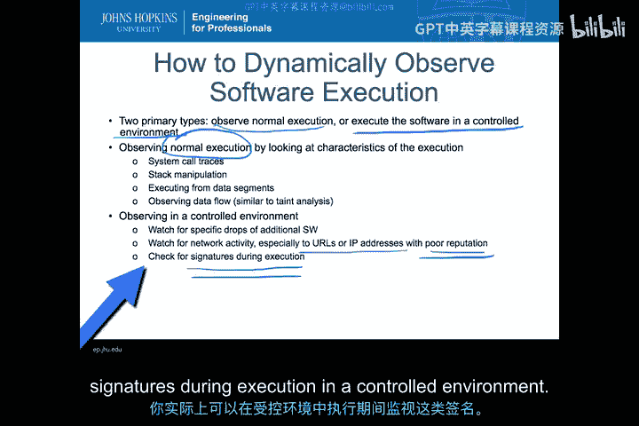

Now， within either a controlled environment or looking at it in a natural environment。

 we can have sort of the misuse versus anomaly detection kind of world。 Remember。

 these are the two primary different types of Is that we've characterized earlier in this course。

 So host based malware can be either signature based or anomaly based。 Both types exist。

 If we're talking about a signature based system。 These are systems that check for very specific patterns that represent the malware。

 Theyre actually patterns that represent the malware in the execution of the actual code。

 So this is a little different than looking for a static binary pattern。

 I'm looking for some kind of a sequence of activity that's going to be a specific pattern associated with malware。

 I can also again， check for specific URLs and I addresses that malware is known to be associated with。

 having bad reputation。 and I can check the code or。signatureignatures。

 if the code is self modifying。 So， for example， if a binary is unpacking into several different files that will be executed。

 I can then check each of those unpacked files dynamically to see if they match any of my signatures that would be normally associated with malware。

 So I can have a number of different ways that these signatures can be used for misuse detection across the execution of code。

For anomaly detection， basically， just like we've talked about before with anomaly detection。

 I have to be able to learn normal or somehow be able to specify normal in order to be able to distinguish between normal and abnormal behavior。

 I can do this in any number of ways for the normal patterns of execution and variations。

 the sort of seminal paper， the seminal work in this area was a sense of self or Unix processes。

 It's a classic paper in this area， certainly one that has been built on over and over and over again with regard to looking at code execution for anomaly detection。

You can specify normal behavior for software and watch for variations。

 This is specification based malware detection。 This was invented in order to say。

 can we specify the important not all activity of software。

 But the important activity of software that would be disrupted by most common malware patterns。

 So there are lots of different ways we'll talk about that a little bit more， And finally。

 you can represent the execution of normal behavior as a state machine or as a hidden Markov model and develop these models of software execution in order to detect the variations from normal behavior。

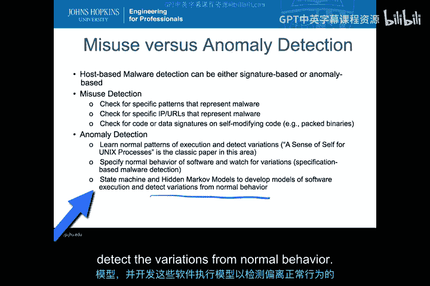

So an example of this that was actually done in the sense of selfreix process was the st detector。

 A st detector actually is a sliding window based detector that essentially looks at the execution of system calls in blocks of in this case。

 six at a time。 and slides that window on six patterns every time you execute another system call。

 It looks at the normal traces of this program so that you can understand which of the execution patterns have been associated with this before。

 So if I have an execution pattern。That looks like this。And I have a sliding window， AB，C， D， E， F。

 and that's a normal one， and G， And that's a normal one。 and H， And that's a normal one。 And A。

 And that's another normal one。 So once I get all of these patterns， all six possible patterns。

 I'm going to create a new pattern， A， F G。B A。And I'm going take my sliding window。

 and I'm going to look at this pattern and compare it to all other ones。 And I'm going to say， wait。

 that's an alert。 I've never seen that particular pattern before。

 That's essentially the way this st detector actually worked。So you have two papers in this module。

 You've got the original sense of self for Unix processes paper， but you also have a paper called Y6。

 and this is relating to problems that this side detector has and this demonstrates more than anything else that each of these learning techniques detects a particular space of anomalies within the execution trace。

 So although the idea is that any anomalous patterns could be detected。 you'll see from the Y6 paper。

 This really isn't the case。 In the case of the side detector。

 there's a very particular set of malware that can actually be detected。

 and it depends a lot on the window size。 So the idea of six as a primary window size is shown in this paper to be done Op window size for actually looking at specific kinds of anomalies within the execution of system traces。

 So this is a good example of how the research in this particular。The areaa has developed over time。

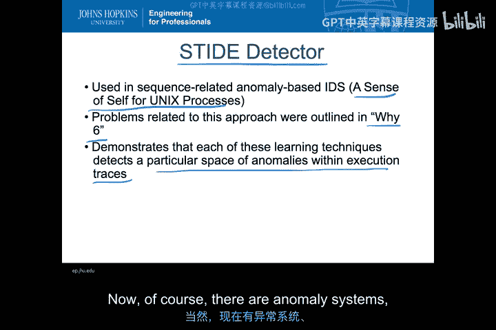

Now， of course， there are anomaly systems and signature based systems and， of course。

 are a lot of hybrid systems。 Almost everything you have with sort of the commercial and the open source world that's out there right now。

 use various forms of detect detection techniques， not just one。 Why not just one。

 We just saw in the Y6 paper in the previous slide that there are a number of limitations to all of these techniques。

 Every technique has a series of limitations。 So if you actually create a hybrid system that has multiple forms of this that can go through。

 you can begin to reduce the false positive rate increase the detection rate and make these systems more commercially viable。

 And that's the bottom line。 as you want to make these systems commercially viable。

 So hybrid systems exist for both。😊，Now we're detection systems and for signature and anomaly based systems。

 So we're going to talk about the hybrid systems for signature systems and hybrid systems for anomaly based systems。

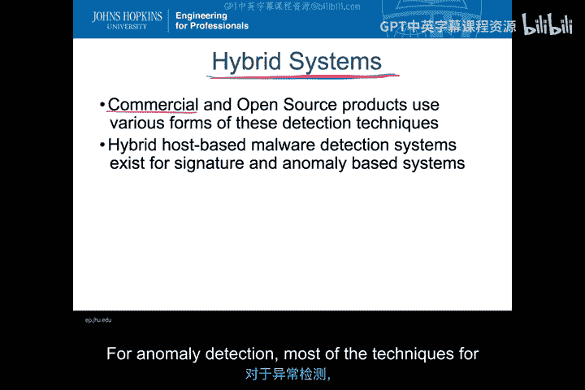

For anomaly detection， most of the techniques for hybrid anomaly detection really deal with the idea of ensemble classifiers。

 This is a technique that says I can put together a number of relatively simple or straightforward classifiers and put them together in such a way that they build upon each other that they actually work together to help to classify the incident space。

 So these are one ways to create machine learning， especially algorithms or things like neural networks that would allow us to really get better at sort of detecting things than a single anomaly detection system would。

So as an example， let's consider sort of looking at root kit detection。

 so I can look at the self nonse detection from the work that we've had in sort of traces。

 and that reduces the false positive in the signaturebased root kit detection。

 So if I'm going to look at other ways of doing signaturebased root kit detection And then I look at the self nonse detection and bring them together。

 I can reduce the false positives for some classes of malware。

 There's a good example here in a class of malware called ghostware。

 This is malware specifically designed to run on your computer and not be visible。

 So it's sort of like a root kit plus some kind of a payload in the background that actually puts your system as part of a separate network or interconnected network of systems that can pull information and stage it through this ghost net in order to get it back。

 So by taking root kit detection and self nonse- detection the false positive rate of detecting ghostware turns out to be。

Chaasically reduced。The whole idea with ensemble classifiers is that what you're really trying to do is reduce false positives by comparing anomalies across different environments。

 So the idea that I can run across many system system1 system 2， system 3。

 if I run and create and these have the same software involved。

 so they all got the same kind of software running。

 if I get an anomaly here and I don't get it here and I don't get it here。

Then I can say that this system is likely that this anomaly is likely to be more associated with malware or something unique to this system than the other two。

 So if I have a series of hosts， and I'm running host base intrusion detection across all of them。

 I can reduce false positives by comparing across similar environments， whether or not。

 I get an anomaly in one space that I don't get in the other spaces。

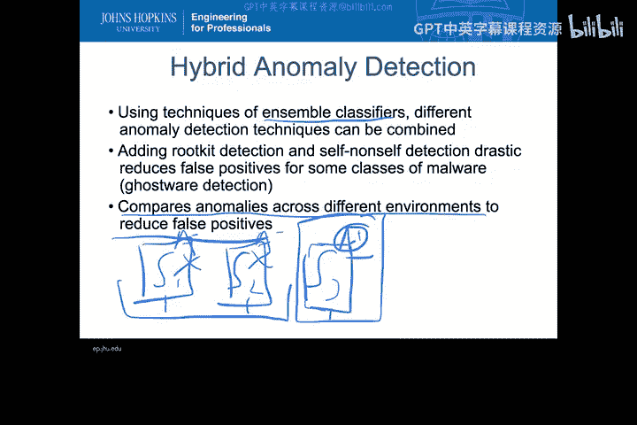

So here's another example of a specificationbased anomaly detection system that's sort of in there。

 So you probably may even have heard of Staard。 It's a reasonably popular product that's been used to protect against buffer overflow style attacks。

 But stackcard really is a specificationbased anomaly detection system。

 It's not unique to any specific kind of buffer overflow attack。

 It's really designed to use this idea of a canary word。

 which is sort of this extra thing that's sitting in the middle of the stack。

 to say if it gets blown away。 If it somehow gets overwritten。

 then that can be detected as something that overrote it in the stack。

 The idea behind this is that we've got the normal stack that we have。

 So this is the bottom part stack stack is growing that way。

 strings that are inside of your buffer are going to grow down this way。

 So in order to create and change a return address from a buffer overflow that's going to return to a piece of。

wareSo this is going to go to some malware。 The canary word will get overwritten。

 If the canary word is overwritten， that value can be checked as a specification。

That's the specification that's being checked。 and if it's overwritten。

 we determine that some kind of buffer overflow attack has actually occurred before the return address is actually taken。

Now， it is important in this case that the canary word， in particular。

 be either randomly chosen or some way that's not predictable to the malware。

 because if the malware can predict it when the buffer is overflowed and we're flooding back into the stack。

 we can simply rewrite the canary word with a copy of the canary word that's already there and then change my return address。

So some of the malware， before it's tried to buffer overflow things。

 has tried to read that canary word in order to understand what value to put in。

 So like most of the coevolution kinds of worlds with the idea of intruders and defenders when the canary word was fixed。

 It was easily sort of subverted by various buffer overflow attacks。

 it became a random value that was then checked a little more complex。

 little more difficult to subvert， but now malware had to take two steps。

 one to read the canary word and then overflow the buffer。

 So then the canary word was more protected where it couldn't be read by the process。 Well， you know。

 again， we just ratchet up the space in each time。 if you want to read more about this exact kind of attack and stackguard。

 I provided the link down here。 that's actually where I took this image from。

 and there are better to full blownown description of exactly how stackguard works at that location。

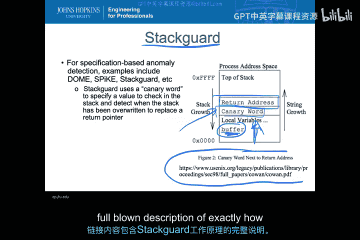

So if that was anomaly detection。 let's talk about hybrid signature detection。

 Hybri signature detection uses a combination of static and dynamic signature production to detect malware。

 So here's the problem that that this hybrid system is trying to solve。 Satures are well known。

For their difficulty in producing good， unique signatures in a timely fashion after malware has been discovered。

 So first， you have to discover the malware， Then you have to tear it apart。

 Then you've got to create a signature， find that the signature is unique to the malware。

 and then you have to distribute it。 So there are systems now that are available。

 One called honeycomb， which attempt to auto generate。

Host based signatures from honeypot style activity， activity from honeypots。

 whose only role is to detect attacks。 So when the attacks are detected。

 there is a auto generatedrated signature that actually comes in place and can be pushed to the host faster than you could do it if you are trying to have a human in the loop to produce this different kind of signature。

There are other systems out there as well that attempt to auto generate signatures assigned from honeycomb。

 So one of the other was MCF， which essentially on the detection of malware。

 attempts to auto generate a signature based on the behavior of the detected malware。

 So this is a sandbox oriented execution which generate signatures that can then be used to protect the operational environment。

So you could also， in this case， generate signatures on packing techniques。

 so you may detect an entire class of malware that uses a similar packing algorithm， but sadly。

 packing algorithms are very easy to change， very easy to update and easily obscured by the adversary。

 so a signature that's really focused on the packing technique is unlikely to be very effective these days at actually trying to detect malware on the system。

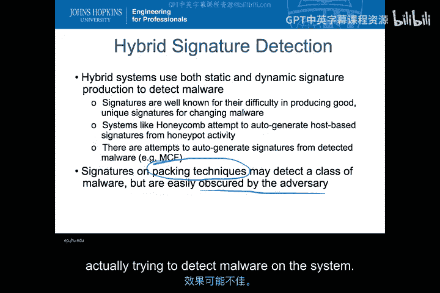

So as I say， this kind of activity is going right up until recent。

 you can see that we have a article here from 2014 which is still producing the kind of work on building on sense of self- for Unix processes that are looking at behaviorbased systems using system call patterns。

 so here's another paper that's just recent using extreme learning which is essentially an ensemble neural network classifier to create what looks like on the rock curve。

 a fairly nice detection of what could be happening with regard to at least one particular class of attacks。

 we're going to be looking a lot at how to generate rock analysis later on in this course。

 but for the purpose of of this chart anything thats getting closer up to this corner is a good detector。

 anything closer to the sort of diagonal is a poor detector so these would be poor detectors down in this area。

Sort of down here and these will be good detectors up here you can see from this paper this is a pretty good detector relatively low false positive rate Here's the bottom has the false alarm rate the detection rate is along the Y axis so we have good detection at a relatively low false alarm rate for this kind of recent research so as you can say the active area of research is still going on in this particular area。

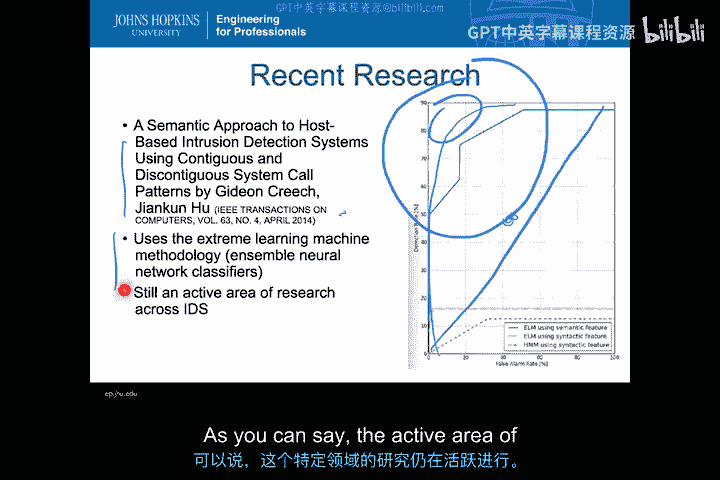

So aside from the research， how is this actually affected products that are actually out there。

 So one example that we could talk about is HbsSS， which is a product that is supported by Mccafe in a system。

 and is used throughout the United States federal government to do host based security。 As I say。

 this is a commercial product。 It's now supported by Mccafee。 It's designed to monitor， detect。

 and mitigate hostbased attacks。 It's a host based IPS。 So in this particular case， this is an IPS。

 or a hips。 And that's exactly what HB is。 It provides a whole variety of component。

 So it is a hybrid system。 In the way that I talk specifically about hybrid systems。

 You can see the modules that it has， but it does asset configuration。

 Tra antivirus using signatures， baseline monitors similar to tripwi。 So in other words。

 it will do target based monitoring device control。 So you can look at the hardware。

Idea of like USB and peripheral monitoring， hardware oriented introductions。

 you can do traditional hips for policy enforcement。

 This are things like the password policies being enforced。 rogue detection。

 Are there individuals in the host base that should not be there and finally。

 an auditing function that really begins to understand particularly whether anything that HbsSS would be looking at has been violated。

 And again， I provided a link for you down here at the bottom。

 feel free to go and take a look at more detail in any of these components with regard to HbsSS。

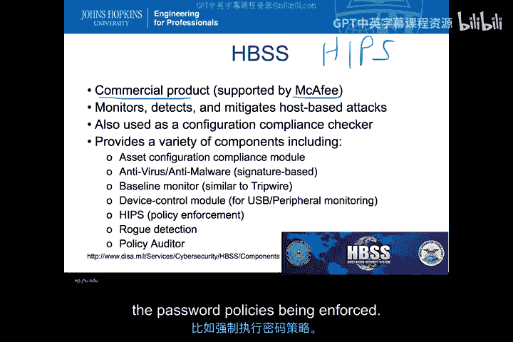

For this class in our project， one of the places we're going to be focused on for our work is OSSCC。

 This is a His that combines many of the functions of malware and attack detection that we've talked about in this particular module in particular。

 the things that OSSCC provides our integrity checking， rootki detection。

 time based alerting active response and Windows registry monitoring。 So OSSCC is at its very core。

 a true IS in every part of the way that we normally describe an IS。

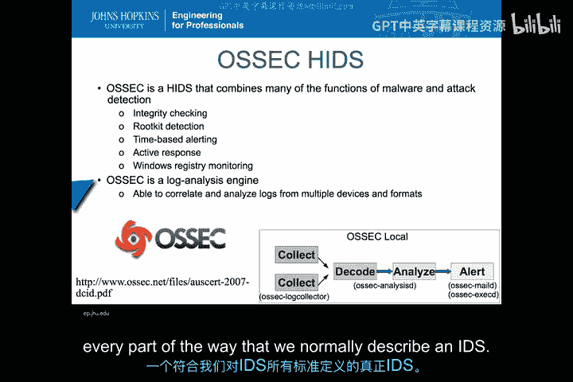

So if you look at what OSS really does， I mean， just focus directly in sort of on this picture。

 we have our log collector， we have a decoder， which is decoding our logs into specific elements that within OSS that we can analyze an analyzer that'll actually combine all of the different logs from different collectors and an alerting function through mail or some other way that can come directly out。

 So OSS really is in this case the kind of IDS that we would normally expect to see。

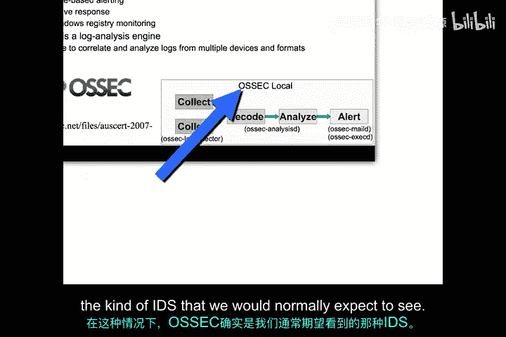

So again， another presentation that you may want to take a look at specifically for OSACCC。

 I've given you a link down here， and that is really gives you a lot of technical detail on exactly how OSSCC works and what some of the internals of OSSCC are。

So in summary， you can see that there's a lot of active and very exciting work in the Hids angle of trying to find malware。

 both through static and dynamic execution。 you'll be working more hands on with some of these tools yourself。

 But now you should be able to see sort of the differences between the targetbased His that we get in tripwire and a more dynamic His that we get from OSSCC and some of the other products。

 So there's a lot of variation， a lot of different ways this can happen。 But remember。

 when it really comes down to it， what is an IS， an Is is really focused on this kind of process。

 So all of the tools that I've talked about have these kinds of stages in order to be an Is within a HiDs。

😊。

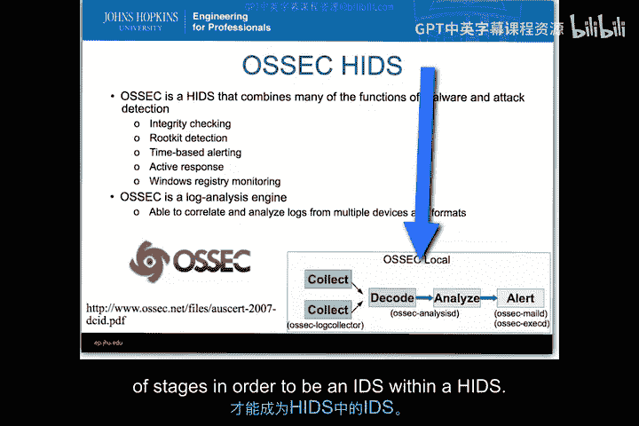