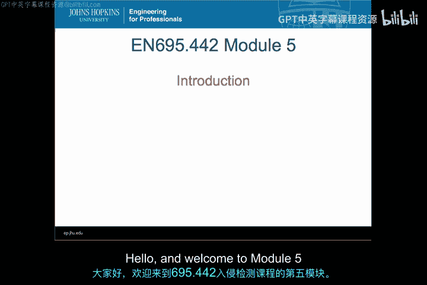
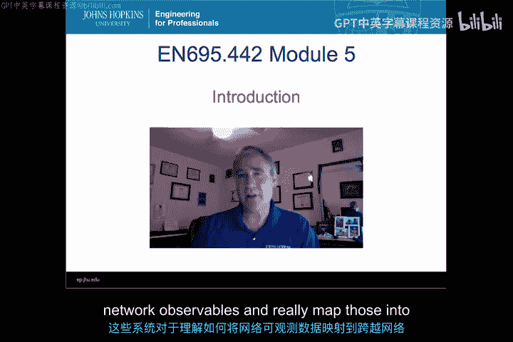
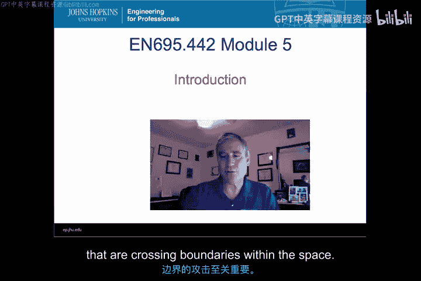
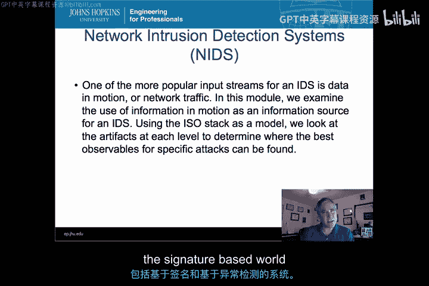
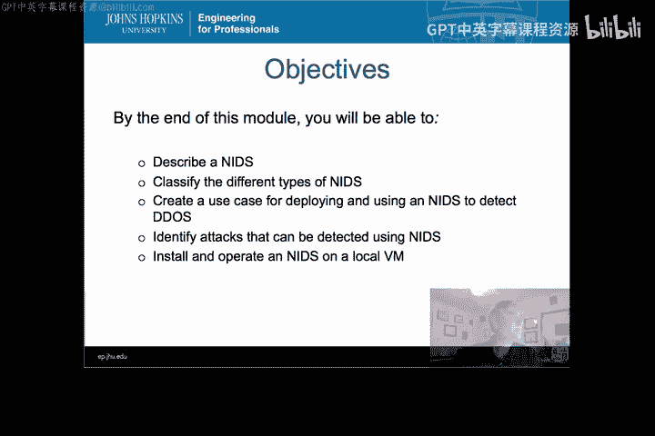

# 约翰霍普金斯大学《入侵检测｜Intrusion Detection》中英字幕 - P16：15_导论.zh_en - GPT中英字幕课程资源 - BV1sGu1z5E2J

Hello and welcome to module 5 of 695442 intrusion detection in this module we're going to start to look into network intrusion detection systems。

 NIDs and NPS network intrusion prevention systems These systems are going to be key to really understanding how we can take network observables and really map those into the kinds of attacks that you see that are crossing boundaries within the space。

The network intrusion detection systems really are one of the more popular kinds of things that you might see out there in both open source and proprietary kinds of systems。

 These are systems that you will see almost any time you do in ID search that's out there。

 They're far， far the most by far the most popular way of looking at external text coming inside and today becoming more popular in terms of looking at internal information leaking outside of the system either through some kind of malware leaking it out of your system or something having to do with an inside or sending information outside of your system。

 So we're going to be using the ISOtack， the seven- layered ISO model as a way of collecting where the observables come from with regard to aidIs。

 we're going to look at the artifacts from each of those levels to say where do we find our observables for NIDs for the network intrusion detection systems。

 and we're going to talk about some of the common kinds of products that are out there。

That actually do some of the NIDs systems both in the signature-based world and the anomaly detectionbased world so by the end of this module。

 you are going to be expected to be able to describe exactly what a NIDs is classify the different types of NDs that exist develop a use case for actually applying NIDs to distinguish between Ddos and flash crowd and we'll talk more about that as we get close to the exercise and identify what kinds of attacks can a NIDs actually detect Finally as part of your handson exercises this week。

 you'll be able to install and operate your own NIDs on the VM that you've already gotten set up so I hope that you enjoy this module it certainly is going to be key to really understanding how the network intrusion detection systems really can operate to help reduce risk across your enterprise。

