# 约翰霍普金斯大学《入侵检测｜Intrusion Detection》中英字幕 - P17：16_网络入侵检测系统原理.zh_en - GPT中英字幕课程资源 - BV1sGu1z5E2J

Okay so in this video we're going to start to talk about what is aIDS。

 specifically we're going to focus on where a network intrusion detection system gets its information。

 where within the various portions of the stack， you can see observables or a NIDs can see the observables and sort of the kinds of attacks that you might expect in each one of these different locations。

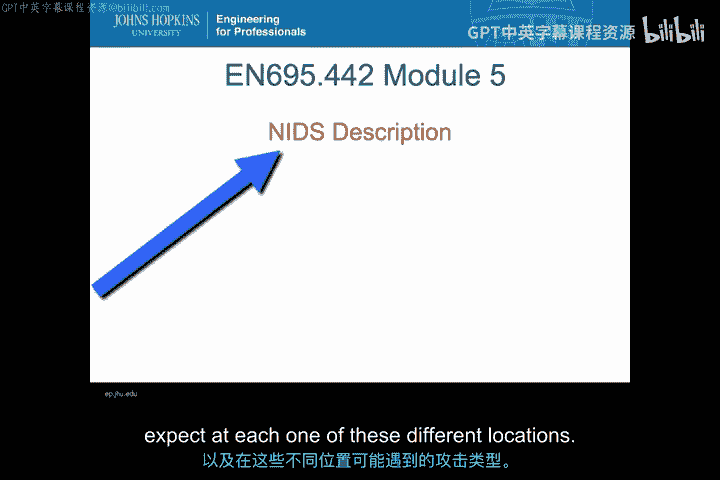

So first of all， let's get into what network intrusion detection system really is So as the name would probably imply。

 uses network data as the source of observables to detect the incident。

 So basically that as long as you're using data in motion So data in motion is the real key for a NIDs then you're really talking about an information source for a network intrusion detection system。

 a Nps or a network intrusion prevention system also uses data in motion but can also do responses within that data in motion blocking or modifying or doing something with network traffic So this really is one of the most popular information sources why because primarily when you have a network interface to say the internet。

 it's the perfect choke point to watch all of the external attacks coming into your organization or a perfect point choke point to see all of the information that might be leaving your organization save from some。

Nowware internally thats sending your IP out so this is one of the reasons why NIs are so popular。

 obviously with networking being a primary place to watch for traffic。

These choke points means that you don't have to do as much in the way of a deployment as you have would have to with a His as we've looked at sort of in the previous module。

 Now， aidds can use either signature or anomaly detection so they can use in their classifier whatever they need to in order to turn these observables into incidents。

 And we'll talk about both signatures and anomaly detection Nd systems within the module。

So as I alluded to just a moment ago， there are a lot of advantages in using some of these networkbased sources that are in here。

 Obviously there is a low performanceance cost if you've got a passive network sniffer you're not taxing each of your other hosts that might have to be doing an IDS functionality along with the other functions that those systems would have to do by and large networkbased intrusion detection systems are not easily seen by intruders。

 they tend to rely on passive links to the network。

 passive taps on the network lines as they go by so intruders have a much more difficult time targeting these IDS systems to attack them and turn them off so that they can't be detected there's very little interaction with other user applications so it doesn't get in the way of some of the things and we'll talk about some exceptions with that a little bit later but in general most NID systems are pretty passive with regard to the user applications。

That are there。Within network observable， some attacks are very easy to spot。

Especially attacks that are sort of aggregated across multiple hosts。

 So although we learned that host based intrusion detection is really。

 really good at identifying things with observables close to the data that's being attacked in the network based cases。

 I can really look at things that are aggregated。 I can look at malformed kinds of attacks that might not even make it to the host。

 And finally， it's a really good place to look for resource exhaustion in network based resources。

 these network denial of service attacks。 are more easily detected in aidds than almost any place else within your system。

😊。

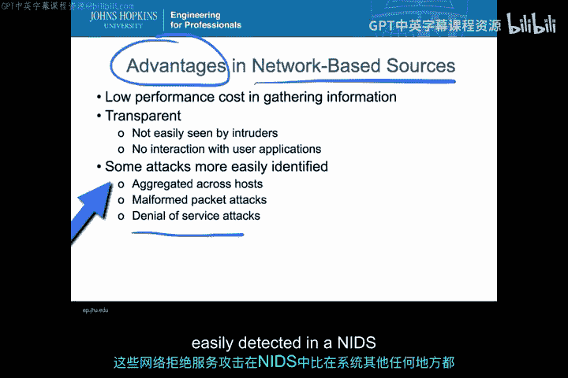

So where does AIDS get its observables where does it actually find all of this information Well not too surprisingly you're going to get it basically from the network stack and I'm going to focus primarily on the TCPI types of network stacks as we go in but basically the idea with these network stacks is that each layer in the stack is an encapsulated structure of the packet in the layer underneath it or layer above it。

 so layer information at one layer is just data to the next tire layer until you peel everything off all the way up to the application so there are many important layer for the IDS within this network IDS and we're going to talk about each one of them so we're actually going to go and talk about the physical the link layer。

 the internet layer the transport layer and the application layers within the stacks to talk specifically about what kind of observables we're going to see at each place within。

This network stack。So one thing to point out that sometimes does get a little confusing。

 this network stack does of course， run on hosts， but the differentiation between a hostbased intrusion detection and a networkbased intrusion detection isn't the fact that the IDs runs on a host because they always run on some kind of computer but the idea is that the information used by the NIDs is the data in motion。

 it's the stuff that's coming across the network links。

 not the audit files and log files and things that are process related running on the host itself。

 So don't get confused when you see that we're going to be talking about network intrusion detection based on a stack that runs within a host because in every case the Is has to run on some computer。

 but usually these Iss are looking at network traffic not just destined for their own computer but anything that's visible to that specific location within the infrastructure。

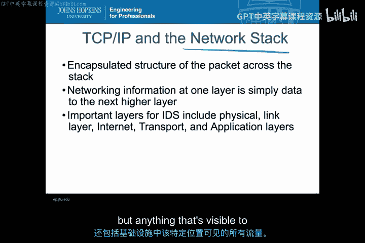

So an important distinction that we need to talk about a little bit is the sort of standard traditional OSsI stack versus what's normally implemented in the TCP stack。

 So this table down below really lists the different layers。

 the seven layered model that's within the OSI stack。

 this seven layered model is the one that's really key to the network intrusion detection system Now the way this model is implemented on specific systems may change based on the operating system and the way that that particular system has been designed So it's very popular for example。

 to have sort these network interface cards and do a lot of this processing at the data link level away from the traditional processor and on some sort of another board that actually sort of plugs in the network and transport layers。

 the TCP UDP areas are often linked together within the TCPIP stack and the session layers usually not separated out either。

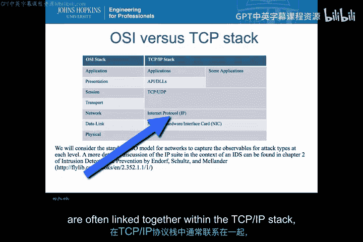

So the session transport network layer tend to be implemented sort of in the same area within normal TCPIP stacks。

 but we're going to talk separately about how the network。

 the transport and the session layers no matter what their implementation contain different kinds of observables that you actually want to make sure you can differentiate。

 the same things true sort of at this application level， this highest level。

 the API DLLs and the application that are here really mixed together both the presentation and the application layer。

 but we're going to treat them separately for the purposes of looking for the observables in the I。

 but keep in mind based on the implementation of the specific network device that we're talking about。

 the observables may actually exist across different portions of the implementation and not be as cleanly separated out as we are describing within sort of this physical to application layer OSI stack。

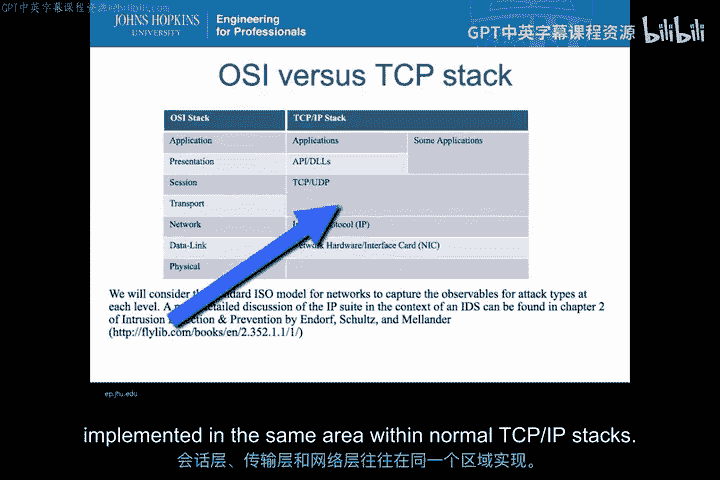

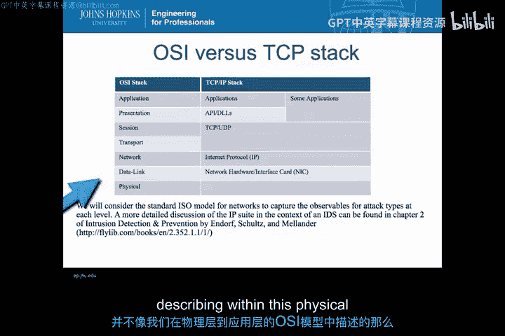

So let's begin with the physical layer This is the layer that actually has all of the as might show by the name。

 the physical characteristics of whatever the network connection or data in motion is and this is true whether we're talking about fiber or coax or wireless pretty much no matter what we're talking about these are the physical characteristics so this is before we actually get to the point of creating packets or digital data so if it's wireless for example。

 we might be talking about the RF characteristics if it's fiber we might be talking about the different kind of frequencies that are actually being sent across the fiber and across the way。

So because this isn't digital data， it's not the traditional network packet data where things you might expect from a network。

 the kinds of things we do get at this layer tends to be related to the physical characteristics of the connection so we can get things like the physical location we can get breaks and taps and devices that are out the link we can get some environmental parameters。

 temperature humidity， some of the things that have to do with specifically what you might think of as the surrounding metadata of the network connection So this is the sort of information that we get from these various devices in order to get these in order to get anything from the physical layer。

 we have to have sensors that sample the physical characteristics of the environment surrounding or within the network sample。

 so these tend to be physical sensors， things like temperature sensors， Tmperbased sensors。

 things that will allow us to look at the impedance of lines or networks to know where we're going to see those break。

and taps and sort of other things that we had talked about up here。

 So in the physical layer we're going to be able to detect detect attacks that take place at the physical layer。

 specific taps on the line， anybody who's doing passive monitoring of the space， cuttings of lines。

 various sorts of entry into places that you shouldn't be tampering inside of boxes where you shouldn't be tampering inside of the hosts So the physical Is is really based on these physical sensors that we have located in the critical portions where an intruder is going to get access within the box to take care of the or do some kind of nefarious action to the physical communications between various boxes that are there。

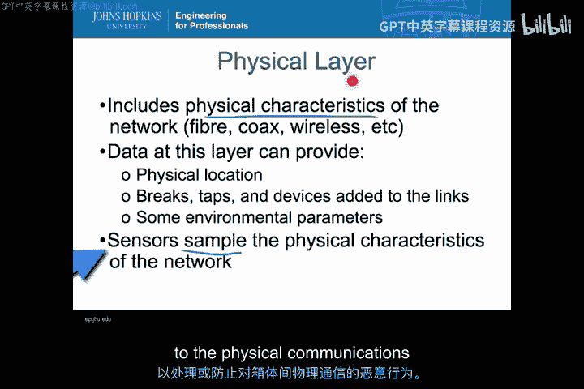

The link layer moving up the line， the next layer up is the first time we actually get digital data。

 so now we've moved from the physical characteristics to essentially the first point to point communications that allow us to look at the bits that are actually flowing。

 This is the encoding of the bits in physical space so that we want to be able to see these various protocols for the point to point connections。

 and again， this is independent。Of the type of physical layer that we're talking about。

 whether we're talking about going over wireless， over coax， over satellite。

 over some other kind of thing， we're looking at the first point to point communications that are here。

 There are lots of things that happen at this layer。 We sort of negotiate the data rate。

 We look at error correction。 This is basic note identification。

 you can provide things like the Mac ID link rates， link specific data that's kind of in place。

 So the sensors at this particular layer look at the low levelvel bitstream。

The actual bits that are passing and encoded between device one to device2。

 We don't look at routing here。 We don't look at the other types of the protocols。

 It really is just the encodings of the bits and the identification and connection of the sites between those two bits。

 The sort of things we're going to get at this layer we're certainly going to get various kinds of spoofing where I'm going to connect a device in and I'm going to authenticate it to a switch or I'm going to put it into a wall in order to connect up to something else physically I'm going to put a rogue A in in a wireless network。

 This is another way of introducing something at the Mac layer or something at this link layer that would allow me to either take over a connection masquerading as somebody else doing a man in the middlet attack or any of the other sorts of things that I can do if I get into the bitstream at this lower level。

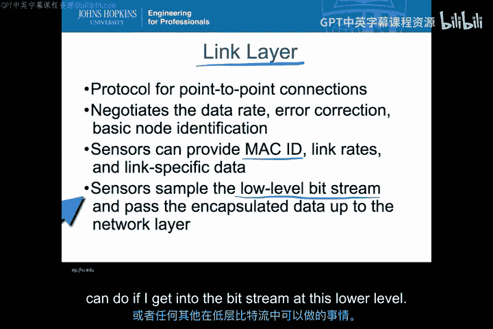

By the time we get up to the network layer and sort of looking within the IP layer of most things。

 but the network layer， we're looking at a protocol that's actually serving as a packet multixer。

 This is going to provide routing and sequencing So now rather than just my point to point links that I had in the previous link layer I'm going to have something that looks at my end to end connection This is going to essentially give me both my source of my destination addresses end to end It's going to say how many hops I'm going through fragmentation of packets This is actually going to control how do I get these bits across switches and routers from one end to the other end So the data that I'm going to get within this IP packet is going to be the TCP packet just like the IP packet was data to the link layer。

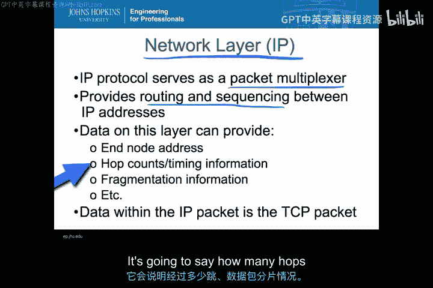

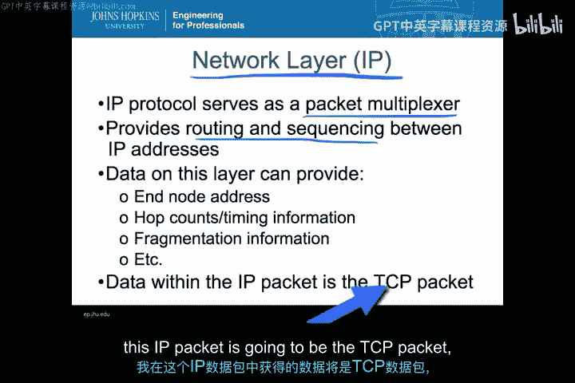

The kinds of attacks are really all about the kind of things that the data on this layers provides。

 I can spoof note addresses。 I can create various kinds of routing anomalies with different kinds of hop counts and timing information。

 I can fragment or unfrment packets， all the things that I can do within sort of the IP headers in terms of my control over these networking is what I can do sort of this network or IP layer on the system。

 So the main things that you're going to see primarily here。

 source and destination addresses you're going to basically see everything having to do with the metrics and statistics on the routing information itself。

 and finally， you're going to have things like timestamps and time to live in various elements within this IP layer。

 depending on exactly which protocol you're doing at the network layer。

 you'll get somewhat different information， but it's always about the routing end to end across multiple nodes。

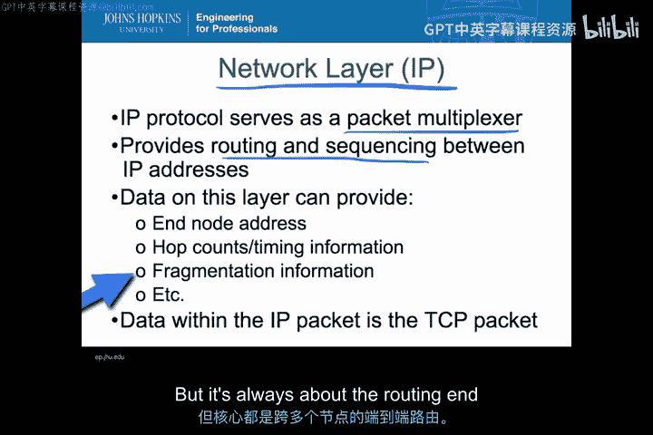

Moving up to the transport layer now I'm getting my port and protocol information。

 This is where the first time I'm going to start linking that end to end network traffic with the kinds of applications that are indicated based on the networking traffic so in this particular area I'm going to link to the application receiving and sending this data I want to tell systems on both ends the sending and the receiving side how to get this data from the network interfaces up into the application that I'm trying to do so we're going to have very specific network enabled application information based on things like port numbers。

There is a warning， however， with this。 make sure that you realize that port numbers themselves don't necessarily indicate。

 They don't necessarily indicate exactly what application the receiver is going to use。

 The sender may make some assumptions。 Like if I send some information to port 25。

 I'm expecting it to get picked up by a mail transfer agent on the other side。

 But if I'm an intruder or if I'm doing something different。

 I might map that port to a different application。 So the mapping of the ports to the application happens on the receiving side for when I'm going to map it from the packet that are being sent to me to the application that's receiving it。

From the other side。Sending the data usually comes from a relatively random port number。

 high numbered port number so that's receiving the receiving network side can't always know necessarily what application is sending the data based on information in the transport layer。

 you need to use other information to actually try to understand how that particular application is sending the data。

 you usually don't get that inside of the transport layer itself。

 get very little information about the sending application。

 but you do get some information about the receiving application。So again。

 the kinds of attacks that I'm going to see at the transport layer are those that have a lot to do with mapping specifically into the applications。

 trying to understand how I'm going to redirect the traffic to an application that the sender expects it to be receiving。

 so if I'm sending something along to port 80 and I'm going to expect it to get picked up by a web server。

 I might have some kind of an attack。That links instead of that port 80 to a web server。

 it links it to some other sort of man in the middle attack that allows us to rewrite the data before it gets to a final webbased application。

 so the kinds of again the tax I get at the transport layer have to do with the specific data。

 the port and protocol information that I'm actually going to be receiving within the transport layer。

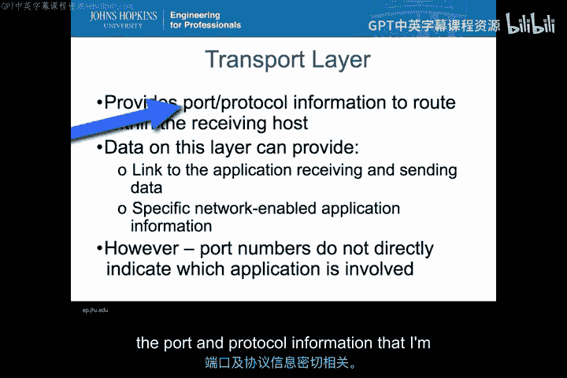

Finally， I'm going to get all the way up to the application layer。

 the application layer in this particular element from the transfer layer is going to really。

Be the recipient point of the payload of the information these are going to be very specific and detailed application layer data that's going to be moved into it so if I talk about as a web server this is likely to be HP or some kind of protocol that's going to be designed for the web server I'm going to have mostly application specific data there may be a general port designation for this from the lower layers。

 but it's the payload that really matters when it gets up to the application layer。In this case。

 the lower layers that we've talked about before really provide fault to delivery to and from the applications。

 so it's so the application doesn't have to worry about what happens after it's packed up some of the application data and is sending it off to the server or receiving it back from the source to the destination vice versa。

Now I've skipped over the presentation layer in this particular one because the presentation layer is so often associated directly with the application layer。

 but the presentation layer is really all about trying to understand how to take the data and reformat it or change it so it's amenable to the application it's a shim that you would put between an application or two application communicating across the network that might have incompatible string formats。

 number formats even sort of packet ordering in various sorts of things you might find between the application。

 so the presentation layer and the application layer normally work together within the application space to provide some kind of information that would translate and allow the applications to communicate more seamlessly together there's also a session layer that's often attached here which tends to take care of the authentication or encryption。

This is where your VPNs usually operate is within the session layer so that also tends to run as a separate application or as a sidecar application to what's happening within the application layer。

 and again， not quite as clean as the same kind of encapsulation that I might see in the rest of the network says consider here。

 but the session layer is associated with the kind of encryption authentication。

 any kinds of special session set up that might go back and forth。

 so we tend to associate session layers with things like HP authentication as we're kind of going back and forth within providing passwords or other sorts of authentication back and forth。

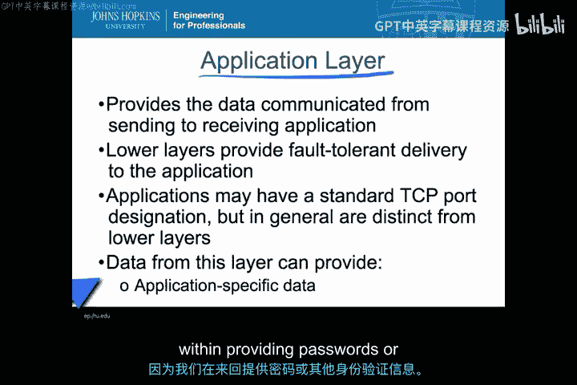

In addition to seeing things across the stack within the ISOtack。

 there's another separate kind of input into NIDs， which are sort of network log files。

 these are not specifically within areas that you might think of as part of the IP stack。

 but they're more log files from devices along the way。

 places like routers where you're going to want to know is a router itself。

Being attacked from the network IDS point of view， it can be a key indicator of attacks against the security of the structure itself against things that are there only recently have things like rat logs been incorporated within NID systems。

 but you'll now see them more in terms of commercial products。

And things that are happening within kind of the network IDS area， other kinds of network data。

 cache files， things that indicate network history， statistical variations。

 netflow collection that's a lot of things that also are collected along the way with network log files that are very useful to an IDS but don't map quite as cleanly into the ISO stackack that we've sort of just covered。

So from here， now that we know what the basic elements of the observables are for the specific NIDs。

 we'll get into more details and examples of what the NIDs out there actually do with this information。

 how they identify attacks， and what some of the examples are within the NIDs world。

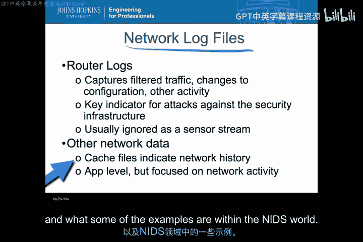