# 约翰霍普金斯大学《入侵检测｜Intrusion Detection》中英字幕 - P18：17_NIDS类型与典型系统.zh_en - GPT中英字幕课程资源 - BV1sGu1z5E2J

Okay， so in this video， let's take a look at some MIID types and some examples building on what we saw in the last video on the kinds of information sources that IDSs that MIIDs in particular can take in。

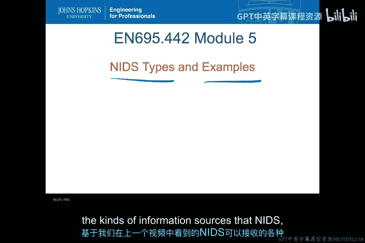

So remember that first and foremost， all Iss at their heart contain a classifier of observables。

 So what observables do you actually want to distinguish between in some of these cases。

 when you talk about network traffic types。 you can actually break things down to sort TCP versus UDP as the two primary different types of normal traffic that is collected and evaluated by these different Is that come in。

 And then， of course， you look down below sort of the TCP and UDP level， And you start to say。

 do I only deal with clear text packets or can I deal with encrypted or tunnel packets。

 So the observables in clear text transmission are pretty simple， you can look into the payload。

 you can get deep packet inspection， you can get things on the network that are actually going to be looking at the specific application types。

 If you have encrypted or tunnel transmission。 you've only got two options。In the first option。

 you can just look at the header information， just the header information and ignore the payload information from the encrypted or tunnel transmission。

 The other thing you can do is you can proxy the tunnel or proxy the encryption So an SSL proxy for example。

 is a thing that many enterprises use to allow you to connect through an SSL proxy。

 which gives you the ability to look clear text into the packet at the network the node that before you go off into the internet。

 this also allows the IS to do the same thing that you can do within clear text transmission。

Within here also， you have to decide whether you're only going to look at open protocols or whether your Ids can look at proprietary protocols。

 So open protocols are like the H Ttps or other protocols that are well known and sort of out there。

 also including， by the way， the winds protocols or the。

Any of the other networking style protocols in cellular that would be openly specified。

 a proprietary protocol would be mostly at the application layer。

 but also perhaps of the session or presentation layer where I've got specific applications that build a layer in to lock the the ability for those applications to only work together with others of the same vendor in those cases you might have additional layers of encryption you might have other ways of specifying the application data that is proprietary and you're unable to sort of look into it。

 so an example might be something like a Netflix that's out there where the proprietary protocol of actually looking at the video would prevent an ID from being able to look into the packets themselves to know whether or not you're being attacked。

Other ones， you can sort of say at the port level and this is sort of in the TCP。

 am I only looking at various fixed ports。Can I do a mixed but you know known ports or do I have them completely randomly in the fixed port。

 I actually use the port number as a way to identify what application I'm going to link it to in the IS sense so I know what observables to look for。

In the mixed ports， I may have several different ports that go to the same application。 For example。

 I may have a web service on port 80， and the same web service might also support port 443。

 So I could have mixed ports and have different ways of looking at the data depending on the port that they're going to randomand ports means that I'm going to use the payload information。

 not the port information to identify how to actually look for my attack observables， And then。

 of course， I've got my how do I classify the actual different types of network traffic Do I have。

 Do I classify them based on port payload features or some other sort of behavior that's indicated all of these are going to help me understand how to encode my observables in a way that I can take the network traffic types and then turn around and decide how I'm going to actually run my classifier。

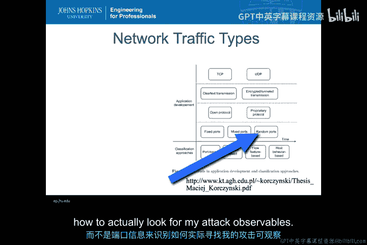

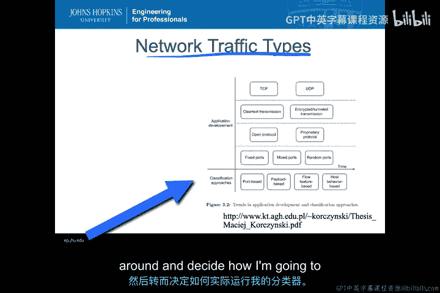

So now that I've got my traffic encoded in a way that I can actually do my network classification。

 now I have to decide how am I actually going to run my classifier。

 I can do it based on the content that are in there， or I can do it independently of the content。

 basically looking at just the header information if I'm going to go context based。

 I can essentially just look at the ports， and look at those strictly to understand how to classify the attacks versus the nonatt or I can dig down into the payload。

 and I can do what is frequently called deep packet inspection in order to understand how to classify my attacks versus my non-atts。

 If I go down into the payload， do I only look at the header of the payload or do we look at the whole thing。

 the entire payload， The header of the payloads is just going to give me sort of the protocol layers。

 maybe some things about the application。 But if I go all the way into the payload itself。

 I might look for malware inside of an email message or inside of some sort of a webbased download。

If I'm not going to go into the content， if I'm just going to be independent of the content。

 then I may just look at flow features， netflow or other kinds of behaviors that are more metadata when it comes to the network traffic classification。

 So in each one of these areas I have to decide now that I've encoded my observables and I'm going to run them into my classifier at what level do I do the classification between regular traffic and attack traffic。

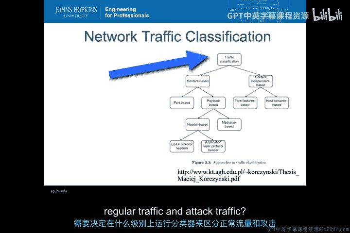

So within your reading this week in chapter2 of the state of the art in intrusion Prevent and detection。

 you'll see this taxonomy that actually shows up on intrusion detection systems and just to sort of scope out exactly where we are in network。

In network Is， we basically are looking here through the architecture， just looking at the Nds。

 We'll talk a little bit about hybrids in the next module。 But in this case。

 we're really going to focus here on the Nds。 This is the only thing fixed within the Nds infrastructure。

 All the rest of these are varying depending on what kind of network IS system you have。

 So you can have an architecture that's centralized hierarchical or distributed。

 You can have post detection that's active and Ips or passive and Is。

 you can have signatures or anomaly detection as your detection method。

 So any of these different types of variations are possible within the NDs systems。

 The only thing fixed in the Nds is the scope is going to be network traffic。

 That's where the observables come from。

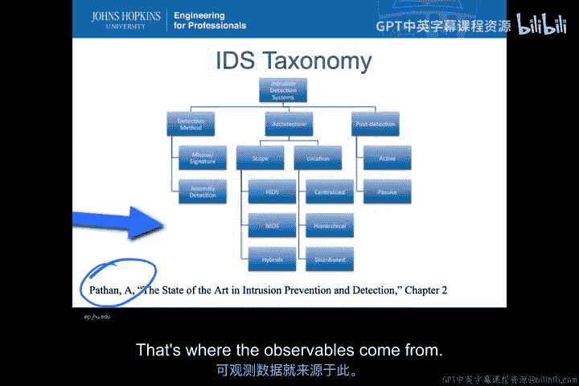

So where you place the nids is also an interesting characteristic of what the niIDs can actually detect。

 so a very common place of course is to monitor your nis outside the firewall。And I by doing this。

 I'm basically saying that all traffic destined for my source or coming out。

 regardless of the filtering of the firewall is going to be picked up by my ND system out here。

This is valuable in terms of understanding what kinds of attacks are bouncing off the firewall。

 so when I have attacks coming in and they're bouncing off the firewall。

 the nids is still going to pick those up sort of down in this area。

If I have some kind of a DMZ that's actually supporting things like my Web services。

 my email services， I might choose to put my Nds right down here in the DMZ。

 The value here is a tax coming through my firewall into my DMZ that are allowed because they're going against my public facing services can be picked up by the Nds when it's placed in this particular location。

 It can also look at all the outbound traffic from your public facing services。

 Now this is important because these bidirectional traffic through your firewall is allowed so unlike maybe blockage coming into your normal land down here in your Ndsbased traffic you absolutely arere going to have legitimate traffic coming down here so your Nds is going to have to be the thing that distinguishes the regular traffic that's coming into your services versus attack traffic coming from the internet and is attempting to violate the securities and。

Policies that are created on the host based systems that you have inside of your DMZ。Finally。

 if you really are looking to monitor your local area networks in terms of this kind of area。

 you might want to place your nid against the local network。 Now， how is this valuable， right。

 Because you've already got your blockage here at the firewall presumably keeping your attacks from happening。

 Well， one of the valuable things on placing a Nds here is you can look for various kinds of traffic that might be outbound from your network that shouldn't be there。

 The kinds of things that are looking through the firewall and outbound that might be expo of information malware that's already running down here on the host that's now sending traffic out。

 This is all going to be picked up here at the Nds。

 And you'll be able to look at that sort of traffic here。 It's also useful for insider threat。

 If I've got insiders attacking in this various section sort of down with again within my local hosts that are sort of down here。

 My Nds is going to look at anything that's attacking between the host。

 It's going to see things internal to my organization。

It would be useful for understanding how insider attacks are working。Finally。

 within your infrastructure， you may actually collect multiple alerts down at some court of an IDS manager。

 this kind of way you can actually take information from all of your IDss and bring them in to some sort of a SIim system。

 security incident management system that's actually going to be running and coordinateordinating if you have multiple NID systems that are actually out there on your network。

 So this IDS manager can take the alerts and push out configurations into all of these different places to allow you to coordinate across all the different places that your NIDs might be organized within your system。

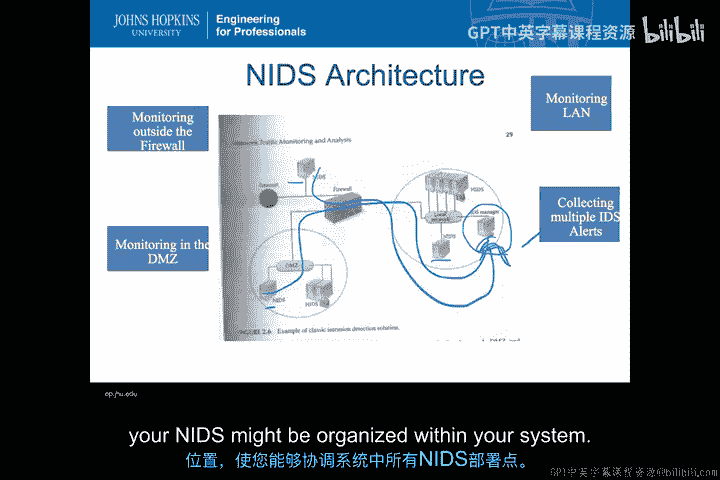

So now that we've talked about what your IDS systems can encode in order to do the specifications。

 let's talk specifically about the different kinds of IDSs that are actually sort of available The earliest type of IDSs that were out there with these sort of network GrP systems these are systems where you're really just taking raw packet data usually it layers 34 in your network and you're matching specific packet patterns was some kind of irregular expression This really started sort of with NSM back in 1995 as one of the earliest versions that just took TCP dumb and piped this to GP with the signature database。

At the very basic level， this covers everything that you would want to do with regard to an Is in that in that sort of a system。

 You could read more about it at this particular URL if you're interested in looking more at the specifics of the NSM report from 1995。

 This network grip system is the basis for snort and most of the other signature based Nd systems that you actually see out there。

 This was the pattern that uses raw network traffic。

 Some kind of a network s sniffer to go against some kind of a regular expression。

 This was a signature based ND system to look for those kinds of specific attacks。

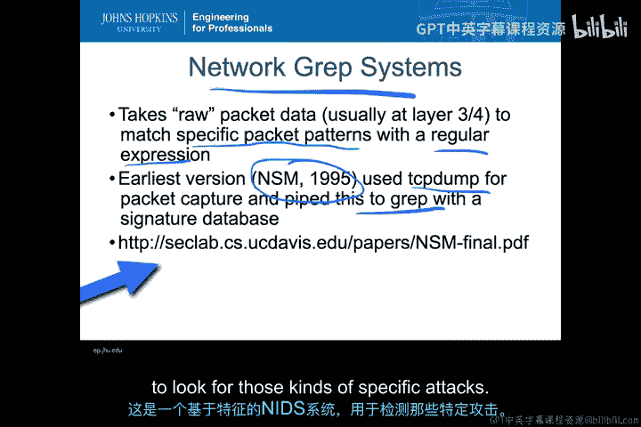

So as I said， that sort of Grpe Bay system really did lead to the idea of Snort。

 This was a natural follow on from NSM created by Martin Roche in 1998。

 who also funded source fire in 2001。 So no surprise， source fire is a more advanced version。

 a commercial version of Snort。One of the biggest contributions of Snort is that it standardized the signature rule file。

 This was really， really important because it allowed through Snort。

 the idea that different third parties could support a free snort installation by having customized。

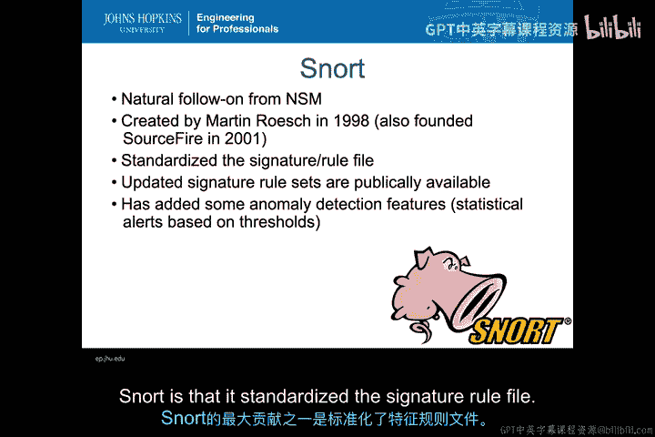

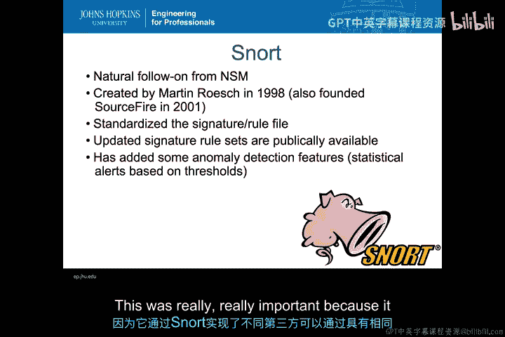

Yes， rule files that were actually all in the same standard format。

 So these updated signature rule sets， some of them were publicly available。

 Some were commercially for sale。 The commercial for sale versions tended to keep up better on zero day attacks and attacks as they came out。

 The public versions tended to to lag behind these commercial versions in terms of what was included in the signature or in the rule file。

Now， both the freeway version of Snort and source fire。

 which is the you can think of as the commercial version of SNort， in both cases。

 there's then been an updated version of the way the rule sets have actually worked to include both。

Signature based detection， as we talked about from the NSM days。

 In addition to some anomaly detection features。 primarily。

 these are statistical alerts based on thresholds。 So， for example。

 if I get too many web requests one given time， too much traffic from a given host。

 not enough traffic from a host， you can set up part of these rule sets that you will actually use to identify when the envelope of normal behavior has been exceeded。

 So in that case， we really are looking at anomaly detection and not signature detection as you would get in the more sort of standardized signature rule based file。

Now， in the course of your exercises and your assignments。

 you will have a lot more experience and be able to do a lot more with SNort and their sort of standard signatures and rule base files。

 so be sure to take a look through the documentation and really get more comfortable with the way SNRT works。

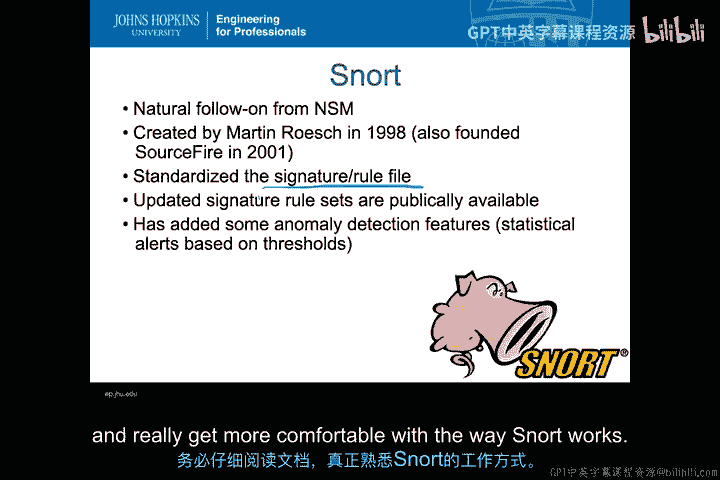

In addition to Snort， there were a couple of other approaches that started in the mid-90s that were of interest。

 One was Nagios created in 1995， primarily for use in network monitoring。

 Nagios took a framework style approach。 It essentially serves as a platform that allows you to use network observables in any way that you want to。

 You can use nagios to create visualizations of your network traffic。

 You can do it to do networkbased analytics， but you can also add modules that would specifically be for Nds。

 So this is considered a platform for different kinds of processing。 It's modular。

 I can include stuff。 It's still very active today。

 You can pull even recent nagios modules for use in network traffic to very general way of connecting network traffic and observables to different things you might do with it。

 So you can see especially in the research community that there's a lot of Nds modules that would be prototyped within Nagios to understand whether these new type。

systems would actually end up working so Nagios is again。

 an open source freely available framework and many of the modules that are included are also open source and freeware as part of Nagios。

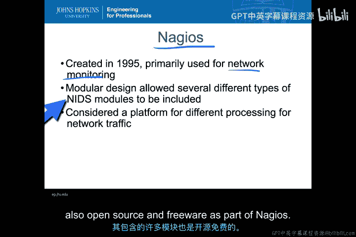

Of course， it didn't take long for other companies like Cisco to get really interested in the market that was growing for intrusion detection and the use of all these open source intrusion detection systems。

 especially snort。 So building on the expertise that Cisco had been using in the firewall community for monitoring and filtering an additional intrusion prevention and detection facility。

 was kind of a natural for that space in the anything having to do with the routing and firewall space。

 Cisco could use a configuration file very similar to a firewall configuration file。

 but really designed more specifically for I and IPS。

 So the current product lines in Cisco include the ASA line of IPSs。

 which you can sort of see at this URL that's down here I' cut a piece of the data sheet from the Cisco secure I over on this side。

 The Cisco secure IPS is a good example of how a commercial IPS solution building on routing and firewall technology。

Can also be very effective at high speed enterprise level NIids and NPS that are actually going to be running across the enterprises that can afford to invest in having support and having a more robust product than one that you might get from a freeware and open source community。

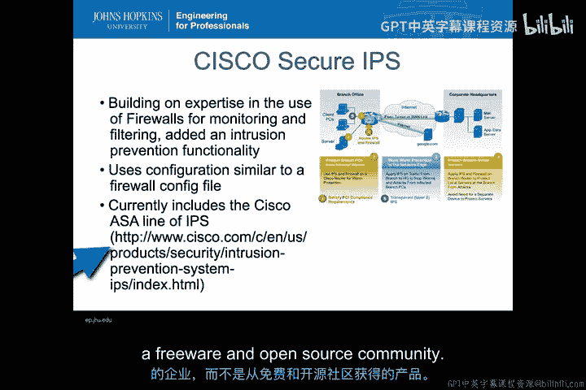

But the open source community within IDS is still very， very active。

 Some notable open source projects that are sort of out there are both Bro and Surraccottta。

 Bro was developed by Vern Paxen in 1996， but it's been under active development since 1996。

 It essentially like Nagios is a framework of plugin modules。

 but unlike Nagios Bro was designed more to be specific for intrusion detection。

 So the modules are well designed to really focus on the detection problem in terms of what's going on。

 Surraccottta developed by the open information security foundation。

 was another approach not quite like Bro， Surraccottta also used standard signature files。

 often like Snort， but it supports a more full set of signature anomaly based detection modules that would run within Surraccottta。

 Both of these Bro and Surraccottta are both。Both included in the security onion package that we'll talk about a little bit in module 6。

So that gives you sort of the notion of the kinds of NIDs products that run on regular networks that are available today。

 both in terms of the commercial sense and the open source sense。

 there's a lot of activity in this particular area of intrusion detection。

 so you can certainly see just even by simple Google searches， new products coming online。

 other vendors that introduce IS products and things that are really IDS that are not called IDS but instead are called network security appliances that might be out that Barracuda being one example of a network security appliance that often doesn't call itself an IDS。

 but in fact includes all of the functionality that we would incorporate within intrusion detection systems and in particular network intrusion detection systems。

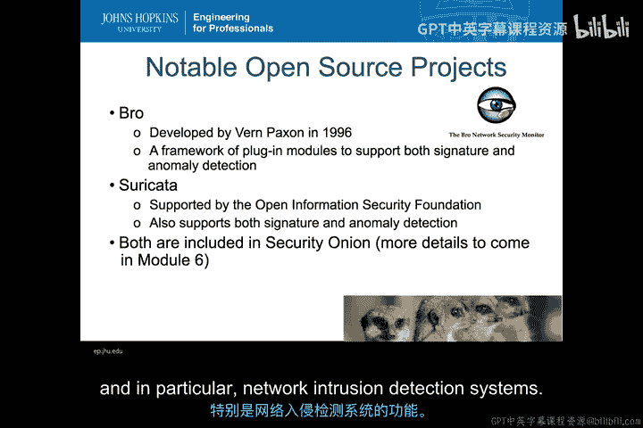