# 约翰霍普金斯大学《入侵检测｜Intrusion Detection》中英字幕 - P20：19_NIDS可检测的攻击类型.zh_en - GPT中英字幕课程资源 - BV1sGu1z5E2J

Okay， so in this video， let's start getting into the specific attack types that would be detected using the NIDS systems as we've been describing them。

 we're also going to in this video talk a little bit about some of the challenges that NID systems have when it's trying to detect attacks within network observables。

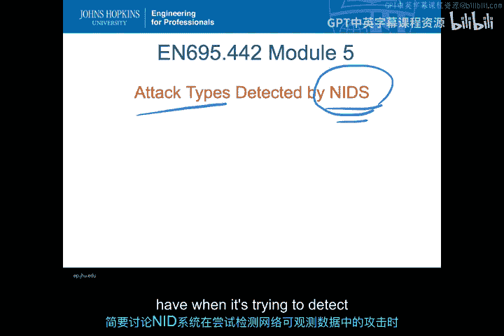

So let's remember from the previous videos that network observables are all about data in motion crossing boundaries。

 essentially these sensor points that contain attack observables。

 so this is exactly the sort of things that would come across networks that can be tapped so network infrastructures that are basically switched in a number of ways may have to have multiple boundaries in order to get all of the attack observables that you're looking for。

 so remember back the previous video where we talked about where to actually place NIDs and think about it in terms of all of the different boundaries that can be crossed where these network observables might exist。

And of course， most of the kinds of attacks that we're really thinking about here are what we consider to be remote attacks。

 These are the attacks containing observables that are crossing these boundaries with data in motion。

 So this is external attacks coming in and violating protocols or information leaving across a boundary that might not or might be violating policy and probably should not be going across that particular boundary。

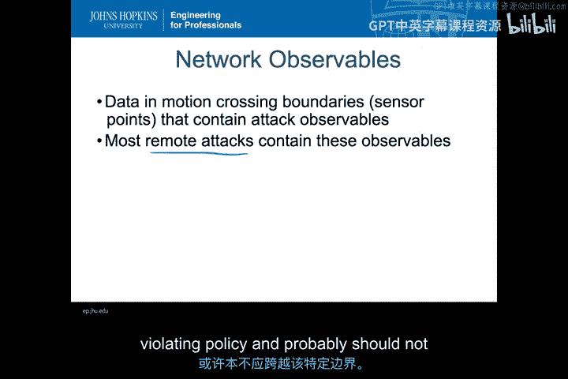

If you consider back to when we had talked about the original taxonomy that we started talking about in module 1。

 the place that we're really focused here is within the target environment。

 As you can see down here of everything having to do with the network and the Internet network。

 So the places where we're really concerned about these network attacks still allow us to take pretty much any of the attacker types。

 using any of a number of tools， vulnerabilities across any of these。

 almost all of these actions would be legitimate， but the target is all crossing these essentially network domains。

 The unauthorized result can again be pretty much anything as can the objective。

 So the kind of areas that we're looking for or anything threading through here but then coming down to specifically one of these and then back up。

 So you can have any number of threads。 as long as they sort of end up in those kind of a places through the attack taxonomy。

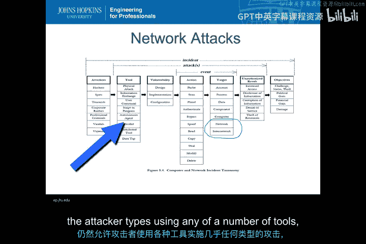

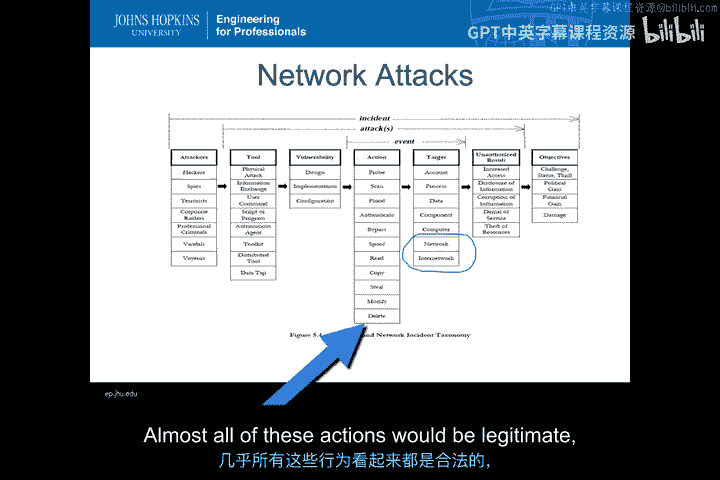

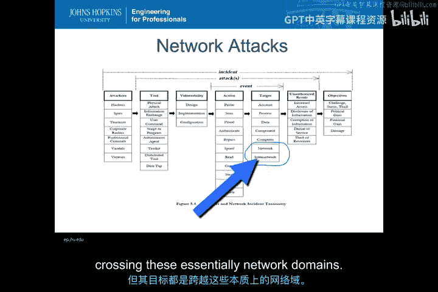

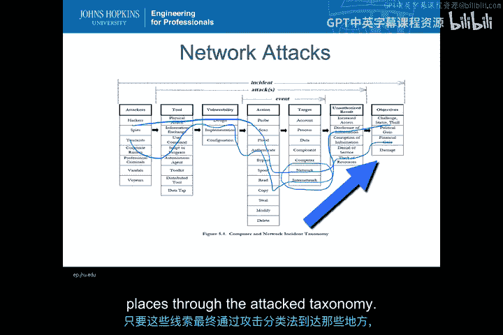

So what are some of the common attack types that we're talking about here。

 Really almost all of the categories we talked about within the His attacks have representative parts that can also be done within the networking side。

 So in eavesdropping， we're talking about eavesdropping in network in data in motion。

 things like man in the middle attacks， TCB hijacking SSL proxies。

 These are all the different types of attacks that are really under the category of eavesdropping。

 masquerading attacks。 remember this masquerading is essentially。

Behaving as if you are somebody else or something else on the network that can mean replaying credentials。

 capturing and reusing passwords， violating anything at the session layer in terms of remember the OSsi model in looking at the session layer for understanding how the authentication or the various kinds of encryptions might be set up in encryption keys。

 So any of these could be part of a masquerade style attack that could be picked up by aidIDs。

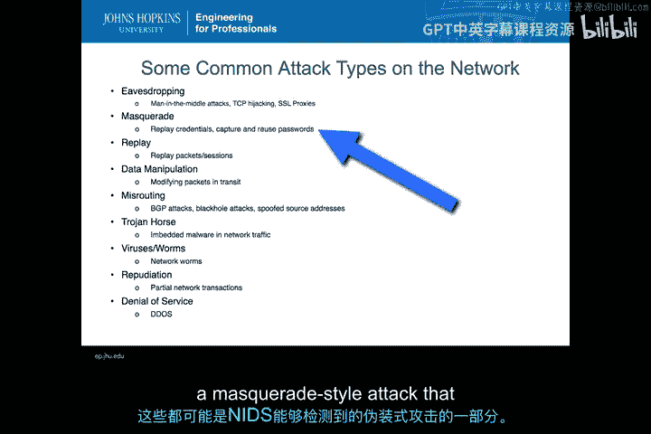

Replay attacks where I'm just going to be replaying packets and sessions， capturing them。

 replaying them at a later time， or perhaps replaying them in a different place on the network infrastructure。

 This would allow me to essentially take activity that was authorized in one place。

 replay at someplace else where it might not be authorized。For data manipulation。

 we're really talking about modifying packets in transit。 You know。

 really looking here as saying I'm capturing， changing the packets and then retransmitting them back out。

For misrouting， obviously， that's clearly a network oriented kind of thing。

 Everything from the kind of BGP attacks， black holeing attacks， Spof source addressing。

 there are are tons of ways to manipulate。

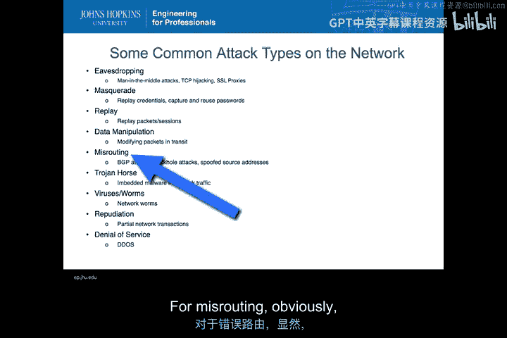

The routing at layer  three in order to sort of understand how to send packets across a place where maybe even eavesdropping or masquerading can be easier to accomplish。

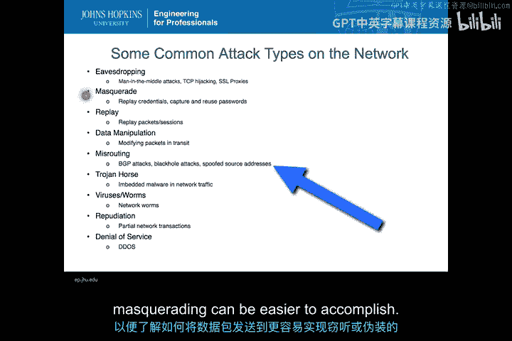

When we're talking about the viruses and worms， we're really talking about network viruses and worms。

 These are malicious code that propagate over network links。

 and we can find them by looking within payload activity。

 or some variation or statistical analysis of the header activity of the network traffic in order to find the sort of viruses and worms。

 repudiation attacks。 these are essentially saying that I've got some kind of network transaction。

 I'm later going to claim was not associated with a particular individual。 So often on the network。

 you'll see partial network transaction starting up kind of a transaction。 And then later on。

 not finishing it， however， still having the effect of the transaction take place。 And， of course。

 then there's the denial of service。 the really big thing is Ddos or dos attacks across a network。

 Well known many， many different kinds of attacks around。

 So the denial of service attack area is one of the most common attack types。

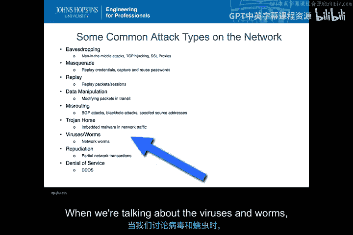

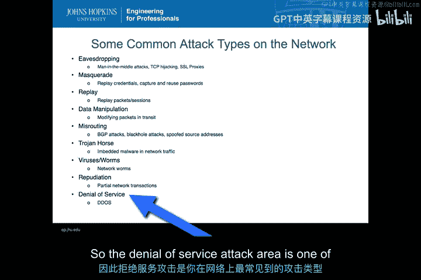

That you're actually going to see on the network。So let's talk a little bit about the issues that you might encounter if you're going to try to use network sources。

 so the idea we've already talked about topology and the placement。

 we've talked a little bit about encrypted traffic。

 but there's also things having to do with timing and time synchronization， session assembly。

 volume and fragmentation so let's talk about each one of those in turn in a little bit more detail。

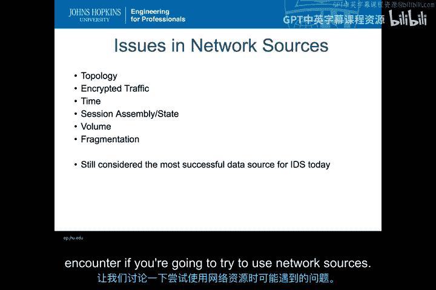

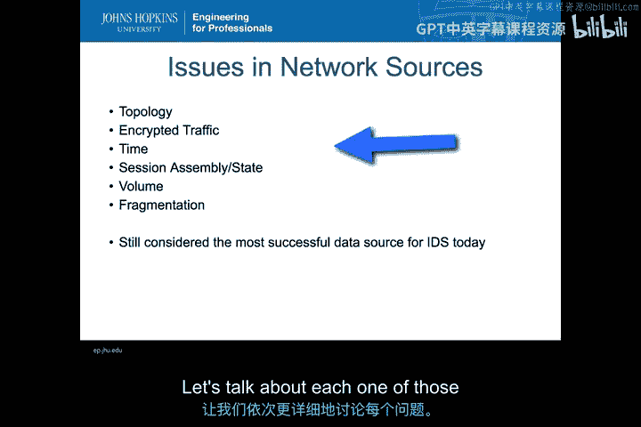

So the first issue when you have niIds is really in the topology area because this has to do with you have to have observables in order to detect attacks to have observables。

 you've got to have your network sensors in the right points each sensor can only capture the observables that are essentially passing through that particular network segment by that network tap So even though it's sort of most common to have the network taps at the internet gateways。

 this really leaves a lot of internal and backdoor kinds of attacks within the infrastructure completely invisible to the NIds。

 So the idea of a complex taxonomy that's more efficient for keeping your traffic bandwidth at a reasonable level may get in the way with your NIds collection of data for specific kinds of attacks。

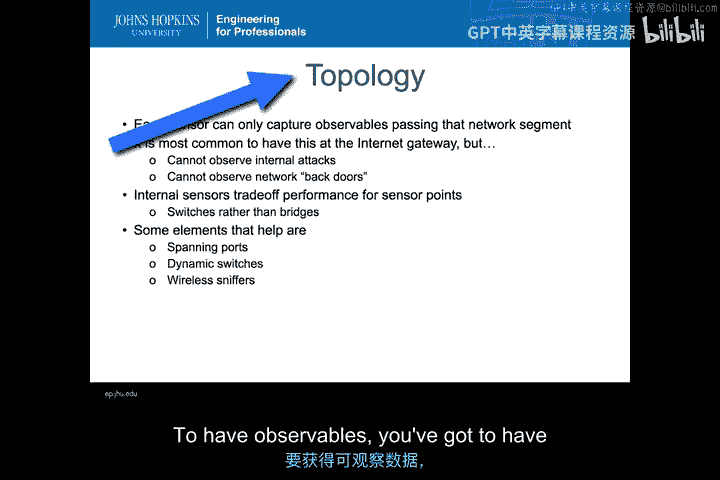

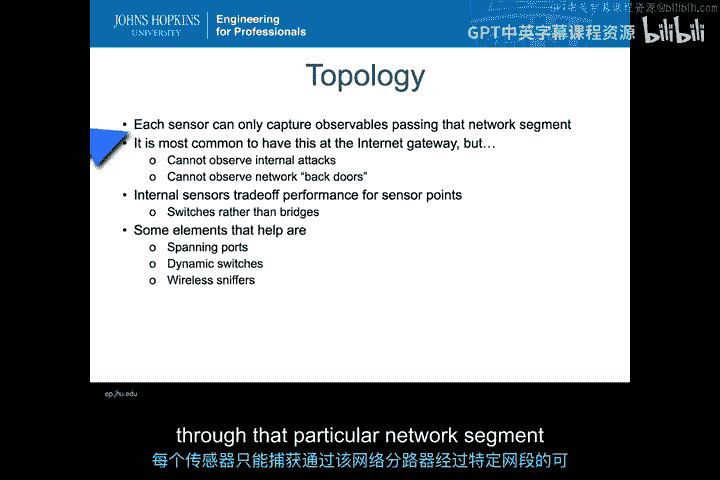

The internal sensors that you may put in place may you may be trading off performance for sensor points。

How many different places do you have switches versus bridges。

 How many places do you actually have full up routers separating different segments within your internal network。

 Every time you have a boundary to cross， you have an area that you probably should have some kind of a nid sensor if you want to have complete coverage of the threats in that particular space。

 There are helpful elements here。Things like spanning ports and dynamic switches and wireless s sniffers that might be more common across an entire infrastructure can help to build a separate overlay network of NID systems that can coordinate with each other and with one of these SIim systems that we talked about previously in order to collect all of the information from these different areas within the topology。

 but still topology turns out to be a really tricky element when you're talking about NIDs。

 because you have to identify where all of your boundaries are。

 and then basically place your NID sensors so you can collect the network traffic across those different boundaries。

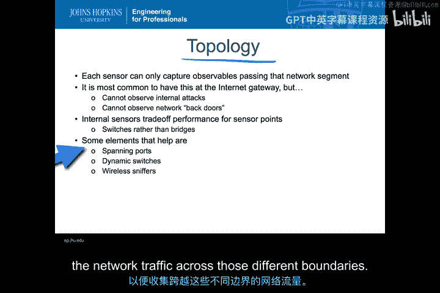

A particular growing problem within this area is encrypted traffic。

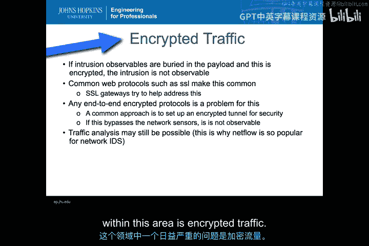

Historically， especially internal to an organization。

 traffic was more or less plain text on the background of the network。 Therefore。

 you could do things like deep packet inspection， payload inspection and identify attacks that were inside of network traffic without having to worry about it being encrypted。

 So if these intrusion observables are buried in the payload and the payload is encrypted。

 The intrusion is not going to be observable， is just kind of the way it is。

 So we've got more and more common web protocols that are making encryption ubiquitous across our various networks。

 S S L probably being one of the largest cases。 The SS S L Tl S。

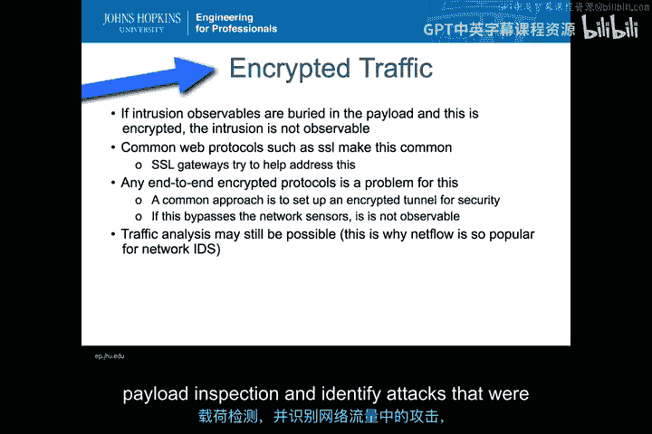

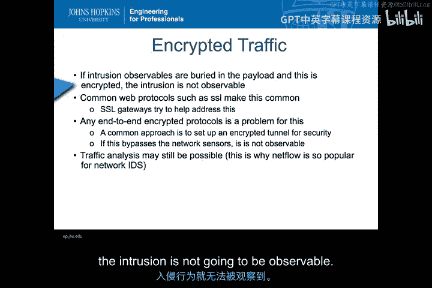

Phennon that's out there in terms of running all applications and everything over SSL is making network based Is much more difficult in terms of trying to understand how to do payload level detection of attacks。

 We do have the idea of SSL gateways， which attempt to serve as a proxy in order to decrypt traffic for the Is and other monitoring systems that are legitimately coming in or out of a specific organization。

 These SSL gateways address one part of the encrypted traffic problem， but not all of them。

 just really just that one part。And because it's just the one part。

 any other end to end encrypted protocol is going to be a problem with this。

 These end to end encryption protocols that go application to application means that your traditional network kind of inspection is only going to work at the lower levels of the protocol。

 The link layer， the I layer， but it's not going to work on attacks internally。

 this can be a problem with database access， it can be a problem with any kind of proprietary protocols and proprietary elements that you're going to have。

 So if these encryption elements end to end， bypass your network sensors again。

You've got something that's not observable。 However， all is not completely lost with regard to this。

 There's a lot of traffic analysis that's still possible with just the meta information。

 This is one of the reasons that things like net flow。

 which we're going to talk about in more detail， is so popular for any of the kind of network based I D S that that are out there。

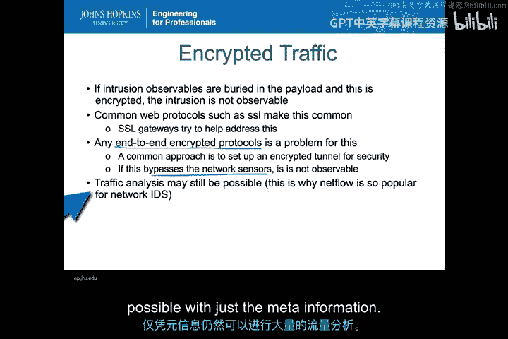

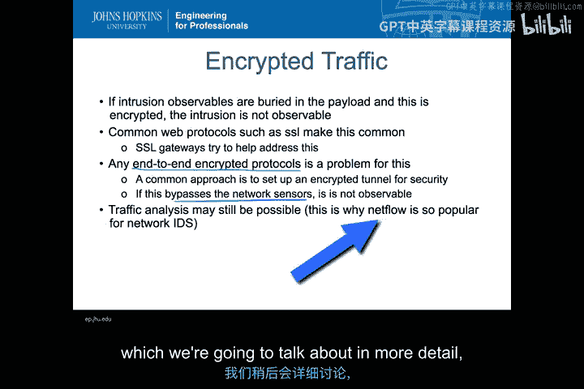

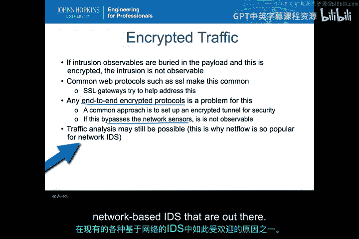

The other problem in looking at networkbased Is is just the whole question of time。

 The idea that I've got multiple sensor points means that I'm probably going to have multiple clocks。

 These clocks may or may not be synchronized in order to really understand that traffic across one particular network element might be the same as traffic against another element。

 So if you want to try to eliminate duplicates in order to be more efficient with a kind of sensors that you're doing on the network or you're trying to correlate the directional flow and what network segments。

 particular network traffic is going across， then you've really got to have synchronized clocks in order to be able to distinguish between things that are close in time and things that are actually going across at virtually the same time。

 So this is why timing is so important with regard to synchronizing multiple incident。

 It's not quite as important if I only have。

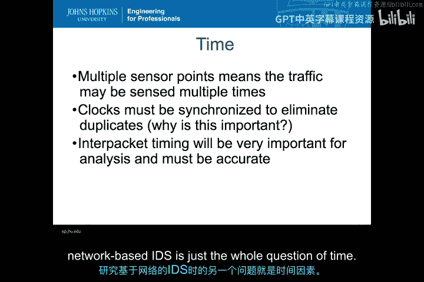

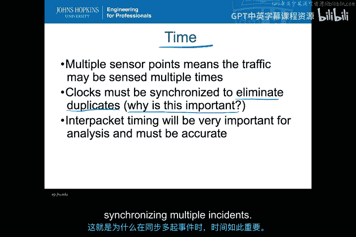

S network based Is。 And all I'm doing is synchronizing everything to one master clock。

 That's not so bad。 But if I have multiple different nids sensors at different points of my network。

 and I have to do correlation， then this whole idea of being able to do inter packet timing。

 it's very important for the analysis to be accurate。

 so that the time across your infrastructure has to be synchronized frequently。

 and it's got to be synchronized to very fine tolerances。 this。

 although it sounds like something that could be fairly easily fixed。

 is one of the largest problems that we've seen in distributed based network Is that are out there。

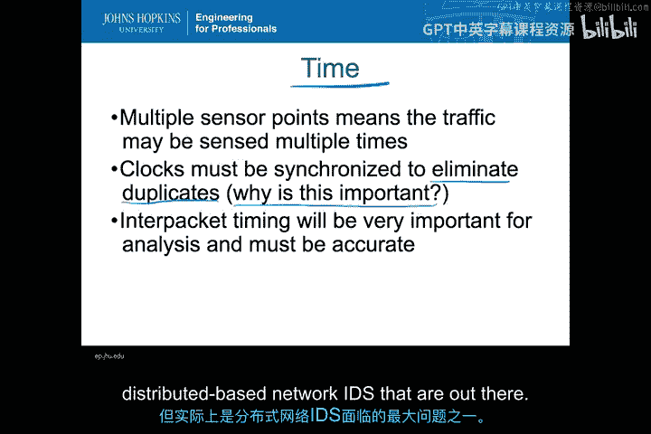

Another difficulty that you have with trying to run these network based Is is session assembly。

 Most attacks don't happen packet by packet， but network sensors see things one packet at a time。

 So at some point， you've got to reconstruct these into sessions in order to recognize whether or not those sessions are actually part of an attack。

Normally， the IS needs some kind of a reconstructed session in order to be able to recognize an attack from specific packets。

 So the sensor， when it's coming in place。 has to know what the host actually sees。 And， of course。

 the host does put together network packets into sessions。 So in order for the Is to see it。

 the Is has to do essentially what the host is doing and put the packets together back into the sessions。

 Unfortunately， doing this passively in the middle of the stream can have a number of different problems。

 packets that are。

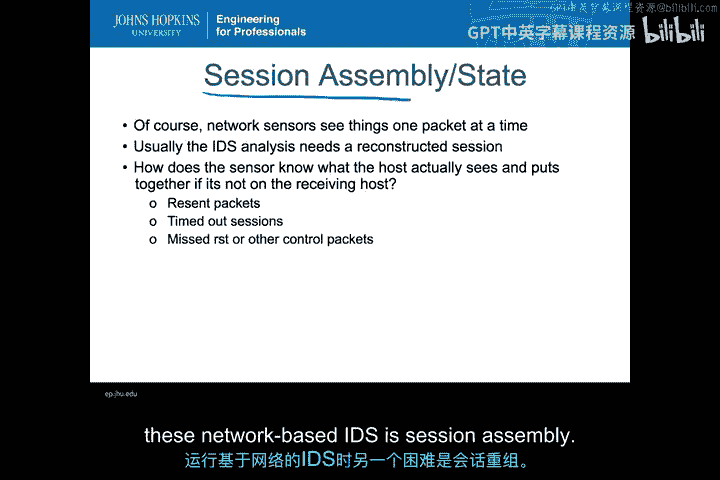

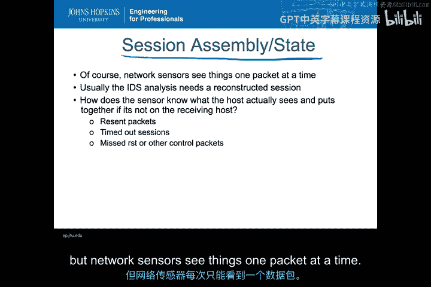

Sessions get timed out at different things。 Different sort of missed packets from the IDs may mean that what the host actually sees and what the Is actually sees are two very different things。

 So the host is often a better place to do the individual detection。

 but the network is sort of an easier place to do the installation and recognition across boundaries。

 So this is just part of a tradeoff that you have to make whenever you're deciding whether to go with a His or a Nds across an infrastructure for your intrusion detection。

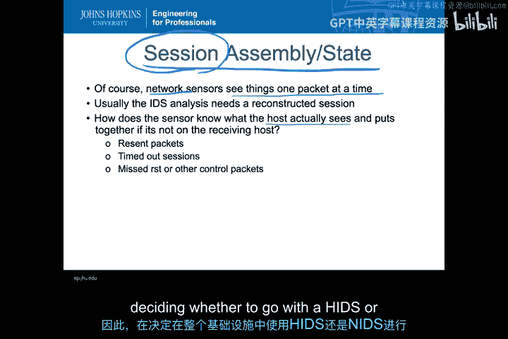

Of course， one other huge problem with regard to Iss is just the sheer volume of the traffic。

 The question is， do you really want to analyze all the traffic。

 or do you just want to look at the headers or do you just want to look at some kind of a summary like netflow。

 If you really want to do it all， You actually have to have a way to store it。

 you have to be able to collect it at line speed and you've got to get all this traffic to the analysis engine In the worst case。

 you're replicating all of your traffic in order to get it to the Is。

 So dealing with volume at the network layer tends to be one of those issues that a Nds has that a Hids doesn't have nearly so much。

 So in a Nds case， every time you place another Nds sensor within your infrastructure。

 you've got to move the Nds alerts or the Nds raw data to the analysis engine portion of the Is。

 How you do that will really depend on what the details of your infrastructure look like and the bandwidth constraints you have across all the different elements。

This can be especially difficult in Feerated enterprises， where you have slow links between large。

 relatively independent enterprises， but you're trying to coordinate the Is across all of the different federated sites。

 Then you've got to essentially summarize the data somehow in order to correlate it between one of the sites to another site in order to finally be able to determine whether the attack can be recognized across the entire Feerated enterprise。

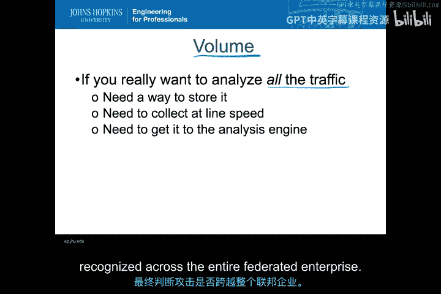

With network based Iss， the degree of fragmentation in the packets is also important。

 If I have a network based I S that's really looking for a pattern packet by packet。

 I need to have enough of the data in the packet to be able to recognize the pattern。

 So one of the difficult parts is to know within a packet Can I。

 do I have to combine it with another packet or not。

If it's fragmented to the point where I don't see everything I need in the signature。

 that my I S is going to have to be stateful。 It's going to have to collect multiple packets and reassemble of them similar to the problem we talked about just a couple of slides ago on reconstructioning sessions in order to understand even the packet by packet kinds of attacks。

 So these fragmenting over the collection boundaries is a way that many intruders attempt to bypass I S detection or Ips S filtering within trying to get these different attacks through to their endpoint So an I S has to take into account that when you have extreme fragmentation sometime to the point where even the I P headers themselves end up being fragmented to some degree。

 Then you got to have some state based reconstruction in order to make this。

Into an observable that the IDS can actually use to help to identify an attack。

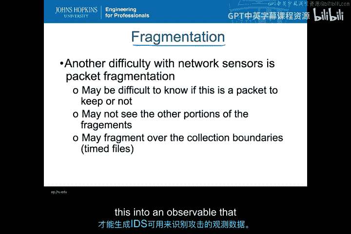

Finally， we've been discussing most of these NDsbased systems as if they're all connected to regular TCPI standard networking。

 but understand there's a lot of networks that don't follow the same pattern that we've talked about within the ISostax or all of these particular TCPI style networking the cellular Wii-fi world。

 the power networks， railway signaling funds transfer and just plain old telephone circuits also can have attacks that go across any one of these sort of data and motion kinds of areas So it is important to realize that even though we've talked about IP based networks。

 these non-ip based networks also have attack observables and each one can essentially you know in turn have different ways of attaching a network based Is in order to understand specifically what the attacks look like in the power world。

 this is especially significant today with looking at。

What's happening in the smart grid technologies， people are very concerned that is we have smart meters and smart grids。

 they become endpoints for attack， then the place that you're actually going to see the attack observables is in these networks that essentially ride over the power infrastructure and having an IDS that can read the observables off of these particular lines is something that's just currently being developed in the commercial space right now in the next module module6。

 we're going to talk more about cellular and Wi-fi and windspace systems but essentially there's an entire other area of wireless intrusion detection systems that uses the wireless transport as the place not only to observe attacks but perhaps even prevent against attacks。

So that's basically the different types and difficulties that NID systems have today。

 so now you should have a pretty good sense of where the different products are actually used and what kinds of attacks can be observed within these various different elements。

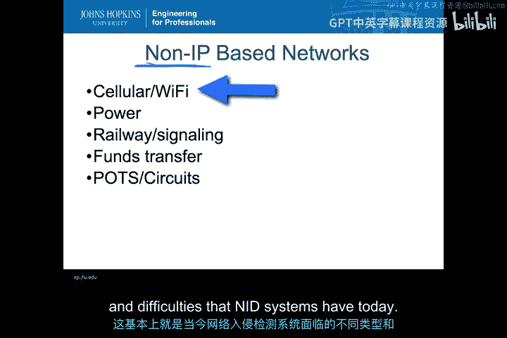

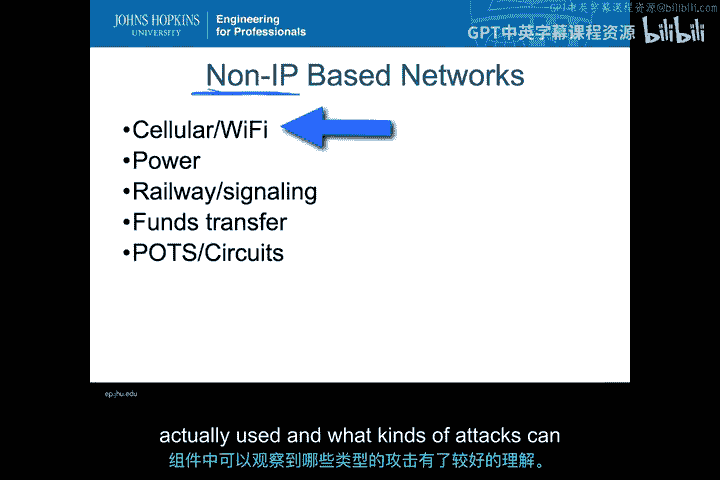