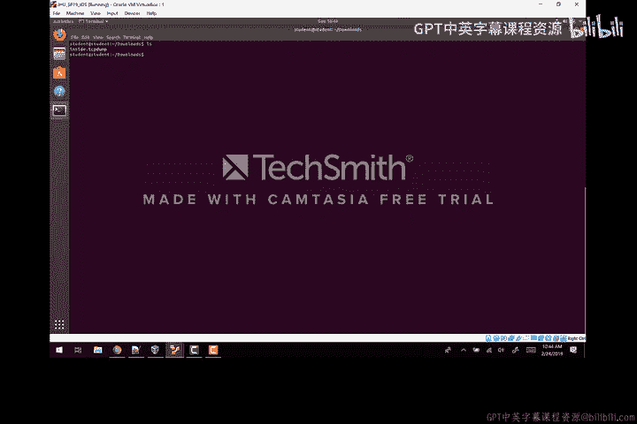
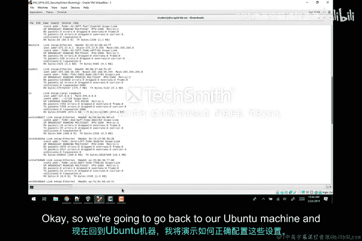
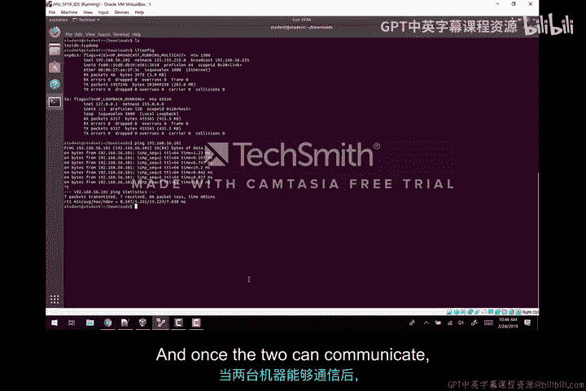
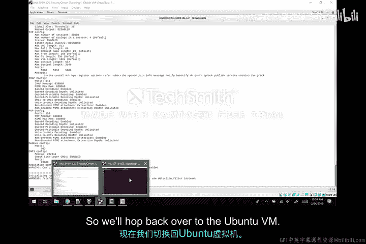
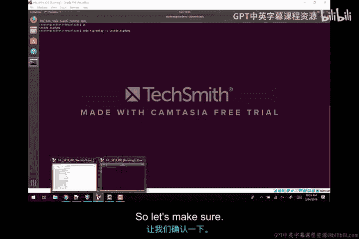
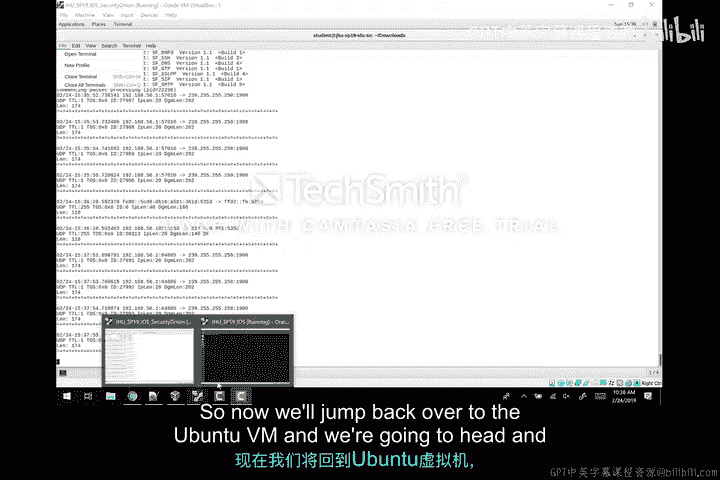
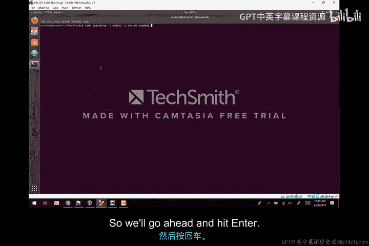
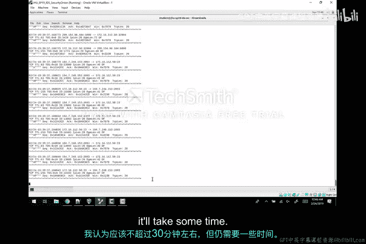
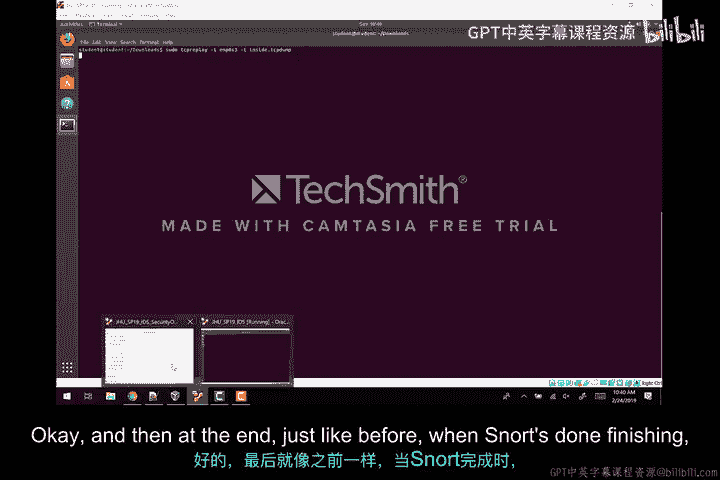
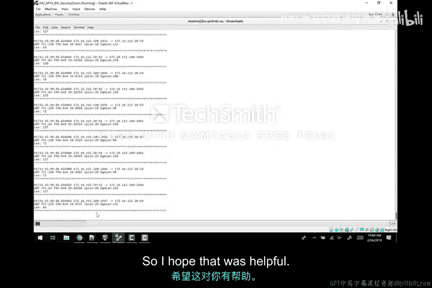

# 约翰霍普金斯大学《入侵检测｜Intrusion Detection》中英字幕 - P21：20_Snort进阶教程（补充资源）.zh_en - GPT中英字幕课程资源 - BV1sGu1z5E2J

In this video， this is the follow up to the first video that I posted。

 we're going to talk about how we can stream packets over the network and get sNort to classify them。

So in order to do that， we're going to use the Ubutu VM， which you see here。

 and I've downloaded and unzipped the insidegot TCP dump PCAP file already。

 we're going to take this and we're going to stream it across the network using TCP replay。

In order to do that， though， we want to make sure first that our two virtual machines can。

Connect to each other。So on the security on IndianDM I'm going to hit an if config and scroll up and I'm going to look at ENP0 S3 that's our primary interface。

 so for some reason it's no longer E0 in Ubutu so wherever you see E0 in any documentation you can replace E0 with ENP0 S3。

And we see that the IP address here is 19216856。101。Okay。

 so we're going to go back to our Uuntu machine。

And I'm going to show you just how to get those settings。Streight。

So we're going to edit the settings for our network here。And we're going to。Go into the settings。

And we're going to go under IPV4， so I switched it to manual because DHCP。

 there's no guarantee that it puts us on the right network。

So you can see here I just incremented the IP address by one， so the other host security Onion was。

 101， so I made ourselves。 102。And the Class C subnet mask。And that's it。So then you hit apply。

And then you can toggle the connection off and on again。And then when you come back。

The terminal and hit an iff config， you'll see here that ENP0 S3 is 56。102。

So if we try to ping over to the security on NBM。哦。

We'll see that it works successfully when indeed we get a response。Okay。

And the other thing that I would mention is that both of the virtual machines。

 you need to change their NI settings。To host only， so for the security Onion and for the Ubutu VM。

 you're going to make sure that the host only adapter is selected。嗯。And once or two can communicate。

 then we can begin then portion of this assignment。

So the first thing we're going to do is start with our security on EDM and similar to the way we did before。

 we're going to launch sNnort again， but this time rather than telling it to ingest packets from a file。

 we're going to tell which network interface it should be sniffing。

So the way we do that is when you pseudo snort。We'll do verbose again so that we can see the packets as they come in。

We'll give it the same。Configuration files before。Okay。

 but this time we're going to give it an interface。

So the dash eye flag specifies what interface it should be listening on。

And we're going to give it the ENP0 S3。Okay， so as before it's going to take a minute to get up and running。

 it's going to load all those rules。So we'll hop back over to the Ubutu VM okay。

 and we're in the directory where inside that tCp comp is that's our PCAP file。

So we're going to use the TCP replay command to replay this file across the network so that snort can ingest it on the other end。

Okay， so the way we do that， we're going to do pseudo。TCP replay。

We're going to want to run it we're going to want to stream the packets as fast as we can just to speed things up a little bit so that's a dash T。

 and if you look in the man page you'll see exactly what that can do for you。Okay。

 so we're going to run it at top speed， so dash T。And then we just need to select which file we want to stream。

Which is inside that TCP dump。Okay。So let's make sure。

Okay， SNnort is almost unloading here， so we'll just give it another minute before we actually start streaming the file。

Okay， so we can see here that SNort is now ready to commence packet processing。 In fact。

 it looks like a couple packets came over the network， but you can safely ignore this。

But we see that SNort is now listening on that interface。Believe it says it up here， yep， NPP0 S3。

 which is exactly what we want。So now we'll jump back over to the Ubutu VM。

And we're going to ahead and use TCP replay to replay the file across the network。

So the way we do this is TCP replay。First， you have to specify which interface you want to send the network traffic out of Okay。

 so in our case， we know that we want to send it out of ENP0 S3。

 that's the network interface that we configured so that we can do the ping。

And we're going to run it as fast as we possibly can。As opposed to running it。

 say maybe you know you can make run it a 10 meg or 100 meg or gig。

 we're just going to run it as fast as we can just stream the packet just to save time。

So that's a dash T， which enables top speed。And then we're just going to give it the name of the PAP file that we want to replay。

 which is inside。 tCP dump。So we'll go ahead and hit enter。 You won't see anything。

 but if we jump over to our snort Vm。

You can see here， I mean， it's a little laggy， but you can see that the packets are now streaming in consistently。

 hopefully。And it goes and goes， and goes， and goes and goes。Okay。

 so we're successfully streaming those packets across the network now and SNort is ingesting them off of the ni instead of doing it directly from a file。

So you're going to want to let this run， take it'll take some time。

 you can probably walk away for a good good number of minutes。

 I don't think it should take more than 30 minutes or so probably， but it'll take some time。

You'll notice that the file will stop streaming。You'll get a note here about how many packets were transmitted。

 and I think it's somewhere like 1。6 million packets。

Something like that so when the TCP replay completes， it'll give you some nice output statistics。

 but you'll notice that the security on UVDM continues the process for quite a bit of time after TCP replay completes。

Okay， and then at the end， just like before， when SNort's done finishing when it ingests all those packets。

 it's going to do some analysis and it will spit out some useful statistics to you at the end and then what we're looking for is the number of alerts that SNort found when you stream the file。

So I hope that was helpful again， if you need anything else， just feel free to shoot me an email。

