# 约翰霍普金斯大学《入侵检测｜Intrusion Detection》中英字幕 - P22：21_导论.zh_en - GPT中英字幕课程资源 - BV1sGu1z5E2J

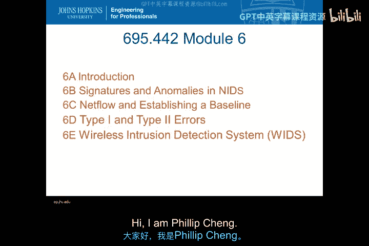

🎼Hi， I am Philip Qing。🎼I am doing an introduction for you。

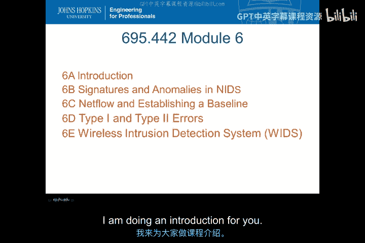

🎼In module 5。🎼Tong has covered。🎼The network intrusion detection system in I D S part 1。

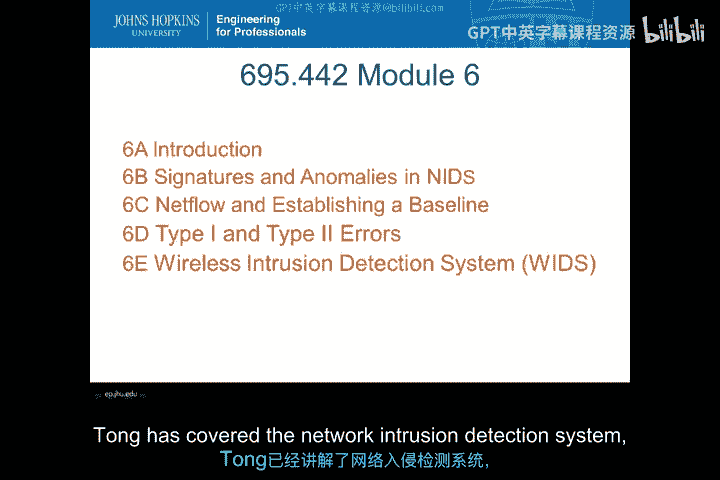

🎼In this module 6。汤。🎼Will continue to discuss on N I D S。

🎼Part 2。🎼He would cover the pros and cons。🎼For the use of anomaly detection versus signature detection。

🎼From the network data。🎼The main topics。🎼To be covered a。🎼Signatures。🎼And anomalies in N I D S。

🎼Net flow and establishing a baseline。🎼Type1， and type  two arrows。

🎼Wireless intrusion detection system。🎼W Is。

🎼Under the signatures and anomalies。

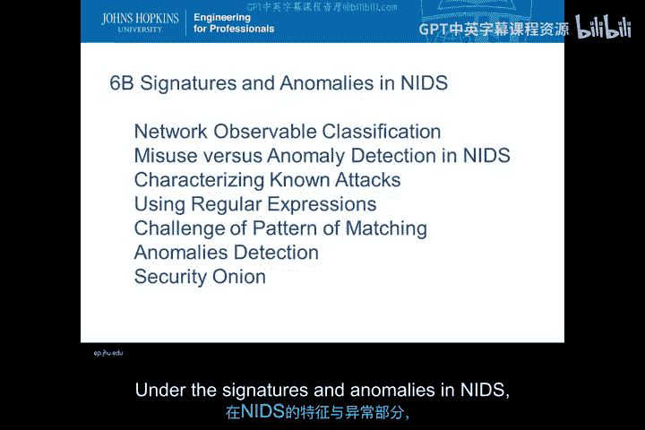

🎼In in I。🎼We should discuss the following topics。Network observable classification。🎼Misuse versus。

🎼An normally detection in N I D S。

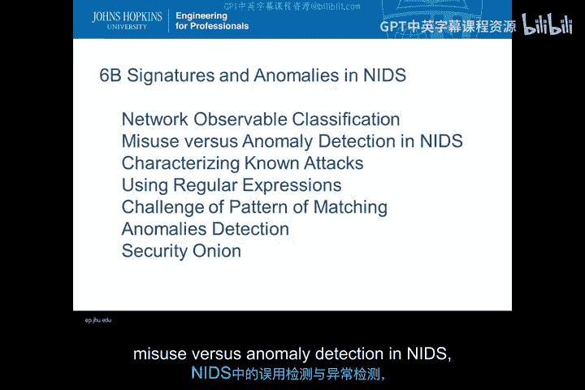

🎼Characterizing known attacks。🎼Using regular expressions。

🎼Challenge of pattern matching。🎼Anomalies detection， security oning。

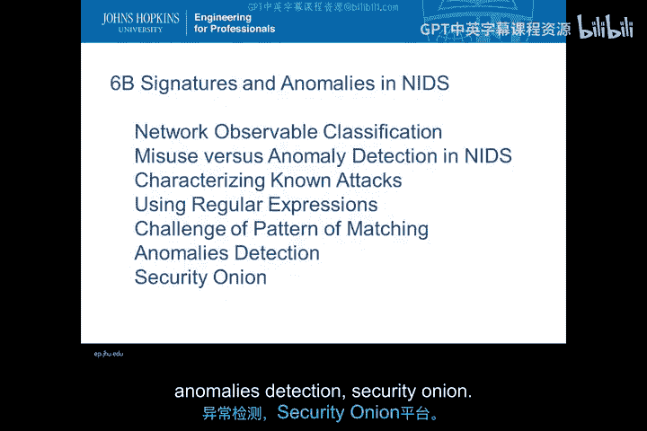

🎼You can see that。🎼Paent matching and regular expressions go together in detecting anomalies。

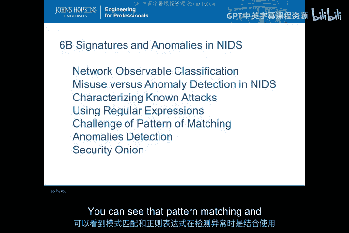

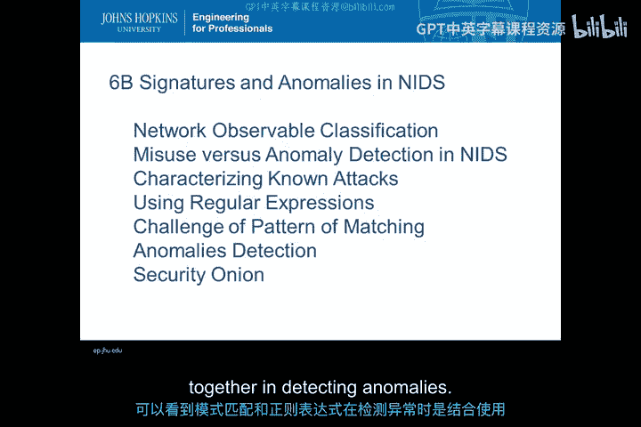

🎼Please pay special attention on the security onlying。

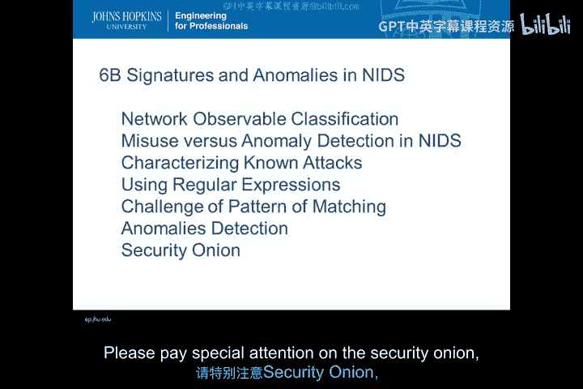

🎼Which is a platform for studying I D S。

🎼You would be asked to set up a security only。

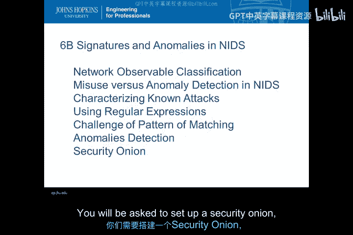

🎼And you will use it for your assignment in this course。

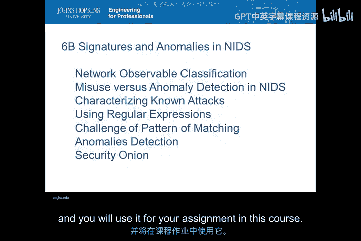

🎼Under the net flow and establishing baseline。

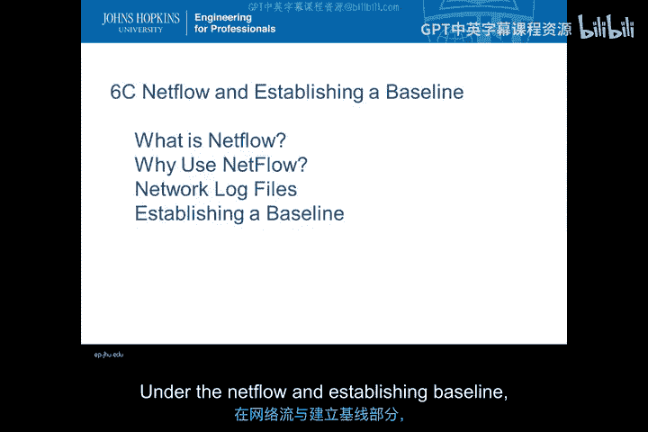

🎼We shall discuss the following topics。🎼What is net flow， Why use net flow。

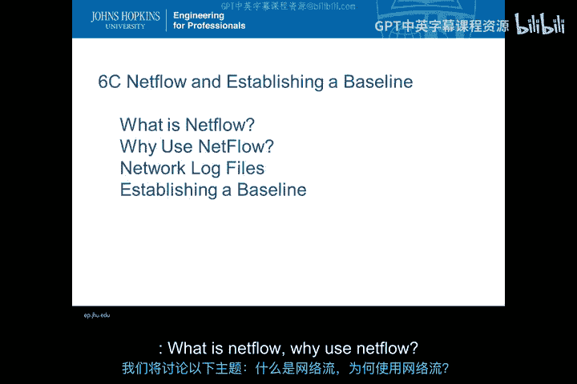

🎼Network， log files。🎼Establishing a baseline。

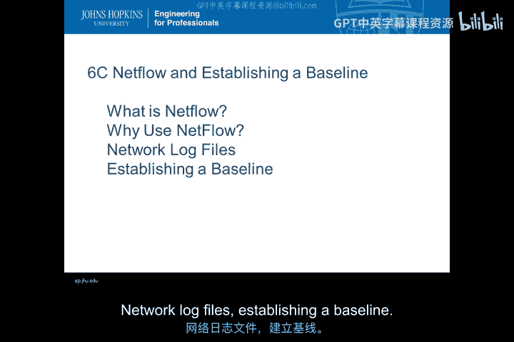

🎼This part of module 6 focuses on the net floor。

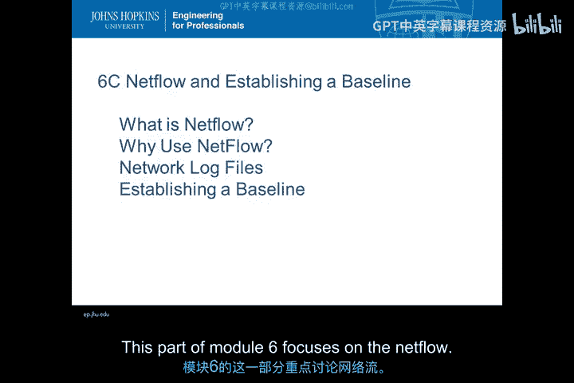

🎼Netflow provides a summary of network traffic。🎼Which can be used。

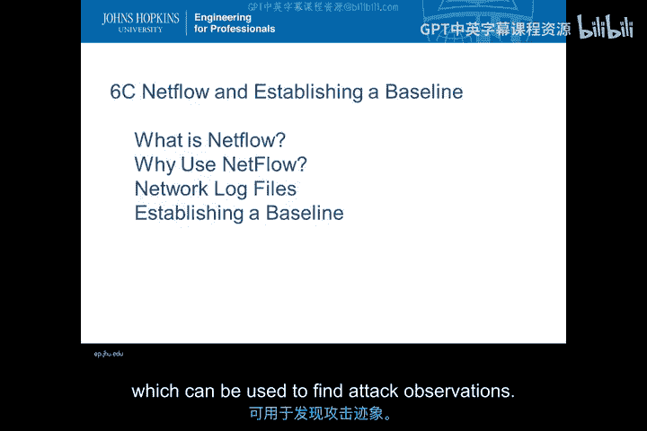

🎼To find， attack observations。🎼In this part module 6。

 we should discuss type 1 and type 2 errors in using the I D S。

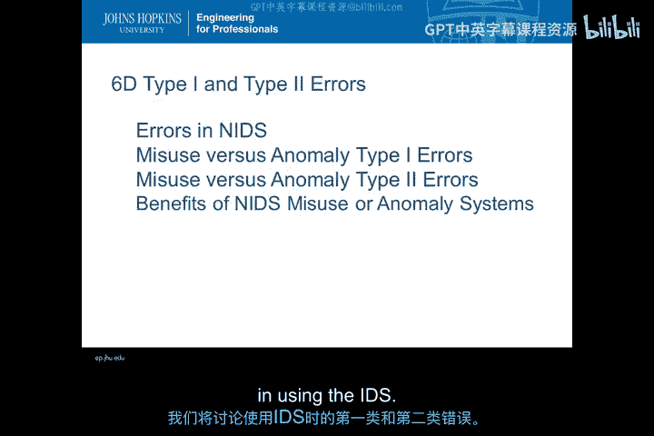

🎼We sure cover the following topics。🎼Ers in N I S。

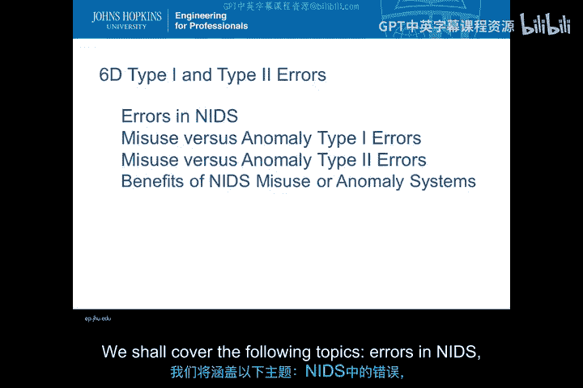

🎼Misuse versus anomaly type 1 errors。🎼Misuse versus anomaly type 2 errors。🎼Benefit of in I D S。

🎼Misuse or anomaly systems。🎼There are always errors in using the N Is。

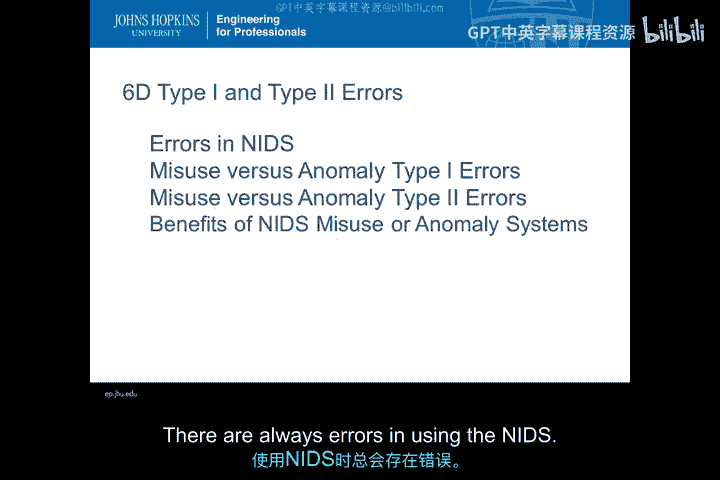

🎼A typepe 1 error is a false alarm。🎼By the N I S。🎼And a type 2 error is a myth by the N I D S。

🎼In the later part of the semester， we will cover the analysis related to part type 1 and type 2 arrows。

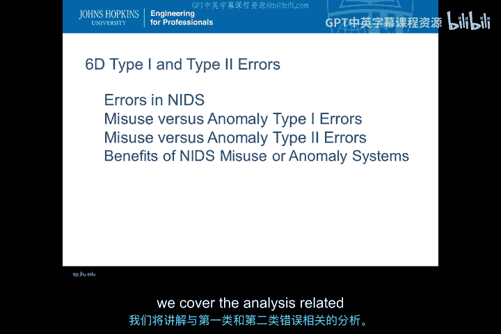

🎼In this part of module 6， we should discuss wireless intrusion detection system。

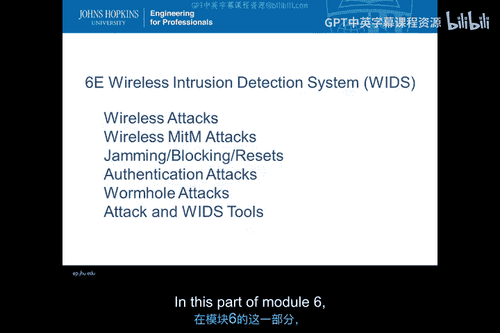

🎼W Is。

🎼Be sure cover the following topics。🎼Wireless attacks。🎼W is mid attack。杰明。🎼Blocking。🎼Mis。

🎼Aentication attacks。🎼Warmhole attacks。🎼Attack and W IDS tools。

🎼You can see that in this part of module 6。🎼We focused on the emerging threats and attacks。

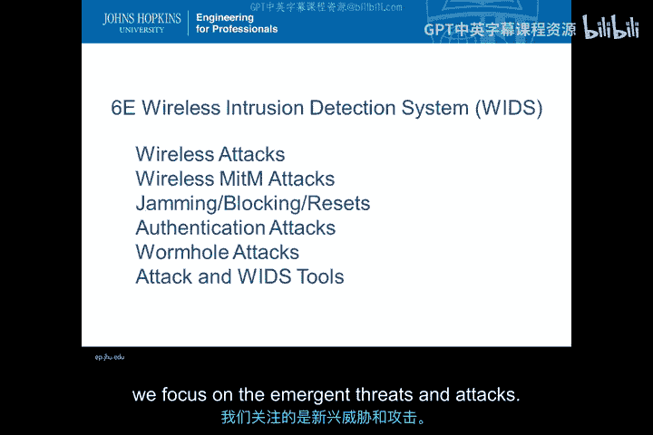

🎼We can expect more security threats in the Wifi marketplace。

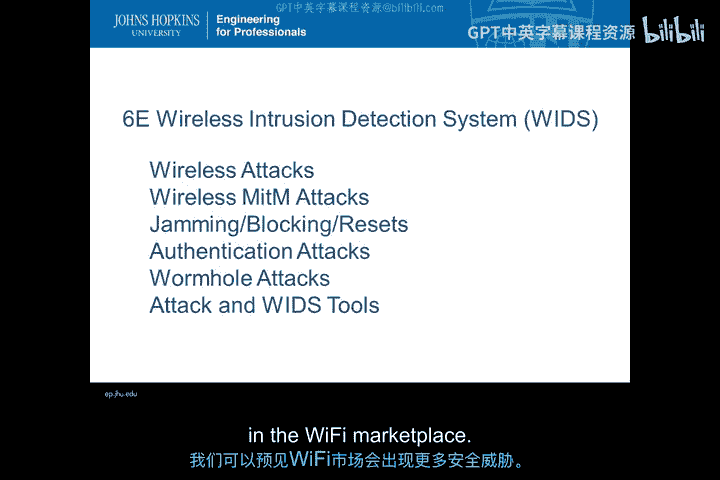

🎼Hope you all will study well in this class。🎼And we be ready to tackle intrusion detection。

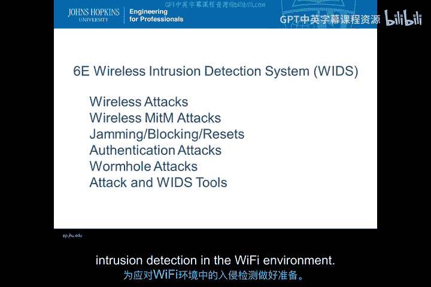

🎼In the wifi environment。🎼Good luck to you all。

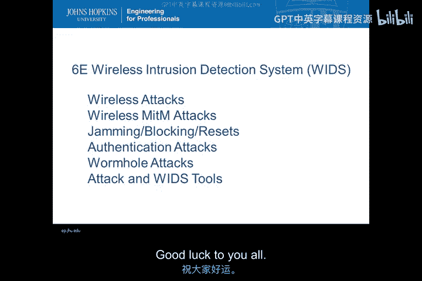