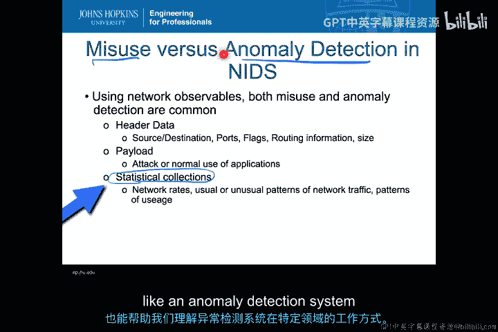
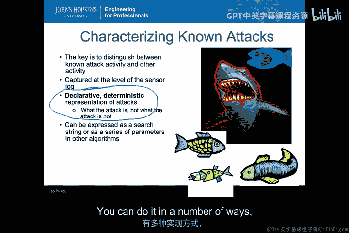
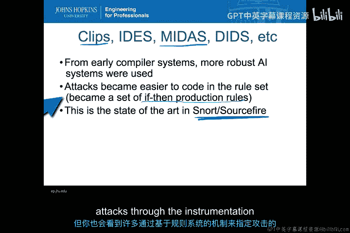
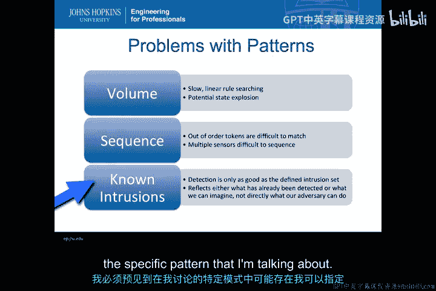
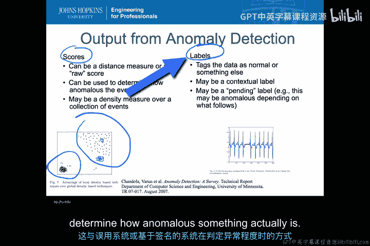
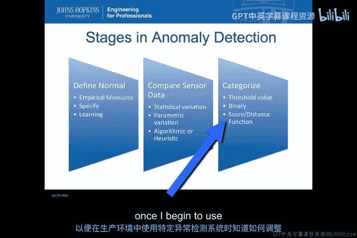
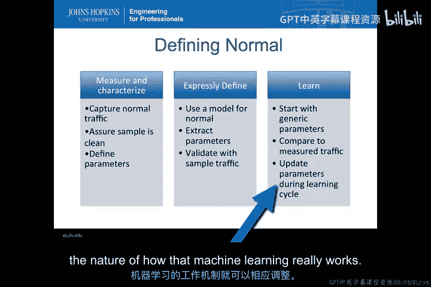
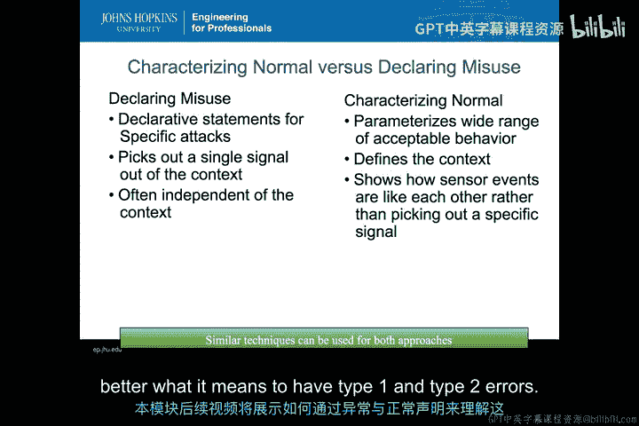
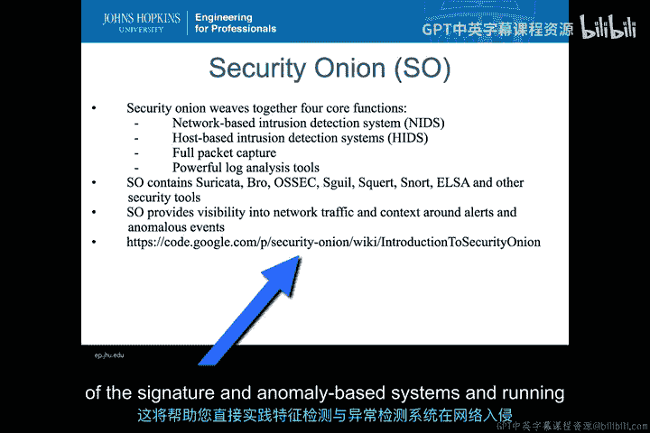

# 约翰霍普金斯大学《入侵检测｜Intrusion Detection》中英字幕 - P23：22_NIDS中的特征匹配与异常识别.zh_en - GPT中英字幕课程资源 - BV1sGu1z5E2J

Okay， so in this video we're going to begin to explore the differences between the signature based NID systems and the anomaly based NID systems。

 so as I said before in module 5， the NID systems depends on looking at observables from the network。

 but within how those observables are classified into incidents。

 we can use both signature based and anomaly based intrusion detection。

So whenever we start talking about the classification side of aidds。

 this is going to be the key element for figuring out how to take the network observables that we've talked about and classify them into normal events and incident that you would then want to investigate to see if there're actually a violation or not。

 So you're going to match this network data that you collect against some kind of predefined condition。

 This may be a configuration。 It may be a learned behavior。 but however。

 it is there's something in the way the Nds is already operating that allows us to compare the current network observables against something that the Nds already knows。

 Now， when I compare those observables against some kind of known good behavior。

 either because I've specified it or I've learned it。

 then this is what I'm going to have as anomaly detection， Basically， every time I match。

Known good behavior。 So I'm better match the known good behavior。 That's normal。

 If I don't match the known good behavior， I end up with an anomaly。

 And that's when the Nds behavior becomes an anomaly detection system When I match against known malicious behavior。

 So now I'm going to talk about this is a signature based system where I'm going to specify the malicious behavior。

 either because I can define it in the signature or some other method。

 then that's going to be my misuse or signature based detection。

So these methods of classification include a wide variety of techniques and representations。

 but in this video we're just going to begin to do an overview of how the NID system uses signatures and anomaly detection systems in order to classify incidents。

So as you might expect， within NID systems in general。

 both misuse and anomaly detection systems are commonplace using the network observables that we have。

 you can actually get quite a lot of data with regard to matching against both normal and signature based attacks。

 This can come from the header data from inside the payload or from some sort of statistical collection across multiple packets。

 multiple sessions， multiple days。 So these statistical collections are going to be very useful for us in defining sort of normal networked behavior in coming into what we expect would look like an anomaly detection system when it comes into that particular area。

 So let's start with signature based systems。 In this case。

 we're going to characterize known attacks。 that's the idea behind the signature based system here is we're characterizing known attacks。

 The key here is to distinguish between the known attack activity and other activity。 so when。

We specify an an attack of some kind， we want to make sure that you don't confuse the sharks with the fish you really want to say I want to define the attack in a way that I can recognize it and readily distinguish it from other things that might look like a fish and I'm going to capture this at the level of the sensor log that I'm talking about so however I characterize my known attacks I'm going to do it with regard to the features that are actually available at the sensor。

Now， a really important element with any of the misuse detection systems is that all misuseed signatures need to be declarative and deterministic。

 Basically， this says I'm going to describe what the attack is。

 I'm not going to describe what the attack is not by being declarative。

 I'm essentially saying that I'm going to positively say this is what the attack is and by being deterministic。

 I'm going to say without a doubt this leads with you match。

 this will always be an attack every time you match it。

 Those two particular elements are common across all of the misuse detection systems so these can be expressed as a search string as a series of parameters。

 any way that you might want to do it to specify the attack as long as declarative and deterministic。

 you can specify them as any kind of a representational string you can do it in a number of ways and we'll talk a little bit more about that。

So the most straightforward way of talking about misuse detection systems is essentially to say using regular expressions。

 can we specify given the features of the network observables。

 what feature specifically indicate some kind of attack。

 The earliest systems express these attacks as regular expressions on packet data on the stuff coming directly out of network packet data。

 And sometimes it was as simple as really say， hey。

 if I see something that looks like those two in the payload。

 then I'm going to assume that that was actually a transition to a Linux root prompt。

 And if that's a transition to a root prompt， I'm going to call that an attack。

 So that's really as simple as it gets with regard to matching regular expressions but they can be as complicated as any way that an expression can actually be driven。

 So when you write these， these are usually some kind of subject matter expert that knows the attack and knows the very parts of the attack that distinguish that。

ack from other kinds of normal behavior。 And that's the expression provided as the regular expression in this case。

 So if there's a lot of noise in the data， it might be especially difficult。 Sorry。

 it was difficult to match some of the more。Say regular kinds of attack things。

 when there's a lot of noise。 And what do I mean by noise。

 a lot of ordinary traffic that's very close to attack traffic。 So let me give you an example。

 Let's say that as part of my normal daily duties， I'm emailing around a number of attachments that I'm trying to understand whether or not they're malware。

 If I use a signature that just matches against that malware， anywhere in the network traffic。

 no matter what protocol I have， then I might say that every time my email a sample around。

 that's going to look like an attack。 Instead， if I see the sample coming across in a way that it could be executed。

 then that's probably a better signature to write， even there's a lot of noise that would also include things that look like the attack signature。

 so。The easiest things that we had and we've talked about this before is if you just sort of put TCP dump pipe to GEP。

 and that's sort of the whole idea behind GrEP being the regular expression。

 TCP dump being our sensor on the network traffic。After the original early days of just using regular expressions。

 there were a lot of applications of rulebased systems and sort of the more robust AI style systems to try to specify attacks using something that would be more complicated than you could get out of a regular expression。

 The idea behind this was to place the malware in some kind of context。

 the attack in a context so that you would match a number of rules that would basically be able to distinguish that particular kind of attack from any other activity that was surrounding the attack。

 So from the very earliest， even from early compiler systems。

These kinds of robust artificial intelligence systems were attempted to try to say。

 how are we actually going to do some of the intrusion detection based on signatures？

The rule sets became sort of the primary way that was successful。 So clips as a rule set。

 you can see that inside of Midas and some of the other kinds of signaturebased detection systems。

 because these are just a set of if then else production rules， which are easy to write。

 easy to specify within the attack structure and are somewhat easier to recognize and follow than a general string than a general regular expression。

 So this is actually what you'll see in your sNort rule set。

 The sNort rule set does consist of a number of direct signatures that are regular expressions。

 but you'll see a lot of rules in there as well that specify a through the instrumentation of a rulebased system。

Now， of course， with this， you have some problems in just using straightforward pattern matching or rule based systems。

 They're slow。 they can be very slow in terms of linear rule matching。

 and this has always been a problem when you have a lot of very complicated signatures to match against and you've got to match all the signatures for every single packet or connection that's coming in。

 So it's hard to scale that。 So you've got these volume problems。Out of sequence。

 packets or sessions tended to make writing the regular expressions very difficult。

 You had to take into account all the different ways in which the indicators or observables would actually show up and come into the Is。

 So you had to write a very much more complicated signature， then you would。

 if they always came in in exactly the same sequence。 Finally， of course， the big one。

 the detection is only as good as the defined instruction set。

 The things that you have actually seen before。 If you've not written a signature。

 then you can't actually have a misusebased detection of that particular signature that's mostly true。

 there is a slight variation in that case where if I have a signature with with some simple variation in the signature that might take into account a class of attack or a class of malware。

 I might see a new attack in the same class and the signature could still be valid。But basically。

 I have to at least have written a signature for that class。

 I have to anticipated that there might be variations that I can specify within the specific pattern that I'm talking about。

Now， in contrast to the signature based systems， when I start talking about anomaly detection systems。

 I'll use this definition from Matt Bishop's book as as a starting point。

 anomaly detection analyzes a set of characteristics of the system and compares their behavior with a set of expected values。

 So the set of expected values means expected is normal。 That's my equivalent to normal。

 values being anything that's going to match against my observable characteristicsistics as the set of things that I'm actually pulling from my observables。

 The system in our case is a networked based system， because remember。

 we're talking about aidds in this particular case So when you wrap up this description。

 our anomaly detection system is going to take network characteristics and network expected values and do the comparison and determine whether or not those values are expected or unexpected if they're unexpected。

 then I'm going。I flaglaged that as an anomaly。When I get into network anomaly detection systems for NIDs。

 there are basically three different types of anomalies that can that I can characterize in this case。

 The simplest is what we call a point anomaly。 It's basically a single event that I've come in and it's deviated from normal so I can imagine a case where I have my ordinary normal behavior and it's kind of going along here at some level of score and then I get a single point that ends up up here out of the line far away from my normal expected behavior。

 Well I'm going to say well， this is going to be my anomalous point and I'm not looking at the context I'm not looking at anything around the area。

 I'm just simply looking at that point and saying， now I see that that particular behavior is one that is something ought that ought to be alerted upon。

So the next type that I have is contextual。 It's sort of like point。

 but it may be somewhat based on the current context。 It's like showing network activity after hours。

 So in this case， this is more like I've got my set like I had before。 I've got my normal activity。

 but it varies in sort of a sinusoidal pattern because of my daily activities。

 So if I get a point here I'm going say that's an anomalous point for that particular time of day。

 it would not be an anomalous point at a different time of day。

 So it's going to depend in contextual on the context of exactly what in this case， time would be。

 So time is a general is a general usual context that's used for contextual anomalies but this axis could actually be anything doesn't have to be time it could be with respect to other kinds of statistical activities。

 activities in the stock market， it could be basically anything that you can imagine。

You would use it to order the various kinds of scores of events that are coming in place。

 So that's the way that sort of contextual anomalies work。In collective anomalies。

 unlike contextual anomalies， it's the sequence that's unusual with respect to the rest of the data。

 So this is a little bit different in that I'm looking at a series of events。

 And so I've got a series of things that are actually going to be running through。

 So I've got events， A，BC， A，BC。A B， A D C， And I'm going to say， well， that's normal。

 and that's normal， but that's kind of an anomalous event。 So I'm going to say within the sequence。

 A is normal and C is normal。 maybe even D is normal in a different context。 But the sequence。

 A D C in this case is going to be an anomaly。 And so this is often used in sliding window patterns with regard to Nds with regard to network traffic。

 These are patterns of network activity。 Pat of network observables that usually follow in a particular sequence or in a particular collection or set。

 that are sort of out there。 And looking at something different in the set will allow us to detect some kind of anomaly within the system。

So just to illustrate the three different types of anomalies that we have。

 if I'm looking particularly at a point that's way outside of my normal behavior。

 this could be a point anomaly because it's far away from any place else that I have in my normal system when I'm looking at contextual anomalies。

 something that's a point here or a point here is going to be different based on the fact that this is this time of day and another time of day。

 And therefore， this is anomous Where this one is not in that case。The third type of anomaly。

 the collective anomaly you can think of as following an envelope sort of around this curve so that I have something that would essentially say that in the context of all of the other patterns that I have here。

 sequences， I'm going to be within the sequences of my normal behavior and look for anything anomalous with regard to the sequences within my network traffic。

 so that's how I'm going to distinguish my third case， my collective case from the other two。

Now unlike a misuse detection system， an anomaly detection system usually outputs some kind of a score or a label on the data。

 these are basically showing how anomaalous something is So unlike the declarative deterministic signatures where you either meet the signature or you don't meet the signature anomaly tech detection systems tend to be a long line of well how anomaalous are you so in the point anomalies。

 you can look this as a standard distance measure or a raw score saying how far off of normal am I because I'm going to really determine how anomaalous any given event is over a collection of event that's where I get the idea that you know there's something different in the way that anomalies work for labeling tagging the data as normal is something else in anomaly detection systems。

 I might label the data without a score but have something with regard to a confidence value associated。

With the label。 So in a machine learning context， I may actually say。

 I have learned that this cluster or this series of events。

 if I look at a cluster of events down here， I may say， well。

 that's I've learned that there are different ways of labeling one cluster from another cluster。

 But then I'm going to have a confidence value that says how close am I to this particular label。

 So if I have a point that's sort of sitting off of here。 I might say， well。

 that's going to be associated with this upper cluster。

 but maybe I have less confidence that it is part of that cluster。

 then something that's more close to the centroid of that particular cluster。

 So my output really could be either a score or a label。 If it's a score。

 then basically it's going to be a score with respect to normal。 If it's a label。

 it might include a confidence value that says how confident am I or how close do I think I am to that particular labeled anomaly that's in place。

 So that's quite different than misuse systems or signaturebased systems with regard to。

How do I determine how anomalous something actually is。

When I'm looking at anomaly detection， I usually have three specific stages that I have to go through in the anomaly detection system。

 First， I have to define normal。 I might do this by empirically specifying some kind of a measure of what I think normal is。

 I might learn that behavior I might run some standard data across it。 But in one way or another。

 I have to define what my normal traffic is。 Then I have to compare the sensor data against that normal traffic。

 looking for statistical variations or some kind of parametric variation。

 These can be algorithmic they can be heuristic。 There are lots of different ways of understanding how to compare the normal behavior to the sensor data that's coming in。

 The final step here is to actually classify or categorize this result。 So if it's a score。

 I can have a threshold value that says that the score is greater than some number than I can essentially call this an anomaly。

 I can create just a simple binary measure that essentially says that。

I am not really directly on this particular labeler within this cluster。

 I'm going to call that an anomaly， or I can simply output the score or the distance function。

 This doesn't really categorize it directly， but sometimes this can be useful if I'm actually trying to understand how effective my intrusion detection system。

 my anomaly detection system would be over a wide range of different kinds of network traffic or different kinds of network enterprises so I want to be look at the raw scores as opposed to just a classified event so that I know how to adjust my threshold or my associations of a binary once I begin to use a particular anomaly detection system in production。

Now， when I'm think about defining normal， obviously。

 I can use captured traffic and say this is normal。 as long as that particular sample is clean。

 So ground truth in defining normal is extremely important knowing exactly that I have normal traffic。

 and I don't have embedded malware。 because once I've defined it as normal， that malware。

 if it's in my normal set will always be classified as normal as well。

 or I could define some parameters that say I should never have more traffic than X during the night。

 and I should never have less traffic during than y during working hours。

 And these may be other ways that I actually measure or character based on the parametric understanding of my network traffic。

 I could expressly defined some kind of a model for normal。 I could say that， you know。

 usually I connections to my web server look like the following packet sequence。

 and I could create a model for that particular packet sequence and say that's my。Normal。

I could use exact， you know， I can extract parameters from these various kinds of measurements that I might take and then say。

 I'm going to expressly define that Im never going to have more or less network traffic than the following。

And then， of course， I can validate this with the same way that I would measure and characterize in the previous step。

 I can validate it with normal traffic that I have。

 The third way to express normal is to basically start with generic parameters and then learn based on comparison to measured traffic。

 This can take longer， but it means that I don't have to understand my traffic as well。

 I can just create it into a learning system and throw it in there and say I'm going to assume these are all normal samples。

 and I'm going to learn a series of parameters， Then I can update if my system changes。

 my context changes。 I add new services。 I start to do different things with my networks。

 Then I can begin to change the nature of how that machine learning really works。

So to sum up sort of characterizing normal versus declaring misuse。

 if I'm going to declare misuse in a signature， I have to have declarative。

 deterministic statements for very specific attacks in order to pick out an attack signal from my normal context。

Often， I'm picking this out independent of the context。 The better my rules。

 the more I may bring in context into actually declaring that piece of misuse。 Nor。

 on the other hand， parameterizes a wide range of acceptable behavior。

 It kind of defines the context as what is normal within the context and looks for anything that might be out the other side。

 This shows how the sensoror events are sort of like each other。

 rather than picking out any kind of specific attack signal from what's happening。

This will be very important when it comes down to defining how we actually declare errors。

 type 1 and type 2 errors， so you're going to see that in a video within this module on how we use this kind of declarations for misuse and for normal to understand better。

what it means to have type one and type two errors。

So a good example of a system that uses both or has included in it。

 both sort of anomaly and signature based systems is basically a machine out there called security Onion Security Onion brings together four specific core functions。

 network based intrusion detection systems， host based or head space systems。

 It has full packet captured just to look for network deliverables and it has some very powerful log analysis tools。

 So in particular， security Onion contains serracottta and bro and OSacCC。

 we've seen these and snort。 we've seen these in previous modules。

 we've looked over these very carefully。 Security Onion is one place that actually provides all of these tools in one place sort of configured and ready to go within a single environment。

 This also can provide us a lot more visibility into network traffic and context around alerts and anomalous events by running multiple different kinds of intrusion detection and analysis across these deliverable。

So I encourage you to go take a look specifically at the documentation and the introduction。

 especially to security Onion， you're going to find this very valuable approach to getting your hands directly on some of the signature and anomaly based systems and running them across network based intrusion detection systems。

