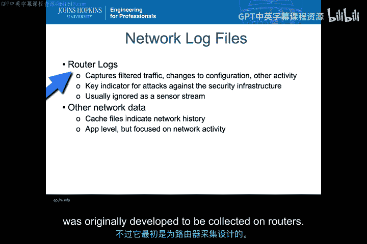
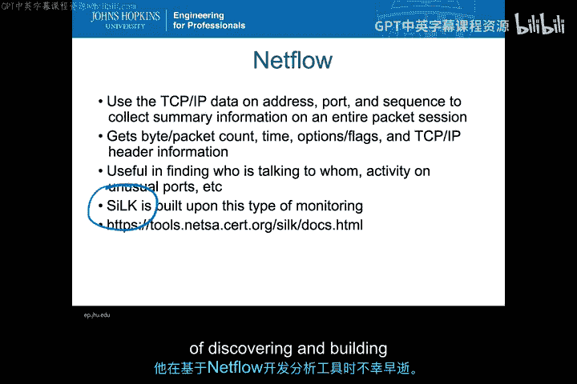
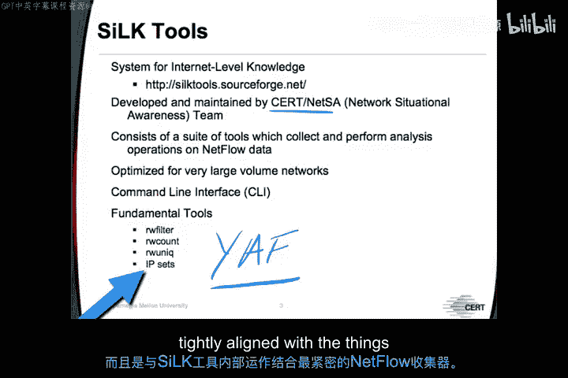
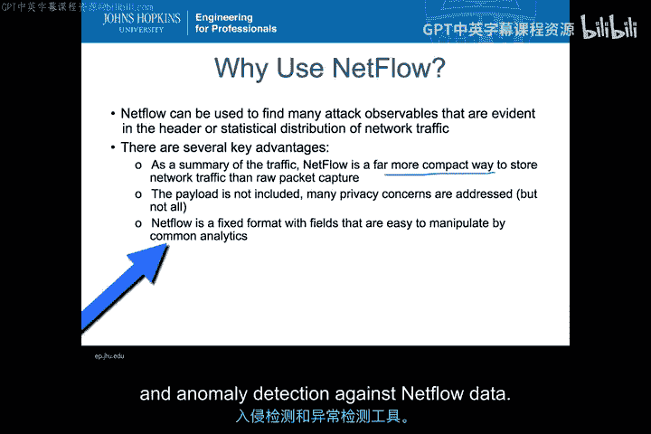
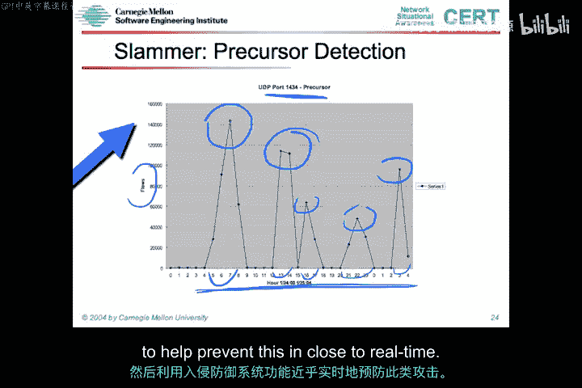
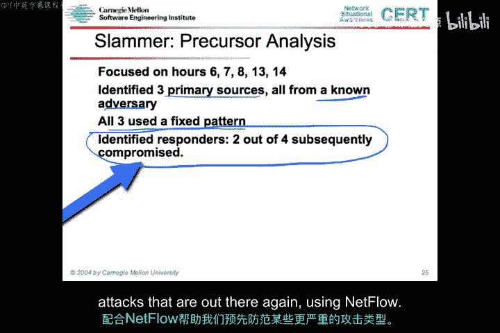
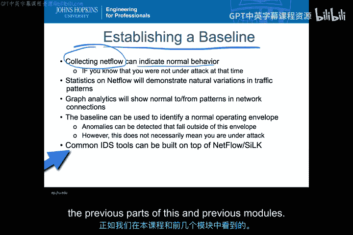

# 约翰霍普金斯大学《入侵检测｜Intrusion Detection》中英字幕 - P24：23_NetFlow流量分析与基线建立.zh_en - GPT中英字幕课程资源 - BV1sGu1z5E2J

Now， whenever you talk about network information sources for NIDs。

 really is not complete until you've actually sort of talked about netflow Neflow is a way of summarizing network connection traffic in a way that's both compact and contains observables for many different kinds of attacks that IDS systems for years have been focused on in terms of understanding exactly how to detect and in some cases even sort of prevent the kinds of attacks that can be detected directly with netflow sensors so this video is all about getting into the networkflow sensor itself what you can do with it and how you would actually use netflow to establish a baseline of activity that you can then use for anomaly detection in order to find the various kinds of anomalies。

 especially statistical in nature that would indicate a number of different attack types。

SoNeflow is in the category of sort of a network log file that was somewhat independent of the OSI stack model of observables that we had talked about in the last module with regard to input to an IDS these are effectively router logs that capture filtered traffic changes to configuration other kinds of activities within the router logs themselves。

 one type of log file that was created was a networkflow log file originally created for financial auditing in order to understand how to charge per traffic so it was a summary of traffic that could actually go back to a charging scheme if required。

 but it is a different type of network log file that specifically indicates various kinds of traffic going through network appliances like routers you can also collect netflow data aside from routers you can collect it on individual hosts as well。

 but it was originally developed。

Will two be collected on routers。So netflow is a summary of the network traffic rather than being on a per packet basis。

 Neflow is based on connection data。 It's based on taking connections that focus on the address。

 port and sequence collecting summary information across the entire session。

 you could get packet packet by counts， times options。

 the various header information that is common across the entire TCPIP session that you have。

 So what is a session， That's like when you are essentially connecting up to an email service in order to send a piece of email。

 there's a handshake that begins the protocol， there's the transport of data。

 and then there's the closing sequence。 all of that is summarized in a single netflow record that says from a specific address to a specific address on these particular ports there was activity this size。

 this amount of time。 So as you can tell， it's very useful in discovering sort of。

What IP address is talking to what other IP address。

 What source is talking to what destination because they provide the port number it was also what ports are involved in the communication to and from there are a number of useful tools that were built up to both collect and process netflow the one that I'm going to focus on here。

 for the most part， is called silkk。It's not the only tool that exists。

 but it is a specific kind of tool that was developed for network monitoring and for intrusion detection you can see from more details at this particular web address that would go to the Silk homepage。

Just as a side trivia note， Silk is actually named after the founder of netflow analysis。

 a persons name Surereshconnda， and his email address was SLK at Cert。org。

 so Silk was actually built。To honor Sureresh Knda after his untimely death while he was in the midst of discovering and building analytic tools based on netflow。

So the actual way the Silk Academy expands is the system for internet level knowledge that was the retrofitted name for silk in terms of how it was actually to be set up it was developed and is currently maintained by the CerRT network situational awareness team in Pittsburgh Pennsylvania this team developed this the silk tools around netflow specifically to gain insight over very large scale internet activities very good for network worms for understanding broadscale attacks this was a way of summarizing much more data than could be captured by capturing the independent packets。

So silk itself is a suite of tools， it's not one tool。

It's a suite of tools that perform both the collection and the analysis of NeF data these tools can bin and organize based on all of the different header information。

 it can produce graphs and statistics over large portions of the Neflow collection and it can really give you graphs and an understanding of the baseline activity that you would really want to have in order to feed into an anomaly based NIDs。

These are optimized for very large volume networks。

 things like know for DSISA over the entire dotm infrastructure。

 Homeland Security uses it across the entire US civilian government。

 we've got very large scale deployments looking and analyzing all of the various kinds of silk tools。

 these were not really fancy graphic oriented tools。

 they were basically command line interface tools that run on UniX。

Linux and various varieties of BSD， The command line interface allowed a lot of movement from the data to and from the individual separate tools that are part of the suite that are consisted within silk。

 So the idea of the silk tools is to run within a Uni system and have a number of small organized tools to process data that's within both a compressed binary form and a regular form of Neflow that was there。

 The fundamental tools。Are things like filtering， counting， Uniing and I sets。

 These are things to essentially say filter all of the netflow data I have based on the following。

The following characteristics or the following regular expression RW count just says for all the two addresses in this range or all the port numbers of this type。

 just give me count of the number of records that contain those particular parameters RW unique basically was to go across an entire set and say show me basically a filter of all the unique sets of source destination IP addresses port numbers to isolate out those that would be more unusual and finally the general IP sets command would say just been all of my netflow data according to the various kinds of IP addresses that were maintained within the netflow data itself。

 very good for input into various kinds of graph analytics that you might want to connect from source and destination ports across the entire set of netflow data that you would have collected Thiss also within the fundamental tools the tool yeah。

 which is a very important it's actually yet another flow collector。

And it is the netflow collector that's most tightly aligned with the things that are happening inside the silk tools。

So the definition of netflow as taken from chapter 2 of the Sil analysislysis Handbook is provided here。

 it's probably one of the best ways of really understanding what netflow data really is so network flow collection as it says in the definition is really different than direct packet capture it's not direct packet capture。

 things like TCP dump which try to give you all of the data instead this builds a summary of the communications between sources and destination the summary part is very important because it gives you a compressed form without losing the things that you would want from the header information on the various packet packet data。

So you can see within the definition some of the particular keys that are relevant。

 the source and destination Is， source and destination ports， the protocols。

 type of service interface on the router， so these attributes constitute the flow labels to understand the flow labels of the record。

 so the source and destination addresses， the ports and the protocol。

 these are the keys into this data， sometimes known as the five tuple within netflow。

 and together with the timing of all of the netflow data distinguish the flows from each other and allow all of the different processing across the identification of unique activity or anomalous activity。

The network flow does obviously cover multiple packets in most cases。 if it were single packets。

 then you would be collecting again， just a regular TCP dump of the generic data that's coming across the network。

 These are all basically the multiple packets that are collected across a common flow label。

 What do you mean by flow label that's the five tuple。

 So the five tuple is the common flow label for all of the multiple packets across that are summarized in a single record。

So for very longstanding connections， this can be quite compacted into a very tight representation of what the flow actually was。

 One of the most important things about netflow is that it does not contain packet payload data。

 This is important because any observables that are only seen inside the packet payload cannot be observed with a netflow Is。

 and that's an extremely important point to keep in mind when you say what kinds of attacks can be detected using netflow as an information source。

So without the payload data， why use Neflow， why even use it if you don't get the payload well？

There are many attack observables that are evident just in the header or the statistical distribution of network traffic。

 And that's what you primarily get from a netflow sensor。 So the key advantages is， first of all。

 it's a summary of the traffic， and it is far， far more compact than doing raw network traffic alone。

Even though the payload itself is not included。Because the payload is not included。

 there are privacy concerns that are addressed， so there are organizations that don't want the payload portion of any of the collection to be stored。

 mainly for privacy concerns， but when I say not all privacy concerns。

 certainly having the metadata for connections can tell you a lot about what's happening with an individual's communications。

 the IP address， the source address， the destination address can indicate usually who the individual is who is actually doing the activity thus you can even just from the to and from addresses。

 get a lot of information about what an individual is doing within the network。

 so you do you are able to restrict the view into the content by collecting simply netflow。

 but it doesn't really fix all of the privacy concerns。And as we've said before。

 NeFlow is a fixed format with fields that are easy to manipulate。

 common across all the network interfaces and common across all of the publicly available tools that are out there for doing a variety of analytics and intrusion detection and anomaly detection against netflow data。

So here's an example of some of the things that you can do with the kind of netflow data since the data that I get from netflow gives me a lot of the average traffic。

 almost anything I can do with regular traffic analysis I can do using netflow data So as you can see。

 I've sort of got normal traffic that sort of down in this range。

 some traffic here that is spiky and looks very individual with regard to the kind of activity I might see in the course of a current day。

 but then I have this interesting arrangement of traffic on the right。

 which says that I have a very sharp sharp rise followed by a continuous stream of traffic coming in all at one time。

 So the average bits in by this green line down here。

 you can say went up high and stayed high in terms of coming in and this is very common with regard to some kind of a Ddos attack that you might see so you can see where you can use。

Netflow kind of information to easily differentiate what I would see from normal behavior from what I would see with a kind of a dedost oriented behavior。

However， one limitation of using netflow for this kind of purpose is where do I put my netflow sensor If I back the netflow sensor further upstream so that more traffic is aggregated。

 that same attack that I saw just a moment ago is buried in all of the normal activity that's there。

 So what was evident at a single site at the simple site that was there in the first place is now gone when it comes to the idea that I've aggregated farther up within the ISP infrastructure。

 Now， I could probably still run additional tools that would break that attack out。

 even with within this infrastructure， But it's not going to be nearly as evident in the traffic level themselves using the same analytics that I was going to use locally in order to understand my average behavior。

 So the point is， if I decided to take average behavior during the week and use a threshold that's somewhere sort of in this range。

For like during the week， maybe on the weekends， I lowered the threshold to here， as you can see。

 this traffic really didn't exceed my threshold in any kind of way so that a threshold in this particular level would not actually have identified what I would have hoped to find which would be a Ddos attack in this area。

 whereas I could easily draw a threshold to do that in the previous case。

There are many good examples of exactly how the various kinds of ports and flows for Diddos could be really observed。

 easily observed using netflow data， This happens to be slammer traffic that was created。

 So slammer was one of those worms that launched at a very specific point in time came to a very high level and then ended shortly thereafter。

 So this is only interesting from the standpoint of having detected it。

 But there's more than you can actually do with netflow data then simply look at did my traffic。

 exceed a threshold。 And can I then use that in order to identify whether or not and under attack。

 In this case， port 1434 is a specific characteristic of network traffic that we might want to look back in time to say werere there precursors of this attack on this particular port that would have indicated either tests or precursors of what had happened with smer and idea。

Finding a precursor like this could be very important if we can identify precursors。

 then we can take action prior to an attack like this in order to throttle or somehow back off at the higher level ISPs。

 the effect this would have on an endpoint that's actually being attacked so let's look at the precursors to this using Neflow。

So here are some hours before the attack。 You notice， first of all。

 these are much smaller flows than the ones we were talking about in the previous slide with regard to the UDP port。

 same port， but these are now the precursors。 And now I've got this sort of interesting pattern of several spikes。

 They're all much smaller spikes but they come in a pattern that look alike their sort of tests for the kind of thing that a worm would want to create。

 So if I know that this is a characteristic。 of something that I might be expecting with regard to a precursor to a worm。

 I could alert on this activity and take some kind of a preventative action before that huge spike that I would have had on port 1434 in the previous。

 Now， the important element here is this is not normal kinds of traffic I would see。

 It's not dangerous because these numbers， these levels are not very high。

 So this is not dangerous dedos traffic。 but as precursors， this tell。

Something about what might be happening on a rather unusual port for 1434 in this case that we might begin to say this violated normal traffic。

 and it could be a precursor to something more significant。

 Could we put an automatic blocking rule in upstream of the ISP that would keep this from really taking our system down。

 Those are the kinds of baselinelining questions that netflow can really begin to set up that you can load into an Ids。

 a anomaly based Is and then use an IPS functionality that help prevent this in close to real time。

So in the precursor analysis， we focus specifically on three primary sources。

 all from a known adversary。 So this is important because we can use a reputation based service to actually identify known adversary sources。

three。Primary sources all from a known adversary using a fixed pattern that is unusual。

And so these responders， these sort of identified responders。

 were tests of who within our infrastructure would answer such a worm as third of the slammer worm that was in。

 So now we have a lot of information that the Is can pull together in order to prepare to take some kind of preventative action。

 We have a reputation service that would tell us we've got a known adversary。

 We've got a fixed pattern of behavior that we can identify and we can identify internal victims that might have been involved in the setup for this particular kind of attack。

 These are all very useful patterns to put into an anomaly detection system that can help us get ahead of some of the more serious kinds of attacks that are out there。

 again， using netflow。

So in summary， I hope you can see that you can establish a baseline easily using netflow collections to indicate normal behavior and as long as you know you were not under attack when you created your normal behavior。

 you can use these statistics on netflow to generate natural and take advantage of the natural variations of traffic patterns in order to look outside there for the kind of anomalies in which you want to alert。

You can use various kinds of graph analytics across this to show normal twof patterns。

 This will help you to understand better what precursors to attack might look like and to identify things that you could begin to take preventative action on using netflow data in order to create a network baseline。

This actually creates what we call a normal operating envelope。

 anomalies that are detected fall outside of this envelope。

 So this doesn't necessarily mean that you're always under attack when you're outside the envelope。

 and it doesn't necessarily mean that everything inside the envelope is not an attack as we get into the type 1 and type 2 errors。

 You'll see that there are easy ways to identify different error classes based on how this might fail to identify attacks。

 However， this is still an excellent way to build。Common IS tools on top of netflow or using the silk tools as a way of building a baselining and alerting that can feed into snort rules。

 saracottta and bro modules， any of the other kinds of Is that support some of the statistically based anomaly detection systems。

 as we've seen in some of the previous parts of this and previous modules。

