# 约翰霍普金斯大学《入侵检测｜Intrusion Detection》中英字幕 - P25：24_I类与II类检测误差.zh_en - GPT中英字幕课程资源 - BV1sGu1z5E2J

Since we're beginning to talk about NIDs in an anomaly detection system。

 it's time for us to start to begin to introduce more detail with regard to type 1 and type 2 errors that are going to be evident whenever you deal with the kinds of anomaly and misuseed detection systems that don't always give you exactly what you want with regard to incident detection。

 so this is a short introduction to type1 and type 2。

 we're going to be revisiting this topic a number of times in this and future modules in terms of looking at how we are going to begin to use type1 and type 2 errors to evaluate the properties of intrusion detection systems and help us to evaluate the efficacy of different kinds of intrusion detection systems。

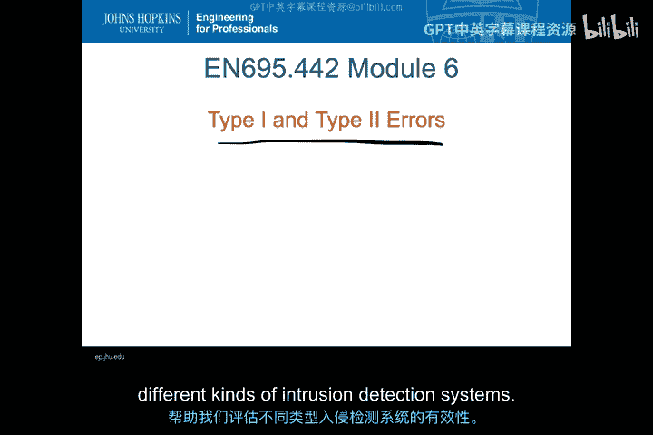

So let's start off by talking about errors in NdDs。

 We've already begun in the previous video to begin to talk about what happens when we have an anomaly detection system where the anomaly is inside the normal behavior or the attack is inside the normal behavior。

 or there's normal behavior that sort of happens outside of the envelope and and is labeled as an attack by the Nds。

 So this talks about when a Nds reports an incident。

 We may actually have an actual attack or a false positive。

 So there's two potential outcomes whenever we get a Nds report of an incident。 You know。

 we could actually have an actual attack。 That's what we're looking for。

 or we could have a false positive。 When I talk about a false positive。

 That means that the Nds has reported an incident that as it is， in fact， not an incident。

 It's just part of normal behavior。 We call that a type 1 error in the classifier。

 The classifier inside the Nd has incorrectly classified。The source material into an possible event。

 and that is a type 1 error。

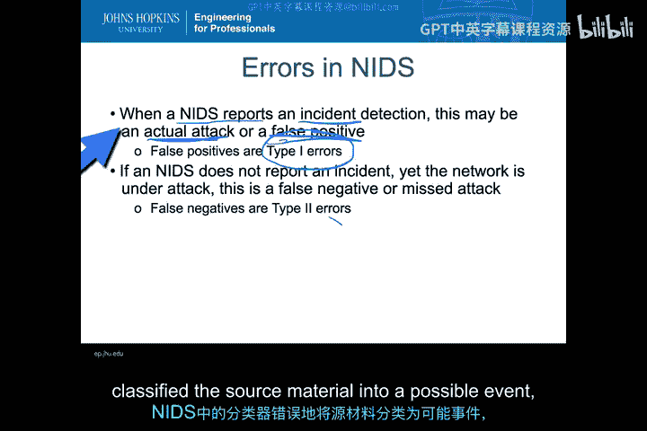

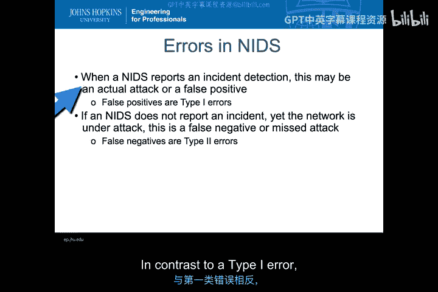

In contrast to a type 1 error， if the Nds does not report an incident yet。

 the network is actually under attack。 This is a false negative。 Basically。

 we should have had an revert， and we didn't， it was a missed attack in our system。

 These false negatives are actually called type 2 errors。

 So just like in the case of the type 1 error， there are two possible outcomes to a detection。

 In this case， there are two possible outcomes to the lack of report。 So if basically。

 data comes in from the Nds。 and it is not indicated as an attack。 It can either be in that case。

 a actual an actual attack。 in which case it indicates a type 2 error。

 or it can truly be normal behavior and not an attack。

 and the Nds has correctly classified normal behavior as normal。

 So then we have a type 2 error or normal behavior。we have a type1 error or an actual attack。

 those are the four different kinds of outcomes that we can actually get with regard to the NIDs so now that we've talked about these two different forms of outcomes that can actually happen。

 let's talk about comparing errors and NIDs based on whether we're using misuse detection or anomaly detection。

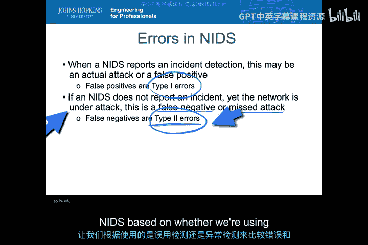

So with regard to type 1 errors。 these are， remember， our false positive errors。

 Let's sort of compare what we've got with misuse versus anomalies。

 So in the misuse systems or the anomaly systems， what do we sort of have with regard to type 1 errors。

 So in a misuse nids were specifying the attack in some configuration or rule set that's there。

 these signatures are usually designed to pick out the unique parts of an attack。

 that is rarely rarely part of normal traffic， because it's rarely part of the normal traffic。

 The misuse not the misuse nids tend to have a very low type 1 error rate。 In other words。

 Nds misuse detection systems rarely detect an attack， rarely say that there's an attack。

 when there isn't actually an attack。 It can happen。

 especially if the misuse signatures are very broad in their definition of an attack。

 but it's rarely the case。

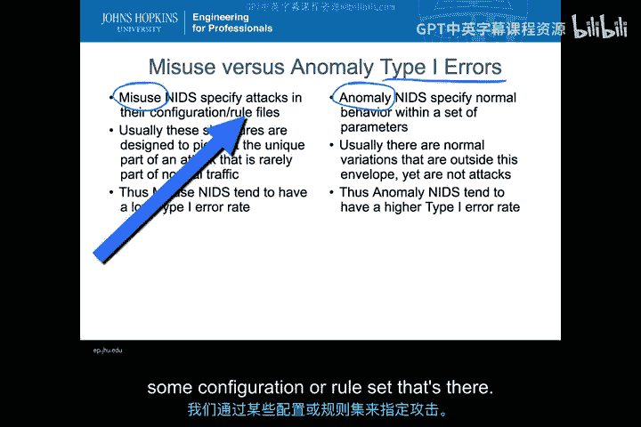

The misuse NIDs are designed to specify the attacks in a way that we get a very low type 1 error rate。

Now， this is in contrast to the way anomaly detection system would specify normal behavior within a set of parameters。

 So normally， there are lots of variations that might be outside of this envelope that would happen on a more regular basis。

 because after all， normal user behavior changes frequently in most normal networks。

 Thus anomaly nids tend to have a higher type 1 error rate。

 there are more false positives reported because there are more anomalies that fall outside of the normal specification and thus are indicated as an attack by the Nds。

 but in fact， are not attacks。 So in comparison， we can see that for type 1 errors。

 the misuse systems tend to have low type 1 error rates and the anomalyidds tend to have a higher type 1 error rate。

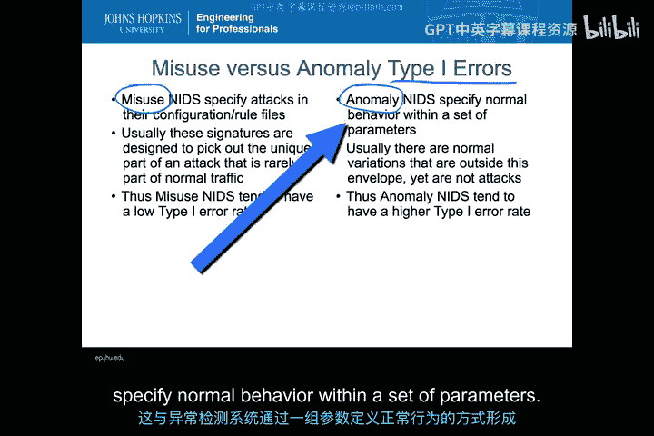

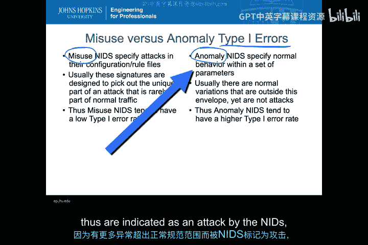

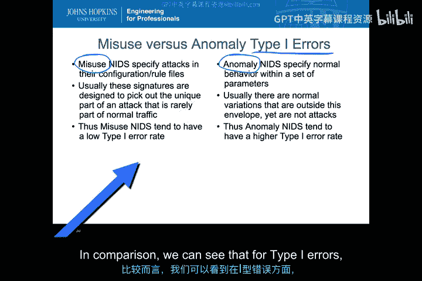

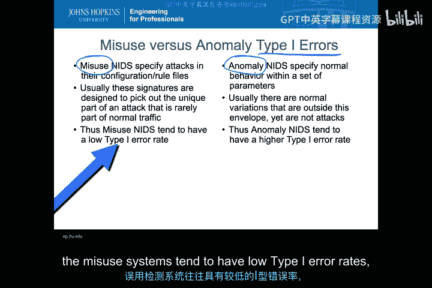

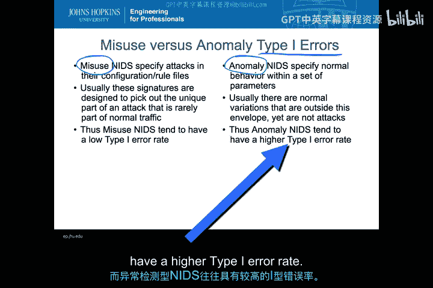

So now let's do the same comparison with regard to type 2 errors。 So misuse detectors。

 they detect only the network attacks that are known。 In other words。

 we have to have them in the specification part of the signature base before they can be attacked detected。

 So most new attacks， zero day attacks or things that have happened since the signature file was updated tend to be missed。

 So because of that， variations in the signatures can pick up small variations in attacks。

 But many attacks know what these variations are， and thus when a new attack comes out。

 it's designed not to be seen by the existing signature bases that are out there。

 So these missed attacks lead to a higher type 2 error rate， more missed incidents。

 So in the case of anomaly detection when we have the anomaly detection system。

The Nds only cares that the system is within normal parameters。

 It doesn't care how or why that particular anomaly is outside the normal parameters。

 So new attacks that are there are not that it's not required that you've seen them before。

Whether you've seen them before or not， as long as they change what the behavior of the system looks like and pushes the system outside the norm。

 they will be detected。 This is the big advantage of an anomaly detection system is that you don't have to have seen the attacks ahead of times。

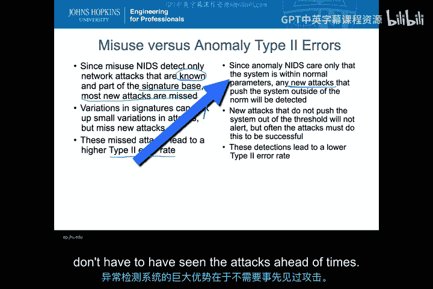

So the new attacks that do not push the system out of the threshold don't alert。

But most attacks have to do something in order to be successful。

 And often that something is to change the normal behavior such that it does push those particular thresholds outside of normal behavior。

 So those detections actually lead to a lower type 2 error rate。In this case。

 anomaly detection systems are more likely to see new attacks。

 and they're more likely to see them with no matter how they were defined or how new they are。

 compared to what we've seen in the misuse detection system where only known attacks are going to be seen。

 So as you can see， this is exactly the opposite case in the type 2 errors。

 we've got the higher type 2 error rate in the misuse system and the lower type 2 error rate in the anomaly detection system。

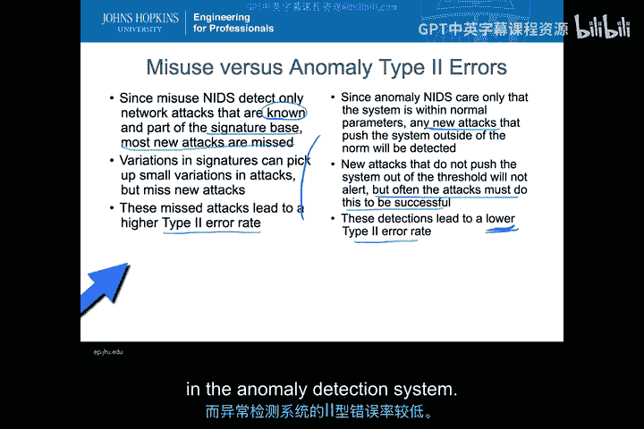

So the table in this chart summarizes what I've just basically said。

 So if we have misuse and anomaly detection systems along these， the misuse system， as we've said。

 sayss to have lower type 1 errors， higher type 2 errors。

 anomaly detection systems have higher type 1 errors and lower type 2 errors。Now。

 what if we combined the two， What if we took a system and added both misuse and anomaly detection within the same system。

 This is true in most of the systems， you'll be looking at snort， bro， sarocottta。

 all of these are combined misuse and anomaly detection system。 Well， as you can see。

 your type1 errors are still likely to be higher， because you're still going to alert just like the anomaly detection system does。

 So you're going to end up with a higher type 1 error rate。

 not the lower type 1 that you get in misuse systems because the misuse systems wouldn't have reported on the other new attacks anyway。

 So you're going to get higher type 1 errors。 And type 2。

 the combined system is going to give you lower type 2 errors。

 just like the anomaly detection system。 So in terms of the type 1 versus type 2 errors。

 a hybrid system is very similar to an anomaly detection system。 So why use a hybrid system。

 It has to do with the。Accuracy， so basically， a misuse system not only has a lower type 1 error。

 but the attacks it detects are quite accurate In the case of the anomaly detection system。

 you don't have as high in accuracy because you've got a high type 1 error。

 And even though you have a lower type 2 error。 You don't miss as many things。

 you still have a lower accuracy that the things you identify are actually a。With a hybrid system。

 you have the higher error type 1 from the anomaly detection portion and the lower type 2 from the anomaly detection system。

 But you get the accuracy of the misuse nids based on the signatures that are actually detected。

 So whenever a signature hits and a hybrid system， you're very likely to have a specific attack that is detected。

 So within the accuracy， my hybrid system is going to do better than my anomaly detection system。

 even though the type 1 and type 2 error rates are going to be similar to my anomaly needss。

So the hybrid systems attempt to use the best of both types of detection to lower the overall error rate。

 and as I said before， snort bro orracottta all combined misuseed and anomaly detection。

 and they do detect known attacks better than anomaly detection and may still have a high type 1 error rate based on the anomaly detection portion of the system。

 So we'll be looking at hybrid systems， but it's important to realize that when you do combine a hybrid system。

 you can't simply lower the type 1 error rate just by adding a misuse system because you're still going to get the alerts that come from the anomaly nids that are actually part of that system。

So the hybrid Nids gives you better accuracy in terms of coming in here。

 and the accuracy is going to be more similar to what you would see in the misuse IS。

 So that's why you want to have the combined systems of the hybrids。 It's why snort。

 bro and Surracottta have all kind of gone off into this way as well as the commercial products like So fire that are all doing that as well。

So this was an introduction to the type1 and type2 errors in the system。

 we're going to be seeing this again in future modules as we do more of the network analysis and more of the idea of how we actually evaluate intrusion detection systems。

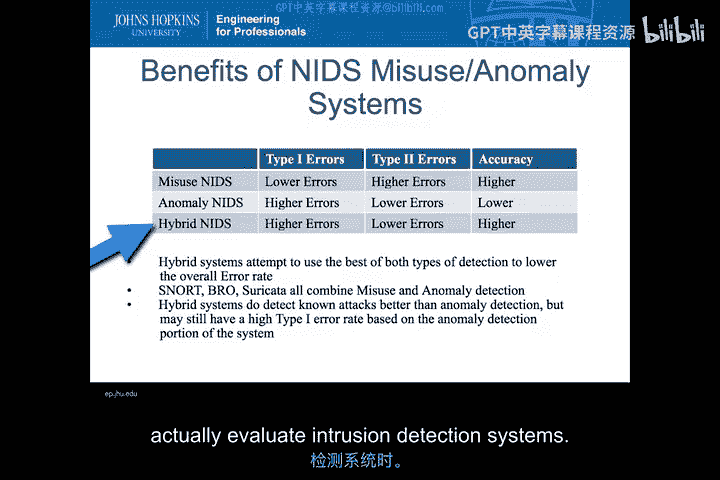