# 约翰霍普金斯大学《入侵检测｜Intrusion Detection》中英字幕 - P26：25_无线入侵检测系统(WIDS).zh_en - GPT中英字幕课程资源 - BV1sGu1z5E2J

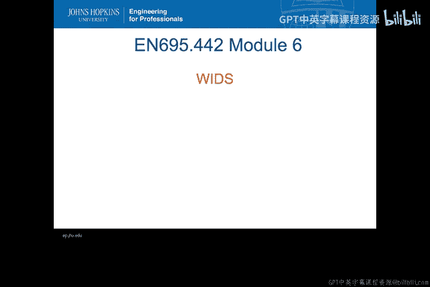

In this video， I want to talk about a specific example of a NID that runs within the wireless 80211 space called the wireless intrusion detection System or WiIDs。

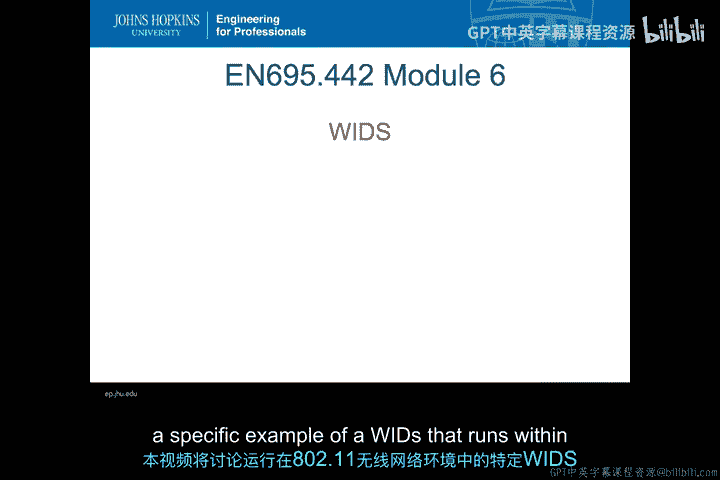

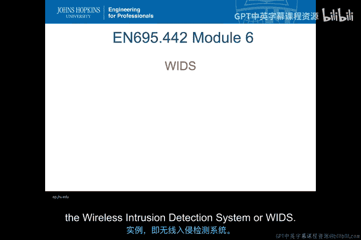

So the WiIDs in this case， is a specific kind of network intrusion detection system specifically designed to detect attacks over RF style networks like 80211。

 although most wID system that you'll see today are specifically designed for 80211 A B DG sort of in that kind of time range。

 the idea behind WiIDs is that whenever I have a cellular network any kind of an RF based system。

 I want to have some kind of a network intrusion detection system that uses the RF as input。

 and allows me to do my network intrusion detection based on using my sensor in the wireless space。

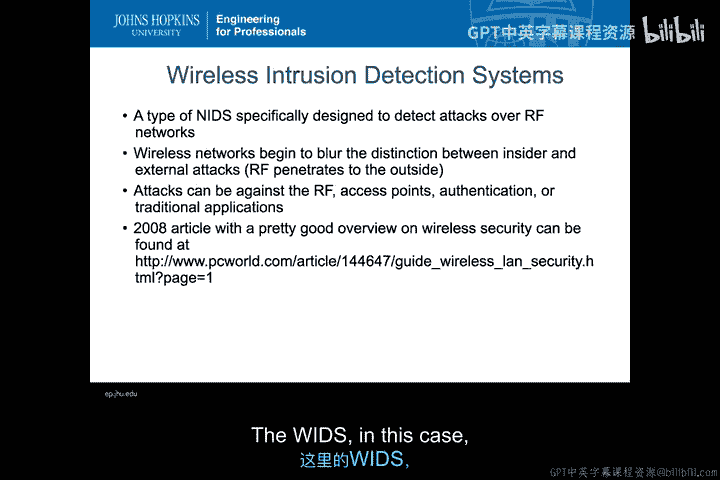

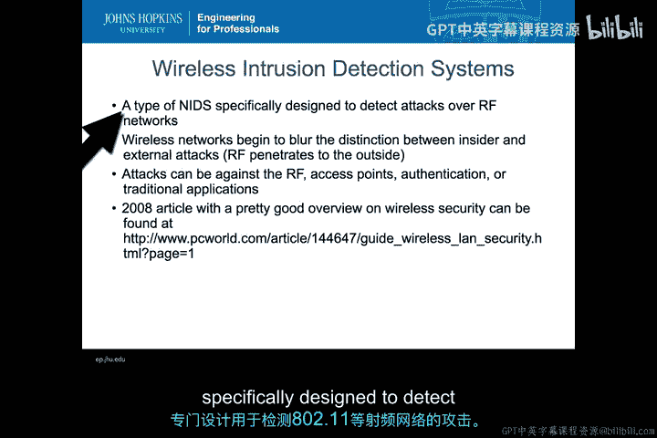

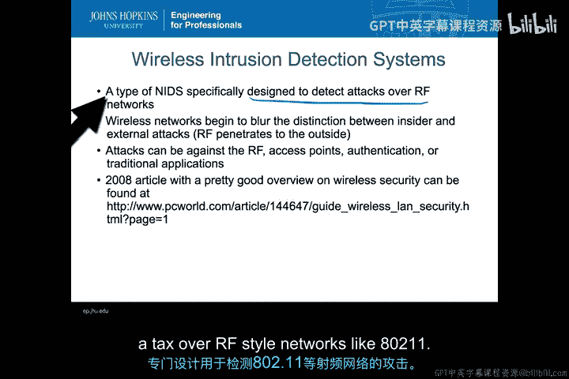

One of the unique aspects of wireless intrusion detection systems is that wireless systems in general begin to blur the distinction between insider and an external threat。

 The way they do that is that Rf doesn't really usually stay to the same walls。

 Most buildings that have wireless networks are not shielded in a way that the RFf stays inside the building So you can be outside the perimeter。

 the physical perimeter of the organization and gain access to the wireless network By doing that。

 you've kind of blurred that distinction between what we mean by an insider that's in the building actually with physical access to your systems and near your building that is able to get access based on this RFF that's penetrating the building to the outside world。

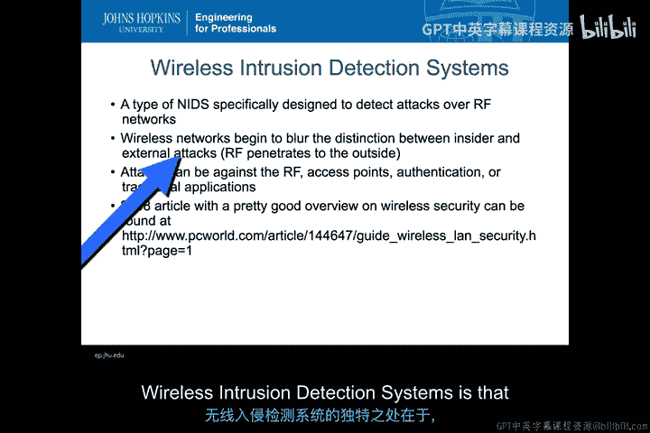

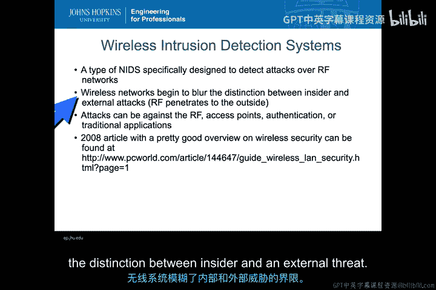

So these attacks can be against the RF itself。The attacks can be against the access points。

 the authentication or other applications that run over these wireless networks。

 So some of the attacks are actually unique to the wireless transport environment in which the Is。

 the WiIs in this case actually runs for a good overview beyond what I'm going to talk about just in this video。

 there's a 2008 article on wireless security found at this particular link。

 And if you if you're interested beyond what we're talking about here and within the readings you have for this module。

 this is another good overview of the wireless security。

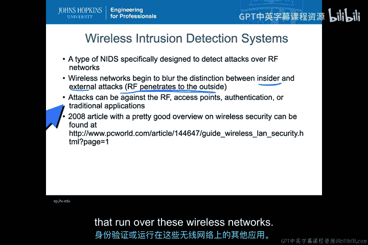

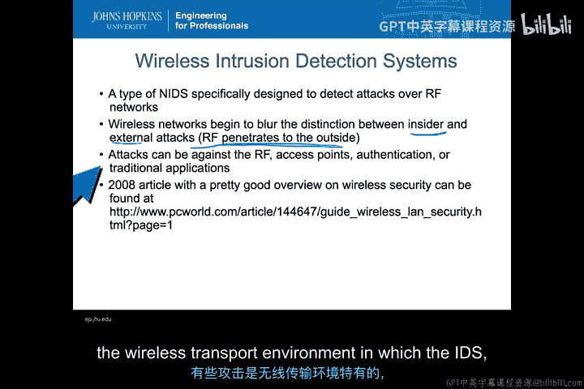

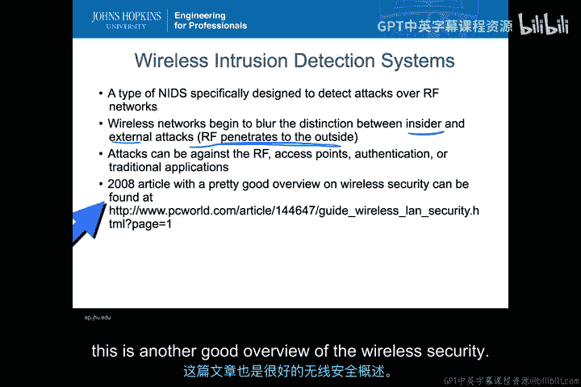

So now I'm going to go into some examples of specific wireless attacks that are a little bit different than the attacks that we've seen on traditional networks up to now。

 I'm going to cover the wireless interception and man in the middle attacks。

 some jamming and blocking connection resets， authentication and wormhole attacks a lot of the graphics that I'm getting from this next couple of slides here。

 come from this particular resource on the wireless attacks unleashed So if you want to follow along with more details in any specific example or see some of the other ones please go into this website you can take a look at it there。

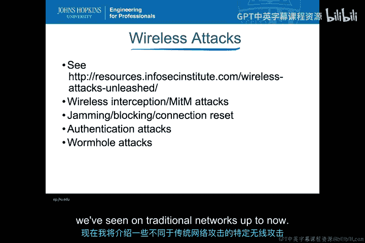

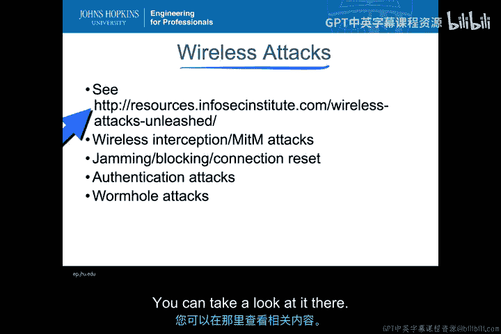

So let's start first to look at a wireless man in the middle attack。

 So this is essentially starts by using a rogue access point。

 What a rogue access point is is another piece of hardware。

 an access point that could be either a physical device access point or it could be a laptop。

 but the idea is that an attacker has taken a piece of hardware and introduced it into the area in which your RF networks' work by introducing a new access point and naming that access point the same as you would expect your legitimate access point to be named。

 you can fool a target into linking with your access point instead of with the legitimate access point。

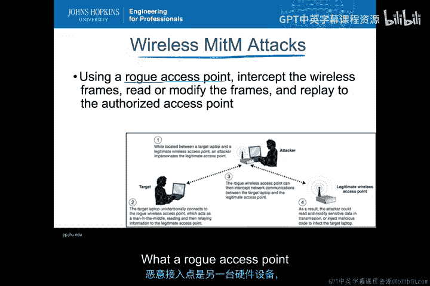

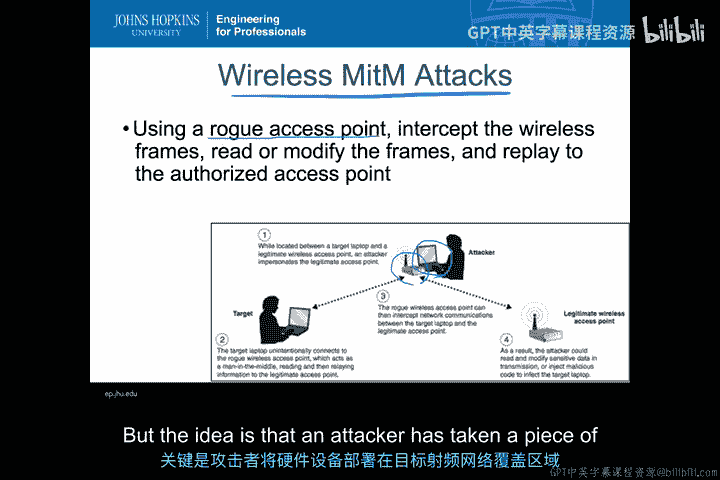

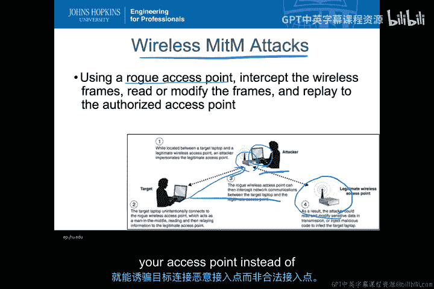

Now， once I have made this connection between the rogue access point now and the victim that's attached。

 what can I do， I I can begin to take the packets that are coming up here。

 including my authentication packets。 read and modify those packets。

 and then send them along to the legitimate access point。

 take the return traffic and do the same sort of thing。 I can create tools to do this automatically。

 So the target would be completely unaware that I have somebody in the middle who's actually using a rogue access point in the wireless space to get between the user and the legitimate access point。

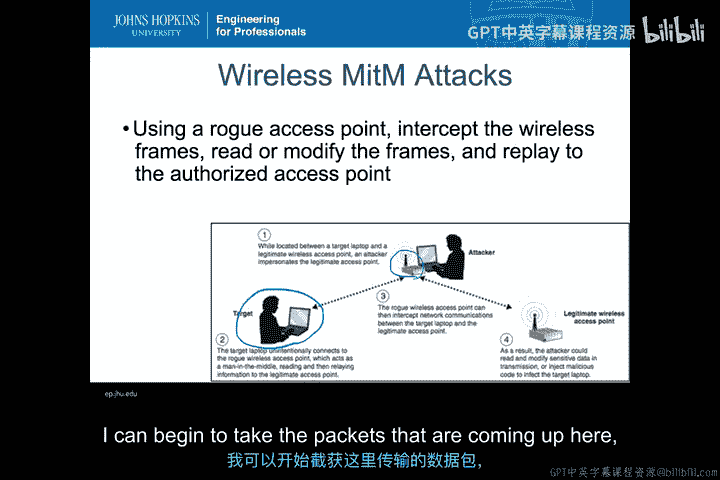

This is easier in the RFf space than it might be in a physical environment。

 because I don't have to worry about where to tap in or cut a line。

 I can simply get anywhere within range Rf range of the specific target that I'm looking for。

 and then。

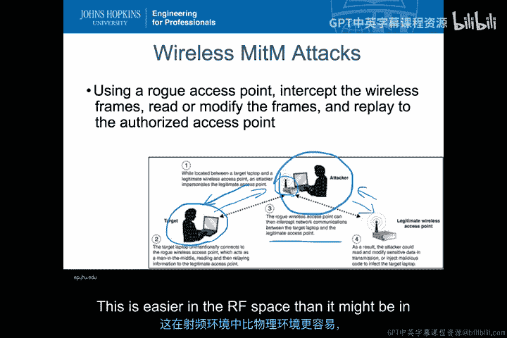

With naming my particular access point in a way and using a little bit more power in my transmit and receive。

 I can get the target computer to prefer to talk to my access point than the legitimate access point。

 So that's the way the man in the middle attacks work within the R S space。

 very similar to man in the middle attacks on wired networks。

 But with the added simplicity that all you have to be is within proximity。

 You don't actually have to do any specific tapping of wires or intercept a legitimate wired connection going into a router or someplace else。

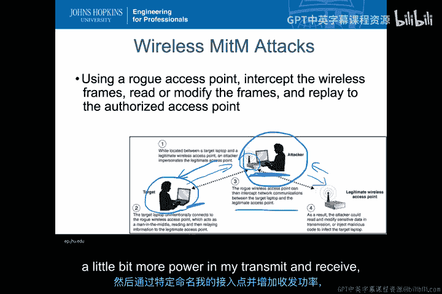

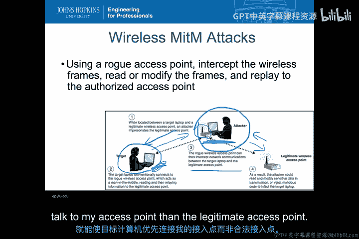

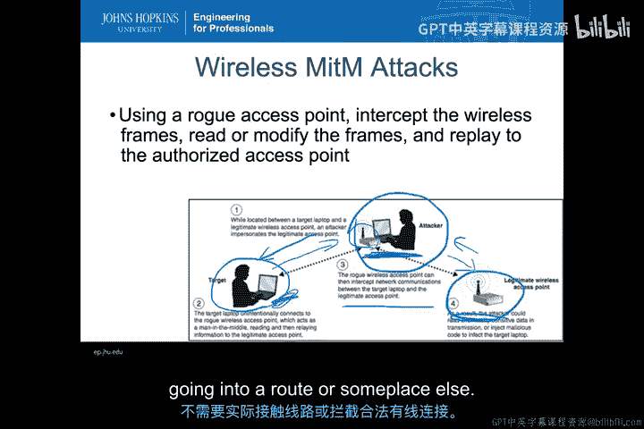

Somewhat unique to the RF environment is the whole idea of jamming and blocking and resetting connections。

 By doing this again， I'm introducing a rogue access point。

 some other kind of transmitter into the environment that's going to be on the same channel and frequency。

In this case， however， I'm just going to use the Rf to create wireless frames that disrupt the signal that jam or block or create resets into the connection that allow me to simply disrupt anything having to do with the organization trying to work between the access points and the endpoints。

 I can do this either by making sure the access point itself can't respond by sending rogue Rf and rogue packets to the access point or I can transmit directly into the various endpoints in terms of doing this sort of jamming or blocking or resetting If I'm going directly to the access point。

 I can potentially crash the access point by sending malformed wireless frames to it by sending any number of things that would do resource exhaustion So there's any number of ways that I can use my R access to the access point in a similar way that if I had physical wired access to a router or switch able to send any number of disrupt。

kind of wireless frames and elements directly into those particular areas。 So within the RF space。

 what would an IDS do， you could look for the kind of patterns that would be jammming。

 blocking and resetting and recognize that they're not just normal variations of your RF space。

 but are in fact， some kind of an attack that's actually been launched against your system。

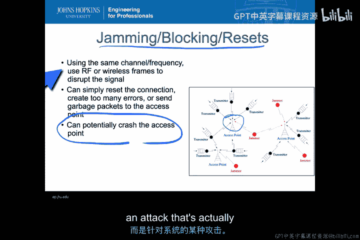

Another very serious attack against the RF space is basically looking at authentication attacks。

 attacks against how you would actually authenticate into your wireless space。

 I doubt that very many of you watching this video now who have an 80211 network use no authentication at all。

 You probably have some kind of a passworded access or a shared key that's actually being used to protect access to the access to your wireless access point。

 Well， earlier versions of these were actually pretty easy to break。

 and there are many common tools out there on the Internet that allow you to really get in and break the various kinds of authentication that's there。

 This was especially true in some of the older addressing schemes and some of the older encryption schemes that were used。

 The newer schemes like WPA2 and WPA2 enterprise have not been broken to date。

 They are much stronger schemes than the older schemes。 But sadly， we have a lot of default。

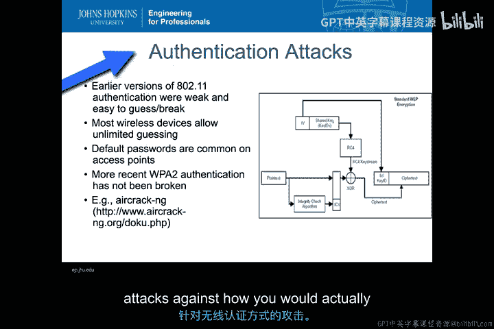

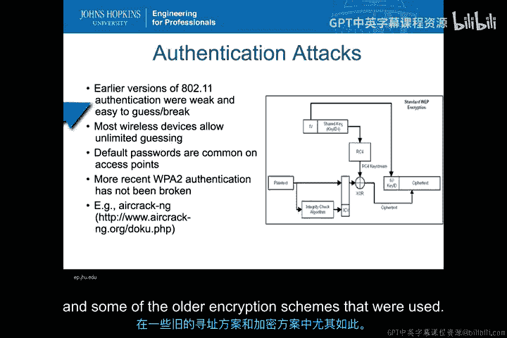

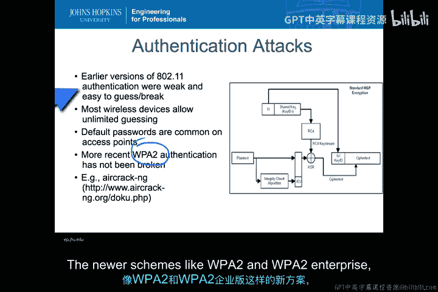

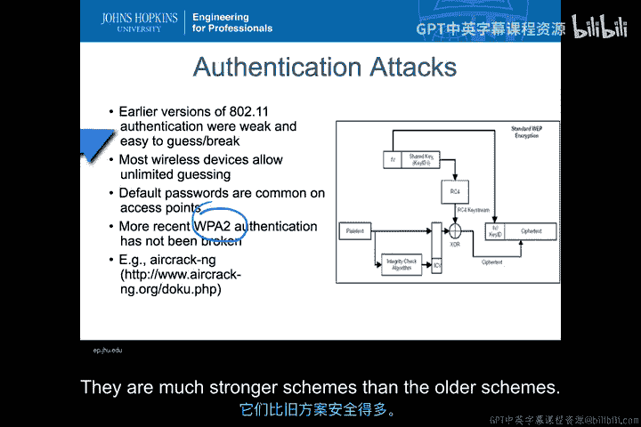

Passwords and default configuration that actually are used to。

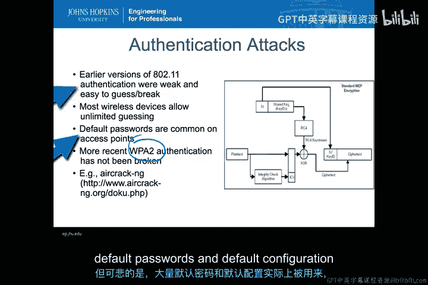

Essentially disrupt these systems that are not maintained very well。

 Most wireless access points are not considered to be computers or devices that require care and feeding。

 so users don't update them。 They don't reset the default passwords。

 they don't update the encryption standards to make sure you've got one that can't be broken。

 So any number of these kinds of errors happen on many of the wireless access schemes that are out there and able to be broken。

 So by looking off on the internet， you can get things like Airc Nng。

 which is actually quite good at using these kinds of schemes to break any of the standard wireless key encryption。

 especially the standard whip encryption that's out there。

 This is the old vulnerable case that's sort of there。

 and aircraft can very quickly break those sorts of authentications and allow you to masquerade into the network and become a fully。

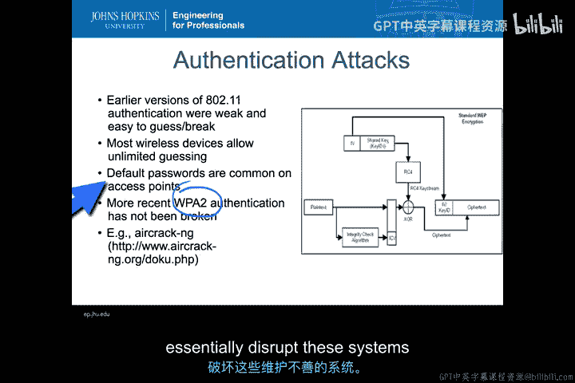

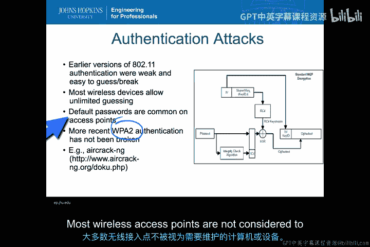

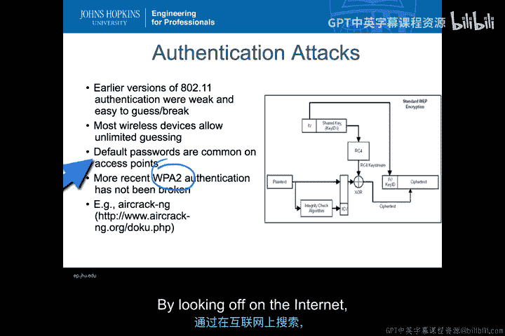

Active participant of whatever network you happen to be trying to break so these authentication attacks are very serious attacks that are both against vulnerabilities and default configurations and vulnerabilities in weak encryption standards in order to break into these kinds of wireless networks that again are leaking outside of your boundaries so that physically you have to be close but not inside the boundary of an organization。

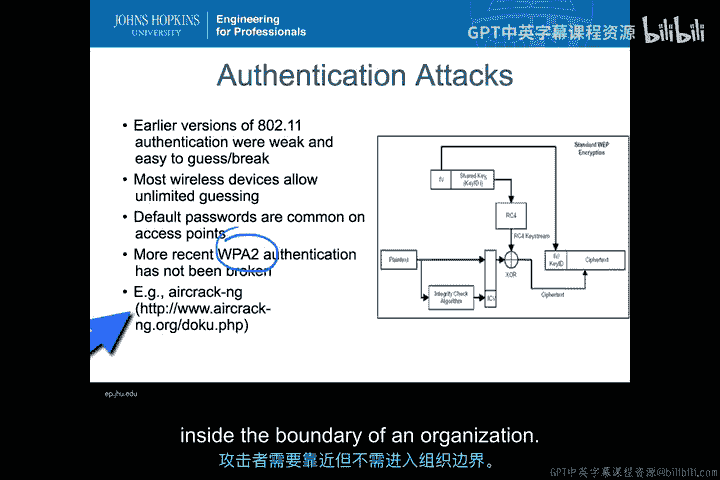

Another completely different kind of attack that actually happens quite a bit in the wireless area are what's known as wormhole attacks。

 These are variations on man in the middle attacks。

 where essentially you're intercepting a packet and your wormholing it to an area closer to its destination。

 then the normal path that it would have to go through in order to get to the destination from the wireless network through the infrastructure and off into the path。

 Well， what good is that， by taking over the packet and either rewriting it or at least replaying it in a way that you get your answer back through the wormhole。

 you can take control of the connection using all of the authentication and the encryption standards that would have come from the original origin point or destination point。

 So this wormholing tunnel allows you to beat the packet to its destination。 Thus。

 the second packet that shows up will be considered a duplicate and dropped。

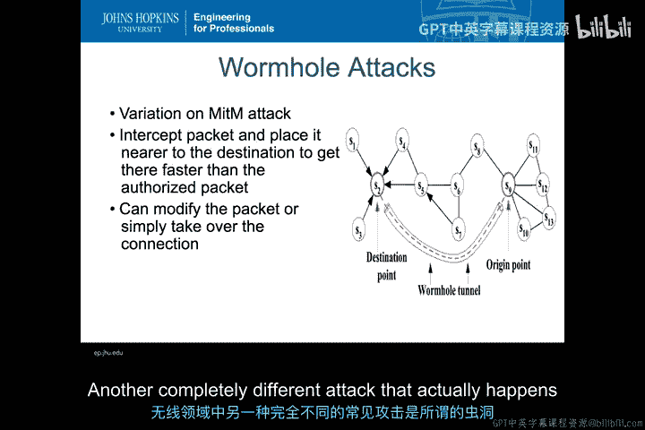

So， the main。Connection that will be set up， will be the one through this wormhole。

 which will be the one that is controlled by an adversary。

 So the adversary can modify the packet or simply just take over the connection。

 So these wormhole attacks work on wireless networks because wireless connections tend to be slower than wirelessd connections。

 they tend to be more convoluted coming back to an origin or a destination point so that you are able to get in there and race the packets to his destination。

 even if you can't decrypt the packet， even if that you can't actually get in there and understand the entire payload of the packet。

 You can still wormhole to his destination and take control as a man in the middle attack going back and forth through this particular kind of wireless disruption。

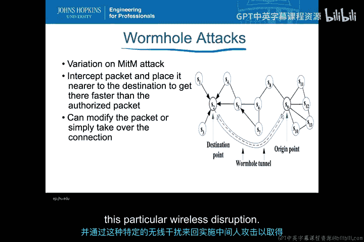

So these are not theoretical in nature。 these attacks or these defensive tools。

 The attacks are actually out there。 Any Google search will uncover many， many。

 many tools for any given attack type that you'd want to do across wireless networks。

 there are some wood tools that are becoming available。 the primary open source one is called Kismid。

 which you can get to at this particular URL that's there。

 Kismm is both a signature and an anomaly based Wis。

 It is a network intrusion detection system based on wireless networks that come in If you want to look at the attacking side。

 Cay Linux， which is an image file that contains many attack tools also contains many open source wireless attack tools。

 So running kismid and cay Linux in a test environment would allow you to test your wireless systems against various common attacks and see。

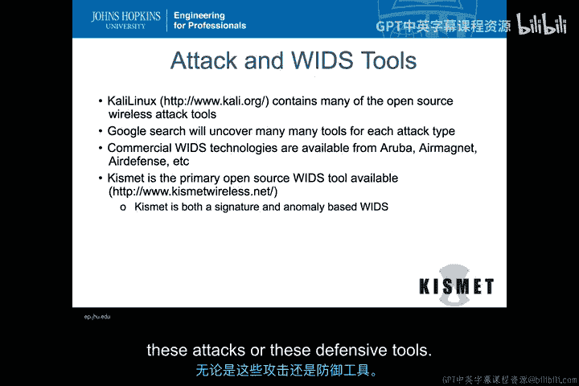

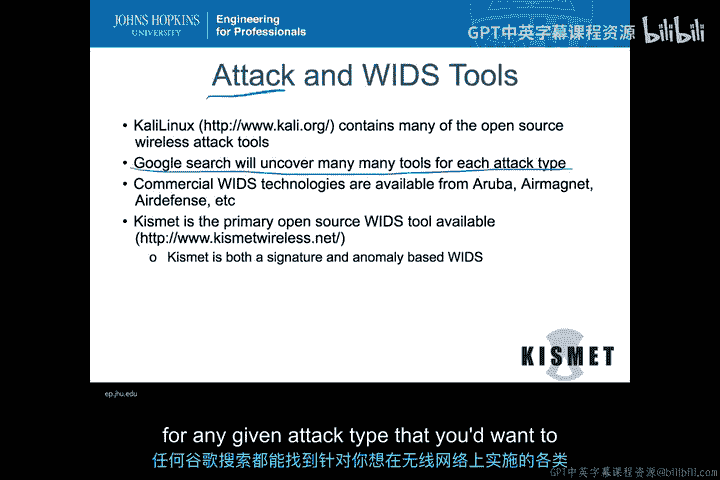

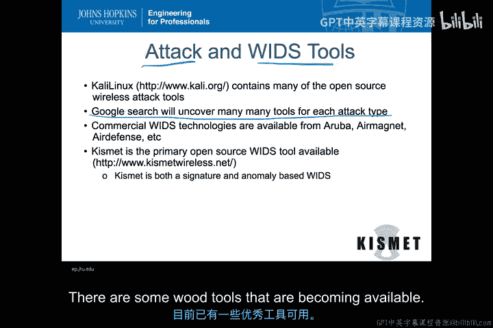

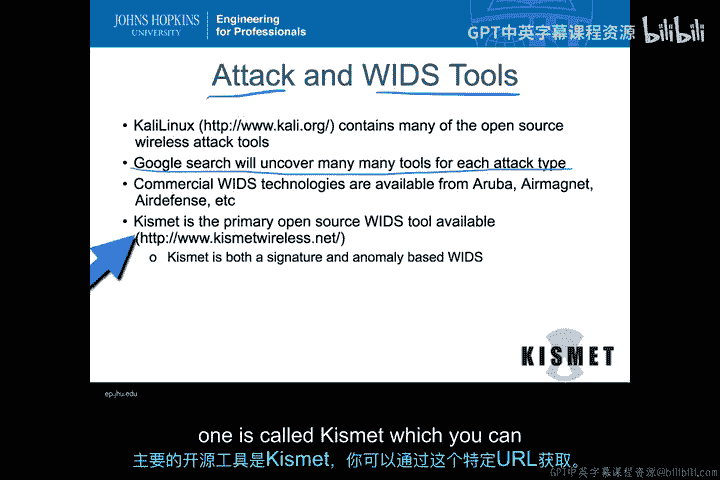

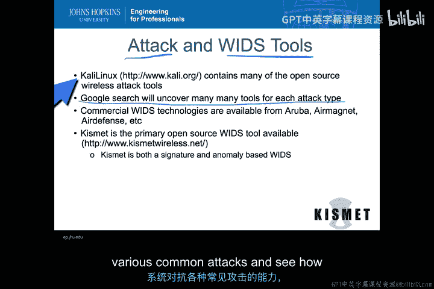

how they're picked up and prevented using Kismid as a primary detection tool that you have within so within this course。

 we don't focus within the aero space or within the wireless intrusion detection space。

 but it is an important and growing aspect of what we're seeing out there in the sort of network intrusion detection system tools so the readings that you have in this module are some recent papers that further describe research in the area of WiIs and what's actually happening with regard to wireless intrusion detection today。

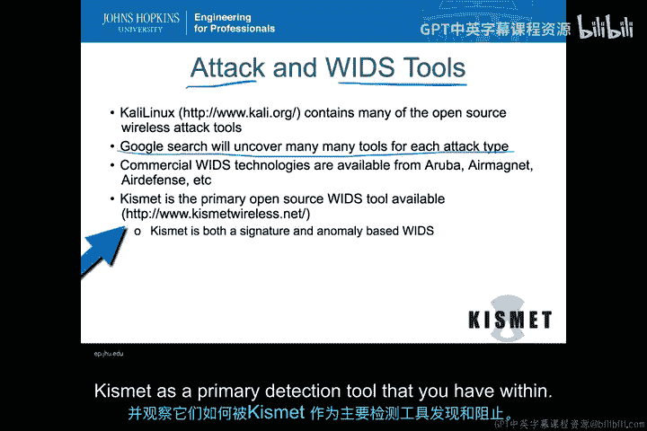

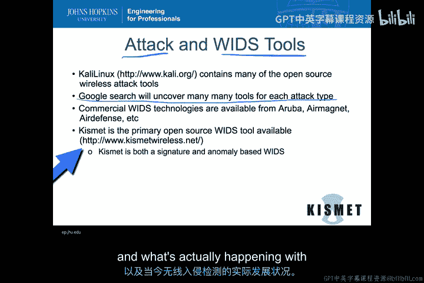