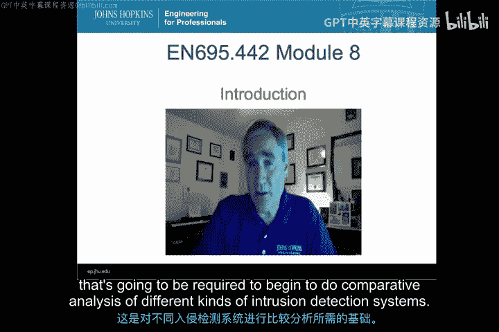
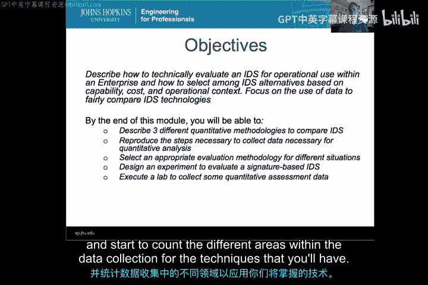
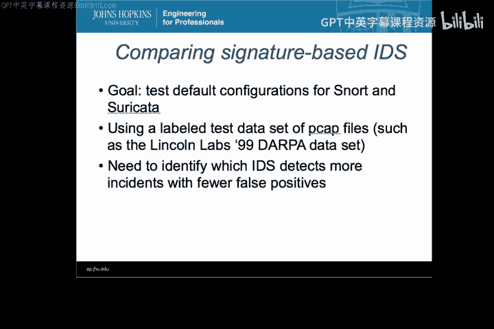

# 约翰霍普金斯大学《入侵检测｜Intrusion Detection》中英字幕 - P27：26_导论.zh_en - GPT中英字幕课程资源 - BV1sGu1z5E2J

Welcome to 695442 module8 where we get into much more of the。

Kind of network analysis that's going to be required to begin to do comparative analysis of different kinds of intrusion detection systems。

So the objectives of this particular module are first and foremost。

 how are we going to technically evaluate， so how are we going to take an intrusion detection system one or more and compare them to each other。

 compare one configuration of an individual IDS with another one。

 how to select among different IDSs and basically try to do better than just looking at the latest marketing literature in order to understand exactly how we would select between one IDS at another。

 depending on what your requirements are for an individual enterprise。

So in this module we're going to briefly describe three different quantitative methodologies that are used to compare intrusion detection systems。

 we're going to reproduce the steps necessary to collect data in order to perform a quantitative analysis。

 we're going to select an appropriate evaluation methodology for different kinds of situations and design and experiment to evaluate specifically signature based IDSs like between SNorRRT and Sararacottta。

 and we're going to execute a lab so that you can start to begin to understand how to do this data collection and start to count the different areas within the data collection for the techniques that you'll have。

So the first video after this one comparing different types of IDSs we'll talk about the three primary approaches。

 comparing the features of an IDS， the different kinds of spec sheets。

 how would you take spec sheets and external information and compare them and contrast them based on your own requirements we're going to talk about an economic comparison briefly but the next video will actually get into that in more detail and then we're going to start to introduce outcome-based comparison which is when you test the IDSs in order to do a performance analysis of how well the IDSs work in your environment each one of these is perfectly appropriate for different solutions we're going to focus our projects mostly around the outcome-based comparison because that's the handson that you'll get with the intrusion detection systems。

 but all three are ones that you're going to want to use when selecting an IDS in a real environment。

All three of these have different kinds of drawbacks and we will talk about the drawbacks of each one and these approaches can be used in conjunction。

 so you will use these all together， it's not in either or kind of situation。

In the economic analysis video。We're going to get more into how do you actually cost out an IDS within your environment Now this isn't going to give you every detail that you need for doing a complete economic analysis。

 but this will start giving you the highlights， the things that you'll have to make sure that you cover。

 especially with regard to resources for deploying the IDS staff training requirements and all of this is part of the upfront cost then there recurring cost and we'll talk about what you might expect in the way of recurring costs and finally maybe the most difficult part of all of the economic analysis is evaluating the benefit sort of calculating some kind of ROI you know in order to understand what kind of return on investment you might get from deploying an IDS in your environment。

Then we're going to have a video that specifically gets into how do you collect data for an IDS evaluation if you're going to do the evaluation of quantitative evaluation yourself。

 how do you actually collect the data， what are the desired data characteristics that you would want to use。

 how would you collect normal and how would you collect a attacks so that you can play those against the different IDSs how would you label the data so that you can perform an analysis and how do you keep it up to date。

 so this is a really important video in terms of understanding how to specifically get your hands on the kind of data that has the right characteristics for being used in your environment？

Finally， we're going to have a video on actually comparing signaturebased IDss as an example as a way of bringing it all together to say how do we test the default configurations of Snort and sirracottta。

 We're going to use a labeled test data set of PAP files。

 assume that you've got some kind of PcapAP that you're going to use for this analysis then we're going to identify which IS really detect more incidents with fewer false positives。

 we're going to save some of the more some of the other ratebased calculations and rock analysis for the next module。

 this is just going to begin to get a little bit into how to do the quantitative analysis based on running attacks against an IDS。

 So this is a really important module and beginning to understand not only how would you compare one IS against another but what can you really expect out of a running IDS。

 how can you actually use an intrusion detection system and expect。

What kind of events are going to be detected and what can you actually do with those events。

 So good luck on the rest of this on the module and let's go ahead and get started。

