# 约翰霍普金斯大学《入侵检测｜Intrusion Detection》中英字幕 - P28：27_各类入侵检测系统对比分析.zh_en - GPT中英字幕课程资源 - BV1sGu1z5E2J

In this first module in module 8， first video， we're going to start to get into how do you actually compare different types of intrusion detection systems if you have several and you really want to decide which is best for a given situation following a very explicit procedure on how to compare IDSs using real data and features or economics are going to be the way that you want to begin to categorize exactly how the IDS is going to work in a specific environment。

So in this video we're going to talk about three primary approaches。

 we're going to talk about comparing features， this is the easiest way to compare two or more intrusion detection systems is just compare their features。

 compare their fit for how you would want to use it in any given situation we're going to introduce economic comparison but we're really going to cover that in more detail in the next video and then we're going to talk a little bit about outcomes based comparisons These are ones where you're actually going to run test data and determine from the test data exactly what kind of outcomes from these intrusion detection systems are best for your specific situation。

So over each one of these different approaches。You're going to use them depending on what it is that you're trying to maximize within your selection of an intrusion detection system。

 whether you really want to maximize sort of the features， the economics or the results。

 the performance of the IDSs， different situations are going to call for different kinds of comparisons。

 there's no perfect one way to compare two IDss， all of these different techniques have their drawbacks and we'll talk a little bit about exactly what those drawbacks are and they're not exclusive。

 you can use different approaches in conjunction， so you may want to say you know for some cases。

 you want to look at the feature comparison for some cases you want to look at the outcomes based for some you may want to look at economics。

 but in any given case， you can choose two or more of these and then combine the results to help you select the best Is for your specific situation。

The most straightforward type of IS comparison is if you're just going to compare the different features within the intrusion detection system。

 So basically you're going to start with what type of intrusion detection system best fits your needs。

 These are the types we've already talked about anomaly detection versus misuse detection network versus hostbased IDss。

 So these are basically saying okay， let's start just with what type of Is is going to be most likely to fit my need within that each of those types you're going to have multiple selections of intrusion detection systems of specific type that you want to compare So you may just look at this different features within those specific IDss and determine sort of which features are really desired and then the availability of a product with the exact list of features that you want may not be available So then you have to begin to do the tradeoffs on which Iss have the best fit for the。

kinds of different features that you would actually want to have in comparing these Iss。

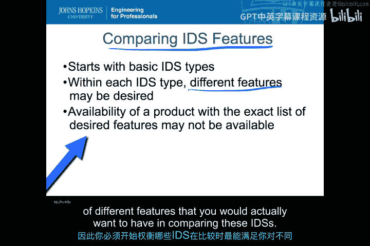

So where do you get the features well you can sort of start with any given。Taxonomy。

 you know we have of course， the anomaly versus the signature based taxonomies within all of these there are different types and we've already talked about different ways in which these taxonomies might break down。

 they break down to even finer details， and then finally you get to the specific types of IDSs that you might choose for a given situation。

This can be pretty straightforward。 if I know， for example。

 that I want a signature based Is based on an expert system。

 I'm now going to have my list to choose from that I can look at and determine whether or not that's going to make any sense。

 If instead， I want anomaly detection system and I don't want it to be self learning。

 I want it to be a descriptive simple stat， then I'm going to have ones that look more like in a different direction over this way。

 So if you have a taxonomy of the different kinds of features And this particular set of features comes more from the。

Reference the sort of down here at the bottom。There are many of these different sort of taxonomies of IDss you can find just with a simple web search this is one that actually gets you all the way down to listing some of the IDss。

 many of the main magazines and publications will have other sorts of breakdowns so this is one way of just simply tracing through in determining whether or not there's any ideass that meets the specific feature set that you want to look at。

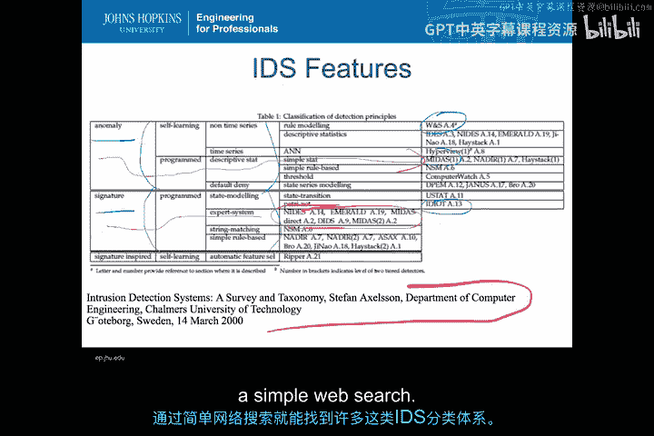

The other approach， which is absolutely valid as well。

 is if you instead of looking at a specific taxonomy of an IDS， you create your own feature set。

 so you know you may actually have a feature set that has different forms of architecture。

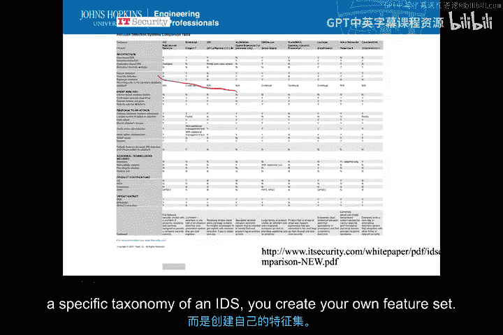

Different sorts of event analysis。 So this is basically not a taxonomy necessarily of Iss。

 These are specific features that you think are important in the selection of a specific Is once you have your features Now you can go out and look across all of the different intrusion detection systems that might contain these。

 and then start to just go through and say， which of those Iss contains what various kinds of features。

 all the way down to the ones that you've determined， make the most sense for you。

 So if I decide what I really want to have is something on the order of this vulnerability checker。

 And I want to look at a vulnerability analysis， then I can say， okay， well。

 I've gone through a lot of these areas and I can see that most of them don't have what I need but I can say。

 wellow， this one has what I need。

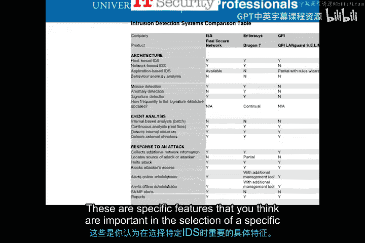

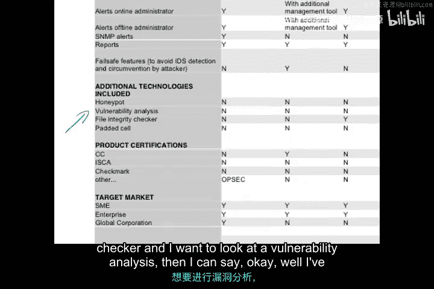

This one almost has what I need， but not quite。 and so I go back through and I look through all these and say。

 okay， well that gives me a pretty limited set so which two tools are those Well。

 that's essentially the ones that I list on the top air defense and Strratagar。

So now I know when I've picked a couple of specific features that I really want to look at。

 I know which ones are most likely to be important to me。

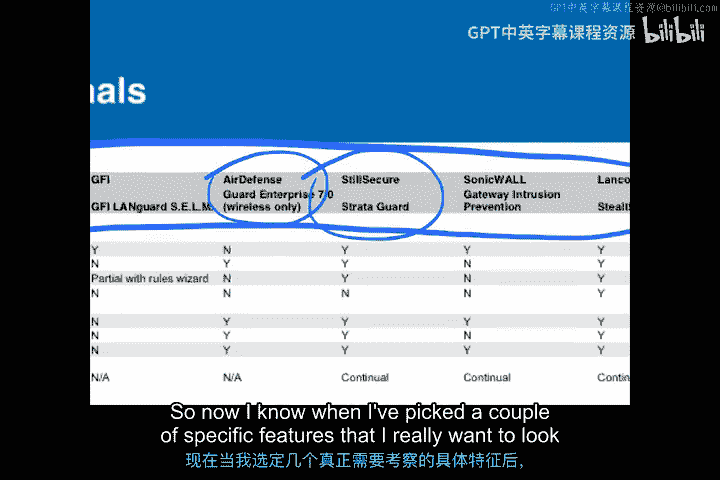

Again， this particular set comes from this reference sort of I have down below， but again。

 the best way to use this is essentially to define your own feature set。

 the feature set that you think is the most important the sort of column down the side。

 when you want to understand which ones of these features you really want to use in terms of that。

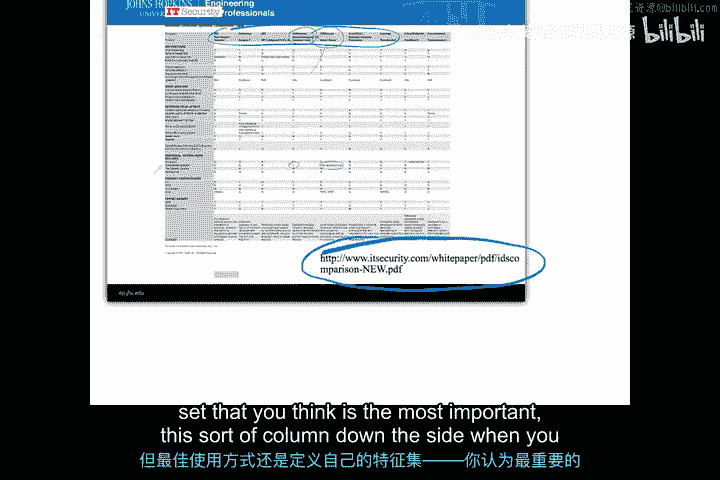

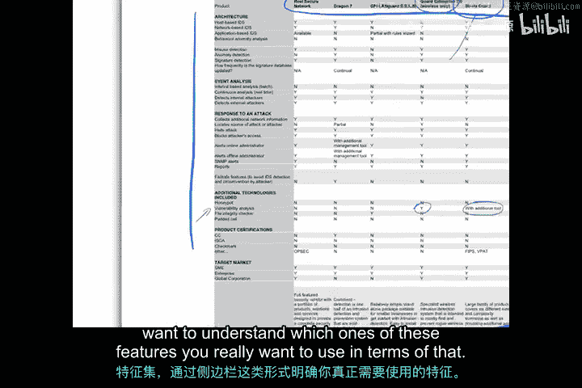

You can get more detailed with some of the features and again。

 these are not features that you necessarily measure yourself。

 These are features that are listed as part of the spec sheet or advertising for a specific IDS。

 so you'll be able to see sort of with the coverage， the false alarm rate， probability a detection。

 many of these types of quantitative features are also available within the information that you can get from an IDS spec sheet。

So if what you're really looking at is the ability to correlate events。

 that may be a specific feature that has a quantitative result It's listed on the spec sheet。

 You may look specifically for the ability to detect never before seen attacks or zero days。

 So you might want to go and look at those particular kinds of intrusion detection systems。

 or you may。Prioritize multiple levels of abstraction。

 things that can work both at the packet level and also up at the session or within the application level。

 And those may be important to you with regard to the kind of quantitative features that you're looking for for specific Is。

The important thing with using feature based analysis for these IDSs is that you can do it primarily through the published spec sheets and comparative analysis that you find external to your organization so you don't necessarily have to bring all of these IDSs into your organization and verify necessarily all that these features exist。

 so you're simply going to be selecting the IDS based on the feature list that you can find。

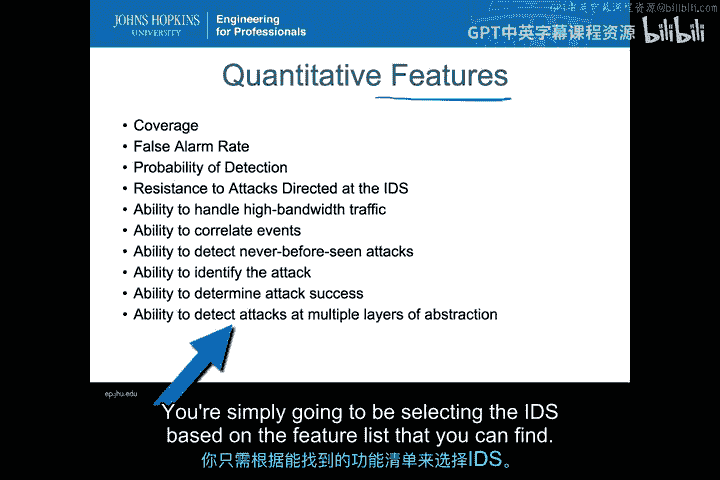

Now I've been talking a lot about featured lists， and it's important to realize that a featured list is not the same thing as a set of requirements。

So if you've put together a set of requirements for an intrusion detection system。

 you may go back to the feature list to see do those features meet the requirements that you have。

 but the requirements are things that you are setting based on the requirements or the constraints that are with your own enterprise or your own environment features on the other hand or the advertised capabilities of the products。

 when you're looking at the requirements you're basing that on risk reduction in a desired specific deployment。

 So that's how you're going to put your requirements together。

 doing a requirements analysis can actually help to identify the desired features。

 The requirements are not often exactly the same as a feature list that you might see within an IS。

 but doing a requirements analysis can lead you to feature selections within the Is that are most applicable to your specific environment。

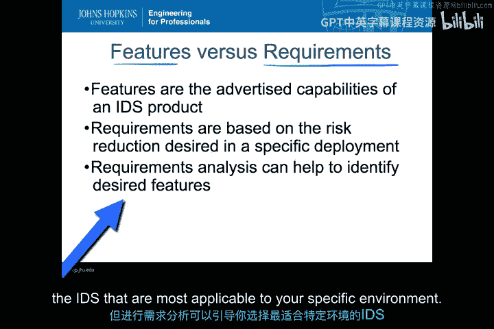

So let's run through a very simple example here， so we have an enterprise that requires an IDS to detect known attacks and identify the apparent source of the attacks。

 so this is the case where I really want to understand where my attacks are coming from。

I want this product to operate on the network。I want them to have known attacks。

 but these must be updated on a regular basis。 So it's not just that they're fire and forget one time。

 I need to have a way for this specific Is to stay updated to the state of the art。 Finally。

 a very important requirement here。 My incidents must integrate into an existing incident manager。

 a security incident manager。 So I'm going to have to take all of the alerts that come out of whatever Is that I decide to create。

 and I'm going to want to make sure it goes into the Sim that I already have。 So in this case。

 I'm looking for a network based signature Is， because I'm want to operate within the network on known attacks。

 So that's going to say that I want to network based signature Is to meet these requirements。

I want to include commercial support for signature updates。

 so that means that I really do want a product that has some kind of a maintenance contract or ability for me to automatically keep my signatures updated using some sort of commercial product。

I have to use a standard alert type in order to integrate into my Sim。

 So I've got to have basically my output of the IS has to be in a standard form。 So as a result。

 there are several commercial based Iss that are going to meet these requirements。

 So things like source fire。And many other network based Iss could potentially meet all of these various kinds of requirements that I'm going to have within my specific environment to be able to meet what it is that I'm trying to achieve。

 as we've seen in previous modules， Network based signature Iss are some of the most common commercial products that we can find。

 Certainly， many of these companies provide signature updates。

 And there are standard IS alert types to integrate into common Sims。Beyond feature-based analysis。

 we might want to do an economic analysis in order to understand what's the most cost effectiveff way to put an ID within my infrastructure to meet my requirements。

 so I'm going to base this analysis on the overall cost of ownership of the intrusion detection system so this would include the acquisition costs the maintenance the staff training。

 the licensing everything having to do with running the I and using the results to actually reduce risk I'm going to also have to include the sophistication of the alerts to say are the alerts going to be sophisticated enough to really get the type of threat that's going to reduce my risk so we're going to actually cover this in a little bit more detail in the next video so this is just an introduction to what we're going to talk about with regard to economic analysis。

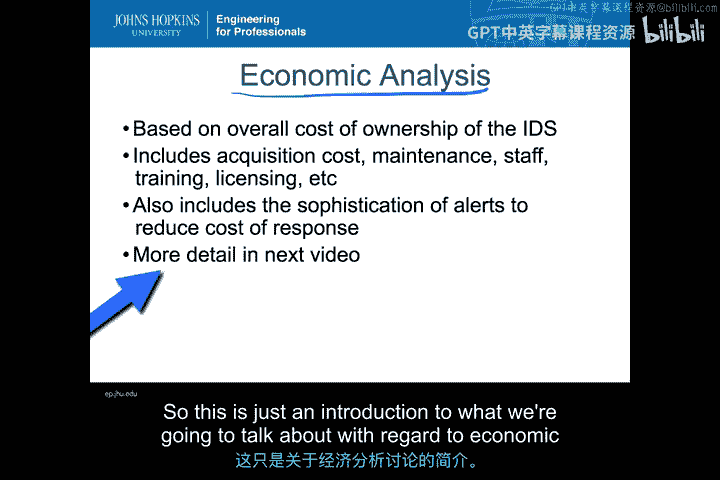

Now I's spend a little bit of time looking at outcome based comparisons。basically。

 this is going to be the testing and performance of our intrusion detection systems in the deployed environment。

So in this case， we're going to have to acquire at least some kind of test version of the intrusion detections that we want to use in order to then deploy them in some kind of either the direct environment that we have or a representation of our environment or at least data that would represent our environment。

 so we're going to use testing and experimentation to determine the accuracy the type 1 or the false positive error rate。

 the type 2， the false negative error rate and some basic measures to say how well does this particular IDS work within an environment like ours。

In the process of doing this， we'll be adjusting the configuration of each IDDS in order to maximize or to optimize the deployment。

And cover the kind of risk that we really care about within our specific environment。

 So this is much more substantial than either the feature or the economicbased analysis。

 but it's also much more tied to the specifics within the deployed environment in order to reduce risk so you get a lot more quantitative results out of an outcome-based comparison than you do out of a simple feature or even an economic based comparison。

 and we're going to be talking a lot about some specific quantitative analysis called receiver operator curves or receiver operator characteristics that we're going to use to analyze the results that we get from outcomesbased comparisons。

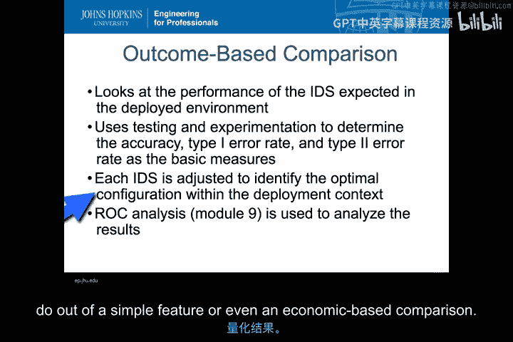

In an outcomesbased comparison， the entire thing that we're trying to do is around the confusion matrix。

 That's the key artifact that we're going to use whenever we're talking about trying to deal with a quantitative analysis of our specific Iss。

 Atts are true or detected by the classifier。 And if it's not detected by the classifier by the Is。

 Then we call it normal or false。 That gives us four possible outcomes for an IS detection when we're doing the test。

 we can have the detected class and the true class。

 The true class is what the data or the environment is really providing。

 the detected class is what each of the Iss that we're testing actually gives us So if there is a true attack and the IS actually does detect it。

 we call that a true positive， we can count that here。

If there is a true normal and it's not detected and it is detected by the IDS。

 then we get a type 1 error， a false positive。If the true class is positive。

But the detected class misses it。 This is the one where the IDS does not find the incident。

 That's a type 2 error。 That's our false negative。 Finally， if there is a true negative。

 one that within the true class is negative and the IS does not detect it as an incident。

 we call that a true negative or an appropriate test of normal。

Once we have all of these counts in any given tests that we're trying to run with our IDS。

 we can use that in a series of different types of quantitative analysis to compare the ways that these IDSs are going to work within the specific environment that we care about。

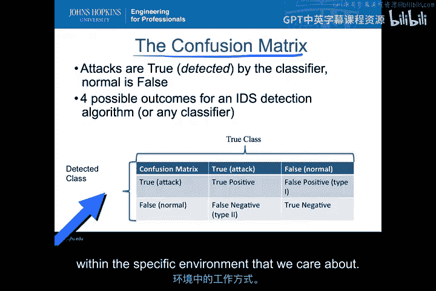

A typical procedure for trying to do one of these outcomes based comparisons is listed here below In step 1。

 we have to develop test data that's representative of the deployed environment。

 So this is really important that if we're going to develop our test data。

 it is actually representative of the environment where we want to deploy。

 That means that it has the same kinds of assets that we're trying to protect and the same types of attacks that we might expect to want to detect with our Is。

 and it's going to have to have the normal behavior that we would want the Is to properly classify as normal。

 This first step can be one of the most difficult portions of doing an outcome based comparison。

 developing or using an external test database in order to understand how to do these tests involves a whole series of elements and problems to assure its properly representative to assure it has the。

The right kind of attacks to assure that it represents our assets properly。

So once we've done that work and we have the test data。

 then we can use the test data on each of the IDSs to both tune them and test them against each other。

So we might use a variety of different types of configurations of an individual IDS。

 this is going to give us different results from our test data。Using the same test data。

 we can run the same test data against multiple different intrusion detection systems with different configurations and do really a head to head comparison。

On exactly how these IDSs work within the test data。After we're running the test data through it。

 we can generate the confusion matrix for each of the configurations of the IDS that are going to be compared。

From there we can begin our analysis， collecting the performance， scale data for each configuration。

 and then we can use receiver operator characteristics， precision recall graphs。

 or any other representation to compare these IDS performances。

 We're going to go into a lot more detail about rock graphs。

 PR graphs and other sorts of detailed quantitative analysis in the next module。For this module。

 we're going to talk more about just sort of collecting performance and scale data and then just doing a comparison of the tradeoffs between detection rates and error rates and performance for the collective data points。

 Now， this is a very high level view of this outcome based comparison process。

 clearly within each of these six steps。 there's a large amount of detail that I'm kind of glossing over right at this point that you have to do in order to have a fair test。

 a rigorous test， a repeatable test and one that actually is representative of the kind of Iss that you're going to want to deploy in your actual environment。

So we have three techniques that we've talked about so far within this video。

 We've got feature based analysis， economic based analysis and outcome based analysis。

 So when would you want to use each one of these。 And when would you want to use them in combination。

 Well， one way to look at it is basically to look just at their sort of pros and cons。

 So with feature based analysis。 Remember， this is just looking at the data sheets and text sheets of the Iss and external testing。

 In order to evaluate whether or not it would be worth running in our environment。

 So as you can imagine， it's easy to gather the data for this。

 It's going to be out there as part of the marketing material。

 There's likely to be academic articles and other sorts of analysis that you can get and read about a specific Is that really understands the performance of those Iss within some kind of test environment。

 However， the con of this is that that test environment that we're。

The features were created doesn't necessarily reflect your environment very exactly。And this also。

 especially from the marking data， the features tend to be very subjective。

 So they might say we detect zero days attacks。 Well， what does that really mean。

 Does that mean that it does some sort of anomaly detection on various classes of attacks。

 Does it have an innovative technique。 that really looks at other sorts of new attacks that have never happened before。

 So there's lots of these that are kind of open questions when all you're looking at is data from tests and marketing that are external。

 Also， these feature analyses won't address your specific performance issues and constraints within your own environment。

And that's really important because it will be hard for you to know how well some of these Iss scale just by looking at the feature list。

 If we're looking at the economic one， now we're going to look at the economics。

 the details of how to do an economic analysis in the next video。

 but the pros and cons of this approach are we can address the initial and recurring costs。

 We can link the technology and the personnel。 This is probably one of the most important parts of this is that we can look at this as a way of。

Not only looking at the technology in isolation， but looking at how that technology fits within our teams and our incident response teams。

 our Cert teams in order to know how we're going to reduce risk with the results of an Is and from an economic analysis。

 it's fairly easy to communicate that to a decision maker because the costs are going to be in bottom line kind of dollars and cents。

The cons for this， however， is that these will drive solutions that minimize cost。

 and they can be much less effective than other perhaps more fully featured systems or systems that you might want to test。

You often underestimate staff and recurring costs when you do this kind of economic analysis。

 It's in the best interest of most of the companies selling I Ds to underestimate these costs。

 And without careful analysis to how you're going to deploy these different types of intrusion detection。

 you may not realize some of the training and staffing requirements that will be necessary to actually use them。

 Finally， these economic。These economic techniques are relatively static。

 They don't adapt well to changing threats， and there may be an open ended economic need to increase various costs within the Id S。

 depending on which one you choose as the threat changes。In the outcome based analysis。

 this one produces a quantitative result。 You really do get it in the context of your environment。

 so you have a much better idea of what the performance of the IS will be within your specific environment。

It also allows you to consider multiple different configurations within a single IDS and it fully takes performance issues into account。

But understand， this is an expensive and difficult type of analysis to do。

 It requires substantial investment in a test environment or test data。

 and it's difficult to compare radically different approaches in I S。

 If I have a single data set that looks like a network dataset set。

 It might not tell me how well a host base I S is going to reduce the same type of risks that I might have in that situation。

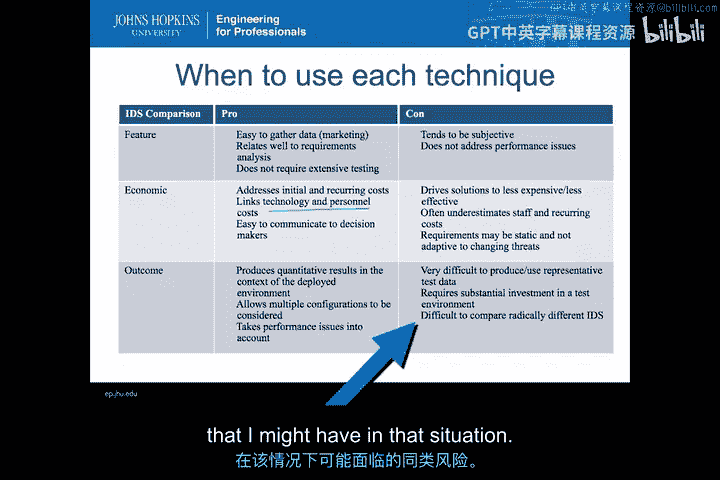

Finally， there really isn't anything that says we can't use these techniques together。

 Each of the techniques can be used to address the shortfalls of some of the other techniques。

 So the features can be used to just the feature list themselves can be used to sort of triage your initial selection。

In order to get a smaller number of Iss that you'll do with an outcome based selection。 Finally。

 you might want to do an economic comparison once you've done an outcome based selection in order to understand the affordability in the total cost of ownership of any of the solution that you might want to use。

 So these are some of the ways that you begin to compare different intrusion detection systems together as we go through this module and through the next module。

 we'll get more and more explicit at how to actually run these tests so that you can demonstrate clearly that you can take the Iss and run tests and do a quantitative comparison between two or more intrusion detection systems。

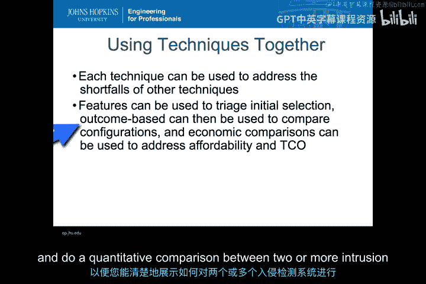