# 约翰霍普金斯大学《入侵检测｜Intrusion Detection》中英字幕 - P29：28_IDS的经济效益分析.zh_en - GPT中英字幕课程资源 - BV1sGu1z5E2J

In this video we're going to drill in a little bit more deeply into performing an economic comparison of different intrusion detection systems。

 So if you remember this is the second of three different ways that you might compare two or more different intrusion detection systems to determine which one would be best for an individual environment。

 we had the features。Wwhich we talked about mostly in the last one， this one。

 which is the economic analysis， and then we will talk a little bit more about how to do a quantitative view based on performance。

In the next video。And the idea of doing a performance comparison will also continue on into the module we have on receiver operator characteristic analysis。

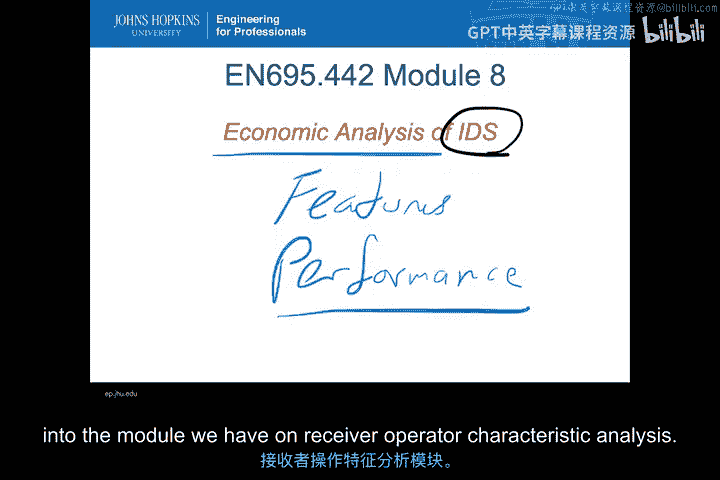

So in this particular video， we're going to go through the different stages or steps that are going to be necessary for doing an economic analysis。

 so we're going to start by determining the initial cost。

Which is not only the initial cost of the Is， but also all of the resources required to operate the Ids once you've procured it。

 We're going to talk about the recurring costs， the ones that are more than just the initial costs of getting the resources and staffing ready。

 but annual and periodic licensing， maintenance recurring costs and finally。

 we'll talk about trying to evaluate the benefit。 The other side of the equation。

 which is do you get enough benefit for all of the costs that you're going to have to put into。

Deploying an intrusion detection system at your particular organization。

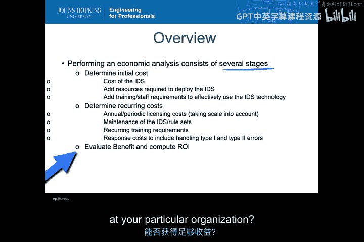

So the thing to keep in mind with the initial cost with the cost of actually acquiring the IDS is that the total cost of getting an IS deployed isn't just getting the software and hardware for the IDS you may have to modify the environment。

 the desired environment so that you actually have everything ready that you need to set up the Is you certainly have to have all of the data transport。

 the sensors and the analysis to know exactly what kinds of events and incidents do you want to detect。

 given the IDS so in many cases people will look to the open source or free versions of the intrusion detection systems thinking that that's going to be a substantial cost savings when in fact。

Often getting these freeware IDSs look really good because you can download the software。

 get it up and running fast， but you don't have often a corporation behind you trying to make sure that you've got the desired environment making sure that you've got it tuned in the appropriate way for all the external resources that you might need so there is a tradeoff more than just what does it cost to buy the initial IDS。

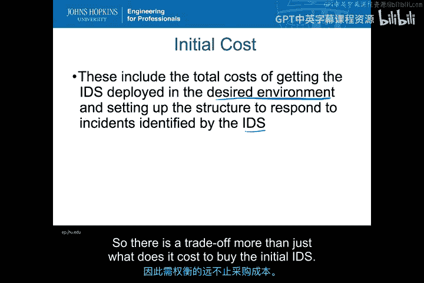

So the cost of these IDSs really do depend on many factors that I have out there so the first thing。

 of course you want to talk about is what are the costs of open source versus commercial technology that you want to have in here so with open source。

 of course you're going to download and run these things for free commercial technology you'll have to somehow procure it the features that you might get from an open source versus a commercial technology are not necessarily a huge distinguishing factor。

The commercial technology is likely to have a few additional features that you may not get with an open source。

 So， for example， if you buy source fire， which is a commercial technology。

 that's going to give you a few more features than snort。

 which is the underlying open source technology that it's based on。

 But if what you're doing is looking for things that ordinary snort can find。

 then you don't get that much extra by going out to source fire。 On the other hand， you do get。

With something like source fire versus snort， the ability to scale larger。

 because you have customized hardware because you have tuned software more than just downloading the open source。

 You can scale these installations usually to much larger and more complex environments。

 than you could just from some of the open source tools。 So， for example。

 if you looking at brow as an open source tool。 It's an excellent tool for really advanced intrusion detection。

 but it's not designed to be high performance。 It's not designed to run as fast as some of the ones that you could get from commercial technology。

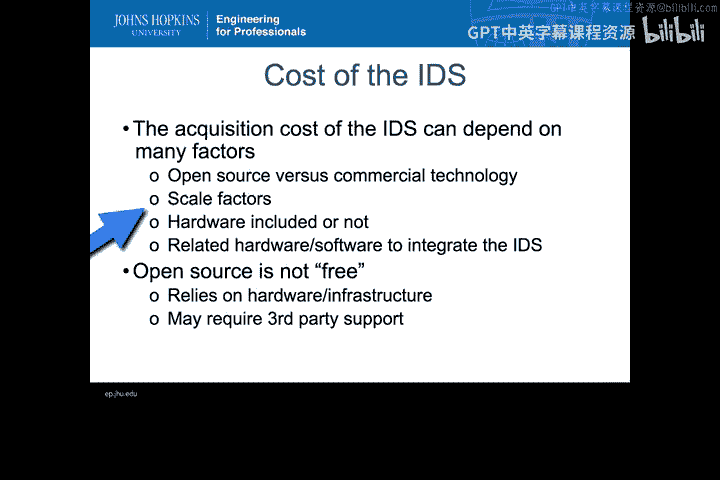

You also have to look with commercial technology。 you often get the appliance。

 You get the hardware that's tuned and installed specifically for running that particular Is。

 If you use an open source Is， realize you're going to have to use some additional hardware resources。

 Often substantial hardware resources。 in order to deploy these across your infrastructure。

 And of course， then there's other related hardware and software issues required to integrate the Is into your environment。

 these may be everything simple from network taps and additional switches to substantial changes in the way say your VPN or your virtual networks are set up in order to route some of these sensor information around to your Iss。

 So the bottom line here is that open source isn't free with regard to the deployment of an Is within your infrastructure。

 You do rely on hardware infrastructure。 and you may require some other kind of。

Party support in order to keep the ideas tuned and up to date in your environment。

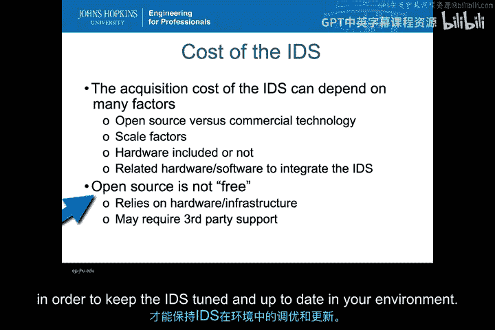

So I alluded in the last slide to some of these non Is related deployment costs。

 the things that don't come exactly with the Is， but are required in order for the Is to work。

 The first set of these， of course， is sensors。 when I'm talking about getting all of the additional。

 all of the observables in order to get them to an Is。

 and recall from what we've talked about in previous modules。

 The observables have to contain the attack data of interest or no Is is actually going to be able to detect these incidents。

 sounds very obvious。 but it's often forgotten in that I go out very quickly to deploy to get my Is。

 I deploy it in a single location in my infrastructure that may or may not have all of the access to the observables that I need to catch all of my attacks of interest。

 So in addition to this distributed Is for additional sensorensored locations。

 you really have to identify where do you want to get the observables this。

Is a main driver for not only where do I want to deploy the sensors。

 but do I need additional bandwidth or other kinds of resources to move the sensor data back to the intrusion detection system so that these more centralized IDSs can coordinate and between all of the different sensor information that's being used。

You may even want to go all the way to using out of band communication between the sensors and the Is so that the intruders can't get in the middle of this sensor IS data path。

 This is really important for especially highly sensitive enterprises and organizations where you know that the attacker is going to be going directly after the sensors and the data path between the sensor and the Is in order to completely hide their activity in terms of what's happening that way。

Now that's on the sensor end from the alert distribution end remember that we've got to get any alerts that come out from the ID to the Cr to the defenders to the people who are actually going to take some kind of an action based on what's happening with that so you that may require additional hardware and software as well just to make sure defenders can get the alerts in close to real time and assure that they actually get those alerts。

 remember if the defenders don't get the alerts it's just like the alert was missed it's just exactly like it was a type 2 error。

Sometimes this is going to require some sort of integration with an existing security incident manager if you already have your configurations and your security incidents managed centrally。

 then the I is going to have to interface with that so you don't create a second stovepid system that then has to be manually correlated to the things that are already happening with your infrastructure and of course there's always a tradeoff between timeliness and cost here if I can get incidents to individuals very。

 very quickly by creating a special purpose sort of alert mechanism。

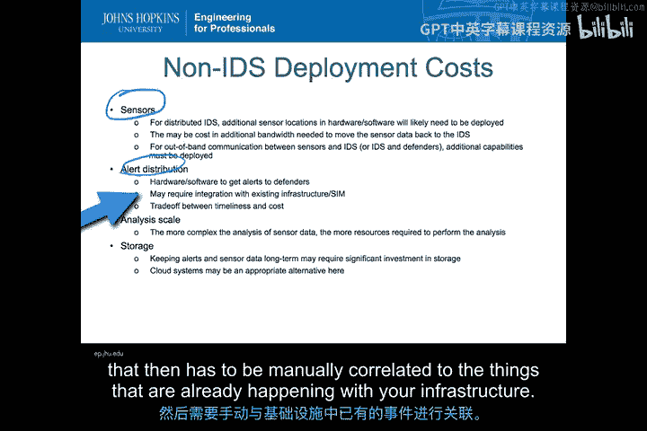

But maybe that's more than I need， maybe I can just do it through email。

 and even though there's going to be some delay between the email arriving to the defender and the action taking place。

 maybe I'll trade that timeliness off a little bit with the expense in getting real time alerts that expense。

 by the way， will also show up again when we talk about the ongoing maintenance costs with regard to staffing a team 247 to look for these particular kinds of incidents。

So then you have to talk about the analysis engine component of the nonidS deployment cost if I have a really complex set of incidents that I'm trying to detect and it's going to require this complex organization correlation of the sensor data。

 I may require additional hardware and software resources to actually perform the analysis so you have to think it isn't just the alerts necessarily that I want to get but it's all of that backend analysis processing that may be especially if it's a machine learning kind of an Is that could require significant resources to train and then to categorize and classify all of the different sensor data that's coming into the Is Finally。

 you have your storage constraints， all of where are we going to keep the alerts in the sensor data。

 how are we going to hold on to this long term， how are we going to be able to go back forensically to go back to the original sensor information so。

Having an idea of what is the volume of alert data and sensor data that I want to keep will also be part of our sort of non IDS deployment cost and another trade off。

 how much do we want to invest in holding this information for what length of time that might be coming forward？

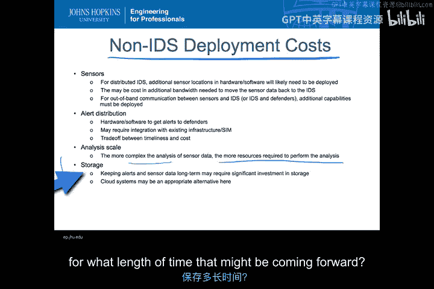

Once you have the hardware and software costs down， you have to start to think about the human costs。

 particularly do I need additional staff and what is the training that those staff require in order to really be able to take advantage of the investment that I'm going to put into the hardware and software of the Is。

 This is really often the largest expense in deploying any Is。

 It's the staff resources necessary to deploy， maintain and respond。 Remember。

 from what we've talked about before， an intrusion detection system requires a human element to be able to follow up on the alerts and actually respond to the incident in order to reduce risk in order to achieve the goal of reducing enterprise risk within the organization。

 and， of course， within staff and training， there are just tons of tradeoffs。

 you might want to use the a more advanced Is for you know to give us。

Better detection and list response alternatives and then automatically execute things through an IPS so that's one thing that might reduce staff costs at the risk of maybe taking the wrong action occasionally。

 creating a self-denial of service and allowing the adversary to somewhat control to some extent what the response cycle is going to be because they're going to be triggered automatically from what the attacker is doing to us。

Of course， I can take an IS and extensively reduce type 1 errors in order to reduce wasted staff time in tracking down alerts that really don't mean anything。

 This is a way of taking our upfront cost in order to reduce the staff requirements that I'm going to need later on。

 And， of course， finally， the better the goies， the better the ease of use the more I can reduce staff training expertise in order to keep it from having my most expert network administrators really being caught up and doing Is work all the time。

So this sort of reduction in type1 errors can lead to a significant reduction in staff requirements。

 but it never is going to take those staff requirements down to zero。

 you're still going to even in an IPS case require significant staffing in order to effectively use these IDSs moving forward in a future module we're going to talk more about putting a CSEt together and what kind of expertise you're going to need in the CSEt and this also as part of this sort of staff and training right at the early decision of how am I going to procure the IDS。

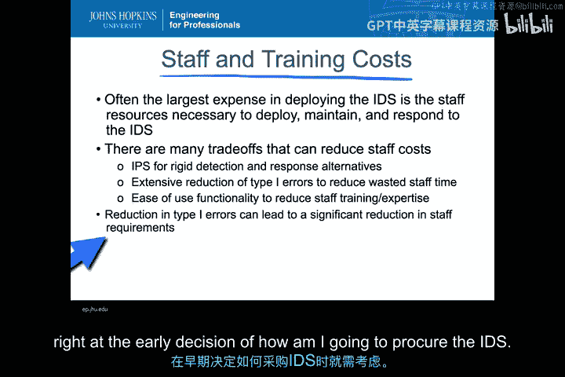

After we've considered all of the initial costs， we have to start to think about what the recurring costs are going to be in maintaining the Is over time。

 Now， we're all used to sort of these annual licensing fees。 This idea that， yeah。

 every year you got to pay your licensing fee for a commercial product。

 And it would be nice if that was really the only recurring cost we had to worry about， But really。

 there's much more than the direct costs that are required here。

 There's lots of indirect costs that are required to maintain the functionality over time。

 So the kinds of things that drive these recurring costs are changes to the threat。

 How is the threat changing over time， What are the new attacks that are invented and are now part of your risk profile。

 infrastructurerastructure changes internally， what is it about my system that I'm changing。

 what new services am I adding what new critical information am I putting in place。

 How am I rearchitecting， I have to look at staff turnover。

 Because that means I'm going to have to retrain and rehire staff that's coming in and。Finally。😊。

I trade I D S off with other defensive technologies。 If I get a new super defensive technology。

 I may be able to say， well， this particular I S on an entire class of alerts maybe isn't required anymore。

 And I don't have to worry about those particular kinds of cost or even sensor locations。

 if I install additional defensive technologies that。

Take the place of some of what I'm doing with regard to the I S。

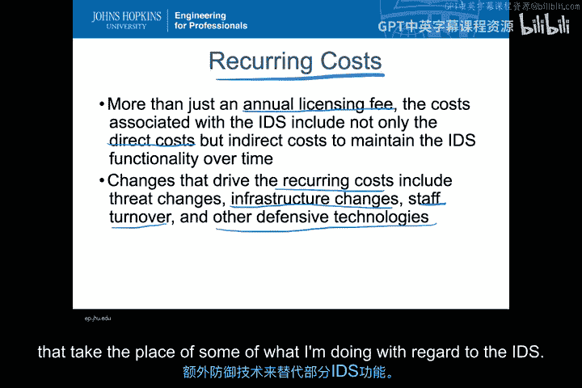

So a lot of these recurring costs really come down to how am I going to maintain the desired Is functionality in order to continue to reduce risk in a predictable way in the way that I really want the Is to work。

 So this is going to mean updating the Is configuration on a periodic basis to frequently address changing internal and external environmental factors。

 These are the different kinds of threats and attacks that'll be coming down。

 These are the sorts of things that say I need to continuously tune and keep my Is up to date in order to control costs。

 So the first thing that you're going to do is you're going to see increases over time in the type 1 error rate without changing the configuration of the Is。

 So if I just left an Is alone I'm going to get more and more of these false positives thatll be coming in place。

 Why Because the external environment continues to get more complex。

 continues to get more functional。regard to new services。

 these may trigger existing configurations of the IDS。

 so whenever I see a significant number of false positives along a service or a set of activity that I know is ordinary。

 I'm going to need to go back and retune my IDS to reduce that type 1 error rate back to a reasonable level again。

Other technologies to help reduce risk might also change the way your IDS configuration has to work with these other defensive technologies。

 both in terms of false positives， but also in terms of making sure that the pieces of attack that are not covered by these additional defensive technologies like firewalls like access controls like other sorts of things that are there are detected through the IDS configuration。

 and that changes as you change not just the IDS， but all the of your defensive technologies。

And of course， you want to be able to identify all of the data that's essential in responding to attacks。

 And this usually means updating the IS configuration so that the assets that are listed。

 the things like you don't just want to get an Ip address when an alert is sent to you。

 you'd like that Ip address to be related to the kind of critical information that will help in a responder prioritize this with regard to all the other things that are going on at that particular time。

 that requires maintenance within the IS configuration。

So remember that the I S is really part of an entire defensive ecosystem here。

 They work together to reduce risk。 Ially， what you want is for the Is to be seamlessly integrated with the rest of your defensive technologies。

 plug in play， if you will， so that the Is can work collaboratively with all of the other ways you have in the defensive ecosystem。

 Today， the vendor community doesn't support that very well。

 These are still mostly stovepid kind of technologies。 However， as they become more and more。

The ability to integrate these becomes greater and greater。

 We will see that these rule sets and other defensive technologies will begin to operate together so that you could have common control over both your IS rule sets and your other defensive technologies in a single common interface。

 That is something I would expect to see coming out of the vendor community in the not too distant future。

Of course， you have ongoing staff costs with regard to any of these Is。

 A lot of these really are focused around training。

 both for the IS technology and what to do when a particular alert is actually fired within an IS。

 So without this kind of training， the discovering how to handle an event really can obviate all of the risk reduction you expect to get out of the IS itself。

Basically， if you use IDS alerts as your training for staff to learn how to do things without testing without some kind of simulation and some other sorts of hands-on training。

 then this idea of reducing severity through accelerated incident response is you know essentially you trade most of that away and you don't get to use some of that。

 of course this is also driven strongly from staff turnover because each time you get new staff on。

 they require the initial training， so you've got both initial training and sort of the enhanced ongoing training both of which you're happening simultaneously within your organization。

And as more incidents are discovered， more staff time is usually required to address these incidents。

 So this is the part of the Is also that tends to get very underestimated with regard to an economic analysis。

 the first time you install an Is and begin to get it running。 You don't know what you don't know。

 So there are a number of tax of attacks that the Is is not detecting the type2 errors。

 that you're also not handling very well initially。

 as you update the Is to cover more and more of this attack base。

 the staff will now be required to address those incidents as they're alerted from the Is。

 So these actually you these actually result in increasing staff resources over time。

 So not just on enterprise growth， which you， of course。

 will have staff increases based on enterprise growth。

 but you also get staff increases based on the numbers and types of incidents that are handled as the Is becomes more。

More and more effective。

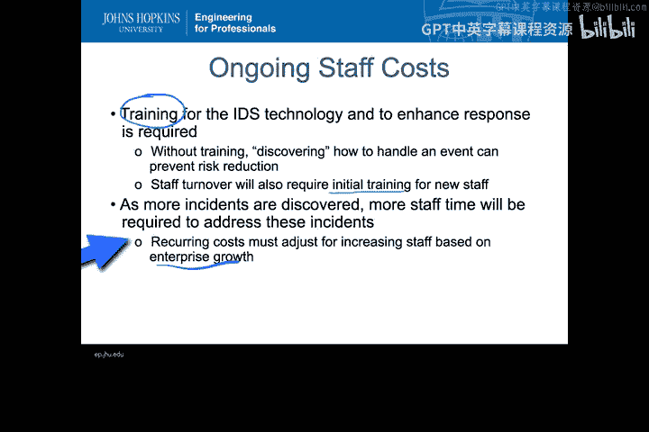

Sadly， when you talk about the ongoing cost of really working with the Is。

 most of your cost or a large portion of your cost is going to be an error management。

 It's going to be in handling these type 1 and type 2 errors that come in。

 So type 1 errors of course， if you knew right from the beginning。

 which of your events where a type1 error。 you wouldn't worry about it。

 you could just immediately triage those out。 but the reason they take some additional cost is trying to resolve that an incident is。

 in fact， to type 1 error takes significant time。 It takes on the order often of the time it would take to resolve a real incident。

 So that's where you get the additional cost from your type 1 errors your false positive。

 your type 2 errors you usually get through external reporting。

 So your CEt is not only looking at events coming from your Is。

 but they're looking for events reported from your users from your customers from other places that have nothing at all to do with the Is。

These external reports help to identify the type 2 errors from the IS's perspective and allow you to change the configuration of the IS to start to pick up that event class。

 that attack class in the future。 So this is a way of tuning the Is to bring in more real incidences。

 So you're always trying to reduce type 1 errors and reduce type 2 errors by adding detection in the Is for the type 2 and removing rules that alert that generate type 1 errors as you're coming in。

 So that's a continuous costs that you have of moving from your error handling costs to the update cost of your Is。

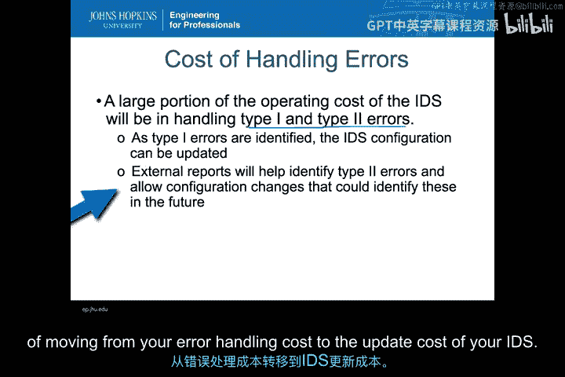

So after dealing with all of these slides up to now， you're probably thinking， wow。

 it really costs a lot to put an Is into an enterprise。 It's extremely expensive。

 So you better get a really good benefit out of the Is in order to justify this significant initial and ongoing cost。

 Well， evaluating the benefit of an Is is extremely difficult。

 It turns out to be one of the most difficult parts of an economic analysis is to calculate what is the benefit that you get from putting in both the Is and all of the support structure。

Necessary to make sure that you use the Is appropriately。

So there's a couple of things that you can do to evaluate the benefit。

 The first thing you can do is look at similar organizations。

 This turns out to be in practice the thing that is most common you say。

 look I'm a large department store chain and there's another one that just last week ended up on the front page of the paper because they didn't handle their events properly so I don't want to be on the front page therefore it's worth。

This investment in an intrusion detection system in order to not be on the front page。

 so I'm going to look at the similar organizations to estimate a cost of an undetected event that comes in here or an event that takes too long to resolve because you know。

 in fact， if I had had an I than I could resolve it much more quickly。

 the impact of my organization would be less。So then you've got an internal analysis that says。Okay。

 so what's the impact of an incident over time？And how much can I expect that idea to reduce the time to respond to an incident so I can use my own history of what kind of events have I had and do an estimate to say。

 if I had gotten an earlier indication of any of these given incidents that I've had in the past。

Does that significantly reduce the cost of that incident and does that help me understand what the benefit of the Is is from that particular kind of analysis。

 So this portion of the analysis is usually expressed in terms of reputation as opposed to a monetary benefit。

 although a lot of people will turn it into a monetary benefit。

 in order to compare it to the cost of the Is deployment in terms of coming in， reputation costs。

 of course， are really subjective and they have to do with， okay。

 when is it really worth it to do the kind of investment that we're going to have to do for an Is。

 It's part of what makes this evaluation of the benefit of an Is， especially difficult。

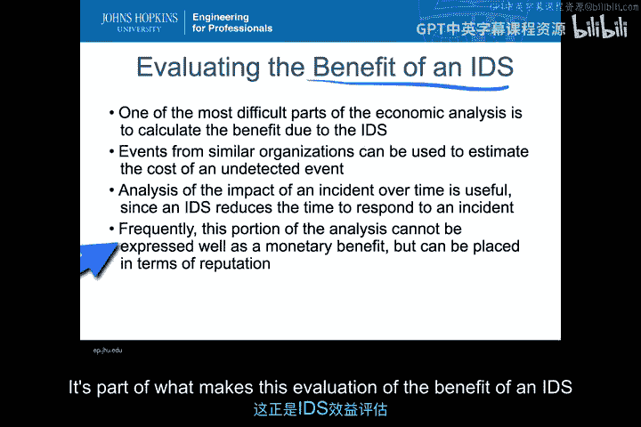

In the business world， this really comes down to can we generate a return on investment in Ri for the installation of an Is。

 This is particularly difficult for what we call nonfunctional attributes。

 which most security kinds of activities don't tend to be profit generating activities。

 they don't positively affect the bottom line， there's simply seen as a cost。

 So doing a return on investment is really trading one set of costs from another set of costs。

 So my return is a lower cost for resolving incidents as opposed to I get some sort of a profit benefit from actually installing the Is。

 So when you do an Ri analysis， realize what you're doing as cost control in terms of coming down and saying an Is will help to reduce the risk and reduce the cost which translate into lower cost eventually So when intrusions are handled well。

诶。And this is some of the difficulty of doing an ROI if I have something in place and I seem to be doing a pretty good job handling incidents。

 I say，Look， I've already got sunk cost into the team and into what I'm currently doing。啊。

So maybe I can reduce that cost by simply eliminating staff or eliminating some of the IDs。

 It doesn't seem like we have too many intrusions， so that probably ought to work out。 Well， in fact。

 you're probably going to be increasing the cost of of what happens when an intrusion does happen when you've cut staff。

 but this is the other side of saying if I'm really worried about as cost cutting an IS is a cost Can I cut that if I don't really know what the monetary benefit。

Of handling this is。And as I said before， the idea of profit is more related to functioning without incidents。

 can I be more effective at delivering my products and services and since the I doesn't typically prevent incidents。

 but instead reduces the time responding to them， linking it directly to profit can be difficult it doesn't mean it's impossible。

 there's a whole organization called DevOs and secure DevOs that is beginning to link the idea of doing security in a DevOs form to profits to basically coming into profit for a corporation。

 so that is another area that can help a lot when we're talking about how do we calculate some kind of return on investment。

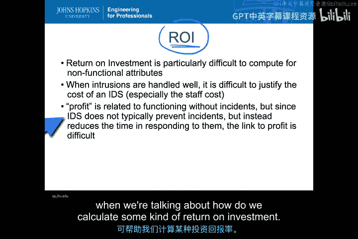

There are some other ways of justifying costs beyond simply looking at sort of return on investment。

 You can actually look at your Is team and look over time at a complexity a complex infrastructure increasing the resources required by your CEt by your response team。

 And then you can say an additional investment in Is can either maintain or perhaps even reduce some of the costs by increasing the efficiency and effectiveness of the response team that there。

 Remember， in this case， the Is really is just a tool that helps the CEt team respond faster and more effectively。

 So like all other tools that are there， you can frequently justify the tool and the supporting costs by the by the level of effectiveness and efficiency that you can work over time。

So at the end of the day you've got to bring all of this together， you have to basically say， okay。

 so how do I really take all of these different factors and bring it in to know whether it's worth and how much is it worth to deploy an IDS so when you know the total cost and you know that this total cost is significantly higher。

You knowThen what you would expect to get into a cost savings， then you might look at alternatives。

 so maybe it isn't best to get the absolute highest standard in the world of an IS。

 but it's worth it to have a tool that helps the effectiveness of the response team。

The important thing is really being upfront about the total and recurring costs。

 The worst situations that you see are over investinging in an Is because you've under invested in the costs。

 and then after a few months or years， even an organization will look and say we're spending way too much on the entire Is infrastructure in the ecosystem in order to really increase the effectiveness at the level that we want。

 So you'll get drastic cuts， which can， like a pendulum swing too far the other way。

 and keep your organization from effectively understanding what the attack what the attacks and the result of those attacks really are in the name of trying to reduce the cost back up。

 So understanding upfront what the costs are and doing a realistic realistic estimation。

 is a way of making sure that everybody is on board and understands what the total。

Initial and recurring costs are and what the likely benefits are going to be for the C C team and for the organization in general in reducing risk。

 having that upfront will also allow you to put together a series of metrics to make sure that that's being maintained over time when you bring all of this economic analysis together。

 As we said before， the economic analysis doesn't have to take place instead of a feature or a performance analysis。

 You can actually use all of these together to trade off some performance versus economic cost in terms of putting some of these in place together。

 It's why we deal with all three of these different kinds of analysis types。

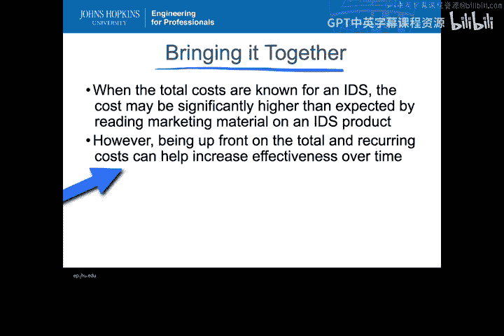