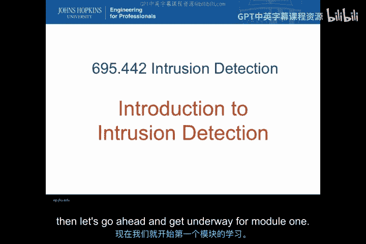
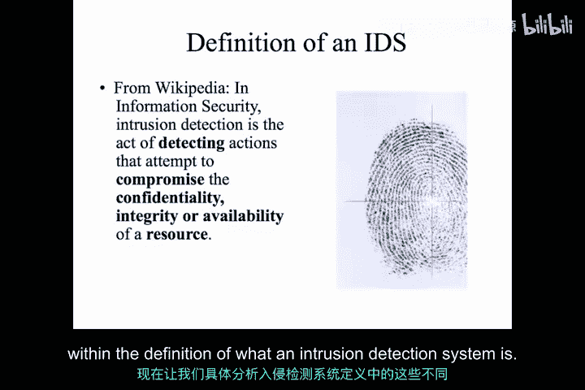
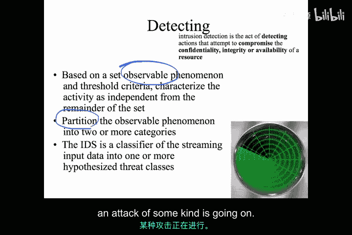
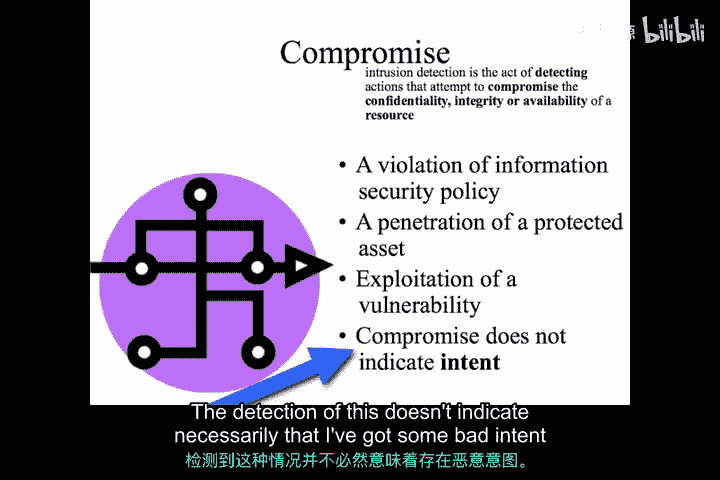
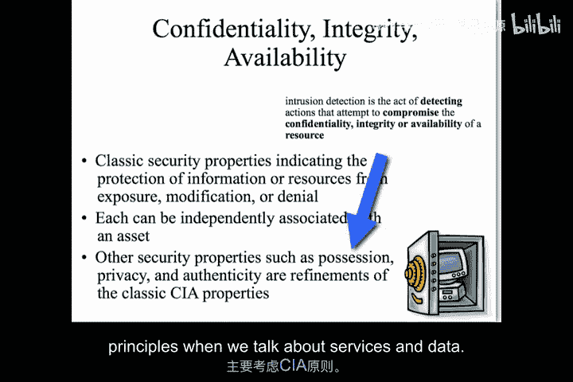
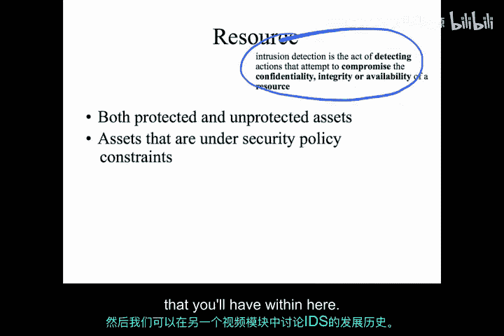

# 约翰霍普金斯大学《入侵检测｜Intrusion Detection》中英字幕 - P2：1_入侵检测系统导论.zh_en - GPT中英字幕课程资源 - BV1sGu1z5E2J

Hello and welcome to the first module for 695442 intrusion detectionte。

This is the first introductory video session where I want to talk a little bit about some of the overview of what an intrusion detection is hopefully by now you've been through the introduction to the course material and you've gotten a better idea of what it is that the course is going to cover the course objectives。

 the syllabus and the various way the grades are being calculated so I'm going assume that you've already got all of that down and then let's go ahead and get underway for module1。

So let's start by going out to the traditional definition of what an intrusion detection system is and breaking that breaking down that definition so that we can actually begin to understand of components and the individual elements of an intrusion detection system。

 so I pulled this definition from Wikipedia， it's probably about as good as any other definition that I've seen with regard to an intrusion detection system。

 the important elements of this sort of definition are bolded here， sort of the detecting the。

Compromise the CIA principles and this idea of resource。

So now let's actually take this and sort of break down on these different areas within the definition of what an intrusion detection system is。

So let's start by talking about what we mean by detecting within an intrusion detection system。

 that's obviously an important part of the major definition that we're talking about within Wikipedia。

So when we talk about detecting what we really mean is that there is a set of observable phenomena。

 observable criteria， and some sort of a threshold that characterizes the activity as independent from the remainder of the set。

 so what this means is that ultimately an IDS system is a classifier in the mathematical sense where I take a set of streaming input data。

That's going to come into the IDS and I'm going to classify that into one or more hypothesized threat classes。

 Those are the fundamentals of what it means to detect something within an intrusion detection system。

So in particular， when we talk about detecting in an IS。

 you can see that because we're talking about a classifier。

 what we're not really talking about is detecting intent or badness or evil or the word attack。

 You don't see any of those things in this sort of idea of detecting。

Key to detecting is the set that you're going to start with this sort of idea of that all your phenomenal have to be observable。

 And once they're observable， we can partition that observable phenomena into these categories。

 And that's really what we're going to get out of the I S。 The I S is in particular。

 Never going to get us intent。 It's never going to actually know that something is bad。 And， in fact。

 it detecting doesn't mean that I have。Correctly identified then the attack of some kind is going on。

 It just means that within the classifier that I have here。

 I partitioned the observable set into something of interest。

Now， the idea of something of interest when I want to talk about compromise in this sort of an area。

 the thing that I'm really thinking about of interest here is things that are in the violation of information securities policy。

 So the way that I'm going to actually partition the way this classifier is going to work is going to be observations that are within what I consider to be my information security policy and things that are not within what I would consider to be my information security policy。

 So things like the idea of a penetration of a protected asset means that I've got some observable that shows that I've touched a protected asset。

From a location that should not have originated that particular access。

 So that's specifically what we mean when we say the word compromise of a protected asset。

 compromise can also be observables that have to do with the exploitation of a vulnerability。

 So sometimes I can watch in particular， an input string to some kind of a network service and know that what I'm doing is matching against some sort of a vulnerability exploit。

 But in particular， And I probably can't say this too often。

 compromisem here does not indicate intent， whether it was done by accident。

 whether some other reason that this particular observable showed a compromise of information security policy。

 The detection of this doesn't indicate necessarily that I've got some bad intent involved。

You can't really talk about the compromise according to an information security policy without actually going into the three the CIA principles。

 the confidentiality， integrity and availability of some kind of protected asset。

 these classic security properties that we talk about that indicate the protection of information。

Is essentially vital so that an IDS can focus on those elements that actually are surrounded in information security policy。

So in particular in this class when we talk about compromise we really are focusing again on the classic CIA principles from information assurance。

 there are of course other security properties like possession， privacy， authenticity。

 they're all refinements of the classic CIA properties。

 these are useful ways to describe security properties that perhaps an intrusion detection system might be interested in detecting。

 but in general most of these can be associated with one of the CIA categories already。

 so we will mostly think about the CIA principles when we talk about services and data。

Now， naturally， when you want to talk about compromise of the CIA properties。

 you're talking about some kind of resource， some sort of protected or unprotected asset or assets that are under the security policy constraints。

 Now， it's important to remember that。You don't have to have every asset explicitly defined under a security policy。

 There may be a lot of implicit constraints or even lack of policy。

 but common knowledge on what ought to be protected。 So， for example。

 I may not have in my own home infrastructure， everything written down in terms of what I would expect to be a protected resource in terms of compromise。

 but I'm certainly going to realize that I've had a compromise when an unauthorized individual。

 either locally， you know physically close to my network or coming in remotely from someplace grabs a file that I don't expect to have distributed。

 or if I've put my own information， say up into the cloud， photographs or whatever。

Even if I don't have an explicit policy saying that those files or photographs should not be shared。

 I would still consider to compromise to have those photographs suddenly exposed in， say。

 a series of open web groups。So you can see from the generalized definition that I have that when I talk about an intrusion detection as the act of detecting actions。

 detecting something active， attempting to compromise the CIA properties of a resource。

That sort of implies immediately that IS is very different than things like computer forensics or some other activity that we might think about with regard to protecting systems。

 IS is by its very nature， a close to realtime activity。

 something you want to detect while it's actually going on。

 This is not specifically looking at a classifier looking to identify previous compromises in your system or trying to do attribution of something that happened in the past。

 You may use collected data to test intrusion detection systems。

 but the deployment and the act intrusion detection really does imply that I've got a realtime streaming set of events that are being classified into threat categories in order to identify this compromise of the CIA ats of some kind of protected resource。

 With that in mind， you know， please go back in and read。

Text versions of the what is an IDS to get a little bit more detail in terms of the definitions of an IDS。

 and then we can talk a little bit about the history of IDS in the other video module that you'll have within here。

