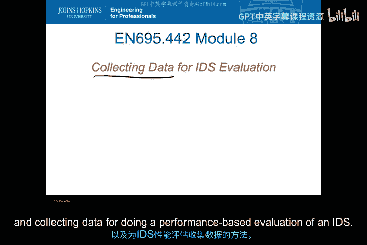
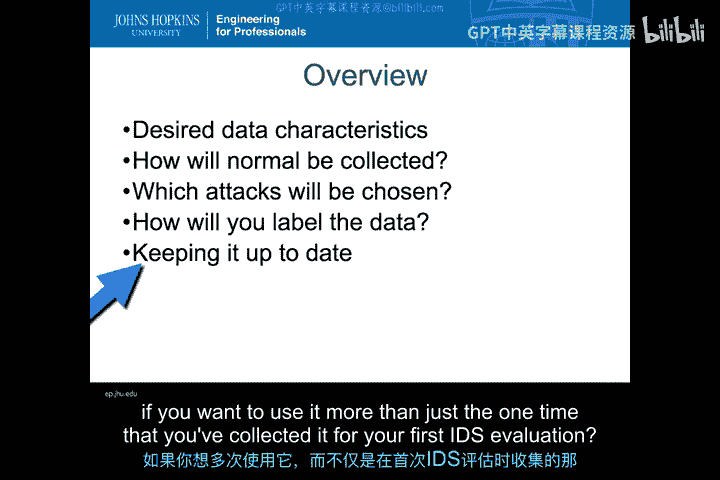
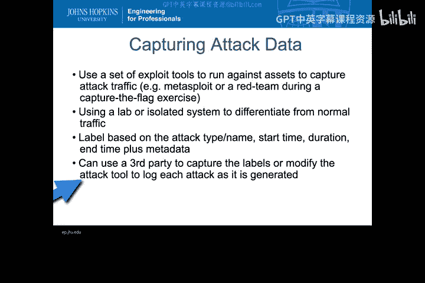
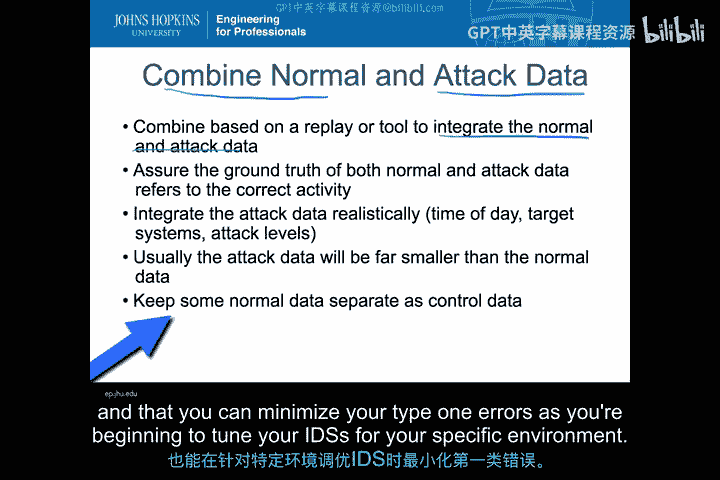
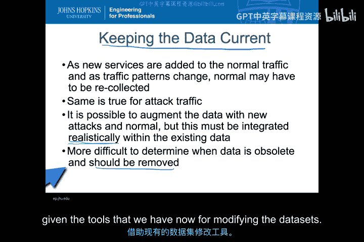
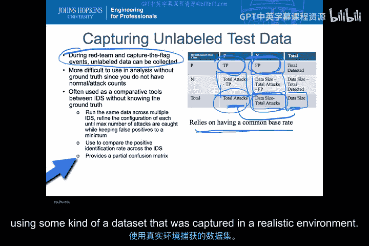
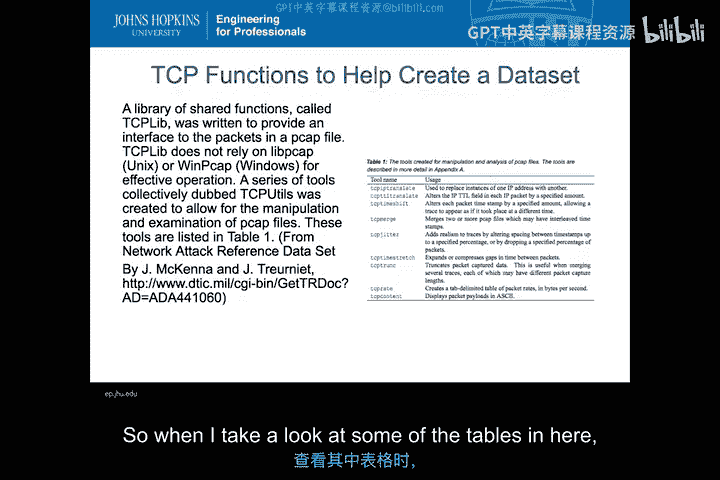
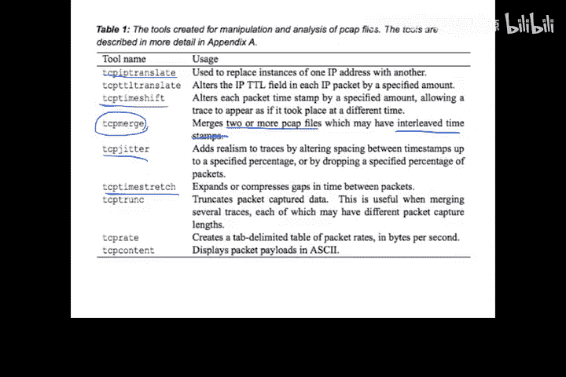
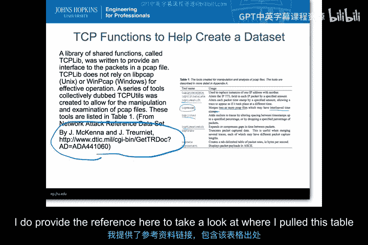
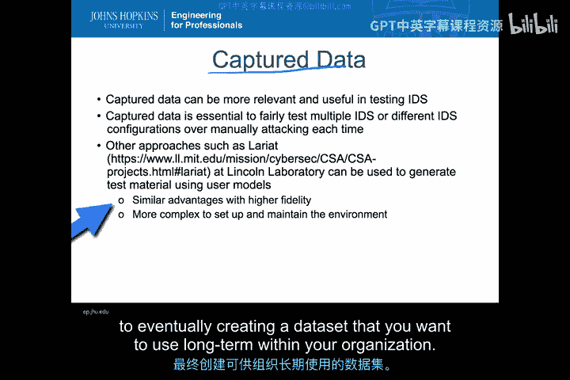

# 约翰霍普金斯大学《入侵检测｜Intrusion Detection》中英字幕 - P30：29_IDS评估数据采集方法.zh_en - GPT中英字幕课程资源 - BV1sGu1z5E2J

Okay， so in this video， we're going to go back to what you need to do within a performance based or an outcomes based IDS evaluation in doing some sort of an intrusion detection system comparison。

Probably one of the most。Important parts of any of these kinds of analyses is making sure that you have the right data that you're using within the IS evaluation context。

 using the wrong data， like anything else that you might do is just going to give you the wrong idea of which Is is better。

 and there are a number of ways that you might collect your own data that you might use your own data for IS evaluation as opposed to using some kind of external database。

 So we're going to talk a little bit about the use of data and collecting data for doing a performance-based evaluation of an IS。

So the way we're going to break down this particular video is we're going to talk about some of the characteristics that are really desired when you want to use collect and use data for an IDS evaluation。

 so you're going to want to know how do you collect the normal side of the data What do you want to do in terms of normal activity How do you choose which attacks are actually are going to be part of your test data that you'll use in the IS how do you actually label to no ground truth。

 how do you really identify what's normal and what's to within your own data set and finally how are you going to keep that data set up to date if you want to use it more than just the one time that you've collected it for your first IDS evaluation。

So collecting your own IS test data can be very difficult in time consuming。

 So why wouldn't you just use external test data that's available out there from either the 1999 Lincoln DARPA evaluation from the KDD cup data from any of these others existing data sets at the research community uses when they test Is。

 So why would you want to collect your own test data。 Well， first of all。

 let's talk about just the pros and cons of collecting your own test data if you do your own the first and probably most important thing is the data you collect is closely aligned to your own system requirements。

 When you collect data from the outside world， the normal and attack data represented in those data sets may or may not have anything at all to do with your systems。

 they're very generic when it comes to what are internet based attacks。

 Whereas if you're collecting your own data， you can be very finetund about what you consider to be normal behavior what you consider to be attacked。

DaYou curate the data yourself。 you don't have to rely on some external organization making sure that the data is correct。

 making sure it's labeled properly， making sure that it's always available and is consistently available for use and finally you can include sensitive data characteristics that you would not want to expose externally to your organization if you want to put in the exact IP addresses of where you keep the crown jewelules of your intellectual property you can do that in your test data。

 you certainly wouldn't want to have that reflected in any kind of a public data test that's sort of out there。

But there are cons as well。 It is way more difficult to get the test data right。

 and we're going to talk a lot about how do you generate this particular test data within this video You've got to keep it up to date yourself。

 I mean， you know it's nice if you know you're curating the data。 you keep it up。 That's a pro。

 the con is you have to curate the data and keep it up yourself and that's going take resources。

 And of course， you only know what you know and external attack database may have additional kinds of attacks that you don't have access to that you don't have the expertise or the ability to launch so maybe you can't include all of the different kinds of attack data that you might want to have。

 So in short， when I talk about the pros， the pros are really all about your normal data and the pros of the external test data your cons have to do with the attack data externally。

 there may be a better idea of the latest version of what attack data actually looks like。はい。

So let's start with the desired data characteristics。

 What do you really want as part of this test data。 Well， of course。

 the first thing you really want to have is labeled attack and normal event data。

 you want to know what is attack and what is normal。

 you need to have ground truth because as you begin to count which things are attacks and which things are normal you've got to be able to run this data over and over again automatically。

 you don't want to manually look at events that are coming back from the Is and then have to go to your data and manually evaluate which ones of them were actually attacks in which ones were normal。

 That's the point of having labeled attack data。 If you're going to use an intrusion detection system that actually has some kind of learning algorithm oromaly detection capability it's even more important to have this data as labeled data so that you can have learning based systems where you've got days of learning data and other days of testing data。

Your network and your host， you need to have both network and host based data as part of your desired data set。

 Why both， Because oftentimes you'll be trading off what you want to do from a network based Ids and what you want to do from a host based IS。

 So network based I S data tends to be easier to collect and generate。

 it's a little more challenging to do host based data。

 But given all of the different ways that you can collect data on the host through sensors。

 you can indeed collect both network and host labeled data to understand how to do the Is comparison。

You have to have an ability to use different base rates， What do I mean by that？

You have to be able to say that some Iss are going to alert based on packets。

 Other are going to alert based on sessions and processes and attachments。

 All kinds of things are going to be different， depending on the different Iss。

 You've got to be able to translate any way that these different intrusion detection systems operate to a common base rate。

 either to the packet level to a session level to something that you can really compare fairly two different Iss that are giving you different kinds of incidents。

  different kinds of alerts that have a different base as to what kind of alert that is。 Obviously。

 you're going to have to have detailed timestamps within the test data and the labels so that you can always match up when an alert comes in where it fits within your test data。

 And finally， you need to have modern attacks and current normal traffic。

 It's not good enough to do things that are old metapldic scripts that aren't really being used much in terms of attacks anymore。

 You've got to have a set of modern attacks that you would expect。

Expect an I S to actually characterize。So let's use an external data as an example here。

 so I picked as an example of the Lincoln Laboratories 1999 DARPA IDS test data set Now this is labeled attack data。

 so the normal data is not labeled but the attack data is labeled in a separate file from the actual PCAP files that are available for use in networkbased IDS these Lincoln Labor evaluations are really all about networkbased IDss they didn't have hostbased data so the network data that you have is PCAP and TCP dump files that you can replay there's basically no base rate normalization the incidents are listed attacks so they tell you what time the attack started and what the duration was but there's no packet for packet listing on which packets were normal and which packets were tax so you couldn't really normalize all the way down to the packet level without making some assumptions about non-interleaving normal and attackbased packets。

Timetamps on this data are in local time， not GMT， so that if you have an IDS that's translating things into GMT and not in local。

 you might have difficulty matching the ground truth of the data to the incident data that's actually coming out。

Well， obviously， this is a 1999 data。 That's from a long time ago。

 Both the normal traffic and the attack traffic are representative of an era that's really long gone with regard to the Internet。

 So this is not representative of anybody's normal environment anymore。 But as you can see。

 this data is still available。 It's still out there。

 and it's often used because it is a labeled data set。 It's a data set that's out there。

 and there aren't that many to use externally。 So this is one that's publicly available。

 It's easy to get a hold of。 It's easy to use。 but you can see there's a lot of the characteristics that we would like to have in a data set that' simply are not evident within this particular external data。

So now what am I going to do to capture my normal data Well obviously I'm going to use some kind of network and host based sensors while I'm playing normal behavior and attack across these sensors in order to collect it。

I'm going to want to label this data as I collect the data because it's going to be too difficult to go back after the fact and try to go back and recode all of the data that's actually captured。

 So I'm going to want to have a way of playing the network in the host based traffic and labeling the packets that I send out and the hostbased process activity that I send in with the labels of what am I doing normal versus attack at any particular given moment。

 It's useful during this time in the normal data to not just say normal。

 but give it some other character of what's happening within the normal data Is this webbased traffic I this normal running processes on the system like word or PowerPoint know what are you actually doing labeling the normal data a little more effectively can help you in an ideas evaluation when you get false positives。

 knowing what type of normal data is actually creating these alerts。Finally。

 you've really got to assure there's no attack or anomalous data going on while you're doing the collection。

 This sounds easy to do。 But if you're not in an isolated environment。

 if you're actually monitoring a live environment in order to create normal traffic。

 Do you really know that at that particular point in time。

 there is no attacks coming in from the Internet against your system at that time， Remember。

 you don't know what you don't know。And so in this particular case。

 there may be advanced attacks that are coming into your system。

 and you just simply don't recognize them because no IS would detect them at the time you're collecting the data。

 This is forever going to be mislabeled within the data that you're creating for your data set。

Capturing the attack data is a little bit more straightforward。

 If you have a set of exploit tools either at the host or at the network。

 then you run those tools and do the same kind of collection that you've done with regard to the normal data。

 your labeling everything you're doing during this attack data side as attack data so you don't need to do the attack data at the same time that you're doing your normal data。

 you can create an isolated environment and run your attack tools。

 your metaplid or your red teaming or capture an exercise and then label all of the different things that are all attacks as part of your attack data that's to be labeled So you want to be able to do things like use a lab or an isolated system that will differentiate this kind of attack data from normal traffic。

 so you don't have a lot of normal traffic embedded inside of what's happening during the attack。

 the labels should not only include the attack type in its name， but the start time。

 the duration and end time plus any other。Data。That you might think is important as part of labeling this attack。

 Remember， you want to compare the I D S alert， not just to the fact that did it find an alert。

 but did it properly characterize the attack， Did it classify it into the right attack type。

So you can use a third party tool to capture the labels or you can just modify the attack tools that you have if they're ones that you've collected on the internet to log each attack as it's generated。

 So really understanding before you capture the attack data。

 how you're going to label it is going to make your job a lot easier of capturing labeled attack data in this case。

Now， if you follow the procedure that I just talked about。

 you're going to have two different dataset sets， you're going to have normal data and you'll have an attack dataset。

 so now you've got to combine these things into a common data you want to combine them based on some kind of a replay tool or some kind of tool that's going to integrate both the normal and the attack data into your systems you want to assure that the ground truth of this normal and attack data refers to the correct activity in the final database that you create you're going to want to integrate this attack data realistically meaning that the times of day you would expect to get an attack The frequencies of attack over time。

 so you're not going to necessarily get an even number of attacks throughout the entire day you may get more at 11 o'clock in the morning more at four in the afternoon more at 2 o'clock in the morning you're going to have more than just a random distribution of the attack think a little bit about what a realistic distribution of those attacks within your data might be。

Usually your attack data is a far smaller data set than the normal data。

 And that's what you want because that's going to characterize what you think your normal activity is going to be like know how you're matching this to the realistic environment。

 Finally， you're going to want to keep some normal data separate as control data that has no attack data interleaved within it so that you always have data that you can play against your IDss so that any alerts that are generated in that case will always be a type1 error。

 It's an easy way both to see that you can run your normal data across the IDss and that you can minimize your type1 errors as you're beginning to tune your IDss for your specific environment。

Once you have a way to interleave the data， you can actually have a little bit easier job of keeping the data current。

 So as new services and new things are added to the normal traffic。

 you can recollect a portion of the normal traffic and then reintegrate new services。

 new kinds of normal inside of your growing database same is true for attack traffic if I've got some new kind of attack traffic。

 I could generate just those attacks， align the times the way I want to within my data and then integrate those in turn you know in a growing data that I would have over time。

 This would allow me to curate the data and keep it current in terms of what's actually happening without recollecting the entire data from scratch。

So again， you've got to integrate this realistically within your data。

 and that's really important is that when I'm going to have a new attack and something new that's in there。

 it's really got to be realistically integrated at the right times against the right kinds of assets in a way that the IDS would realistically want to detect this。

The more difficult part of keeping all of this current is really understanding when things from the dataset should be removed。

 when is it you know when do you not using a particular web service anymore。

 When is something really not of interest either on the normal or the attack side and can you remove just those portions of the data without completely regenerating normal。

 in some cases you might be able to given the tools that we have now for modifying the data sets。

 but it is more difficult to know what the impact of removing attacks tax and normal behavior is than simply augmenting in order to keep the data current。

So what happens when capturing labeled data really isn't directly available to you and why would that be So a lot of。

A lot of times， you'll have red team events and capture the flag events。

 These are going to have normal traffic and attack traffic interleaved in a way that it was not initially labeled。

 You're going to get just the data set of what happened without any labels。

 what what without any labels at all。 This is really much more difficult to use as an IS test because you don't really have the ground truth。

 You have to create the ground truth。So even if I have a high level description of what attacks were used against the system and I can sort of identify those within the data set without having a complete。

 you know， and a complete understanding of what they are。

 I'm going to have more difficulty in trying to get the ground truth and then using these continuously as a data set。

 but。It's worth talking about because these are often the data sets that you actually have so you can use these tools。

In order to do some comparative analysis within the I S without necessarily knowing what the ground truth is。

 So how do I do that， Well， if I run these capture the flag or these red team data sets that are unlabeled against multiple Iss。

 I at least can none identify what each of the Iss。Triggers on as an attack。 I can very。

 very least get these kinds of true positives and know whether they have actually been part of the attack stream that I know。

 I can also get a false positive number because I get triggered events that I know were not part of the red team where they captured the flag event。

 So even if I don't really have normal， Those are two things that I can actually get from running an unlabeled data set across。

 So now I might be able to compare the positive identification rates across the Iss just by looking at that particular column or particular row within the confusion matrix。

 And I'm going to get from this a partial confusion matrix。

 I might even be able to generate more of my total。 how I might do that。

 if I have an idea of what the total attacks were in some sort of common base rate， Again。

 this relies on having a common base rate packet session something。 then I know if I have。

My total attacks。 and I have the true positive attacks that were there。 I can calculate。

What essentially the， the element down here in terms of the missed attacks are the same thing with regard to normal。

 If I can look at my false positives that I have， and I know what my total data size was。

And I understand the total attacks and the total data size。 I can generate my normal。Total。

 and since I have my false positives， I can then generate my data size here。

 so I can use some simple mathematics to estimate what some of the other elements might be within my confusion matrix。

 even if the dataset set originally was not labeled in terms of what was there。 Again。

 this is not as good or the same as using a label data set。

 but it is a way of still doing a comparative analysis against multiple ideas is using some kind of a data set that was captured in a realistic environment。

So how am I going to go and integrate all of these different pieces into a common file Now within talk about it on the network side first。

 there are a number of TCP functions that can really help you create a data and I've got a few of them just sort of listed here in this library called TCP Lib which was really written to provide an interface to packets in a PCAP file This one essentially allows us to take a PCAP file or more than one PCAP file and begin to modify those so I can bring them into a common test set so。

When I take a look at some of the tables in here so if I look at this particular table that I pulled you can see that there's a number of tools that are going to be immediately valuable in terms of doing some of the combination that I talked about before So for example。

 this TCP merge merges two or more PcapAP files So if I have attacks and I have normal traffic and they all are within the same interleave time frame。

 I can now take these and merge them into a single TCP file that I do some of these other ones can add realism in a number of ways I can expand or compress time I can translate IP addresses so I can take IP addresses that were target in one way and replace them by targeting them someplace else same thing for like TCP time shift if I do my normal one day and I do my attack data the next day。

 I can use TCP time shift to alter the timestamp of either the normal or the attack into the same time。

The previous one， which I can then effectively use TCP merge to put those two files together。

 so these are valuable tools in simply manipulating the PAP files that I have in the network area in order to completely evaluate and create a usable data set that has all of these merged into a single place。

And for more information， I do provide the reference here to take a look at where I pulled this table and also has a link to place to get all of these tools for use within the manipulation of PCCAP files。

So in summary， the value of capture data for its relevance can be in IDS is essentially that you are developing something that really represents your environment that is reusable in testing IDS systems This can be very valuable and more valuable in trying to find a data set on the web that is going to be used and provide your results that you may or may not be able to trust with regard to how something would perform within your own environment。

 so these capture data can do multiple tests or different IDS tests you can change configuration by replaying these attacks over and over again by replaying the same data across the different ISs and different configurations of the same IDSs。

 This is not the only approach one other one that I will note。

Is that instead of creating a data set to replay you could have an environment that is scripted。

Where the normal and the attack activity can be replayed or generated on demand。

Through user models or through other kinds of attack tools that are run in an exact way against the IDSs each time。

The advantage over a dataset is that I now can more easily modify user models and attack models to represent my environment the way I want to。

 The downside is， of course， you're going to be running this in approximately real time。

 So it's going to take you as long to run the attacks as it is in real time to generate them in test data you can often run these across the Is is faster than real time because the data is simply going to be replayed across the sensors or directly into the Iss themselves。

 So I give you a link here to for more information on lat and for approaches modelbased approaches that again。

 were really。Highlighted as one of the methodologies Lincoln Laboratories uses to do some of these tests and evaluations。

So that's essentially。All of the issues that we're going to cover here in terms of capturing and running your own data。

 there are obviously lots of details that are really important with regard to which attack tools can you really use。

 where do you get them， How do I know that they're representative。

 how do I do test dataset validation that's really beyond the scope of what I want to cover in this module。

 but all of them are relevant to eventually creating a data set that you want to use long term within your organization。

