# 约翰霍普金斯大学《入侵检测｜Intrusion Detection》中英字幕 - P31：30_基于特征的IDS性能比较.zh_en - GPT中英字幕课程资源 - BV1sGu1z5E2J

So now let's bring it all together in this last video where we actually try to talk about a procedure for comparing signature- based IDSs。

 so this will be the first part of trying to use data that we would have that' labeled in order to create the right kind of counts to figure out exactly how we would compare between two signature based IDSs。

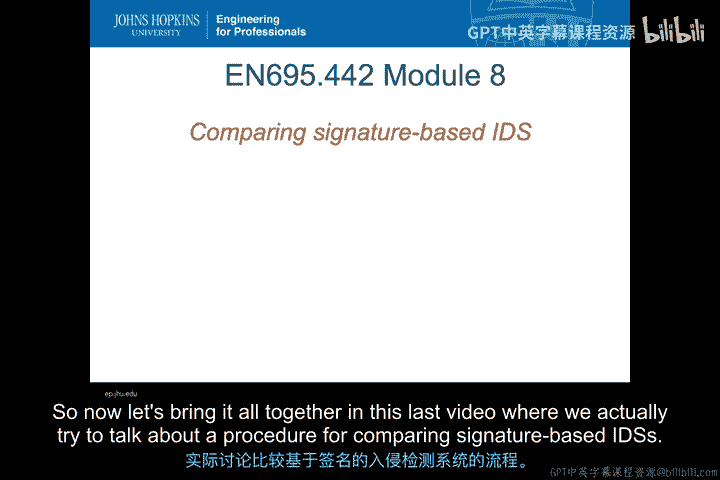

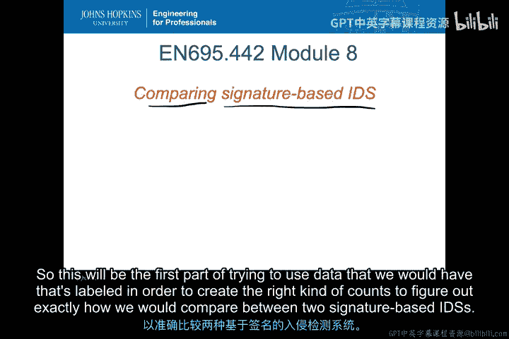

So in this example， I want to design an experiment between Snort and Surraccottta。

 So these are two things that you're now familiar with from running on security Onion and we'll be able to see if what we wanted to do was to take some kind of a test configuration for Snort and Sraccottta。

 how would we actually create an experiment that would allow us to choose between these two。

 given a standard data set。

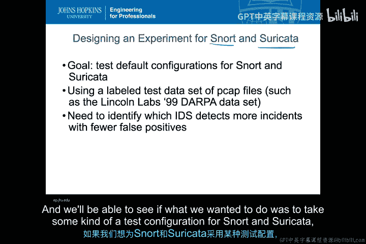

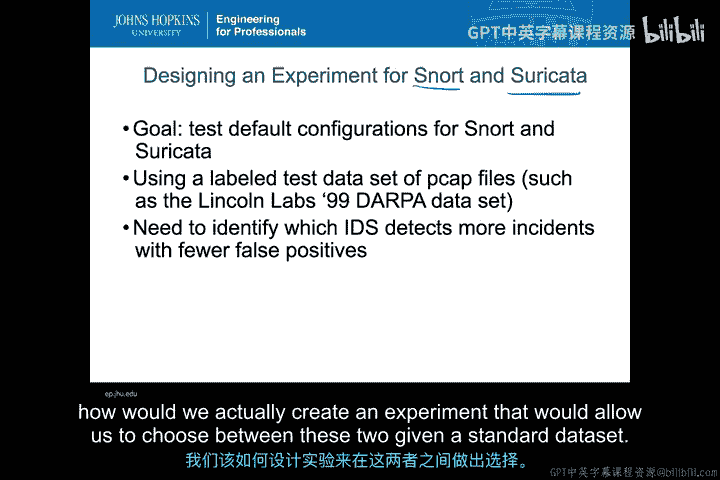

So first of all， our goal， as I said， is going to be to test the default configurations。

 So I'm not going to try to do the tuning of snort and Sraccottta to any particular enterprise。

 I'm just going to try to say snort and Serraccottta out of the box which one is going to work better for this particular dataset and the what I'm going to do is is the labeled data set for Pcap files So this is。

 for example， the Lincoln Laborator's DA data set or the KdD cup dataset。

 any of these that would be a labeled dataset set So that's what I want to do is take a labeled dataset set and compare snort and Surraccottta with a goal of identifying which Is detects more incidents with fewer false positives。

 So it's not going to be a full analysis like we'll talk about in the next module this is just an initial analysis with just the goal of saying which Is detects more from this dataset and which one has fewer false positives。

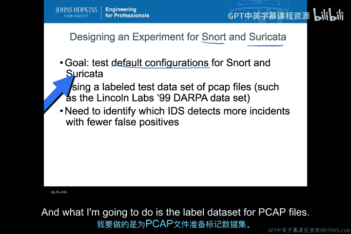

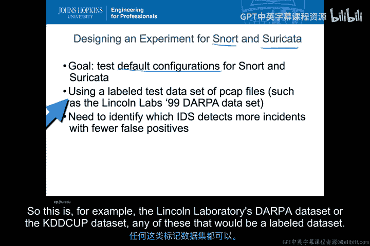

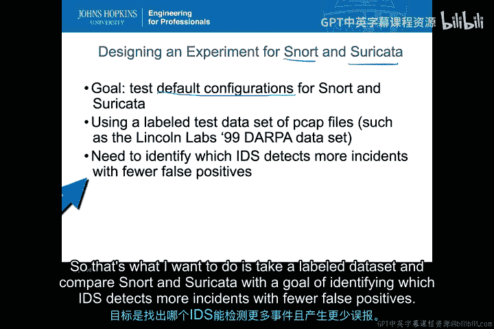

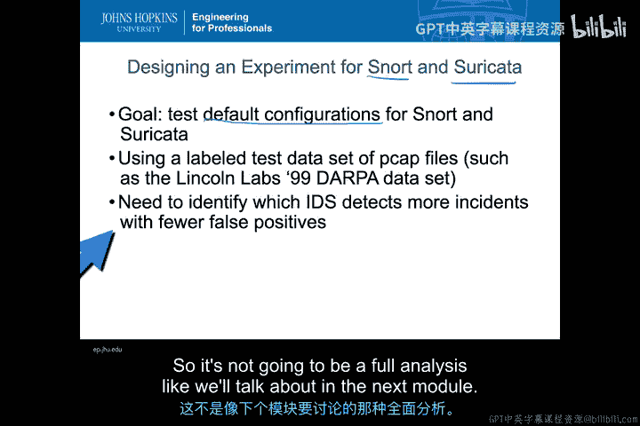

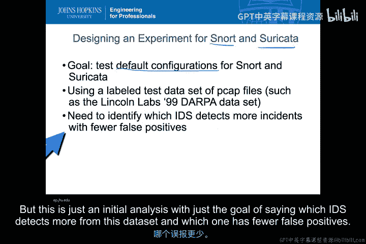

So we're going to do this test as a seven step process that we're going to run through and the first step that we're going to do is we're going to prepare the test environment。

 So this is where we're going to run all the tests。

 We're going to make sure that we have the right things installed that we can actually do the counts that we need to use that we can set up the items in the environment that we're actually going to test。

 This is some kind called the the system under test and that's what we're going to do in this first step。

 So we're going to use an environment such as security Onion。

 We're going to install both Snort and Sararata with their default configurations。

 This is what you have done in previous labs。 So that part of it should be very familiar to。

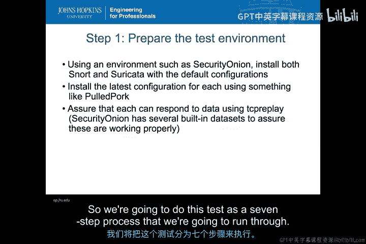

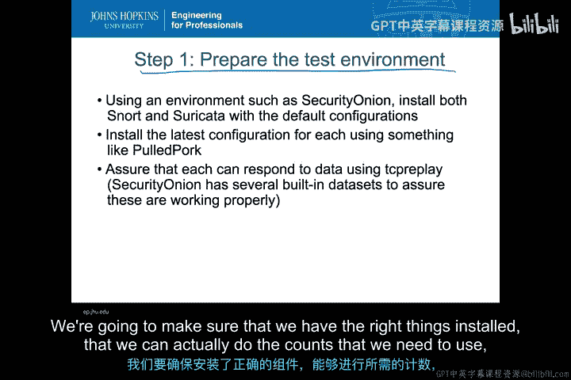

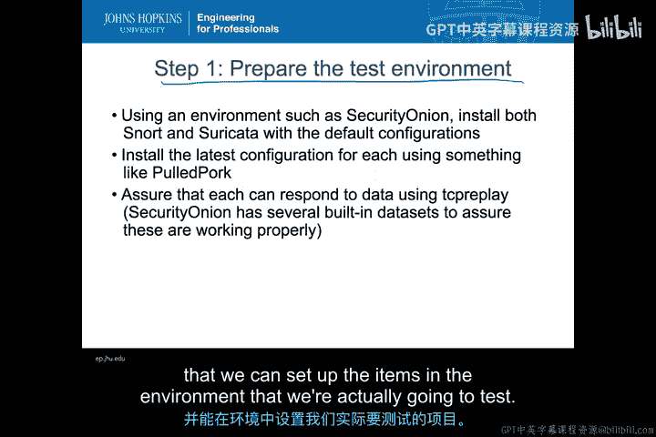

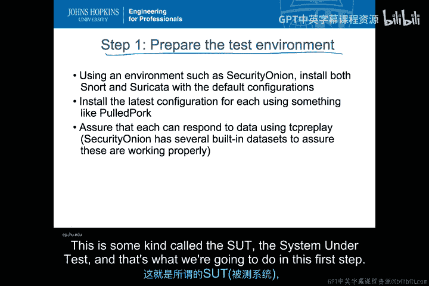

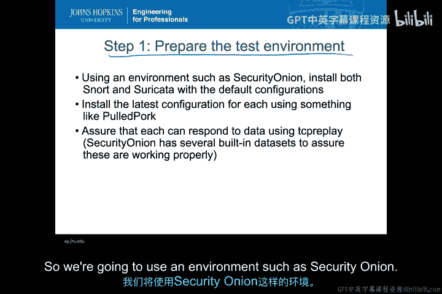

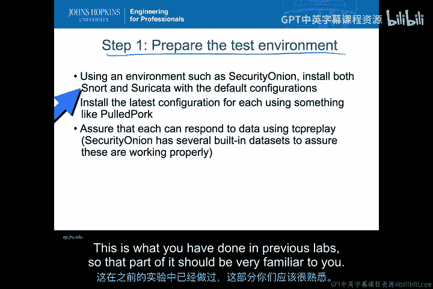

Then we're going to install the latest configuration for each using something like pulled pork。

 some way of saying is the default configuration that I have for both snort and saraccottta up to their latest defaults。

 And then finally， I want to assure that both of them can actually respond to data。

 So I'm going to take built in data sets from， say， security onion。

 And I'm going to use TCP replay just to make sure that they're both working。

 So this is just preparing a test environment。 So I have a working version of snort and saraccottta in the default configurations and that they can actually listen across a network sensor to alert on events that actually come by。

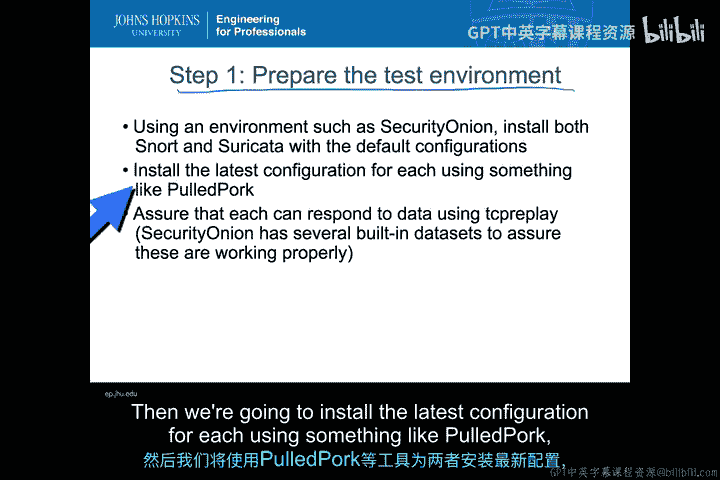

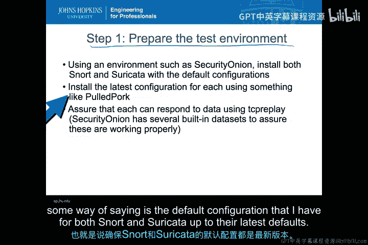

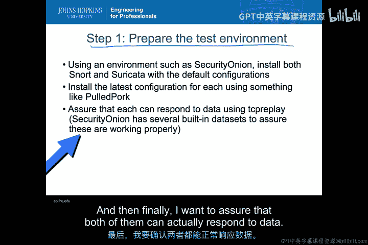

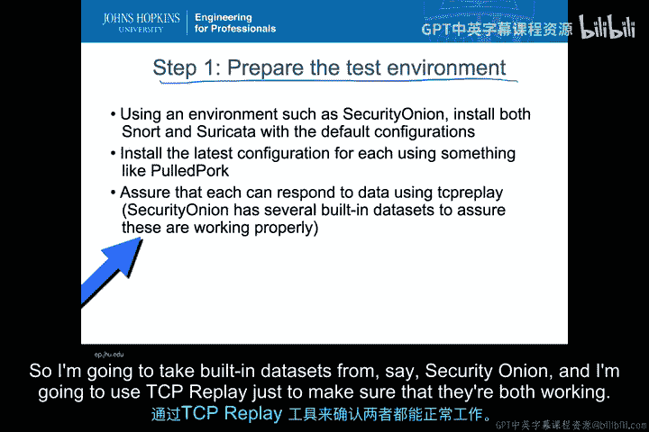

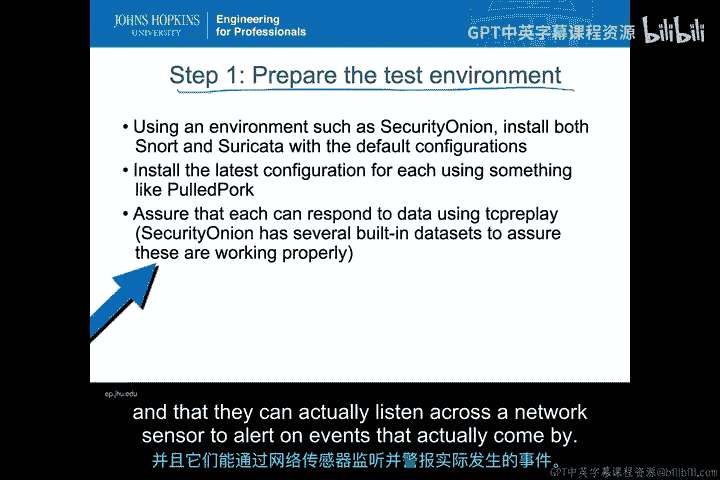

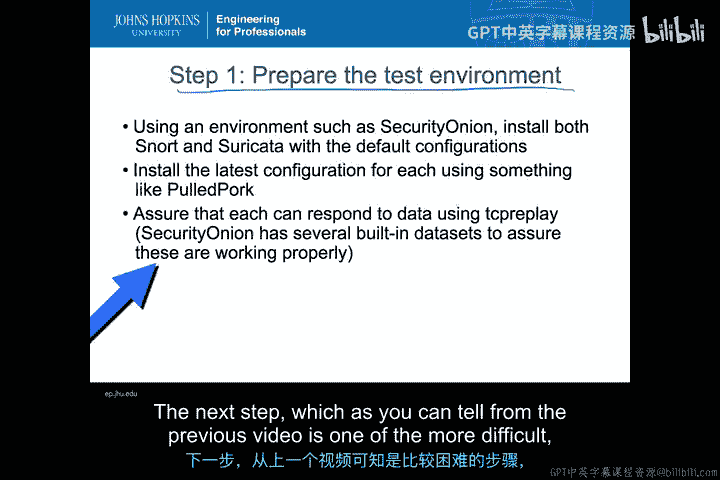

The next step， which， as you can tell from the previous video is one of the more difficult。

 is preparing the data， preparing the data on how we're going to collect it from these tests。

 So the very first thing we have to do is decide what base rate are we going to use for the labeled data。

 Are we going to use packet sessions attached I'm going to see what actually is labeled in my in my data set。

 So if I use something like the KDD cup data， every packet is labeled。

 So if my base rate and that point is going to be packets。 Now。

 this means that if I get a detection within snort or serocottta。

 I have to be able to say within that detection that I have。

 which packets are actually involved in the thing that was detected and then I don't just count it as a single incident。

 I have to count it as the number of packets that were associated with that incident so that I can have the same level of packets for normal and packets for the incident。

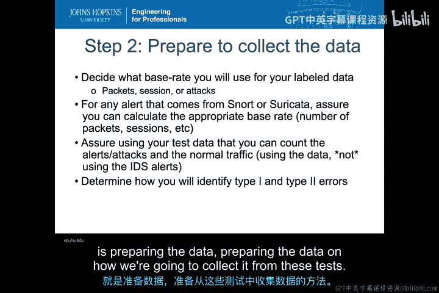

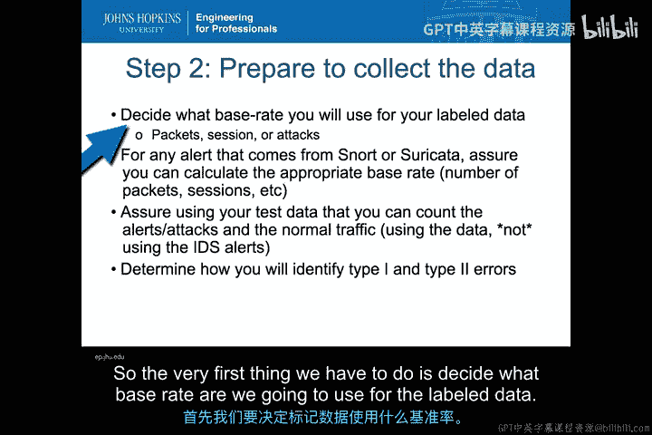

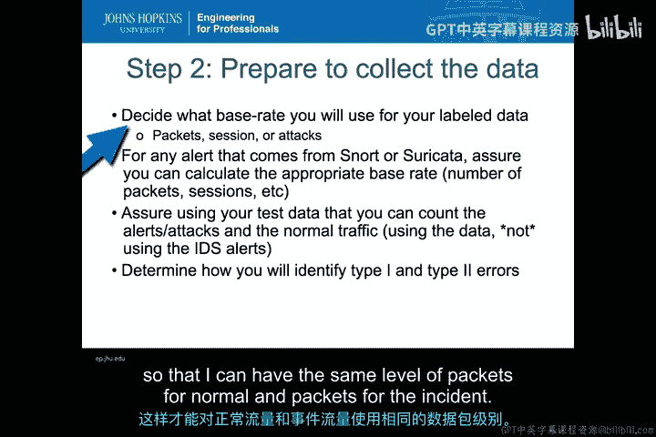

So I'm not just simply counting the number of events that I get from these different ideasss。

 I have to convert them to the base rate that I want。 Now， if I decided to use sessions instead。

 then when I get an alert that was session based， I have to go back to the labeled packet data and basically look at all of the different labels that were associated with that session and reduce that to one。

 So I don't multiply count the normal sessions。 I count each session is one， not each packet as one。

 If I want to use sessions。 attacks are a little more tricky because attacks can actually happen over multiple sessions。

 imagine a Ddos attack that has thousands and thousands of sessions that are actually coming in in order to be a single attack against a system。

 If I'm going to use attacks as a base rate， then what I really have to do is talk about normal behavior。

 not as sessions， but a whole collection of sessions much more difficult to understand how the common base rate might apply between a multiple session attack and a multiple。

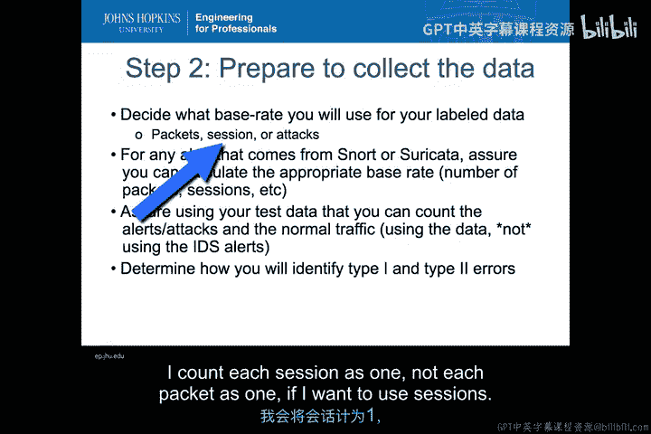

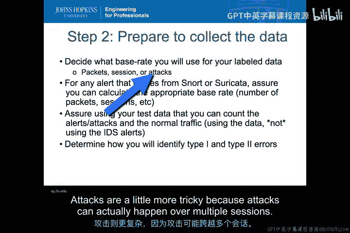

Normal attack。So for any alert that comes from Snort and Serraa。

 I want to assure that I can calculate the appropriate base rate， the number of packet sessions。

 et cetera。 They're going to come from that attack。 I can use the test data， you know。

 the sample data that I used in the previous step1 in order to know that I can count based on alert。

 the number of packets that were associated with that alert。Finally。

 assure that my test data and the normal traffic the test data that I'm using。

 I can count the alert and the attacks， and I can count the normal traffic using the data not using the IS alerts。

 Remember， you can't count normal。 based on IS alerts。

 You have to count normal based on what's actually in the test data。 Finally。

 I'm going to determine how I will identify type 1 and type 2 errors。 So remember， a false positive。

 a type 1 error is going to be the number of packets associated with an incident that was alerted within snort or saracottta that isn't。

 in fact， a labeled attack。 A type 2 error is going to be the number of packets inside of my labeled data set that are actually a attack packets。

 but not part of an alert that actually came from Snort and saracottta。

 Those will be my type 2 error accounts that I would get from that。

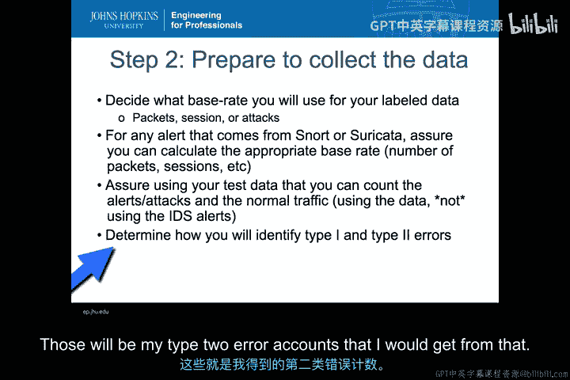

Now， in step 3， I'm going to make sure my test data is all ready to go with regard to running this test。

 I have to assure that the I P addresses and times stamps match the ground truth that I actually have if the ground truth is a separate file。

 if the ground truth is the same file， that I have to make sure the labels are associated with all the packets or sessions。

 However， they're labeled。 assure that the time is going to count。

 I have to know whether the times stamps are in GMT or in some kind of a local time。

 So I'll know how to。To associate the alerts with the ground truth that's in the test data。

 assuresure that I can count based on my base rate in the attack data itself。

 We talked about that in the previous step2 a little bit。 And finally。

 I have to write any scripts that I'm going to need to match the ground truth with my collected alerts。

 So if a really big data files， I certainly don't want to be counting these packets manually。

 I'm going to write some sort of Python scripts or shell scripts or a scripts or something that are going to be able to go through and match the ground truth with the alert data and with the actual data that I have there so that I can get appropriate and repeatable counts out of the test data from and compare that to the data that I would get from alerts。

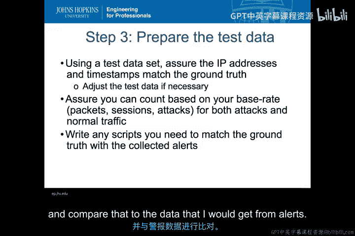

In the next step， I want to use some test data that has no attacks in it at all。

 So I'm going to run each one of these Pcap files using TCP replay while snort and Sracottta are running。

 I don't have to run them， by the way， at the same time。

 I can do it against snort and then I can do it against sirracottta or vice versa。

 If my resources are not appropriate enough to run all the Is is simultaneously at the same time。

 I can always run them independently and count the numbers independently from this。

 So the advantage of writing of running this with just normal traffic alone is that any incident that's alerted is all going to be a type 1 error。

 So this verifies that I can run normal data and it gives me an idea as to whether the tuning of the Is is similar to what the normal is in the test data that I'm going to run。

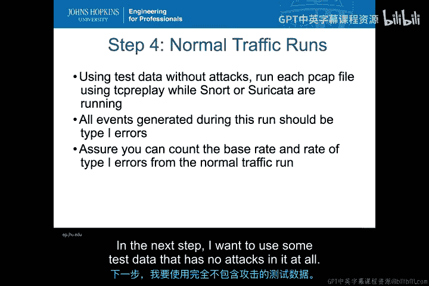

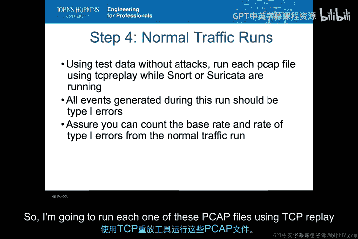

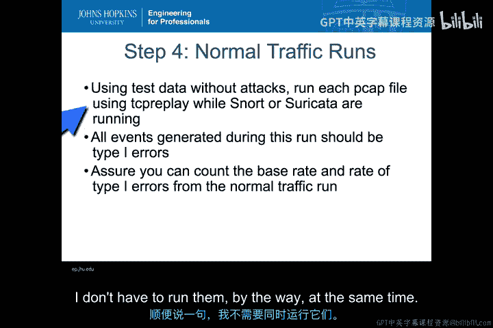

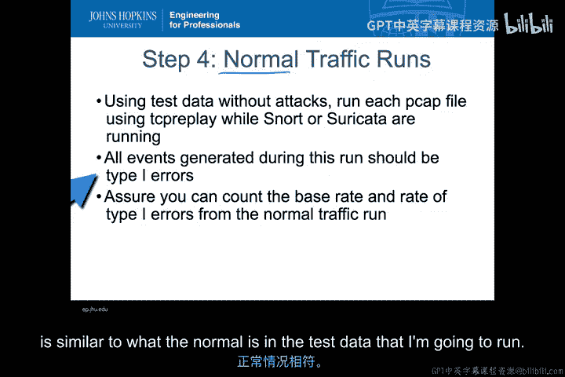

Again， from here， I'm also gonna to assure that I can count the base rate of the normal traffic and from the type1 errors in this normal event run to get it。

 So I won't have any type 2 errors。 I can't because I don't have any attacks in the data itself。

 I can have type 1 errors and I can have normal， you know， true normal events。

 And those are the two things that I'm going to pick up from this particular step4 run。

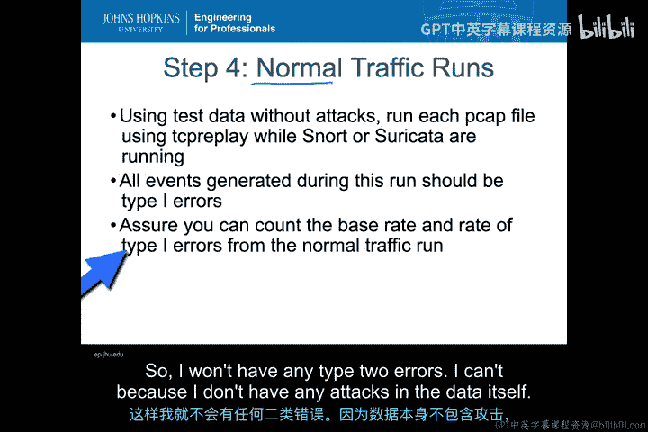

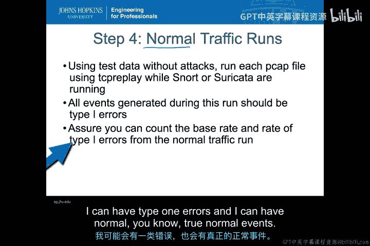

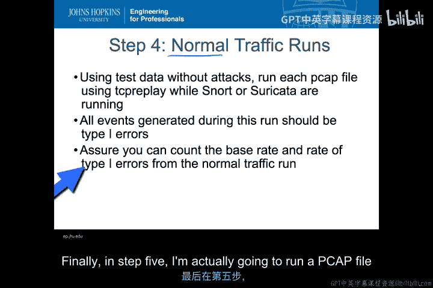

Finally， in step 5， I'm actually going to run a Pcap file with the actual attack behavior embedded with the normal。

 So these are Pcap files that have both normal and attack behavior using TCP replay。

To run these files pass both Nort and Sararacottta。 So for each incident。

 I want to match the ground truth using the times stamp， the source destination I P number。

 the metadata for the incident that's coming out from each of those to the ground truth and then count all the packets in the ground truth associated with that event。

That is my count number for the P for the number of things that were correctly identified。

 So from here， I want to calculate the detected attacks， the type 1 errors。

 the type 2 errors from the base rate of each incident。

 include the missed attacks and the normal behavior。Finally。

 if the expected attack detection does not occur， or if I get something really strange that I have a lot of attacks that were part of my ground tro。

 but at the wrong times， I should go back and check the timetamps。

 Probably what happened is the alerts are reporting in a different time zone than my data is actually my ground truthop and the data。

 That's a very common problem。 And it's one of the things that you can do to go back and say。

 invalidate that test run and run it again with the appropriate kind of data ready to go。

 In other words， go back to step 3。 Prepa the data So it's appropriate for the attack run。

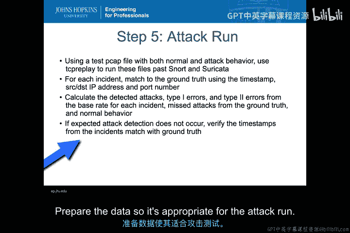

In step 6， this is where you're actually going to perform the counts and analyze the data。

 You're going to determine from the same test data which IS detected the most incidents。

 That should be a simple matter of counting the packets that were detected from Snort versus the packets that were detected in Sracottta determined from the same test data。

 which Is had fewer type 1 errors， In other words， how many packets were associated with an event that was not actually a labeled attack。

 You could also determine from the same test data which had fewer type 2 errors。 In other words。

 what attack data in the ground truth was not alerted。

 And then these three measures will give us the first cut at whether snort or seracottta in a given test data set。

 which one can actually perform better from test data that we have generated。

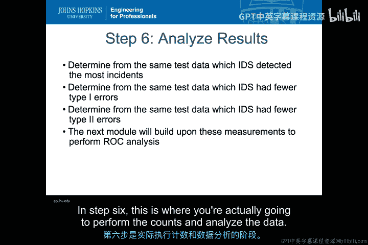

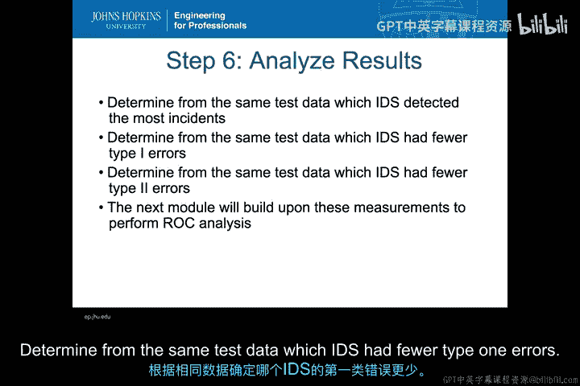

From the next module， what we're going to do is build upon these measurements to perform a rock analysis across multiple configurations of an IDS and move from simply doing IDSs that are signature based to doing more advanced IDSs that might be anomaly based as well。

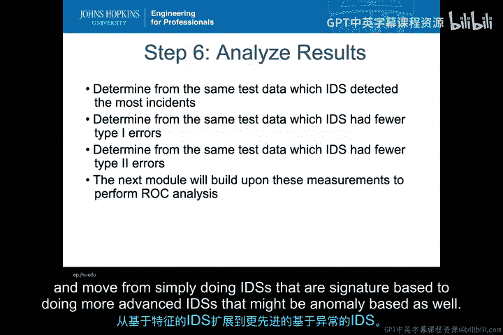

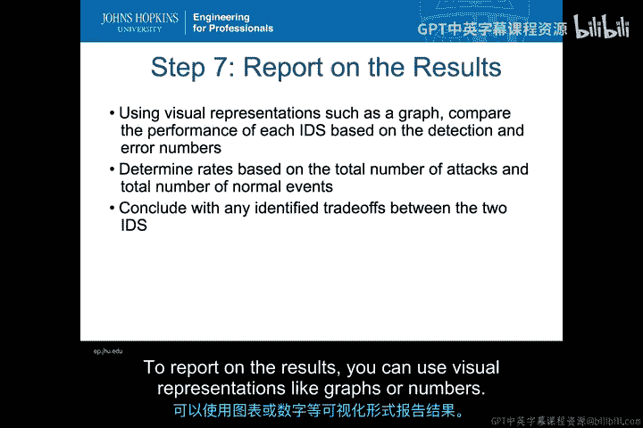

To report on the results， you can use visual representations like graphs or numbers。

 There's any number of way that you might want to report。

 But the real key is that given a common base rate that you have across all of the normal and attack behavior。

 you can report the numbers in a way that makes sense from the standpoint of the attacks that were detected over the overall attacks that were part of the system。

 So the total number of packets associated with attacks versus the number of packets that were actually associated with a detection again。

 using packets as the base rate in that particular idea。 you can determine the rates。

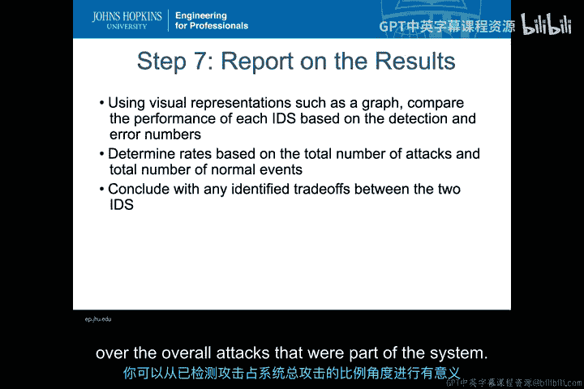

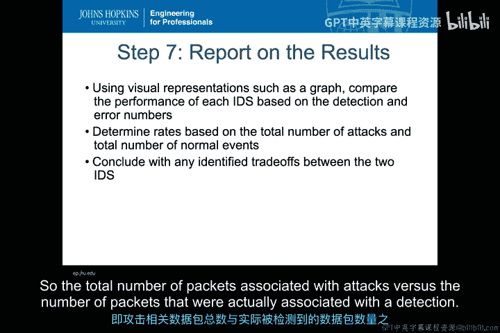

Very simply based on that。 So I can just look at， you know， for example。

 the standard rate P over the total number of tax that was that was actually there。

 I can get a false positive rate by essentially looking at the false positives again over the total that's there。

 And then I know how many of the things I had detected were over the total number of attacks that we're really there for the false positives I can do the same thing with the type 2 error rates the same thing with more so I can begin to calculate rates and the rates are going to be key into getting us into what we're going to be doing in the next module with regard to receive or operator curves。

 So that's a way your lab is going to build upon these kinds of steps in order to understand better how to begin to compare idss using real test data So this should be able to start to get your hands on actually running events across these various idss that we're going to use toward the rest of the semester。

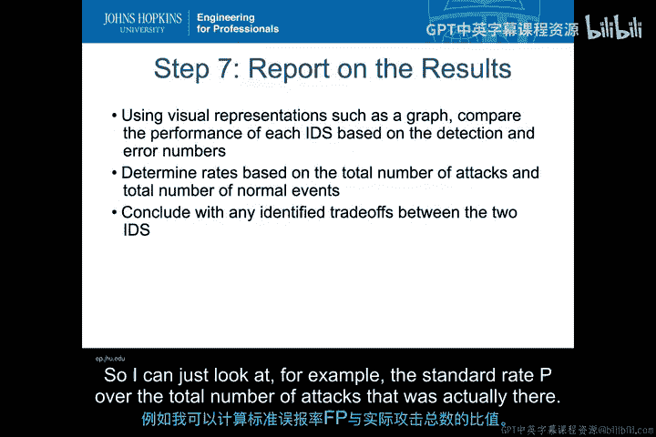

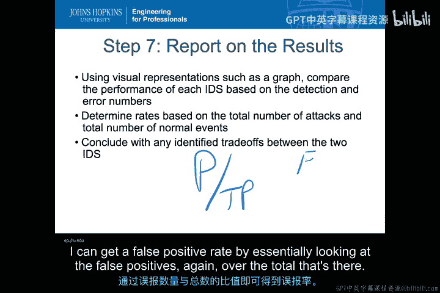

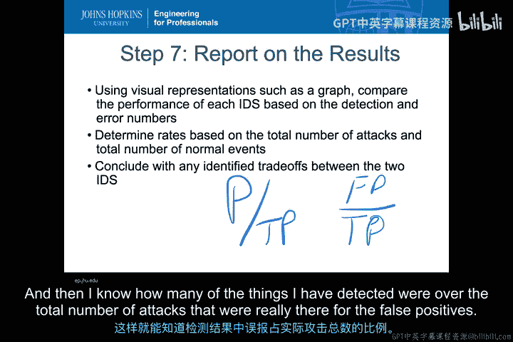

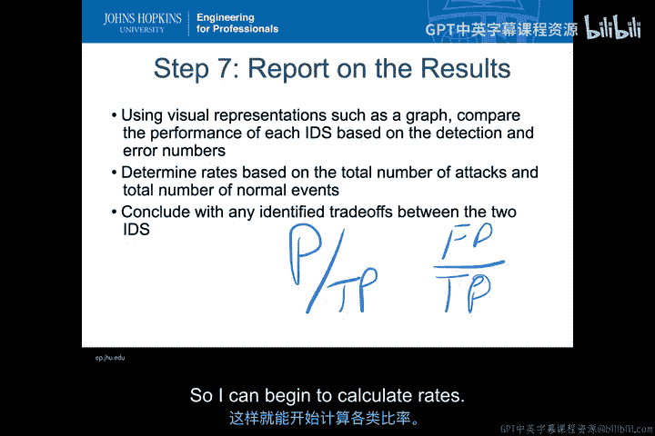

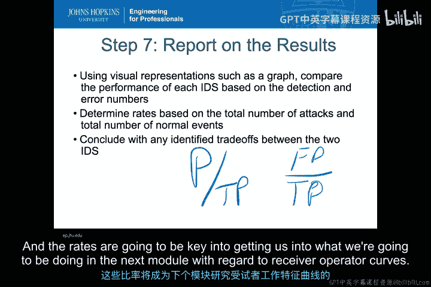

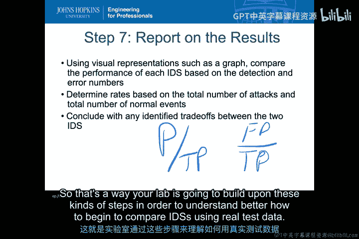

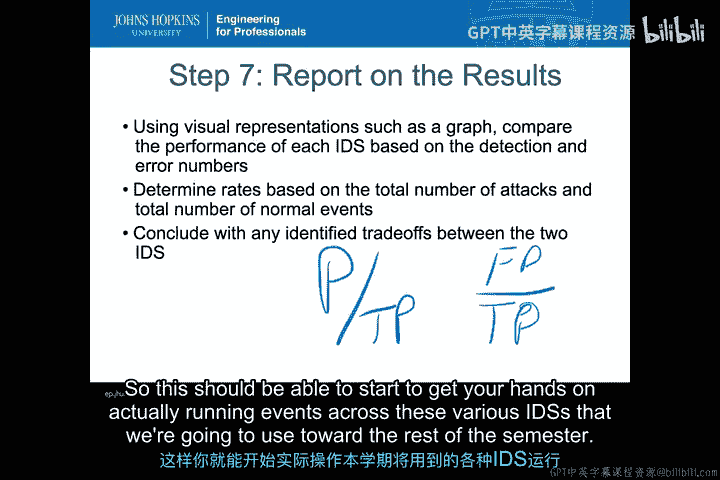