# 约翰霍普金斯大学《入侵检测｜Intrusion Detection》中英字幕 - P33：1_导论.zh_en - GPT中英字幕课程资源 - BV1sGu1z5E2J

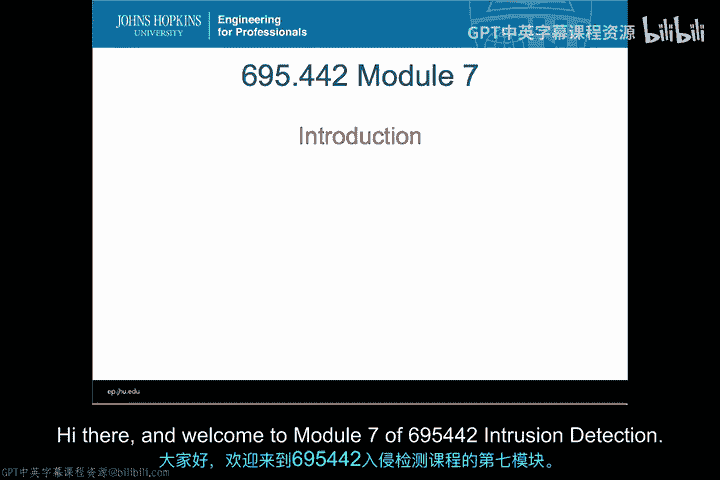

Hi there and welcome to module 7 of 695442 intrusion detection in this video we're going to introduce the topics that we're going to be covering within this module primarily focused around looking at large network intrusion detection following on from the NIDs work that we've been doing sort of in the past modules building that into something that's going to take a look at the more larger and complex problems that you get in sort of real largescale enterprises so by the end of this module the first and most important thing is that you're going to be able to differentiate between network situation awareness net SA tools from network intrusion detection systems they are a little bit different and they're often advertised as being basically the same kind of tool they share a lot of components and they share a lot of functionality but they're not actually the same tool and they're used differently we're going to talk。

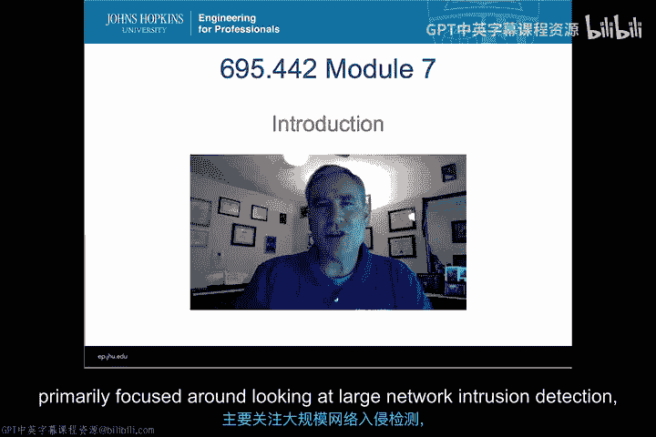

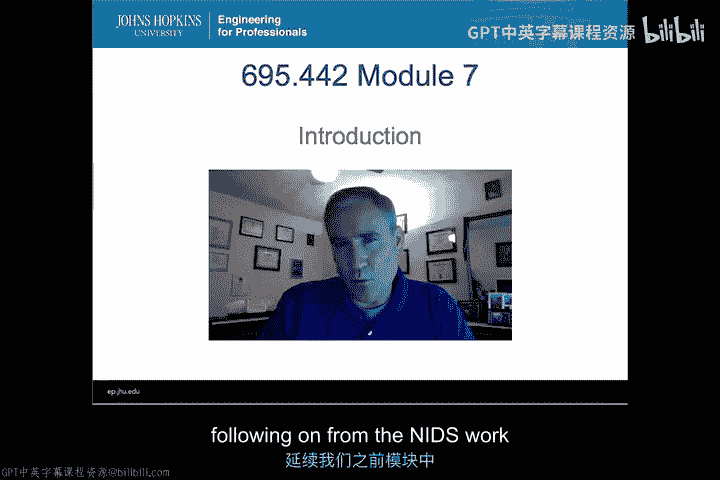

about that we're going to be able to apply anomaly detection to largescale graph analysis largescale network analysis problems。

 Basically what happens when you're not just talking about one system with an IDs on it or one small set of systems but you have a large enterprises network together。

 What can you do We're going to use that information to develop and alarm using graph analysis on the network traffic。

 So you're actually going to have some opportunities to understand how you would create alarms based on these systems we're going to discriminate between the traditional niche deployments and largescale network analytics that support intrusion detection。

 So we're going show a little bit how they work together and how you can discriminate between the traditional kinds of deployments we've talked about so far and more complex deployments that will include network situational awareness。

 Finally， we're going to get more into the security onion products that we talked about last time and you're going to move ahead to actually begin to configure bro。

As part of the intrusion detection packaging that you're going to do with insecurity Onion。

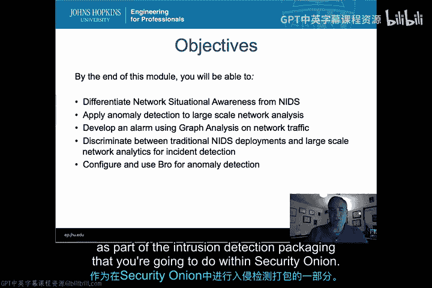

So the videos within this module that you're going to go through， there's of course this one。

 the introduction video that you're watching now， there'll be a video specifically on network situational awareness。

 another really addressing the anomaly detection on largescale network traffic。

 we're going to get into graph analytics and talk a little bit about how graph analytics is related to large scale network intrusion detection。

 and then finally we're going to have a video that gets into more details on security onion and an introduction to the Bro IDS。

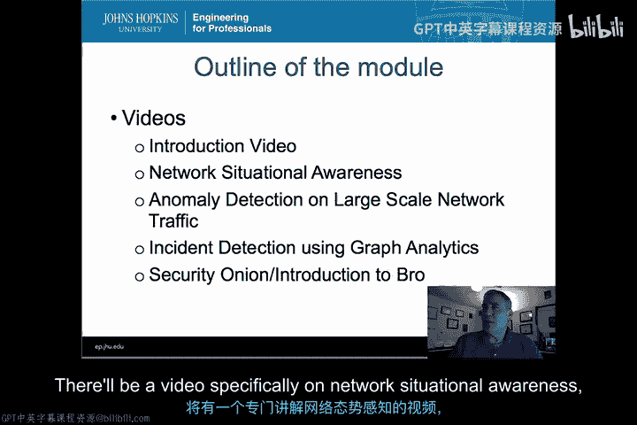

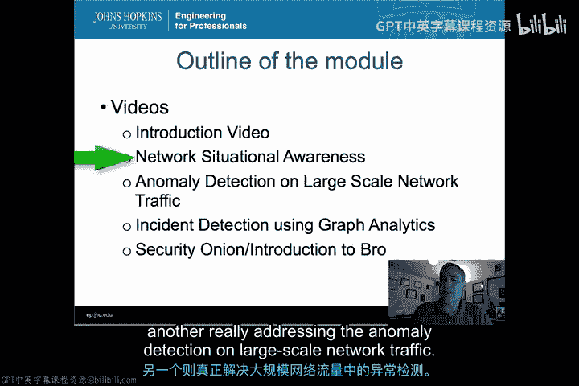

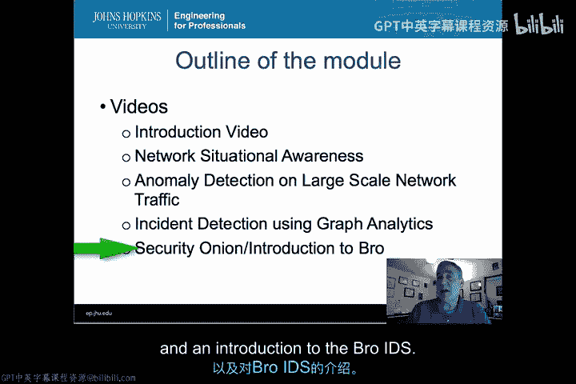

So in the network situational awareness video， we're going to answer these kinds of questions。

 we're going to answer what is NeS， what is network situational awareness。

 what are the tools and techniques that are used in NeS。

 how do we use those tools to help us investigate incidents once we either have an alert or have identified some kind of anomaly。

 and finally how is NeSA really related to network intrusion detection systems？

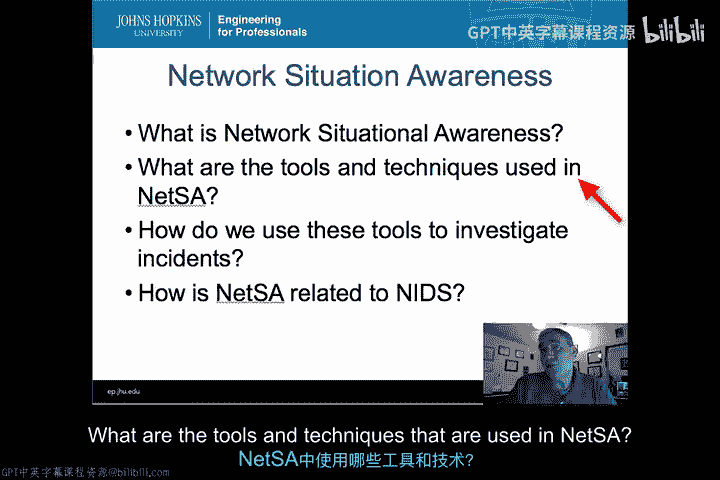

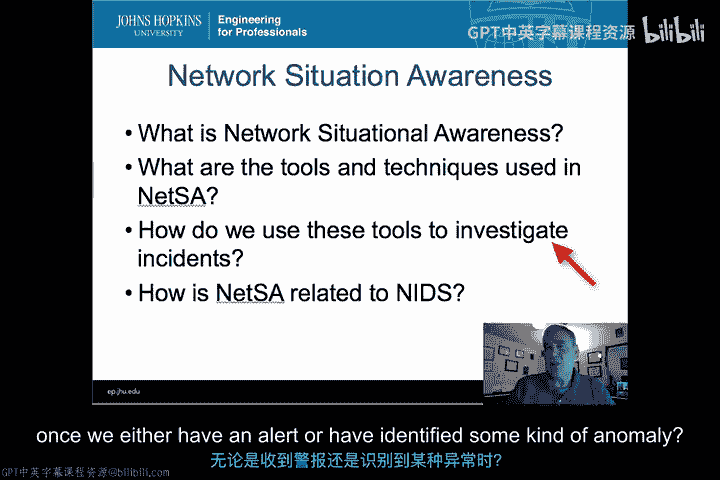

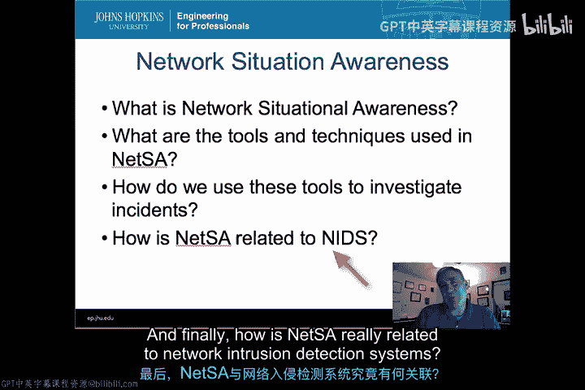

In the next video we're going to build upon that by looking at a novelway detection on largescale network traffic This is going to build on using netSA tools to help us understand how those features and functions can help us to identify anomalies so we're going to review what IP data flows are we've talked a little bit about netflow in the past and about some of the other summaries of network traffic but we're going to get more into detail with IP data flows we're going to talk about the different types and formats of flow data that you might run across how you would actually monitor a largescale virtual machine environment such as you would get in a commercial cloud environment that adds some complexities to the way that you would want to deploy and use aidIDs or a netSA kind of a product we're going to talk a little bit about how that's related to traffic streams so build from IP data flows to traffic streams and use volumets within those traffic streams to help us identify anomalies that's going to get us into behavioral analysis。

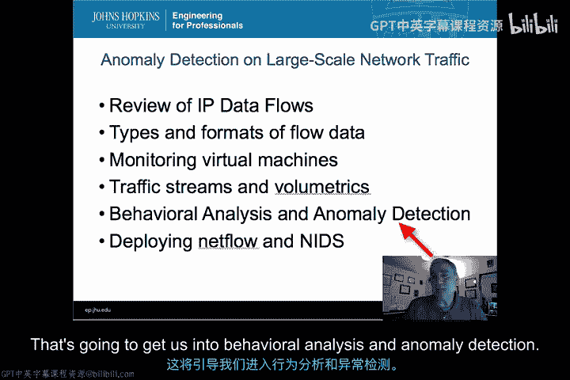

anomaly detection and finally we'll talk about deployments that use both netflow。

 metaa and knits together to do this large scale anomaly detection。In the next video。

 we're going to get into graph analytics。Now graph analytics is a growing and very important topic in the area of building classifiers in a way that we can identify different kinds of intrusions so we're going to start right at the beginning。

 talk about what is a graph， how are we going to construct that graph from netflow data。

 how to keep it relatively simple at the beginning so that we can pull some anomalies out of this data。

 we're going to talk about specific ways to analyze these graphs。

 using the connectivity within graphs to help us define normal behavior。

 and then finally getting a little bit pushing out into the research world。

 looking at locality and how locality can be used in graph analytics。

 to help us identify normal so that we can start to identify anomalies。

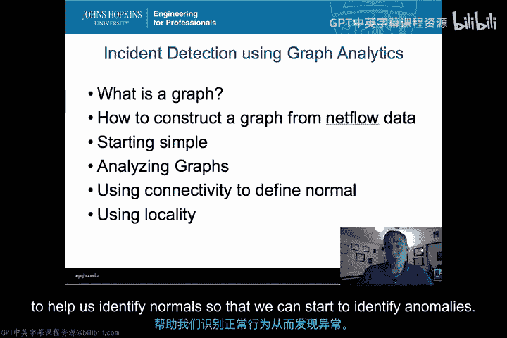

After we get through those and we've really run through the graph analytics there is going to be a video that's going to help introduce more features within security Onion and specifically get into beginning to configure bro so that you'd be able to use that as one of your network intrusion detection systems that you would want to evaluate as part of the exercises in the labs that you're going to get to as you move through the rest of this course。

 so we'll talk about the components of security Onion what analysis tools are available some of the deployment modes and then get into that introduction of bro that I talked about so this is a module that's going to get into much more detail with regard to realistic deployments of IDS use of NeSA in order to help identify anomalies within IDS and finally move us forward in the actual hands-on labs that are going to help us to use IDS in an evaluation context so enjoy the rest of this module and let's get started with the rest。

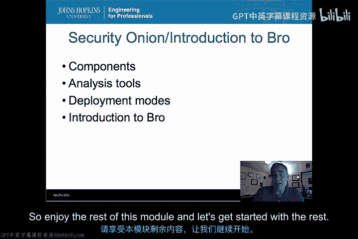