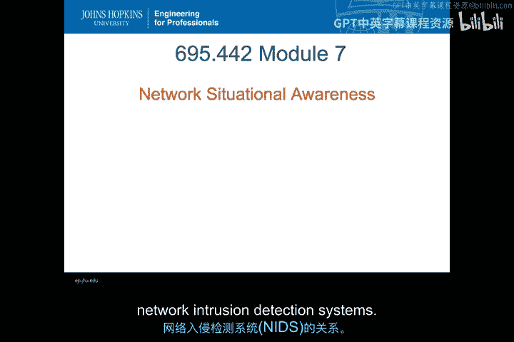
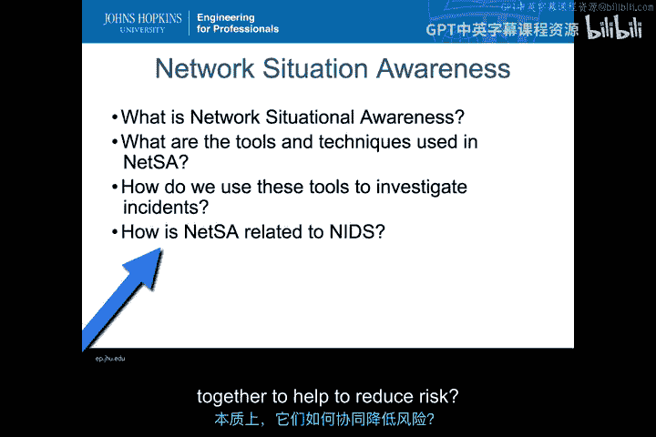
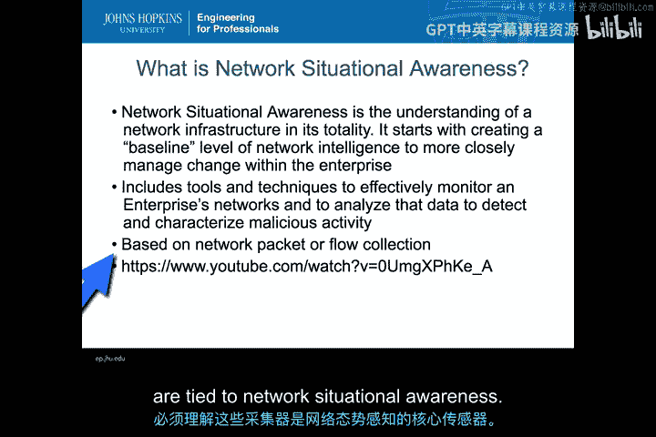
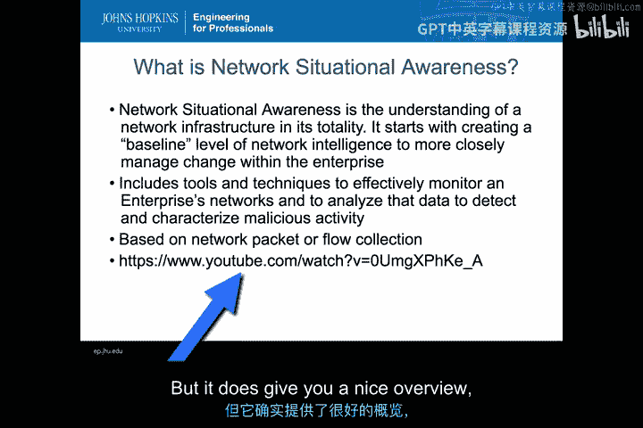
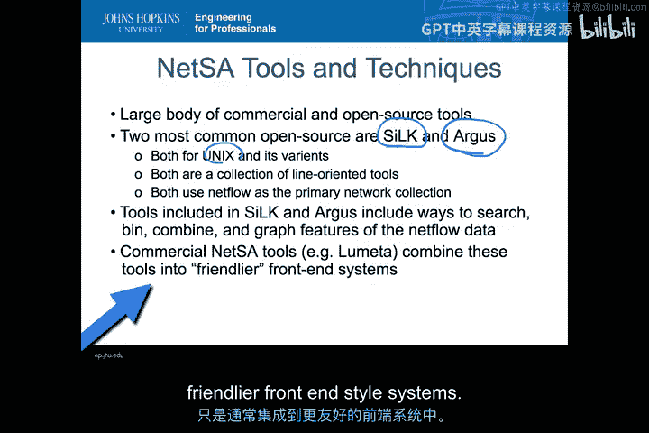
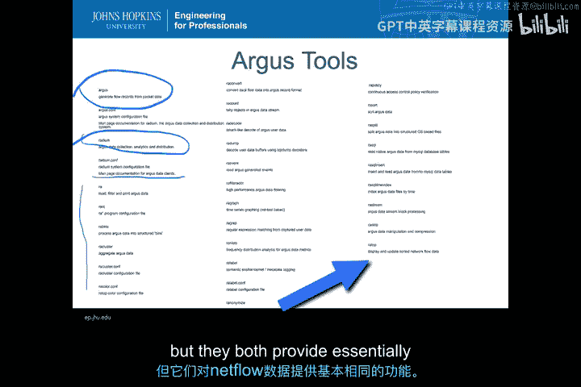
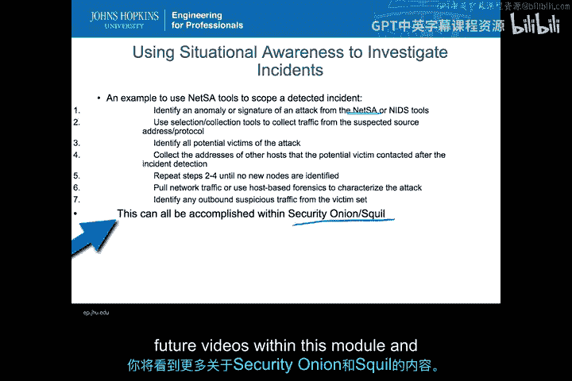
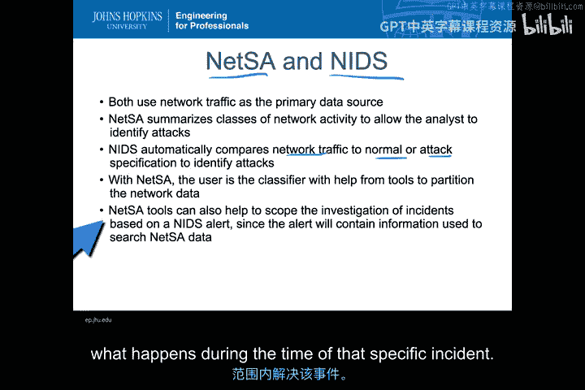

# 约翰霍普金斯大学《入侵检测｜Intrusion Detection》中英字幕 - P34：2_网络态势感知.zh_en - GPT中英字幕课程资源 - BV1sGu1z5E2J

In this video module， we're going to start to describe network situational awareness and its relationships with where we've been talking about network intrusion detection systems。

So here's a summary of what we're going to talk about in this particular video we're going to talk first of all about what is network situational awareness we'll get a good description of it。

 we'll talk about some of the tools and techniques used in network situational awareness where netS as we often abbreviate it how do we use these tools to investigate incidents and finally how is netS related to network intrusion detection systems basically how can they work together to help to reduce risk。

So what is net S A network situational awareness is the understanding of a network infrastructure in its totality。

 It starts with creating the baseline level of network intelligence to more closely manage change within the enterprise。

What this essentially means is that network situation awareness， unlike intrusion detection。

 it's not alerting me on potential malware。 It's giving me a total view of the things that are happening within my infrastructure to allow me as the user to be able to identify when there are problems or anomalies that I might take care of either because their security anomalies or basically anything else。

 They include a whole variety of tools and techniques that effectively monitor enterprises networks。

 They include analytics and analysis tools to allow us to detecting character activity。

 whether it's malicious or not malicious。 So even though it's not specifically an intrusion detection system itself。

 the tools and techniques allow me to manipulate all of the data that I'm collecting about my network situational awareness to help understand better exactly what's going on。

NetSA is almost always based on network packet or some kind of flow collection。

 This is really important to understanding that these are the sensors that essentially are tied to network situational awareness。

 Some modern tools that use netS as part of their input may also collect information from the host as well。

 but that is not typical today so。

So if you want a better overview on some of the elements that make up network situation awareness。

 I would encourage you to watch this YouTube video from Lameta。

 which is a nice overview of a five-step process that helps to collect and really understand where that particular data is coming from on the network and how it can be used to understand your IP addresses and your vulnerabilities that would give you that baseline view across what's happening on your network。

 you'll also see from this Lameta brief that a very common tool is just using network data。

 So this is another example where we're not getting the hostbased data in order to help us understand situational awareness。

 that's why it's a net essay tool but it does give you a nice overview at least from one perspective of what network situation awareness is。

So there's actually a very wide variety of both commercial and open source tools thatll help you deal with network situational awareness。

 We talked about a little bit about the Laettato in the previous slide just now。

 but let's talk about some of the open source ones that you can actually use for free so the two most common open source network situational awareness tools are this tool called silkk and another tool called Argus they're both designed for UniX and UniX variants that run on so these are not Windowsoriented tools but they are tools that run essentially on network Linux servers where most of the kind of network collection is going to happen these particular tools unlike the Lametato are really a collection of lineoriented commands so this is unlike some of the commercial tools these are not really highend fancy user interface kinds of tools that allow you to process the open source information。

Both of these use netflow as their primary network collection and manipulate netflow that come in so the tools that are included in Sil and Arrgs basically break down into ways to search to bin to combine and to graph all of the features that you're collecting with regard to the netflow data on the system so it allows you not only to get an overview with all the data。

 but allows you to select subsets of the data to drill in to specific activity that you might want to know a little bit more about。

 As I said before the commercial tools do the same thing。

 they just tend to combine them into friendli or frontend style systems。

The silk tool set， as I said before， is a very comprehensive set of analysis tools on netflow collection。

 It basically supports this whole idea of analysis pipeline processing silkflow records to automate common tasks。

 getting very close to sort of the realtime reporting of events。

 Now these aren't necessarily intrusions。 This is not like an intrusion detection system。

 but it is a way of getting close to a live real-time view of what you might want to be reporting and feeding these data into some sort of a system incident an event management system a semi or a S that would be out there。

 and the kinds of tools that are created in here as you have an example of some of them just sort of listed you've got libraries that look for importing and exporting in standard shareable forms so that you can take some of your net flow and。

Sharreed into lo repositories or bring in other kinds of net flow materials with to your system。

Other tools that are included are annotation systems so that I can basically mark up the kind of collection that I have。

 some graphical front end tools to help me work with the data and present it in a readable way。

 libraries that help me do a lot of these things within Python as opposed to just in command line scripts。

 I can look specifically and drill into DNS information using Orcas。

 there are Python libraries for generating two dimensional statistical visualizations there's the silk data。

 the silk tools themselves that are kind of the command line tools that are part of silk。

That contain all kinds of selection and filtering tools that you can use on those data。

 there is an alert reporting system that helps you do this more or less real time analysis pipeline that I talked about before。

There is an IPF mediator， so you can use yet another flow collector with the silk tools。

 and of course， YaF itself is a tool that collects netflow data in the IPF process of collecting in a standard form。

This is a bit of an eye chart， but you can see that Argus， just like silk。

 has many of the same kind of tools all built into yet another framework。 It's basically， again。

 the same kind of thing。 Argus includes the collection and analysis tools as part of Arrggus。

 So they don't separate it out in the same way that silk。

 separates gaff from some of the basic silk tools， so I can generate the flow tools using Arrggus directly。

 that I can do my analysis and distribution using radium from some sort of a configuration that I create on it。

 but then I still have all of my reading and filtering and processing that I would normally use on the netflow style data that Arrggus is collecting。

 I can do counts。 I can do conversions。 I can dump various pieces， I can graph them。

 I can use regular expressions across them， create frequency distributions。

 I can do a number of sorting。splitting using MySQL as a way to put things into more database format。

 I can stream block processing with this， I can manipulate and compress the data itself。

 I can display and update the sort of netflow data so Argus and silkk both two completely different tool sets。

 different approaches in the way that you would have to learn to use the tools。

 but they both provide essentially the same kind of functionality across the netflow data。

One of the most important uses of these situational awareness tools is to help investigate incidents once an IS is actually thrown an alert。

 and you're worried about this。 So let's walk through a simple process of how I might use netS tools once I've actually detected an incident from a Nds。

 Well， the first thing， of course， is I've identified some sort of anomaly or signature based attack。

 from the NIDs tools。 I might have actually got this directly using net essay if I was looking at the netS graphs of my activity and I noticed an anomaly。

 That means that as a user， I'm playing the role as the classifier in terms of determining the attack。

 But I do determine an attack for however I do it。 and then I'm going to go。

 and I'm going to take all of my netflow data that's been collecting。

 and I'm going to use my selection tools to say whatever was part of the attack。

 I'm going to try to just pull that traffic。From the suspected source address and protocol。

 So I get a better sense of all of the flows that are related to the attack signature that I have。

 Now， within the flows， I'm going to find out all of the other nodes that that particular system was talking to so that can identify potential victims of the attack that made even beyond the initial anomaly and signature that I had first done。

 So I'm going to collect the addresses of these other hosts that the potential victim contacted using。

 again， my flow tools that tell me who was talking to whom within my enterprise。

 So I'm going to just keep repeating these steps every time I get a new node that was talking as part of this incident。

 I'll add them to my set of hosts and flows that could be associated with this intrusion。

I'm going to use those flows to go after any other more detailed packet or Pcap collection than I might have within the network or go to use host space forensics directly within the hosts that were affected to really characterize the attack finally。

I can use these netflow tools to look for any outbound suspicious traffic from any of the victim set。

 I can say were these victim machines talking to anything outside my infrastructure in a way that I would worry there's a command and control situation where these systems are being controlled from the outside or potentially information is leaking from within my site。

 Now， the good news is that all of these steps can also be accomplished inside of security onion。

 the system that you're going to be using within this module using S as a nice reasonably good graphic oriented way of doing these kinds of steps to identify from an anomaly or from an alert all of the things I need to do with regard to the collection of netflow data in order to resolve or investigate some kind of potential incident that I would have had。

 you're going to see a lot more about security onion and squ within future videos within this module and within the handson lab。

You're actually going to be working on。So finally， let's talk about the relationship between netS and NIDs。

 the network intrusion detection system。 We've talked a little bit about the use of NIDs use of netS in resolving a NDs alert。

 So let's talk a little bit about their relationship and why you would want to use both of them。

 Well， first of all， both NIDs and netS use network traffic as their primary data source。

 So they're both using the same source of data in order to either generate the alert or generate the views of what's happening。

 NeS in particular summarizes network activity It gives you context around all of the various things that might be an anomaly or might be part of a NIDs alert。

 So。Where in the Nds， I'm going to have to go out and just find the one specific element that's going to come from my nids on what's happening。

 Ne us A can help me build up context and help me build up an understanding of what was happening before after and during the things on my system that were being attacked。

 According to the nids alert that I got。 So the Nds。

Automatically compare this network traffic to normal or attack specification。

 whether you're an anomaly detection system or a signature based system in order to identify the attacks。

 That's not the job of the net essay。 That's the job of the Nds。 But as a result。

 the Nds is going to give you an alert， but it's not going to give you everything about the investigation that you might want to have about the alert。

 If you're lucky， the Nds will give you host names。

 and they'll give you something about the packet capture that was related to that Nds alert。

 but it's not going to give you all of the downstream nodes。

 It's not going to give you your full sense of what you can get。

 as you want to investigate the incident using net essay。 So with netS， the user is the classifier。

 So a Nds does this comparison。 So Nds builds in a classifier to sort of compare this network traffic to normal or attack traffic。

 But with netS， the user is expected to do that comparison based on tools that help visualize and。

Addres the data in a very understandable way。 So the most important part of this relationship is that Neta A tools help to scope the investigation of an incident。

 I can look at everything all the conversations of the way systems were talking to other systems。

 And if I have portions of my network or portions of my infrastructure that were not touched by these attacks。

 I can scope them out of my investigation and save an enormous amount of time in terms of understanding which systems I actually have to go into and patch or fix or observe the traffic or even understand what information was taken from those systems。

 So Neta A。While it's not really in scope for the main focus of this course。

 the use of Netase and NIDs together is an important step for using the NIDs in a way that will help you resolve the incident in the scope of control that's reflected by what happens during the time of that specific incident。

