# 约翰霍普金斯大学《入侵检测｜Intrusion Detection》中英字幕 - P35：3_大规模网络流量异常检测.zh_en - GPT中英字幕课程资源 - BV1sGu1z5E2J

Okay， so building on the last video， let's talk about how we could actually use the netSA kind of tools that we learned about before to begin to get to anomaly detection for large scale network traffic。

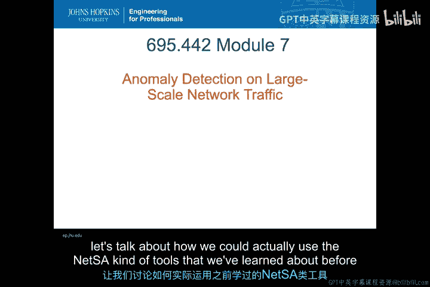

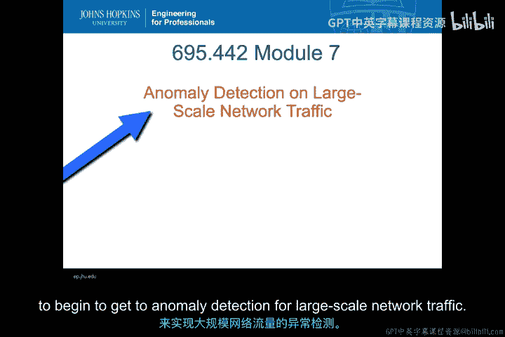

So within this video we're going to be reviewing IP data flows because that's the core of all of the network traffic anomalies that we're going to be talking about here we'll talk a little bit about the types and formats of the flow data monitoring virtual machines。

 which is an especially important area with regard to cloud computing in regard to use in large enterprise systems of the way we're currently doing load balancing against servers。

We'll talk about traffic streams and volumetrics。Build that into behavioral analysis and finally start talking about anomaly detection and deploying these net flow and Nds in order to accomplish aomaly detection for these large scale network traffic systems。

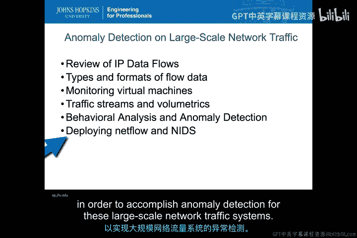

So let's start by talking about Internet protocol data flows， I data flows。

 These are the heart of any of these sort of net essay or Nds or any of these collection systems。

 the important thing to realize is that I data flows are unidirectional。

 They're a unidirectional group of packets that share some common characteristics。

 typically the source， the destination addresses the source and destination ports and the type of service。

 along with maybe a couple of other elements。 But those four。

 the source destination I source destination port and type of service with five elements。

Are the unique characterize uniquely characterize a particular IP data flow that's in there。

 So that's how you really use the packets and group them into these flows that can start talking about all the things happening from a source to a destination。

 Now， obviously， there's going to be a lot of packets interleaving these IP data flows in the collection off the wire。

 So what we're doing is that we're binning all of the packets that we're collecting into these IP data flows based on those four common characteristics。

In addition， we usually think of a data flow as starting and stopping。 So if it's a TCP session。

 we would start with a Sinac packets and finish with a Finac or a timeout or a reset that you would sort of happen within that area。

 So these are all basically grabbing the header information out of the packets in order to do the characteristicizing the IP data flows。

 but the data flow itself also includes the payload of each and every one of the packets。

 It's not a net flow packet or netflow record。 These data flows are characteristic of all of the packets and all of the bits in all of the packets that are actually flowing across the wire that you're doing。

 So that's the important difference between like a data flow and a net flow。

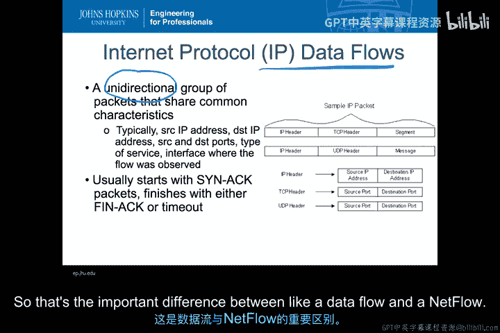

So flows start and stop by the initiation and the close out protocols that actually happen during the event。

 so in the standard TCP world， when host A is going to talk to host B。

 the first thing that happens is host A is going to send the S packet to host B。

When the S packet is received at Ho B， a S Act packet will go back and acknowledge packet will be sent in that way。

 And then now you've got TCP connection establishment and regular data packets can begin to flow。

 So this protocol is recognized as the start of 8 I data flow。 Now， to complete an I data flow。

Normally， if hostt A is trying to complete it and finish it off， it's going to send a fin。

 which gets an a。 a fin will also be sent from host B or could be sent from host B in order to close the connection in a normal way。

But， of course， sometimes things don't happen normally in many kinds of attacks。 for example。

 if host A is attacking host B， it might just send a sin message。

And spoof the place it's sending it from。 So the S Act actually goes to a completely different place。

 And since no a is ever received back。 So this part of the protocol doesn't happen。

 What happens is host B will sit around and wait for this receive act that host B is supposed to get。

 And when it never receives the Sac eventually it will time out。

 But if hostt A is doing this over and over and over again to host B。

 the resources in host B to save all of these sin packets。 All of these half open connections。

 as you will， could eventually exhaust the resources on host B and cause it to crash or cause the network traffic to fail。

 There are a number of ways that host B could get around this。

 But that's traditionally the sin flood attack。The same kind of thing can happen sort of at the end of the flow。

 If host A is sending data and it never sends a fin packet。

 then host B is just going to keep waiting for that session to continue。

 and it could wait for a long time before it finally times out and terminates the connection internally。

 So if you don't receive these， you can actually get it terminated by timing out or in other sort of ways。

 And， of course， B can initiate the fin message as well。

 So even though a has been sending the communication。

 B could cancel a connection by sending a fin message。 In fact， you could get a host C。

 which spoofs host B。 and sends that f message。Essentially。

 resetting the connection between host A and host B。

 So these are f attacks from a third party that are essentially resetting or disrupting connections that are that are moving past。

 Now， C has to figure out a number of internal parts of the data packet in order to send a f message that actually works。

 So C is probably going to have to be in the middle of this in order to see the things that are happening to send a legitimate f message。

 but that still is a perfectly legitimate attack that takes advantage of the way these flows are supposed to work。

So if I'm now trying to do my start and end of flows。

 I'm going to have to keep in mind all of the different ways that a flow can start。

 So a half open connections or problems in the closed connections so that my start and end of flows essentially reflects what the real host A and host B might see in terms of a data flow packet。

 So that's where these collectors have to understand enough about the protocol to know all the different ways that things might time out be out of sequence。

Come in different kinds of orderss， be reset by attacks。

 And these are all things that the flow processing has to take into account in order to legitimately understand the flows between Ho A and host B。

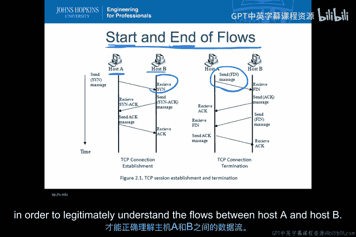

Now it's important to realize that when we're talking about IP data flows in the previous diagram。

 I was talking about two separate flows for each one of host A and host B。

 the flows from A to B and the flows from B to a those are two separate IP flows Session on the other hand are the bidirectional set of flows So when we talk about the protocol charts and moving back and forth。

 we're talking about TCP or IP sessions that are there。

 most sessions can that take at least two flows， one in one direction and one back in the other direction。

 So as we're collecting flow data IP flow data understand that that flow data represents half of the conversation。

 It's like talking on the telephone and only being able to hear the person talking and not being able to hear what the host is hearing that's one data flow So each the source to destination。

 each direction is going to be one of these。Where the sessions have the source dust port swapped。

So the sessions are related， but they are not the same session。

 There are actually two separate IP data flows。And of course， remember。

 as part of the normal way that TCP works， flows and sessions can overlap in time。

 packets can arrive out of order。 they can be duplicated or missing within a flow。 there are lots of。

Problems that can happen that TCP and the protocol within the host will fix with regard to how the networking works。

 But if I'm collecting passively， I can't actively communicate in the collection of the I data flow。

 So if I drop a packet or if I miss something important with regard to this session。

 that I'm going to have an anomaly in my data flow that might never be seen at host A And B that are participating actively in the two connections。

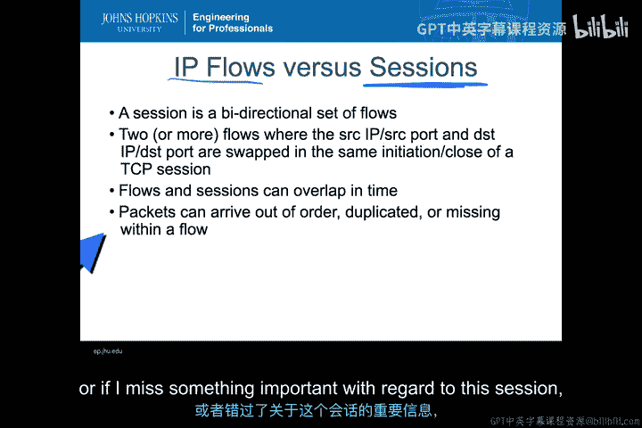

So as I've said before， IP data flow is not the same as Neflow。

 so IP data flow is a undirectional collection of packets between a source and destination。

 source port destination port at a specific time， NeF is a summary of IP data flow。

Usually it the summary has the initiation and the termination conditions built into the idea that there's a start and an end to a particular flow that happens。

 So， again， these are unidirectional。Connection， so a net flow record is still unidirectional。

 It's from a source to a destination， not the other way around。

 So if I look at my example sort of down here， I've got net flow connections that usually have a date and a time and a duration。

 So a start time and a duration time， a protocol， what protocol was actually run。The source。

 and the destination。Borts， how many packets， how many bys and how many flows。

Based on the termination condition ran from that host source destination source port destination port。

 You could have multiple flows that are happening within the same。

The same for Tbble that essentially does it。 Now you'll notice that I have two separate flow records。

 These two happen to who have swapped the source port in the destination port and the source and destination I addresses。

 which means these are the two halves of a session， So often with net flow data。

 I'm going to want to see the source destination swapped and put those two net flows together in order to understand the bidirectional conversation between the two hosts。

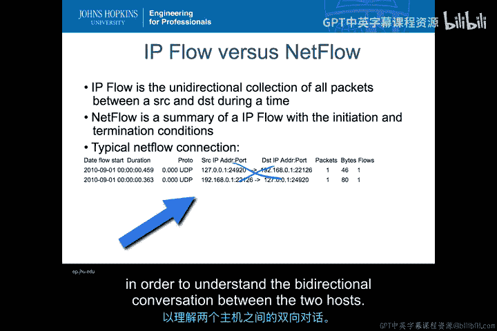

There are many different types and formats of IP data flow。 The most common type of flow， of course。

 is what I've been talking about。 It's netflow。 Neflow was invented by Cisco。

 It's still the most standard summary of I data flow that exists。

 So that's why many people when they talk about IP data flow they will use that term synonymous with netflow data。

 but understand IP dataflow includes the packet data netflow does not。

 It's a summary that takes into account the initiation and termination conditions of the I data flow。

 but there are lots of other examples。 Extreme networks has clear flow and Sflow foundry networks。

 Huawei Techologies， juniper blueco。 Each one of these has slightly different formats collect mostly the same kind of information as netflow。

 but might format it differently collects something that's a little differently in terms of the flags give you some different characteristics with。

to what's happening with regard to the packet data flow and the tools that run with these various flow types are unique to the IP data flow type。

so these tools are usually specific for blue coat or juniper or huawei or foundry and not。

The same across all of the tools。 So when you talk about network situational awareness tools or net tools。

 they will be specific to a particular kind of Ip dataflow collection。

 whether it's netflow or packetteer or any one of these other types。 Now。

 it should be noted that in addition to these summary formats。 There's， of course。

 regular old Pcap data which is basically a raw collection of all of the packets。

 And you can create Pcap subsets that use filters that would give you essentially all of the packets that are represented within a particular flow。

 This can be very useful when I get some kind of an alert。

 And I get a net flow indicator of that alert， But I can now filter my Pcap data to only pull those packets that are specifically related to the alert that I got the source destination addresses and ports over a time period。

Then I can now want to look at the packets to say what was the actual attack that was flowing inside of the IP data flow。

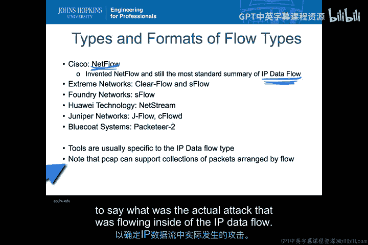

So why don't we talk more about duplex flows。 Why dont we always focus on just that one half of the connection。

 Why doesn't all our tools just automatically use both sides of the connection and characterize it that way。

 Well， although you need the duplex flow to understand the full context。

 it can be very expensive to produce， there's a lot of correlation that has to happen with regard to things that are going from a to B and other things going from B to A correlated in time correlated by port and IP address correlated over the different ways that the packets might travel and the different sensors that they actually might come across。

 So normally， we don't collect duplex flows in a particular record。

 we can always put them together later。 but we don't usually collect them that way because of the expense and the difficulty it is to do this correlation in close to real time。

 There's also a problem with this with regard to duping packets and sessions correlating the variety of flows and。

The packet payload to know that the various reverse flows are correct in creating the duplex flow。

So that's a lot of work that you need to do once you want to get into a particular kind of attack or incident or something you're trying to understand。

 but it's not the sort of thing that you're going to collect in general。And in fact。

 unidirectional flows tend to be all you really need for nids。 For the most part。

 Think about the attacks that I've already begun to describe， like the sin attack。

If I have a flow where I'm essentially looking for the sins and I see no other data coming from Naticker host to the destination。

 it's not difficult to conclude that I might have a sin attack coming from that particular host。

 especially if I have a lot of different net flow records with one sin packet coming from a variety of different source addresses。

 I might think those source addresses are spoofed or they're coming from some kind of a botnet where all of the different elements are just trying to have half open connections in order to take down the resources of a particular target that it's going up into。

So that's basically unitdirectional flows are all you need for that kind of a thing。

 The follow up analysis is where you really want to have the duplex flows because you want to understand both sides of the traffic and during an attack。

 it's important to know how the victim responded to the packets that come in。

 not just that you had a undirectional flow。

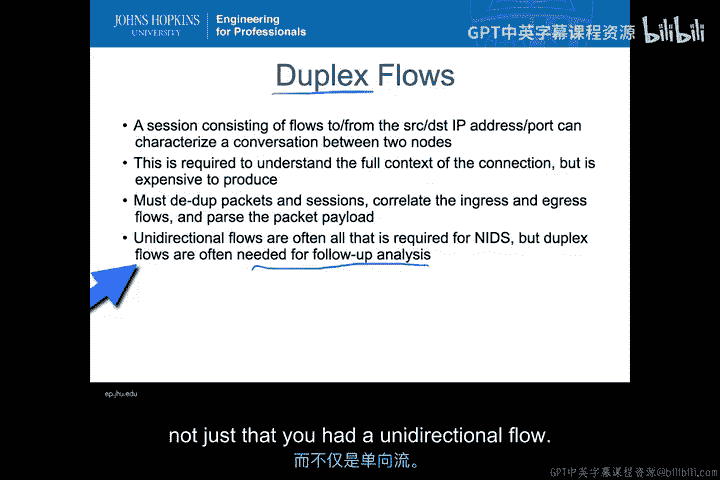

Now， one very important and recent development with regard to NeSA has been。

 how are we going to use flow monitoring IP data monitoring to monitor a virtual machine environment。

 So remember in a virtual machine environment， you may have a single interface that's connected to multiple virtual machines。

 So the packets that I'm collecting across the internet。

 the fourupple that I use to distinguish all of my data flows look like they're all coming from the same source address。

 but they may， in fact， be coming from many different virtual machines inside the interface。

 This happens because often the virtual machines will not through the host。

The network address translation or natting will essentially allow each of the virtual machines to have a unique I address。

 But the host that's hosting all of those virtual machines would then provide a common address across all of those machines that it would translate to when it goes outside or coming back in from the interface。

So if I'm monitoring at the physical interface of the system。

 I may not be able to tell which packets are actually coming from which VM they all look like they're coming from the same host。

 Think of large cloud environments where I could have dozens or more。

VM's running on a single hardware platform， some of which are belonging to different organizations or different Vms run by a variety of organizations that maybe have completely different characteristics with regard to how those machines are running。

 I'm going to want to be able to separate those I P flows in a way that I can make sense about who's talking to whom。

So I might want to export flows from the internal switch in order to differentiate within these thick flows。

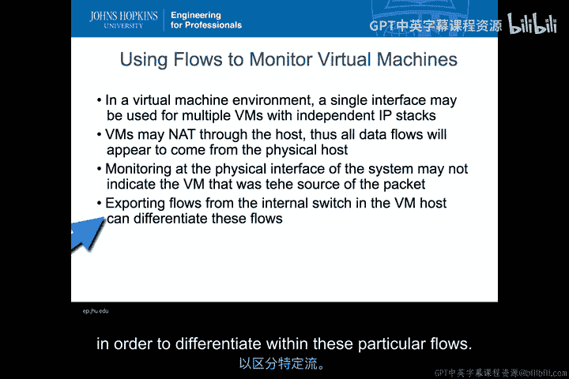

So let's sketch out a little bit on how this might actually work。

 so I might have a series of VMs that are all running on top of a very of a common platform。

 So this is my hypervisor。And these are all my v ms。And one might be Windows。 One might be Linux。

 I could have a whole variety of different things at the D are running。

 Each of these has a unique I P address。So each one of these is unique to each other on the IP address。

 but as they pass through the hypervisor。All of these get translated to the hypervisor， I P address。

So that's all I see coming out of these particular hosts。 Now， what can I do。

 the switch that's actually doing this within the hypervisor。

 my I could actually do my data flow collection。Directly out of the switch。

 If I do it out of the switch here in the data flow collection。

 then I'm going to get all of the individual Ip addresses that are coming from the individual hosts as opposed to doing it out here where I only get the single I P address。

 So if I can collect from here that I'm going to get more information。

 But that means each one of my hypervisors is going to have to have its own data flow collector。

 And that's going to have to get sent some place outside of all the different hosts。 And， of course。

 I could have many of these hosts。 So each one of them would have to have its own collector。

 which would all go to some kind of a central repository。

That I might use for my I S or for my situational awareness tool。

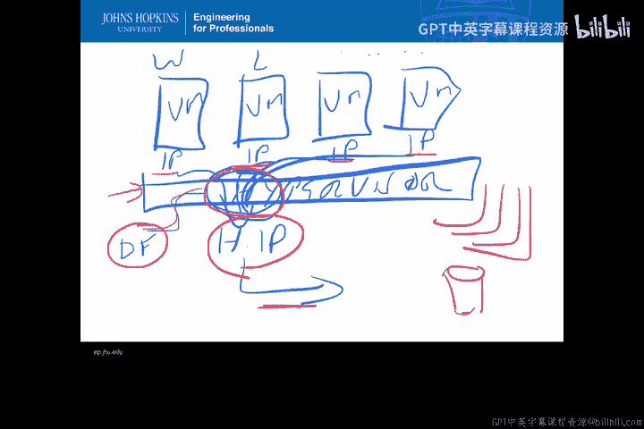

So as you can see from that previous example， basically。

 I'm going to have a pretty large set of traffic streams that can come out of this。 A lot of packets。

 a lot of different areas where I'm going to have packets coming at a variety of different areas within the bandwidth。

 That means that I can actually do some volumet analysis on my traffic streams in order to understand something about anomalies that might be happening outside of the individual data that I might get within a single I data flow。

 So I can use。These flows with times stamps in order to get rates so I can do packet rates。

 both on a per I basis and per link basis in order to。Understand at any given time of day。

 day of the week， week of the month。 What is it that my normal packet rate would be。

 and that I can sort of understand what things that wouldn't be my normal packet rate would be。

 It is sort of moving in that way。 So these packet rates can be aggregated by network or they can be drilled down so that I can either look at specific source and destination addresses and look at the flows related to those。

 I can look just at a source address like my web server and say。

 what does a flow look like to my web server， What does a flow look like to my clients。

 What do external flows look like from my external router。

 or I can say within the entire bandwidth of my internal land。

 What does the bandwidth look like by aggregating all of this together。 So from this。

 I can do a lot of volumetric kind of analysis， statistical analysis on the packet rates that are coming in。

 So sampling these rates。 at the routers and switches。

Is a very compact method of observing normal behavior。

 where normal behavior then is really just being defined as how as what is a normal packet rate for that particular time of day in that particular day of the week for that particular time of the year。

 So the normal behavior is probably going to change between daytime。

 nighttime between the weekends and the weekdays between shopping seasons and non- shoppingping seasons。

 So knowing what the volumes look like in those particular areas and graphing them using network situation awareness tools is the first easy way to begin to see anomalies happening within my system。

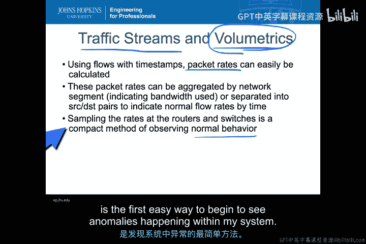

So if I'm doing this and I'm observing just in terms of bandwidth， just in terms of volumetrics。

 with these rates calculated between the host and calculated by time。

 I can see anomalies related directly to the rates。 So obviously。

 the larger the collection that I'm doing， the larger the anomaly has to be to be visible。

 So let's look at this example I have down here in this chart。 I've got essentially a normal set。

Of traffic pattern。 And then suddenly， at one particular time， I go high and approximately flat。

 It doesn't take very， very much analysis to look at that and say， oh。

 that's clearly something happened during that time。 It could have been an attack。

 It could have been some other configuration change。

 It could have been even potentially everybody getting interested in the site at one time。 but the。

The idea that this came up all of a sudden， within a particular minute means it probably didn't come up slowly like you would expect to come up during a flash crowd。

So that's why using volumetrics and using these kind of anomalies。

 DDoOS attacks in particular can be pretty easily observed using even very simple volumetric techniques from network situational awareness tools。

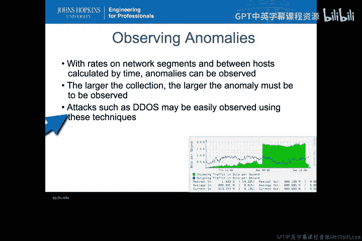

Now， we talked about the relationship between network situational awareness and Nds。

 The idea here is that if I can recognize， if I can observe some kind of an attack using netS。

 I should be able to alert on that condition。 Once I can characterize it。

 I can characterize what the change is。 and I can say， I can turn that into a Nds alert。

 so I can move from situational awareness where a person has to decide if I'm under attack to a Nds tool where the tool itself can determine whether it is that I'm under attack。

 And for things like Ddos， this is quite easy。 I just set a threshold for a normal bandwidth during a time of day or connection type。

 And anything that exceeds that threshold generates an alert。 Now。

 that doesn't always mean that I'm going to be under attack。

 There could be a number of reasons why I get extra activity that I didn't expect in any given day。

 But it is something that I would probably want to investigate。 So it's a reasonable kind。

OfTre and alert or anomaly that I would want to have as part of my needss for the alert。 And。

 of course， snort sircottta bro can all do this type of anomaly detection。

 So even though we think mostly of snort as a signature detection tool。

 it can do these threshold based anomaly detections on things like Ddos。

 once you've identified what a bandwidth threshold might be for the kind of collection that you have。

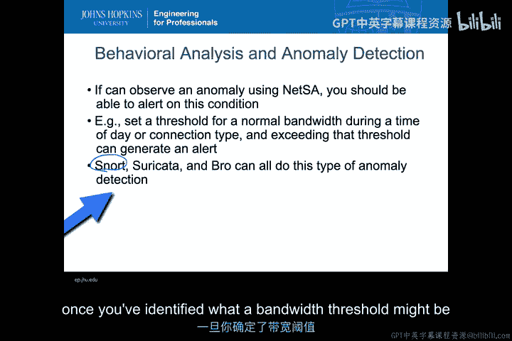

Now， the nice thing about NeS is it can actually help you determine the baseline because using netS tools。

 I'm going to get graphs that essentially show the variation of my normal behavior over time。

 So I can take those observations and use them to help draw the threshold for my needss that are there。

 So it is a little challenging to set thresholds because they do change and you're going to get false positives generated on any high used day。

 But basically， if you imagine that you sort of have your plot and your regular daily use of the bandwidth kind of goes like this。

 and maybe over time， it starts to get larger， I can still sort of say theres an evening threshold as a daytime threshold。

 So I can set a couple of different threshold areas。 change them based on the time of day。

 And if I get more and more alerts， I begin to increase those thresholds to deal with the fact that I might actually have things that are changing on my network that。

😊，have to take， into account。Now these thresholds can be very useful for a whole number of things that are beyond even just a single enterprise using very simple threshold analytics based on traffic。

 you can get graphs that look like how worms are propagc across the world。

 So this particular URL is an example of that。 so let's take a look。

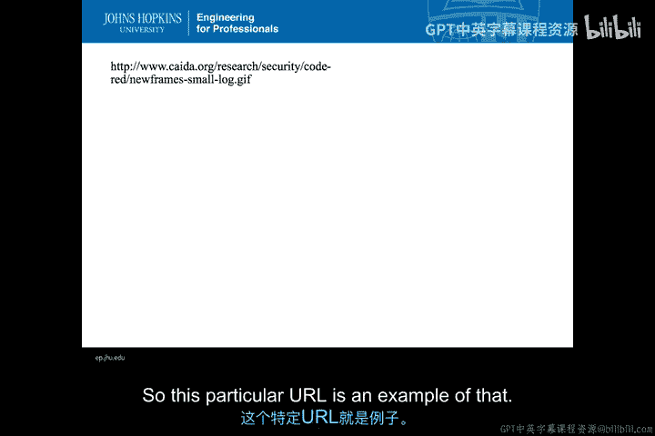

So as you can see， the code red wormm is spreading and all of this is volumetric information just on the worms communicating unidirectally from source to destination to give us a really good idea of exactly how fast something like the code red wormor is spreading。

And of course， the more infections I have， the more flows and IP data flows come up， and of course。

 the faster it spreads sort of around the world。

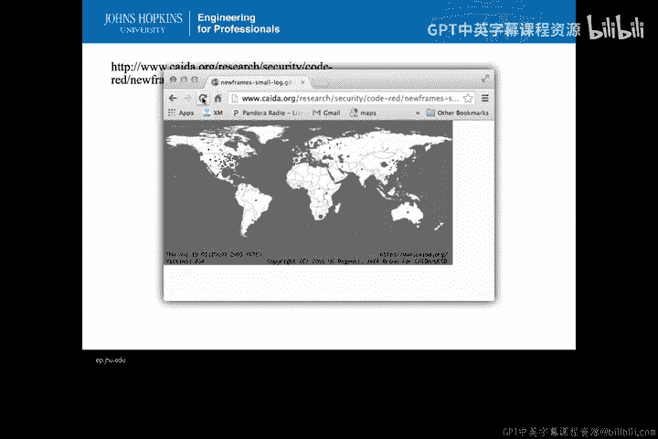

So finally， how would I want to deploy basically some kind of aIDs and some kind of a netflow within my organization in order to allow me to do some of these really interesting investigations that would follow on from an IS alert so here's one example that I sort of have sketched out very simply here this is where my external network could of course be the internet or any place else this is my edge router。

 so this is my edge router that is connecting my enterprise to that external network so traffic is coming down through my edge router and into my enterprise。

 usually it flowing through some kind of a firewall switch。

 an ASA something that's happening here I can connect my IS my passive tap directly at this point to see everything that's making it through that particular sort of element from the outside world to detect all of my inbound flows that might be that might have an incident。

Or my outbound flows that might be expfilling information。

 but the flow data is probably I'm going to wanted that more on my internal switch so that my netflow collection can also get things that are happening between the DMZ and my client in back。

Because as I expand from an alert that comes from my Is。

 and I want to begin to investigate that with netflow collection data。

 it's probably going to indicate things that are going to be flowing internally within my network as well。

 So whereas the Is perhaps only has to look at the outside world and things that are coming to and from the outside world。

 considering that I'm ignoring insider threat at this particular point in time。

 The network flow data is going to want to come from all of the major choke points inside so that I can begin to get a better sense of what the network situational awareness is inside of my enterprise。

 if my netflow data were only being collected here We only being collected out here in the same place my Is was。

 then I wouldn't actually get a good sense of a lot of the systems inside that never communicated to the external network。

 So clients that only communicated to things of my DZ or even things that were nated。

 if my clients turn out to be nated through some internal setup。

Boxes that I'm not even going to get unique IP addresses at this point to understand what's happening with my netflow data。

 So when you think about putting both an Is and a netflow collector inside of your infrastructure。

 you don't have to and shouldn't put them necessarily in exactly the same place。

 You can put them in different places so that when you're doing investigations based on an alert。

 I can have more complete information about what's happening with regard to the situational awareness picture I get throughout my enterprise。

So that's going to about wrap it up for this particular video。

 we'll move on into what some of the other analytics and graph analytics we can do with information like this。

 but at this point you should be able to see how IDS and Neflow data can work together to actually help to not only identify issues and see issues where the human being as the classifier but use IDS alerts to help with NeSA to be able to understand the scope of those alerts and understand how to use the information from NeSA to help us evaluate and respond to the IDS alerts that we might be getting。

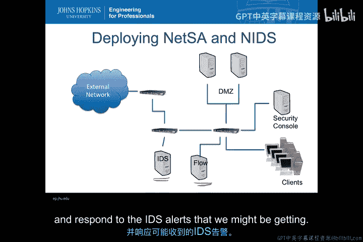